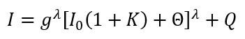
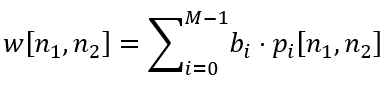
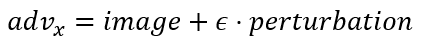
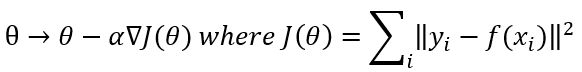
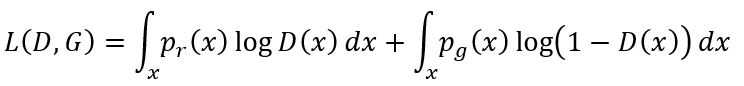
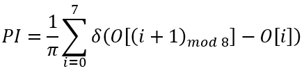
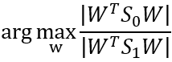
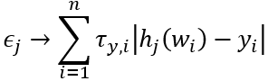
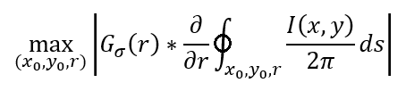

# Quiz di Digital Forensics and Biometrics

**121 domande in 16 argomenti.** Testi e opzioni in inglese. Gli ID seguono la posizione nel JSON originale. Versioni simili e duplicati sono inclusi.

Le risposte del quiz sono in fondo a ogni sezione. Per 20 domande la fonte indica «non verificata».

[Quiz di Polterino](https://github.com/Polterino/polterino.github.io/blob/462ef076ab80ec59d1b3b9c871ea22695ab24ac6/questions/questions_digital.json) · [Licenza Apache 2.0](Pics/Quiz-Polterino/LICENSE).

## Indice

- [[#Acquisition, evidence integrity and forensic reporting|Acquisition, evidence integrity and forensic reporting]] (8)
- [[#Disk and mobile forensics|Disk and mobile forensics]] (4)
- [[#Network forensics and intrusion detection|Network forensics and intrusion detection]] (5)
- [[#Multimedia acquisition, device attribution and JPEG|Multimedia acquisition, device attribution and JPEG]] (8)
- [[#Multimedia enhancement and audio forensics|Multimedia enhancement and audio forensics]] (4)
- [[#Image tampering, deepfakes and anti-forensics|Image tampering, deepfakes and anti-forensics]] (4)
- [[#Watermarking and active versus passive methods|Watermarking and active versus passive methods]] (5)
- [[#Anomaly detection|Anomaly detection]] (12)
- [[#Adversarial machine learning|Adversarial machine learning]] (10)
- [[#GANs and model training|GANs and model training]] (9)
- [[#Biometric modalities and standards|Biometric modalities and standards]] (6)
- [[#Fingerprint recognition|Fingerprint recognition]] (13)
- [[#Face detection and recognition|Face detection and recognition]] (17)
- [[#Fairness in biometrics|Fairness in biometrics]] (3)
- [[#Iris and other eye biometrics|Iris and other eye biometrics]] (7)
- [[#Gait recognition|Gait recognition]] (6)

## Acquisition, evidence integrity and forensic reporting

**Q006.** Considering a hash function that generates the digest <u>d</u> from a string <u>s</u>, <u>s -> d(s)</u>, select the <u>correct</u> statement referred to the resilience to second pre-image property.

- A. Given a d(s1)=d1, finding s2 such that d(s2)=d1 must be computationally-unfeasible.
- B. Searching for a couple of strings s1 and s2 such that d(s2)=d(s1) is computationally-unfeasible.
- C. Given a digest d, creating s such that d(s)=d must be computationally-unfeasible.
- D. The length of s must be a multiple of a predefined minimum length.

**Q019.** Concerning the figure of Digital Evidence First Responder in ISO IEC 27037/2012, select the <u>wrong</u> statement among the following ones:

- A. He/She checks and seizures the area containing digital devices.
- B. He/She presents the results of the analysis in court.
- C. He/She avoids changing the state of device.
- D. He/She profiles all the persons authorized to access the area.

**Q035.** Concerning a forensic technical report to be presented in court, which of the following elements should <u>not be included</u> in the initial summary?

- A. The CV of the analyst.
- B. The conclusions in brief.
- C. The summary of the activities.
- D. The objectives of the report.

**Q043.** Considering a hash function that generates the digest <u>d</u> from a string <u>s</u>, <u>s -> d(s)</u>, select the <u>correct</u> statement referred to the resilience to collision property.

- A. Searching for a couple of strings s1 and s2 such that d(s2)=d(s1) is computationally-unfeasible.
- B. Given a d(s1)=d1, finding s2 s.t. d(s2)=d1 must be computationally-unfeasible.
- C. The length of s must be a multiple of a predefined minimum length.
- D. Given a digest d, creating s s.t. d(s)=d must be computationally-unfeasible.

**Q044.** Considering a hash function that generates the digest <u>d</u> from a string <u>s</u>, <u>s -> d(s)</u>, select the <u>correct</u> statement referred to the resilience to pre-image property.

- A. Searching for a couple of strings s1 and s2 such that d(s2)=d(s1) is computationally-unfeasible.
- B. Given a d(s1)=d1, finding s2 s.t. d(s2)=d1 must be computationally-unfeasible.
- C. The length of s must be a multiple of a predefined minimum length.
- D. Given a digest d, creating s s.t. d(s)=d must be computationally-unfeasible.

**Q046.** Concerning the figure of Digital Evidence First Responder in ISO IEC 27037/2012, select the <u>wrong</u> statement among the following ones:

- A. He/She profiles all the persons authorized to access the area.
- B. He/She identifies notes, diaries, post-it, manuals.
- C. He/She can be someone who is not in charge of the investigation.
- D. He/She checks and seizures the area containing digital devices.

**Q093.** In the acquisition and handling processes of a digital evidence (DE), the <u>adequateness</u> requirement implies ....

- A. ... that the evidence is authentic.
- B. ... that the evidence is useful in the legal process.
- C. ... that the evidence has been acquired using proper methods/tools/procedures.
- D. ... that operations can be repeated using the same methods and procedures.

**Q098.** Considering all the expertes involved in the acquisition of a digital evidence, select the most appropriate statement about the Incident Response Specialist (IRS)

- A. He/She can be someone not in charge of the investigation.
- B. He/She documents the scene and all the components
- C. He/She analyzes the evidence in the forensic lab
- D. He/She has the competences to deal with a wide range of forensic and scientific issues

> [!check]- Risposte del quiz
> - **Q006** · A
> - **Q019** · B
> - **Q035** · A
> - **Q043** · A
> - **Q044** · D
> - **Q046** · C
> - **Q093** · C
> - **Q098** · A

## Disk and mobile forensics

**Q018.** Considering the analysis of a storage disk, which of the following statement would you use to explain what the <u>non-indexed</u> space is (select <u>the most fitting</u> option)?

- A. It is the space where Reallocation occurs when a sector is damaged.
- B. It is a memory space which was occupied by a file that has been removed.
- C. It is a write-protected space on the disk that cannot be overwritten.
- D. It is the space within a sector between the end of the contained file and the end of the corresponding sector.

**Q040.** Considering the analysis of a storage disk, which of the following statement would you use to explain what the <u>slack space</u> is (select <u>the most fitting</u> option)?

- A. It is the space within a sector between the end of the contained file and the end of the corresponding sector.
- B. It is the memory space included within a geometrical sector.
- C. It is a non-allocated memory space that can be overwritten by a file.
- D. It is a memory space which is not indexed anymore since the table of indexes has been lost with file removal.

**Q099.** In mobile device forensics, the ICCID code refers to ... (select the correct statement)

- A. ... the version of PC/SC support standard.
- B. ... the Subscriber Identity Module card.
- C. ... the specific mobile terminal.
- D. ... a code to unlock the phone.

**Q118.** About data carving, which is <u>wrong</u>?

- A. Magic numbers are the same for all file types
- B. 45% data are in slack and non-indexed spaces
- C. Photorec can be used for image data carving

> [!check]- Risposte del quiz
> - **Q018** · B
> - **Q040** · A
> - **Q099** · B
> - **Q118** · A — non verificata

## Network forensics and intrusion detection

**Q013.** Profiling a stream of packet lengths (sniffed via Wireshark), it is possible to detect which application is run by an Android phone. 5 different SVM classifiers were obtained by training a common dataset (made of 1000 training vectors) with different configuration parameters. According to the final accuracy and the number of support vectors (#SV), select the most reliable one.

- A. #SV=10, accuracy=92%
- B. #SV=30, accuracy=97%
- C. #SV=900, accuracy=99.5%
- D. #SV=100, accuracy=97%

**Q038.** Among the following, select the <u>wrong</u> statement concerning Network-based IDS.

- A. They require storage and fast processing capabilities.
- B. They provide a network-wide overview of the attack.
- C. They can detect out-of-band attacks.
- D. They are not robust to fragmentation and TTL attack

**Q092.** Consider the following description of a sniffer detection method "During the transmission, send a packet with the IP address of the suspect machine without or with a wrong MAC address. All machines should reject it since MAC does not match IP. Only a sniffer would answer". The statement can be referred to:

- A. Local host analysis
- B. Ping method
- C. Latency method
- D. ARP watch

**Q102.** About TTL manipulation attack, which is <u>wrong</u>?

- A. Attacker must have detailed knowledge of network topology
- B. It requires to encrypt packets
- C. Network IDS could be fooled by this strategy
- D. Traffic is shaped by fragmenting the malicious packets into smaller ones
- E. Traffic is shaped by adding dummy packets with smaller TTL values

**Q106.** About HIDS, which is <u>wrong</u>?

- A. Could detect juice jacking attacks
- B. Robust to fragmentation and TTL attack
- C. Can not monitor entire network segment
- D. Multiple sensors can be easily updated and installed

> [!check]- Risposte del quiz
> - **Q013** · B
> - **Q038** · C
> - **Q092** · B
> - **Q102** · B — non verificata
> - **Q106** · D — non verificata

## Multimedia acquisition, device attribution and JPEG

**Q003.** Concerning the Photo-Response Non-Uniformity (PRNU) equation, which among the following statements is surely <u>wrong</u>.

- A. Theta includes compression noise.
- B. K is a multiplicative term.
- C. I_0 is the noise-free image.
- D. g is a gain factor.

**Q007.** Among the following list, select the strategies that can be employed by multimedia forensics to authenticate the origin of visual data (acquiring device).

- A. Constrast enhancement, stabilization, interlacing detection
- B. PRNU estimation, CFA interpolation strategy estimation, chromatic aberration estimation.
- C. Deepfake detection, integrity verification, ghosting artifacts detection
- D. Sharpening, distortion correction, magnification.

**Q014.** Among the following list, select the strategies that can be employed by multimedia forensics to authenticate the origin of visual data (acquiring device).

- A. PRNU estimation, CFA interpolation strategy estimation, chromatic aberration estimation.
- B. Sharpening, distortion correction, magnification.
- C. Deepfake detection, integrity verification, ghosting artifacts detection.
- D. Contrast enhancement, stabilization, interlacing detection.

**Q037.** Given a digital image, estimating the CFA interpolation strategy adopted on that image allows...

- A. ...to associate the image to a specific Bayer pattern.
- B. ...to associate the image to a camera model only if it has not been compressed.
- C. ...to associate the image to a specific acquisition time.
- D. ...to associate the image to a specific camera.

**Q039.** Given two PRNU patterns (one estimate from an image and the other from a set of 20 flat field pictures taken with the suspect camera), select the <u>wrong</u> statement among the following ones.

- A. Peak-to-Correlation Energy is less noisy than Normalized Cross-Correlation.
- B. Flat field images need to be very dark.
- C. Peak-to-Correlation Energy is more computationally demanding than Normalized Cross-Correlation.
- D. If the image has not been taken with the suspected camera, PCE or NCC values are more or less the same for different analysis windows.

**Q045.** Given two PRNU patterns (one estimate from an image and the other from a set of 20 flat field pictures taken with the suspect camera), select the <u>correct</u> statement among the following ones.

- A. Peak-to-Correlation Energy is less computationally demanding than Normalized Cross-Correlation.
- B. Peak-to-Correlation Energy is more noisy than Normalized Cross-Correlation.
- C. Flat field images need to be very dark.
- D. If the image has not been taken with the suspected camera, PCE or NCC values are more or less the same for different analysis windows.

**Q101.** Ghosting artifacts in video recapture are related to

- A. Video compression
- B. Lens distortion
- C. Overlapping of 2 consecutive frames
- D. CPA filter interpolation

**Q117.** About JPEG process, which is <u>wrong</u>?

- A. After quantization there is entropy coding
- B. transform coding operation is performed on 8x8 blocks
- C. Different quantization steps are used on coefficient form R, G and B components
- D. DCT is used

> [!check]- Risposte del quiz
> - **Q003** · A
> - **Q007** · B
> - **Q014** · A
> - **Q037** · A
> - **Q039** · B
> - **Q045** · D
> - **Q101** · C — non verificata
> - **Q117** · C — non verificata

## Multimedia enhancement and audio forensics

**Q022.** Assuming that an audio forensic analyst is processing an audio sequence and, at a certain point, he starts selecting the harmonics that are multiples of 50 Hz. Which type of analysis is he/she carrying on?

- A. Reducing noise to classify events
- B. Reverberation analysis
- C. Voice/speech identification
- D. Analyzing the electrical network frequencies

**Q023.** Given an audio track to analyze, select among the following steps the one witch is not useful in an enhancement

- A. Equalization
- B. De-reverberation
- C. Critical listening
- D. Analyze frequencies around f_0 = 50 Hz (and multiples)

**Q027.** Among the following list, select the strategies that can be employed by multimedia forensics to enhance the quality of visual data.

- A. Deepfake detection, integrity verification, ghosting artifacts detection
- B. Watermarking, stabilization, image phylogeny
- C. PRNU estimation, CFA interpolation strategy estimation, chromatic aberration estimation
- D. Sharpening, distortion correction, magnification

**Q111.** For a blurred frame of a video, how can we sharpen the details?

- A. Equalize color histogram
- B. Filter image with High Pass Filter
- C. Enhance contrast
- D. Magnify image

> [!check]- Risposte del quiz
> - **Q022** · D
> - **Q023** · D
> - **Q027** · D
> - **Q111** · B

## Image tampering, deepfakes and anti-forensics

**Q002.** Considering a copy-move image tampering detection, select the <u>correct</u> statement among the following ones.

- A. It requires analyzing more than one image.
- B. It searches for blurred regions that denote the alteration.
- C. It is based on detecting ghosting artifacts.
- D. It uses local image descriptors

**Q012.** Which of the following features is <u>NOT</u> useful to detect deepfakes?

- A. Blinking pattern
- B. Low frequency details.
- C. Facial hair
- D. Glare of glasses

**Q104.** Strategy to prevent correct authentication of image publicly-distributed across the network is

- A. Watermarking
- B. Geolocalization
- C. Anti-forensics algorithms
- D. Encryption

**Q114.** Which is a not useful strategy to detect image splicing composing two different images?

- A. PRNU estimation
- B. Multiple JPEG compression detection
- C. CFA interpolation strategy estimation
- D. Copy-move detection

> [!check]- Risposte del quiz
> - **Q002** · D
> - **Q012** · B
> - **Q104** · C — non verificata
> - **Q114** · A — non verificata

## Watermarking and active versus passive methods

**Q025.** Given the following multimedia processing strategies, select the <u>passive</u> one.

- A. CFA estimation
- B. Encryption
- C. Steganography
- D. Watermarking

**Q031.** Considering the equations for a spread-spectrum watermarking, select the <u>wrong</u> statement among the following ones.

- A. P_i[n_1, n_2] is a zero-mean pulse.
- B. The perceptual mask is embedded inside the pulse p_i[n_1, n_2].
- C. The number of tiles is different from the number of embedded bits.
- D. P_i[n_1,n_2] depends on the message to be embedded.

**Q034.** Considering a spread-spectrum watermarking algorithm, select the <u>correct</u> statement on perceptual mask among the following ones.

- A. The perceptual mask improves the quality of the original image.
- B. The perceptual mask selects the pixels where just noticeable distortion is low.
- C. The perceptual mask embeds the information in points where image is mostly smooth.
- D. The perceptual mask is dependent on the information to be embedded.

**Q109.** About watermarking, which is <u>wrong</u>?

- A. Allows free distribution of image/video content
- B. Prevents unauthorized access to image/video
- C. Can be applied multiple times without compromising the accessibility
- D. Embeds a key-dependent binary message

**Q113.** Which is an active forensic strategy?

- A. PRNU estimation
- B. Leveraging compression traces
- C. Watermarking
- D. CFA estimation

> [!check]- Risposte del quiz
> - **Q025** · A
> - **Q031** · D
> - **Q034** · B
> - **Q109** · B — non verificata
> - **Q113** · C — non verificata

## Anomaly detection

**Q016.** Concerning unsupervised anomaly detection on a dataset where a is the fraction of anomalies, select the <u>wrong</u> answer among the following ones.

- A. Heavy tails in distributions facilitate the detection process.
- B. If alfa > 5%, WDAD assumption is needed.
- C. If alfa is small, a simple outlier detector is required.
- D. If alfa is large, you can fit a two components mixture model.

**Q021.** Considering the isolation tree anomaly detection algorithm, which of the following statements is <u>NOT</u> correct?

- A. In the creation of a single classification tree, thresholds are chosen randomly.
- B. Final anomaly score depends on the expected depth.
- C. When score 2^(-d/r) is low, we have an anomaly (d is the average depth).
- D. For a given tree, attribute selection is repeated until every sample in the dataset is a leaf.

**Q030.** Consider the following anomaly example 'A packet loss which is not expected.' How would you define it?

- A. Contextual anomaly
- B. Point anomaly
- C. Collective anomaly

**Q047.** Which among the following conditions makes the WDAD (Well-Defined Anomaly Distribution) assumption <u>NOT</u> valid?

- A. Adversarial conditions
- B. Unknown anomaly
- C. Impossibility of using deep learning for anomaly detection

**Q048.** Which among the following ones is <u>NOT</u> an anomaly type?

- A. Point anomaly
- B. Contextual anomaly
- C. Collective anomaly
- D. Systematic anomaly

**Q049.** Considering a sudden decrease of temperature in July (Northern emisphere), we can state that it is a

- A. Point anomaly
- B. Collective anomaly
- C. Contextual anomaly

**Q050.** Which of the following metrics is used to create a ROC (receiver operative characteristics) curve?

- A. Accuracy
- B. F1 score
- C. Recall
- D. Precision

**Q051.** Which of the following classification strategies is suitable for anomaly detection?

- A. Isolation forest
- B. None of the mentioned strategies
- C. Few shots learning networks
- D. One-class SVM
- E. All of the mentioned strategies

**Q052.** Concerning an isolation forest algorithm, select the <u>wrong</u> statement among the following:

- A. Classification is performed computing the average depth for a given input samples.
- B. Anomalies usually place at the lowest average depth for the trees
- C. Node splitting is repeated until every input points is located on a leaf.
- D. For each tree, the attribute selection order is random.

**Q053.** In clean data learning for anomaly detection, we can <u>NOT</u> use the training set to create ...

- A. ARMA models
- B. A multiclass SVM classifier
- C. Recurrent Neural Networks
- D. A dynamical system from Partial Differential Equations

**Q095.** Given the following sets of anomaly detection techniques, select the set made entirely of classical machine learning strategies (not including deep learning)

- A. K-means, Transformer networks, Long-Short Term Memory
- B. Transformer networks, Convolutional Neural Networks, Support Vector Machine
- C. Spectral clustering, Decision trees, Long-Short Term Memory
- D. Isolation forest, Spectral clustering, Support Vector Machine

**Q116.** Which is more suitable in anomaly detection supervised learning?

- A. Deep autoencoder
- B. Spectral clustering
- C. CNN classifier
- D. One-class SVM

> [!check]- Risposte del quiz
> - **Q016** · A
> - **Q021** · C
> - **Q030** · B
> - **Q047** · A
> - **Q048** · D
> - **Q049** · C
> - **Q050** · C
> - **Q051** · E
> - **Q052** · B
> - **Q053** · B
> - **Q095** · D
> - **Q116** · C — non verificata

## Adversarial machine learning

**Q028.** Considering a Fast Sign Gradient Method (FGSM) to perform a targeted attack on an image classifier (e.g. converting the classification of the image of a labrador into a komodo dragon - see lab session nr. 2), an adversarial image is generated by the equation (below). It is possible to state that... (select the <u>correct</u> statement)

- A. The effectiveness of the attack (confidence on a <u>wrong</u> classification) increases as the variable epsilon decreases.
- B. The strategy is more effective if more iterations are performed.
- C. The distortion increases as the variable epsilon increases.
- D. The effectiveness of the attack does not depend on the target final class.

**Q036.** In adversarial machine learning, which among the following definitions proves to be more suitable for an attack algorithm that aims at forcing the classifier into misclassifying one specific sample into generically <u>wrong</u> class without knowing the detection algorithm.

- A. Universal untargeted whitebox attack.
- B. Individual targeted whitebox attack.
- C. Individual untargeted blackbox attack.
- D. Universal targeted blackbox attack.

**Q042.** In adversarial machine learning, which among the following definitions proves to be more suitable for an attack algorithm that aims at forcing the classifier into misclassifying all the samples into generically <u>wrong</u> class without knowing the detection algorithm.

- A. Universal targeted blackbox attack.
- B. Universal untargeted whitebox attack.
- C. Individual targeted blackbox attack.
- D. Universal untargeted blackbox attack.

**Q054.** In adversarial machie learning, which of the following attack combination scenarios prove to be the most challenging ...

- A. Blackbox individual attack
- B. Blackbox targeted attack
- C. Whitebox universal attack.
- D. Whitebox targeted attack

**Q055.** Which of the following attack types are most likely adressing an IDS?

- A. Poisoning attack
- B. Evasion attack
- C. Model extraction

**Q056.** Consider an adversarial machine learning where attacker manipulates samples in order to trick a pre-trained detector/classifier, what is the name of this type of attack?

- A. Poisoning attack
- B. Evasion attack
- C. Model extraction

**Q057.** Which among the following adversarial ML attacks is the LEAST computationally expensive?

- A. Carlini & Wagner
- B. Fast Gradient Sign method (FGSM)
- C. Deepfool
- D. Jacobian-based Saliency Map Attack (JSMA)
- E. Broyden-Fletcher-Goldfarb-Shanno method (BFGS)

**Q094.** Which among the following adversarial strategies perturbs one feature at a time?

- A. Carlini & Wagner Attack (C&W)
- B. Jacobian-based Saliency Map Attack (JSMA)
- C. Broyden-Fletcher-Goldfarb-Shanno method (BFGS)

**Q097.** Considering a Fast Sign Gradient Method (FGSM) to perform an untargeted attack on an image classifier (lab session nr. 2), an adversarial image is generated by the equation (below) where perturbation is computed ... (select the <u>correct</u> completion)

- A. ... by minimizing the loss function w.r.t. the correct ground truth label.
- B. ... by maximizing the loss function w.rt. the correct ground truth label.
- C. ... by maximizing the loss function w.rt. to a specific wrong label (one-hot encoding).
- D. ... independently from the correct ground truth class.

**Q108.** Which is not useful against adversarial attacks?

- A. GAN defenses
- B. Ensemble of NN
- C. Deep autoencoder

> [!check]- Risposte del quiz
> - **Q028** · B
> - **Q036** · C
> - **Q042** · D
> - **Q054** · B
> - **Q055** · B
> - **Q056** · B
> - **Q057** · B
> - **Q094** · B
> - **Q097** · B
> - **Q108** · C — non verificata

## GANs and model training

**Q005.** Considering the metric Frechet Inception Distance (FID) for the evaluation of the performance of GAN, select the <u>wrong</u> statement among the following ones.

- A. It is sensitive to some artifacts.
- B. It assumes a Gaussian distribution of the generated feature vectors.
- C. It favors detectable objects, and therefore, it is not related to human evaluation.
- D. It can detect mode dropping.

**Q058.** Which of the following loss function can lead to a vanishing gradient problem in a GAN?

- A. L(D,G) = −0.5E_z[log D(G(z))]
- B. L(D,G) = D(x)−D(G(z))
- C. L(D,G) = E_x[log D(x)]+E_z[log(1−D(G(z)))]

**Q059.** The metric Inception Score (IS) will provide a high values for GANs that .... (select the correct statement)

- A. generate realistic data x
- B. aim at making p(y|x) as uniform as possible.
- C. generate p(y) with a low entropy.
- D. aim at making p(y) as uniform as possible.

**Q060.** Among the following, select the <u>wrong</u> statement about the Frechet Inception Distance or FID.

- A. It can be computed using mean and covariance matrix for fake and real data only.
- B. It models real and fake data as a multivariate distributions.
- C. It is not affected by visual artifacts
- D. It is robust to noise

**Q061.** Select the <u>wrong</u> statement:

- A. y_i is the ground truth label for the sample x_i
- B. The update strategies is part of a gradient descent strategy
- C. alfa is the gradient and changes for each x_i
- D. Dataset is made of couple (x_i, y_i )

**Q090.** Considering a GAN architecture which is being trained to generate fake faces and the corresponding training loss, select the <u>wrong</u> statement among the following ones.

- A. The discriminator wants to maximize L(D, G).
- B. The generator aims at having D(x) = 0 and D(G(z)) = 1.
- C. Training stops when the accuracy of the discriminator goes to 0 (all the fake samples are classified as real).
- D. Generator operates on the term integral_x(p_g(x) log(1-D(x))) dx.

**Q091.** Considering a GAN architecture which is being trained to generate fake faces and the corresponding training loss, select the <u>wrong</u> statement among the following ones.

- A. The discriminator wants to maximize L(D, G).
- B. The discriminator aims at having D(x) = 0 and D(G(z)) = 1.
- C. the learning process can be assimilated to a MAP estimation problem
- D. Generator operates on the term integral_x(p_g(x) log(1-D(x))) dx.

**Q096.** Concerning GAN's training procedure, which of the following tricks can be used to solve a mode collapse?

- A. Penalize discriminator weights
- B. Adding noise
- C. Unroll GAN
- D. Modify minmax loss funtion

**Q107.** Which is not related to GAN?

- A. Face recognition
- B. Text-to-Image synthesis
- C. Face inpainting
- D. Image-to-Image translation

> [!check]- Risposte del quiz
> - **Q005** · C
> - **Q058** · C
> - **Q059** · D
> - **Q060** · C
> - **Q061** · C
> - **Q090** · C
> - **Q091** · B
> - **Q096** · C
> - **Q107** · A

## Biometric modalities and standards

**Q033.** Considering the ISO/IEC JTC1 SC37 standardization activity and the related work groups, select the <u>correct</u> statement among the following ones.

- A. The standardization activity only aims at the definition of a common data exchange format.
- B. Hand geometry is not considered since it can be related to soft biometrics.
- C. The Biometric Data Interchange Format (ISO/IEC 19794) also deals with non-technical issues like presentation.
- D. It can be divided into 6 different work groups.

**Q063.** Given the following set of biometric scheme, select the one which is <u>not</u> processing bilevel signals.

- A. Voice recognition.
- B. DNA sequence matching (in Voss representation).
- C. Vision-based gait analysis.
- D. Fingerprint identification.

**Q065.** Considering an ear-based biometric system, select the <u>wrong</u> statement among the following one.

- A. It can be acoustic based or geometry based.
- B. It is safe against ID stealing since ear canal is part of a hidden structure.
- C. It can be implemented with specific ear bud.
- D. Features do not change with age.

**Q067.** Considering the ISO/IEC JTC1 SC37 standardization activity and the related work groups, select the <u>correct</u> statement among the following ones.

- A. The standardization activity only aims at the definition of a common data exchange format.
- B. Hand geometry is not considered since it can be related to soft biometrics.
- C. The Biometric Data Interchange Format (ISO/IEC 19794) also deals with non-technical issues like presentation.
- D. It can be divided into 6 different work groups.

**Q120.** Considering the SO/IEC STC1 SC37 standardization which activities are carried on within the WG2?

- A. Standardization of all necessary interfaces and interactions between biometric components and subsystems
- B. Defines a BDB format for the features that can be identified and extracted from a digitized fingerprint
- C. Provide a multipart standard with the first part defining a reference architecture for biometric profiles and subsequent parts focusing on particular applications
- D. Deals with legal and other issues related to biometrics

**Q121.** Which of the following <u>involves</u> working with bilevel images (i.e. the one that always use binary images)

- A. Face recognition
- B. Gait recognition
- C. Iris recognition
- D. Fingerprint recognition

> [!check]- Risposte del quiz
> - **Q033** · D
> - **Q063** · A
> - **Q065** · D
> - **Q067** · D
> - **Q120** · A
> - **Q121** · A — non verificata

## Fingerprint recognition

**Q004.** Select the <u>wrong</u> statement concerning the major fingerprint types

- A. The number of singular points can be 0, 1, or 2.
- B. A tented arch has 2 singular points.
- C. The core is the north-most loop-type singular point.
- D. Singular points can be loops or deltas.

**Q008.** What is the main role of geometric hashing in fingerprint indexing?

- A. Computing a matching score for each enrolled fingerprint.
- B. Retrieving all the triangles of a fingerprint from a hash table.
- C. Verifying the geometric constraints of a potential match.
- D. Determining the length of the longest side of a triangle formed by minutiae.

**Q020.** Among the following criteria, which is <u>NOT</u> used to filter spurious minutiae in minutiae extraction?

- A. Minutiae that do not have an adjacent ridge on either sides.
- B. Minutiae that are located midway between the two nearest minutiae.
- C. Minutiae that are close and opposite in direction.
- D. Too many minutiae in a small neighborhood.

**Q024.** Select the <u>correct</u> statement concerning the M82 algorithm:

- A. Initial coarse pre-alignment takes into account top 10 minutiae pairs.
- B. Deformation tensor is computed before matching pairs.
- C. It takes into account the orientation of ridges.
- D. A list of minutiae couples is sorted according to the matching weights.

**Q041.** Select the <u>wrong</u> statement concerning the M82 algorithm:

- A. A weight is assigned to each matching pair.
- B. Small deformation can be compensated by a tensor transformation.
- C. A coarse pre-alignment is performed using the Top 2 matching pair.
- D. The list of matching minutiae pairs is ordered according to their weights.

**Q074.** In a ridge-based relative orientation, we can <u>erroneously</u> state that

- A. Ridges consents a more robust matching than using simple minutiae
- B. Ridges are defined between couples of minutiae
- C. Ridges are normalized.
- D. Ridges are sampled at regular points

**Q078.** Given the Pointcare index equation,select the <u>wrong</u> statement among the following:

- A. PI=2 correspond to a whorl point.
- B. The function delta outputs values from -pi/2 to pi/2.
- C. It computes a cumulative change on minutiae coordinates.
- D. PI=1 corresponds to a loop point.

**Q079.** Considering the thinning operation and the minutiae computation, select the <u>wrong</u> answer among the following:

- A. More than one structuring element can be applied.
- B. Thinning is operated on gray scale images
- C. After thinning and minutiae computation, minutiae can be filtered out because of noise.
- D. After the thinning operation, ridges have one pixel width

**Q081.** Concerning the spectrum (Fourier transform representation) of a fingerprint patch in a 2D image, we can surely <u>state</u> that ...

- A. Phase is related to the intensity of ridges
- B. Most of the information is retained by the absolute values of the coefficients
- C. It can be approximated by a rect function.
- D. It is characterized by two simmetric peaks (w.r.t. coordinate center)

**Q082.** Which of the following types of minutiae are <u>not</u> considered by the ANSI/NIST-ITL 1, 2007 standard.

- A. Compound
- B. Endings
- C. Islands
- D. Trifurcations

**Q083.** Which of the following types of minutiae are <u>not</u> considered by the ANSI/NIST-ITL 1, 2007 standard.

- A. Crossovers
- B. Lake
- C. Bifourcation
- D. Undefined

**Q103.** About level 1 features of fingerprint, which is <u>wrong</u>?

- A. Singular types can be characterized by computing a cumulative change of orientations
- B. The core is the north most loop
- C. In full prints, the number of loops must be equal to the number of deltas
- D. Minimum resolution of 500 dpi is required

**Q115.** About fingerprint description on fingerprint indexing, which is <u>wrong</u>?

- A. Triangle information is stored in a hash table
- B. Number of ridges between couples of minutiae could be used
- C. Length of triangle sides could be considered
- D. Geometric properties are usually defined by arrays of 4 values

> [!check]- Risposte del quiz
> - **Q004** · A
> - **Q008** · B
> - **Q020** · B
> - **Q024** · D
> - **Q041** · C
> - **Q074** · B
> - **Q078** · C
> - **Q079** · B
> - **Q081** · D
> - **Q082** · C
> - **Q083** · B
> - **Q103** · D — non verificata
> - **Q115** · D — non verificata

## Face detection and recognition

**Q009.** Which of the following challenges to face recognition does <u>NOT</u> belong to the PIE set?

- A. Distance from the camera.
- B. Familiarity.
- C. Compression effects.
- D. Blurring.

**Q010.** Considering the equation select among the following sentences the <u>correct</u> one

- A. The equation defines the Fisherface decomposition and S_0 is the interclass scatter matrix.
- B. The equation defines the Principal Component Analysis decomposition.
- C. The equation defines the Independent Component Analysis decomposition and S_0 is the between class scatter matrix.
- D. The equation defines the Linear Discriminant analysis decomposition and S_0 is the between class scatter matrix.

**Q026.** Concerning facial landmark extraction algorithms, select the <u>wrong</u> statement among the following ones.

- A. Each regression tree uses different subsets of pixels.
- B. Kazemi and Sullivan's approach uses an ensemble of regression trees.
- C. It starts with a fixed template of points which are fitted to the face.
- D. Kazemi and Sullivan's solution uses 15 points instead of 68 used by dlib.

**Q029.** Which feature set is useful to compensate face deformation in face recognition?

- A. Level 3 features
- B. Level 2 features
- C. Level 1 features

**Q032.** What is the purpose of face alignment/normalization in facial recognition systems?

- A. To capture facial landmarks for emotion classification.
- B. To ensure consistent lighting conditions for accurate recognition.
- C. To detect and align faces with different viewpoints and expressions.
- D. To improve the speed of face recognition.

**Q066.** In relation to the Kazemi-Sullivan algorithm, select the <u>wrong</u> statement among the following:

- A. Split decisions are made on the same pixel set.
- B. It is based on cascade regressors.
- C. Landmarks are warped in order to make pixel intensities match.

**Q069.** Select the <u>wrong</u> answer about Viola and Jones algorithm:

- A. The use of integral image, rectangular filters, and cascading are some of the peculiarities of this algorithm.
- B. VJ algorithm can be used in real time applications.
- C. The best set of rectangular features is selected using majority voting.
- D. An integral image is a representation that stores the sum of the intensity values above and to the left of the image point.

**Q070.** Among the following facial feature set, select the one that contains <u>only</u> local features.

- A. PCA, Eigenfaces
- B. Eigenfaces, LDA.
- C. Tensorface, PCA.
- D. Dlib facial landmark, LBP

**Q073.** Concerning the use of deep learning solution in face recognition, please select the <u>wrong</u> statement among the following:

- A. Generalization can be difficult because of bias.
- B. Large networks are more efficient and require smaller training sets.
- C. Large backbone networks for facial features can be reused from previous trainings on different datasets.
- D. Training set-ups are usually ideal; real life cases are different.

**Q075.** Considering the Viola-Jones algorithm and the equation of the error for a weak classifier

- A. h_j(w_i) are filter responses.
- B. w_i is the considered window.
- C. The optimal classifier h_j(w_i), All j is selected at the end of the iteration t.

**Q076.** Given the integral image S(x,y) and a rectangular region within a frame defined by coordinates (x0,y0),(x0,y1),(x1,y0),(x1,y1), with x0&lt;x1 and y0&lt;y1, it is possible to compute the response of rectangular filter with the equation:

- A. S(x1,y1)-S(x0,y1)-S(x1,y0)-S(x0,y0)
- B. S(x1,y1)-S(x0,y1)+S(x1,y0)-S(x0,y0)
- C. S(x1,y1)-S(x0,y1)-S(x1,y0)+S(x0,y0)
- D. -S(x1,y1)+S(x0,y1)+S(x1,y0)-S(x0,y0)

**Q080.** Given a generic face recognition system and the different phases, select the <u>correct</u> statements among the following.

- A. Processing is the very last step.
- B. Feature extraction must be done before alignment.
- C. Localization must be done before alignment.
- D. Comparison is performed before feature extraction.

**Q084.** Which of the following approaches is <u>not</u> a possible solution to the landmark extraction problem for face alignment?

- A. Kazemi and Sullivans's solution
- B. Ren's solution
- C. Pantic's approach
- D. Viola-Jones

**Q085.** Select the wrong answer about FACE RECOGNITION:

- A. Generally speaking, we use 5 steps: face localization, face alignment/normalization, face processing, feature extraction and face comparison.
- B. We use 3 levels for facial features, the first is about the coarsest details and the third is related to micro level features.
- C. Global facial features are related to the whole appearance, while local features are focused in some salient points.
- D. Deep learning algorithms demonstrated that Gabor filters are not effective for face recognition.

**Q086.** Which of the followings <u>NOT</u> belong to the so-called PIE challenges to face recognition

- A. Wardrobe
- B. Light intensity
- C. Frontal poses
- D. Compression

**Q087.** Which of the followings <u>NOT</u> belong to the so-called PIE challenges to face recognition

- A. Light intensity
- B. Aging
- C. Frontal poses
- D. Compression

**Q112.** About facial features and levels, which is <u>wrong</u>?

- A. Level 2 features allow to compensate deformation
- B. Level 3 features are unconstructed and microlevelel
- C. Level 1 features allow estimate wether subject is male or female
- D. IPD = Intra-Pupillary Deformation

> [!check]- Risposte del quiz
> - **Q009** · B
> - **Q010** · D
> - **Q026** · D
> - **Q029** · B
> - **Q032** · C
> - **Q066** · A
> - **Q069** · C
> - **Q070** · D
> - **Q073** · B
> - **Q075** · A
> - **Q076** · C
> - **Q080** · C
> - **Q084** · D
> - **Q085** · D — non verificata
> - **Q086** · A
> - **Q087** · B
> - **Q112** · D — non verificata

## Fairness in biometrics

**Q017.** Concerning different methods to recover fairness, which of the following strategies are related to a pre-processing phase.

- A. Data augmentation
- B. Domain adaptation.
- C. Modification of classification regions.
- D. Disentanglement methods.

**Q068.** Concerning the problem of fairness for deep learning solution in face recognition, please select the <u>wrong</u> statement among the following:

- A. Training set-ups are usually ideal; real life cases are different.
- B. Fairness in relational domains considers social, organizational, and other relational connections.
- C. In fairness through awareness, any two individuals with a certain similarity receive a similar outcome
- D. Fairness can be granted post-processing by adopting a cost-sensitive learning.

**Q119.** What is called “Any two individuals with a certain similarity metric should receive a similar outcome”?

- A. Fairness through awareness
- B. Fairness through unawareness
- C. Counterfactual fairness
- D. Fairness in relational domains
- E. Group fairness

> [!check]- Risposte del quiz
> - **Q017** · A
> - **Q068** · D
> - **Q119** · A

## Iris and other eye biometrics

**Q011.** In iris recognition, occlusion masks allow to localize...

- A. Primary specular reflection, eyelids, strands of hair.
- B. Pupillary boundary, eyelids, eyelashes.
- C. Specular reflections, eyelids, eyelashes.

**Q015.** In the integro-difference operator for iris recognition systems, we can <u>surely</u> say that...

- A. Gradient is computed along a circle centered at (x_o, y_o).
- B. Image pixels are integrated along a ray starting from (x_o, y_o).
- C. Data are convolved with a Gaussian filter.
- D. It is used to segment out eyelids.

**Q064.** Considering the dilation ratio of a pupil, select which of the following statements is <u>wrong</u>

- A. It depends on health and decision making.
- B. It depends on the emotional state and the illumination.
- C. Larger dilation decreases the mean of authentic distribution.
- D. The higher, the larger is the pupil.

**Q071.** Traditional iris segmentation uses the integro-difference operator, Select the <u>correct</u> statement among the following ones.

- A. It can be used to find both limbic and pupillary boundaries.
- B. Filtering ensures that crypts, freckles, and furrows are reasonably enhanced.
- C. It finds the maximum in the blurred partial derivative with respect to the (x0,y0) coordinates.

**Q072.** Considering a rubber sheet image of an iris, we can <u>surely</u> state that:

- A. It can not be used if the image is partially covered by eyelids.
- B. It allows removing occlusions from iris image.
- C. It includes the primary specular reflection.
- D. It includes reflection artifacts.

**Q077.** Concerning an iris code, select the <u>wrong</u> statement among the following.

- A. Masks identifies valid samples.
- B. Sampling is performed using 8 radii.
- C. Gabor response gives a two bit representation.
- D. It is generated from a set of Gabor filters that output real values quantized on 4 levels.

**Q088.** In the context of biometrics eye related, select the CORRECT statement

- A. The retinal scanner authentication in not affected by the health condition
- B. The sclera vein authentication is not affected by the presence of contact lenses
- C. The pigmentation of the iris affects the performance of authentication
- D. The iris formation is genetically determine

> [!check]- Risposte del quiz
> - **Q011** · C
> - **Q015** · C
> - **Q064** · C
> - **Q071** · A
> - **Q072** · D
> - **Q077** · D
> - **Q088** · C — non verificata

## Gait recognition

**Q001.** Considering a generic processing pipeline for a gait identification system, select the <u>correct</u> ordering for the following Processing steps:

- A. Upsampling and filtering, template matching, template extraction, classification.
- B. Template extraction, upsampling and filtering, sample normalization, classification.
- C. Upsampling and filtering, template extraction, classification, angle normalization.
- D. Upsampling and filtering, template extraction, sample normalization, classification.

**Q062.** Select which set of model-free modellings for gait recognition uses binary (bilevel) images.

- A. backward Single-step History Image (bSHI) and forward Single-step History Image (fSHI)
- B. Motion-History Image and Motion-Silhouette Image
- C. Motion-History Image and Active-Energy Image
- D. Motion-Energy Image and forward Single-step History Image (fSHI)

**Q089.** In the context of gait analysis, select the CORRECT statement

- A. The silhouette extraction is not necessary in the model free approach
- B. The DL best network for model base approach is PoseNet
- C. Wearable sensors are not suitable for the acquisition of the signal
- D. The gait is a non-repetitive signal

**Q100.** What are the four main phases involved in the Gait Identification Scheme?

- A. Image/video acquisition, silhouette extraction, extraction of salient points, feature computation and dimensionality reduction, classification/identification
- B. Model-free acquisition, Model-based acquisition, feature extraction, dimensionality reduction, classification/identification
- C. Silhouette extraction, feature computation, dimensionality reduction, identification/classification
- D. Camera acquisition, feature extraction, model-free identification, model-based identification, database comparison
- E. None of the above.

**Q105.** In gait analysis strategy, what <u>cannot</u> be used for joint-coordinate acquisition

- A. Pressure sensor
- B. Gyroscopic sensor
- C. RGB camera
- D. Depth camera

**Q110.** Which is a gait-modeling strategy not model free?

- A. Motion Energy Image
- B. Active Energy Image
- C. Forward Single-step history image
- D. Motion History image
- E. Skeleton fitting

> [!check]- Risposte del quiz
> - **Q001** · D
> - **Q062** · B
> - **Q089** · B — non verificata
> - **Q100** · A — non verificata
> - **Q105** · A — non verificata
> - **Q110** · E
