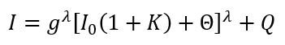

# Quiz del primo midterm di Digital Forensics and Biometrics

**105 domande a scelta multipla** (35 dal quiz, 70 nuove) e **2 esercizi o domande aperte**.
Le domande originali mantengono gli ID **Q**. Le nuove sono contrassegnate con **(AI made)**.
Soluzioni in fondo a ogni lezione, con riferimenti per le domande nuove.

[Quiz completo](Quiz%20di%20Digital%20Forensics%20and%20Biometrics.md) · [Fonte Polterino](https://github.com/Polterino/polterino.github.io/blob/462ef076ab80ec59d1b3b9c871ea22695ab24ac6/questions/questions_digital.json) · [Licenza Apache 2.0](Pics/Quiz-Polterino/LICENSE).

## Indice

- [[#Lesson 1 — Introduction to digital forensics and biometrics|Lesson 1 — Introduction to digital forensics and biometrics]]
- [[#Lesson 2 — Acquisition and preservation of digital evidence|Lesson 2 — Acquisition and preservation of digital evidence]]
- [[#Lesson 3 — Disk and mobile forensics|Lesson 3 — Disk and mobile forensics]]
- [[#Lesson 4 — Mobile acquisition and network forensics|Lesson 4 — Mobile acquisition and network forensics]]
- [[#Lesson 5 — Network forensics and intrusion detection|Lesson 5 — Network forensics and intrusion detection]]
- [[#Lesson 6 — Network forensics and evidence fusion|Lesson 6 — Network forensics and evidence fusion]]
- [[#Lesson 7 — Materiali non disponibili|Lesson 7 — Materiali non disponibili]]
- [[#Lesson 8 — Introduction to multimedia forensics|Lesson 8 — Introduction to multimedia forensics]]
- [[#Lesson 9 — Acquisition traces|Lesson 9 — Acquisition traces]]
- [[#Lesson 10 — Image and audio acquisition|Lesson 10 — Image and audio acquisition]]
- [[#Lesson 11 — Quality enhancement and forensic report|Lesson 11 — Quality enhancement and forensic report]]
- [[#Lesson 12 — Tampering and watermarking|Lesson 12 — Tampering and watermarking]]
- [[#Lesson 13 — Social media forensics, IoT forensics and anomaly detection|Lesson 13 — Social media forensics, IoT forensics and anomaly detection]]

## Lesson 1 — Introduction to digital forensics and biometrics

[Slide della Lesson 1](Lesson%201/Lecture%2001%20-%20Intro%20to%20DF%20and%20Biometrics.pdf)

### Digital evidence and forensic investigations

**Q093.** In the acquisition and handling processes of a digital evidence (DE), the <u>adequateness</u> requirement implies ....

- A. ... that the evidence is authentic.
- B. ... that the evidence is useful in the legal process.
- C. ... that the evidence has been acquired using proper methods/tools/procedures.
- D. ... that operations can be repeated using the same methods and procedures.

**AI-01-01.** Considering the 5 W + H questions in a forensic investigation, which question is addressed by reconstructing the time at which an account was accessed? (AI made)

- A. When?
- B. How?
- C. Who?
- D. Where?

**AI-01-02.** Considering the requirements for handling digital evidence under ISO/IEC 27037, select the statement that describes <u>pertinence</u>. (AI made)

- A. The selected method is appropriate for the available resources.
- B. The evidence is relevant to the investigation.
- C. A third party can check the documented actions.
- D. The same procedures yield consistent results under the same conditions.

**AI-01-03.** Considering the requirements for handling digital evidence, which of the following describes <u>repeatability</u>? (AI made)

- A. Obtaining consistent results using the same methods, procedures, tools and conditions.
- B. Showing that the evidence is relevant to the case.
- C. Choosing the least expensive way to collect evidence.
- D. Obtaining consistent results using different tools or conditions.

> [!check]- Risposte della lezione
> - **Q093** · C
> - **AI-01-01** · A. A timestamp helps determine when an event occurred. [slide 17](Lesson%201/Lecture%2001%20-%20Intro%20to%20DF%20and%20Biometrics.pdf#page=17)
> - **AI-01-02** · B. Pertinence concerns the relevance of the evidence to the investigation. [slide 29](Lesson%201/Lecture%2001%20-%20Intro%20to%20DF%20and%20Biometrics.pdf#page=29)
> - **AI-01-03** · A. Repeatability uses the same conditions. The lecture distinguishes it from reproducibility under changed tools or conditions. [slide 29](Lesson%201/Lecture%2001%20-%20Intro%20to%20DF%20and%20Biometrics.pdf#page=29)

## Lesson 2 — Acquisition and preservation of digital evidence

[Slide della Lesson 2](Lesson%202/Lecture%2002%20-%20Digital%20evidences.pdf)

### Roles in digital evidence handling

**Q019.** Concerning the figure of Digital Evidence First Responder in ISO IEC 27037/2012, select the <u>wrong</u> statement among the following ones:

- A. He/She checks and seizures the area containing digital devices.
- B. He/She presents the results of the analysis in court.
- C. He/She avoids changing the state of device.
- D. He/She profiles all the persons authorized to access the area.

**Q098.** Considering all the expertes involved in the acquisition of a digital evidence, select the most appropriate statement about the Incident Response Specialist (IRS)

- A. He/She can be someone not in charge of the investigation.
- B. He/She documents the scene and all the components
- C. He/She analyzes the evidence in the forensic lab
- D. He/She has the competences to deal with a wide range of forensic and scientific issues

### Identification, collection and acquisition

**AI-02-01.** Select the <u>correct</u> order of the four phases for handling a digital evidence item. (AI made)

- A. Collection, preservation, identification, acquisition.
- B. Identification, acquisition, preservation, collection.
- C. Identification, collection, acquisition, preservation.
- D. Acquisition, identification, collection, preservation.

**AI-02-02.** Concerning the order of volatility on a running system, which of the following should generally be collected <u>first</u> if all are relevant and accessible? (AI made)

- A. Files stored on the hard disk.
- B. Logs stored on a remote server.
- C. Archived backups.
- D. CPU registers and cache.

**AI-02-03.** A powered-on device contains relevant volatile data that would be lost if it were switched off. The investigator is authorized to access it. Which strategy is most appropriate to preserve those data? (AI made)

- A. Collect only the external labels and serial numbers.
- B. Document the state and acquire the volatile data while the device is running.
- C. Use a verified copy of last week's disk backup in place of the live acquisition.
- D. Disconnect power and acquire a disk image later.

**AI-02-04.** Considering forensic imaging, which acquisition can capture unallocated areas of the entire source disk? (AI made)

- A. An export of the file names listed by the filesystem.
- B. A bit-stream image of the whole disk.
- C. A logical copy of selected folders.
- D. A backup containing only files visible to the user.

### Preservation and chain of custody

**Q006.** Considering a hash function that generates the digest <u>d</u> from a string <u>s</u>, <u>s -> d(s)</u>, select the <u>correct</u> statement referred to the resilience to second pre-image property.

- A. Given a d(s1)=d1, finding s2 such that d(s2)=d1 must be computationally-unfeasible.
- B. Searching for a couple of strings s1 and s2 such that d(s2)=d(s1) is computationally-unfeasible.
- C. Given a digest d, creating s such that d(s)=d must be computationally-unfeasible.
- D. The length of s must be a multiple of a predefined minimum length.

**Q043.** Considering a hash function that generates the digest <u>d</u> from a string <u>s</u>, <u>s -> d(s)</u>, select the <u>correct</u> statement referred to the resilience to collision property.

- A. Searching for a couple of strings s1 and s2 such that d(s2)=d(s1) is computationally-unfeasible.
- B. Given a d(s1)=d1, finding s2 s.t. d(s2)=d1 must be computationally-unfeasible.
- C. The length of s must be a multiple of a predefined minimum length.
- D. Given a digest d, creating s s.t. d(s)=d must be computationally-unfeasible.

**Q044.** Considering a hash function that generates the digest <u>d</u> from a string <u>s</u>, <u>s -> d(s)</u>, select the <u>correct</u> statement referred to the resilience to pre-image property.

- A. Searching for a couple of strings s1 and s2 such that d(s2)=d(s1) is computationally-unfeasible.
- B. Given a d(s1)=d1, finding s2 s.t. d(s2)=d1 must be computationally-unfeasible.
- C. The length of s must be a multiple of a predefined minimum length.
- D. Given a digest d, creating s s.t. d(s)=d must be computationally-unfeasible.

**AI-02-05.** Concerning the chain of custody, select the <u>most appropriate</u> record for a transfer of a digital evidence item. (AI made)

- A. The item's identifier, person releasing it, person receiving it, and date and time of transfer.
- B. A list of the conclusions that the receiving analyst expects to reach.
- C. The file extension and name without transfer details.
- D. A screenshot of the final report.

**AI-02-06.** A forensic image was copied to a new storage medium. Which check directly tests whether the copied bytes match the previously hashed image? (AI made)

- A. Compare the two file names.
- B. Check whether both copies open in the same tool.
- C. Compute the digest of the copy with the same hash algorithm and compare it with the recorded digest.
- D. Compare the labels of the storage media.

### Open question

**OPEN-02.** An authorized responder arrives at a hospital. A running workstation supports an ongoing service, and relevant data exist only in volatile memory. The service cannot be interrupted. Explain which acquisition strategy you would choose. Specify what you would document, how you would verify the exported files after transfer, and what belongs in the chain of custody. (AI made)

> [!check]- Risposte della lezione
> - **Q019** · B
> - **Q098** · A
> - **AI-02-01** · C. The lecture orders identification, collection or seizure, acquisition, then preservation. [slide 9–10](Lesson%202/Lecture%2002%20-%20Digital%20evidences.pdf#page=9)
> - **AI-02-02** · D. CPU registers and cache are at the top of the order of volatility shown in the slides. [slide 13–14](Lesson%202/Lecture%2002%20-%20Digital%20evidences.pdf#page=13)
> - **AI-02-03** · B. Live acquisition preserves relevant volatile data before shutdown. The responder documents the state and actions taken. [slide 13–14, 19–20](Lesson%202/Lecture%2002%20-%20Digital%20evidences.pdf#page=13)
> - **AI-02-04** · B. Whole-disk imaging copies the disk by blocks and can include unallocated areas. [slide 24–26](Lesson%202/Lecture%2002%20-%20Digital%20evidences.pdf#page=24)
> - **Q006** · A
> - **Q043** · A
> - **Q044** · D
> - **AI-02-05** · A. The chain of custody documents who handled the item, when, and where it moved. [slide 37–39](Lesson%202/Lecture%2002%20-%20Digital%20evidences.pdf#page=37)
> - **AI-02-06** · C. Comparing digests of the same byte sequences with the same hash algorithm tests integrity. [slide 24–25, 29–31](Lesson%202/Lecture%2002%20-%20Digital%20evidences.pdf#page=24)
> - **OPEN-02** · Perform a scoped live acquisition of relevant volatile data while the workstation remains running. Record the device state, time, scope, reason for using live acquisition, tools and actions taken, including any observable change. Hash the acquired output, preserve the reference digest and compare it with a digest computed using the same algorithm after transfer. Record the evidence identifier, date and time, sender, recipient and each transfer. [slide 13–14, 19–25, 29–31, 37–39](Lesson%202/Lecture%2002%20-%20Digital%20evidences.pdf#page=13)

## Lesson 3 — Disk and mobile forensics

[Slide della Lesson 3](Lesson%203/Lecture%2003%20-%20Disk%20and%20mobile%20forensics.pdf)

### Disk forensics

**Q018.** Considering the analysis of a storage disk, which of the following statement would you use to explain what the <u>non-indexed</u> space is (select <u>the most fitting</u> option)?

- A. It is the space where Reallocation occurs when a sector is damaged.
- B. It is a memory space which was occupied by a file that has been removed.
- C. It is a write-protected space on the disk that cannot be overwritten.
- D. It is the space within a sector between the end of the contained file and the end of the corresponding sector.

**Q040.** Considering the analysis of a storage disk, which of the following statement would you use to explain what the <u>slack space</u> is (select <u>the most fitting</u> option)?

- A. It is the space within a sector between the end of the contained file and the end of the corresponding sector.
- B. It is the memory space included within a geometrical sector.
- C. It is a non-allocated memory space that can be overwritten by a file.
- D. It is a memory space which is not indexed anymore since the table of indexes has been lost with file removal.

**AI-03-01.** Considering file recovery on an SSD, select the <u>correct</u> statement about TRIM and garbage collection. (AI made)

- A. TRIM informs the controller which blocks are no longer needed, and internal garbage collection can later erase them.
- B. TRIM lets the operating system mark files as write-protected.
- C. Garbage collection is performed only by the forensic workstation.
- D. TRIM restores the filesystem entries of deleted files.

**AI-03-02.** Concerning basic header-and-footer file carving, which condition makes complete recovery more difficult? (AI made)

- A. The file's header and footer remain intact.
- B. The file can be read from a forensic disk image.
- C. The file is fragmented and its blocks are not stored contiguously.
- D. The file has the expected signature at its beginning.

**AI-03-03.** Which of the following pairs correctly associates a forensic tool with its main role as described in the lecture? (AI made)

- A. PhotoRec — recovering files by carving recognizable data.
- B. Foremost — decoding a SIM identification number.
- C. PhotoRec — exporting server access logs from live traffic.
- D. Autopsy and Sleuth Kit — recording audio harmonics.

**AI-03-04.** Why can recovery of a fragmented deleted file be harder after its indexing information is lost? (AI made)

- A. The file's data necessarily become encrypted.
- B. Every fragmented file uses the same block sequence.
- C. The filesystem moves all deleted blocks into a contiguous area before removing the index.
- D. The remaining blocks can be noncontiguous, and the index that linked them may no longer be available.

**AI-03-05.** Considering an encrypted drive that is currently unlocked, which forensic consideration is <u>correct</u>? (AI made)

- A. A raw image always contains plaintext regardless of the device state.
- B. The analyst can infer the encryption keys from the drive's serial number.
- C. Encryption proves that the data on the drive were modified.
- D. Shutting down can lose current access and require reauthentication to read the data again.

### Mobile devices and isolation

**Q099.** In mobile device forensics, the ICCID code refers to ... (select the correct statement)

- A. ... the version of PC/SC support standard.
- B. ... the Subscriber Identity Module card.
- C. ... the specific mobile terminal.
- D. ... a code to unlock the phone.

**AI-03-06.** Concerning mobile identifiers, which of the following identifies the equipment rather than the SIM card? (AI made)

- A. PUK.
- B. IMEI.
- C. PIN.
- D. ICCID.

**AI-03-07.** A responder finds an unlocked mobile phone switched on. Which consideration supports isolating it while keeping it powered on, when practical and authorized? (AI made)

- A. A shutdown always preserves all volatile state.
- B. A shutdown disables the phone's lock on the next startup.
- C. Isolation limits remote changes, while shutdown can trigger a lock or credential prompt on restart.
- D. Isolation guarantees access to every encrypted file.

> [!check]- Risposte della lezione
> - **Q018** · B
> - **Q040** · A
> - **AI-03-01** · A. TRIM communicates that data are no longer needed. Internal garbage collection can erase the associated data later. [slide 11–12](Lesson%203/Lecture%2003%20-%20Disk%20and%20mobile%20forensics.pdf#page=11)
> - **AI-03-02** · C. Basic carving works best when the surviving data between the boundaries are contiguous. [slide 14–16](Lesson%203/Lecture%2003%20-%20Disk%20and%20mobile%20forensics.pdf#page=14)
> - **AI-03-03** · A. PhotoRec is one of the file recovery tools covered in the disk-forensics lesson. [slide 16–20](Lesson%203/Lecture%2003%20-%20Disk%20and%20mobile%20forensics.pdf#page=16)
> - **AI-03-04** · D. The filesystem index helps locate fragments. Losing the index can leave disconnected blocks whose order is harder to reconstruct. [slide 14–16](Lesson%203/Lecture%2003%20-%20Disk%20and%20mobile%20forensics.pdf#page=14)
> - **AI-03-05** · D. Current access can depend on the unlocked state. A restart can require credentials again. [slide 21–22](Lesson%203/Lecture%2003%20-%20Disk%20and%20mobile%20forensics.pdf#page=21)
> - **Q099** · B
> - **AI-03-06** · B. IMEI identifies the mobile terminal. ICCID identifies the SIM card. [slide 25–26](Lesson%203/Lecture%2003%20-%20Disk%20and%20mobile%20forensics.pdf#page=25)
> - **AI-03-07** · C. Isolation can preserve the accessible state while limiting remote changes. Restarting may require credentials. [slide 27–29](Lesson%203/Lecture%2003%20-%20Disk%20and%20mobile%20forensics.pdf#page=27)

## Lesson 4 — Mobile acquisition and network forensics

[Slide della Lesson 4](Lesson%204/Lecture%2004%20-%20Network%20forensics.pdf)

[Appunti sulla mobile acquisition](Lesson%204/4.%20Mobile%20acquisition%20and%20introduction%20to%20network%20forensics.md)

### Mobile acquisition

**AI-04-01.** Considering the four mobile acquisition approaches discussed in class, which result is typical of a <u>logical</u> acquisition? (AI made)

- A. A directory-level acquisition that necessarily includes every protected app container.
- B. A raw duplicate of the phone's entire storage.
- C. A photo of the lock screen and no exported records.
- D. A backup or export of records available through supported interfaces.

**AI-04-02.** An analyst documents the visible state of a phone by photographing its screen. Which acquisition approach does this exemplify? (AI made)

- A. Logical acquisition.
- B. Filesystem acquisition.
- C. Manual acquisition.
- D. Physical acquisition.

**AI-04-03.** An analyst can acquire a device backup but needs app artifacts that are absent from it. Which approach is specifically aimed at acquiring files and directories, subject to the device's access controls? (AI made)

- A. Filesystem acquisition.
- B. Manual screen documentation.
- C. Logical export of the same backup.
- D. Recording the phone's external identifiers only.

### Network forensics and packet capture

**Q092.** Consider the following description of a sniffer detection method "During the transmission, send a packet with the IP address of the suspect machine without or with a wrong MAC address. All machines should reject it since MAC does not match IP. Only a sniffer would answer". The statement can be referred to:

- A. Local host analysis
- B. Ping method
- C. Latency method
- D. ARP watch

**AI-04-04.** Considering the two traffic collection strategies, which statement describes <u>stop, look, and listen</u>? (AI made)

- A. Analyze incoming packets in memory and retain selected packets.
- B. Capture all packets and postpone analysis until after storage.
- C. Capture only application logs, independently of the network packets.
- D. Store all packets permanently before applying any filter.

**AI-04-05.** Which pair of identifiers is used in the lecture to distinguish Ethernet addresses from network-layer addresses? (AI made)

- A. IP address and URL.
- B. ICCID and IMEI.
- C. TCP port and DNS name.
- D. MAC address and IP address.

**AI-04-06.** An analyst has a capture of encrypted application traffic and wants to compare activity patterns without reading message contents. Which observable does the lecture use for this purpose? (AI made)

- A. Plaintext passwords.
- B. Packet lengths.
- C. Encryption keys recovered by reading the IP header.
- D. The contents of encrypted messages.

> [!check]- Risposte della lezione
> - **AI-04-01** · D. Logical acquisition typically retrieves data through a backup or export interface, with limits on protected material. [appunti di Lesson 4](Lesson%204/4.%20Mobile%20acquisition%20and%20introduction%20to%20network%20forensics.md)
> - **AI-04-02** · C. Manual acquisition documents what the operator can see on the device. [appunti di Lesson 4](Lesson%204/4.%20Mobile%20acquisition%20and%20introduction%20to%20network%20forensics.md)
> - **AI-04-03** · A. Filesystem acquisition targets directories and file-level artifacts. Access still depends on the device and its protections. [appunti di Lesson 4](Lesson%204/4.%20Mobile%20acquisition%20and%20introduction%20to%20network%20forensics.md)
> - **Q092** · B
> - **AI-04-04** · A. This approach performs real-time filtering and keeps selected traffic. [slide 8](Lesson%204/Lecture%2004%20-%20Network%20forensics.pdf#page=8)
> - **AI-04-05** · D. Ethernet uses MAC addresses. IP addresses identify endpoints at the network layer. [slide 6–7, 13–14](Lesson%204/Lecture%2004%20-%20Network%20forensics.pdf#page=6)
> - **AI-04-06** · B. The example profiles activity using packet lengths without needing to read the encrypted payload. [slide 9](Lesson%204/Lecture%2004%20-%20Network%20forensics.pdf#page=9)

## Lesson 5 — Network forensics and intrusion detection

[Slide della Lesson 5](Lesson%205/Lecture%2005%20-%20Network%20forensics.pdf)

### Capture, router records and server logs

**AI-05-01.** Concerning the PCAP-to-CSV example, which of the following is a field shown in the exported flow representation? (AI made)

- A. The SHA digest of the investigator's report.
- B. The subscriber's SIM PIN.
- C. The plaintext of every encrypted payload.
- D. The destination port.

**AI-05-02.** Considering the acquisition of volatile router data, which of the following helps document network state before it changes? (AI made)

- A. A copy of the server's static HTML pages.
- B. A printout of the router's purchase receipt.
- C. A photo of the router's serial number alone.
- D. A record of the current routing table and active state.

**AI-05-03.** In the Common Log Format, which field records the HTTP response code returned to the client? (AI made)

- A. Authuser.
- B. Request.
- C. Bytes.
- D. Status.

### Wireless forensics and hybrid IDS

**Q038.** Among the following, select the <u>wrong</u> statement concerning Network-based IDS.

- A. They require storage and fast processing capabilities.
- B. They provide a network-wide overview of the attack.
- C. They can detect out-of-band attacks.
- D. They are not robust to fragmentation and TTL attack

**Q106.** About HIDS, which is <u>wrong</u>?

- A. Could detect juice jacking attacks
- B. Robust to fragmentation and TTL attack
- C. Can not monitor entire network segment
- D. Multiple sensors can be easily updated and installed

**AI-05-04.** Concerning wireless forensics, why is channel hopping a useful capability for a capture tool? (AI made)

- A. It reveals encrypted messages without keys.
- B. It replaces the need to record when packets were captured.
- C. It guarantees simultaneous capture of every channel with one radio.
- D. It allows the tool to observe traffic on multiple wireless channels over time.

**AI-05-05.** What is the purpose of a hybrid intrusion detection system? (AI made)

- A. To monitor only the payload of encrypted network connections.
- B. To combine evidence from host-based and network-based detection.
- C. To monitor only local system events.
- D. To make host logs unnecessary in every investigation.

**AI-05-06.** Which statement correctly distinguishes profile-based from signature-based intrusion detection? (AI made)

- A. Profile-based detection makes an alert only if an entry already exists in the signature database.
- B. Signature-based detection compares activity only with a learned profile of normal behavior.
- C. Profile-based detection flags deviations from expected behavior. Signature-based detection looks for known patterns.
- D. Both require a known attack signature for every alert.

> [!check]- Risposte della lezione
> - **AI-05-01** · D. Destination port appears among the displayed flow fields. [slide 3–4](Lesson%205/Lecture%2005%20-%20Network%20forensics.pdf#page=3)
> - **AI-05-02** · D. Current routing and operational data can change and should be documented during acquisition. [slide 11–12](Lesson%205/Lecture%2005%20-%20Network%20forensics.pdf#page=11)
> - **AI-05-03** · D. The status field contains the response code, such as 200 for a successful request. [slide 15–17](Lesson%205/Lecture%2005%20-%20Network%20forensics.pdf#page=15)
> - **Q038** · C
> - **Q106** · D — non verificata
> - **AI-05-04** · D. Channel hopping lets a radio change its monitored channel during an acquisition. [slide 20–21](Lesson%205/Lecture%2005%20-%20Network%20forensics.pdf#page=20)
> - **AI-05-05** · B. A hybrid IDS combines the perspectives of HIDS and NIDS. [slide 23–27](Lesson%205/Lecture%2005%20-%20Network%20forensics.pdf#page=23)
> - **AI-05-06** · C. The lecture contrasts deviations from normal behavior with patterns drawn from known activity. [slide 28](Lesson%205/Lecture%2005%20-%20Network%20forensics.pdf#page=28)

## Lesson 6 — Network forensics and evidence fusion

[Slide della Lesson 6](Lesson%206/Lecture%2006%20-%20Network%20forensics.pdf)

### Traceback and privacy-preserving networks

**AI-06-01.** Concerning network forensics, what is the main purpose of traceback? (AI made)

- A. To assign filesystem permissions to captured traffic.
- B. To compress a packet capture for long-term storage.
- C. To reconstruct the path or origin of attack traffic from network evidence.
- D. To identify a camera from its PRNU.

**AI-06-02.** Which set of sources does the lecture propose correlating in a Tor forensic investigation? (AI made)

- A. Only the URL printed in the final report.
- B. Only the MAC address printed on the computer's label.
- C. Only an image's JPEG quantization tables.
- D. RAM artifacts, filesystem or storage artifacts, and network observations.

### Evidence fusion and Dempster–Shafer theory

**AI-06-03.** Let the frame of discernment be $\Theta=\{A,S\}$. What does a mass assigned to $\Theta$ represent? (AI made)

- A. The source supports $A$ and $S$ as simultaneously true.
- B. The sources disagree, so this mass should be discarded as conflict.
- C. The source supports the frame as a whole without distinguishing $A$ from $S$.
- D. The source assigns the same singleton mass to $A$ and $S$.

**AI-06-04.** For $\Theta=\{A,S\}$, suppose $m(\{A\})=0.40$, $m(\{S\})=0.35$ and $m(\Theta)=0.25$. Which pair gives $Bel(\{A\})$ and $Pl(\{A\})$, respectively? (AI made)

- A. 0.40 and 0.40.
- B. 0.40 and 0.65.
- C. 0.65 and 0.40.
- D. 0.25 and 0.65.

**AI-06-05.** In Dempster's normalized combination rule, which contribution enters the conflict term $K$? (AI made)

- A. A pair of focal sets whose intersection is a singleton.
- B. A pair of focal sets whose intersection is empty.
- C. A pair of focal sets whose intersection is the whole frame.
- D. Every pair that includes the full frame as one of the focal sets.

### Open question

**OPEN-06.** Two IDS sensors assess whether a network is under attack. The frame of discernment is $\Theta=\{A,S\}$, where $A$ means attack and $S$ means safe. Combine their assessments using Dempster’s normalized rule. Show the conflict and unnormalized masses, compute the final masses, and give the belief and plausibility of attack. Explain what the mass on $\Theta$ represents. (AI made)

| Focal set | Sensor 1 | Sensor 2 |
|---|---:|---:|
| $\{A\}$ | 0.45 | 0.35 |
| $\{S\}$ | 0.15 | 0.30 |
| $\Theta$ | 0.40 | 0.35 |

> [!check]- Risposte della lezione
> - **AI-06-01** · C. Traceback helps reconstruct the source or path by linking evidence from network observations. [slide 3–5](Lesson%206/Lecture%2006%20-%20Network%20forensics.pdf#page=3)
> - **AI-06-02** · D. The lecture describes joint examination of memory, storage and network streams. [slide 9–10](Lesson%206/Lecture%2006%20-%20Network%20forensics.pdf#page=9)
> - **AI-06-03** · C. Mass on the full set represents uncertainty between alternatives. Conflict arises from an empty intersection during combination. [slide 17–22](Lesson%206/Lecture%2006%20-%20Network%20forensics.pdf#page=17)
> - **AI-06-04** · B. Belief adds masses contained in the hypothesis. Plausibility adds masses that intersect it, including the 0.25 on the full frame. [slide 19–22](Lesson%206/Lecture%2006%20-%20Network%20forensics.pdf#page=19)
> - **AI-06-05** · B. Products of masses for pairs with empty intersection contribute to conflict $K$. Nonconflicting masses are divided by $1-K$. [slide 22–25](Lesson%206/Lecture%2006%20-%20Network%20forensics.pdf#page=22)
>
> - **OPEN-06** · Conflict $K=0.45(0.30)+0.15(0.35)=0.1875$. The denominator is $1-K=0.8125$.
>
>   | Set | Nonconflicting products summed | Unnormalized | Normalized |
>   |---|---|---:|---:|
>   | $\{A\}$ | $0.45(0.35)+0.45(0.35)+0.40(0.35)$ | 0.4550 | 0.5600 |
>   | $\{S\}$ | $0.15(0.30)+0.15(0.35)+0.40(0.30)$ | 0.2175 | 0.2677 |
>   | $\Theta$ | $0.40(0.35)$ | 0.1400 | 0.1723 |
>
>   $Bel(\{A\})=0.5600$ and $Pl(\{A\})=m(\{A\})+m(\Theta)=0.7323$. Mass on the full frame represents support that does not distinguish attack from safe. [slide 19–25](Lesson%206/Lecture%2006%20-%20Network%20forensics.pdf#page=19) · [esempio svolto A.6](Lesson%208/exercise_solved.pdf#page=1)

## Lesson 7 — Materiali non disponibili

Nessun materiale numerato Lesson 7 è disponibile nella cartella del corso.

## Lesson 8 — Introduction to multimedia forensics

[Slide della Lesson 8](Lesson%208/pres_lecture08b.pdf)

Gli esercizi svolti A.5 e A.6 riprendono la fusione delle prove della Lesson 6. [Esercizi svolti](Lesson%208/exercise_solved.pdf)

### Multimedia evidence and processing history

**Q007.** Among the following list, select the strategies that can be employed by multimedia forensics to authenticate the origin of visual data (acquiring device).

- A. Constrast enhancement, stabilization, interlacing detection
- B. PRNU estimation, CFA interpolation strategy estimation, chromatic aberration estimation.
- C. Deepfake detection, integrity verification, ghosting artifacts detection
- D. Sharpening, distortion correction, magnification.

**Q014.** Among the following list, select the strategies that can be employed by multimedia forensics to authenticate the origin of visual data (acquiring device).

- A. PRNU estimation, CFA interpolation strategy estimation, chromatic aberration estimation.
- B. Sharpening, distortion correction, magnification.
- C. Deepfake detection, integrity verification, ghosting artifacts detection.
- D. Contrast enhancement, stabilization, interlacing detection.

**AI-08-01.** An image has been acquired, edited, uploaded to a platform and downloaded. Which statement about its processing history is <u>correct</u>? (AI made)

- A. All observable changes in the downloaded file prove intentional tampering.
- B. Every trace introduced by the camera must survive every later stage.
- C. Later editing and platform processing can introduce new traces or modify earlier ones.
- D. Only the sensor can leave traces in an image.

**AI-08-02.** Which question is most directly addressed when a multimedia analyst reconstructs the original source of a posted image? (AI made)

- A. Which report section lists the investigator's qualifications?
- B. Which IDS sensor produced the largest belief mass?
- C. Which acquisition or processing chain produced the available version of the image?
- D. What is the mobile terminal's IMEI?

### Signal representation

**Q063.** Given the following set of biometric scheme, select the one which is <u>not</u> processing bilevel signals.

- A. Voice recognition.
- B. DNA sequence matching (in Voss representation).
- C. Vision-based gait analysis.
- D. Fingerprint identification.

**Q105.** In gait analysis strategy, what <u>cannot</u> be used for joint-coordinate acquisition

- A. Pressure sensor
- B. Gyroscopic sensor
- C. RGB camera
- D. Depth camera

**AI-08-03.** Considering quantization in a digital acquisition chain, select the <u>correct</u> statement. (AI made)

- A. It measures only the horizontal dimensions of the signal.
- B. It maps signal amplitudes to a finite set of representable levels.
- C. It assigns a different time index to each sensor.
- D. It infers the original scene directly from the final file.

**AI-08-04.** A depth image is represented by $D=f(x,y)$. What does the pixel value $D$ encode in the lecture's model? (AI made)

- A. The number of quantization levels in the sensor.
- B. The luminance of the pixel in the RGB image.
- C. A value that parametrizes distance from the camera.
- D. The horizontal coordinate of the pixel.

**AI-08-05.** Considering the joint model presented in the lecture, which set describes the maximum six degrees of freedom? (AI made)

- A. Three translational coordinates and three rotation angles.
- B. Three color components and three depth values.
- C. Six rotation angles with a fixed translation.
- D. Six translations along distinct Cartesian axes.

> [!check]- Risposte della lezione
> - **Q007** · B
> - **Q014** · A
> - **AI-08-01** · C. Acquisition, editing, storage and sharing can each affect the available traces. [slide 2–5](Lesson%208/pres_lecture08b.pdf#page=2)
> - **AI-08-02** · C. Source reconstruction examines origin and processing history. [slide 8–11](Lesson%208/pres_lecture08b.pdf#page=8)
> - **Q063** · A
> - **Q105** · A — non verificata
> - **AI-08-03** · B. Quantization discretizes amplitude. Sampling discretizes the independent variable, such as time. [slide 14–16](Lesson%208/pres_lecture08b.pdf#page=14)
> - **AI-08-04** · C. A depth map encodes range at each image position. [slide 20–21](Lesson%208/pres_lecture08b.pdf#page=20)
> - **AI-08-05** · A. The lecture's joint model permits up to three positional and three rotational degrees of freedom. [slide 22–23](Lesson%208/pres_lecture08b.pdf#page=22)

## Lesson 9 — Acquisition traces

[Slide della Lesson 9](Lesson%209/pres_lecture09b.pdf)

### Fourier analysis and filtering

**AI-09-01.** Which representation is best suited to visualizing how the frequency content of a recording changes over time? (AI made)

- A. The mean amplitude of the entire recording.
- B. The magnitude of the Fourier transform over the entire recording without time windows.
- C. A spectrogram.
- D. A histogram of sample values without timestamps.

**AI-09-02.** Which ordering correctly describes filtering an image in the frequency domain? (AI made)

- A. Take the DFT and treat the resulting coefficients directly as output pixels.
- B. Take the DFT, multiply by the frequency response, then apply the inverse DFT.
- C. Replace pixel values with their ranks, then compute a histogram.
- D. Inverse DFT, apply frequency response, DFT.

### Optical and acquisition-device traces

**Q003.** Concerning the Photo-Response Non-Uniformity (PRNU) equation, which among the following statements is surely <u>wrong</u>.

- A. Theta includes compression noise.
- B. K is a multiplicative term.
- C. I_0 is the noise-free image.
- D. g is a gain factor.

**Q039.** Given two PRNU patterns (one estimate from an image and the other from a set of 20 flat field pictures taken with the suspect camera), select the <u>wrong</u> statement among the following ones.

- A. Peak-to-Correlation Energy is less noisy than Normalized Cross-Correlation.
- B. Flat field images need to be very dark.
- C. Peak-to-Correlation Energy is more computationally demanding than Normalized Cross-Correlation.
- D. If the image has not been taken with the suspected camera, PCE or NCC values are more or less the same for different analysis windows.

**AI-09-03.** Which statement about chromatic aberration is <u>correct</u>? (AI made)

- A. It is a sensor fingerprint caused only by pixel response variation.
- B. It describes an equal radial displacement of every color component at every point.
- C. It is produced by using different JPEG quantization tables for luminance and chrominance.
- D. Different wavelengths can be refracted differently by a lens, creating color-dependent misalignment.

**AI-09-04.** Considering printer and scanner forensics, which of the following is a potential trace of a laser printer's optical mechanism? (AI made)

- A. Polygon mirror wobble.
- B. The Bayer pattern of the source image.
- C. The 50 Hz mains component of a recording.
- D. The IMEI of the device.

**AI-09-05.** What is the main reason sensor noise is relevant to camera attribution? (AI made)

- A. The sensor adds the same compression artifacts as JPEG encoding.
- B. Noise determines the location of an image regardless of metadata.
- C. Every noise component has an identical pattern on all cameras.
- D. Some sensor imperfections leave a recurring, device-dependent pattern in images.

**AI-09-06.** Which of the following image sets is most suitable for estimating a reference PRNU pattern? (AI made)

- A. A set of unrelated pictures chosen to have the same JPEG quality setting.
- B. Bright, nearly uniform, unsaturated images from the same camera.
- C. A single strongly saturated frame.
- D. Dark frames from several different cameras.

> [!check]- Risposte della lezione
> - **AI-09-01** · C. A spectrogram represents spectral content over time. [slide 5–11](Lesson%209/pres_lecture09b.pdf#page=5)
> - **AI-09-02** · B. Frequency-domain filtering multiplies the transform by the filter response before reconstruction. [slide 12–16](Lesson%209/pres_lecture09b.pdf#page=12)
> - **Q003** · A
> - **Q039** · B
> - **AI-09-03** · D. Chromatic aberration results from wavelength-dependent refraction. [slide 22–25](Lesson%209/pres_lecture09b.pdf#page=22)
> - **AI-09-04** · A. The lecture associates polygon mirror wobble with the laser printer. [slide 27–29](Lesson%209/pres_lecture09b.pdf#page=27)
> - **AI-09-05** · D. PRNU is a recurring response variation linked to the imaging sensor. [slide 30, 36–44](Lesson%209/pres_lecture09b.pdf#page=30)
> - **AI-09-06** · B. Bright, unsaturated flat-field images from the same camera help estimate its device-dependent pattern. [dispensa multimedia, p. 11](Lesson%208/NotesAboutMultimediaForensics.pdf#page=11)

## Lesson 10 — Image and audio acquisition

[Slide della Lesson 10](Lesson%2010/pres_lecture10.pdf)

### Image processing and compression

**Q037.** Given a digital image, estimating the CFA interpolation strategy adopted on that image allows...

- A. ...to associate the image to a specific Bayer pattern.
- B. ...to associate the image to a camera model only if it has not been compressed.
- C. ...to associate the image to a specific acquisition time.
- D. ...to associate the image to a specific camera.

**Q117.** About JPEG process, which is <u>wrong</u>?

- A. After quantization there is entropy coding
- B. transform coding operation is performed on 8x8 blocks
- C. Different quantization steps are used on coefficient form R, G and B components
- D. DCT is used

**AI-10-01.** Considering the Expectation–Maximization approach to demosaicing detection, which ordering describes one iteration? (AI made)

- A. Convert RGB to grayscale and repeat without a model update.
- B. Estimate a new model once and then only read its output.
- C. Estimate latent assignments using the current model, then update the parameters using those estimates.
- D. Estimate the compression bitrate, then discard all pixel relationships.

**AI-10-02.** What is the forensic purpose of looking for double JPEG compression traces? (AI made)

- A. To test whether the image underwent an earlier JPEG compression and potentially estimate aspects of it.
- B. To retrieve the name of the application that last opened the file.
- C. To reconstruct the exact camera model from every image.
- D. To guarantee that the image was maliciously edited.

**AI-10-03.** In predictive video coding, what is the role of motion-compensated prediction between adjacent frames? (AI made)

- A. It estimates an audio source from the video soundtrack.
- B. It applies JPEG compression independently to every frame.
- C. It guarantees identical file sizes for equal-length videos.
- D. It exploits temporal correlation to predict a frame region from a reference frame.

### Digital audio and acoustic traces

**Q022.** Assuming that an audio forensic analyst is processing an audio sequence and, at a certain point, he starts selecting the harmonics that are multiples of 50 Hz. Which type of analysis is he/she carrying on?

- A. Reducing noise to classify events
- B. Reverberation analysis
- C. Voice/speech identification
- D. Analyzing the electrical network frequencies

**AI-10-04.** Which pair of operations turns an analog microphone signal into a digital representation? (AI made)

- A. Sampling in time and quantizing the amplitude.
- B. Playback and room reverberation.
- C. Loudspeaker amplification and image sharpening.
- D. Source separation and voice comparison.

**AI-10-05.** Which observation can support acoustic event localization in a room? (AI made)

- A. The Bayer filter pattern of the microphone.
- B. The relative timing of the direct sound and its reflections.
- C. Only the file extension assigned by the audio recorder.
- D. The quantization table of the JPEG cover image.

**AI-10-06.** Which of the following is listed as a microphone characteristic that describes sensitivity as a function of arrival direction? (AI made)

- A. The name of the digital audio container.
- B. The polar pattern.
- C. The ADC quantization depth.
- D. The audio file's compression ratio.

> [!check]- Risposte della lezione
> - **Q037** · A
> - **Q117** · C — non verificata
> - **AI-10-01** · C. The E-step estimates memberships or latent assignments. The M-step updates the model parameters using those estimates. [slide 14–19](Lesson%2010/pres_lecture10.pdf#page=14)
> - **AI-10-02** · A. Double JPEG analysis can reveal traces of earlier compression. Recompression alone does not establish malicious editing. [slide 36–38](Lesson%2010/pres_lecture10.pdf#page=36)
> - **AI-10-03** · D. Motion compensation uses a matching region from a reference frame to predict a block and reduce temporal redundancy. [slide 31–34](Lesson%2010/pres_lecture10.pdf#page=31)
> - **Q022** · D
> - **AI-10-04** · A. Sampling selects discrete times, while quantization represents amplitudes with discrete values. [slide 39–42](Lesson%2010/pres_lecture10.pdf#page=39)
> - **AI-10-05** · B. Reflections travel along different paths and may arrive after the direct sound. Their timing can carry spatial information. [slide 48–49](Lesson%2010/pres_lecture10.pdf#page=48)
> - **AI-10-06** · B. The polar pattern describes microphone directionality. [slide 50](Lesson%2010/pres_lecture10.pdf#page=50)

## Lesson 11 — Quality enhancement and forensic report

[Slide della Lesson 11](Lesson%2011/pres_lecture11.pdf)

### Quality enhancement

**Q027.** Among the following list, select the strategies that can be employed by multimedia forensics to enhance the quality of visual data.

- A. Deepfake detection, integrity verification, ghosting artifacts detection
- B. Watermarking, stabilization, image phylogeny
- C. PRNU estimation, CFA interpolation strategy estimation, chromatic aberration estimation
- D. Sharpening, distortion correction, magnification

**Q111.** For a blurred frame of a video, how can we sharpen the details?

- A. Equalize color histogram
- B. Filter image with High Pass Filter
- C. Enhance contrast
- D. Magnify image

**AI-11-01.** A rectangular license plate appears as a trapezoid because it was recorded from an oblique viewpoint. Which operation is most directly adapted to this distortion? (AI made)

- A. Audio equalization.
- B. Histogram equalization.
- C. Magnification without a geometric transform.
- D. Perspective correction using corresponding corners.

**AI-11-02.** Several aligned frames show the same static scene with differing random noise. Which operation can improve the estimate of the scene? (AI made)

- A. Keep a single arbitrarily chosen frame and discard the rest.
- B. Integrate the aligned frames, for example by averaging them.
- C. Assign every frame a new timestamp.
- D. Isolate frequencies around 50 Hz in the soundtrack.

**AI-11-03.** An analyst needs to extract the vocal component of a recording from overlapping background music. Which technique corresponds to this task? (AI made)

- A. Perspective correction.
- B. Audio source separation.
- C. Image sharpening.
- D. Speech comparison.

### Forensic report

**Q035.** Concerning a forensic technical report to be presented in court, which of the following elements should <u>not be included</u> in the initial summary?

- A. The CV of the analyst.
- B. The conclusions in brief.
- C. The summary of the activities.
- D. The objectives of the report.

**AI-11-04.** Which material belongs in the <u>analysis</u> section of a forensic image-enhancement report? (AI made)

- A. Only a list of the attached files.
- B. The processing steps, tools or settings used, and supporting results.
- C. An unsupported statement of the analyst's preferred conclusion.
- D. Only the names of people who will read the report.

> [!check]- Risposte della lezione
> - **Q027** · D
> - **Q111** · B
> - **AI-11-01** · D. A perspective transform can map the observed corners to a rectified rectangle. [slide 9, 12](Lesson%2011/pres_lecture11.pdf#page=9)
> - **AI-11-02** · B. Frame integration can retain consistent scene content while reducing uncorrelated noise in aligned views. [slide 15–16](Lesson%2011/pres_lecture11.pdf#page=15)
> - **AI-11-03** · B. Source separation isolates a component within a mixture. The lecture demonstrates vocal separation. [slide 17–22](Lesson%2011/pres_lecture11.pdf#page=17)
> - **Q035** · A
> - **AI-11-04** · B. The analysis section documents what was done and shows results so the procedure can be examined. [slide 34, 40–46](Lesson%2011/pres_lecture11.pdf#page=34)

## Lesson 12 — Tampering and watermarking

[Slide della Lesson 12](Lesson%2012/Lecture%2012%20-%20Tampering%20and%20watermarking.pdf)

### Physical and statistical traces of tampering

**Q002.** Considering a copy-move image tampering detection, select the <u>correct</u> statement among the following ones.

- A. It requires analyzing more than one image.
- B. It searches for blurred regions that denote the alteration.
- C. It is based on detecting ghosting artifacts.
- D. It uses local image descriptors

**Q012.** Which of the following features is <u>NOT</u> useful to detect deepfakes?

- A. Blinking pattern
- B. Low frequency details.
- C. Facial hair
- D. Glare of glasses

**AI-12-01.** Considering the detection of splicing between two different source images, which group consists entirely of acquisition or compression traces that can be compared across regions? (AI made)

- A. Audio equalization, perspective correction and volume normalization.
- B. Audio ENF, audio reverberation and audio sample rate.
- C. ICCID, IMEI and PUK.
- D. PRNU, CFA interpolation and JPEG compression footprints.

**AI-12-02.** Assume the image geometry and a common light source imply consistent shadow directions. What can markedly incompatible directions in different parts of the image indicate? (AI made)

- A. The image necessarily has a valid watermark.
- B. A possible inconsistency that warrants checking for compositing.
- C. The camera's ICCID can be inferred.
- D. Each shadow was definitely captured at the same time.

**AI-12-03.** In the lecture's Benford-law example for detecting synthetic imagery, which values are examined? (AI made)

- A. Last digits of SHA digests.
- B. First digits of the image dimensions only.
- C. First digits of quantized DCT coefficients.
- D. First digits of mobile equipment identifiers.

**AI-12-04.** In the lecture's example of checking ballistic motion in video, what is compared after compensating for perspective distortion? (AI made)

- A. The JPEG quantization tables of each frame and the corresponding audio samples.
- B. The file extension and the camera serial number.
- C. The tracked path of the object and a parabolic motion model.
- D. The watermark message and the microphone response.

### Watermarking and data hiding

**Q025.** Given the following multimedia processing strategies, select the <u>passive</u> one.

- A. CFA estimation
- B. Encryption
- C. Steganography
- D. Watermarking

**Q109.** About watermarking, which is <u>wrong</u>?

- A. Allows free distribution of image/video content
- B. Prevents unauthorized access to image/video
- C. Can be applied multiple times without compromising the accessibility
- D. Embeds a key-dependent binary message

**Q113.** Which is an active forensic strategy?

- A. PRNU estimation
- B. Leveraging compression traces
- C. Watermarking
- D. CFA estimation

**AI-12-05.** What does the perceptual mask control in the spread-spectrum embedding model? (AI made)

- A. The order in which a judge receives the evidence.
- B. How strongly the watermark can modify different pixels while controlling visibility.
- C. The image's filename and extension.
- D. The original message contents.

**AI-12-06.** In the lecture's spread-spectrum detection model, which information is used to recover the embedded bit from a tile in the blind case? (AI made)

- A. The known tiling and the corresponding embedding pulse, used to correlate against the observed tile.
- B. The JPEG quality factor alone.
- C. The message supplied in advance by the detector.
- D. The original unwatermarked image only.

**AI-12-07.** Which property is normally emphasized in steganography when sending a hidden message? (AI made)

- A. Concealing the presence of the communication in a cover signal.
- B. Blocking anybody from accessing the unmodified cover signal.
- C. Recovery of an audio signal from reverberation.
- D. The need for every reader to visibly detect the message.

> [!check]- Risposte della lezione
> - **Q002** · D
> - **Q012** · B
> - **AI-12-01** · D. The lecture compares PRNU, CFA and JPEG footprints for spatial inconsistencies indicative of splicing. [slide 5–8](Lesson%2012/Lecture%2012%20-%20Tampering%20and%20watermarking.pdf#page=5)
> - **AI-12-02** · B. Shadows, illumination and reflections are physical consistency checks. An inconsistency is a clue requiring further analysis. [slide 10–14](Lesson%2012/Lecture%2012%20-%20Tampering%20and%20watermarking.pdf#page=10)
> - **AI-12-03** · C. The example compares first-digit statistics of quantized JPEG DCT coefficients. [slide 24–25](Lesson%2012/Lecture%2012%20-%20Tampering%20and%20watermarking.pdf#page=24)
> - **AI-12-04** · C. The example compares the observed trajectory with an expected parabolic trajectory after perspective compensation. [slide 19–20](Lesson%2012/Lecture%2012%20-%20Tampering%20and%20watermarking.pdf#page=19)
> - **Q025** · A
> - **Q109** · B — non verificata
> - **Q113** · C — non verificata
> - **AI-12-05** · B. The mask adapts embedding strength to local visibility, for example by exploiting image edges. [slide 41–44](Lesson%2012/Lecture%2012%20-%20Tampering%20and%20watermarking.pdf#page=41)
> - **AI-12-06** · A. The decoder uses the sign of the inner product between the observed tile and the corresponding pulse. The host image is not needed for that model. [slide 44–45](Lesson%2012/Lecture%2012%20-%20Tampering%20and%20watermarking.pdf#page=44)
> - **AI-12-07** · A. The lecture's data-hiding examples distinguish a hidden message from the visible cover. [slide 27–28, 34–36](Lesson%2012/Lecture%2012%20-%20Tampering%20and%20watermarking.pdf#page=27)

## Lesson 13 — Social media forensics, IoT forensics and anomaly detection

[Slide della Lesson 13](Lesson%2012/pres_lecture13A.pdf)

### Social media forensics

**AI-13-01.** Concerning a social interaction graph, which statement correctly describes nodes and edges? (AI made)

- A. A node represents one file extension, and an edge represents the hash of an unrelated file.
- B. A node represents a single camera pixel, and every edge represents a sensor response.
- C. A node represents a timestamp, and every edge represents a JPEG compression.
- D. A node represents an account or user, and an edge can represent a connection, message or mention.

**AI-13-02.** Why can it be difficult to reproduce a social media timeline by repeating the same collection later? (AI made)

- A. An image can be uploaded only once.
- B. All posts are necessarily stored in one immutable file.
- C. Interactions, posts and visibility can change between collections.
- D. Edge weights in a graph can never be saved.

**AI-13-03.** In the graph-based image phylogeny method covered in the lecture, what do the edge weights represent before the tree is constructed? (AI made)

- A. Pairwise image dissimilarities.
- B. The cryptographic keys used to sign each file.
- C. The number of contacts in the uploader's phone.
- D. The absolute publication date of each image.

### IoT forensics

**AI-13-04.** Why can disconnecting an IoT device before documenting or collecting its state complicate an investigation? (AI made)

- A. It necessarily makes its cloud records immutable.
- B. It converts every device record into a standardized format.
- C. Disconnecting a device guarantees that all logs are uploaded.
- D. Volatile or short-lived evidence can be lost before it is preserved.

**AI-13-05.** Which of the following makes it harder to correlate evidence from heterogeneous IoT sources? (AI made)

- A. Missing metadata and limited information for aligning events in a timeline.
- B. Uniform, documented hardware and software specifications.
- C. Full correlation records already included for every event.
- D. All records using a shared, validated clock and common schema.

### Anomaly detection

**Q048.** Which among the following ones is <u>NOT</u> an anomaly type?

- A. Point anomaly
- B. Contextual anomaly
- C. Collective anomaly
- D. Systematic anomaly

**Q049.** Considering a sudden decrease of temperature in July (Northern emisphere), we can state that it is a

- A. Point anomaly
- B. Collective anomaly
- C. Contextual anomaly

**Q050.** Which of the following metrics is used to create a ROC (receiver operative characteristics) curve?

- A. Accuracy
- B. F1 score
- C. Recall
- D. Precision

**Q053.** In clean data learning for anomaly detection, we can <u>NOT</u> use the training set to create ...

- A. ARMA models
- B. A multiclass SVM classifier
- C. Recurrent Neural Networks
- D. A dynamical system from Partial Differential Equations

**Q095.** Given the following sets of anomaly detection techniques, select the set made entirely of classical machine learning strategies (not including deep learning)

- A. K-means, Transformer networks, Long-Short Term Memory
- B. Transformer networks, Convolutional Neural Networks, Support Vector Machine
- C. Spectral clustering, Decision trees, Long-Short Term Memory
- D. Isolation forest, Spectral clustering, Support Vector Machine

**Q116.** Which is more suitable in anomaly detection supervised learning?

- A. Deep autoencoder
- B. Spectral clustering
- C. CNN classifier
- D. One-class SVM

**AI-13-06.** Which statement correctly describes the WDAD assumption? (AI made)

- A. Anomalous samples are drawn from a known distribution.
- B. Every anomaly must be collective.
- C. Every anomaly occurs at the same instant.
- D. The nominal distribution contains no variability.

**AI-13-07.** Considering change-point evaluation, which quantity captures how long a detector takes to signal a real change? (AI made)

- A. Detection delay measured relative to the true change point.
- B. The number of training samples.
- C. The size of the model's feature vector.
- D. Overall accuracy over all nominal and anomalous samples.

**AI-13-08.** Why might a window-based metric be preferred when evaluating a detector of anomalous intervals? (AI made)

- A. It makes the position in time of every detection irrelevant.
- B. It measures only the number of features extracted per event.
- C. It can evaluate whether detections occur within the relevant interval around the true event.
- D. It requires the entire event to be reduced to a single binary label for the whole recording.

**AI-13-09.** Given a detector with 12 true positives, 3 false positives and 8 false negatives, which pair gives precision and recall, respectively? (AI made)

- A. 0.80 and 0.60.
- B. 0.60 and 0.75.
- C. 0.75 and 0.40.
- D. 0.60 and 0.80.

> [!check]- Risposte della lezione
> - **AI-13-01** · D. The lecture models accounts as nodes and relationships or interactions as edges. [slide 4–5](Lesson%2012/pres_lecture13A.pdf#page=4)
> - **AI-13-02** · C. Social interactions and what platforms expose are dynamic. A later collection can show different data. [slide 5–7](Lesson%2012/pres_lecture13A.pdf#page=5)
> - **AI-13-03** · A. The method computes pairwise dissimilarities, builds a weighted graph and estimates a tree of parent–child relationships. [slide 8–11](Lesson%2012/pres_lecture13A.pdf#page=8)
> - **AI-13-04** · D. The lecture identifies limited evidence lifetimes and premature shutdown or disconnection as preservation problems. [slide 18–20](Lesson%2012/pres_lecture13A.pdf#page=18)
> - **AI-13-05** · A. The slides highlight missing metadata and limited evidence for timeline reconstruction and correlation. [slide 19–21](Lesson%2012/pres_lecture13A.pdf#page=19)
> - **Q048** · D
> - **Q049** · C
> - **Q050** · C
> - **Q053** · B
> - **Q095** · D
> - **Q116** · C — non verificata
> - **AI-13-06** · A. WDAD assumes a well-defined anomaly distribution. Novel failure modes and adversarial conditions can violate it. [slide 36–37](Lesson%2012/pres_lecture13A.pdf#page=36)
> - **AI-13-07** · A. Delay uses the detected and true change-point times. Pointwise accuracy alone does not capture it. [slide 44, 47](Lesson%2012/pres_lecture13A.pdf#page=44)
> - **AI-13-08** · C. Window-based evaluation incorporates temporal tolerances or compares predicted and true intervals. [slide 44, 48](Lesson%2012/pres_lecture13A.pdf#page=44)
> - **AI-13-09** · A. Precision is $12/(12+3)=0.80$. Recall is $12/(12+8)=0.60$. [slide 45](Lesson%2012/pres_lecture13A.pdf#page=45)

## Nota sulle chiavi originali

Le chiavi delle domande **Q** sono riportate come nel quiz, con «non verificata» dove indicato dalla fonte. Per gli argomenti di **Q034**, **Q047**, **Q114** e **Q118** trovi nuove formulazioni basate sui materiali del corso. In particolare, le slide includono il PRNU tra le tracce utili per lo splicing e distinguono la capacità di modifica pixel per pixel nella maschera percettiva. [slide 5–8, 41–44](Lesson%2012/Lecture%2012%20-%20Tampering%20and%20watermarking.pdf#page=5)
