# Camera forensics

## PRNU in practice

**Question.** Did either candidate device take the office photo? Estimate each device's photo-response non-uniformity (PRNU) and look for it in the same questioned image.

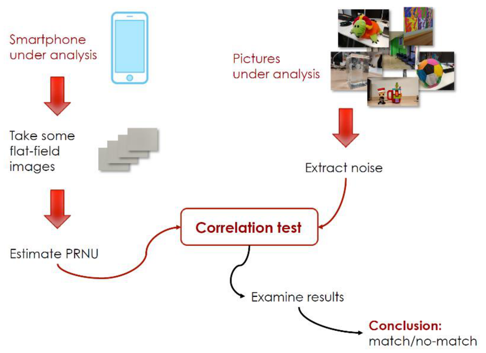
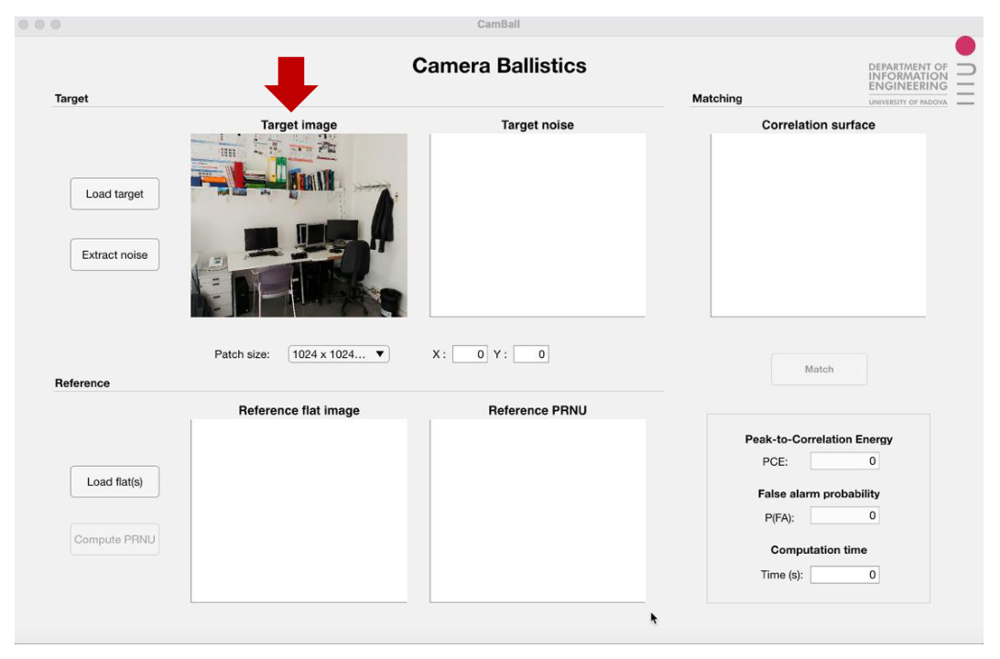

1. Take about **10–20 flat-field photos** with each candidate, for example of an evenly lit wall. Use enough light for a measurable sensor pattern and avoid clipping because saturated pixels lose intensity variation.
2. For each reference $I_i$, subtract its denoised version $F(I_i)$ to get $W_i=I_i-F(I_i)$. Estimate the device pattern pixel by pixel using $\widehat K=\sum_i I_iW_i/\sum_i I_i^2$.
3. For questioned image $J$, compare $W_J=J-F(J)$ with the expected pattern $J\widehat K$. Compute normalized cross-correlation across pixel shifts to test alignment. Peak-to-correlation energy (**PCE**) measures the peak against the background energy of the correlation surface. [PRNU estimation](../Lesson%209/9.%20Camera%20forensics%20and%20acquisition%20traces.md) · [PCE and false-alarm model](https://ws.binghamton.edu/fridrich/Research/EI7254-18.pdf)

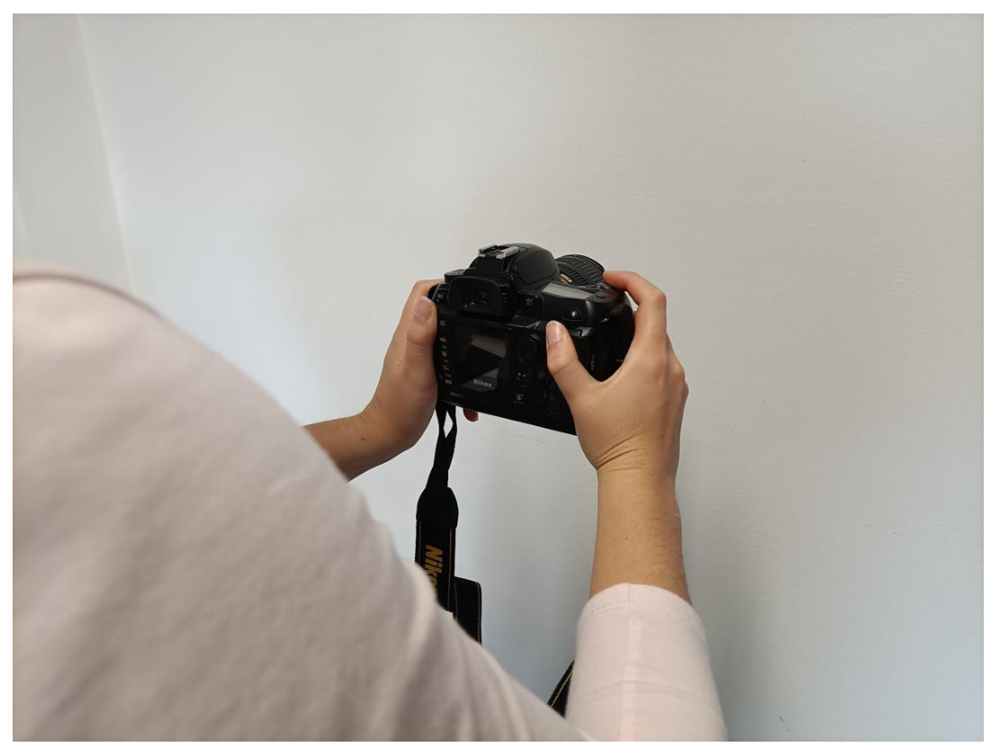
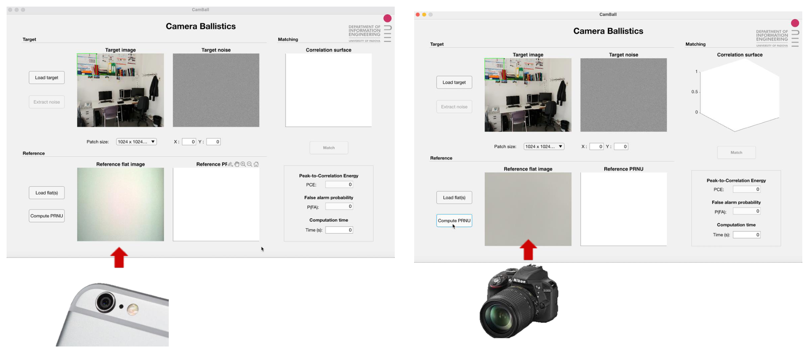

| Candidate | Result | Interpretation |
|---|---|---|
| Phone | No distinct correlation peak. Reported PCE $\approx -1.2$. | The test found no match. |
| Camera | One distinct peak at the matching shift. PCE $\approx 213$. | The test supports this camera as the source. |

Under the test's no-match model, the camera result had a false-alarm probability of about $10^{-48}$. This measures how rarely an unrelated device would score that high under the model.

Ordinary photos can serve as references if they reliably come from one device. Scene detail left after denoising can contaminate the estimate. WhatsApp recompression can weaken PRNU enough to prevent a match.

## Digital camera model

Light passes through the lens and color filters to the sensor. The camera digitizes the sensor readings and processes them into an image. Sensor imperfections and digital processing leave different traces.

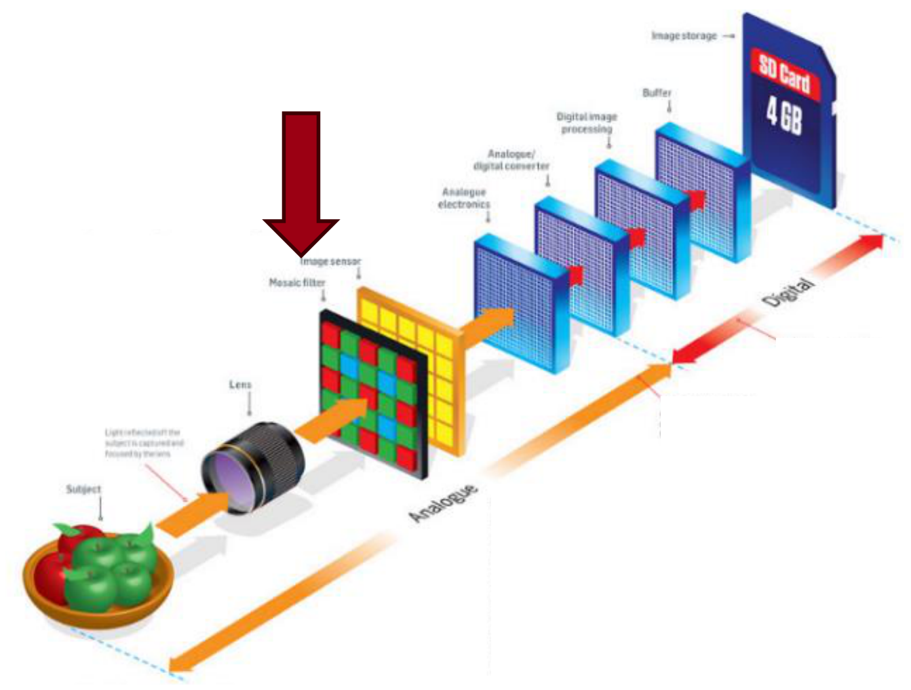

### Spectrum of colors

White light can contain many wavelengths. A prism separates them. An RGB display uses three primary channels to reproduce a range of perceived colors. Each filter or primary has its own spectral response.

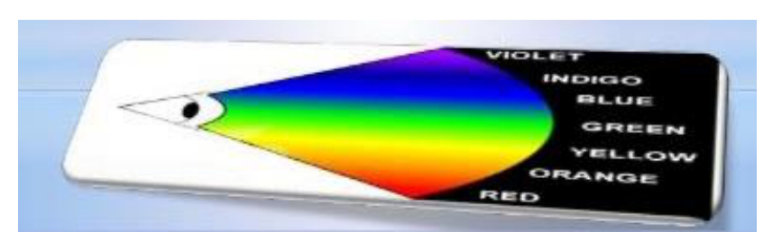
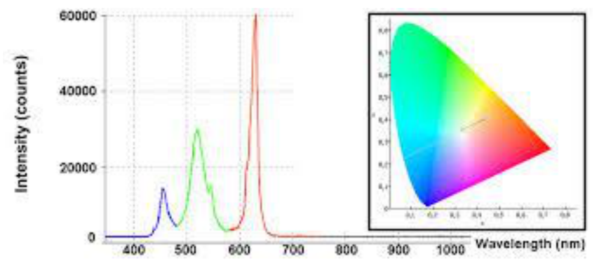

### Color sensors

A CCD or CMOS photosite integrates incoming light into a single reading. Color acquisition requires separating wavelengths.

- **Three-chip camera.** Prisms and filters split the incoming light into three bands, each measured by a separate sensor.
- **Single-chip camera.** A color filter array (**CFA**) lets each photosite measure one band. Firmware estimates the other two values at each site. This reconstruction is **demosaicing**.

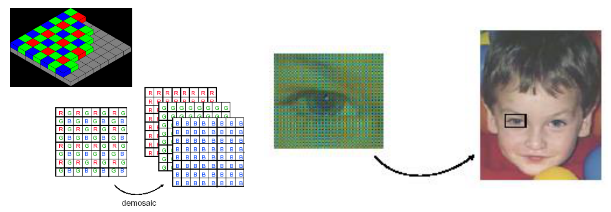

### CFA interpolation detection

A Bayer CFA repeats a $2\times2$ tile with two green, one red, and one blue site. Each reconstructed channel contains a regular arrangement of measured and estimated values. Values estimated from neighbors can retain periodic correlations.

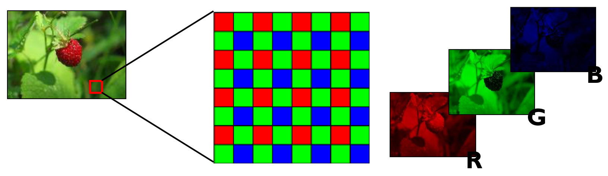

In the green example, estimate missing values in the first column from the measured samples immediately above and below. Row 2 gives $(10+12)/2=11$, and row 4 gives $(12+6)/2=9$.

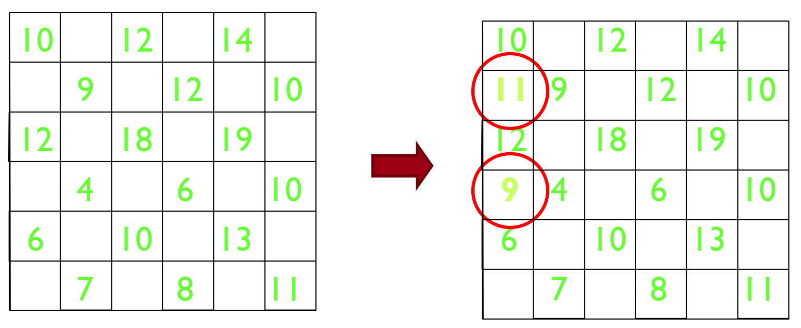

### Color interpolation

The available neighbors depend on the channel and CFA position. A basic interpolator averages along the relevant row or column. An edge-aware method can choose the smoother direction to avoid averaging across a sharp transition.

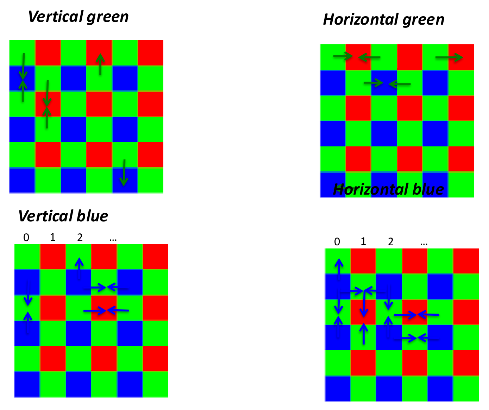

### Demosaicing artifacts

Fine detail can cause false color. In the lighthouse comparison, bilinear interpolation produces color along the fence and nearby edges. Methods A and B reduce it. Differences in interpolation can provide clues about the model or firmware that processed an image.

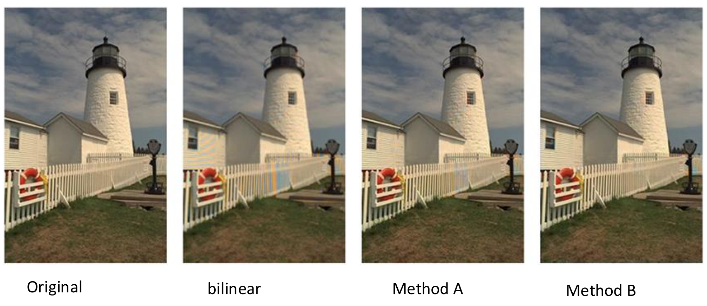

### Similarly…

Resizing creates correlations. In this example, a $6\times6$ grid expands to $6\times12$ by inserting columns between recorded samples. The first interpolated value is $(11+3)/2=7$. A region with a different resampling trace may have been processed separately. Legitimate resizing can leave the same trace. Acquisition traces also help distinguish scanner and camera images.

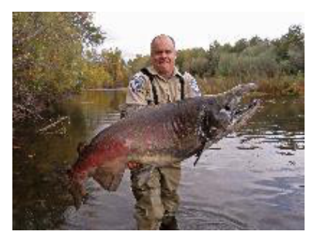
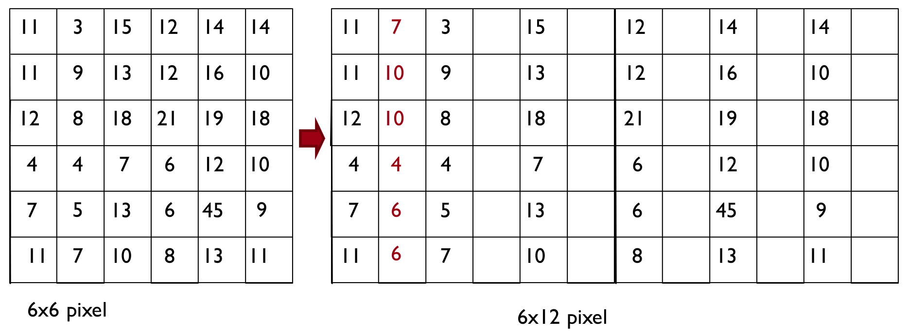

### A simple estimation approach

For one color channel, predict the pixel from a weighted sum of nearby values. The interpolation weights and which pixels follow that predictor are both unknown. Estimate them together, then test whether the predictable pixels follow a repeating pattern.

### Demosaicing detection

For channel values $I(x,y)$, use a $(2m+1)\times(2m+1)$ neighborhood $\mathcal N$ with offsets $(u,v)$. The center has weight $\alpha_{0,0}=0$ so the predictor uses surrounding pixels. [Popescu and Farid, CFA interpolation model](https://hfarid.org/downloads/publications/sp05a.pdf)

$$
\widehat I_d(x,y)=\sum_{(u,v)\in\mathcal N}\alpha_{u,v}I(x+u,y+v),\qquad
r(x,y)=I(x,y)-\widehat I_d(x,y).
$$

A small residual $r$ makes the interpolation model more plausible at that pixel.

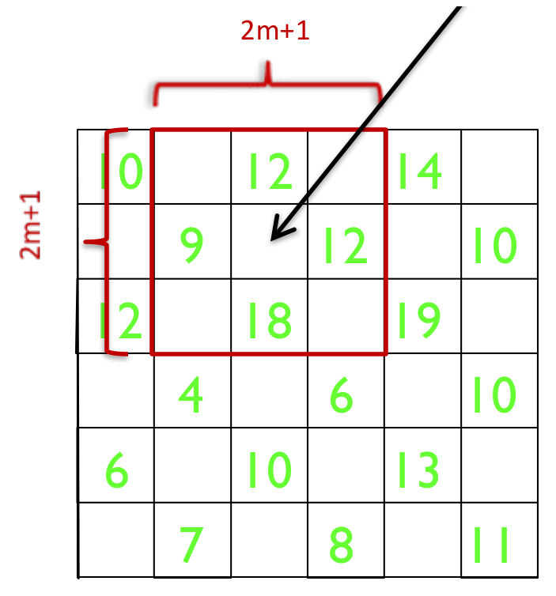

### Expectation-maximization: main description

Suppose points came from two Gaussian sources $A$ and $B$ with unknown labels. Start with estimates of the sources. Assign each point probabilities of belonging to either source, then refit each source with those probabilities as weights. The illustrated points have $(P(A),P(B))=(0.6,0.4)$ and $(0.2,0.8)$. Update the probabilities and refit until the estimates stabilize.

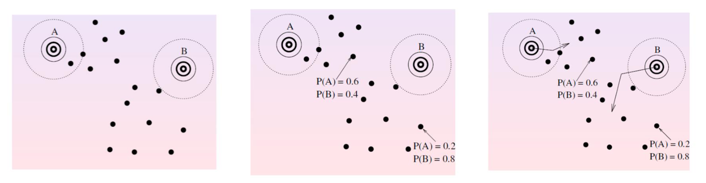

### Expectation-maximization

For observed samples $x_i$, hidden labels $z_i$, and parameters $\theta$, the observed log-likelihood is $\ell(\theta)=\sum_i\log\sum_z p(x_i,z\mid\theta)$. For label distributions $q_i(z)$, Jensen's inequality gives

$$
\ell(\theta)\ge
\sum_i\sum_z q_i(z)\log\frac{p(x_i,z\mid\theta)}{q_i(z)}.
$$

1. **E-step.** Set $q_i(z)=p(z\mid x_i,\theta_{\mathrm{old}})$. The bound then equals the log-likelihood at the current parameters.
2. **M-step.** Keep $q_i$ fixed and maximize the bound over $\theta$. Repeat both steps to convergence.

The bound follows from the concavity of $\log$. [Dempster, Laird and Rubin, EM algorithm](https://doi.org/10.1111/j.2517-6161.1977.tb01600.x)

### Demosaicing detection

- **E-step.** Model the residual of a predicted pixel as zero-mean Gaussian with variance $\sigma^2$. For the other class, use a uniform density $1/\delta$, with $\delta$ the range of possible values. With equal class priors, the posterior probability of interpolation is

  $$
  w(x,y)=\frac{L_{\mathrm{int}}}{L_{\mathrm{int}}+1/\delta},
  \qquad L_{\mathrm{int}}=\frac{1}{\sigma\sqrt{2\pi}}
  \exp\!\left(-\frac{r(x,y)^2}{2\sigma^2}\right).
  $$

- **M-step.** Refit $\alpha$ by minimizing $\sum_{x,y} w(x,y)r(x,y)^2$ and update the residual variance. Repeat, then arrange the final posterior probabilities $w(x,y)$ as a **probability map**. [Popescu and Farid, E-step and weighted least-squares update](https://hfarid.org/downloads/publications/sp05a.pdf)

### Examples

Take the magnitude of the two-dimensional Fourier transform of the probability map. In the CFA example, regularly spaced interpolation sites produce distinct spectral peaks. The comparison image has a diffuse spectrum. Image texture, resizing, and compression can affect the pattern, so interpret the peaks alongside other traces.

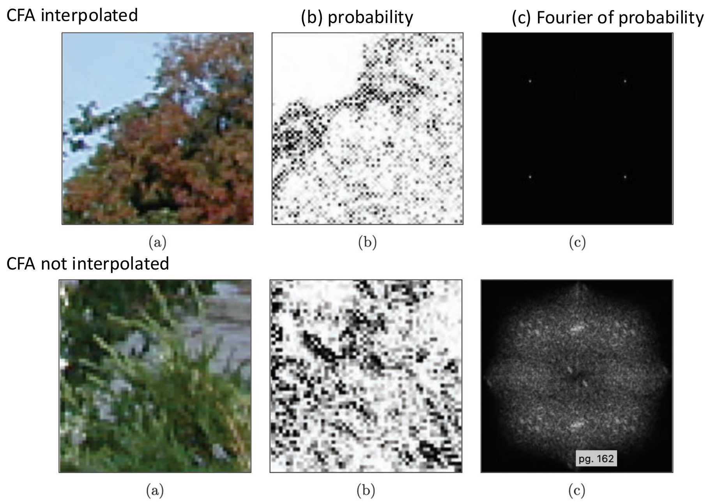

## Compression

### Coding

A coding standard specifies the bitstream structure and how to decode it. Encoders can make different decisions about quantization, rate control, and motion search while generating valid streams. Those decisions can leave clues about the encoder and its settings.

### Lossless and lossy coding

- **Lossless** coding reconstructs the input exactly by exploiting redundancy. An analogy is Morse code, where common **E** uses one dot and rarer **J** uses a dot and three dashes. ZIP is a lossless format. GIF applies lossless LZW coding to palette indices. Producing the palette from a full-color image can discard colors. [GIF89a specification](https://giflib.sourceforge.net/gifstandard/GIF89a.html)
- **Lossy** coding accepts reconstruction error to use fewer bits. Baseline JPEG and MP3 are examples. JPEG 2000 supports both reversible and irreversible coding.

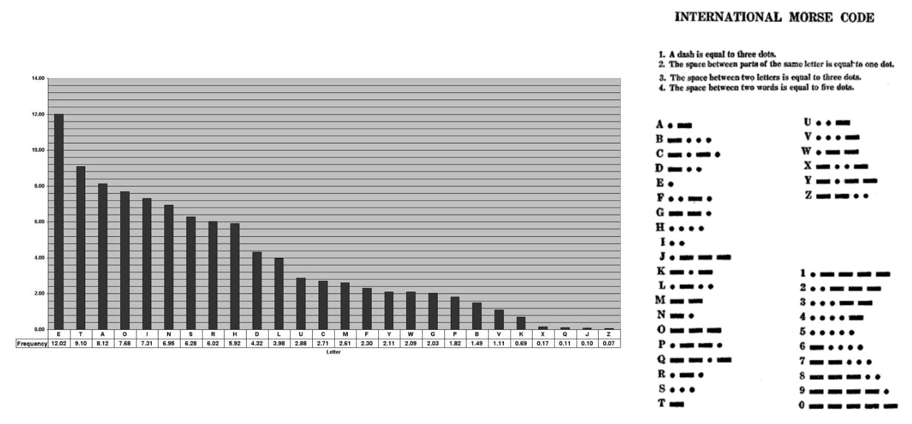

### Lossy coding

**Rate–distortion** compares reconstruction error with the bit rate needed to achieve it. Full-reference measures use the source as a reference. For $N$ samples $a_i$ and reconstructed values $b_i$,

$$
\mathrm{MSE}=\frac{1}{N}\sum_i(a_i-b_i)^2,\qquad
\mathrm{PSNR}=10\log_{10}\frac{255^2}{\mathrm{MSE}}\quad\text{for 8-bit samples}.
$$

Higher PSNR means lower MSE. **SSIM** compares luminance, contrast, and structure using local means $\mu_a,\mu_b$, variances $\sigma_a^2,\sigma_b^2$, covariance $\sigma_{ab}$, and stabilizing constants $c_1,c_2$. [Wang et al., SSIM](https://ece.uwaterloo.ca/~z70wang/publications/ssim.pdf)

$$
\mathrm{SSIM}(a,b)=
\frac{(2\mu_a\mu_b+c_1)(2\sigma_{ab}+c_2)}
{(\mu_a^2+\mu_b^2+c_1)(\sigma_a^2+\sigma_b^2+c_2)}.
$$

No-reference metrics estimate quality from the reconstructed image alone. Subjective tests ask viewers to rate perceived quality. The plot compares the bit rates the two encoders use to reach given PSNR values.

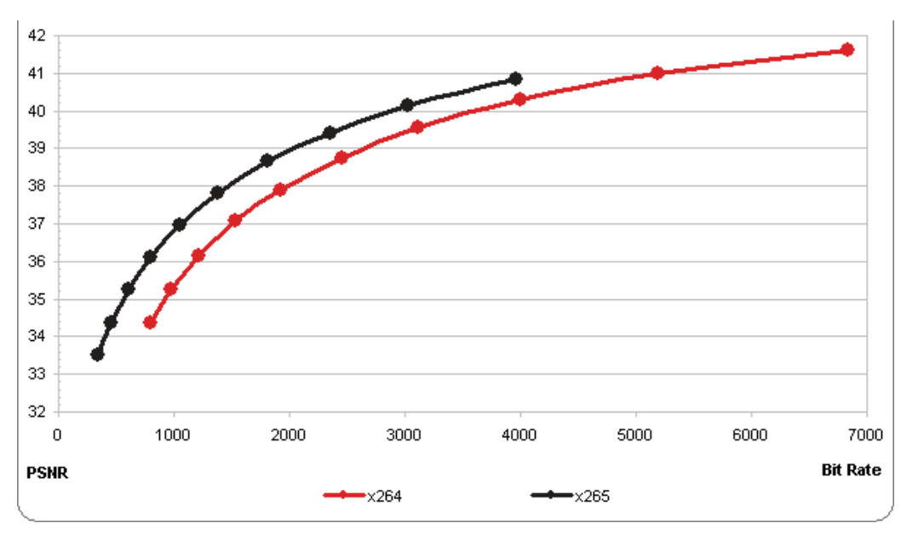

### Example

Using the JPEG measurements and a 24-bit RGB reference, divide 24 by the compressed bits per pixel to obtain the size reduction.

| Quality factor | PSNR | Compressed rate | Compressed to original |
|---|---:|---:|---:|
| 90 | 41.26 dB | 2.31 bpp | $24/2.31\approx10.4$, about $1:10$ |
| 10 | 31.98 dB | 0.31 bpp | $24/0.31\approx77.4$, about $1:77$ |

At QF 10 the sky shows more visible blocks and lower fidelity. QF is an encoder control.

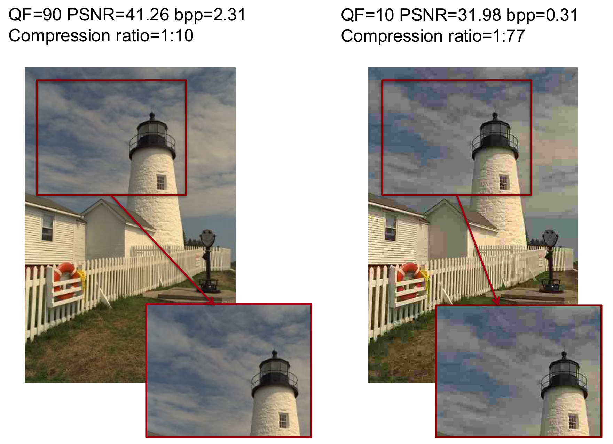

### JPEG coding scheme

1. Typical JPEG/JFIF color encoding converts RGB to **YCbCr** and may subsample the chroma channels.
2. Split components into $8\times8$ blocks and apply the **discrete cosine transform (DCT)**. Divide the coefficients by their quantization steps and round.
3. Encode the DC difference from the preceding block of that component. Scan the AC coefficients in zigzag order and encode runs of zeros. Baseline JPEG uses Huffman entropy coding.

Chroma subsampling and coefficient quantization discard information. YUV is used here as shorthand for the luma/chroma conversion. [JPEG standard, Annex A](https://www.w3.org/Graphics/JPEG/itu-t81.pdf) · [JFIF color convention, § 6.2](https://www.itu.int/rec/dologin_pub.asp?id=T-REC-T.871-201105-I%21%21PDF-E&lang=e&type=items)

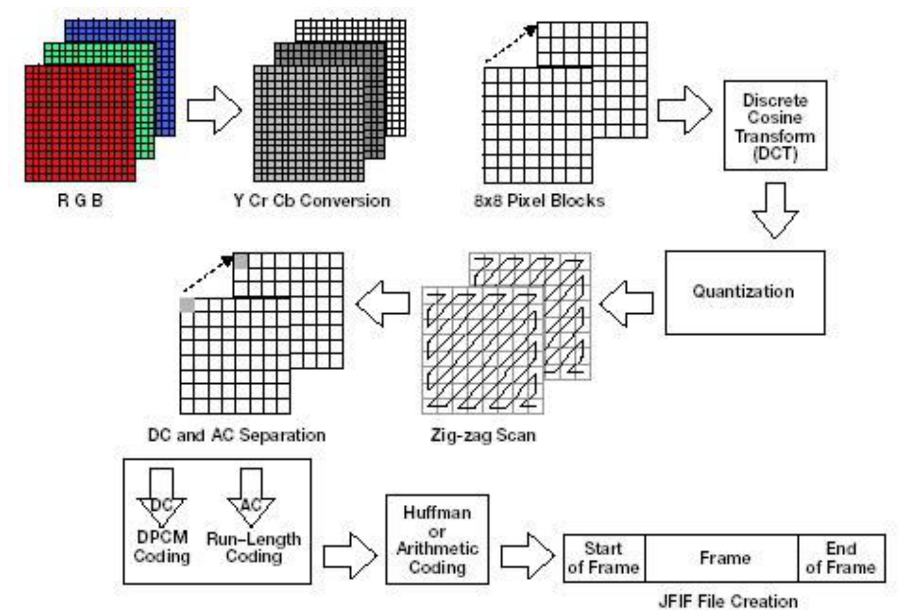

### Frequency representation

For a smooth block, the DCT often concentrates most energy into a few low-frequency coefficients. The top-left **DC** coefficient represents the block average up to scaling and level shift. The **AC** coefficients represent variation. Small coefficients can become zero after quantization, which reduces the number of values to code.

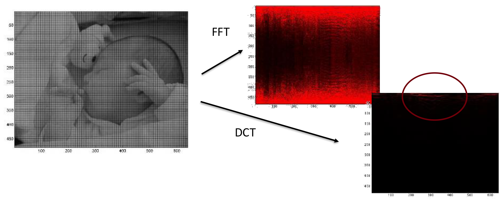
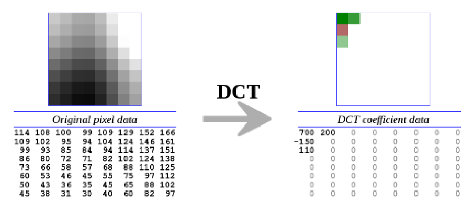

### Quantization & blocking artifacts

For $q=2$, floor $x/q$. With $x=(39,38,37,38)$, the indices are $(19,19,18,19)$. Multiplying by $q$ reconstructs $(38,38,36,38)$, so $x-\widetilde x=(1,0,1,0)$. JPEG DCT quantization normally rounds to the nearest integer. [JPEG standard, § A.3.4](https://www.w3.org/Graphics/JPEG/itu-t81.pdf)

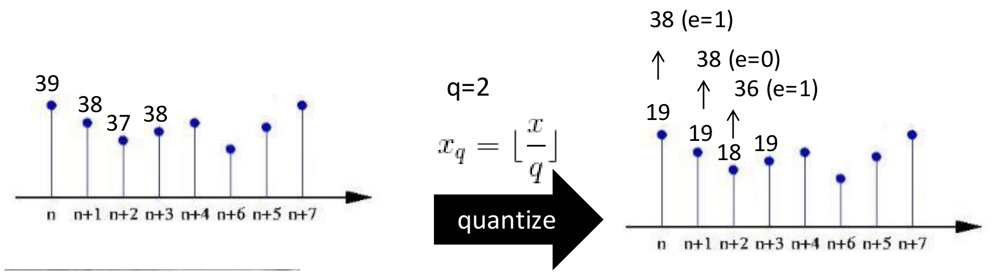

Coarser quantization generally reduces the bit rate and increases distortion. Processing blocks independently can make their boundaries visible (**blocking**). Losing high-frequency detail around sharp edges can produce ripples (**ringing**).

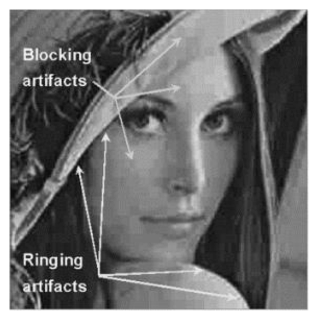

### Frame building

JPEG markers identify the start and end of the image, its frame and scans, and tables needed for decoding. The frame gives dimensions, components, and sampling factors. The scan identifies its components and entropy table selectors. Quantization and Huffman tables describe decoding parameters. APP1 can hold Exif metadata. Layout choices and table values can help compare encoders. [JPEG standard, Annex B](https://www.w3.org/Graphics/JPEG/itu-t81.pdf)

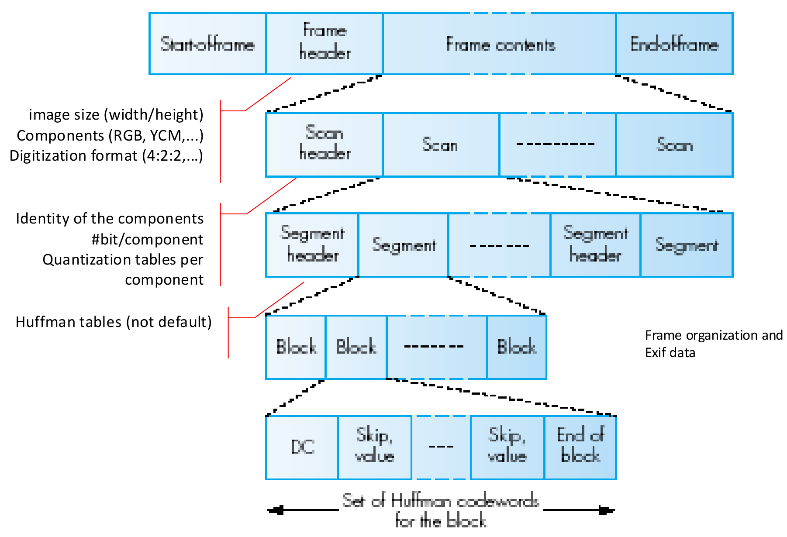

### Similar strategies for audio: MP3

MP3 (**MPEG-1 Audio Layer III**) uses a filter bank and transform to represent sound in frequency bands. A psychoacoustic model estimates masking, where a strong sound makes nearby components or quantization noise less audible. The encoder uses this estimate to allocate bits, quantize and code the coefficients, then format the bitstream.

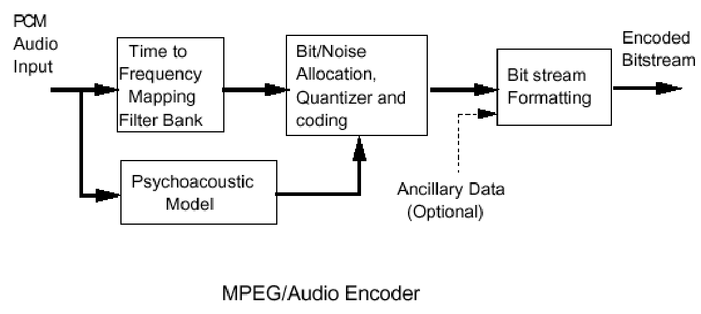

### Generic predictive video coding architectures

Neighboring frames share much of their content. For a block in frame $t$, the encoder searches a window in a decoded reference frame $t-k$. The displacement $(d_x,d_y)$ is a **motion vector**. It signals the selected predictor and codes the residual, $\text{current block}-\text{predicted block}$.

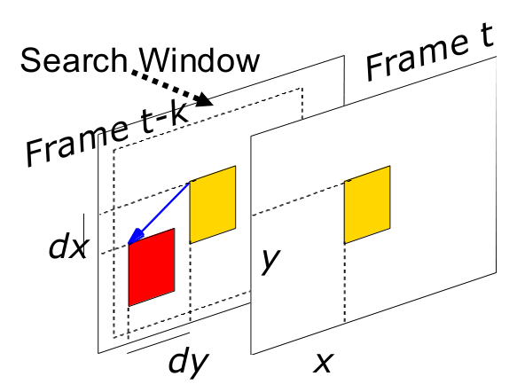
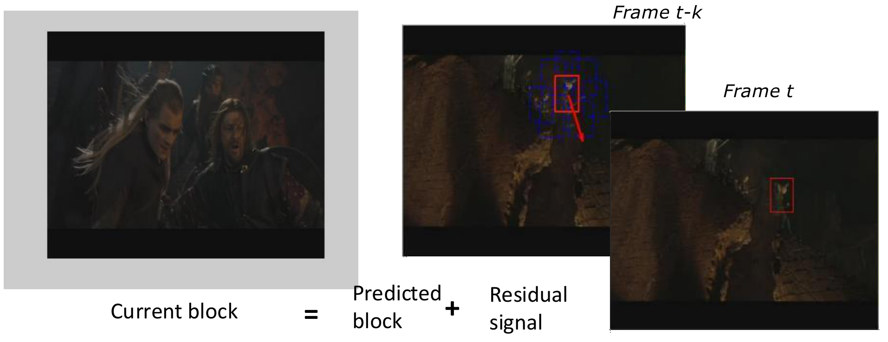

### Example: MC-prediction for two consecutive frames

The two traffic frames differ because the cars move. Motion-compensated blocks predict most of the current frame. The residual is prominent around moving objects and newly exposed regions. Adding the residual back to the prediction reconstructs the current frame, subject to coding loss.

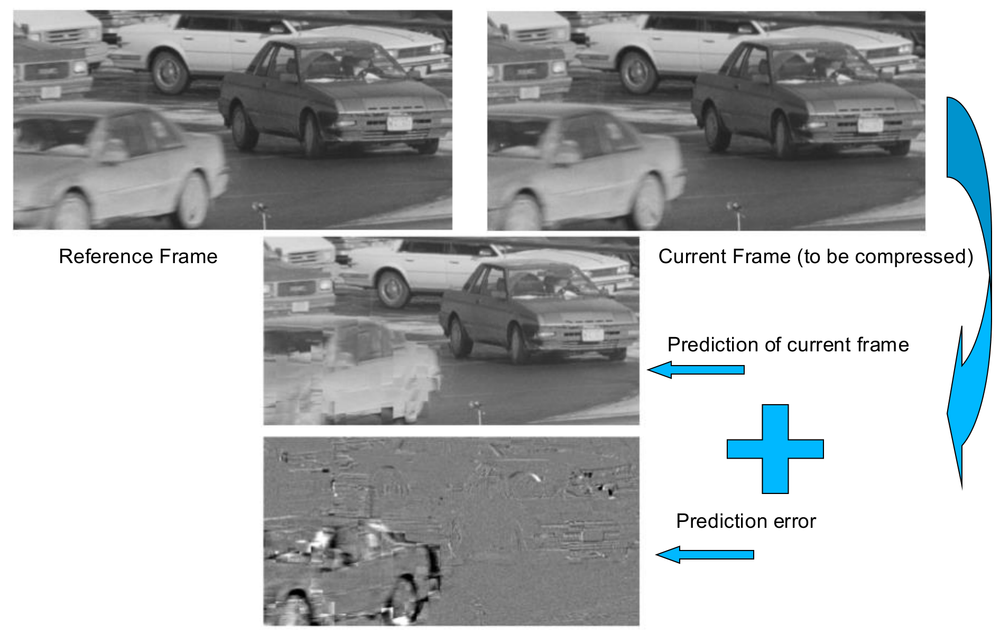

### Constant bit rate

**Constant bit rate (CBR)** targets a fixed bit rate. With the same bit budget, motion or fine detail can raise distortion. At **250 kbit/s** and **1 Mbit/s**, quality varies with both rate and content.

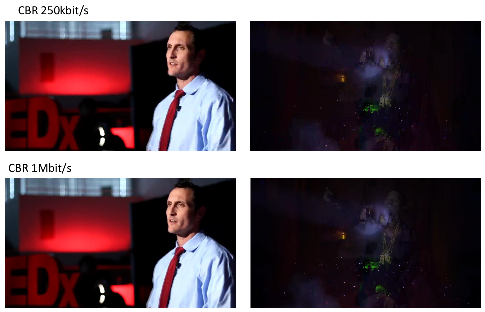

### Constant quality

In **constant rate factor (CRF)** mode the encoder varies the bit rate with content to target a quality level. In this example, lowering CRF from 45 to 27 increases one file from **665 KB to 2.0 MB**, and another from **1.2 MB to 5.3 MB**.

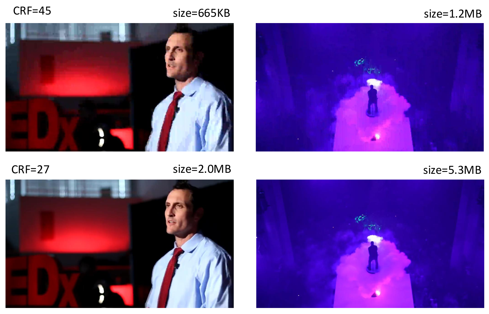

### Coding current image and video compression standards

JPEG and JPEG 2000 encode still images. H.26x and MPEG standards cover uses such as video calls, disc storage and digital television. H.265 is also called HEVC and H.266 is VVC. Ogg and WebM package coded streams in containers. [ITU-T H.266](https://www.itu.int/rec/T-REC-H.266) · [Xiph, Ogg](https://xiph.org/ogg/) · [WebM Project](https://www.webmproject.org/about/)

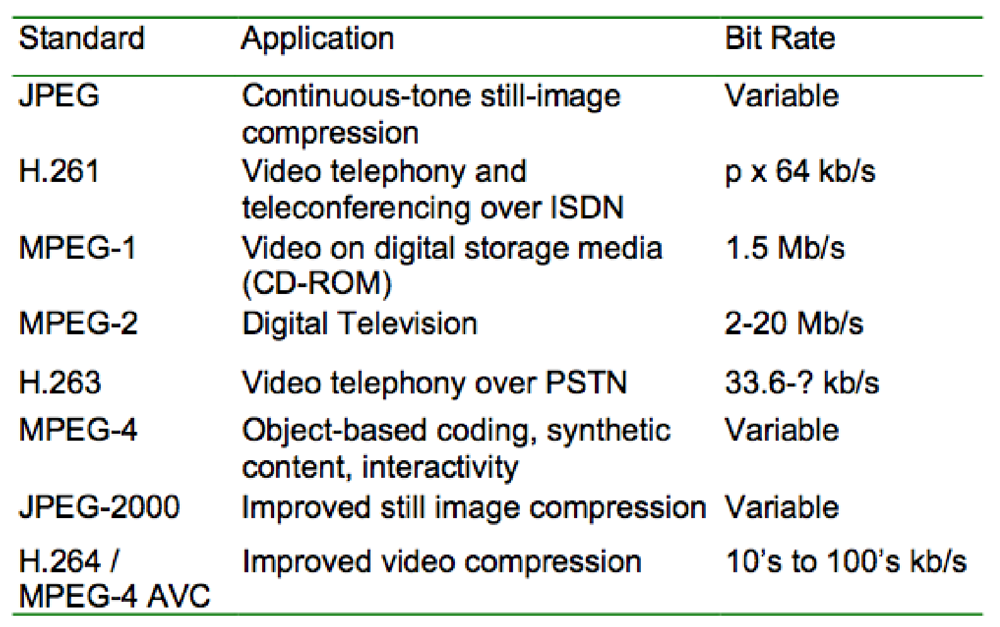

### JPEG compression footprints

Look for discontinuities aligned with the $8\times8$ grid, quantization patterns in DCT coefficient distributions, and coding parameters stored in the file. A smooth distribution before quantization can acquire regularly spaced occupied bins after discretization. This matters when the current file has been exported in another format and its visible encoding parameters no longer describe earlier processing.

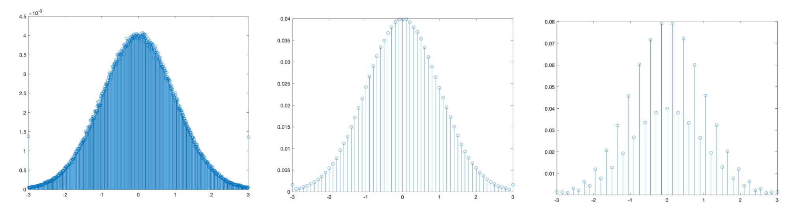

### Double (multiple) JPEG compression

The goal is to detect an earlier JPEG pass and, where possible, infer its parameters. With aligned block grids, an idealized coefficient $c$ becomes a multiple of $Q_1$ after the first quantization and reconstruction. Its quantized bin after the second pass is

$$
b_2=\operatorname{round}\!\left(\frac{Q_1}{Q_2}
\operatorname{round}\!\left(\frac{c}{Q_1}\right)\right).
$$

- **$Q_1=3,\ Q_2=2$.** Some second-pass bins are unreachable in this model. For example, first-pass reconstructed values $0,3,6$ give second-pass bins $0,2,3$ with half-integer ties rounded upward.
- **$Q_1=2,\ Q_2=3$.** Reconstructed values 2 and 4 both map to bin 1. Merging bins produces alternating high and low counts. In both comparisons, the single-compression histogram uses the same final step $Q_2$.

Periodic gaps or peaks and coefficient statistics such as leading digits can support a previous-compression hypothesis. For instance, if an already compressed beach photo is combined with an uncompressed portrait and saved as JPEG, the regions can have different compression histories. Equal steps and shifted block grids can obscure the illustrated pattern. Ordinary re-saving can also cause double compression.

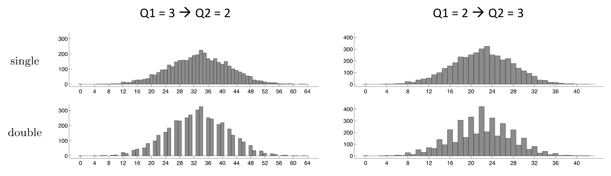

### Social media statistics

Upload pipelines can resize and recompress images. The illustrated Facebook, Twitter, and Flickr coefficient distributions differ even at the same final quality factor. Such differences can help infer how an image was processed.

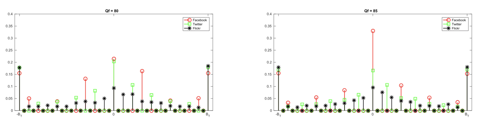

**FusionNET** combines DCT histograms with noise residuals to classify image patches. The confusion matrix shows, for example, that **91.31%** of Facebook patches in the study were labeled Facebook. This is a benchmark result for the tested platform pipelines and data. [Amerini et al., FusionNET](https://iris.uniroma1.it/retrieve/e3835323-897d-15e8-e053-a505fe0a3de9/Amerini_Social-Network-Identification_2019.pdf)

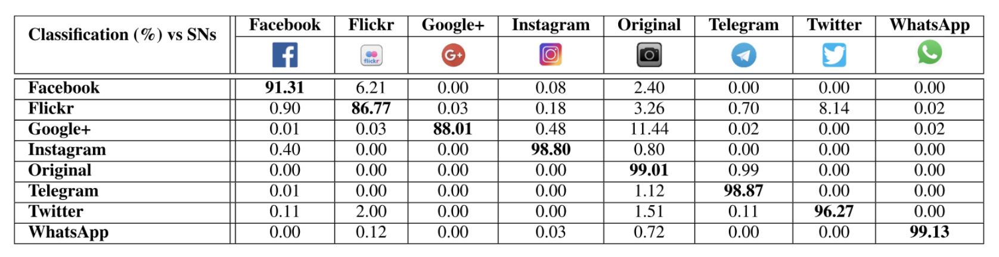

## Digital audio recorders

### Digital audio

Sound is a pressure variation traveling through a medium. The arriving wave moves the microphone diaphragm, just as it moves the eardrum. The microphone converts that motion into a varying voltage.

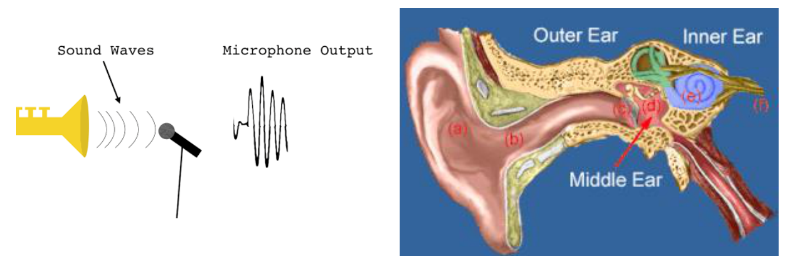

### Digital audio acquisition

Amplify the microphone voltage and send it to an analogue-to-digital converter (**ADC**). **Sampling** takes readings at discrete times. **Quantization** maps each reading to a discrete amplitude level. Store the resulting sequence of numbers. CD audio uses **44.1 kHz**. G.711 narrowband telephony uses **8 kHz**. [ITU-T G.711](https://www.itu.int/rec/t-rec-g.711-198811-i/en)

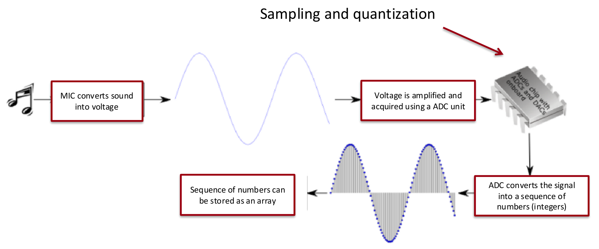

### From soundwave to voltage

In a **condenser microphone**, the diaphragm and a fixed backplate form a capacitor. Sound changes the gap and therefore the capacitance. A biased circuit turns the variation into an electrical signal.

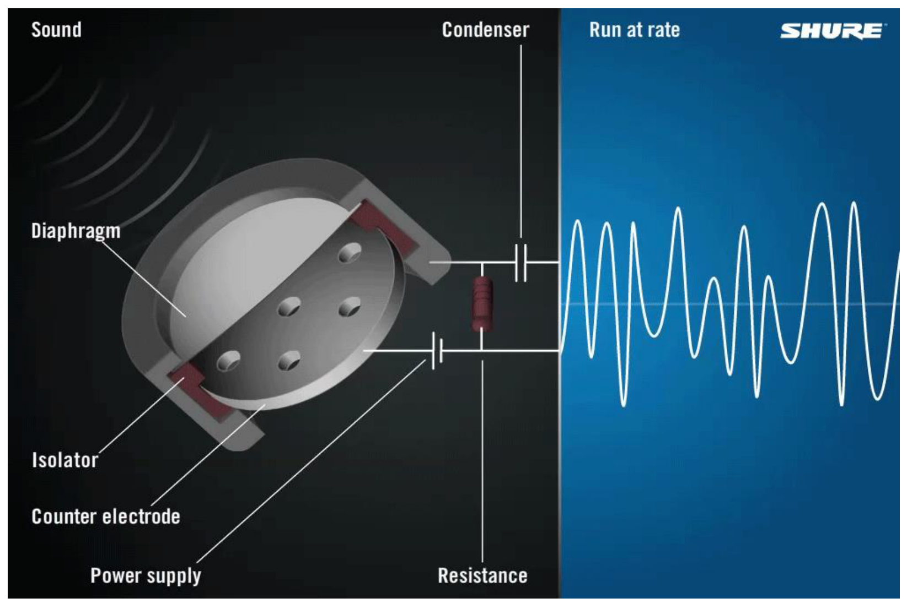

### Digital audio reproduction

A digital-to-analogue converter (**DAC**) and reconstruction filter turn the stored samples into a continuous voltage waveform. An amplifier drives the loudspeaker, which produces pressure variations in the air.

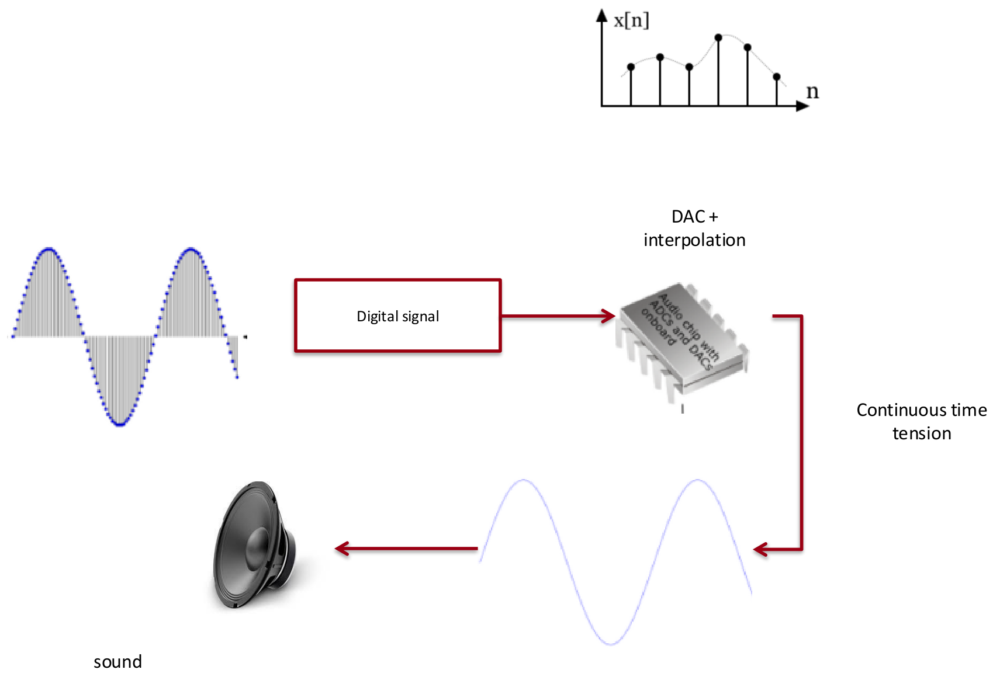

### Viceversa

In a dynamic loudspeaker, current through a voice coil in a magnetic field moves the coil and its cone. The cone's motion produces the outgoing sound wave.

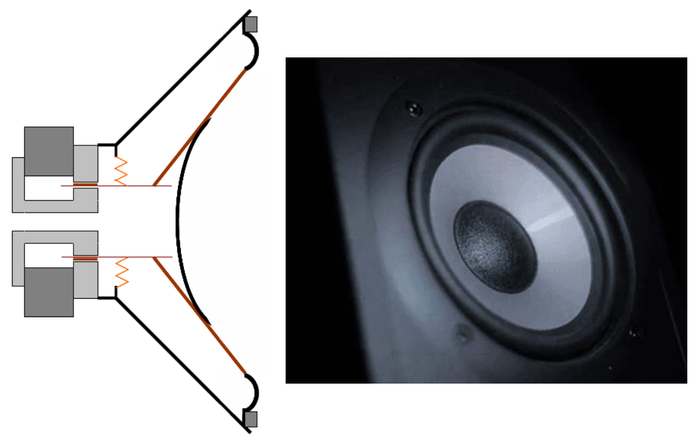

## Audio forensics

### Authentication of digital audio

**Integrity** asks whether audio was cut, spliced, mixed, filtered, or recompressed. Discontinuities in background noise, room acoustics, or electrical hum can suggest an edit. **Authenticity** asks whether the inferred microphone, room, and recording chain fit the claimed origin. Playback and re-recording can add traces of a second chain.

### Electrical network frequency (ENF) analysis

Electrical hum or power electronics can imprint the **electrical network frequency** on a recording. It fluctuates slightly around its nominal **50 or 60 Hz**. Light flicker can carry a related trace in video. Comparing the estimated trajectory with a time-stamped reference can help date a recording, assess continuity, or associate it with a power grid. Devices and rooms on a synchronous grid can share the same fluctuations. [Garg et al., ENF-based location inference](https://drum.lib.umd.edu/items/1c5d57eb-866c-4df7-9aed-3b13220709a0)

1. Use the **short-time Fourier transform (STFT)** on overlapping windows. Retain frequency bands of width $f_B$ around the nominal fundamental $f_0$ and its harmonics $kf_0$.
2. For each window, form $S(f)=\sum_{k=1}^{L}w_kP_{B,k}(kf)$. Here $P_{B,k}$ is the power spectrum near harmonic $k$, $w_k$ its weight, and $f$ a candidate frequency near $f_0$. Track the peak of $S(f)$ through time.
3. Compare the trajectory with a reference, or use features such as its mean, variance, and autoregressive coefficients to classify a grid. [Hajj-Ahmad et al., ENF grid classification](https://mast.umd.edu/files/paper_ENF/conf_paper7_WIFS13.pdf)

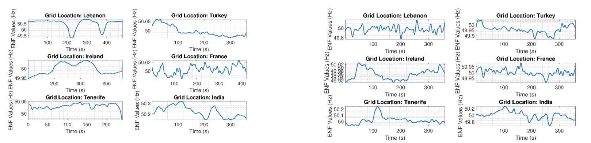

### Sound propagation

Sound travels through air at about **343 m/s at 20 °C**. Travel time depends on path length and the speed in the medium. Reflections change the path. Spreading and absorption reduce amplitude. The attenuation plot shows that air absorption also varies with frequency and humidity.

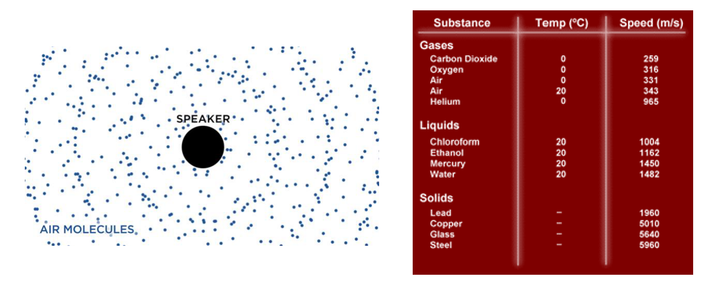
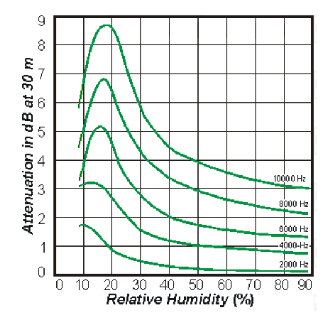

### Reverberation and event localization

A microphone receives the direct sound and delayed, attenuated reflections. In the schematic, the direct path arrives at **0.3 s**, the floor reflection at **1 s**, and the longer reflected path at **2.9 s**. The reflected paths arrive **0.7 s** and **2.6 s** after the direct sound.

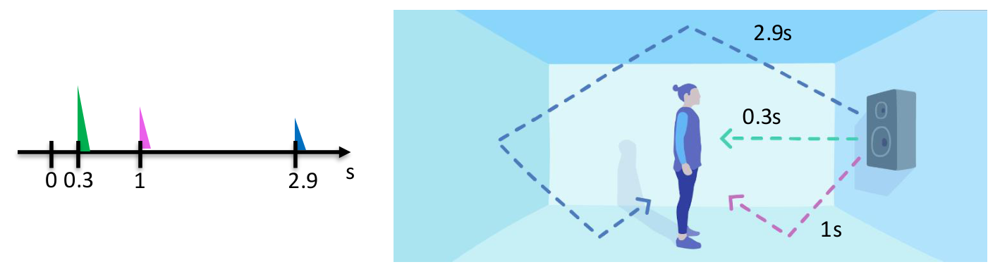

The **room impulse response** $h(t)$ describes how the surroundings transform a short pulse. For source signal $x(t)$ the received signal can be modeled as $y(t)=(x*h)(t)$. The church example has a longer reverberant tail than the Troller’s Gill example. Arrival delays and decay can provide clues about the space and the source–microphone geometry.

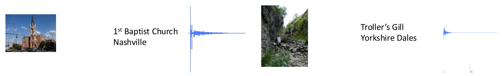

### Microphone’s structure

Microphones differ in transducer type (**dynamic**, **condenser**, **electret condenser**), sensitivity, frequency response, and directionality. A **polar pattern** shows sensitivity versus arrival angle. An omnidirectional microphone responds similarly at all angles in the plotted plane. Directional patterns favor some angles.

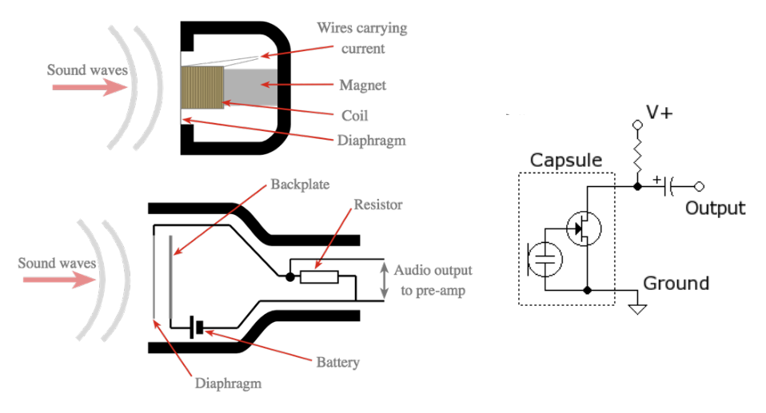
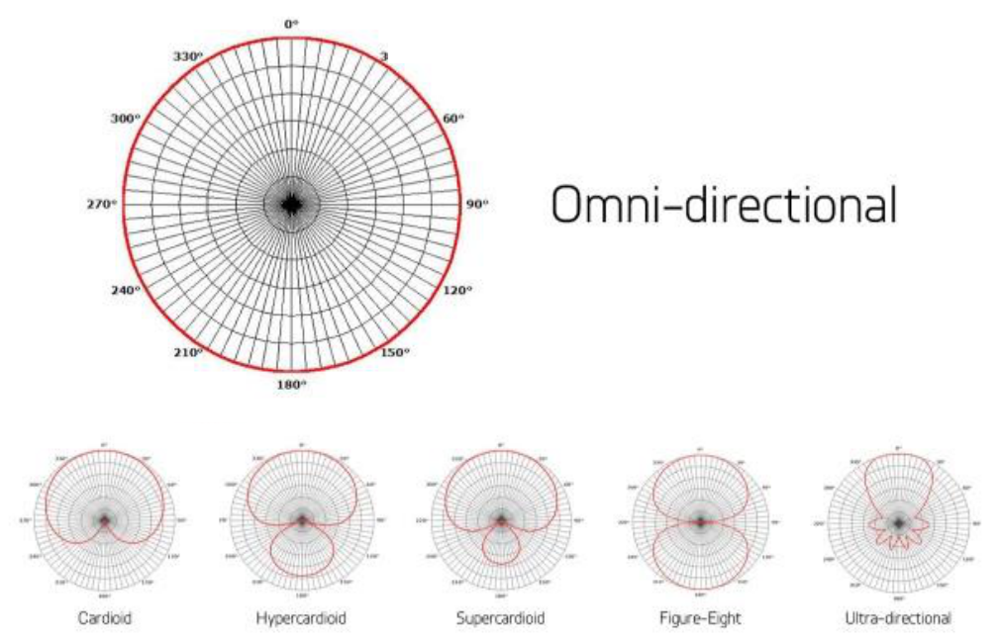

The iPhone, iPhone 3G, and iPhone 3GS curves show differences in the frequency response of the recording chains. The room, sound source, and processing can also affect the observed spectrum.

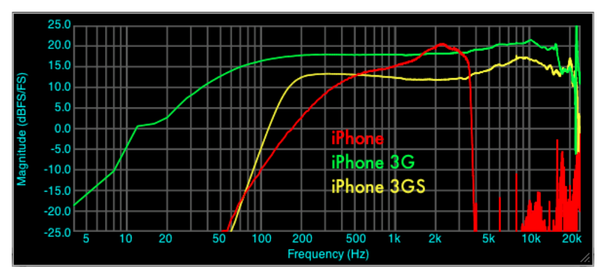

### Feature extraction

Train a microphone classifier on labeled recordings. Extract the same features from the questioned recording and compare them with the trained models.

- **LPCC** are linear prediction cepstral coefficients.
- **PLP** uses perceptual linear prediction. The corresponding predictive coefficients are labelled **PLCPP**.
- **MFCC** are mel-frequency cepstral coefficients.

The histograms show that individual feature distributions can overlap between microphones. A classification result depends on the feature set, training data, and recording conditions.

