# Multimedia integrity

## Digital editing of pictures: pictures and information

Editing can change what a photograph communicates by moving objects, combining scenes or changing how a person appears. Examples include repositioned pyramids on a magazine cover, different treatments of a portrait, a composite news photograph and disputed football frames.

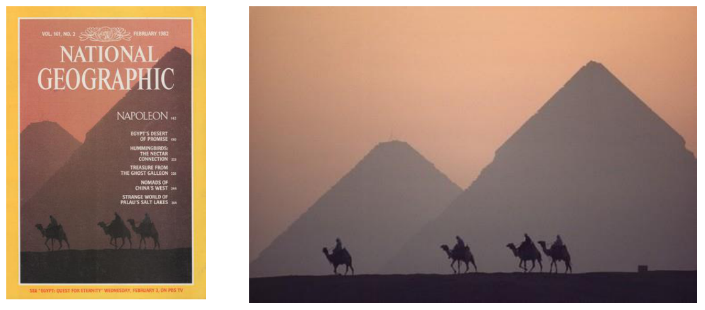
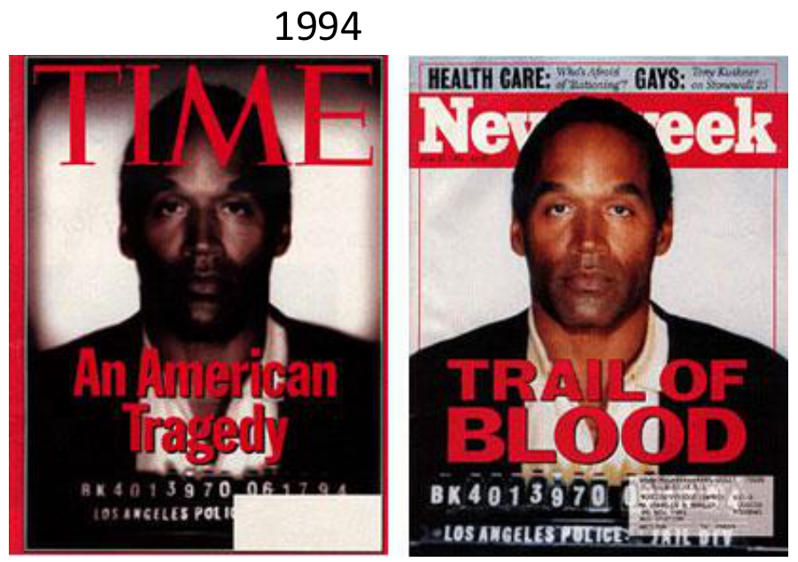
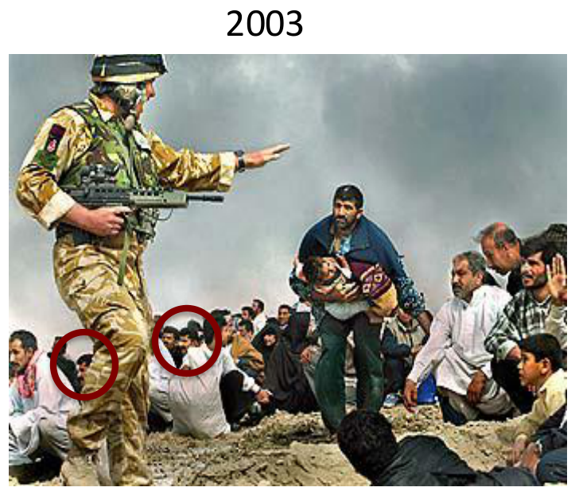
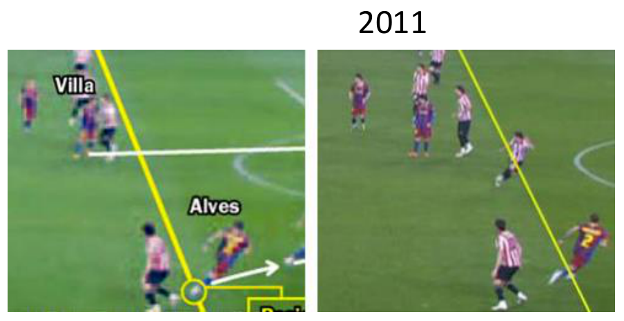

## Scientists do fakes too…

In science, edited figures can misrepresent observations and undermine independent verification. Compare repeated or altered structures in gels, astronomical images, and radiographs.

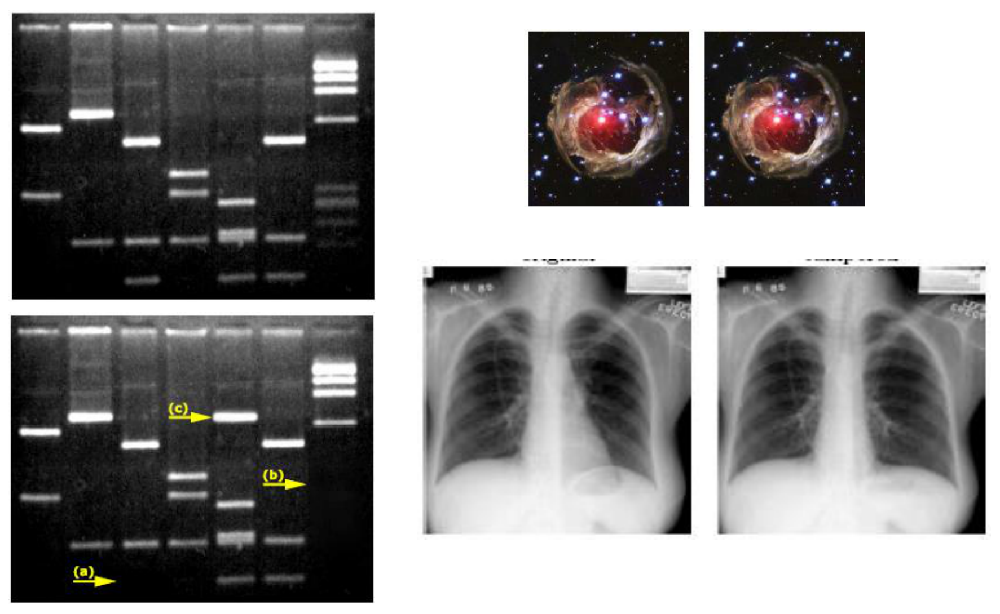

## Fake images from computer graphics

Computer graphics can produce photorealistic images. A single image can contain both a photographed face and a rendered body, as in the fashion examples. Visual plausibility alone is weak evidence of origin.

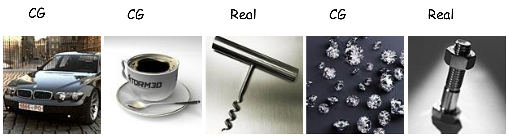
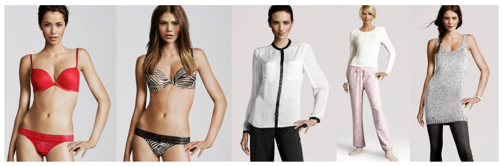

## Image forgery

**Manipulation** changes image contents while concealing the change. **Splicing** combines material from different images. **Copy-move** reuses material within the same image. Either can add or conceal objects.

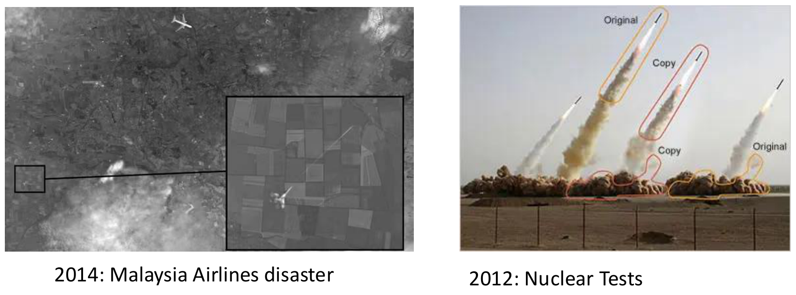

### Basic principle: homogeneity

Regions acquired and processed together should have compatible forensic traces. Compare local measurements across the image. A pasted butterfly may carry traces of its source image even where it blends visually into the host.

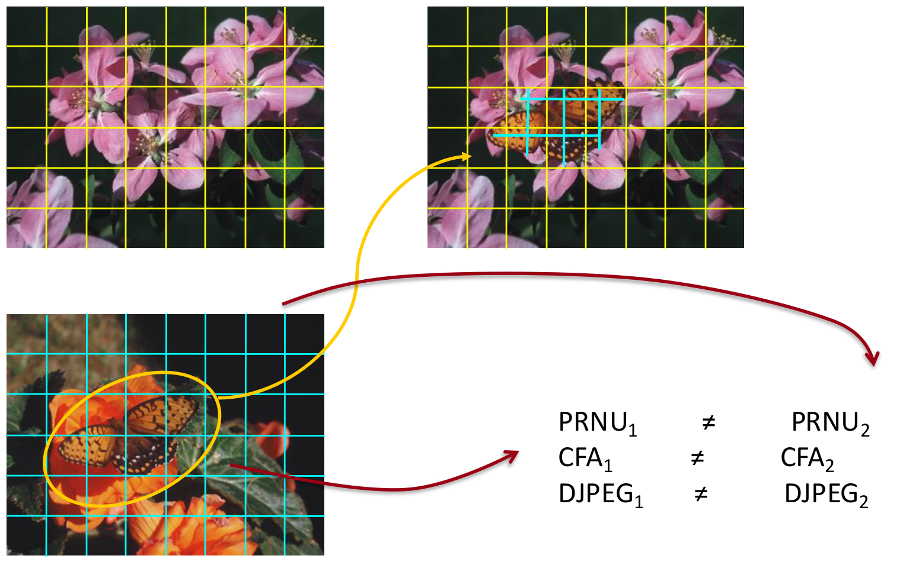

### Check consistency/inconsistency of footprints

- **Acquisition:** Photo-response non-uniformity (PRNU) can indicate a sensor, while the color filter array (CFA) and demosaicing leave interpolation patterns.
- **Processing:** Resizing, smoothing, and other edits can change interpolation or local correlation. JPEG coding parameters and signs of recompression can reveal different histories across regions.
- **Scene and sources:** Illumination, geometry, and motion should agree with the scene. A close match to part of another image can identify material worth tracing.

A mismatch raises suspicion. Compare several traces because local image content and ordinary processing also affect measurements.

### Similarity alarm: duplicate elements

Scan overlapping windows or match local features such as SIFT descriptors. An unusually close match between spatially separated regions can flag a copy-move. In the example, copied foliage covers a truck. Matching establishes correspondence. The direction of copying requires other evidence.

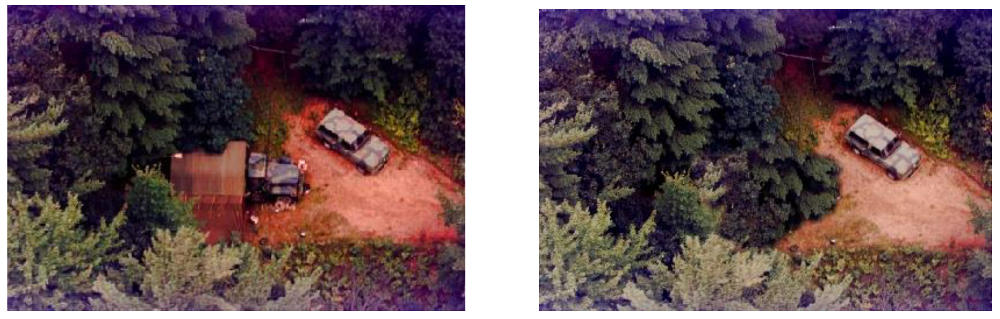
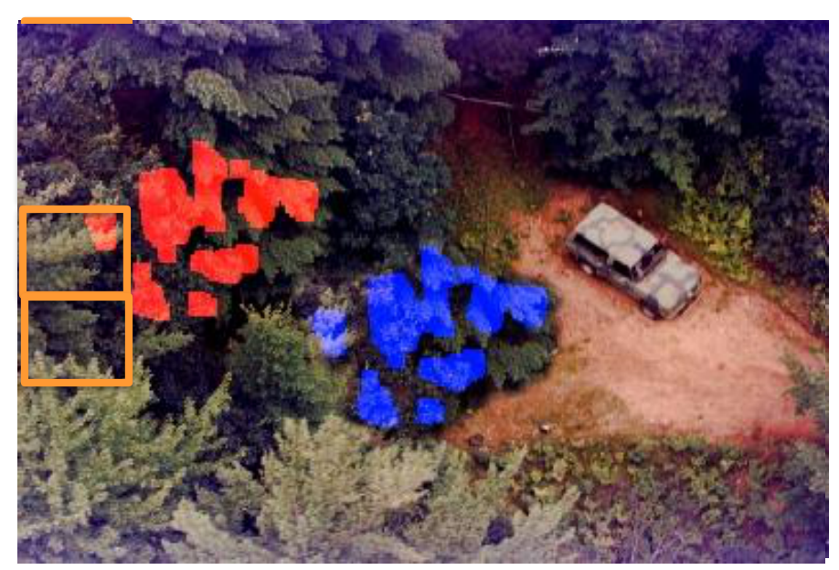

### Forensically example

The questioned JPEG shows a flying saucer over a mountain valley. The demonstration combines several checks.

1. **Clone detection.** Increasing the minimum similarity threshold removes weaker matches. Several cloud matches persist, supporting the inference that clouds were copied.
2. **Error level analysis (ELA).** Recompress the image as JPEG and map the differences from the input. In the demonstration, quality near 90 made certain regions stand out. Lower quality produced more widespread distortion. Compare similar textures and edges because the residual also depends on image content.
3. **Noise and gradients.** Noise differs noticeably across some regions. The luminance gradients show little separation in this example.
4. **Metadata and thumbnail.** Camera metadata and GPS are consistency checks. The location fits the Alpine scene. The embedded thumbnail shows an earlier scene with a paraglider, supporting the reconstruction that the scene was rearranged, clouds concealed parts of it, and the saucer was inserted. Software can preserve, rewrite, or strip metadata and thumbnails.

A local AI edit may leave a regional discrepancy. Regenerating the whole image may leave a global generator signature, which gives limited information about how much of the original scene survives.

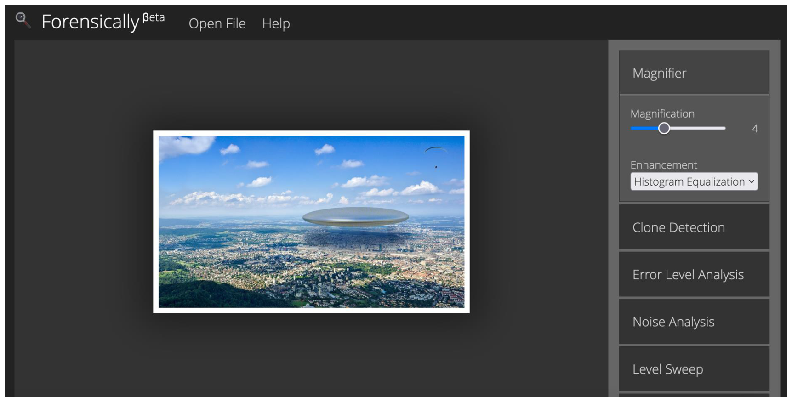

### Consistency from physics and real environments

Check whether illumination, shadows, perspective, reflections, and video motion obey a common scene model. In the camp image, the annotated shadow directions illustrate how one object can conflict with the others.

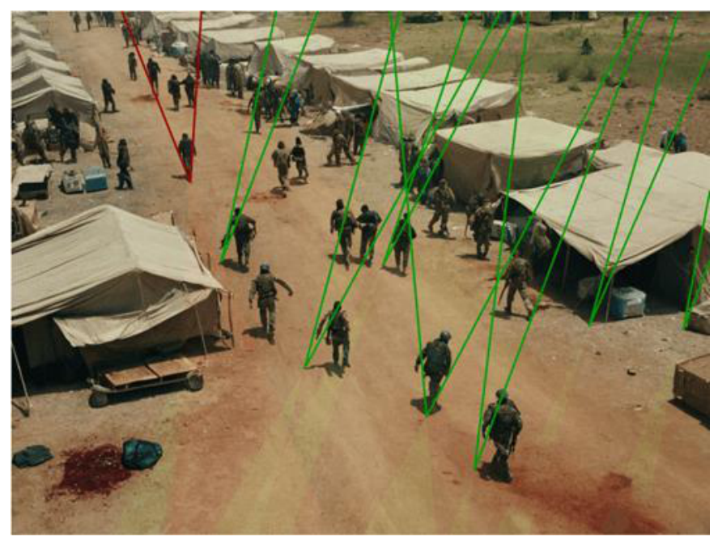

### Shadows and perspective

With one dominant light, draw a line through each object point and its corresponding cast-shadow point. Under perspective projection, these lines should meet near the projected light position, or the light-direction vanishing point for a distant source. Use several reliable correspondences and allow for picking error.

In the original snow scene the shadow lines cluster near the Sun. In the synthetic example they disagree with each other and with the visible Sun.

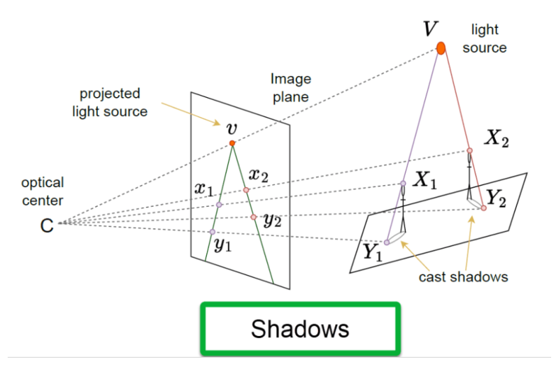
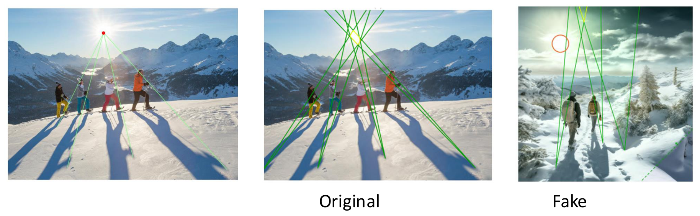

### Incident light

Shading can estimate the direction of incident light under assumptions about surface geometry and illumination. In the composite, one person appears lit from the side while the other two are lit mainly from above.

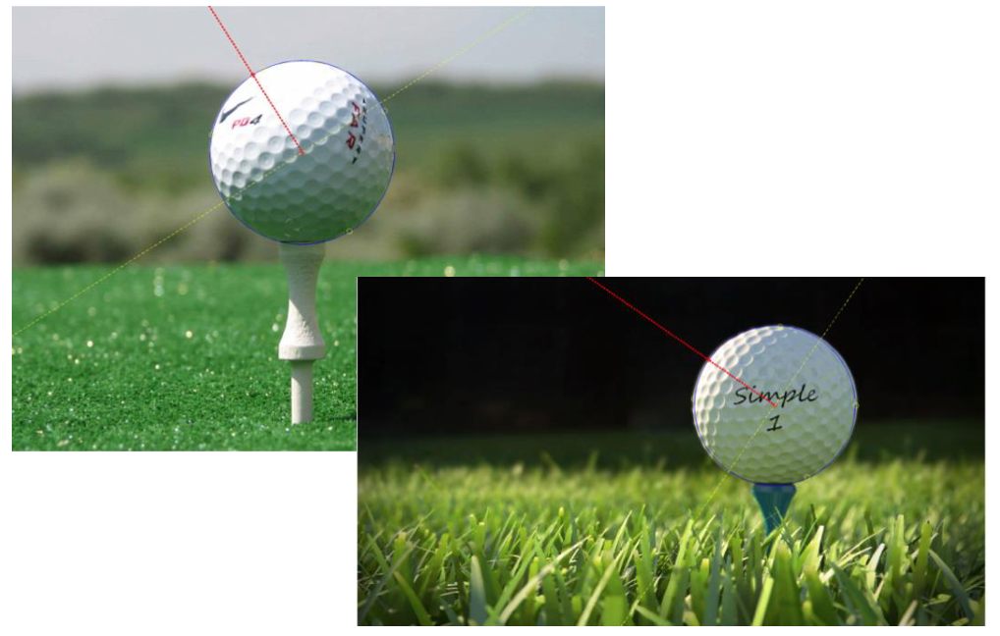
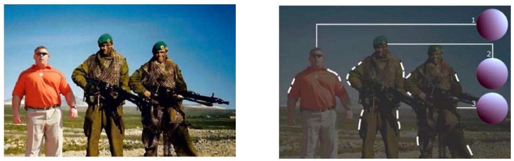

### Reflections

For a planar mirror, the lines joining each object point to its reflected counterpart are parallel in 3D and normal to the mirror. In a perspective image, the projected lines should share one vanishing point or pass through a common tolerance region. In the synthetic dressing-table image, the shoulder and brush correspondences are incompatible.

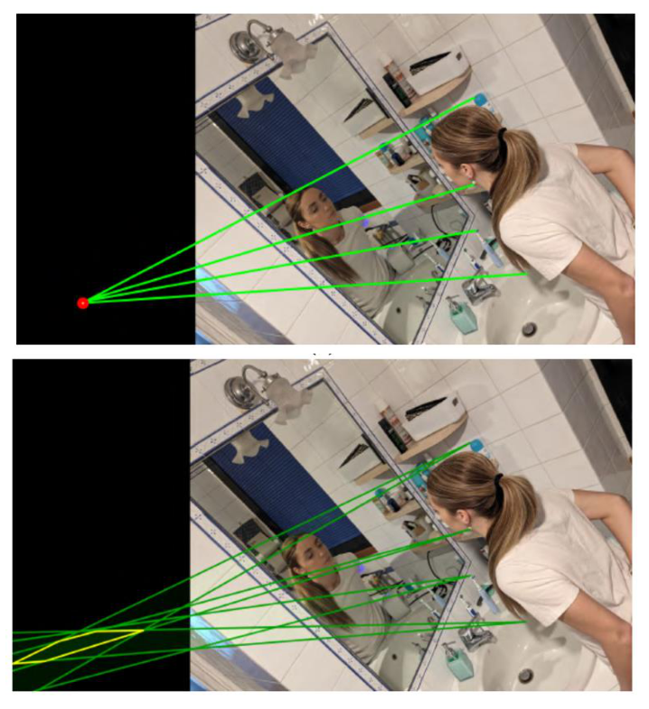
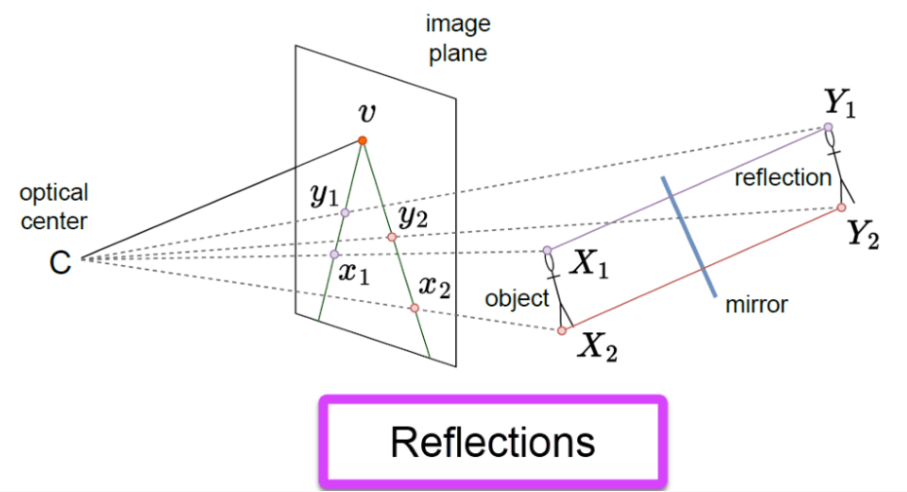
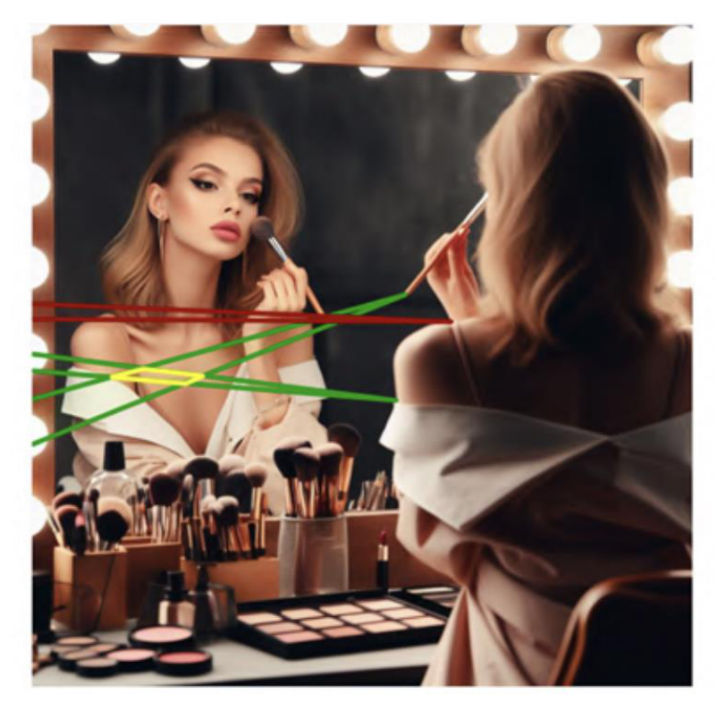

### Example

The same correspondence test applies to a planar glass façade. Connect visible points on the people and surroundings to their reflected counterparts.

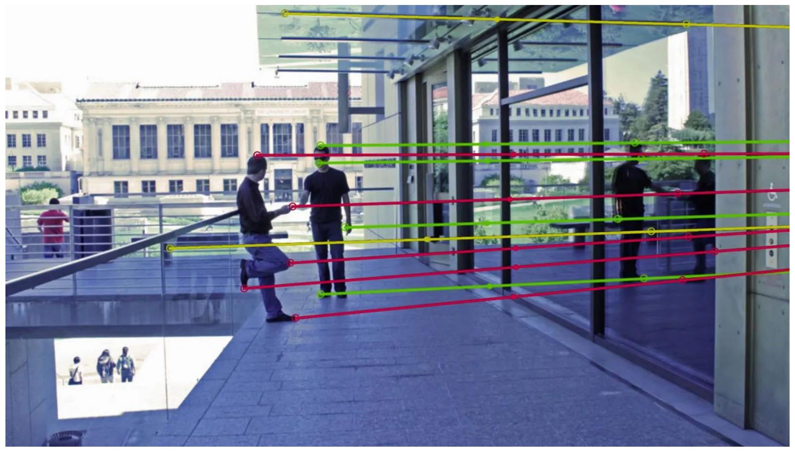

### Video editing

In the elevator demonstration, the closing segment was played backward and reused to make the doors appear to open with nobody inside. A residual after recompression highlights a local discrepancy. The known source sequence explains how the edit was made.

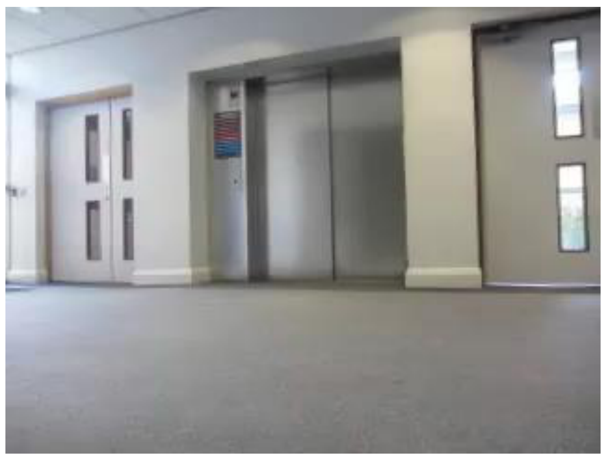

### Environment estimation

Compare the environment visible in a video with the environment suggested by its audio. Structure from motion (SfM) estimates 3D structure from views taken at different positions. Echoes and reverberation provide acoustic clues. Strong indoor reverberation paired with an apparently open-air scene can suggest that the tracks have different origins.

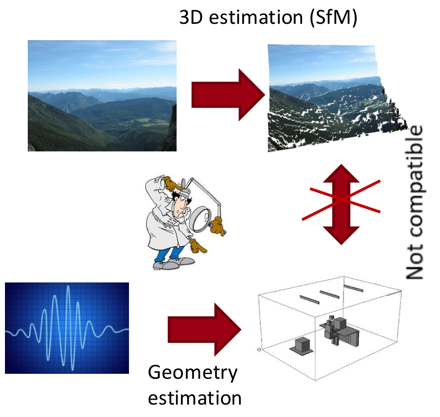

### Balistic motion

Track the object in successive frames, correct for perspective, and compare the measured positions with a physical trajectory. A freely moving ball under constant gravity follows a parabola in the plane of motion when drag is negligible. In the demonstration, the tracked positions deviate systematically from the yellow model.

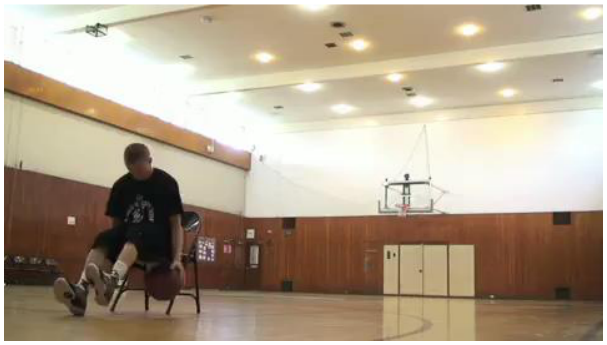
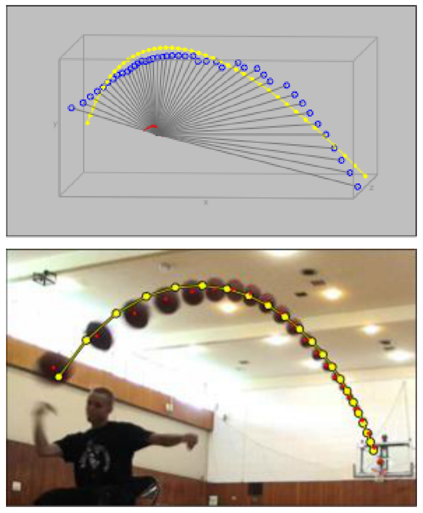

### Multiple-origin tracking

Match regions against images found elsewhere to identify possible sources for a composite. Similarity relations between originals, copies, and edited variants can be represented as a graph. The cyclist scene combines a bicycle photograph with a nuclear-test photograph. The lion composite combines a photograph of a lion undergoing a scan with MGM imagery.

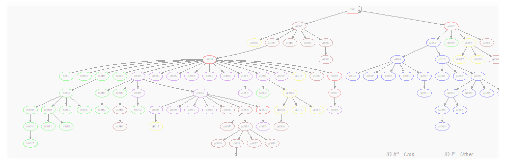
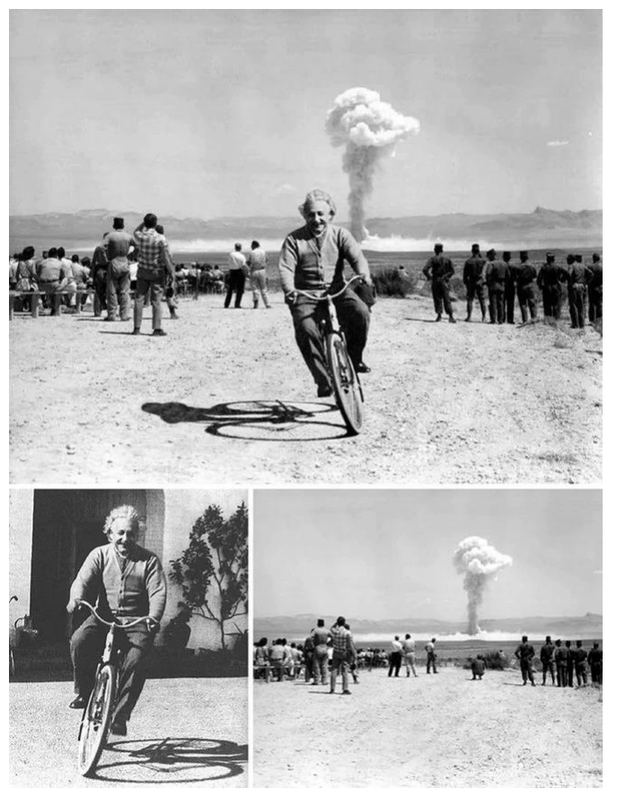
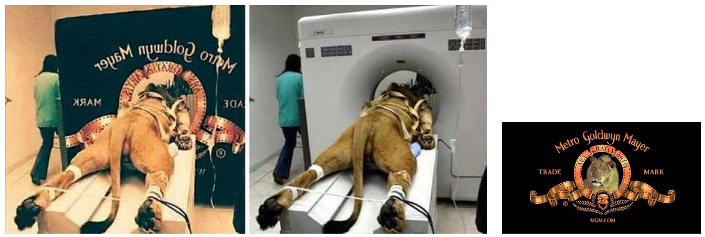

## Multimedia forgery as a cybersecurity issue

Deep learning makes synthetic media easier to produce. Film effects, design, and entertainment use the same broad technology as impersonation, disinformation, and voice-based fraud.

Classifying portraits as real or generated can be difficult. Artificial-looking hair boundaries, inconsistent lens reflections and incompatible shadows can reveal generated images. Some authentic portraits also look unusual.

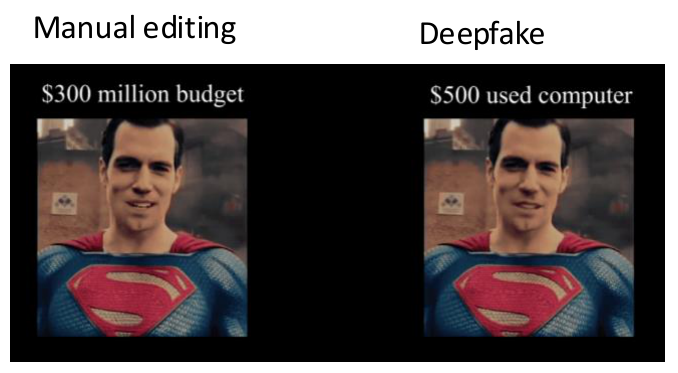

### Summary of deepfake tools

| Task | Examples |
|---|---|
| Face replacement or reenactment | Faceswap, DeepFaceLab, FSGAN |
| Face or portrait synthesis and control | DiscoFaceGAN, StyleRig |
| Transfer motion or drive a face with audio | “Do as I Do”, Neural Voice Puppetry |

In **puppetry**, a source performance drives a target identity. Text-to-video generation synthesizes a sequence from a prompt.

### GAN detection

Look for errors in fine detail and facial geometry, including hair, skin texture, eyes, glasses, reflections, shading, and the boundary between a face and its surroundings. JPEG compression can erase high-frequency clues. The cues also vary across generative adversarial networks (GANs) and diffusion models.

Video adds evidence from optical flow, head motion, blinking patterns, and speech–lip synchronization. Early systems sometimes omitted blinks. Later generators reproduced them, so blink presence alone lost its value as a cue. Physical checks such as shadow consistency can still help, with results depending on the generator and the scene.

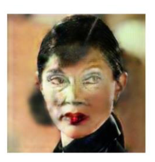
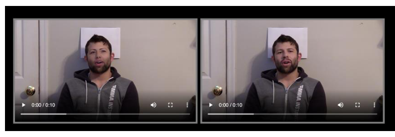

### Statistical anomaly

From a JPEG, collect the first decimal digit of the magnitudes of nonzero quantized discrete cosine transform (DCT) coefficients. Compare digit frequencies with a natural-image reference, such as Benford's law.

$$
P(D=d)=\log_{10}\left(1+\frac{1}{d}\right),\qquad d=1,\ldots,9.
$$

The distributions differ for photographs, GAN images and conventional CGI. In this example, GAN curves fall between the others. A deviation is a statistical cue whose value depends on the comparison data and compression history.

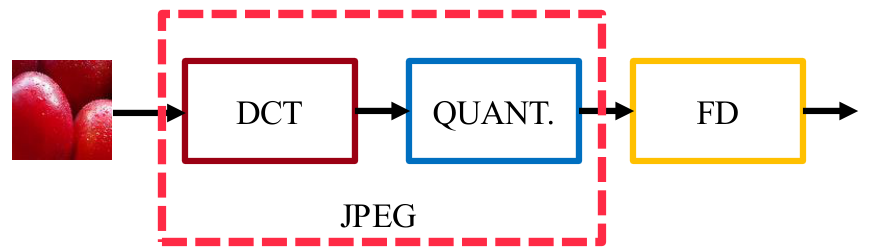
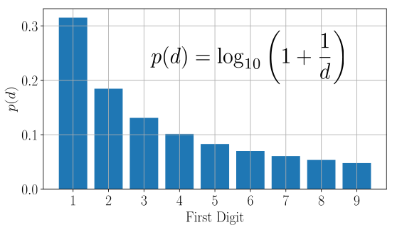
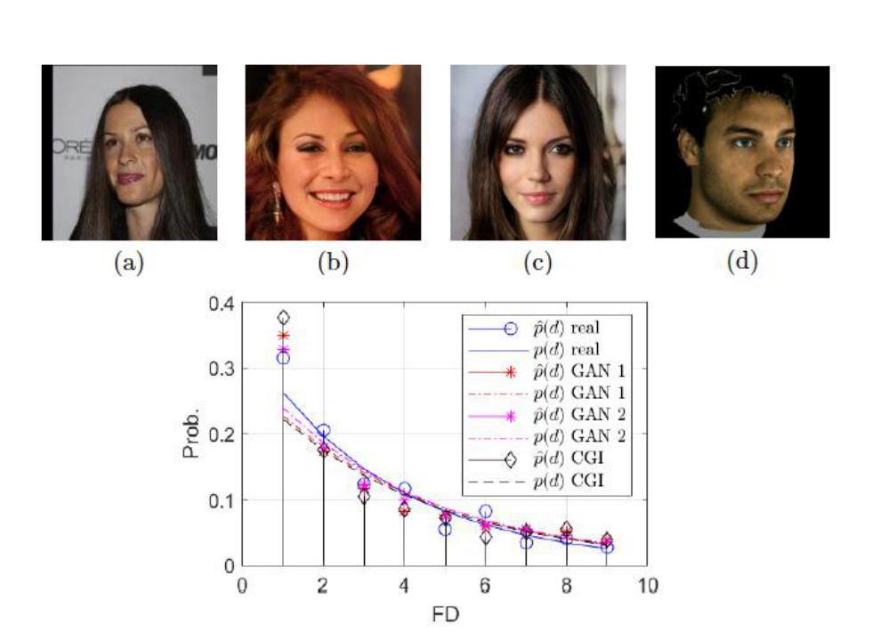

### Summary of deepfake detectors

| Cue | What the detector checks |
|---|---|
| Facial details, warping, and blending | Local eye or mouth artifacts, resolution changes, and seams around the replaced face |
| Head pose and temporal behavior | Landmark geometry, optical flow, and blink patterns across frames |
| Audio–video agreement | Whether mouth shapes (visemes) match spoken sounds (phonemes) |
| Acquisition and coefficient statistics | PRNU or related fingerprints and first-digit anomalies |

## Data hiding: watermarking and steganalysis

Watermarking is an **active** technique. A mark is deliberately embedded before the media is distributed and later checked or decoded.

### Intuitive example

Alice’s letter about stargazing carries a hidden message. To recover it, take the first letter of each word. Starting at position zero, use each successive digit of $\pi$ as a step length. The first stops are positions $3,4,8,9,14,23$. The first 14 stops yield `BUUBDLUPNPSSPX`. Move each letter one place back in the alphabet to read **ATTACK TOMORROW**.

The result uses the leading digits of $\pi=3.1415926535897\ldots$.

### Watermark in history

Anamorphosis conceals an image through distortion. Holbein’s *The Ambassadors* reveals a skull from an oblique viewing angle. Schoen’s *Vexierbild* and cylindrical anamorphosis use changes in viewpoint or reflection to expose a hidden image. Linguistic steganography, Cardan’s grille, and encoding letters as musical notes illustrate other ways to conceal information.

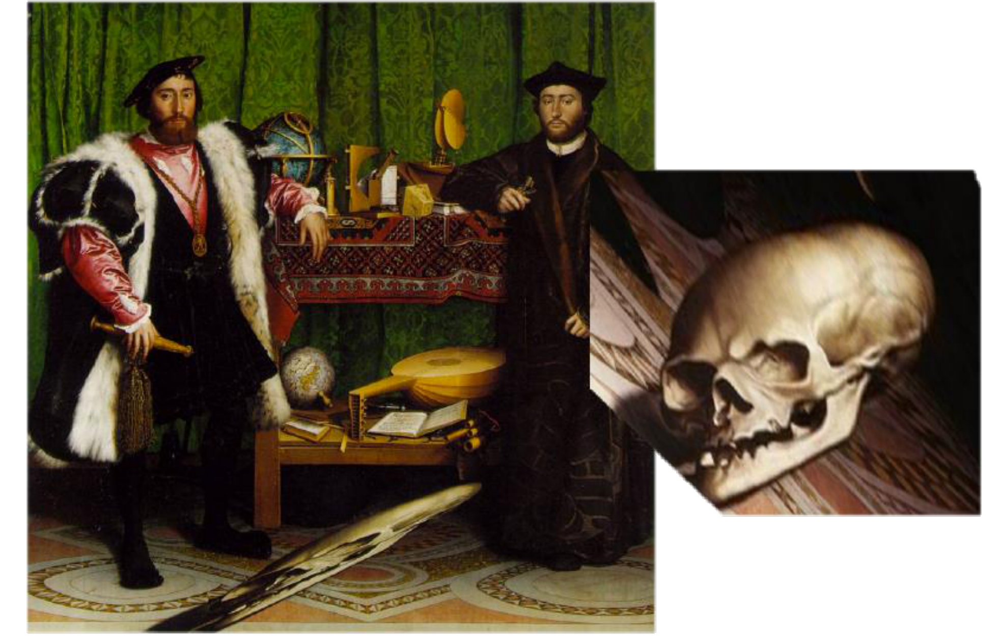
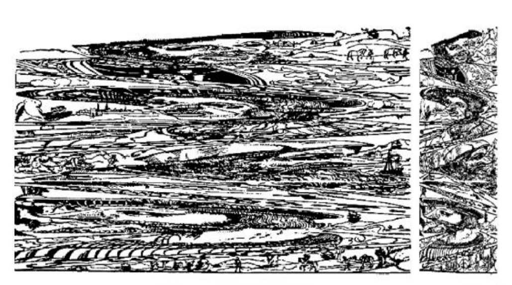
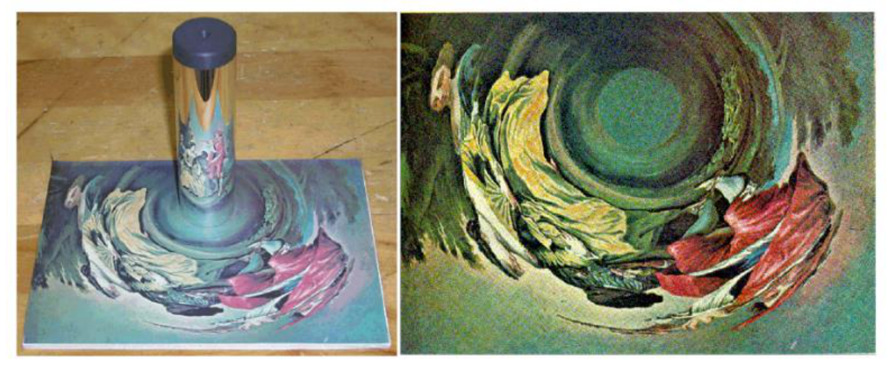
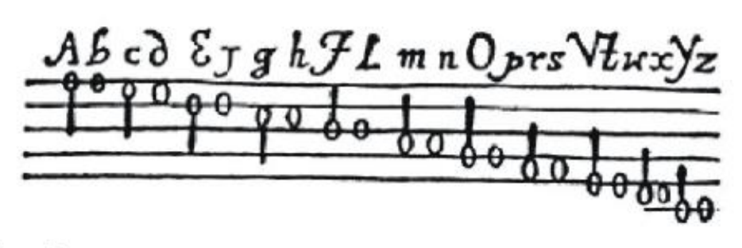

### A taxonomy of watermarking

Data hiding includes steganography, watermarking, and covert communication. **Fingerprinting** assigns distinct marks to copies so the source of a leaked copy can be traced. **Reversible watermarking** allows exact recovery of the original host. **Fragile** marks are designed to change under editing. **Semi-fragile** marks tolerate selected routine operations and reveal other modifications.

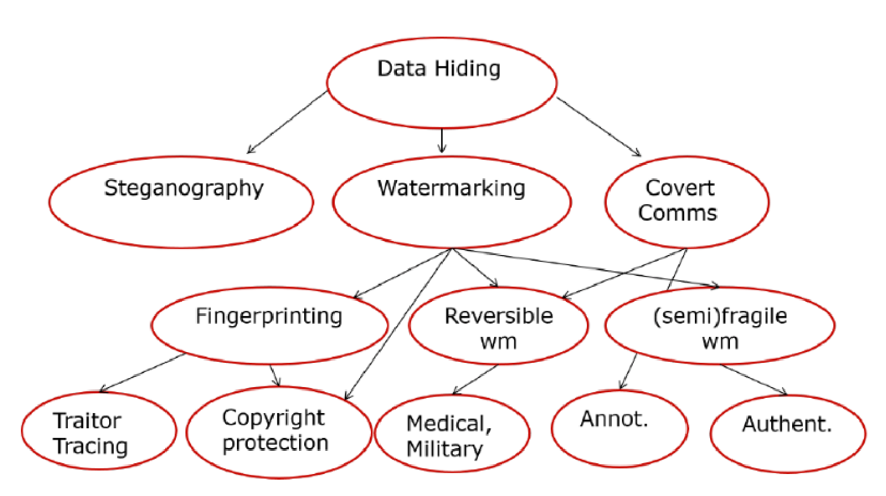

### Some terms …

- A **watermark** is information attached to a host whose meaning is preserved. It can be visible or invisible. Imperceptible marks preserve the original appearance and can be harder to locate or remove.
- **Steganography** hides the existence of a message in an ordinary carrier. **Steganalysis** seeks evidence of that hidden message.
- An **attack** can remove, distort, or expose embedded data. Unintentional processing can also impair recovery.

### Why not cryptography?

Encryption controls access during distribution. A watermark can still support ownership verification, copy tracing, or integrity checking after a recipient decrypts and copies the media. The two techniques can be used together.

Typical design goals include blind recovery without the original, resistance to expected processing, low visibility, key-controlled access, sufficient payload, and coexistence with other marks. Successive processing stages can leave separate marks for traceback. Embedding should keep the host’s dimensions and storage requirements close to the original.

### Watermarking vs. data hiding

| Goal | Decision and metric |
|---|---|
| Detect a key-dependent watermark | Binary presence test. A receiver operating characteristic (ROC) plots the detection rate against the false-alarm rate. |
| Recover a key-dependent message | Decode multiple possible bit sequences. The bit error rate (BER) is the fraction of recovered bits that are wrong. |

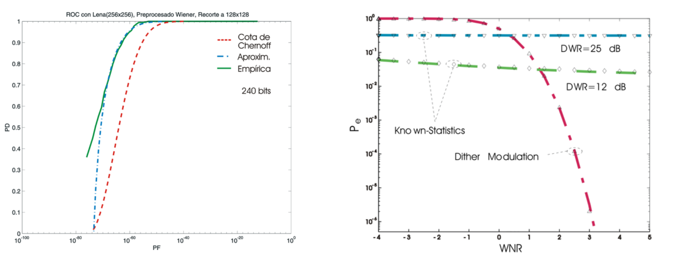

### Two families of watermarking

- **Additive spread-spectrum.** Add a mark spread across many samples. The host signal contributes interference during blind recovery.
- **Quantization-based.** The message selects a quantizer. The resulting reconstruction levels carry the symbol and remove the additive host-interference term in the ideal model.
- **Spread-Transform Dither Modulation (STDM).** Quantize a projection of the host along a spreading direction.

### A model for data hiding

Perceptual analysis identifies how strongly each part of the host can be changed. A key controls the modulation of the message into a mark. Embed it, distribute the marked media, and use the key to detect or decode it after possible processing.

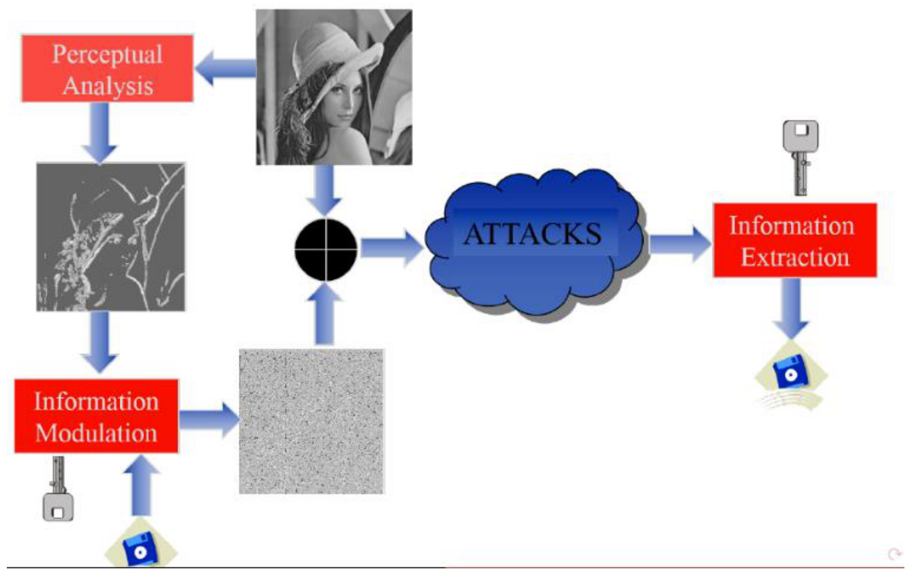

### Hiding one bit …

Let $x$ be the host pixel luminance, $b\in\{-1,+1\}$ the symbol, and $\alpha>0$ the embedding strength. The marked luminance is $y=x+w$, with $w=b\alpha$. When $x$ is available, subtract it and recover $\hat b=\operatorname{sgn}(y-x)$. Increasing $\alpha$ makes the mark easier to recover and more visible.

### Blind case…

If the original $x$ is unavailable, estimate it with a local mean $\mu$ and try $\hat b=\operatorname{sgn}(y-\mu)$. When the residual host variation dominates the mark, that single-pixel estimate is unreliable. Spread each bit over many pixels and combine their evidence.

### Human contrast sensitivity

The contrast sensitivity function (CSF) peaks at intermediate spatial frequencies. The eye is less sensitive at very low and very high frequencies. A **perceptual mask** controls the local strength of the mark. A simple mask is the magnitude of the Gaussian-filtered image gradients $h$ and $v$.

$$
\alpha[n_1,n_2]=\sqrt{h[n_1,n_2]^2+v[n_1,n_2]^2}.
$$

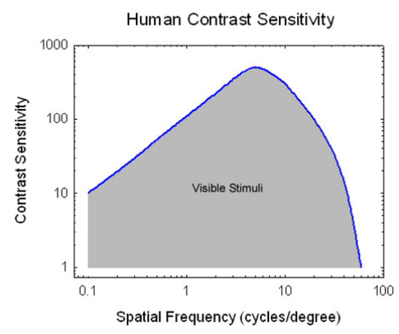
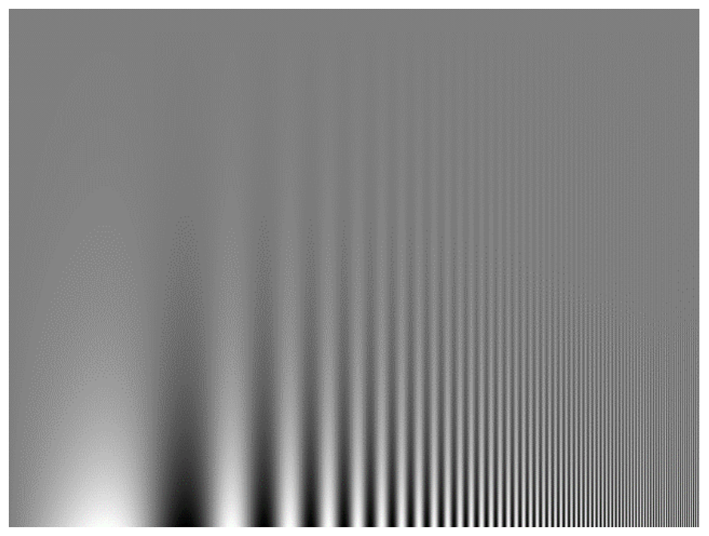

### Examples of perceptual mask

Fine detail such as hair, grass, and foliage can hide stronger modifications. Smooth regions require smaller changes. The masks are shown at ten times their original display strength.

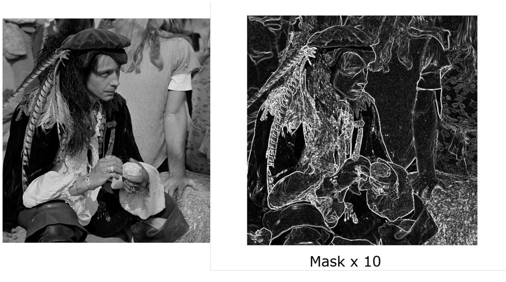
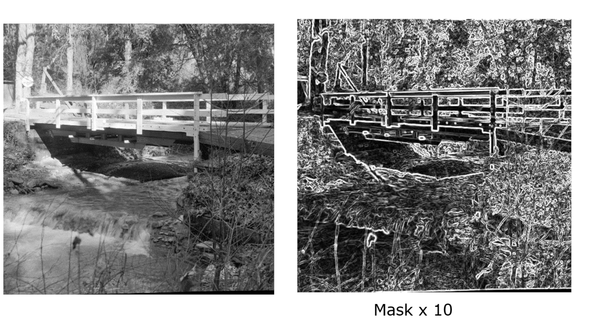

### Model for spread-spectrum embedding

Partition the pixel set of an $N\times N$ image into $M$ disjoint, key-dependent tiles $T_i$. Equal tiles have $N^2/M$ pixels each. Use one symbol $b_i\in\{-1,+1\}$ per tile. At pixel $n=(n_1,n_2)$, form a pulse from a perceptual mask $\alpha[n]$ and a pseudorandom sequence $s[n]$ with zero mean and unit variance.

$$
p_i[n]=
\begin{cases}
\alpha[n]s[n], & n\in T_i,\\
0, & \text{otherwise}.
\end{cases}
\qquad
w[n]=\sum_{i=0}^{M-1}b_i p_i[n],\qquad
y[n]=x[n]+w[n].
$$

Each bit contributes across its tile, where the mask gives the most weight to pixels that can hide the changes.

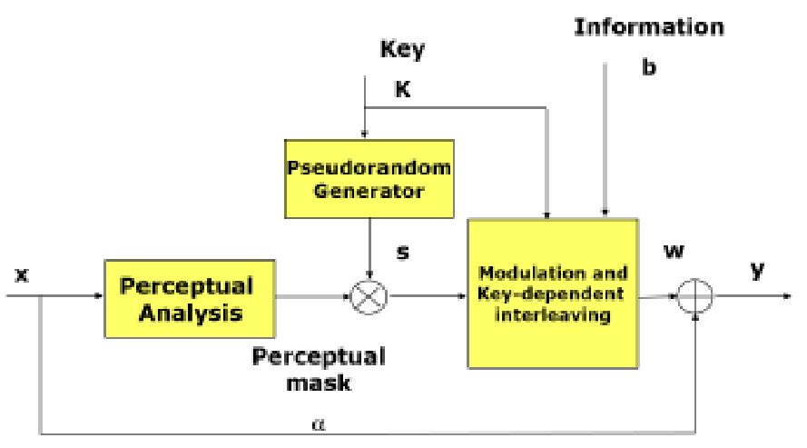

### Detection strategy

Preprocess the received image and use the key to recover the tiling and spreading sequence. On a tile, write $y=x+\gamma bp$, where $\gamma>0$ scales embedding strength and $p$ is the reference pulse. Multiply by the corresponding pulse samplewise, sum over the tile, and threshold at zero to decode the bit.

$$
\hat b=\operatorname{sgn}\langle y,p\rangle,\qquad
\langle y,p\rangle=\langle x,p\rangle+\gamma b\lVert p\rVert^2.
$$

For independent, identically distributed zero-mean Gaussian host samples and equally likely bits, this sign rule is optimal for a known pulse. The watermark adds coherently in the sum. Uncorrelated contributions tend to cancel.

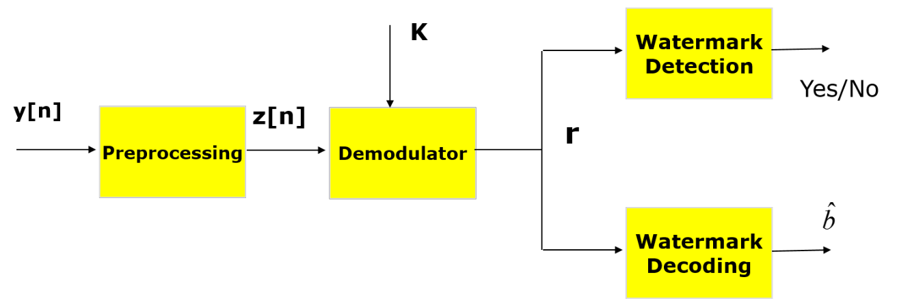
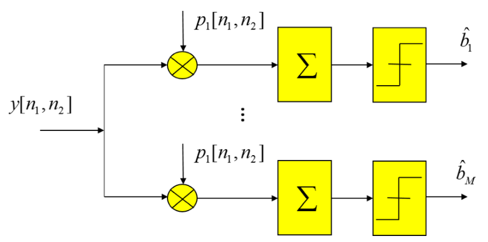

### Performances

For a fixed image and embedding strength, more pixels per bit generally reduce BER and improve robustness while reducing payload. Increasing embedding strength can improve recovery at the cost of visibility. The measured curves also depend on the image and statistical assumptions.

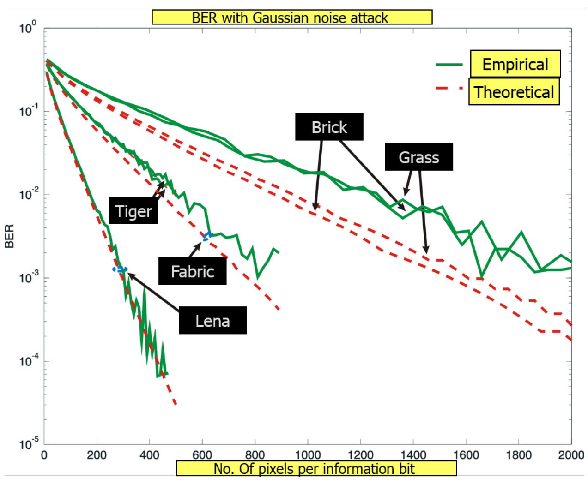
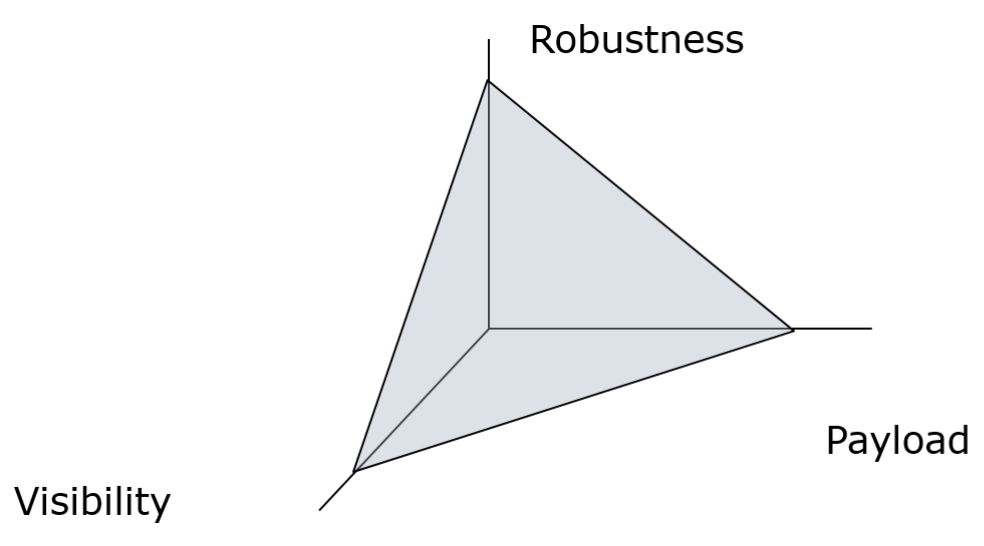

### Attacks

Noise, filtering, cropping, compression, rotation, scaling, averaging, and repeated watermarking can interfere with detection or decoding. Robust marks are designed to survive expected changes. A fragile mark acts as a seal whose alteration signals possible tampering.

### Applications

Marks support labeling, copy fingerprinting, authentication, signaling, and copy or playback control. Hosts include images, video, audio, text, and software.
