# Social media / IoT 4n6 / Anomalies

## Social Media Forensics

### Introduction

Social media evidence often comes from a limited view of a platform. Direct acquisition of its servers is generally impractical. Access to private records may require the operator's cooperation.

- Preserve relevant messages, posts, media, profiles and timestamps. Assess who uploaded each item and whether it changed.
- Put posts and interactions on a timeline. Compare them with surrounding content and events to interpret their meaning.
- Use account connections and activity patterns to guide the investigation. Document collection methods and distinguish observations from inferences.

### Traces

| Trace | What to examine |
|---|---|
| Social footprint | Friends, follows and group memberships |
| Communications | Contacted accounts, channels and interaction patterns |
| Pictures and videos | Uploads and tags in media posted by others |
| Activity times | Connection times and timestamps of relevant events |
| Apps | Services used and the activity they record |

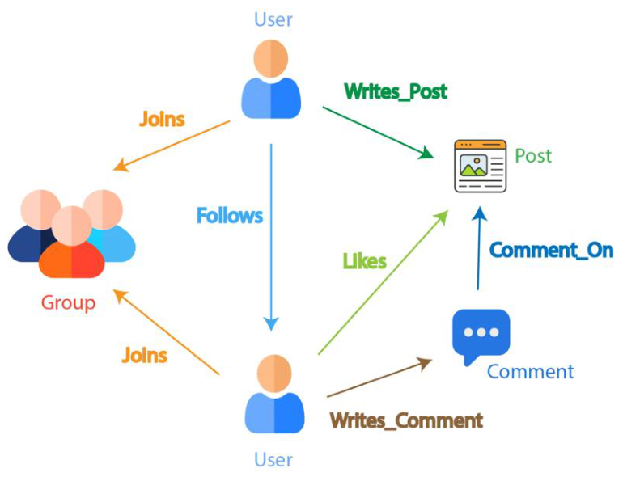

### Social footprint

A social graph $G=(V,E)$ represents accounts as nodes $V$ and relationships as edges $E$. An edge can represent a friendship, a message or a mention. Direction matters for interactions such as follows or messages.

Build separate graphs from friend lists, photo tags and direct messages. Match them with event timelines and location clues. Comparing snapshots from different times can reveal changes in the graph or in visible content.

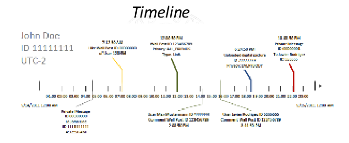

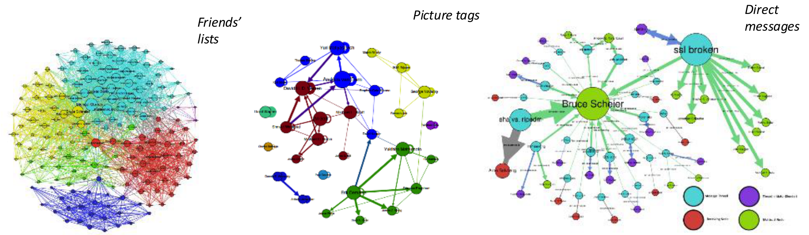

### Example

To study communities and outliers in a network of supporters:

1. Start with a seed list of known accounts. Follow directional connections and look for dense clusters with mainly internal interactions.
2. Use distinctive words or phrases to find candidate communities. Track when and where those patterns spread, and check whether the matches could occur by chance.
3. Analyze the stance expressed in messages. Use geotags, inferred locations, image classification and mapping for context.

Network proximity and language similarity are leads. Attribution requires corroboration.

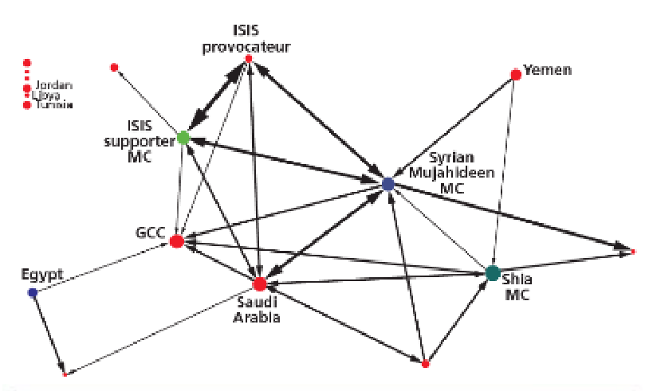

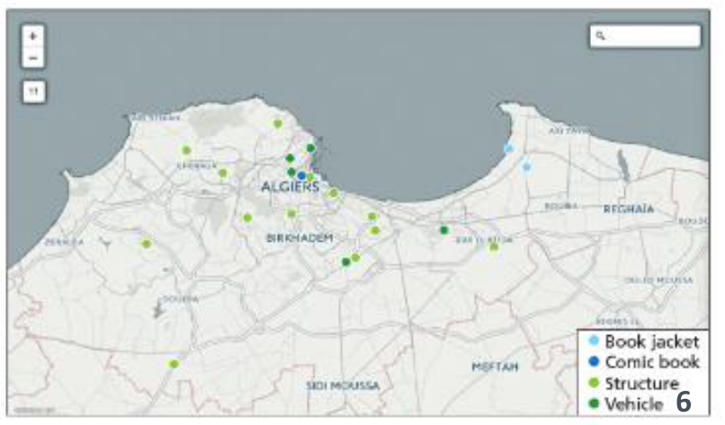

### Issues

Graphs and timelines change as users add, remove or hide content, so a later collection can yield a different view. Some traces are visible only to the platform or internet service provider. Define how many hops to follow and document the collection limits. Self-selection, demographics and uneven platform use also bias the sample. Privacy and legal constraints affect which data can be collected and reported.

### Spreading of data through networks

Posts, datasets, images, videos and software spread through sharing networks. Epidemic diffusion models describe how sharing propagates. Edits and re-uploads create copies and near duplicates.

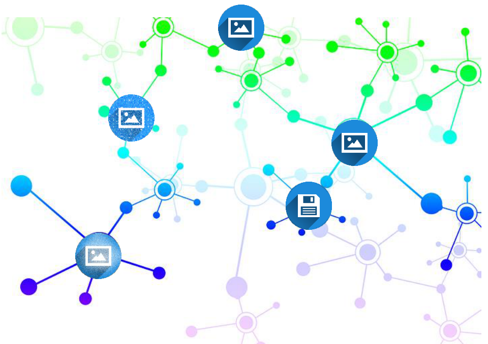

### Some questions arise …

Which copy came first, when did it appear, and where did it come from? **Phylogenetic analysis** represents the evolution of related copies as a tree, by analogy with biological lineage. It supports content traceback, copyright investigation, malware profiling and verification of misleading media.

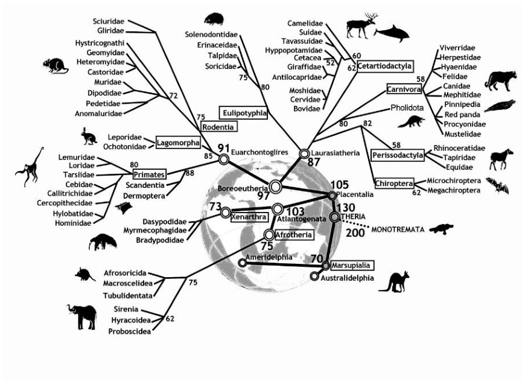

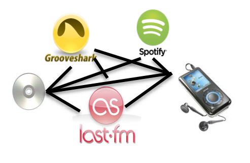

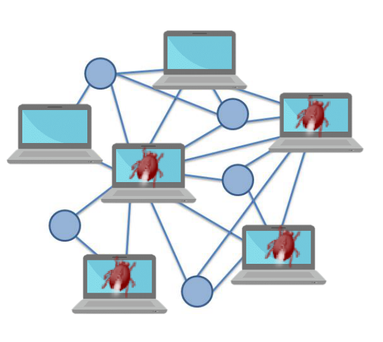

### Image phylogeny tree reconstruction

1. Compute a matrix of pairwise dissimilarities among related images. When the measure is directional, retain both directions for each pair.
2. Use the images as graph nodes and the dissimilarities as edge weights.
3. Apply a spanning-tree or branching method such as **Oriented Kruskal** or **Optimum Branching**.
4. Read each directed edge as a proposed parent-to-child relationship. The root is the candidate original.

Dissimilarity is noisy. The resulting tree is a reconstruction hypothesis.

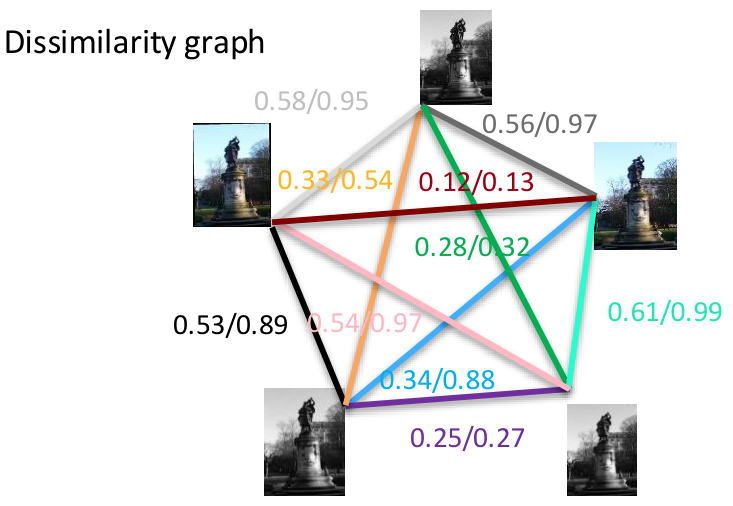

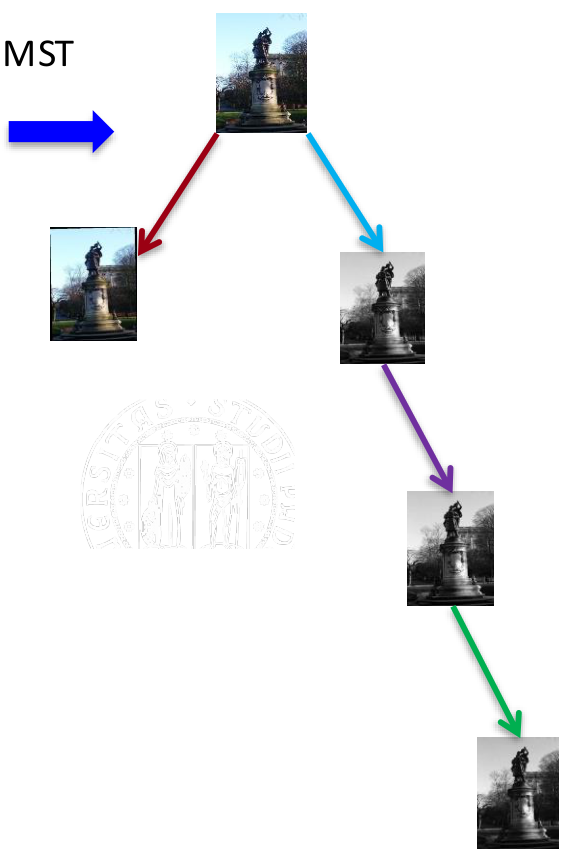

### State-of-the-art strategies

Improve the tree by combining dissimilarity measures, modeling uncertainty, checking dependencies and incorporating side information. Deep learning can estimate more robust dissimilarities and can also be used to denoise the measurements and reconstruct the tree jointly.

## IoT Forensics

### Internet-of-Things -> Internet-of-Everything

The **Internet of Things (IoT)** connects heterogeneous devices with sensors, software and processing capability. Communication can occur automatically. The broader view includes thing-to-thing, person-to-thing and person-to-person interactions. Examples include smart homes and cities, power grids, manufacturing, healthcare, agriculture and environmental monitoring.

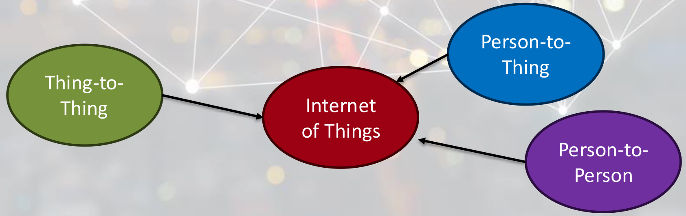

### Devices

Wearables capture activity or physiological measurements. Smart locks and home sensors record access or environmental events. Industrial controllers, cameras and safety systems monitor equipment and processes. Connected cars and unmanned vehicles can also produce location and operation records.

### Need for IoT forensics

Many interfaces and varied hardware expand the attack surface. Low-cost or resource-constrained devices may have limited protections. Device compromise can expose private information, disrupt services or affect physical safety. **Denial of service** and **information leakage** are two major risks. The same devices can generate traces that support or challenge an investigative hypothesis.

### Three level of analysis

- **Device forensics** examines local storage, sensor data and device state.
- **Network forensics** examines communications and associated network records.
- **Cloud forensics** examines application, account and service records held remotely.

Correlate observations across levels. A single device may hold only part of the event history.

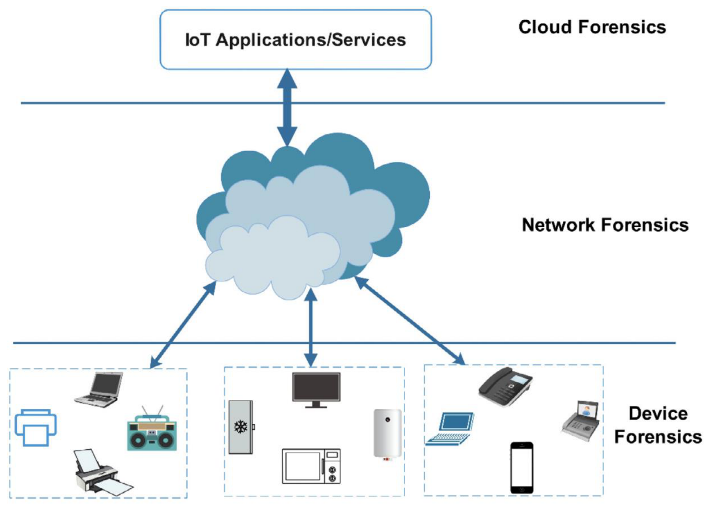

### Traditional/Cloud/IoT forensics

| Setting | Evidence and acquisition |
|---|---|
| Traditional | Local computers, mobile devices and files. The examiner can often secure the relevant device. |
| Cloud | Virtual machines, logs and remote storage. Access depends on permissions and provider cooperation. |
| IoT | Embedded devices, tags, sensor networks, companion apps and cloud services. Identify which components retain relevant traces across ownership and network boundaries. |

### Challenges

IoT investigations span collection, analysis and presentation. Device diversity and uneven tool support affect every stage.

#### General problems

Few tested methods and tools cover the full range of devices. Poorly tested procedures can change or destroy evidence. Investigations across jurisdictions also depend on consistent documentation and cooperation.

#### Evidence identification, collection and preservation

Find the relevant IoT system and determine where it stores each trace. Devices vary in hardware, software and data retention. Short retention can overwrite useful records. A shutdown or disconnection before preservation can erase volatile state.

#### Evidence analysis and correlation

High data volumes, missing metadata and few overlapping records make timeline reconstruction difficult. Look for common events or other anchors across device, network and cloud records. Record where the available timestamps or correlations remain uncertain.

#### Evidence presentation

Explain the evidence path, methods and limitations in terms a non-specialist can follow. For an unusual method, document validation and any changes made to the evidence so the result can be evaluated.

### Example: attack on refrigeration 2026

Manipulated refrigeration settings led to food losses at European supermarkets and threatened blood products at storage sites in France. In a cold-chain incident, prioritize safety and continuity. Coordinate incident response and log actions. Preserve controller and monitoring records when safe, isolate affected equipment carefully, and avoid unnecessary reboots or updates before preservation. Correlate events, assess scope and impact, restore from trusted sources and document the recovery.

### Incident 1: TRENDnet

Links exposed live feeds from nearly 700 internet-connected home cameras. The US Federal Trade Commission filed a complaint in 2013. The final order required a security program, assessments and customer notification. Remote access to a home device can expose sensitive activity far beyond the device owner. [FTC case record](https://www.ftc.gov/legal-library/browse/cases-proceedings/122-3090/trendnet-inc-matter)

### Incident 2: Volkswagen scandal, 2015

Independent road tests found higher nitrogen oxide emissions than laboratory tests. The vehicle software recognized test conditions and applied full emissions controls during testing. Comparing behavior in controlled and normal operating conditions exposed the discrepancy. [EPA investigation](https://www.epa.gov/enforcement/learn-about-volkswagen-violations)

### Incident 3: Strava case

Aggregated fitness tracks revealed the layout of some military facilities through repeated routes. A heat map can expose an operational pattern even when it summarizes activity across many users.

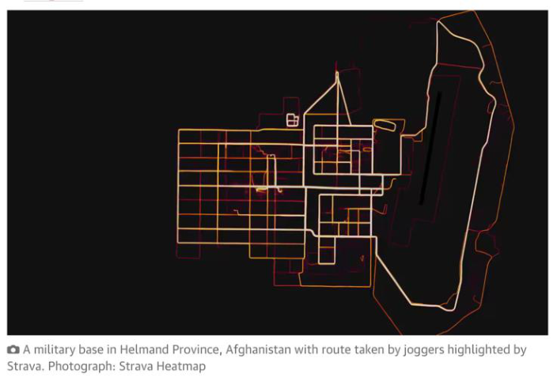

### Incident 4: Arkansas case

After a death in a home with an Echo speaker, investigators sought device-related records from Amazon under a search warrant. A voice assistant may record audio after activation. Timing and speaker attribution depend on what the device actually captured and what the provider retained.

### Challenges

A distributed architecture complicates chain of custody and integrity checks. Identify which owner or service controls each record, limit collection to relevant private data and document cross-jurisdiction transfers.

### Existing solutions

| Approach | Main idea |
|---|---|
| Cyber-Trust | Combines intrusion detection with a distributed ledger for collecting and preserving smart-home evidence. |
| Forensics Edge Management System (FEMS) | Combines security functions at the smart-home edge. Integration and validation are difficult. |
| PRoFIT | Incorporates ISO/IEC 29100 privacy principles to protect witnesses' data and support voluntary participation. |
| Probe-IoT | Uses a distributed ledger to record transactions between devices, users and cloud services. |

## Anomaly detection

### What are anomalies?

An **anomaly** or **outlier** differs substantially from nominal observations. It can represent a fault, a rare event or unfamiliar behavior. Uses include security monitoring, fraud detection, machine vision, medical analysis and predictive maintenance.

### Noise ≠ anomaly

Noise comes from measurement error or contamination. It can create unusual values or hide meaningful changes. Check whether an outlying reading reflects a recording problem or a real departure from nominal behavior.

### Hystory facts: ozone depletion

In 1985, ground-based measurements revealed Antarctic ozone depletion. Nimbus-7 had also measured unusually low values, but its processing flagged and set aside readings outside the expected range. A quality filter can therefore suppress the phenomenon an investigation needs to detect. [NASA account of Nimbus-7 processing](https://science.nasa.gov/earth/earth-observatory/research-satellites-for-atmospheric-sciences-1978-present/)

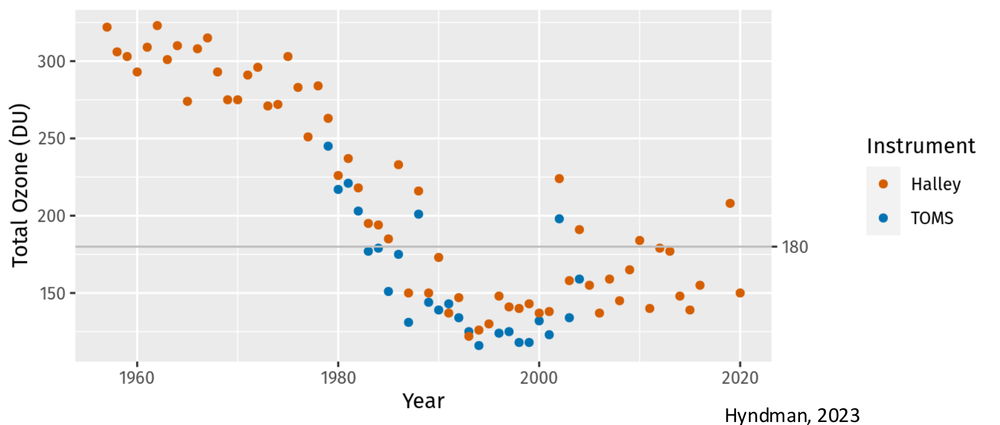

### Urging issues for anomaly detection

Networks and devices produce large, fast-changing datasets. Some failures are rare and have severe consequences. Machine learning and greater processing capacity support detection in large, high-dimensional datasets. Evaluation has to reflect the costs of missed events and false alarms.

### Example of anomalies

A network attack may produce unusual traffic. Tampered images may contain regions with inconsistent pixel characteristics. Other applications include suspicious transactions, abnormal access patterns, malware detection, production monitoring and fault prediction.

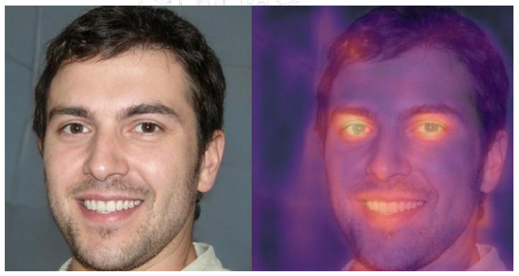

### Why anomaly detection?

Anomalies are hard to label in advance. They are rare, their features can vary across cases, and new failures or adversarial behavior can change what they look like. Class imbalance leaves few abnormal examples for training. Automation helps screen large volumes of data.

### Theory: what is an anomaly?

Let $\mathbf{x}_1,\ldots,\mathbf{x}_n\in\mathbb{R}^d$ be observations with $d$ features. A dataset can mix nominal samples and anomalies generated by a different process.

The **Well-Defined Anomaly Distribution (WDAD)** assumption gives anomalies a known distribution, as in recurring instances of a characterized machine failure. It can break down with new fault modes, adversarial behavior or a changing definition of what counts as anomalous.

### Taxonomy of anomaly detection

| Type | What makes it unusual |
|---|---|
| Point | One observation deviates from the general pattern. |
| Contextual | A value is unusual for its context, such as location or season. |
| Collective | A sequence or group is unusual as a whole, even when its individual values look ordinary. |

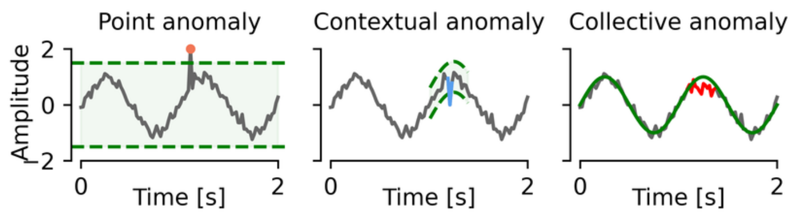

#### Point anomalies

A traffic-volume observation or residual can stand out on one router link even when the other links look ordinary.

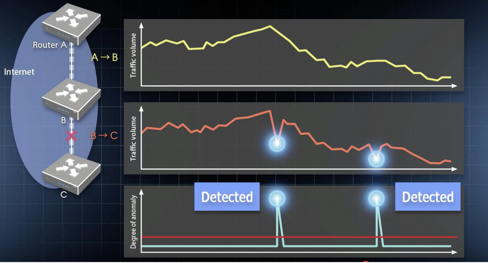

#### Contextual anomalies

The same low temperature can be normal in winter and anomalous in summer. Compare each observation with the seasonal baseline for its date.

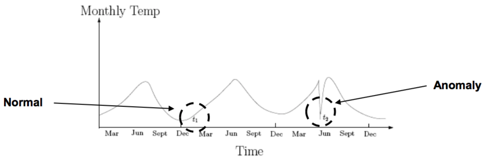

#### Collective anomalies

A skipped heartbeat appears in the sequence as an unusual interval or waveform. The individual amplitudes in that interval can remain within the usual range.

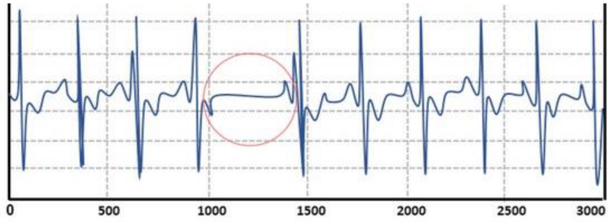

### Signal decomposition

An additive time-series model is $x_t=T_t+S_t+r_t$, where $T_t$ is the trend, $S_t$ the seasonal component and $r_t$ the remainder. Inspect the remainder for departures after accounting for trend and seasonality. Depending on the signal, components can combine multiplicatively or include additional cycles.

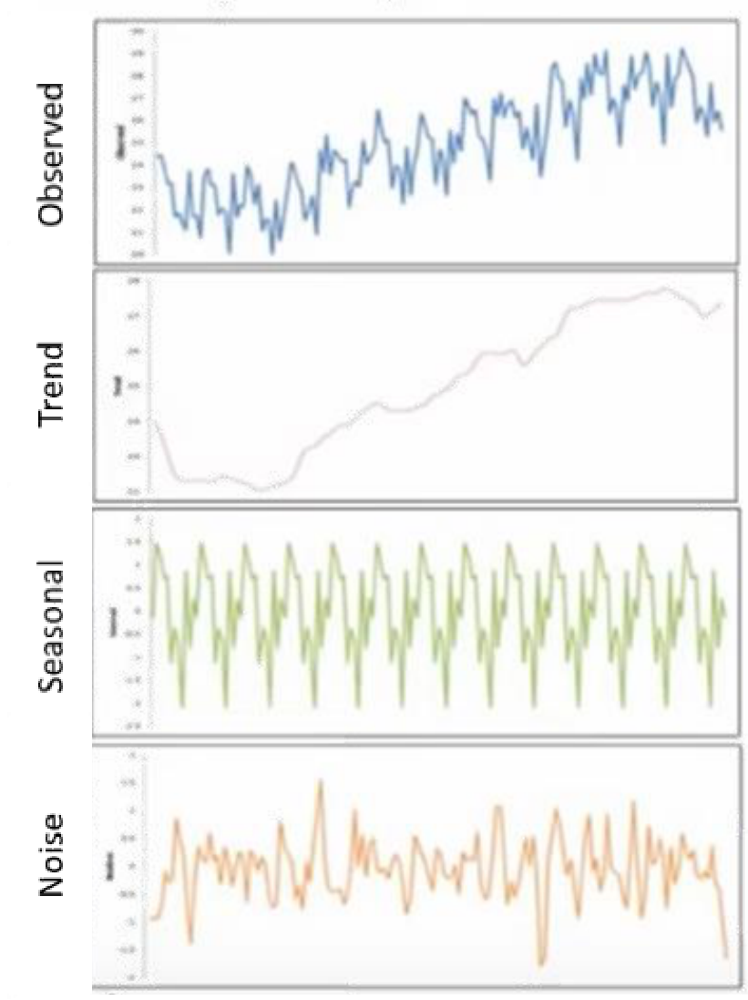

### AD evaluation

**Outlier detection** labels observations. **Change point detection** marks boundaries where behavior changes and can locate the start or end of an anomalous interval. A change point can also separate two nominal regimes.

- Binary scores compare predicted and reference labels.
- Timing scores measure how early or late a change is detected.
- Window scores use a tolerance around the true event, or compare predicted and reference intervals. Specify how multiple alarms in one window are counted.

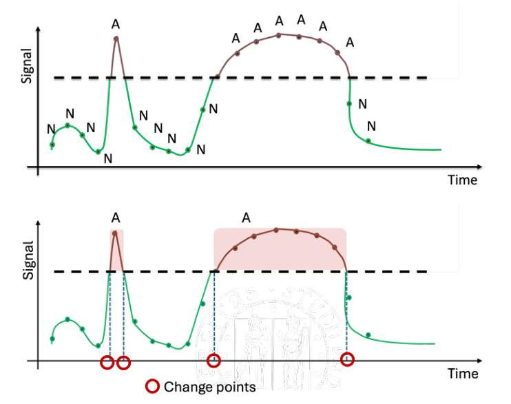

### AD binary metrics

Treat anomalies ($A$) as positive and nominal observations ($N$) as negative.

| Actual / Predicted | $A$ | $N$ |
|---|---|---|
| $A$ | True positive ($TP$) | False negative ($FN$) |
| $N$ | False positive ($FP$) | True negative ($TN$) |

| Metric | Formula |
|---|---|
| Precision (PPV) | $TP/(TP+FP)$ |
| Recall (TPR or sensitivity) | $TP/(TP+FN)$ |
| Miss rate | $FN/(TP+FN)=1-\mathrm{TPR}$ |
| False-positive rate (FPR) | $FP/(TN+FP)$ |
| Specificity (TNR) | $TN/(TN+FP)=1-\mathrm{FPR}$ |
| Accuracy | $(TP+TN)/(TP+TN+FP+FN)$ |
| $F_1$ | $2TP/(2TP+FP+FN)$ |
| G-mean | $\sqrt{\mathrm{TPR}\cdot\mathrm{TNR}}$ |

Specificity is recall for the nominal class. The false-positive rate measures the share of nominal observations flagged as anomalies. $F_1$ is the harmonic mean of precision and recall. [Recall and class labels](https://scikit-learn.org/stable/modules/generated/sklearn.metrics.recall_score.html)

The **Matthews correlation coefficient (MCC)** uses all four outcomes.

$$
\operatorname{MCC}
=\frac{TP\,TN-FP\,FN}{\sqrt{(TP+FP)(TP+FN)(TN+FP)(TN+FN)}}.
$$

A **ROC curve** plots TPR against FPR as the decision threshold varies. **ROC AUC** is its area. A precision–recall curve shows how precision changes with recall. Accuracy alone can mask poor recall when anomalies are rare.

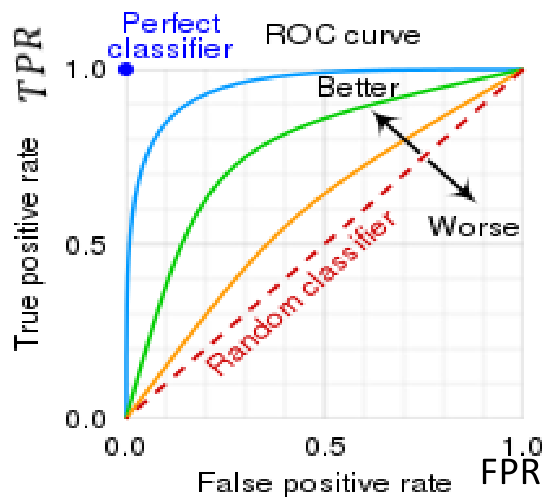

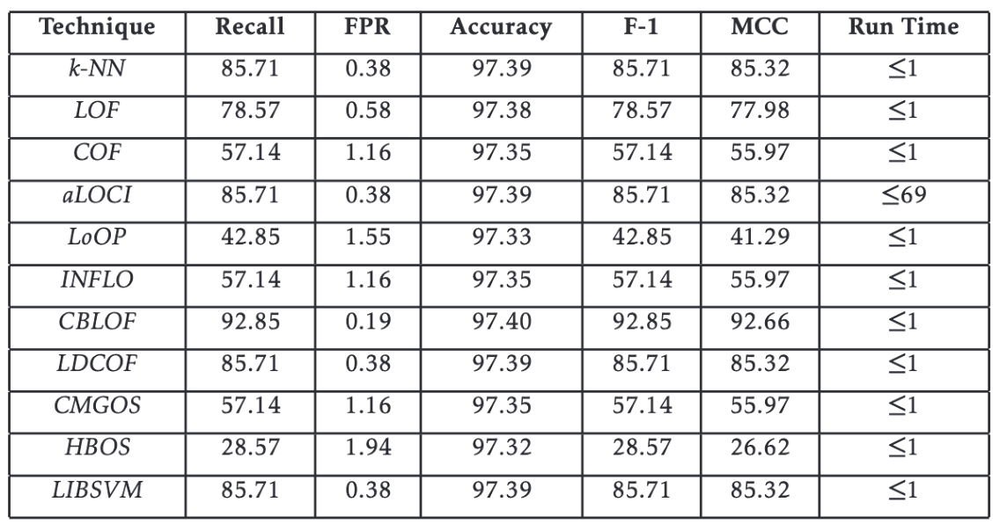

### Change point metrics

Match estimated and reference change points before measuring error. For $m$ matched pairs, let $e_i=\widehat{t}_i-t_i$, where $t_i$ is the reference time and $\widehat{t}_i$ is the detected time. Positive $e_i$ means a late detection.

$$
\mathrm{MAE}=\frac{1}{m}\sum_{i=1}^m |e_i|,\quad
\mathrm{MSD}=\frac{1}{m}\sum_{i=1}^m e_i,\quad
\mathrm{MSE}=\frac{1}{m}\sum_{i=1}^m e_i^2.
$$

$\mathrm{RMSE}=\sqrt{\mathrm{MSE}}$. Range-normalized RMSE divides RMSE by a specified nonzero reference range. The **average detection delay (ADD)** averages detection lags under a defined alarm policy. It equals MAE for the same matched detections when all errors are delays. **Hausdorff distance** takes the largest nearest-point distance across the two sets of change points, considering both directions.

### Window-based metrics

The **Numenta Anomaly Benchmark (NAB)** scores detections in time windows. Earlier detections inside a window earn more credit. False alarms and missed windows incur penalties. The **Rand index** measures the fraction of pairs of time points for which two segmentations agree on whether the points belong to the same segment. [NAB paper](https://arxiv.org/abs/1510.03336)

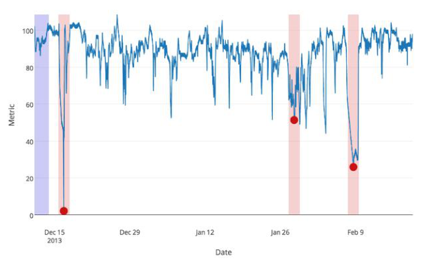

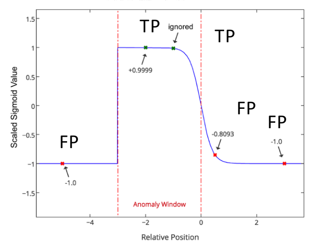

### How to tune the performance?

Automate threshold selection where possible and keep it configurable. Excessive false alarms overload reviewers. Tune the threshold against the costs of misses and false alarms for the application. In a high-volume alert stream, tolerating some misses may keep the workload manageable.

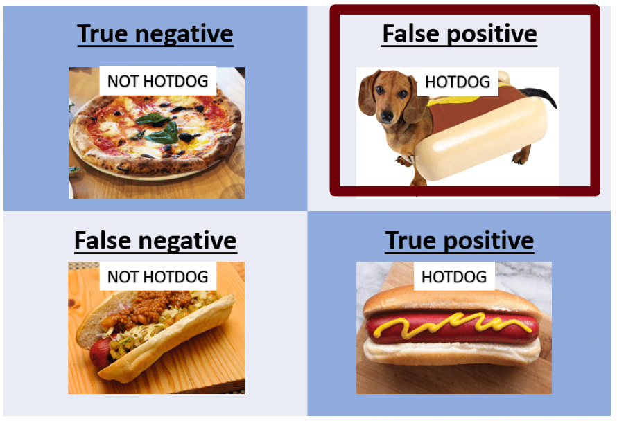

### Classes for classical AD algorithms

| Method | Detection idea |
|---|---|
| Statistical or model-based | Learn the nominal distribution or boundary and flag unlikely points. |
| Density-based | Flag points in sparse neighborhoods. |
| Deviation-based | Test how much a statistic, such as variance, changes when a point is removed. |
| Neighbor- or cluster-based | Flag points far from neighbors or poorly represented by clusters. |
| Projection-based | Reduce dimensionality and inspect departures from the projected structure. |
| Bayesian networks | Use dependencies among variables to identify unlikely combinations. |
| Neural networks | Learn features or a representation of nominal behavior and measure deviations from it. |

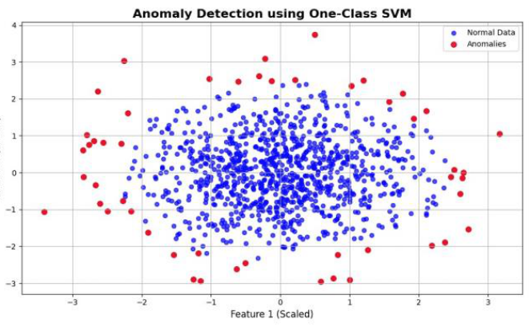

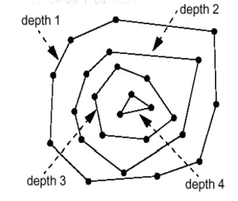

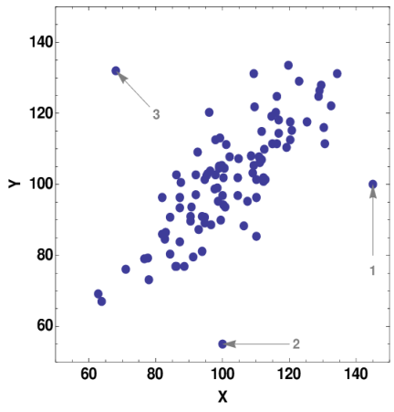

### Learning conditions (1/2)

- **Supervised learning** uses labeled nominal and anomalous examples. With severe class imbalance, check recall and the cost of false alarms alongside accuracy.
- **Unsupervised learning** uses unlabeled data that may contain both classes. Many methods assume nominal points form common patterns and anomalies are sparse or isolated. Anomalies can form their own clusters and nominal behavior can be dispersed.

### Learning conditions (2/2)

- **Clean nominal training** models normality from nominal examples and tests on data that may contain anomalies.
- **Positive–unlabeled learning** uses labels from one class and an unlabeled mixture. A small labeled sample may cover only part of that class's behavior.

### Machine learning and deep learning

Traditional approaches include K-means, spectral clustering, random forests, one-class SVMs, self-organizing maps and growing neural gas. Deep approaches include fully connected networks, CNNs, recurrent models such as LSTMs, GANs, one-shot or few-shot architectures and transformers. Choose the model based on available labels, the data structure and the type of anomaly.
