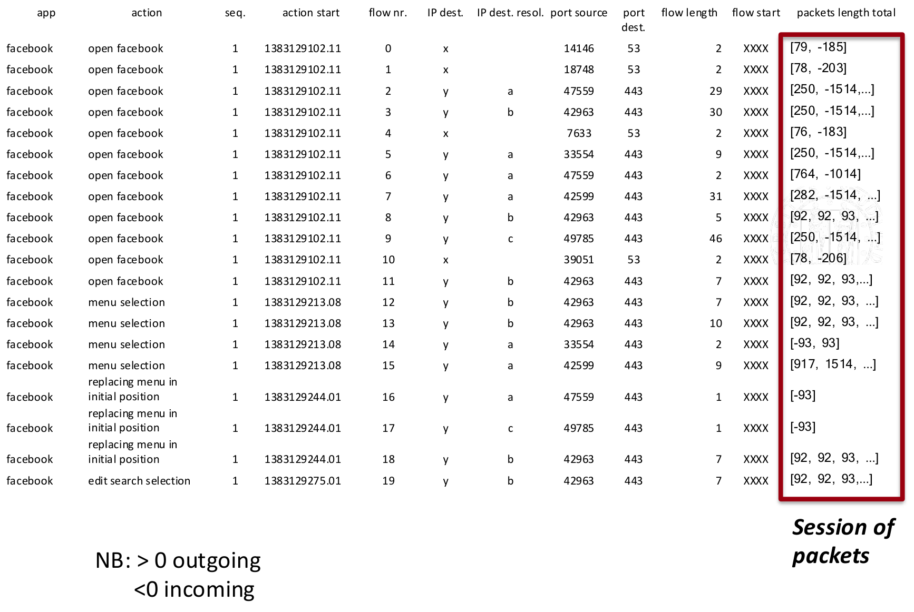
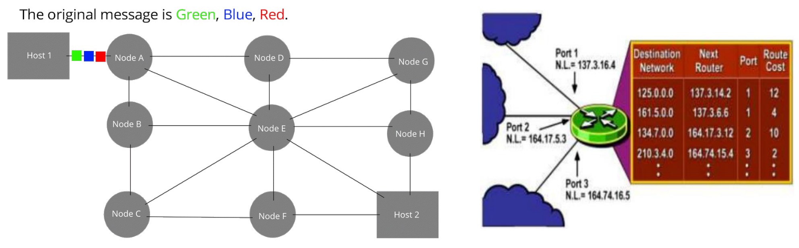
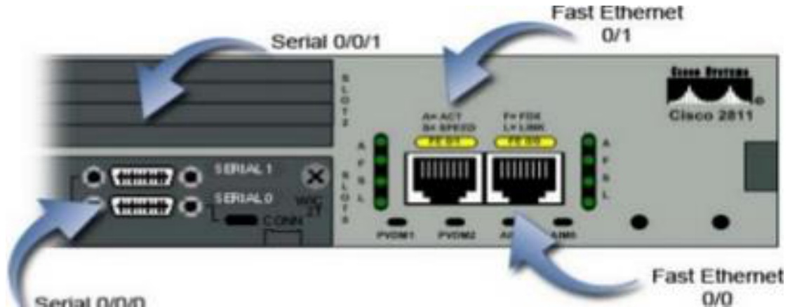

# Network forensics

Network evidence includes packet captures, live router state, server logs and wireless signals. Authorized passive capture supports investigations, security monitoring and network troubleshooting. Wireshark can filter traffic by IP address, port or protocol. Capture filters limit what is saved. Display filters change what the analyst sees in an existing capture.

## PCAP files

Classic **PCAP** stores captured packets. A global header appears once, followed by a header and the captured bytes for each packet.


- **Global header.** The magic number identifies byte order and timestamp resolution. The version, snapshot length (`snaplen`, the maximum bytes saved per packet) and link-layer type describe the capture. Modern readers ignore the legacy `thiszone` and `sigfigs` fields. [libpcap savefile format](https://github.com/the-tcpdump-group/libpcap/blob/master/pcap-savefile.manfile.in)
- **Packet header.** In the microsecond format shown, `ts_sec` and `ts_usec` give the seconds and the microsecond fraction. `incl_len` is the captured length in bytes and `orig_len` is the original packet length. Capture truncation, such as a packet exceeding `snaplen`, can make `incl_len` smaller.

## PCAP->CSV files

A derived CSV can group packets into flows. The example records the application and action, sequence and flow IDs, times, destination IP or resolved name, ports, packet count and ordered signed lengths. Packet sizes, timing and direction can support application profiling even when payloads are encrypted.

In the example, `[79, -185]` represents a 79-byte outgoing packet followed by a 185-byte incoming packet.



## Trojan horse eavesdropping

Trojan spyware operates on a compromised endpoint and can collect communications, activity logs, calls or camera and microphone data. A passive sniffer observes traffic at a capture point. In a man-in-the-middle (MITM) attack, an intermediary relays communication between endpoints. Endpoint spyware can depend on the device and OS version. Its installation and operation can alter evidence, disrupt services or expose data through additional backdoors.

## Routing analysis

### TCP/IP router

A router interconnects networks. It uses the destination IP address and its routing table to select a next hop and outgoing interface. Packets between the same endpoints can take different paths when more than one route is available. Routing tables and configurations help explain how traffic was forwarded.



### Routing on TCP/IP

- **Components.** ROM, power-on self-test (POST), router OS (Cisco IOS in the example), RAM, flash and nonvolatile RAM (NVRAM).
- **Ports.** LAN and WAN ports carry network traffic. Console and auxiliary ports provide administrative access, for example by using a terminal emulator with a local cable or modem.
- **Modes.** Setup, user, privileged, global configuration and interface configuration. The active mode controls which operations are available.



*The serial interfaces are labelled `0/0/0` and `0/0/1`. The Fast Ethernet interfaces are labelled `0/0` and `0/1`.*

### Router attacks

Router compromise can disrupt connectivity across several networks or redirect their traffic. Infrequent updates and configuration reviews can prolong exposure. Investigators may find signs of reconnaissance, unauthorized access, privilege changes or persistence.

### Most common router attacks

| Attack | Effect or evidence |
|---|---|
| Denial of service (DoS) | Resource exhaustion degrades or interrupts forwarding. |
| Packet mistreating | Abnormal packet handling can cause drops, misrouting, loops or congestion. |
| Routing table poisoning | Altered routing information can divert traffic along an unexpected path. |
| Hit and run / persistent | An isolated attempt leaves a short event window. Persistent attacks produce repeated activity. |

### Gathering volatile router data

Use the local console and terminal emulator where possible. Record reference time, router time and active sessions. Preserve the live state and save a copy of the configuration. Compare routing tables and static routes with a known baseline. Check the Address Resolution Protocol (ARP) cache for unexpected IP-to-MAC mappings and corroborate them with other evidence.

**Order of volatility.** Registers and cache → routing tables → ARP cache → process table → kernel statistics and modules → main memory → temporary file systems → secondary memory → router configuration → network topology.

### Cautions and documenting

Record the complete console session and use read-only `show` commands. Avoid rebooting or changing the configuration because either can destroy evidence. If remote access is necessary, document how it affects what can be collected. Record evidence handling in the **chain of custody**, findings in the case report and the nature and scope of the incident in the response record.

### Bad guys and good guys

A **Router Audit Tool (RAT)** assesses configuration security. Configuration reviews, encrypted management traffic, multifactor authentication and centralized authentication reduce exposure.

## Server logs

### Server log

Servers record events such as access attempts, requests and errors according to their logging configuration. Logs support troubleshooting, monitoring, performance analysis and audits. In a 4G network, unusual connection records helped identify malfunctioning SIM cards.

| Log type | Typical evidence |
|---|---|
| System | Kernel, service, process and OS errors. |
| Application | Application events, error details, timestamps and severity. |
| Security | Authentication, access and alerts from firewalls, IDSs or other security tools. |
| Audit | User actions, data access and configuration changes. |
| Event | Selected significant system, security or application events. |

Storage formats include plain text, structured records, binary logs, syslog messages and web access formats such as CLF and ELF.

### Log analysis strategies (1/2)

Aggregate records to compare visits, unique visitors, session duration, peak hours, authenticated accounts, entry and exit pages, referrers and errors. Available fields determine which statistics can be derived. Frequent requests may reflect a fault or suspicious activity. Correlate them with authentication, application or network records.

The **NCSA Common Log Format (CLF)** records `host ident authuser date request status bytes`.

```text
127.0.0.1 user-identifier tomasin [30/Aug/2017:10:25:16 -0700] "GET /apache_pb.gif HTTP/1.0" 200 1068
```

- `127.0.0.1` is the logged client address. `user-identifier` is the remote ident value and `tomasin` is the authenticated account. A dash marks an unavailable value in these identity fields.
- The server recorded an HTTP/1.0 `GET` for `/apache_pb.gif` at `10:25:16` with a UTC offset of `−07:00`. Status `200` means success. The status families are `2xx` success, `3xx` redirection, `4xx` client error and `5xx` server error.
- `1068` is the response size in bytes, excluding HTTP headers. [Apache Common Log Format examples](https://httpd.apache.org/docs/current/mod/mod_log_config.html.en#examples)

### Log analysis strategies (2/2)

The **Extended Log Format (ELF)** can record similar events with a configurable field list. In W3C ELF, read the `#Fields` directive to interpret each column. The same approach applies to application and machine logs. Identify the schema, align timestamps and correlate related events. [W3C Extended Log File Format](https://www.w3.org/TR/WD-logfile/)

## Wireless channel sensing

### Introduction to wireless forensics

Wireless forensics collects radio traffic as evidence, including data and multimedia such as voice over IP. Multiple access points (APs) and client roaming can spread a session across frequencies. A radio hopping between channels samples each one intermittently. Simultaneous monitoring limits gaps. Plan processing and storage for the combined throughput, frame sizes and frame counts across monitored channels.

Both example captures cover all 14 channels of the historical 802.11b/g setup.

| Measurement | Moving car | Parking lot |
|---|---:|---:|
| Duration | 25 min | 5 min |
| Volume and frame count | 74 MB, about 265,000 | 24 MB, about 107,000 |
| Networks detected | 60 | 24 |
| Open / WEP / WPA networks | 12 / 42 / 6 | 4 / 17 / 3 |
| Networks carrying data | 13 | 6 |
| Data / management / control frames | 25% / 39% / 36% | 6% / 53% / 41% |

Management and control frames dominate both captures. The parking lot capture contains 24 networks in total, based on the security counts. Duration and setting differ between captures, so the counts alone cannot isolate the effect of motion. [Raul Siles, capture tables 3–4](https://community.broadcom.com/viewdocument/wireless-forensics-tapping-the-air-1?CommunityKey=1ecf5f55-9545-44d6-b0f4-4e4a7f5f5e68&tab=librarydocuments)

### Features for good WF tools

- The historical example uses **15 radios**. Fourteen observe the channels simultaneously and one hops across them. The number depends on the channels and coverage needed.
- Use passive monitor mode. Transmissions from the collector can disturb the channel and change the behavior being measured. Capture all authorized traffic when scope permits, and filter by AP or station MAC address during analysis where possible.
- Log GPS time and outdoor position, receiver identity, channel, received signal strength (RSSI) and signal and noise measurements. External antennas improve reception. Remote access can help manage the collection device.
- Encryption can hide payload contents while leaving observable radio and traffic characteristics.

## Analyzing evidences: authentication, attribution, monitoring

- **Authentication** assesses whether a captured stream is genuine.
- **Attribution** links a stream to a source, device, account or user. A link to a device or account requires corroboration before attributing activity to a person.
- **Monitoring** uses captures, logs or signal measurements to detect activity over time. For example, radio beacons can help track movement.

### Example: intrusion detection systems (IDS)

An **IDS** raises alerts when monitored activity meets criteria for suspicious behavior. Firewalls, antivirus software, applications and other sensors supply additional records for correlation.

| IDS | What it monitors |
|---|---|
| NIDS | Traffic observed by sensors on monitored network segments. |
| HIDS | Events and state on a specific host. |
| PIDS | A selected protocol, such as HTTP. |
| APIDS | Application-specific exchanges, such as SQL requests. |

### Host-based IDS

HIDS examines system activity, logs, calls, errors and incoming traffic. It can show what happened after traffic reached a host and detect local events such as attempts through a console or USB connection. Its access to host activity can corroborate evidence when network observations differ from what the host processed.

Per-host deployment and updates consume resources and must account for different operating systems. One host has limited visibility into activity across the network. Compromise can disable local monitoring or prevent alert delivery.

### NIDS

Network probes analyze traffic for signatures or deviations from a profile. They can spot activity across hosts, such as a distributed pattern of connection attempts, without running an agent on each monitored host. The **Monitor Interface (MI)** receives traffic. The **Command & Control Interface (CCI)** handles management and reporting, typically over a separate network. Events outside the monitored path require other evidence.

### NIDS (2/2)

- **Bandwidth.** Sensors must capture, reassemble and analyze traffic fast enough to keep up. Dropped traffic can leave gaps in evidence.
- **Fragmentation.** A sensor should reconstruct the same packet the destination processes. Overlapping fragments can cause the reconstructed views to differ.
- **Time to live (TTL).** IPv4 forwarding decrements TTL by at least one per routing hop. A router discards a packet when the TTL expires. A packet visible at a probe may never reach the destination, so corroborate claims about delivery with endpoint evidence. [RFC 1812, §5.3.1](https://datatracker.ietf.org/doc/html/rfc1812#section-5.3.1)
- **Encryption.** Encrypted payloads limit content inspection. Flow metadata and authorized endpoint observations can still support detection.

### Hybrid IDS

Network sensors and host agents report to a central platform. Correlating alerts across these sources can link network events to host effects and requires processing more data.

### IDS trigger

| Trigger | How it works | Main trade-offs |
|---|---|---|
| **Anomaly Detection (Profile based)** | Flags deviations from a **nominal** profile built with statistics, rules or a learned model. | Can flag unknown or insider activity. Needs representative training and updates as behavior changes. Training takes time, alerts can be hard to explain, and false positives and false negatives are possible. |
| **Misuse Detection (Signature based)** | Matches observations to rules for known attacks, as in antivirus signature matching. | Known patterns can be detected as soon as the relevant signatures are deployed. New attacks and variants may evade existing rules. The signature database needs updates and some rules require sensors to retain state across events. |

An IDS alert is a lead. Check the related traffic and host evidence to determine whether an intrusion occurred and what it affected.
