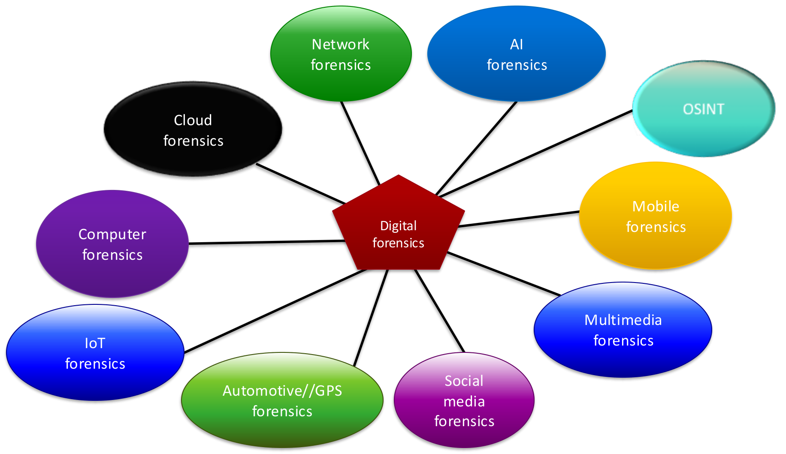
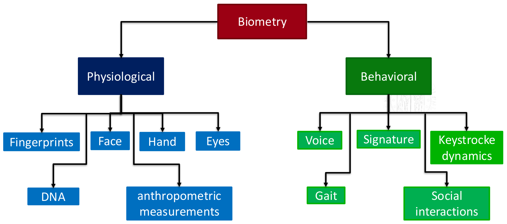
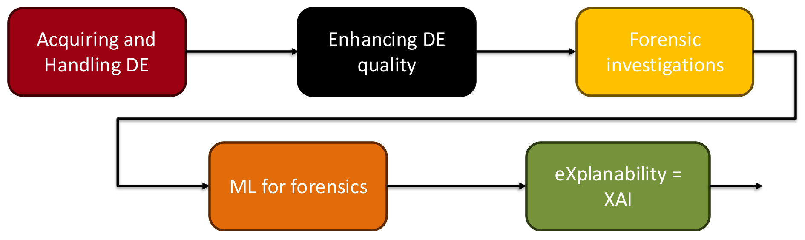
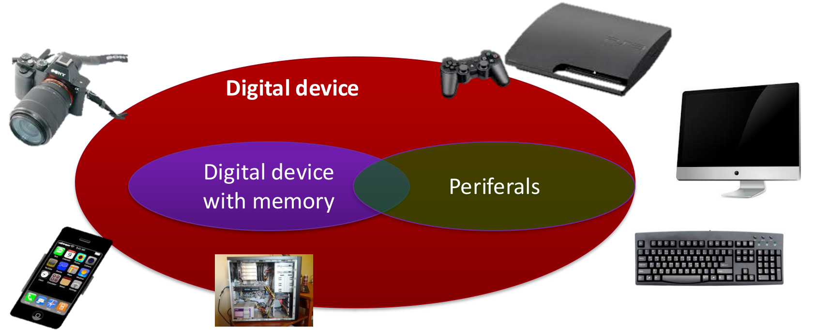

# INTRODUCTION TO DIGITAL FORENSICS AND BIOMETRICS

*Sources: [lecture slides](Lecture%2001%20-%20Intro%20to%20DF%20and%20Biometrics.pdf), pp. 14–30; recordings [01A](Lecture%2001A%20STEM.mp3), from about 46:00, and [01B](Lecture%2001B%20STEM.mp3). Administrative information and the recording break are omitted.*

## WHAT IS DIGITAL FORENSICS?

> [!info] Definition — Digital forensics
> Digital forensics applies scientific methods to identify, collect, examine and analyse data while preserving information integrity and maintaining a strict chain of custody.

**Integrity** means preserving the evidence against alteration. The **chain of custody** records its handling and transfers so that its history remains traceable. These requirements support the credibility of the investigation, beyond the technical correctness of its results.

## NEED FOR DIGITAL FORENSICS

Organisations depend on large amounts of valuable data. When data are damaged, stolen or compromised, forensic analysis reconstructs what occurred. It also helps explain security breaches, attacks, failures and industrial malfunctions.

The lecturer uses cybercrime cost projections to illustrate the scale of the problem, including human consequences that cannot be expressed adequately in money. The figures below are **projections reproduced from the slides**, rather than measured results or current estimates.

The GDP comparison illustrates scale; cybercrime costs are not a country's GDP. Exposed sectors include critical infrastructure, banking, telecommunications, technology, chemicals, energy and transport.

## SECURITY VS. FORENSICS

| Cyber Security | Digital Forensics |
|---|---|
| Policies and practices to prevent and monitor unauthorised access, misuse or modification. | Examination of devices, data and network traffic to reconstruct events and their causes. |
| Primarily protects systems and information. | Usually investigates after an incident or alteration. |

The fields are closely connected: understanding how an incident happened can inform protection. Forensics also applies to non-criminal events, such as faults in an industrial process.

## 5 W + H: FORENSIC INVESTIGATIONS

A forensic investigation seeks answers to six questions:

| Question | Information sought |
|---|---|
| **Who?** | Suspect, victim, account, device or IP address involved. |
| **What?** | The event: data theft, malware infection, image manipulation, etc. |
| **When?** | Timeline and duration, using timestamps, logs and creation/edit dates. |
| **Where?** | Physical location, device, server or network segment. |
| **Why?** | Motivation or objective. |
| **How?** | Tools, exploits, credentials, malware or social engineering used. |

A **digital ID**, such as an account or IP address, must be distinguished from a person's **biological ID**. Linking the two is essential in an *“Onlife”* world, where online and offline activities are blended. A digital identifier alone does not establish the real person responsible.

**Biometrics** measures physical characteristics or personal traits to recognise individuals. It helps connect digital evidence to a real identity.

Time, duration and location also affect the interpretation of events. For example, a breach lasting months differs from one lasting hours, and the country involved can affect applicable rules.

The expert's task is to **establish facts supported by the evidence**. Deciding guilt is not the expert's role. If the evidence does not support a conclusion, the expert must say so.

## FORENSIC CALL FOR BIOMETRICS ….

The central question is: **who is the person associated with this evidence?** Possible outcomes are:

- **Individualization:** association with a particular individual.
- **Exclusion:** exclusion of a candidate as the source.
- **Inconclusive:** insufficient information to support either outcome.

These are possible conclusions, not a guarantee that every trace identifies someone.

| Aspect | Forensic use | Operational biometric recognition |
|---|---|---|
| Timing | After the event. | May operate before or during an event, e.g. access control. |
| Measurement | The available trace determines what can be measured. | The system can select the trait and acquisition conditions. |
| Collection | Often manual; evidence is frequently low quality. | Often automated and may require a real-time response. |
| Uncertainty | The original event generally cannot be repeated to obtain a better trace. | An inconclusive acquisition can often be repeated. |
| Communication | Findings must be explained to a court or jury. | Output is typically expressed numerically. |

A **false non-match** fails to associate measurements from the same person; a **false match** associates measurements from different people. The lecturer emphasises avoiding false exclusions of the perpetrator in forensic searches. Surveillance also prioritises avoiding missed matches, whereas access control places particular importance on avoiding false matches that admit unauthorised users.

Forensic traces may be accidental, partial or deliberately obscured. Report conclusions and limitations clearly enough for a reader without a scientific background to understand them.

## SOME EXAMPLES

- **Allianz Life:** social engineering enabled access to a third-party cloud system and personal data. Forensics helps reconstruct access and determine what data were affected.
- **SHAMS II:** more than **100,000 facial images** were extracted from extremist visual material, filtered and processed through INTERPOL's facial-recognition system. The example combines digital evidence processing with biometrics; the lecturer corrects the initial “10,000” to “100,000”.
- **Clearview:** a facial-recognition database built from images scraped online illustrates why an investigation must also consider how data were collected.
- **Industrial anomaly detection:** reconstructing a failure can support production quality and safety.

These are examples discussed in the lecture, rather than independent case analyses.

## DIGITAL EVIDENCES

**Digital evidence (DE)** consists of digital devices or data, including files, images and network streams, relevant to an investigation.

Digital forensics initially focused heavily on computer storage, including hidden or deleted files. Its scope now includes many interconnected domains:

Different domains require different acquisition and analysis techniques, while retaining the same need for preservation and traceability.

## FROM DIGITAL EVIDENCE TO REAL LIFE ID

Biometric traits fall into two broad groups:

- **Physiological:** characteristics of the body, such as fingerprints, face, hand, eyes, DNA and anthropometric measurements.
- **Behavioral:** characteristics of actions, such as voice, signature, gait, keystroke dynamics and social interactions.

The lecturer also mentions physiological signals such as heart activity, EEG, muscle activity and skin conductance. No biometric trait is perfect: the choice depends on the application, available measurements and required reliability. Combining traits can provide additional information. For example, a phone's motion sensors may reveal a walking pattern different from its owner's.

## WHAT WILL YOU GAIN IN THIS COURSE?

The course connects evidence handling with disk, network, multimedia and social media analysis, biometric identification, reporting and relevant legal issues. Machine and deep learning matter both as investigative tools and for understanding attacks that use them.

**XAI** denotes explainable artificial intelligence: investigative results must be understandable and justifiable.

## ACQUIRING A DIGITAL EVIDENCE

## DIGITAL EVIDENCES

In the classroom video, investigators unplug a compromised baby camera. This can destroy **volatile information**, such as active connections and associated network information. Securing a physical object is therefore not sufficient: an intervention can change or erase the digital evidence it contains.

The lesson is to assess the device and the information at risk before acting. The video illustrates the problem; it does not establish a universal rule to leave every device powered on or to switch it off.

## ACQUIRING AND PRESERVING DIGITAL EVIDENCES

**ISO IEC 27037/2012**, as identified in the lecture, provides guidelines for identifying, acquiring and preserving digital evidence.

- **ISO:** International Organization for Standardization; develops technical standards across many fields.
- **IEC:** International Electrotechnical Commission; focuses on electrical, electronic and related technologies.

The following descriptions concern the versions cited in the course slides, rather than a check of current editions.

## OTHER STANDARDS

| Standard cited in the slides | Purpose |
|---|---|
| ISO/TR 15801:2009 | Trustworthiness and reliability of electronically stored information. |
| ISO/IEC 17020:2012 | Requirements for bodies performing inspection. |
| ISO/IEC 17025:2005 | Competence of testing and calibration laboratories. |
| ISO/IEC 27000:2012 | Information security management overview and vocabulary. |
| ISO/IEC 27041 | Ensuring investigative methods and processes are fit for purpose. |
| ISO/IEC 27042 | Analysis and interpretation of digital evidence, including validity and reproducibility. |
| ISO/IEC 27043 | Models and guidelines for incident investigation processes. |

A shared vocabulary also helps different organisations exchange evidence consistently.

## ISO IEC 27037/2012

The lecture presents four phases for handling data in a legal investigation:

1. **Identification (inspection):** identify potential sources of relevant digital evidence.
2. **Seizure (virtual):** take control of the relevant evidence or device.
3. **Acquisition:** obtain the digital information contained in the source.
4. **Preservation (conservation and sealing):** protect the evidence against alteration and maintain its integrity.

The lecturer distinguishes the broad everyday use of *acquisition* for the whole collection process from its narrower meaning here: acquiring the information is different from physically seizing its device.

The material is already digital. Converting analogue sources, such as film or magnetic recordings, into digital form is outside the scope described here.

## ISO IEC 27037/2012: MEMORY DEVICES

Covered sources include computer storage, removable media, phones, memory cards, GPS/navigation systems, cameras and CCTV, networked computers and network devices. Connected appliances, smart sensors and other IoT devices may also store relevant information.

A device's everyday function does not determine its forensic value: the relevant question is whether it acquires or stores information useful to the investigation.

## REQUIREMENTS

- **Pertinence:** evidence must be relevant to the investigation. Document why it is worth acquiring; possession of a digital device alone does not make its acquisition justified.
- **Reliability:** preserve authenticity and integrity. Document operations so that the process can be examined and reproduced.
- **Adequateness:** choose appropriate evidence, quantity and methods. A complete copy or physical seizure is not always necessary or feasible; the case, resources, system and applicable legal framework matter.
- **Verificability:** a third party must be able to examine the actions, methods and procedures. Those handling evidence must justify their decisions.
- **Repeatability:** obtain consistent results using the same method, procedures, tools and conditions.
- **Reproducibility:** obtain consistent results using the same method with different tools or conditions, following the distinction used in the lecture.
- **Provable:** demonstrate and justify why the chosen method was the best feasible option.

**DEFR** and **DES** denote the digital evidence first responder and digital evidence specialist involved in handling evidence.

Adequateness also requires considering operational consequences: seizing a phone differs from removing the computer controlling a power plant. Acquiring more data increases time, cost and the amount that must be analysed.

AI results can depend on the trained model and training data. A result alone is insufficient: the method and relevant materials must support verification and reproducibility. Investigative usefulness does not automatically establish that a result is suitable for presentation as evidence.

Some exceptional recovery procedures can irreversibly alter or destroy a damaged source. The lecturer uses this to stress that an irreversible operation requires a documented justification, including why alternatives were inadequate.

## ISO IEC 27037/2012: WHAT AND WHAT NOT?

| Included in the scope described | Outside that scope |
|---|---|
| Logging operations and maintaining documentation. | Country-specific legal rules. |
| Chain of custody and traceability. | Evidence analysis techniques. |
| Planning priorities. | Specific technical instruments. |
| Protection, sealing and packaging. | Report writing and presentation. |
| Physical or virtual transport. | Handling analogue data. |
| Roles and responsibilities in evidence transfers. | |

**Logging** records what was done. The **chain of custody** traces who controlled or accessed the evidence, when, and why it was transferred. Both help make the investigation verifiable.

The closing classroom survey asks which device to process first among a laptop, USB drive, phone, hard disk, camera and router. The scene image is not supplied in the lesson files, and the answer is deferred to the next lecture. No priority order is established here.
