# Multimedia analysis: enhancement and forensic reporting

**Source:** `pres_lecture11.pdf`, 47 slides.
# Quality enhancement

## Image/video enhancement


## Enhancing images/videos

Images and videos are often captured under adverse conditions, such as nighttime video surveillance. Evidence may need processing to improve its visual quality. Dedicated software or source code can be used.

- **[Adobe Photoshop](https://www.adobe.com/products/photoshop.html):** described as the industry standard for professional photo editing.
- **[Adobe Lightroom](https://www.adobe.com/products/lightroom.html):** intended for photographers managing large image collections.
- **[Capture One](https://www.captureone.com/):** known for color management and RAW processing.
- **[Corel PaintShop Pro](https://www.paintshoppro.com/):** described as a Photoshop alternative with powerful editing tools and a one-time purchase.
- **[Affinity Photo](https://affinity.serif.com/en-us/photo/):** described as an affordable, single-purchase application with professional editing features.

Free and open-source tools:

- **[GIMP](https://www.gimp.org/)** (GNU Image Manipulation Program).
- **[Darktable](https://www.darktable.org/)** and **[RawTherapee](https://rawtherapee.com/)**, designed for RAW file processing.

These descriptions reproduce the lecture's software examples, rather than a current pricing or licensing comparison.

## Data enhancement: images and video

Tools and operations used in multimedia forensics:

- **Sharpening:** makes edges clearer and more distinct.
- **Video stabilization:** reduces unwanted movement in video.
- **Distortion correction.**
- **Perspective distortion correction.**
- **Deblurring.**
- **Noise reduction.**
- **Masking:** hides faces or other regions to protect a witness, victim, or law enforcement officer.
- **Contrast enhancement, blur reduction, and color equalization.**
- **Image magnification:** increases displayed image size; recovering additional detail requires more than resizing alone.

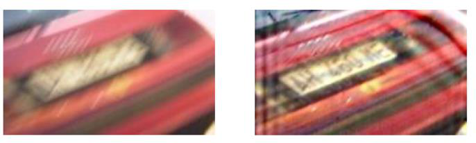

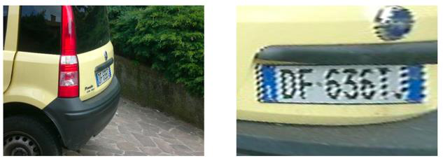

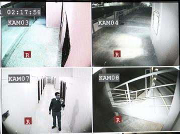

Operations associated with older video systems:

- **Deinterlacing:** interlaced scanning records alternating fields. Deinterlacing reconstructs progressive frames from those fields.
- **Demultiplexing:** separates combined camera signals so that an individual camera stream can be isolated. Multiplexing combines signals; demultiplexing separates them.

##  Contrast enhancement

If picture is very dark, the contrast is low.
Pixel values are transformed using a power law:

$$
I^{g}(x,y)=\bigl(I(x,y)\bigr)^g.
$$

The resulting intensity is rescaled using parameters $m$ and $M$:

$$
I'(x,y)=\frac{I^{g}(x,y)-m}{M-m},\qquad M\ne m.
$$

Given $g$, $m$, and $M$, these transformations convert one image into another. Here $I^g$ denotes the gamma-transformed image.

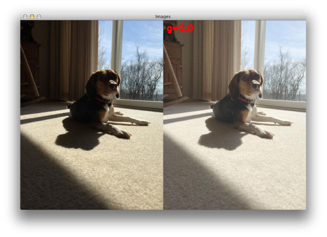

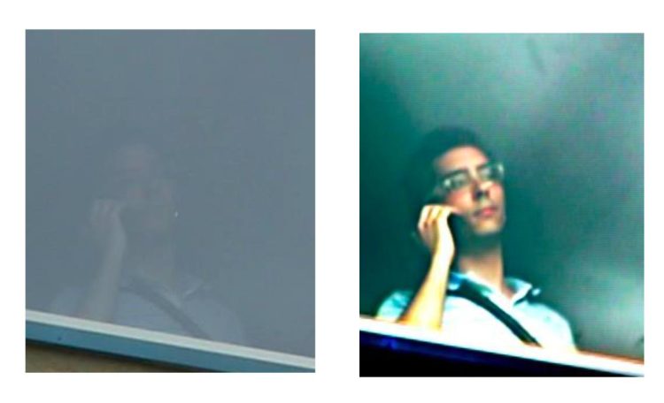

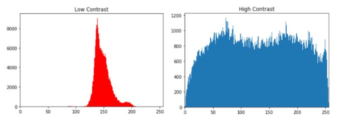

## Contrast enhancement: histogram equalization

Histogram equalization can be applied to each channel:

```python
import cv2
import numpy as np

# OpenCV uses BGR channel order by default.
b_image, g_image, r_image = cv2.split(image_src)
b_image_eq = cv2.equalizeHist(b_image)
g_image_eq = cv2.equalizeHist(g_image)
r_image_eq = cv2.equalizeHist(r_image)
image_eq = cv2.merge((b_image_eq, g_image_eq, r_image_eq))
```

An explicit histogram and cumulative distribution implementation:

```python
# image_matrix: grayscale uint8 image; 256 intensity bins.
bins = 256
image_flattened = image_matrix.flatten()
image_hist = np.zeros(bins, dtype=np.int64)
# cv2.calcHist can also compute the histogram.
for pix in image_flattened:
    image_hist[pix] += 1

cum_sum = np.cumsum(image_hist)
nonzero_cdf = cum_sum[image_hist > 0]
cdf_min = nonzero_cdf[0]
denominator = cum_sum[-1] - cdf_min
if denominator > 0:
    uniform_norm = np.clip(
        (cum_sum - cdf_min) * 255.0 / denominator, 0, 255
    ).astype(np.uint8)
    image_eq = uniform_norm[image_matrix]
else:
    image_eq = image_matrix.copy()
```

> [!info] Code correction
> The source creates `image_flattened` but iterates over the two-dimensional matrix. The corrected loop iterates over pixels. It also applies the lookup table and handles a constant image. The source normalization is `(cum_sum - cum_sum.min()) * 255 / (cum_sum.max() - cum_sum.min())`; using the first occupied cumulative bin handles empty leading bins.

CLAHE (contrast-limited adaptive histogram equalization) is another option. Full invertibility is not guaranteed. Independent channel equalization can also change color balance.

## Sharpening

Sharpening applies a spatial filter to an image. The example combines the original image with a high-pass component:

```python
kernel = np.array([[0, -1, 0], [-1, 5, -1], [0, -1, 0]])
image_sharp = cv2.filter2D(src=image, ddepth=-1, kernel=kernel)
```

$$
K=\begin{bmatrix}
0&-1&0\\
-1&5&-1\\
0&-1&0
\end{bmatrix}.
$$

The kernel sums to 1; it is a sharpening filter with a high-pass contribution, rather than a pure high-pass filter.

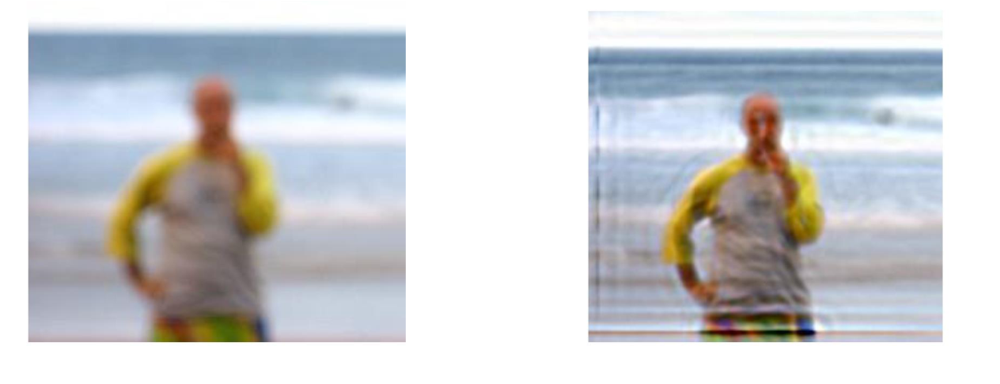


## Magnification

Image processing can increase image size and apparent clarity. With video, multiple frames can be used, and subtle motion can be magnified.

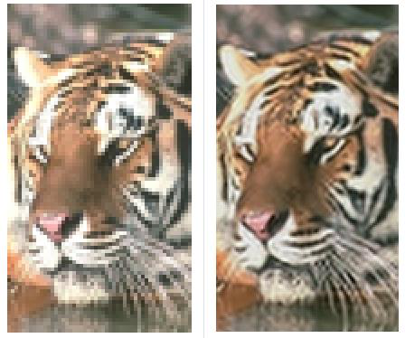

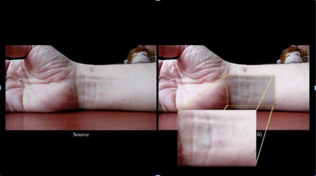
## Magnification: code examples

For Eulerian video magnification, the slide suggests:

```bash
pip install PyEVM
```

For a single image, Wand provides `magnify()`:

```python
from wand.image import Image

with Image(filename="input.png") as image:
    image.magnify()
    image.save(filename="magnified.png")
```

Alternatively, resize with OpenCV:

```python
scale_up = cv2.resize(
    source, None, fx=scaleX, fy=scaleY,
    interpolation=cv2.INTER_LINEAR,
)
```

The source's `Image.magnify()` is a method reference; the example above calls it on an image instance.

## Blurring compensation

Visual comparisons illustrate blur reduction and deblurring.


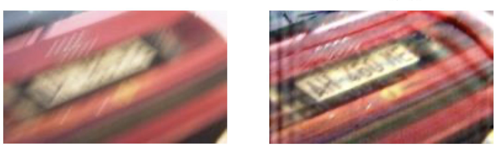

## Perspective correction

A perspective transform maps four source points to four destination points:

```python
matrix = cv2.getPerspectiveTransform(pts1, pts2)
result = cv2.warpPerspective(frame, matrix, (500, 600))
```

The output size is 500 pixels wide by 600 pixels high.

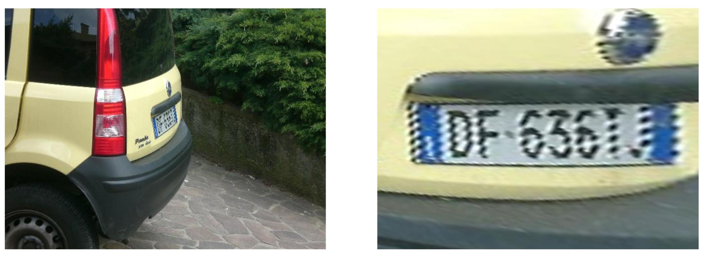

## Noise reduction

Two families of techniques:

- **Classical methods:** adaptive filtering.
- **Neural network methods:** learned denoising strategies.

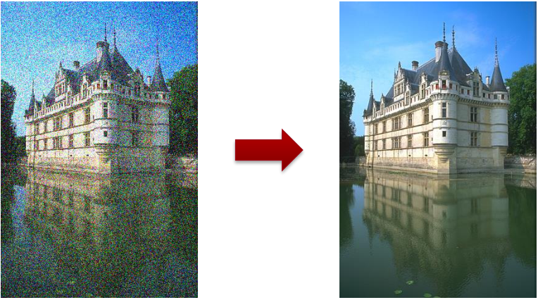

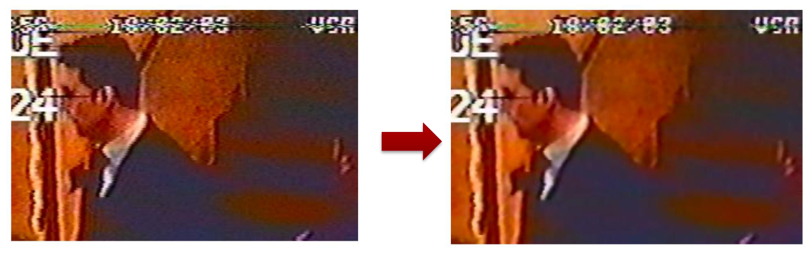
## Slide 14 — Lens distortion correction

Camera lens geometry, strong curvature, and optical imperfections can produce substantial distortion. This distortion may need correction.

> [!info] Wording correction
> The source phrase “highly-spherical non-spherical geometry lenses” is contradictory. The examples illustrate strong lens distortion, including fisheye-like geometry.

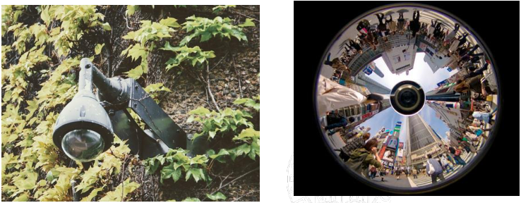

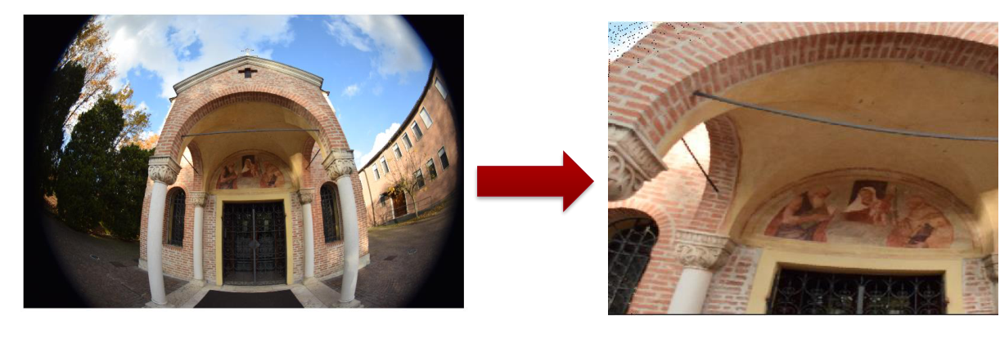

## Frame integration

The slide illustrates improved visibility obtained through frame integration.

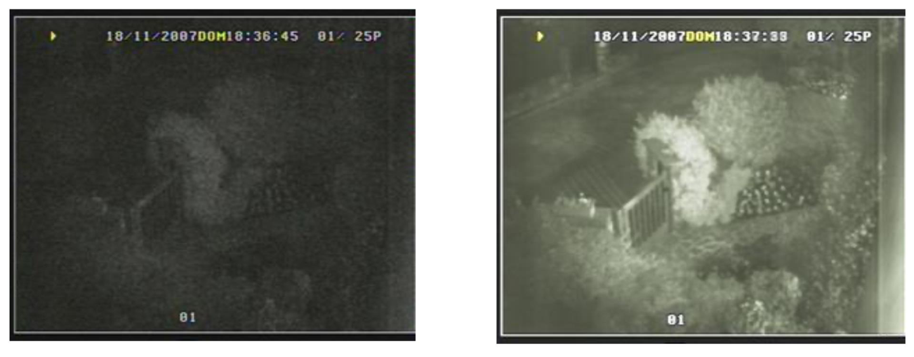

# Audio forensics

## Audio enhancement

Audio enhancement improves the quality, clarity, and intelligibility of audio signals. Denoising removes unwanted noise, distortion, or artifacts from recordings.

Noise or interference to remove or isolate includes:

- **Background noise:** persistent low-level environmental sound, such as air conditioning and fans.
- **Impulse noise:** clicks and crackles from electrical interference or microphone handling.
- **Electrical noise:** hum and buzzing from electrical devices, recorders, and microphones.
- **Reverberation:** sound reflections caused by rooms and other surroundings.

## Forensic audio enhancement and analysis

Tools and tasks in multimedia audio forensics:

- Noise reduction.
- Speaker identification.
- Speech identification.
- Environment estimation and localization.
- Event reconstruction.
- Authentication.

**Example: Watergate investigation.** The lecture describes an 18½-minute gap in a recording of President Richard Nixon discussing the Watergate break-in with his chief of staff. Analysis determined which recorder made the erasures and how many separate erasures occurred. The recorded AC hum also provided information about the acquisition location.

## Audio enhancement: listening and processing

Audio is frequently cleaned, amplified, and then examined by human listeners. The brain filters and focuses on sounds, but listeners must be aware of **pareidolia**: perceiving meaningful patterns in ambiguous signals.

Automatic detection can support monitoring and surveillance, for example by counting vehicles.

Tasks include:

- **Critical listening.**
- **Equalization:** select or adjust frequency ranges.
- **Dynamics processing:** expand or soften signal components.
- **Reverberation and dereverberation processing.**
- **Removal or reduction of unwanted sounds:** air conditioning and electrical equipment are examples. Intermittent sounds, such as barking dogs, can be more troublesome; spectrogram analysis helps locate their time-frequency regions.
- **Electronic measurements and visualization.**


## Example: frequency selection

Given an audio sample, attempt to isolate drums and bass using frequency selection.

Packages shown in the slide:

```bash
pip install ipywebrtc
pip install sounddevice
pip install librosa
```

Example: a tenth-order Butterworth low-pass filter with a 1000 Hz cutoff, represented as second-order sections:

```python
import numpy as np
import matplotlib.pyplot as plt
from scipy import signal as sig

# Fs: sampling frequency in Hz; x: audio samples.
sos = sig.butter(
    10, 1000, fs=Fs, btype="lowpass", analog=False, output="sos"
)
w, H = sig.sosfreqz(sos, fs=Fs)
plt.plot(w, 20 * np.log10(np.maximum(1e-10, np.abs(H))))
y = sig.sosfilt(sos, x) * 2.0
```

The source calls this a filter “with 10 coefficients”; `10` specifies filter order. The displayed code produces the low-pass output, not both isolated instruments. The slide labels its listening examples **Original**, **Filtered (bass)**, and **Filtered (drum)**.

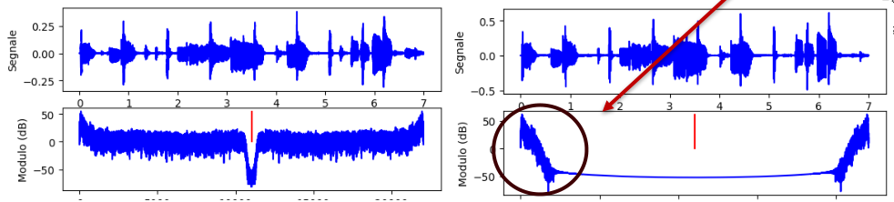

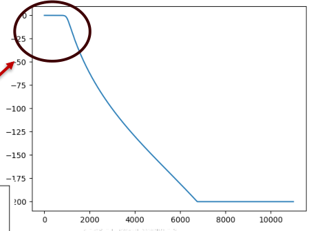

## Example: vocal separation

Separate voice from music using a time-frequency representation, nearest-neighbor filtering, and soft masks:

```python
import librosa

S_full, phase = librosa.magphase(librosa.stft(x))
S_filter = librosa.decompose.nn_filter(
    S_full,
    aggregate=np.median,
    metric="cosine",
    width=int(librosa.time_to_frames(2, sr=Fs)),
)
S_filter = np.minimum(S_full, S_filter)

margin_i, margin_v = 2, 10
power = 2
mask_i = librosa.util.softmask(
    S_filter, margin_i * (S_full - S_filter), power=power
)
mask_v = librosa.util.softmask(
    S_full - S_filter, margin_v * S_filter, power=power
)
S_foreground = mask_v * S_full
S_background = mask_i * S_full
```

The source shows **Original** and **Voice** playback examples, together with spectrograms. `S_foreground` and `S_background` are magnitude spectrograms; playback requires inverse transformation with phase information.

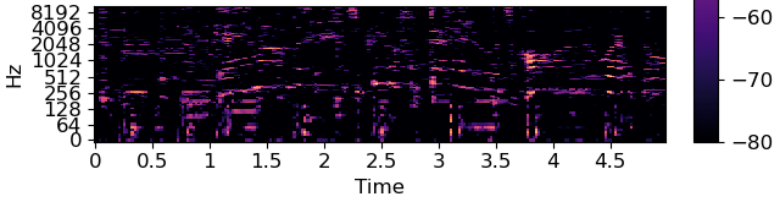

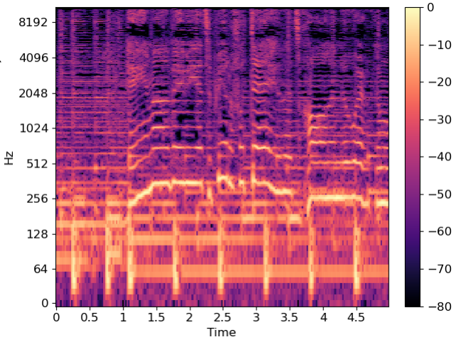

## Speech comparison

- Compare a known voice sample with an unknown sample.
- Assess the likelihood that the speakers are the same or different.
- Speech analysis also supports message transcription.
- Enhancement can make whispered and distant voices more audible.

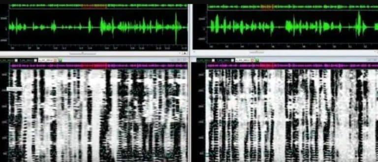

## Examples and further references

Before-and-after audio enhancement examples:

|Recording setup|Problems addressed|
|---|---|
|Handheld microphone in a pocket|Air-conditioning noise and wall reflections|
|Wireless microphone connected to a squad-car video recorder|Traffic noise and poor quality|
|911 call|Handling noise|
|Miniature video camera|Distortion reduction|

Each row has **Before** and **After** playback icons in the source.

Further reading: [Audio forensics overview](https://www.montana.edu/rmaher/publications/maher_forensics_chapter_2010.pdf).

# Example: analyzing an image

## Example: original frame

**Task:** enhance the visibility of the face of the person in this frame.


## Example: hypotheses and proposed solution

Hypotheses:

- The image was captured at night or in the evening, suggested by low contrast and limited dynamic range.
- Noise is present.
- Blur affects the image.
- The subject occupies a small number of pixels.

Possible processing sequence:

1. Denoise using OpenCV's `fastNlMeansDenoisingColored`.
2. Apply gamma correction.
3. Apply a sharpening filter to improve edge visibility.
4. Select the face region.
5. Enlarge the selected region by a factor of three.

Sharpening improves edge contrast; it is not a general inverse solution to blur.


## Denoising


## Gamma correction


## Sharpening

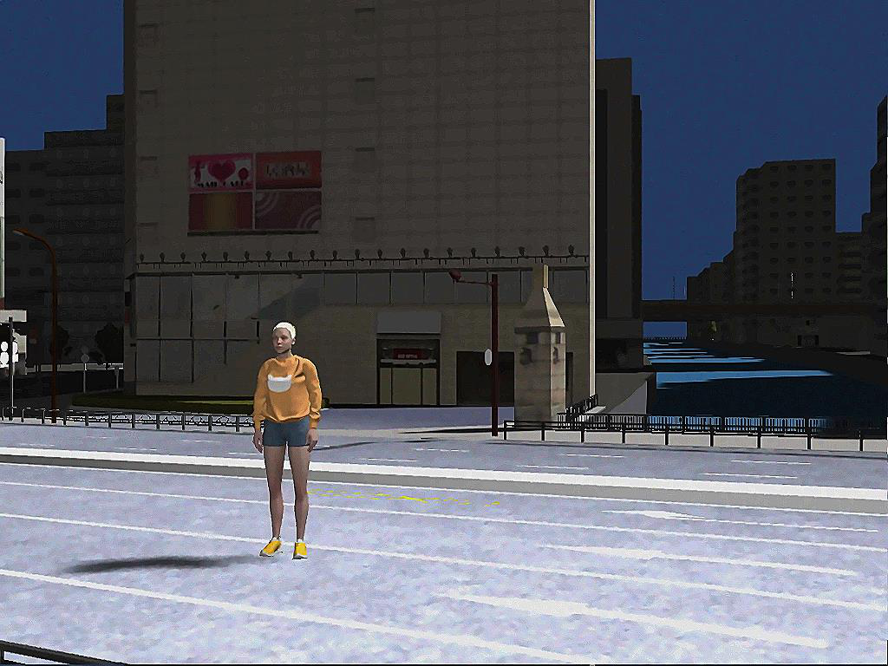

## Detail


## Enlargement

The selected detail is enlarged by a factor of three.

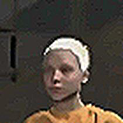

## Image enhancement code

The following code preserves the source's processing sequence and parameter values, with floating-point normalization and a guard against division by zero:

```python
import cv2
import numpy as np

# I: input BGR uint8 image.
Idenoised = cv2.fastNlMeansDenoisingColored(I, None, 4, 4, 3, 7)

image_float = Idenoised.astype(np.float32)
minimum = image_float.min()
maximum = image_float.max()
if maximum > minimum:
    image_eq = (image_float - minimum) / (maximum - minimum) * 255.0
    image_eq = image_eq.astype(np.uint8)
else:
    image_eq = Idenoised.copy()

# Gamma correction via a lookup table.
# The source calls this invGamma, but uses it directly as the exponent.
gamma = 1.1
table = np.array([
    ((i / 255.0) ** gamma) * 255 for i in range(256)
]).astype(np.uint8)
image_eq = cv2.LUT(image_eq, table)

kernel = np.array([[0, -1, 0], [-1, 5, -1], [0, -1, 0]])
image_sharp = cv2.filter2D(src=image_eq, ddepth=-1, kernel=kernel)

# NumPy uses [row, column, channel].
image_detail = image_sharp[350:420, 290:360, :]
width = image_detail.shape[1] * 3
height = image_detail.shape[0] * 3
dim = (width, height)
Ifinal = cv2.resize(image_detail, dim, interpolation=cv2.INTER_LANCZOS4)
```

> [!info] Parameter interpretation
> The source code rescales the observed minimum and maximum to 0–255, then uses exponent 1.1. For normalized intensities between 0 and 1, that exponent darkens them; the preceding contrast stretch can still brighten the overall displayed result. Slide 43 instead mentions `min=0.1` and `max=0.5`; those fixed limits do not appear in this code. The crop is 70 × 70 pixels and the output is 210 × 210 pixels.

# How to write a report

## Slide 34 — Report structure

A report is usually divided into:

1. **Executive summary:** objective and summary of conclusions.
2. **Description of the evidence analyzed:** received material, software and tools used, and delivered material. Include a list of appendices and the lecture's proposed ISO/IEC 27037 declaration concerning handling of evidence and reproducibility.
3. **Evidence extraction:** explain how the analyzed evidence was obtained.
4. **Analysis.**
5. **Conclusions.**
6. **Your CV.**

## Executive summary: objective, activities, and conclusions

**Which questions does the report address?**

- State clearly the purpose of the analysis.
- Prefer a hypothesis-testing style.
- Define two or three concise questions so that the conclusions are clear.

**What did you do?**

- Describe the activities performed.
- Use a short, clear list.

**What can you conclude about the evidence?**

- Answer the questions posed at the beginning.
- Be concise while remaining clear and sufficiently detailed.

## Example: executive summary

**Objective.** This report aims to improve the quality of the image under analysis. In particular, it examines whether it is possible to:

- Reduce noise and blur to improve image quality.
- Improve the visibility of the face of the person depicted in the frame.

**Summary of activities.** The work was carried out as follows:

- Denoising and image quality enhancement.
- Face-region extraction.
- Face magnification.

**Conclusions, as proposed in the source example.** The processing improved image quality. The example claims that image quality can be significantly improved and that the face appears to belong to a short-haired Caucasian woman, whose identity “could correspond …”. The identity statement is unfinished in the source.

> [!info] Interpretation correction
> These are example report statements, not an identification established by this transcription. Enhancement alone does not establish identity or validate demographic inferences. Conclusions must be supported by the evidence and method used.


## Description of evidence and materials

**What did you receive? — Received material**

- Names, characteristics, and details of original files analyzed or processed: extension, format, frame rate, and other relevant properties.
- Names of supplied software, such as players required for proprietary video formats.
- Hash values for verification.

**What did you use? — Adopted software and tools**

- Name every tool used in the analysis.
- The lecture recommends open-source solutions where suitable.
- Identify the operating system and hardware, including the computers used.

**What do you deliver? — Produced material**

- Document the contents of delivered folders containing videos, tools, the report, and other outputs.
- Include a file containing hash values for delivered files.
- Include a copy of the report.

## Example: received material, tools, and deliverables

**Received material**

```text
File: image_to_be_analyzed.png
Format: PNG
Resolution: 1024 × 768
MD5: [not supplied in the slide]
SHA-1: [not supplied in the slide]
```

**Software and tools used in the example**

- MacBook Pro laptop, 13-inch, 2020, running macOS Monterey 12.5.1 (21G83).
- macOS `md5` and `shasum` tools to calculate MD5 and SHA-1 values.
- [Python 3.8.1](https://www.python.org/downloads/release/python-381/).
- [`opencv-python` 4.4.0](https://opencv.org/opencv-4-4-0/).
- [`matplotlib`](https://matplotlib.org/).
- [`shutil`](https://docs.python.org/3/library/shutil.html), part of Python's standard library.
- [`numpy`](https://numpy.org/).
- [`mpldatacursor`](https://pypi.org/project/mpldatacursor/).
- `testo.py`, a script created to analyze the image.

**Delivered material**

Describe each folder and subfolder and its contents. The source lists:

- `/softwares`: …
- `/original_image`
- `/created image`
- SHA hash files and MD5 hash files.

## Example: appendices and reproducibility

**Appendices.** The report consists of $N$ pages, is associated with a digital archive, and includes a final appendix.

**Reproducibility.** The source proposes the following declaration: “The analysis follows the standard for handling digital evidence ISO/IEC 27037, and all results can be replicated using the included software.”

This is a template statement from the lecture. A completed report must substantiate its handling and reproducibility claims with its actual procedures, software, and parameters.

## How was the evidence extracted?

**Acquisition process**

- Explain how the material was extracted, for example by selecting frames from a video sequence.
- If particular regions or time instants were selected, explain why: for example, “the subject of interest entered the camera's field of view at …”.
- Explain why specific tools and configurations were used.

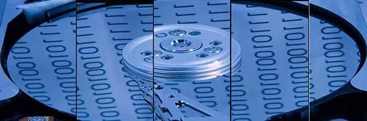

## Analysis

- Describe what was done.
- Report all parameter values and analysis details.
- Include intermediate results.
- Be detailed, clear, and straightforward.

## Example: denoising analysis

Denoising was performed using:

```python
Idenoised = cv2.fastNlMeansDenoisingColored(I, None, 4, 4, 3, 7)
```

“Parameters were selected …”  
“This led to the result …”

These unfinished phrases are placeholders in the source; a completed report must explain parameter selection and resulting changes.


## Example: gamma correction analysis

The source states that gamma correction was performed with:

$$
m=0.1,\qquad M=0.5,\qquad g=1.1.
$$

It then leaves placeholders: “using the operations …” and “Parameters were selected …”. The fixed limits differ from the observed-minimum/maximum normalization in slide 32; they must be reconciled when documenting an actual analysis.


## Example: sharpening, detail selection, and enlargement

“Then, sharpening was applied with …”  
“Parameters were selected …”

A **70 × 70 pixel** detail at coordinates **(350, 290)** was selected; the first coordinate is vertical. In NumPy notation:

```python
image_detail = image_sharp[350:420, 290:360, :]
```

The source leaves the selection rationale unfinished: “selected because …”. The detail is then magnified by a factor of three, using the command shown in slide 32.


## Conclusions

State clearly and definitively what was anticipated in the executive summary. Include a signature and date.

Example placeholders:

- “We have identified the subject as …”
- “It is possible to state that …”

Padova, 29/05/2023  
Name and surname

The example date is reproduced from the source. These phrases require supporting analysis before use as actual conclusions.


## Slide 46 — Avoiding mistakes

**Avoid personal opinions.** Objectivity is central to forensic analysis. Stick to facts, including in the writing style; avoid phrases such as “I believe” or “In my opinion”.

**Support every claim.** Describe methods clearly, explain how the evidence supports the conclusions, and use data, charts, or images as supporting material. The lecture mentions the Amanda Knox case as an example, without further explanation.

**Keep the report consistent.** Inconsistent units, date formats, or terminology can raise doubts. The lecture mentions the O. J. Simpson case, without further explanation.

**Check the data:**

- Obtain expert review.
- Double-check data.
- Track changes and versions.
- Pay attention to legally relevant details.
- Cross-reference data.
- Check calculations.
- Verify sources.
- Review dates and times.

## Slide 47 — Legal issues

**Validity and authentication**, as listed in the lecture:

- Maintain a clear chain of custody.
- Have the work performed by a qualified expert.
- Use scientifically valid methods.
- Establish that the evidence has not been tampered with.

Example chain-of-custody table:

|What|Who|When|Where|
|---|---|---|---|
|Collection|Officer John Brown|2023-06-15, 10:30 AM|Crime scene|
|Storage|Evidence clerk|2023-06-15, 2:00 PM|Locker #42|
|Analysis|Lab tech Sarah Lee|2023-06-16, 9:00 AM|Forensic lab|

**Privacy issues.** Reports often contain sensitive information. To balance disclosure with privacy, the lecture suggests:

- Use initials or case numbers.
- Remove personal information unrelated to the case.
- Follow applicable data-protection laws for digital evidence.
