# LECTURE 02 : DE ACQUISITION

*Sources: [slides](Lecture%2002%20-%20Digital%20evidences.pdf), pp. 3–44; [extended notes](Notes%20about%20acquisition%20of%20digital%20evidences.pdf), used for clarification; [lecture recording](Lecture%2002%20-%20DE%20STEM.mp3), in teaching order. Administrative announcements are omitted. External technical clarifications are marked locally.*

## PEOPLE AROUND DE

Suppose an attacker compromises a computer. Its files, storage and current state may reveal what changed and how the attack occurred. Different actors handle this **digital evidence (DE)** at different stages.

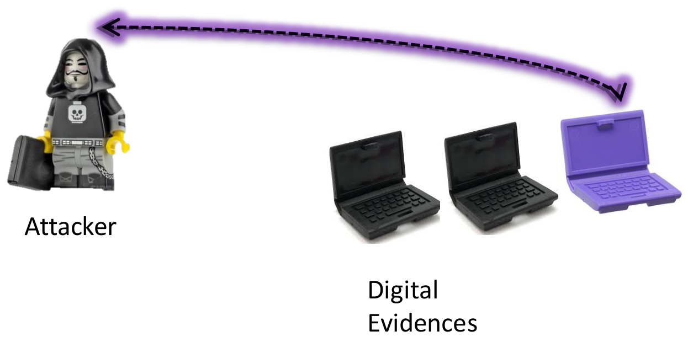

## INCIDENT RESPONSE SPECIALIST (IRS)

The **IRS** first responds to the incident, limits damage and alerts the appropriate authorities. This may be a system administrator or emergency responder, rather than an investigator appointed to handle evidence. Incident containment can alter evidence, so the IRS must record actions and communicate them to investigators.

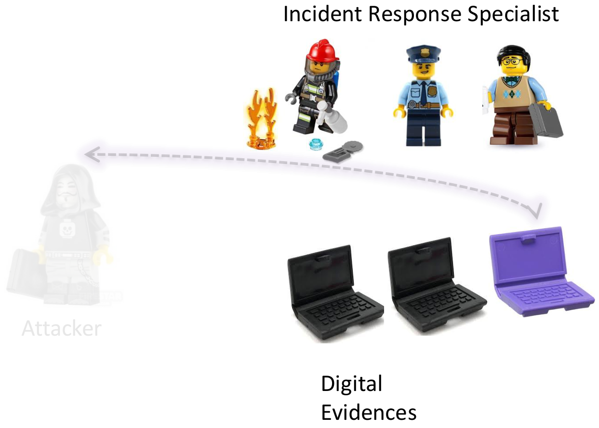

## DIGITAL EVIDENCE FIRST RESPONDER (DEFR)

The **DEFR** is an authorised, trained operator appointed to intervene on the scene. The DEFR identifies evidence, isolates devices, seizes equipment or acquires data, and consults the IRS about what happened.

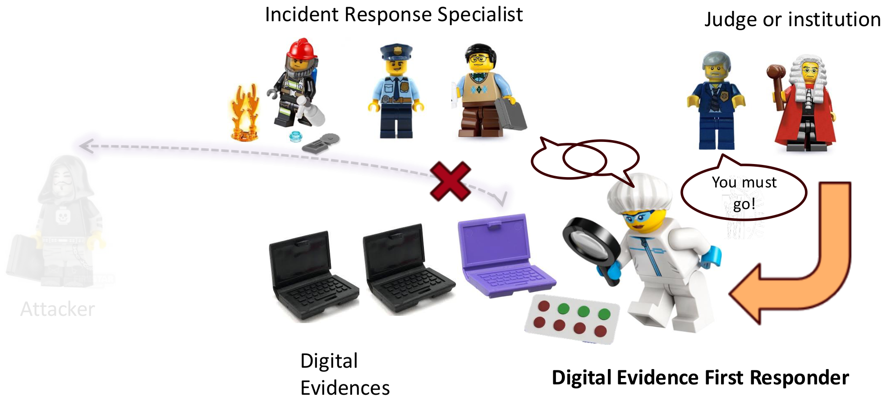

## DIGITAL EVIDENCE SPECIALIST AND FORENSIC LAB MANAGER

The **DES** has specialist technical competence, for example in operating systems and network acquisition. Specialists can assist on the scene or analyse acquired evidence in the laboratory. The **FLM** manages laboratory activities, where analysis supports conclusions.

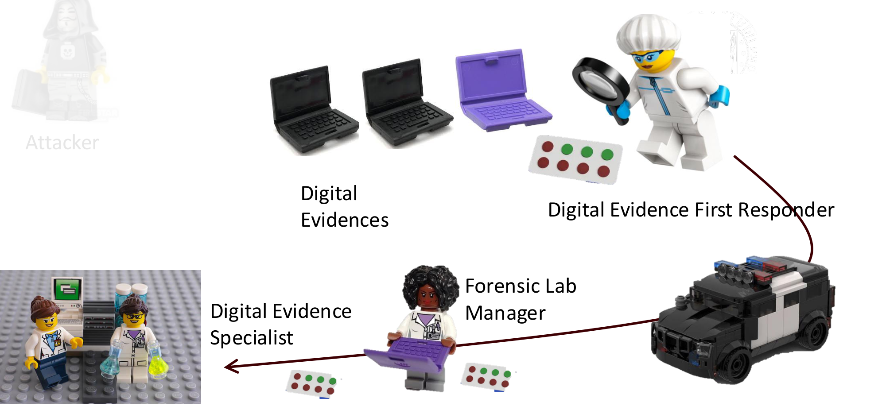

## ISO IEC 27037/2012: WHO? (1/2)

The DEFR must:

- Secure the area and identify its responsible personnel and authorised users.
- Keep people away from devices and power supplies; avoid unnecessary state changes.
- Document the scene, screens, components and cable connections with photographs, video or diagrams.
- Look for relevant notes, diaries, manuals, passwords and PINs.
- Preserve associated physical traces, including fingerprints and biological material.

## ISO IEC 27037/2012: WHO? (2/2)

**DEFR is an authorised role; DES denotes broader technical expertise.** A qualified DES may act as a DEFR, but the roles are not interchangeable automatically.

The IRS prioritises containment and service protection; the DEFR prioritises evidence integrity. These objectives can conflict. Record the intervention and its effects so that subsequent investigators can evaluate them.

## HANDLING PROCESS FOR A DE

| Phase | Purpose |
|---|---|
| **Identification** | Search for, recognise and document potential evidence. |
| **Seizure / collection** | Physically remove the device containing potential evidence. |
| **Acquisition** | Create a copy of its digital data. |
| **Preservation** | Protect integrity and original condition throughout handling and storage. |

Collection may precede acquisition in a laboratory. If removing the device is impossible or would lose information, acquisition takes place on the scene. Preservation continues across all phases.

Storage must prevent unauthorised access and damage from magnetic fields, dust, vibration, humidity or unsuitable temperatures.

## IDENTIFICATION: BRIEFING!

Before intervention, establish what happened, what to look for, what is expected or unexpected, and how to preserve privacy and integrity. Prepare the tools, storage, packaging, personnel and access permissions needed for the expected situation.

Acquire relevant information within the authorised scope. Unrelated information creates privacy concerns and increases acquisition and analysis costs.

## IDENTIFICATION: VOLATILE DATA

Evidence has both a **physical component**—the device—and **logical content**—its data. Identify relevant sources and prioritise information at risk of disappearing.

> [!info] Definition — Volatile data
> Data in temporary memory, such as RAM, that may be lost when power is removed or the system restarts. Examples include running processes, open connections and current system state.

Also identify sources difficult to locate or access: remote/cloud storage, geographically dispersed systems, very small memory cards and embedded IoT storage. Map peripherals and communications, including past communications, even if the device is currently disconnected.

A connection can both reveal useful information and allow further changes. Assess what to record and preserve before changing the device's connectivity.

## ODV: ORDER OF VOLATILITY

The lecture gives the following acquisition priorities, from rapidly changing local state towards more persistent or remote information:

| Order | Source | Examples |
|---|---|---|
| 1 | CPU registers, caches and real-time state | Instruction pointer, registers, timers. |
| 2 | RAM | Processes, threads, clipboard, open files, drivers, encryption keys. |
| 3 | Temporary memory in network devices | Routing entries, ARP/DNS caches, active sessions. |
| 4 | Peripheral memory | GPU VRAM, printer buffers, external-device memory. |
| 5 | Disk-based volatile data | Swap/pagefile and temporary or pending file data. |
| 6 | Remote/cloud-based volatile data | Remote session state and real-time network logs. |

The principle is to preserve what changes or disappears fastest. The listed disk/cloud order reflects the lecturer's example of unstable local writes versus more stable remote storage; assess actual volatility in the specific system.

## IDENTIFICATION: SCHEME

First decide whether to collect the physical device or acquire its data on the scene. Then determine whether it is switched on or off: these choices lead to different procedures.

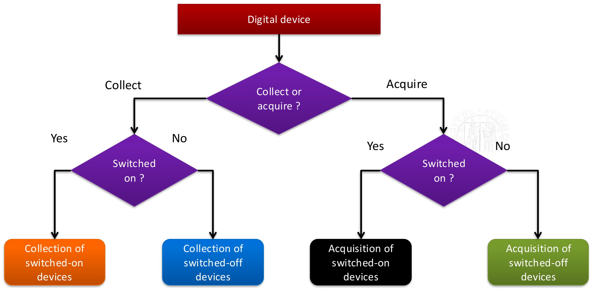

## IDENTIFICATION: DEFR’S OPERATIONS

Record each device's type, brand and serial number, its peripherals and operating state. If it is on, document the display. Gather necessary power/data cables and use wireless detection where relevant to locate communications or hidden devices. Include useful non-digital information.

Evaluate **volatility, encryption, critical system functions, legal limits and resources**. An unlocked encrypted device may expose readable data or keys that become unavailable after shutdown. A hospital or power-plant computer may need to remain operational.

## COLLECTION

Collection physically removes a device; acquisition extracts its information. Gather accessories needed to operate or connect it in the laboratory. Choose and document the procedure according to the device's state, risks, costs and available time.

## COLLECTION: CRITICAL SITUATIONS

Some systems cannot be shut down or seized without disrupting essential services, including data centres, surveillance, medical and industrial control systems.

- **Live acquisition:** copy information while the system is running, often on the scene, when seizure is impossible or volatile information would otherwise be lost.
- **Partial acquisition:** acquire only selected data because the system is too large, time is limited, only some information is relevant, or access is restricted.

These describe different dimensions: *live* concerns operating state; *partial* concerns scope. They can be combined. A targeted software dispute may require selected files, whereas a broader investigation may need more extensive collection; scope still requires justification.

## COLLECTION: SWITCHED ON DEVICES

1. Determine whether live acquisition is necessary because of volatile data or encryption.
2. Acquire relevant volatile information first, then required non-volatile data.
3. Evaluate whether the remaining data are stable before deciding how to power down.
4. Label, disconnect and safely package the device; repeat for other devices and gather accessories.

In the lecture's decision tree, stable data lead to unplugging; unstable data lead to a standard shutdown. A normal shutdown itself performs writes and changes system state, so the choice must be assessed and documented rather than applied blindly.

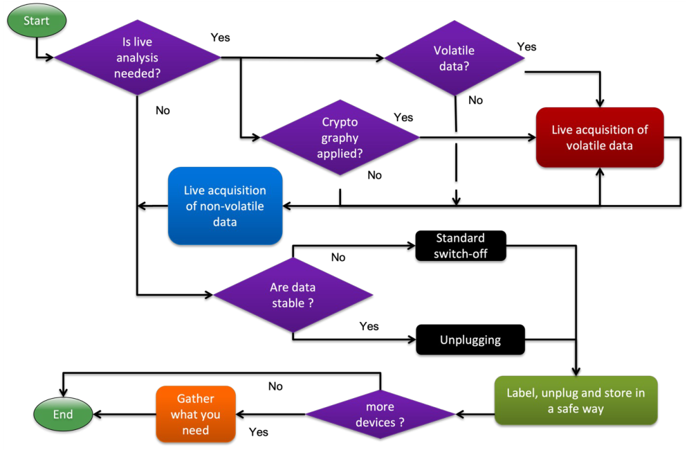

## COLLECTION: SWITCHED-OFF DEVICES

Verify that the device is genuinely off. The course procedure removes power and any battery, removes storage where appropriate, labels it and records type, vendor, serial number, part number and size. Package safely and retain accessories. Acquisition and hashing can then occur on the scene or in the laboratory.

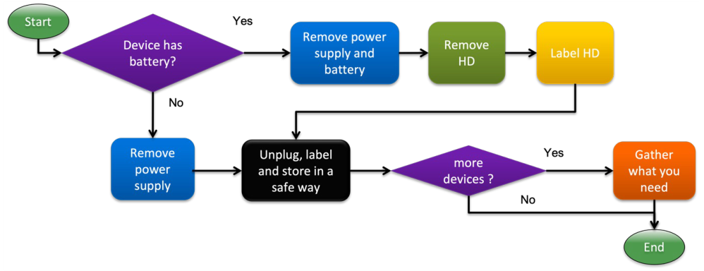

## CASE EXAMPLES


| Situation | Reasoning |
|---|---|
| A compromised laboratory PC | Assess whether one machine or the network is affected; physical seizure may be feasible. |
| An isolated, switched-off camera | Collection may suffice before laboratory acquisition. |
| Data on a server | Live or remote acquisition may be necessary; location and access restrictions matter. |
| Medical records | Acquire the relevant patient's information without disrupting services or collecting unrelated records. |

The lecturer then revisits Lesson 1's scene-selection quiz. A black screen does **not** prove that a device is off: communication may continue. The router deserves attention because connections and temporary state can be lost. Apparently disconnected, inactive storage and the camera are less urgent once their state is verified. The scene image is absent from the supplied PDFs, and no complete numbered ranking is established in the recording.

## ACQUISITION

Create a forensic copy of the relevant storage medium, partition or files. Document **methods, tools and activities**, while minimising changes to the source. If changes cannot be avoided—for example during live operation, with damaged sectors or under time limits—record and justify them.

## ACQUISITION: IMAGING

**Imaging** creates a bit-stream copy, retaining the acquired medium's contents and metadata. A complete image can include deleted-file remnants, unallocated space and **slack space**, the unused part of allocated storage units.

| Copy | Result |
|---|---|
| Disk clone | A direct one-to-one disk copy. |
| Bit-wise image | A file/archive representing the acquired disk data. |
| Compressed bit-wise image | The same representation with lossless compression. |

Ordinary drag-and-drop or cut-and-paste does not produce an equivalent forensic disk copy: it omits storage context and may lose or change metadata and timestamps. A single file may still be the object of an investigation, but it does not preserve the surrounding disk history.

## BASIC TOOLS FOR IMAGE ACQUISITION

The slide's `dd` example, with spacing corrected:

```bash
dd if=/dev/sdc of=image.dd
```

`if` identifies the input device; `of` identifies the output raw image. The extended tool `dcfldd` can compute hashes, log them and split output:

```bash
dcfldd if=/dev/sdc hash=md5,sha256 hashwindow=10G md5log=md5.txt \
  sha256log=sha256.txt split=10G splitformat=aa of=image1.dd
```

Here the slide specifies MD5/SHA-256 hashing and 10G hash windows/output segments. These are acquisition examples, not commands executed for these notes.

Formats include raw images; proprietary EnCase `.E01` and ILook formats; and tool-independent AFF, AFD and AFM. Containers may retain acquisition metadata and require compatible tools.

## ONLINE ACQUISITION EXAMPLE: DEFAMATING POSTS

A defamatory post may disappear before a platform provides evidence. The investigator may lack access to the server or its complete storage. The lecture uses this to motivate prompt acquisition of the visible content. Platform cooperation and lawful access depend on the case and jurisdiction.

## EXAMPLE OF LIVE ACQUISITION OF A POST

Download available content and document its presentation with screenshots or printouts. The credibility of the capture also depends on the **computer, user and network**: malware, human error or network redirection can affect what is recorded.

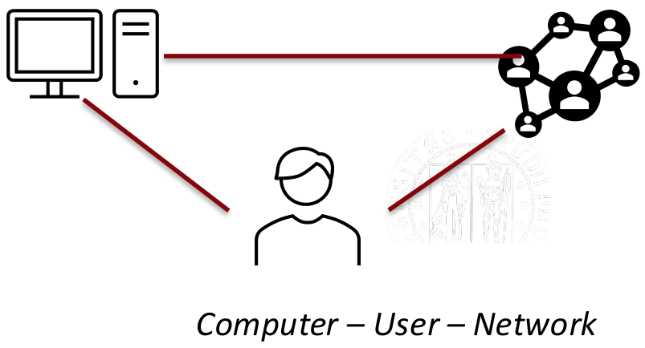

The lecturer proposes a live operating system, video recording of the procedure, network diagnostics or visits to reference sites, traffic recording and hash computation with different software. LegalEye is mentioned as an alternative tool. These measures document the acquisition environment; a screenshot alone does not establish authorship or eliminate every possible alteration.

## HOW TO ENSURE AUTHENTICITY

Compute a digest at acquisition and compare it later to detect changes.

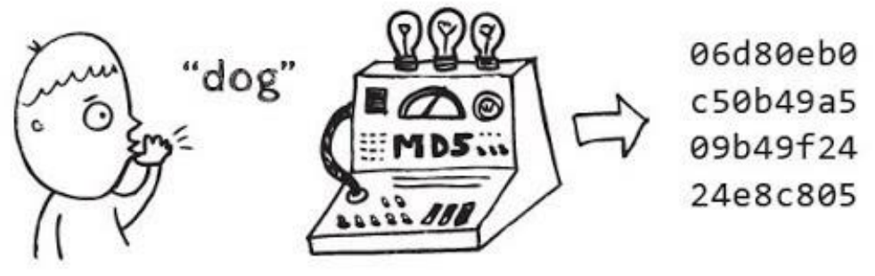

For the lecture's toy checksum, sum the numbers and retain the last decimal digit:

$$
12+34+56+78+43+45+79+81=428,
\qquad d=428\bmod 10=8.
$$

Changing $56$ to $57$ gives $429$, hence $d=9$: the alteration is detected. But a compensating change elsewhere can restore the checksum. This illustrates why a simple sum is insufficient against deliberate modification.

## HASH FUNCTIONS

> [!info] Definition — Hash and digest
> A hash function maps a variable-length bit string $f$ to a fixed-length digest $d=H(f)$ of $n$ bits.

$$
H:\{0,1\}^{*}\rightarrow\{0,1\}^{n}.
$$

Hashing is deterministic and many-to-one. Different inputs can share a digest: this is a **collision**. A changed digest proves the compared bit strings differ; a matching secure digest supports integrity relative to the recorded reference, rather than proving origin or authorship.

Create a protected master image and verified working copies for the parties involved. Hashes allow copies to be checked while the original remains safely stored; where authorised, imaging can also permit returning the physical resource to its owner.

## HASH FUNCTIONS FOR CRYPTOGRAPHY

A cryptographic hash should make the following tasks computationally infeasible:

| Property | Task an attacker should not feasibly accomplish |
|---|---|
| **Pre-image resistance** | Given $d$, find $f$ such that $H(f)=d$. |
| **Second pre-image resistance** | Given $f_1$, find a different $f_2$ such that $H(f_2)=H(f_1)$. |
| **Collision resistance** | Choose any two distinct inputs $f_1,f_2$ with $H(f_1)=H(f_2)$. |

The distinction is whether the target digest, the original input, or neither is fixed beforehand. Collisions exist mathematically; resistance concerns the difficulty of finding them.

## HASH FUNCTION: MD5

**MD5** produces a **128-bit digest**, usually displayed as 32 hexadecimal characters. It is fast and widely encountered. For the exact text `Digital Forensics`, without a trailing newline:

```text
093005a1f5950fba6c6a8b628c8e3a22
```

**Technical clarification:** the slide's “decrypt” arrow describes finding a known input through guessing or a lookup table. Hashing is not encryption, and input length alone does not determine whether a lookup succeeds. An unsuccessful lookup does not prove that recovery is impossible. See [OWASP's explanation of hash guessing](https://cheatsheetseries.owasp.org/cheatsheets/Password_Storage_Cheat_Sheet.html#when-password-hashes-can-be-cracked).

The lecture demonstrates two programs with the same MD5 but different behaviour: `hello.exe` prints a greeting; `erase.exe` displays a simulated deletion message. The screenshot states that nothing was erased.

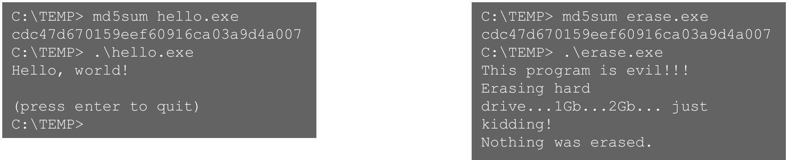

## COLLISION ATTACKS

An attacker may deliberately construct different files with the same digest, undermining a comparison based only on that hash.

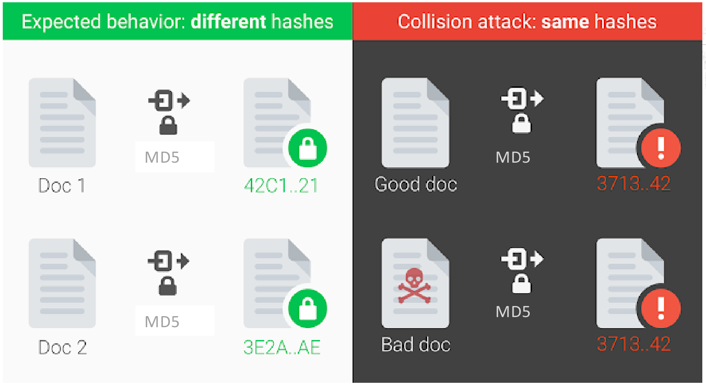

**Technical clarification:** accidental collision rarity does not imply resistance to a deliberate attack. MD5 is unsuitable where collision resistance is required, as documented in [RFC 6151](https://www.rfc-editor.org/info/rfc6151/).

## HASH FUNCTION: SHA

**SHA** stands for Secure Hash Algorithm. The lecture distinguishes SHA-1 from the SHA-2 variants:

| Algorithm | Digest length |
|---|---|
| SHA-1 | 160 bits |
| SHA-224 / SHA-256 | 224 / 256 bits |
| SHA-384 / SHA-512 | 384 / 512 bits |

The last four belong to SHA-2. Larger digests provide a larger output space, but algorithm design and known attacks also matter.

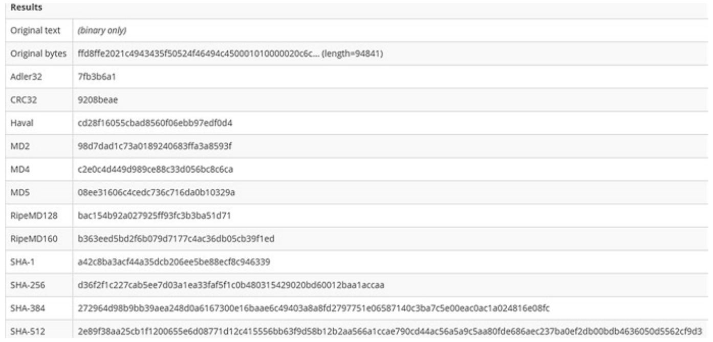

## NOTHING IS COMPLETELY SECURE

The lecture cites the 2017 SHA-1 collision demonstration. Its illustrative comparison contrasts the costs of MD5 collisions, the SHA-1 attack and SHA-1 brute force; these are historical slide figures, not current hardware benchmarks.


The lecturer recommends recording multiple hashes to make substitution harder. This adds checks, but is not an absolute guarantee. Preserve the reference digests and acquisition records as well: a digest cannot establish integrity if both the file and its recorded reference are replaced.

## CASE: GARLASCO 2007

*Discussed here in the recording; supporting slide: p. 42.*

The suspect's laptop and thesis activity were examined as possible alibi evidence. The lecturer uses the failure to image and preserve the source properly to illustrate how investigative operations can change data and weaken later verification. Metadata and recovered information then require careful interpretation.

The lesson is methodological: acquire and hash a reference copy before analysis. Poor handling can undermine either inculpatory or exculpatory evidence. The slide's “73,8 visible files” has no explicit unit, so no numerical loss estimate is inferred here.

## CONSERVATION

Protect data from accidental, deliberate and environmental alteration whenever evidence is stored, accessed, analysed or transferred. Protect privacy too.

Label devices and data, use packaging appropriate to the medium, secure moving parts and minimise transport risks. Where continued power is required, maintain suitable battery charge. Preserve fingerprints and biological traces by appropriate handling, including gloves. Restrict storage access to authorised personnel and verify integrity after relevant operations.

## CHAIN OF CUSTODY

The **chain of custody** is the documented history of evidence from intervention onward. It records handling, processing, storage and transfers in paper or digital form.

The lecture's O.J. Simpson example illustrates the issue: unrecorded possession of blood samples by multiple officers created grounds to question contamination or alteration. A documentation gap raises uncertainty; it does not itself prove tampering.

## CHARACTERISTICS OF CHAIN OF CUSTODY

Record who collected the evidence, where it was stored, who accessed it and why, and when and how it was transferred.

Link each item to a unique identifier, device details, hash values, collection date/time/location and the collector's identity and role. Log every access using **Who, What, Where, When and Why**, and record transfers and handling. Physical security and documentation support each other.

## CASE: KILLING OF CAYLEEN ANTHONY 2008

The course presents browser-history evidence concerning chloroform-related searches and a claimed 84 website visits. Relevant Firefox data were recovered from unallocated space on a shared computer, limiting attribution to a specific user. Four forensic tools produced differing results, with inadequate documentation of the discrepancies.

**Forensic lesson:** finding data does not establish who generated it. Investigators must explain recovery context, conflicting tool outputs and limitations. The slide reports acquittal on the major charges; that outcome is not treated here as proof that one forensic issue alone determined the verdict.

## CASE: SILKROAD 2013

The lecture contrasts Silk Road, a Tor-based marketplace using Bitcoin. Investigators correlated browser/configuration information, network connections, wallet records, memory and file-system evidence.

The key acquisition point is that the suspect's laptop was seized while open and accessible, preserving access to unencrypted information. Properly documented live acquisition can capture evidence that shutdown might make inaccessible.

## SOME TIPS

Use appropriate forensic tools; keep access logs; timestamp operations; verify and hash data; and ensure the whole team follows consistent, understood protocols.

## ADDITIONAL NOTES ON CHAIN OF CUSTODY

Document and justify any alteration, naming the responsible person. Record releases and transfers with dates. Restrict access, secure the original drive and perform analysis on verified working copies.
