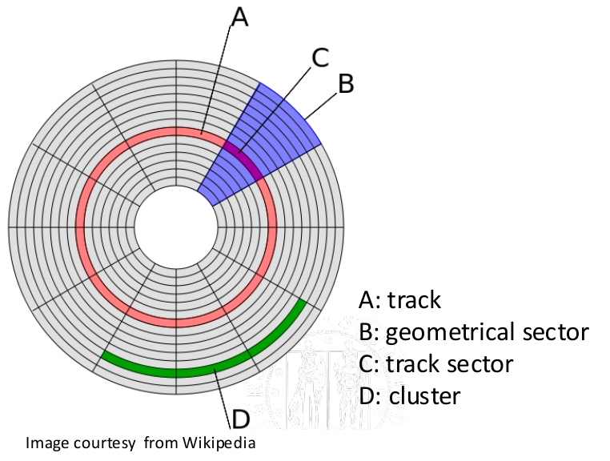
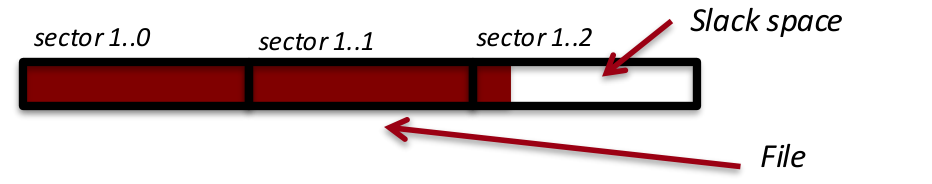
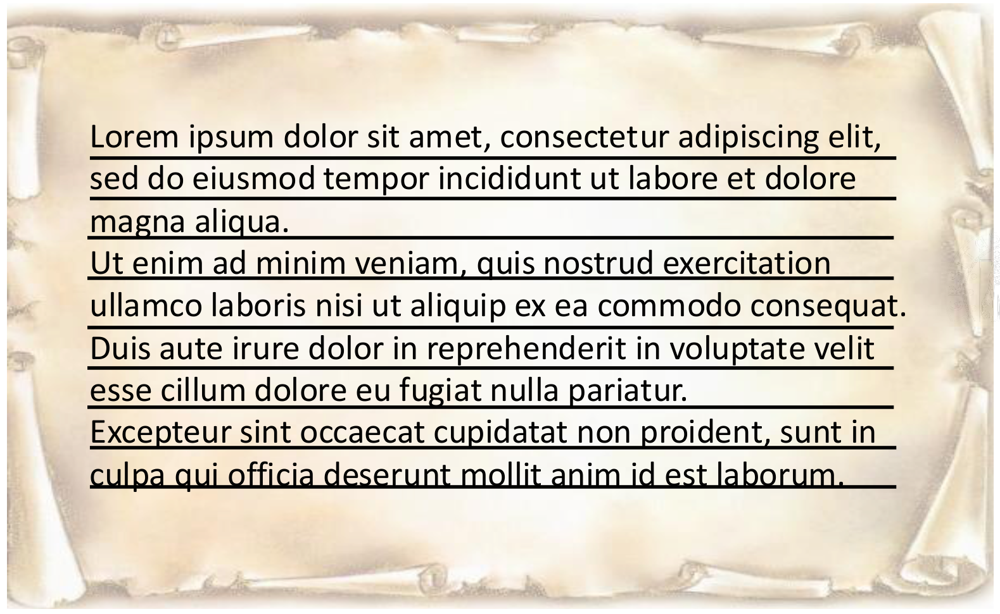
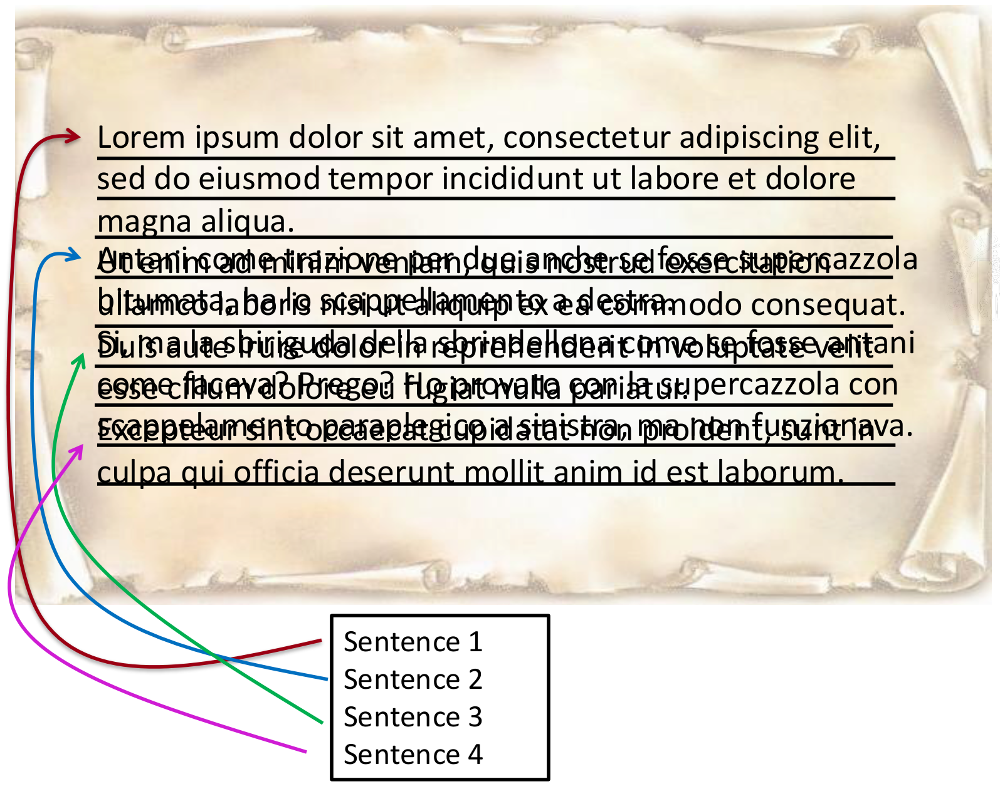
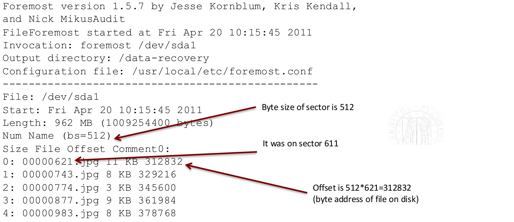
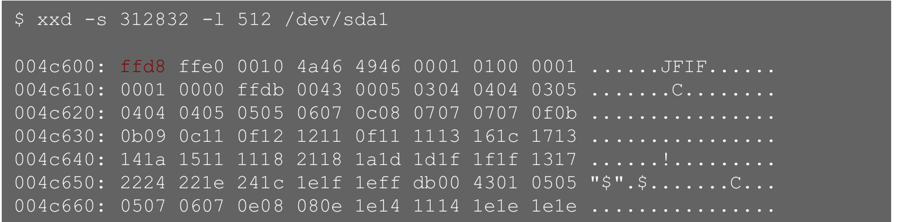
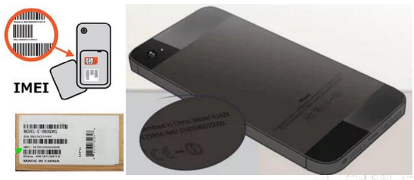
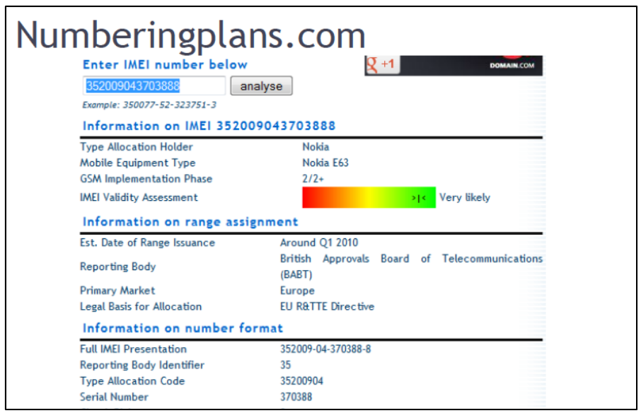
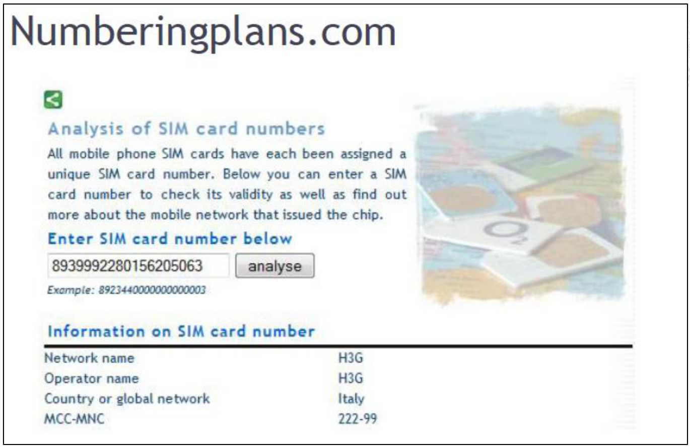
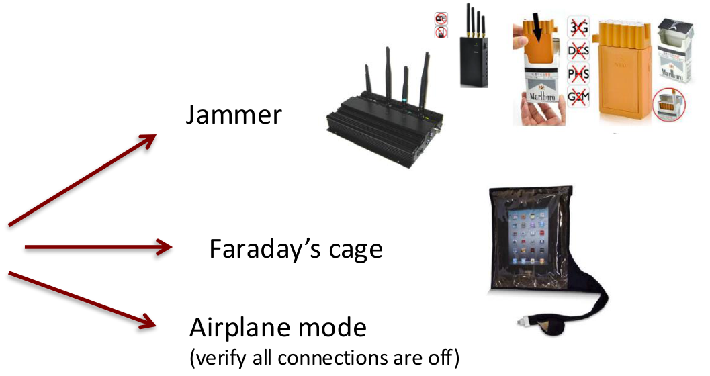

# DISK AND MOBILE FORENSICS

*Sources: [lecture slides](Lecture%2003%20-%20Disk%20and%20mobile%20forensics.pdf), [transcript](Lecture%2003%20-%20HD%20forensics%20STEM.transcript.txt), [recording](Lecture%2003%20-%20HD%20forensics%20STEM.mp3) and [extended notes](Notes%20about%20HD%20and%20mobile%20forensics.pdf). The transcript determines teaching order; extended notes clarify taught concepts. Technical corrections are marked locally.*

## SOME TIPS

Use appropriate forensic tools, keep access logs, timestamp operations and verify data with hashes. Everyone handling evidence must follow the same understood protocols.

## ADDITIONAL NOTES ON CHAIN OF CUSTODY

Document and justify any alteration, identifying the responsible person. Record releases and transfers, restrict access, secure the original drive and analyse a verified working copy. These principles apply to all evidence types.

## MEMORY DEVICE ACQUISITION QUESTIONS

Before acquisition, establish the number and type of computers/drives, their storage capacity and any specific problems, especially SSD behaviour and encryption. Device type matters: unplugging a laptop's power cable does not necessarily switch it off because its battery can maintain power.

## DATA STORED ON A DIGITAL DEVICES

Relevant information includes both visible files and remnants outside the normal file list. Recovery can produce enormous amounts of material, so select operations according to the case, device, filesystem and data sought. A focused question may still require an exhaustive search.

Commercial, free and open-source tools are available. Open-source tools can help others inspect and reproduce the procedure, but reproducibility also requires the correct configuration and records.

## MEMORY SPACE ON A DEVICE

Traditional HDDs store information along tracks, subdivided into sectors. Filesystems allocate space in **clusters**, or allocation units, grouping sectors for efficient management.



| Space | Meaning |
|---|---|
| **Allocated** | Assigned to current files, metadata or programs. |
| **Unallocated** | Available for allocation; it may still contain old data. |
| **File slack** | Unused bytes between a file's logical end and the end of its allocated space. |

The slides sometimes use *slack* broadly for non-indexed space; distinguish this from unallocated space. In the following example, bars labelled “sector” represent the 4 KB allocation units used in the calculation.

With 4 KB clusters, a 9 KB file requires:

$$
\left\lceil\frac{9}{4}\right\rceil=3\text{ clusters},
\qquad 3\cdot4=12\text{ KB allocated},
\qquad 12-9=3\text{ KB slack}.
$$

The last 3 KB cannot be allocated to another ordinary file while that cluster remains assigned. These are byte quantities, despite the slide's “Kb” notation.



## EXAMPLE ON A SHEET

Imagine each row as an allocation unit and each sentence as a file that must begin on a new row. If a sentence ends halfway through a row, its unused remainder illustrates slack.



## TRACES FROM DISK SPACES

Deleting a file generally removes or updates its filesystem references and frees its allocation units, without immediately overwriting every data byte. If the bytes remain, recovery may be possible.

In the example, **file A is 12 KB** and occupies three 4 KB clusters without slack. Delete A and write **file B of 9 KB** in the same allocation: B overwrites 9 KB, while the remaining **3 KB may retain A's data**. Complete overwrite destroys those remnants; partial overwrite may leave useful fragments.


Recovery depends on the allocation and subsequent writes. The slide's 45% figure motivates examining slack and non-indexed space; it is not a general recovery rate.

**Terminology clarification:** the lecture also mentions damaged/reallocated sectors. A **G-list** is a *grown defect list*, rather than a general name for deleted-file or slack space; specialised recovery from affected sectors is not guaranteed. See [Seagate's defect-management description](https://www.seagate.com/support/disc/manuals/scsi/3655npmb.pdf), §3.4.4.1.

## EXAMPLE ON A SHEET

Removing a sentence's index does not erase the writing. A replacement sentence overwrites only the space it uses, leaving parts of the old text. Smaller allocation units reduce potential slack, at the cost of different management overheads.



The overlapping text is part of the original illustration.

## SOLID STATE DRIVE

SSDs use flash memory cells rather than rotating magnetic platters. Stored charge represents information; the lecture distinguishes **SLC, MLC, TLC and QLC**, storing respectively **1, 2, 3 and 4 bits per cell**.

Flash has limited write/erase endurance. **Wear levelling** distributes writes among cells, complicating the relationship between logical addresses and physical storage. Flash blocks must be erased before reuse.

- **TRIM**, or the corresponding SCSI **UNMAP** operation, tells the controller which logical data are no longer needed.
- **Garbage collection** operates inside the controller: valid data are consolidated and reclaimable blocks erased. It can resume when a drive receives power, including behind a host write blocker.
- **Encryption and compression** can further complicate interpretation and reconstruction.

**Technical correction:** TRIM signals discard; it does not itself imply immediate physical erasure. Garbage collection can operate without TRIM, contrary to the extended notes' absolute statement. See [Kingston's explanation and tests with TRIM disabled](https://media.kingston.com/pdfs/business/garbage_collection_and_trim_on_ssd_performance_mkf_422.pdf). Blocking host writes does not necessarily stop internal controller activity.

## DO NOT DESPAIR …

Recovery may still be possible when discard is unsupported, disabled or not passed through the storage stack; firmware behaves unexpectedly; or a file is corrupted without having been deleted. RAID, external enclosures and NAS introduce additional layers whose behaviour must be checked.

**Technical correction:** USB does not universally prevent TRIM. Compatible bridges can pass it through; for example, [JMicron documents TRIM support in its JMS580 USB–SATA controller](https://www.jmicron.com/products/list/1). The USB connection alone therefore does not guarantee preservation.

The slide distinguishes three post-TRIM read behaviours:

| Behaviour | Result before new data are written |
|---|---|
| Non-deterministic TRIM | Repeated reads may return different data. |
| **DRAT**: Deterministic Read After TRIM | Repeated reads return consistent data. |
| **DZAT**: Deterministic Zero After TRIM | Reads return zeroes. |

Consistent output does not necessarily mean the original bytes remain accessible.

## WHAT TO DO ?

The lecturer proposes connecting the SSD as a secondary drive, checking how full it is and studying the vendor's garbage-collection behaviour. This avoids using the evidence drive as the running system drive; it does not guarantee that controller activity stops.

**Source discrepancy:** the lecturer says a nearly full disk increases pressure to reclaim unused blocks. The extended notes instead suggest improved recovery prospects. Follow the oral explanation here, without treating fullness alone as a recovery prediction. Laboratory work uses acquired images to avoid changing physical evidence during analysis.

## FILESYSTEMS

Filesystems track the fragments belonging to a file, which need not be contiguous. Recovery strategies therefore depend on how the filesystem represents allocation and deletion.

Moving a file to a trash directory is different from removing its references. On traditional storage, deleted content may remain until overwritten or wiped; on SSDs, the discard/controller mechanisms discussed above can also make it inaccessible.

## DATA CARVING

> [!info] Definition — Data carving
> Extracting files or fragments from a larger byte stream using content patterns and structural information, without relying on filesystem indexes.

A **magic number** is a characteristic byte pattern indicating a format. Filename extensions alone are insufficient.

| Format | Beginning | End marker |
|---|---|---|
| PDF | `%PDF` | `%%EOF` |
| JPEG | Hexadecimal `FF D8` | Hexadecimal `FF D9` |

**Correction:** the slides show `%EOF`; the PDF marker has **two percent signs**, as specified in [Adobe's PDF reference](https://opensource.adobe.com/dc-acrobat-sdk-docs/standards/pdfstandards/pdf/PDF32000_2008.pdf), §7.5.5.

Tools such as `hexedit`, `hexdump` or `xxd` expose bytes; Linux `file` helps identify formats. A signature is a recovery candidate, not proof of a complete, valid file.

## WHAT DATA CARVING ALLOWS …

Simple header/footer carving works best when boundaries survive and the file lies contiguously between them. Fragmentation, missing pieces and compression-dependent decoding state make reconstruction harder. Compression does not prohibit all recovery—JPEG and MP3 themselves illustrate that some compressed content can survive partial loss.

Advanced methods may recover non-sequential or unordered fragments; some recovery is possible without a footer. Carving can operate on disk images and RAM dumps. Use verified copies for analysis.

Beware of **false positives** and incomplete results: a recovered JPEG may be only an embedded thumbnail rather than the original full-resolution image. Recognisable fragments do not guarantee a usable complete file.

## FOREMOST

Foremost searches content signatures rather than filesystem indexes. It can recover candidates from allocated, deleted or unallocated data and from some formatted media. Recovery after formatting depends on what was actually overwritten.

Its output includes directories by file type and **`audit.txt`**, recording the run and recovered-file offsets. Original filenames are generally unavailable; generated names reflect locations in the input.

The slide's examples, adapted to an image and separate output directories:

```bash
# Search all configured types.
foremost -t all -i image.dd -o recovered-all

# Search JPEG and GIF files.
foremost -t jpg,gif -i image.dd -o recovered-images

# Search OLE documents and JPEG files.
foremost -t ole,jpg -i image.dd -o recovered-documents

# Skip the first 10000 input blocks before searching.
foremost -s 10000 -t ole,jpg -i image.dd -o recovered-after-skip
```

`-i` specifies input, `-o` output, `-t` file types and `-s` blocks to skip. Recovered output belongs on separate storage from the source. Command syntax and block units are described in the [Foremost manual](https://manpages.ubuntu.com/manpages/jammy/man8/foremost.8.html). These examples were not executed here.

## FOREMOST: AUDIT.TXT FILE

The audit records the invocation, input length, output directory, configuration, recovered types, sizes and offsets.



For block size $b$ and block index $k$, the byte offset relative to the input is:

$$
o=k\,b.
$$

**Source inconsistency:** the example names `00000621.jpg` and the lecturer says block 621, but the reported offset is `312832`. With 512-byte blocks:

$$
611\cdot512=312832,
\qquad 621\cdot512=317952.
$$

Thus the printed offset corresponds to **611**, as one slide annotation states. The expression `512*621=312832` is incorrect. Without the underlying image, the intended filename cannot be settled.

To inspect the reported offset on a working image:

```bash
xxd -s 312832 -l 512 image.dd
```



The dump begins at `0x4C600 = 312832` and contains `FF D8` followed by a JFIF header. This supports a JPEG starting there, without establishing completeness.

## PHOTOREC

PhotoRec is an open-source recovery tool for many file types, including images, documents and archives. It can be used alongside TestDisk; its role is broader than recovering photographs alone.

## AUTOPSY + SLEUTH KIT

**The Sleuth Kit** provides disk/filesystem analysis tools; **Autopsy** supplies a graphical analysis environment. The lecture lists disk-image examination, timelines, hashing, file-type and content searches, and deleted-file recovery.

## DISK ENCRYPTION

Encrypted storage may be readable while unlocked, but inaccessible after shutdown. Preserve the opportunity for live acquisition where needed.

| Course category | Operating idea |
|---|---|
| **Software** | An application encrypts data using keys; the data need not be bound to one machine. TrueCrypt is the historical example. |
| **Hardware** | Drive/controller firmware performs encryption. |
| **Hybrid** | Software protection is combined with hardware-bound key management; the course uses BitLocker as its example. |

The lecture describes transparent startup, user authentication and USB-based authentication as possible access modes.

**Technical clarification:** TPM means **Trusted Platform Module**. Its role in BitLocker is protecting key use and checking startup measurements; TPM involvement is not synonymous with the chip encrypting every disk byte. Coverage also depends on the volumes/configuration, rather than every boot component necessarily being encrypted. See [Microsoft's explanation](https://learn.microsoft.com/en-us/windows/security/hardware-security/tpm/how-windows-uses-the-tpm#bitlocker-drive-encryption).

## HOW TO CIRCUMVENT?

The lecture identifies possible avenues for authorised recovery:

- **Cold-boot memory recovery:** DRAM remanence may allow recovery of keys before memory contents decay or are cleared.
- **Unencrypted remnants:** temporary files, caches or other copies outside the protected area may retain information.
- **Live access:** avoid losing an already unlocked state through sleep or shutdown.
- **Recovery keys or implementation weaknesses:** investigate whether usable recovery material or a specific vulnerability exists.

These are conditional opportunities, not universal decryption methods. If all usable keys and recovery copies are lost, strong encryption may leave the protected content unrecoverable even though ciphertext remains.

The lecturer then runs a classroom quiz, before introducing mobile forensics:

| Scenario | Answer and reasoning retained from the discussion |
|---|---|
| Identify evidence in a room | Phone, laptop, router/smart assistant and smart TV can all hold relevant traces. |
| An unpowered external SSD | Immediate live acquisition is unnecessary while it is off; reassess preservation risks when power is applied. The lecturer's USB-based reassurance requires the correction above. |
| The depicted voice assistant | Server-side storage and remote state changes matter. The “deleted images” option is treated as irrelevant to the depicted device; do not generalise to camera-equipped assistants. |
| Surveillance video of an incident | Acquire promptly because retention limits and cyclic recording may remove or overwrite the needed interval. No universal retention duration is established here. |
| A typical router | Volatile state is the principal issue in the example; ordinary mains-powered routers do not present the phone's battery problem. |
| Medical information on a hospital system | Use live acquisition where services cannot be stopped, and limit acquisition to authorised relevant records. |

*The quiz images and full answer choices are absent from the PDFs. A further question around 1:00–1:03 is unclear even after checking the audio; no selected option is inferred.*

## MOBILE DEVICES

Mobile forensics includes files and media, but also equipment identifiers, SIM information and network-related traces. Connections can permit remote changes while the device is held physically.

The broad sequence remains **identification/collection → acquisition/verification → conservation → evaluation/presentation**. This lesson introduces identifiers and collection; detailed internal-memory/SIM acquisition in the extended notes goes beyond the recorded lesson.

## IDS FOR MOBILE DEVICES (1/2)

**IMEI — International Mobile Equipment Identity** identifies equipment, rather than the subscriber's SIM or contract. The displayed IMEI has **15 digits**. Changing the SIM does not change the equipment's IMEI.

It may be printed on a label, the back of the device or beneath a removable battery. On an operating phone, `*#06#` can display it, but interacting with evidence changes its state and must be justified and recorded.





**Clarification:** the modern IMEI comprises an 8-digit **Type Allocation Code**, a 6-digit serial number and a check digit. Allocation/database information may identify the model, but a claimed “nation” must not be treated as the phone's current location or a universally encoded country of sale. See [RFC 7254, §4.2](https://www.rfc-editor.org/info/rfc7254/).

**SIM — Subscriber Identity Module** supports access to the cellular network. Its **ICCID — Integrated Circuit Card Identification** identifies the card. The lecture's database example returns operator/network information from the ICCID. Distinguish **equipment identity** from **card identity**; neither alone proves who used the phone.



## COLLECTION/SEIZURE OF MOBILE DEVICES (1/2)

Secure the phone/tablet, prevent unauthorised interaction, note physical defects, photograph its condition and document all actions. Determine whether it is on or off. **If off, leave it off**: powering it up can change data or initiate communications.

## COLLECTION/SEIZURE OF MOBILE DEVICES (2/2)

If on, document the displayed information and, where possible, compare device time with a reference clock. Record any offset for later timeline interpretation. Network-synchronised time may help, but timestamps alone do not guarantee authenticity.

Avoid browsing menus or opening messages. Preserve power where appropriate while isolating communications. The slide lists Bluetooth, Wi-Fi, cellular connections and GPS reception, which can affect recorded location state.



| Method | Operating idea and limitation |
|---|---|
| **Jammer** | Transmits interference. The lecturer notes legal, power and interference-area constraints. |
| **Faraday enclosure/bag** | Shields radio signals without navigating the phone. Suitable power arrangements may be needed. |
| **Airplane mode** | Changes device settings; verify all relevant radios are off. It requires interaction and knowledge of the model. |

Shutdown or battery removal is an alternative requiring assessment of lost data and future unlocking requirements.

## SWITCHING OFF VS. ISOLATION

Shutdown may activate phone locks or require SIM/device credentials on restart. Keeping an isolated phone on preserves access, but repeated connection attempts can drain its battery: plan suitable external power.

Airplane mode avoids some connection attempts, but it is not risk-free. The lecturer explicitly notes that enabling it changes the device and can be mishandled on an unfamiliar model. Document the choice and resulting state.
