*Sources: [transcript](Lecture%2004%20-%20mobile%20forensics%20STEM.transcript.txt), [recording](Lecture%2004%20-%20mobile%20forensics%20STEM.mp3), [network slides](Lecture%2004%20-%20Network%20forensics.pdf), pp. 3–19, and [extended notes](Notes%20about%20network%20forensiocs.pdf), pp. 1–6 for supporting explanations. The opening mobile-forensics continuation has no corresponding slides in this folder. Its content appears first, following the recording; later, untaught PDF sections are omitted.*

Mobile, disk, network and multimedia forensics overlap: a phone stores files and media while communicating with remote services. Device- and OS-specific details change, but evidence preservation and validation remain necessary.

Isolating an operating phone can preserve access while preventing remote changes. A jammer or Faraday enclosure can increase battery consumption because the phone keeps attempting to connect. Airplane mode requires interaction and changes the device's state. Shutdown may require credentials on restart. Distinguish a **device lock** from the **SIM's PIN/PUK protection**.

Mobile evidence can reveal:

- **Communications:** SMS, chats, email, contacts and application records.
- **Activity:** application use, notifications and event timelines. Correlating visible and hidden activities can reveal relationships.
- **Media:** photographs and videos, with metadata that must be checked rather than assumed authentic. EXIF fields can be altered or absent.
- **Location:** GPS records and connections to Wi-Fi, Bluetooth or cellular infrastructure. A cellular connection generally places a device within a coverage area, not at an exact point or necessarily with a particular person.

| Source | Potential information | Limitation |
|---|---|---|
| Filesystem and application storage | Files, databases and application artifacts. | Access depends on permissions, lock state and encryption. |
| Secure storage | Credentials, tokens and cryptographic keys. | Protected access and encryption may prevent extraction. |
| Backups | Copies of application and system data. | They may exclude protected or selected content. |
| System logs | Events, crashes and disruptions. | Retention is limited; older records may be overwritten. |

**Android** is Linux-based and varies across vendors and versions. Application sandboxing and permissions restrict access to other applications' data. **iOS** integrates hardware and software more tightly; app containers, keychain data, encrypted backups and pairing records affect access. Correlating artifacts across applications may require access to several protected areas, such as browser history, download records and image metadata.

The lecturer discusses **rooting/jailbreaking** as ways to gain broader access, with risks of changing evidence and weakening security. **Terminology clarification:** bypassing OS restrictions differs from unlocking a phone for another mobile carrier. Compare Apple's descriptions of [jailbreaking](https://support.apple.com/en-euro/guide/iphone/iph9385bb26a/27/ios/27) and [carrier unlocking](https://support.apple.com/en-us/109316).

| Acquisition | Scope and trade-off |
|---|---|
| **Manual** | Record the screen, visible settings and running apps. Useful for initial orientation, but transient state may not be reproducible. |
| **Logical** | Obtain backups or exported records. Usually partial; protected artifacts may be missing. |
| **Filesystem** | Access directories, databases and application containers more deeply. Requires specialised access and validation. |
| **Physical** | Obtain raw storage information where possible. Modern device protections can make this difficult; raw acquisition does not guarantee readable decrypted data. |

The lecturer names commercial suites including **Cellebrite, Magnet AXIOM and Oxygen**, alongside open-source analysis tools such as **Autopsy**. SQLite viewers, **ExifTool** and custom parsers help examine acquired artifacts. AI-assisted search can locate candidate events in videos or records using natural-language queries; results still require inspection and validation against the evidence.

# NETWORK FORENSICS

## INTRODUCTION TO NETWORK FORENSICS

> [!info] Definition — Network forensics
> Monitoring and analysing network traffic to gather information, compile evidence and detect intrusions.

Network evidence is often **volatile** and **not comprehensively logged**. Once communication ends, uncaptured information may be lost. Recording everything requires storage and processing resources that can conflict with real-time service requirements.

For security, network traces support intrusion monitoring and reconstruction, even when a local disk has been wiped. Investigations may reassemble transferred files, search content, parse messages and examine filters, firewalls and existing systems. Encrypted content may remain unreadable while traffic patterns still reveal information.

## NETWORK FORENSICS OPERATIONS

1. **Multi-sensors data fusion:** combine packet captures, router/firewall logs, IDS alerts and protocol statistics. Multiple observations provide context that a single sensor lacks. The slides mention Dempster–Shafer theory as one fusion approach; no derivation is taught here.
2. **Identification of Attack Events:** select relevant events and extract attack features from large volumes of traces. Known signatures identify familiar patterns; anomaly detection seeks departures from expected behaviour. An unusual event is not automatically an attack.
3. **Attack Reconstruction:** reconstruct interactions with the compromised system to understand how the attack occurred.
4. **Traceback and Attribution:** investigate packet origins and attack paths using packets, applications, traffic patterns and protocol behaviour. Packet marking, logging and combinations are introduced as possibilities.
5. **Incident Response:** validate alerts, identify the exploited vulnerability, contain the incident, eradicate the cause, recover and investigate. Preserve useful evidence while acting promptly and avoiding unnecessary disclosure to the attacker.

Tracing a packet to a terminal does not by itself establish the real person responsible.

## NETWORK FORENSICS’ STEPS

| Step | Purpose |
|---|---|
| **Identification** | Recognise the incident from network indicators. |
| **Preservation** | Secure and isolate physical/logical evidence against alteration. |
| **Collection** | Document the scene and acquire copies with standardised procedures. |
| **Examination** | Search systematically for relevant evidence and document it. |
| **Analysis** | Interpret evidence, reconstruct traffic and draw justified conclusions. |
| **Presentation** | Explain findings and their evidential basis. |
| **Incident Response** | Use validated information to assess and address the incident. |

The lecturer emphasises isolation in the preservation step. Response can begin immediately when an incident is detected; the list is not a requirement to delay containment until presentation.

## OSI STACK STRUCTURE

The **OSI model** describes seven layers of communication. Peer layers interact logically, while data pass through the local stack and physical medium.

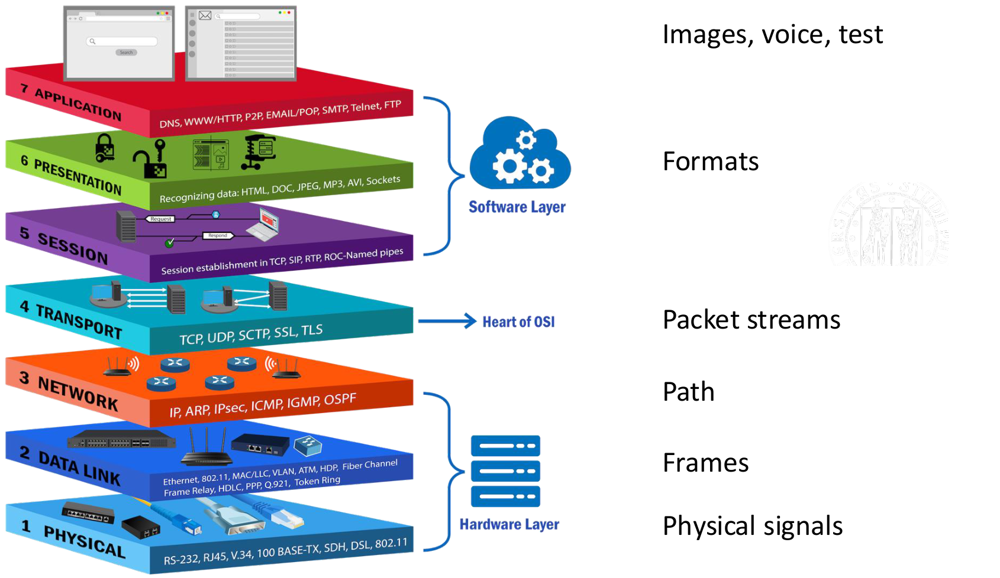

| Layer | Role in the lecture's example |
|---|---|
| 7. Application | The application using network services, such as a streaming app. |
| 6. Presentation | Representation and formats of the exchanged information. |
| 5. Session | Organisation of an ongoing exchange. |
| 4. Transport | End-to-end transport, including delivery/recovery functions where supported by the protocol. |
| 3. Network | Packet addressing and routing across networks. |
| 2. Data link | Frames exchanged on a local link. |
| 1. Physical | Electrical, optical or radio signals. |

The model gives different levels at which to collect and interpret evidence; the diagram is a simplified teaching overview, not an exact placement of every Internet protocol.

## OPERATING LAYERS IN NETWORK FORENSICS

| Area | Main evidence and purpose |
|---|---|
| **Ethernet analysis** | Local frames, activity profiles and suspicious behaviour on a network segment. |
| **TCP/IP – Router analysis** | Packet paths and router information for tracking traffic and investigating origins. |
| **Internet/Server based analysis** | Web, email and chat communications, server logs and account-related records. |
| **Wireless analysis** | Radio-channel observations and captured communications, with physical-medium and security constraints. |

Router and server acquisition are introduced here as areas of investigation; their detailed procedures are deferred. Wireless work can involve both signals and the frames/data recovered from them.

## DATA COLLECTION METHODS

| Method | Procedure | Main resource requirement |
|---|---|---|
| **“Catch-it-as-you-can”** | Capture all observable packets, then analyse them in batch. Useful when the relevant features are not yet known. | Large storage and adequate capture throughput. |
| **“Stop, look, and listen”** | Inspect incoming packets in memory and retain selected information in real time. | Sufficient processing speed to apply the selection without losing relevant traffic. |

Selective capture saves storage but excludes data that cannot be recovered later from that capture. A **sniffer/packet analyser** captures traffic and may decode fields according to protocol specifications. Current tools can combine capture with filtering; the distinction is the chosen collection strategy.

## EXAMPLE: TRAFFIC ANALYSIS ON ENCRYPTED CHANNELS

In the lecture's example, a phone communicates through an access point while another machine captures observable traffic. Encryption prevents reading payloads, but **packet-length statistics can reveal application-related patterns**.

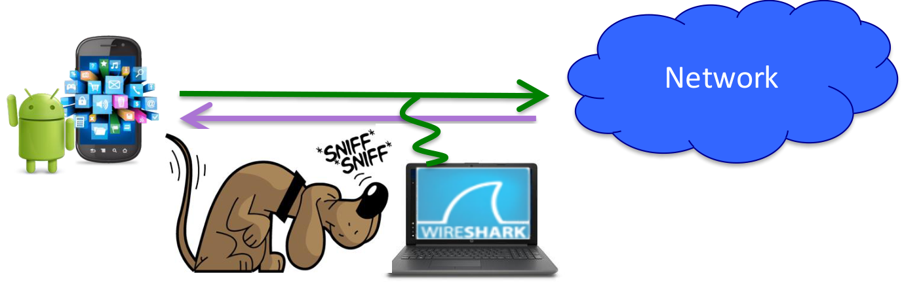

The historical Facebook/Twitter example represents each stream by its **average packet length** and **variance**. Different activity patterns produce distinguishable groups in the illustrated dataset.

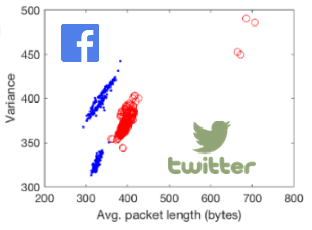

This is statistical profiling, not decryption or guaranteed classification of every future stream. Application features and traffic patterns change. The lecturer also mentions identifying viewed video content from traffic statistics.

## VIDEO SURVEILLANCE STREAMING

The same idea applies to an encrypted Wi-Fi camera stream. Movement changes visual content and can change the encoded traffic pattern. An observer may infer presence or movement without seeing the decrypted video.

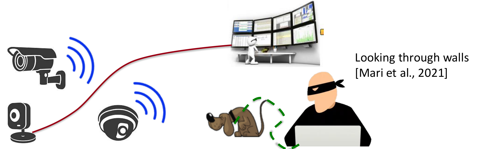

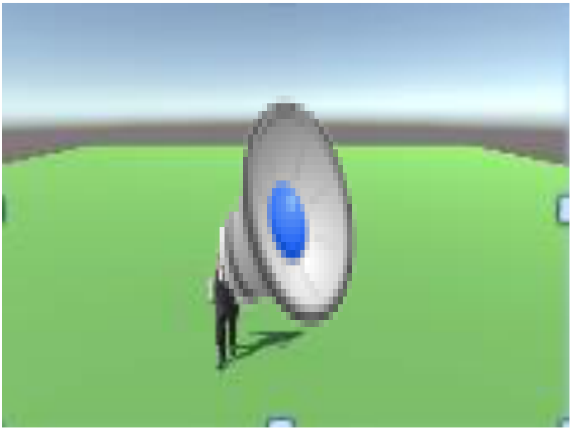

The examples retain three distinct patterns:

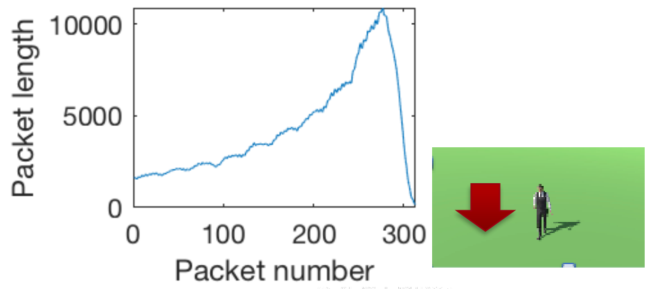

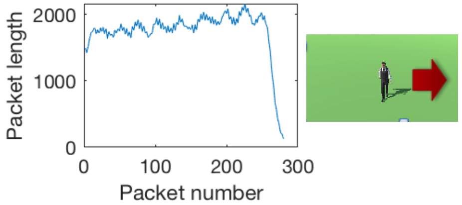

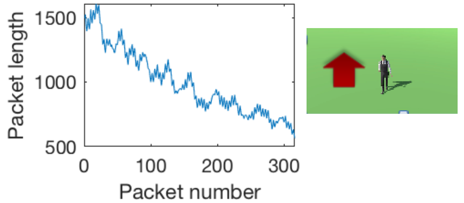

The lecturer describes training on a CGI reconstruction and applying the model to a real scene. Known layout and constrained corridor movement help interpretation. Camera motion and multiple nearby people complicate inference; the examples do not establish universal tracking accuracy.

This packet-statistics approach differs from inferring movement directly from changes in the radio propagation environment, another wireless-sensing possibility mentioned orally.

## ETHERNET

Ethernet operates at the **data-link layer** and carries **frames**. Source and destination **MAC addresses are 48 bits**, or 6 bytes. A frame also includes payload and an error-checking **Frame Check Sequence (FCS)**.

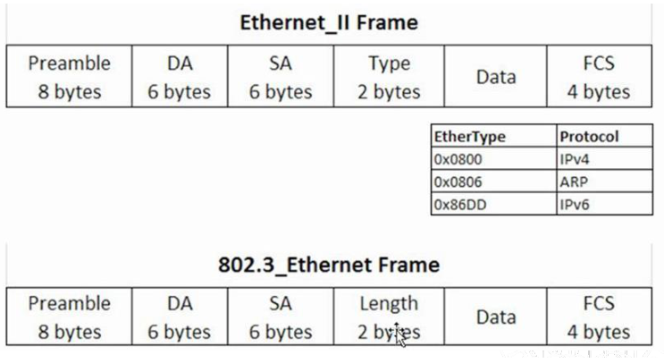

In **shared Ethernet**, devices share a medium. A transmitted frame reaches the segment's devices; a normal NIC accepts relevant destination frames and ignores unrelated unicast traffic. Simultaneous transmissions can collide and require retransmission.

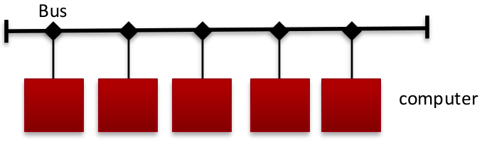

**Switched Ethernet** forwards known unicast frames towards the relevant port rather than every port. Separate links improve efficiency; full-duplex links avoid the shared-medium collision problem. Repeaters/hubs repeat signals, while bridges/switches perform selective forwarding.

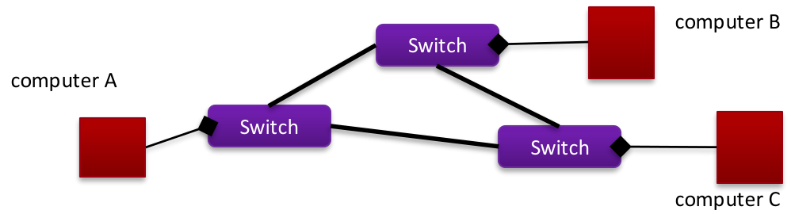

The capture position therefore determines which frames are observable.

## HOW A SNIFFER WORK

A **MAC address** identifies an interface for local frame delivery; an **IP address** supports network-layer addressing. **ARP — Address Resolution Protocol** maps an IPv4 address to a local link-layer address.

1. The sender checks its ARP cache.
2. If the mapping is absent, it broadcasts a request for the target IP's MAC address.
3. The target replies; the learned mapping is cached.
4. The sender can address the Ethernet frame appropriately.

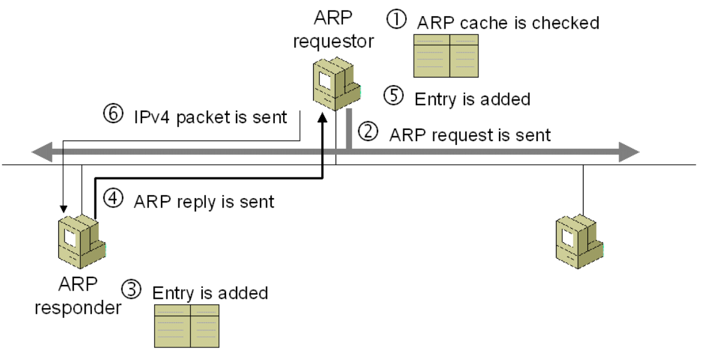

Keep two tables distinct: an **ARP cache maps IP addresses to MAC addresses**; a **switch forwarding table maps MAC addresses to ports**.

On a shared segment, **promiscuous mode** makes a NIC deliver frames it receives even when their destination MAC is another interface. On a switched network, this does not make the switch send it traffic from unrelated ports. A monitoring/mirror port can provide the required visibility; see [Wireshark's Ethernet capture explanation](https://wiki.wireshark.org/CaptureSetup/Ethernet).

The lecture describes two active interception mechanisms:

- **ARP spoofing:** forged ARP information associates another host's or gateway's IP with the interceptor's MAC. Traffic can then be relayed through the interceptor as a **man-in-the-middle (MITM)**. The named tool is `arpspoof`.
- **MAC flooding:** many fabricated source MAC addresses exhaust forwarding-table capacity, potentially causing wider flooding of unknown-destination traffic. The named tool is `macof`. This changes network behaviour and can degrade performance, making the intervention conspicuous.

**Technical clarification:** the slide's “switch becomes a hub” is a simplification. The relevant behaviour is **unknown-unicast flooding within the VLAN**, dependent on configuration and protection mechanisms, rather than every frame inevitably reaching every network port. See [Cisco's explanation](https://www.cisco.com/c/en/us/support/docs/switches/catalyst-6000-series-switches/23563-143.html).

## EAVESDROPPING PACKET STREAM

Packet captures support fault diagnosis, intrusion/misuse detection, traffic statistics, content investigation and checking security controls. Captures may also expose credentials or cookies when protocols do not protect them. Encryption can conceal payloads while leaving the traffic-pattern leakage shown earlier.

Document the capture method and its effect on the network: passive observation and active redirection do not preserve the same conditions.

## SNIFFING SOFTWARES

The lecturer introduces **tcpdump**, **Wireshark** and **Snort** for capture, protocol inspection, filtering, logging and intrusion-related monitoring. The slide also lists Hunt, Ettercap and Dsniff as interception/security tools.

**Naming correction:** Ethereal is Wireshark's former name, not an independent modern alternative. See the [project's renaming announcement](https://www.wireshark.org/news/20060607.html). A tool's ability to intercept traffic does not by itself defeat correctly configured authenticated encryption.

## HOW TO DETECT A SNIFFER

| Method | Operating idea | Limitation |
|---|---|---|
| **Ping method** | Send a probe with the suspect IP but an unexpected destination MAC and look for a response. | Depends on the host's filtering and protocol stack; promiscuous reception alone does not guarantee a reply. |
| **ARP method** | Use specially addressed ARP traffic and a subsequent probe to test whether the host learned information not normally accepted. | A schematic behavioural test, dependent on implementation. |
| **Local host analysis** | Inspect interfaces and suspicious capture processes; the course names `ifconfig`. | Interface flags alone do not establish malicious sniffing or exclude capture. |
| **Latency method** | Compare probe response times while traffic is being processed. | Congestion and ordinary load can also delay replies, causing false positives. |
| **ARP watch** | Monitor changed or duplicate IP/MAC associations. | Legitimate reassignment, including DHCP, can cause alerts. |
| **IDS** | Correlate packets and address associations and alert on suspicious mismatches. | An alert requires contextual validation. |

These methods provide **indicators**, not a universal proof that a sniffer exists or is absent. In particular, [Wireshark's FAQ](https://www.wireshark.org/download/docs/faq.html) notes that capture-library promiscuous mode may not appear in `ifconfig` output.

## ANTI-SNIFFING MEASURES

Protect ARP associations and network devices against redirection, use sniffing-detection tools, and apply appropriate switch/gateway controls. The course mentions Snort, Anti Sniff and arpwatch, alongside stronger checking of network address behaviour.

Use authenticated encrypted communications to protect content, while recognising that metadata can remain observable. Unexpected address mappings are investigation leads; they must be interpreted in the network's configuration and DHCP context.

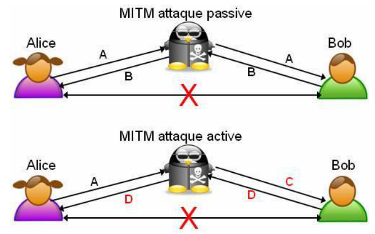

The diagram distinguishes **observing relayed messages** from **modifying their contents**. The lecture ends here; PCAP structure, detailed router/server analysis, IDS architecture and Tor material later in the PDFs are outside this recording's taught scope.
