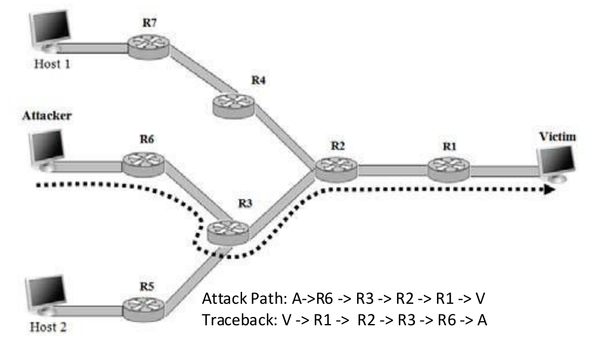
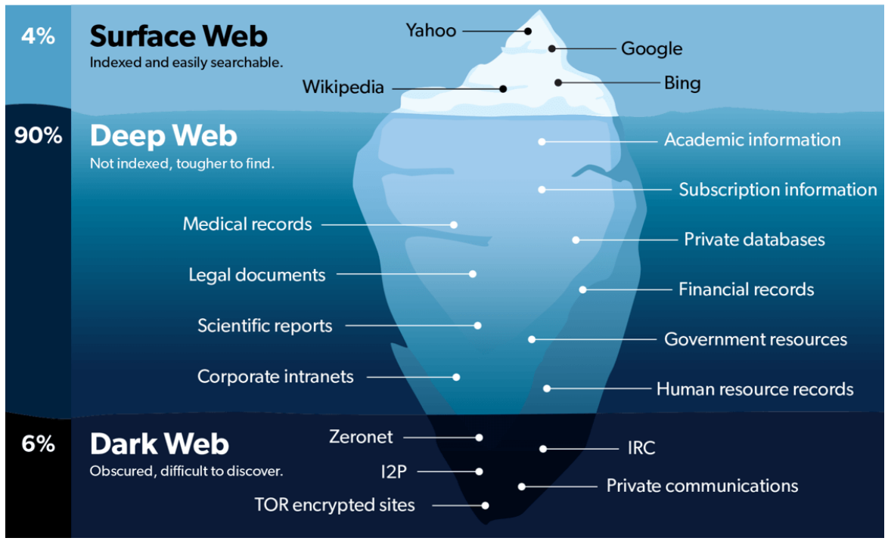
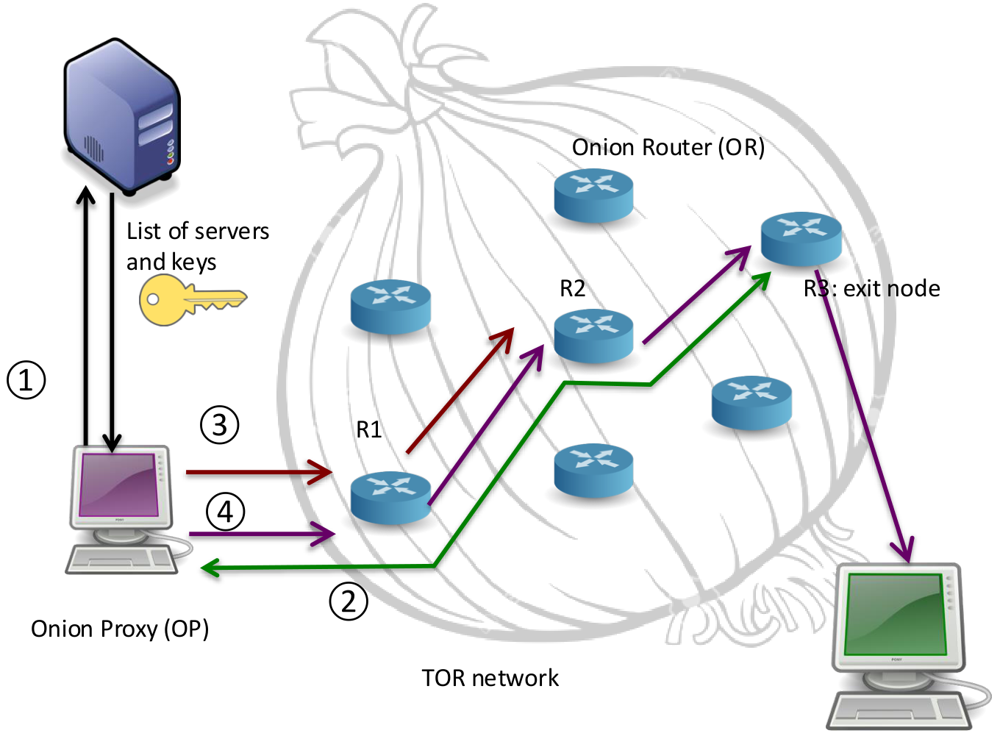
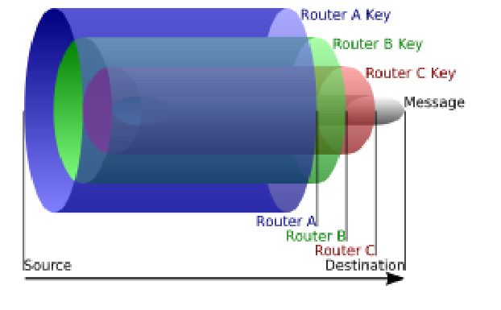
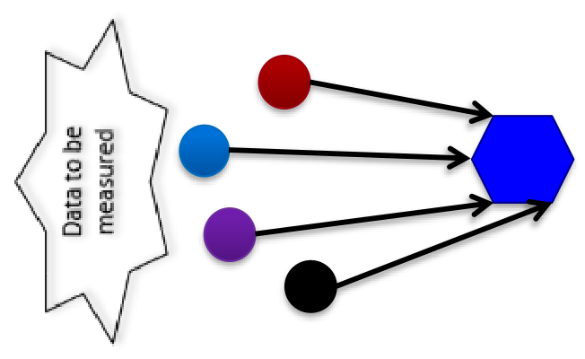
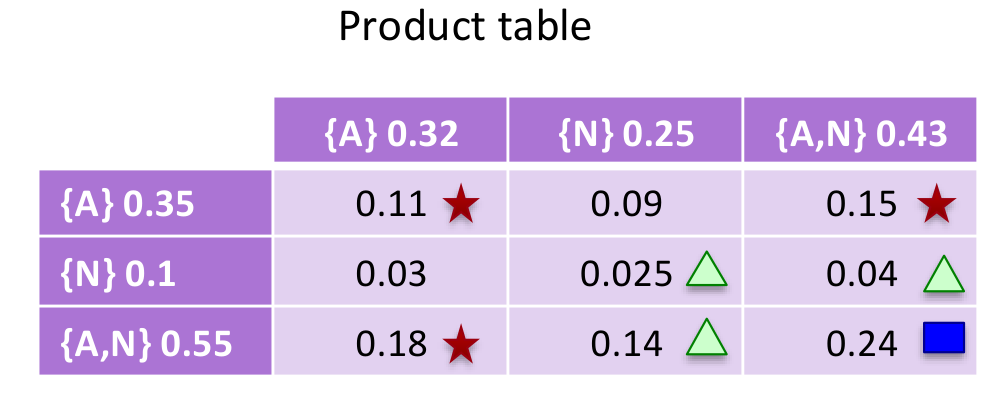
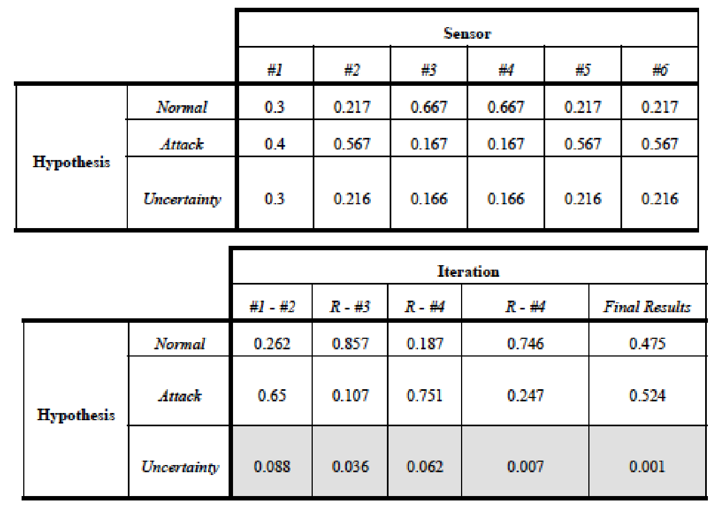

# LECTURE 06 –NETWORK FORENSICS

*Sources: [slides](Lecture%2006%20-%20Network%20forensics.pdf), [transcript](Lecture%2006%20-%20Network%20forensics%20STEM.transcript.txt) and [extended network forensics notes](../Lesson%204/Notes%20about%20network%20forensiocs.pdf), pp. 9–13 and 17–20. The lecture proper begins at about 00:16:10.*

## IDS TRIGGER

An anomaly-based IDS flags deviations from a nominal profile. It can flag unfamiliar activity, but training, changing behavior and false alarms affect its reliability. A signature-based IDS matches known patterns and depends on current rules. Combining the two can broaden coverage. [Lesson 5 notes](../Lesson%205/5.%20Network%20forensics.md#ids-trigger)

## TRACEBACK STRATEGIES

**Traceback** uses network evidence to infer where a packet, flow or transferred file originated. It is useful in distributed denial-of-service investigations and when source IP addresses may be spoofed. A recovered route can identify a likely originating network or terminal. Attributing activity to a person requires additional evidence.

Traceback can use individual packets or flow data, in real time or after the incident. Coordinated sources, short suspicious flows and incomplete router participation can leave gaps. A practical method must work with existing infrastructure, scale under partial deployment and limit router processing, storage and bandwidth overhead.

## TRACEBACK SOLUTIONS

| Method | Evidence used | Constraint |
|---|---|---|
| **Packet logging** | Routers retain packet records or digests. SPIE uses hashes of selected packet fields, and AMN collects sensor reports centrally. | Retention and processing cost limit coverage. |
| **Packet marking** | Participating routers put path information into packets. Probabilistic marking samples packets. Deterministic marking uses a fixed rule, often at the edge. | Reconstruction depends on deployment and enough usable marks. |
| **Hybrid** | Packet marks point to information in router logs, as in Distributed Link List Traceback (DLLT). | Requires compatible devices along relevant parts of the path. |

An **autonomous system (AS)** groups networks under a common routing policy. Traceback can use records within an AS and require cooperation at administrative boundaries.

## ATTACK RECONSTRUCTION

Align timestamps and correlate host, server and network logs to reconstruct the order of events. The resulting timeline can show how an incident developed and which defenses failed.

A **honeypot** is a monitored decoy, such as a service, host or network. It has no essential workload and is isolated from production. Its logs help study interactions without waiting for a production compromise. Poor isolation can expose other systems. The lecture also raises questions about how evidence from a decoy is collected and interpreted.

## PRIVACY-PRESERVING NETWORKS

### DEEP WEB FORENSICS

The **surface web** is indexed by ordinary search engines. The **deep web** contains unindexed material, including private databases and pages behind authentication. The **dark web** is a deliberately concealed part of the deep web accessed through overlay networks. [Congressional Research Service, *The Dark Web*](https://www.congress.gov/crs_external_products/IF/PDF/IF12172/IF12172.3.pdf)

The Silk Road case illustrates the value of correlating service, financial and endpoint evidence. Hidden infrastructure, large data volumes and cross-border jurisdiction complicate collection and attribution. Reused usernames or public contact details can provide leads. Bitcoin transactions are public and addresses are pseudonymous, so connecting an address to a person requires corroboration. [Bitcoin white paper, §10](https://bitcoin.org/bitcoin.pdf)

### DEEP WEB APPLICATIONS

Tor uses a relay-based anonymity overlay. Freenet and ZeroNet are examples of peer-to-peer publishing systems. ZeroNet uses BitTorrent for distribution and Bitcoin-style cryptography to sign content. [Freenet project history](https://freenet.org/about/) · [ZeroNet documentation](https://zeronet.io/docs/faq/)

*The diagram illustrates access categories. Its percentage labels are unsourced.*

### TOR NETWORK

For an ordinary website connection, the Tor client builds a circuit through entry, middle and exit relays. It wraps outgoing data in layers using a separate key for each relay, represented on slide 9 as $K_1(K_2(K_3(\text{DATA})))$. Each relay removes its own layer. The entry relay sees the client connection, and the exit relay connects to the destination.

Most Tor cells have a fixed size, which limits direct inference from cell length. The **512 bytes** on the slide describe older link versions. Fixed-length cells are **514 bytes** for link protocol version 4 and later. A Tor cell is a protocol unit carried over the network. [Tor link protocol specification](https://spec.torproject.org/tor-spec/preliminaries.html)

### TOR FORENSICS

Tor limits what any one relay sees. Timing can still correlate observations at different vantage points. For an ordinary web connection, Tor’s encryption ends at the exit, while HTTPS protects application data through to the destination. Timing similarity alone has limited value for attribution. [Tor Project on anonymity limits](https://support.torproject.org/about-tor/security/attacks-on-onion-routing/) · [Tor Project on exit visibility](https://support.torproject.org/about-tor/introduction/tor-vs-other-proxies/)

| Evidence source | Possible artifacts |
|---|---|
| **RAM** | Volatile strings such as URLs, onion addresses and search terms. A dump can also retain active connection information. |
| **Storage** | Installation and configuration records, browser files and Windows Registry or Prefetch artifacts where available. |
| **Network capture** | Relay connections, packet lengths and timestamps. Correlate them with artifacts from the acquired endpoint. |

### OTHER SOLUTIONS

- **Spidering and content analysis** collect accessible pages, index text and compare links or similar documents. A bag of words represents a document by its terms or term counts.
- **Dark network analysis** models entities and links as a graph and studies its topology, such as small-world or scale-free structure. **Interactional coherence** compares communication patterns, shared references and forms of address.
- **Authorship analysis** uses writing style or media features. **Sentiment and affect analysis** classify the attitudes or emotions expressed in content.

## TRACEBACK SOLUTIONS

In the later classroom demonstration, the lecturer used traceroute to illustrate hop discovery. Standard IPv4 traceroute starts with a time to live (TTL) of **1**. A router that drops an expired probe can return an ICMP Time Exceeded message, revealing the responding hop. Higher TTLs reveal subsequent responding hops. The transcript starts the example at zero. The measured path describes the diagnostic probes and can differ from the path of earlier traffic. The subsequent MITM example illustrates a separate forensic point. Altered forwarding can change where traffic is observed, so compare network evidence with endpoint records. [RFC 5388, §2.1](https://www.rfc-editor.org/rfc/rfc5388.html#section-2.1)

## COMBINE EVIDENCES

### COMBINING EVIDENCES

For hypothesis $H$ and evidence $E$, Bayes’ rule updates prior $P(H)$ using likelihood $P(E\mid H)$:

$$
P(H\mid E)=\frac{P(H)P(E\mid H)}{P(E)}.
$$

If observations $E_1,\ldots,E_n$ are conditionally independent given each hypothesis, their likelihoods multiply:

$$
P(H\mid E_1,\ldots,E_n)\propto P(H)\prod_i P(E_i\mid H).
$$

The product uses likelihoods $P(E_i\mid H)$. Slide 13 reverses the conditioning in this line. Normalize across the hypotheses to obtain a posterior. Reliable likelihoods can be hard to estimate, and logs of the same event can be dependent even when different systems generated them.

### EXAMPLE

Let $H$ mean that PC-17 is infected, with $P(H)=0.05$. Each update uses the previous posterior $p$ as the new prior and assumes conditional independence under $H$ and $\neg H$.

$$
p'=\frac{a p}{a p+b(1-p)},\qquad
a=P(E_i\mid H),\quad b=P(E_i\mid\neg H).
$$

| Evidence | $a$ | $b$ | Updated $p'$ |
|---|---:|---:|---:|
| Firewall logs show contact with a suspicious IP | 0.90 | 0.10 | 0.3214 |
| DNS logs show resolution of a malware-associated domain | 0.85 | 0.05 | 0.8895 |
| Proxy logs show an executable download from that domain | 0.80 | 0.08 | 0.9877 |

For the first row, $p'=0.90(0.05)/[0.90(0.05)+0.10(0.95)]$. Equivalently, multiply the prior odds by the likelihood ratios $9$, $17$ and $10$, then convert the final odds to probability. With the given inputs the last posterior is **98.77%**. Slide 14 gives $0.98$. The calculation depends on the assumed model, especially because all three records may describe related network activity.

### COMBINING EVIDENCES

Ken is found dead in a shared apartment. The example assumes one culprit among Barbara ($B$), John ($J$) and Sean ($S$). One witness is 80% sure they heard men arguing. Another is 60% sure Ken planned to lend Sean money, which the example treats as evidence against a motive for Sean. Both accounts support groups of possibilities and leave uncertainty about the individuals.

### DEMPSTER-SCHAFER THEORY

The **theory of belief functions** combines separate bodies of evidence while allowing each piece to support a set of outcomes. Belief in a claim and belief in its complement can both be zero when all support remains uncommitted.

### DS THEORY: DEFINITIONS

The **frame of discernment** $X$ contains mutually exclusive and exhaustive elementary outcomes. Its power set $2^X$ contains all subsets, including the empty set. For $X=\{A,N\}$, with $A$ meaning attack and $N$ normal operation:

$$
2^X=\{\varnothing,\{A\},\{N\},X\}.
$$

The subset $X$ represents unresolved choice between $A$ and $N$. The slides also use $\Theta$ for the power set.

### TRANSFERABLE BELIEF MODEL (TBM)

In the normalized formulation used in the lecture, a **basic belief assignment** is $m:2^X\to[0,1]$ with $m(\varnothing)=0$ and $\sum_{B\subseteq X}m(B)=1$. The mass $m(B)$ is support committed to the subset $B$ as a whole. For example, $m(\{A,N\})=0.30$ leaves $0.30$ uncommitted between the two outcomes.

$$
\operatorname{bel}(A)=\sum_{B\subseteq A}m(B),\qquad
\operatorname{pl}(A)=\sum_{B\cap A\ne\varnothing}m(B)=1-\operatorname{bel}(X\setminus A).
$$

Here $A$ denotes any subset. Belief counts support that implies $A$. Plausibility counts support compatible with $A$. The **Möbius transform** recovers masses from beliefs:

$$
m(A)=\sum_{B\subseteq A}(-1)^{|A|-|B|}\operatorname{bel}(B).
$$

### INTERPRETATION OF MASS

In the voting analogy, $m(B)$ is the fraction of votes cast for the set $B$. A vote can identify one outcome, favor a group, or leave the entire frame open. The switch and sealed-envelope analogies make the same distinction between definite and unresolved outcomes.

### INTERPRETATION OF BELIEF AND PLAUSIBILITY

The interval $[\operatorname{bel}(A),\operatorname{pl}(A)]$ bounds probabilities compatible with the assignment. Its width reflects how much evidence is unresolved about $A$.

| Interval | Interpretation |
|---|---|
| $[0,1]$ | Total ignorance about the claim. |
| $[0,0]$ or $[1,1]$ | The evidence rules it out or fully supports it, respectively. |
| $[0.3,1]$ or $[0,0.8]$ | Some support for the claim or for its complement, respectively. |
| $[0.2,0.7]$ | Some evidence supports each side. |

### MORE THAN 1000 WORDS … EXAMPLES

In the crime-scene example, the detectives assign these illustrative masses. They are a separate input from the two witness assignments below.

| Set | $m$ | $\operatorname{bel}$ | $\operatorname{pl}$ |
|---|---:|---:|---:|
| $\{B\}$ | 0.1 | 0.1 | 0.4 |
| $\{J\}$ | 0.2 | 0.2 | 0.7 |
| $\{S\}$ | 0.1 | 0.1 | 0.6 |
| $\{B,J\}$ | 0.1 | 0.4 | 0.9 |
| $\{B,S\}$ | 0.1 | 0.3 | 0.8 |
| $\{J,S\}$ | 0.3 | 0.6 | 0.9 |
| $X$ | 0.1 | 1 | 1 |

For $\{J,S\}$, belief adds the masses of $\{J\}$, $\{S\}$ and $\{J,S\}$, giving $0.6$. Only $\{B\}$ carries positive mass disjoint from $\{J,S\}$, so plausibility is $1-0.1=0.9$.

### DS’S COMBINATION RULE

For independent sources using a common frame, intersect each pair of subsets, multiply their masses and sum products with the same intersection. Normalize over nonempty intersections.

$$
q(C)=\sum_{U\cap V=C}m_1(U)m_2(V),\qquad
K=\sum_{C\ne\varnothing}q(C)=1-q(\varnothing).
$$

For $C\ne\varnothing$ and $K>0$, $m_{12}(C)=q(C)/K$, and $m_{12}(\varnothing)=0$. Here $K$ denotes the retained mass, as on slide 22. The slide’s conditional-independence equation shows a plus sign. The factorization of the joint likelihood uses multiplication.

### EXAMPLE: CRIME SCENE

Model the first witness with $m_1(\{J,S\})=0.8$ and $m_1(X)=0.2$. Model the second with $m_2(\{B,J\})=0.6$ and $m_2(X)=0.4$. All other masses are zero.

| Intersection | Product | Combined mass |
|---|---|---:|
| $\{J\}$ | $0.8(0.6)$ | 0.48 |
| $\{J,S\}$ | $0.8(0.4)$ | 0.32 |
| $\{B,J\}$ | $0.2(0.6)$ | 0.12 |
| $X$ | $0.2(0.4)$ | 0.08 |

All intersections are nonempty, so $K=1$. Under the stated encoding, John has the strongest individual support, with belief $0.48$ and plausibility $1$. The result depends on how the witness statements were translated into masses and leaves the culprit unresolved.

### EXAMPLE: FUSION OF MULTIPLE IDS

On the frame $X=\{A,N\}$, sensor 1 assigns $(0.32,0.25,0.43)$ and sensor 2 assigns $(0.35,0.10,0.55)$ to $\{A\},\{N\},X$, respectively.

Conflict comes from attack paired with normal in either order, so $q(\varnothing)=0.32(0.10)+0.25(0.35)=0.1195$ and $K=0.8805$. The exact products give:

| Set | Unnormalized $q$ | Normalized $m_{12}$ |
|---|---:|---:|
| $\{A\}$ | $0.32(0.35)+0.32(0.55)+0.43(0.35)=0.4385$ | 0.4980 |
| $\{N\}$ | $0.25(0.10)+0.25(0.55)+0.43(0.10)=0.2055$ | 0.2334 |
| $X$ | $0.43(0.55)=0.2365$ | 0.2686 |

Attack has the strongest individual support. The slide rounds the products and labels the last row as belief. The last row is mass on $X$, while $\operatorname{bel}(X)=1$.

### EXAMPLE: FUSION OF MORE IDS

Combine the first two sensors and then add each subsequent sensor to the result. The rule is commutative and associative when the sources satisfy its assumptions and each combination is defined.

The slide’s final column agrees with the recomputation at its displayed precision. Several intermediate columns differ. For sensor order $1,2,\ldots,6$, recomputing from the displayed inputs gives:

| Sensors used | $m(\{N\})$ | $m(\{A\})$ | $m(X)$ |
|---|---:|---:|---:|
| 1–2 | 0.2624 | 0.6504 | 0.0872 |
| 1–3 | 0.5298 | 0.4425 | 0.0277 |
| 1–4 | 0.7460 | 0.2466 | 0.0075 |
| 1–5 | 0.6201 | 0.3768 | 0.0031 |
| 1–6 | 0.4750 | 0.5238 | 0.0012 |

### PROS AND CONS OF DS THEORY

Mass on sets represents unresolved alternatives and allows fusion without a precise Bayesian prior. The method can combine support for attacks absent from a signature list, provided the sensors supply relevant evidence. The number of subsets is $2^{|X|}$, so computation can grow quickly. Dependent sources can overstate support, and strong conflict makes normalization sensitive to small inputs.

### CONTRADICTIONS IN DS THEORY

The first witness assigns $0.99$ to John and $0.01$ to Sean. The second assigns $0.99$ to Barbara and $0.01$ to Sean. The only nonempty intersection with positive mass is $\{S\}$, so $q(\{S\})=0.01^2=0.0001$ and $K=0.0001$. Normalization gives $m_{12}(\{S\})=1$ even though each witness gives Sean only $0.01$. The apparent certainty comes from discarding $0.9999$ of conflicting mass. At total conflict, $K=0$ and the rule is undefined. [Zadeh on conflict in Dempster–Shafer theory](https://onlinelibrary.wiley.com/doi/abs/10.1609/aimag.v7i2.542)

### EXERCISE A.6

The lecture defers the exercises. For the three-IDS problem, Lesson 8 works through both combinations and obtains $\operatorname{bel}(\{A\})\approx0.5925$ and $\operatorname{pl}(\{A\})\approx0.7441$. [Worked Exercise A.6](../Lesson%208/8.%20Multimedia%20evidences.md#exercise-a6)

### EXERCISE A.5

For the terminal-attribution problem, Lesson 8 derives the combined masses. Terminal C has the strongest singleton support ($0.4737$), narrowly ahead of A ($0.4211$), with substantial conflict ($0.81$). [Worked Exercise A.5](../Lesson%208/8.%20Multimedia%20evidences.md#exercise-a5) · [Handwritten solutions](../Lesson%208/exercise_solved.pdf)
