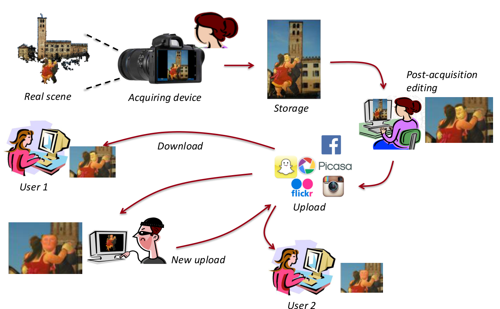
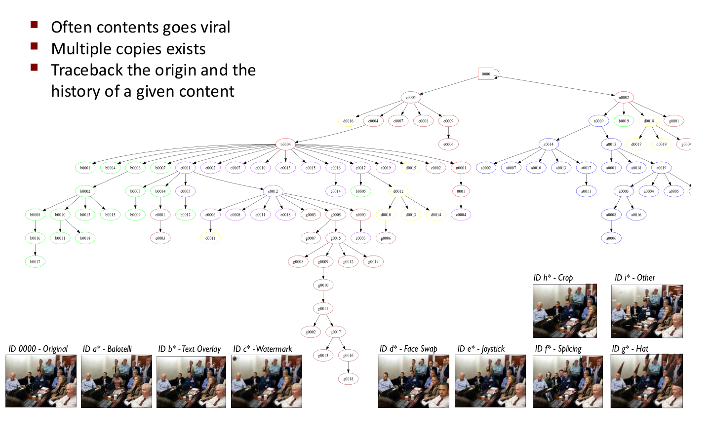
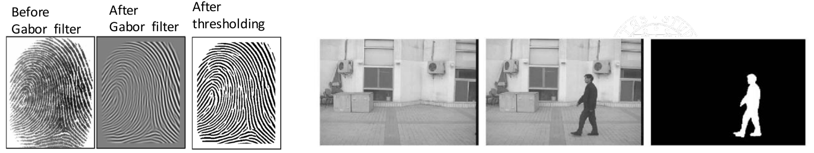
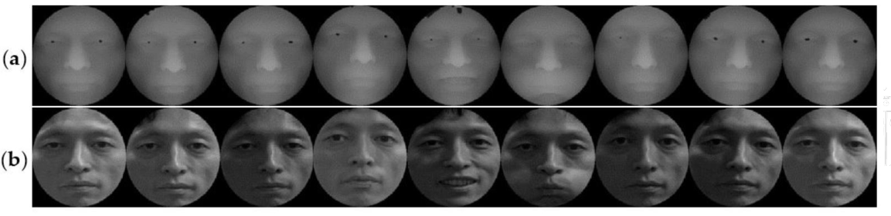
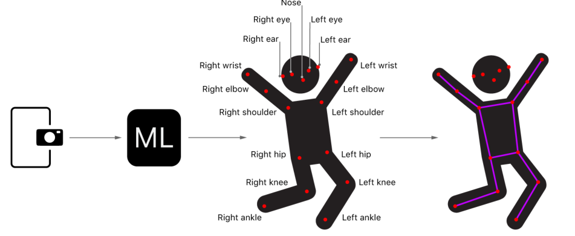

# LECTURE 08 – MULTIMEDIA EVIDENCES

*Sources: [lecture transcript](Lecture%2008%20-%20Exercises%20and%20Intro%20on%20Multimedia%20STEM.transcript.txt), [solved exercises](exercise_solved.pdf), [slides](pres_lecture08b.pdf), [extended notes](NotesAboutMultimediaForensics.pdf). Figures are taken from the slides. Extended notes are integrated only where relevant to this lecture.*

## Exercise A.6

Three IDS sensors assess whether a network is under attack. Let $\Theta=\{A,S\}$, where $A$ means **attack**, $S$ means **safe**, and mass on $\Theta$ represents **uncertainty**, not evidence that both occur.

| Hypothesis | Sensor A | Sensor B | Sensor C |
|---|---:|---:|---:|
| $\{A\}$ | 0.30 | 0.35 | 0.35 |
| $\{S\}$ | 0.20 | 0.25 | 0.10 |
| $\Theta$ | 0.50 | 0.40 | 0.55 |

**Dempster's rule:** intersect the hypothesis sets, multiply their masses, and sum products yielding the same intersection. Discard conflicting products (empty intersections), then normalize the remaining masses:

$$
q(X)=\sum_{U\cap V=X}m_1(U)m_2(V),
\qquad
m_{12}(X)=\frac{q(X)}{Z},
\quad Z=\sum_{X\ne\emptyset}q(X).
$$

Here $Z=1-K$, where $K$ is the conflicting mass. The handwritten solution calls the normalization sum $k$.

**1. Combine sensors A and B.** Since $\{A\}\cap\Theta=\{A\}$, uncertainty contributes to attack when combined with attack evidence; the same applies to safe.

| Set | Unnormalized mass $q$ | Normalized mass ($Z=0.855$) |
|---|---|---:|
| $\{A\}$ | $0.30(0.35)+0.30(0.40)+0.50(0.35)=0.400$ | 0.4678 |
| $\{S\}$ | $0.20(0.25)+0.20(0.40)+0.50(0.25)=0.255$ | 0.2982 |
| $\Theta$ | $0.50(0.40)=0.200$ | 0.2339 |

Conflict is $0.30(0.25)+0.20(0.35)=0.145$, so $Z=1-0.145$.

**2. Combine this result with sensor C**, using the same intersections:

| Set | Unnormalized mass (rounded) | Final mass |
|---|---|---:|
| $\{A\}$ | $0.4678(0.35+0.55)+0.2339(0.35)\approx0.502924$ | **0.5925** |
| $\{S\}$ | $0.2982(0.10+0.55)+0.2339(0.10)\approx0.217251$ | 0.2559 |
| $\Theta$ | $0.2339(0.55)\approx0.128655$ | 0.1516 |

The normalization sum is $Z\approx0.848830$. Calculations retain full precision; displayed values are rounded, explaining small differences from the handwritten solution.

**Interpretation:** attack has the strongest support; combining sensors reduces uncertainty. This mass is not an ordinary probability: $Bel(A)=0.5925$, while $Pl(A)=m(A)+m(\Theta)=0.7441$. Changing the combination order gives the same final result, apart from rounding.

## Exercise A.5

A system failure originates from terminal A, B, or C: $\Theta=\{A,B,C\}$. John and Paul assess HIDS/NIDS evidence.

| Set | John | Paul |
|---|---:|---:|
| $\{A\}$ | 0.80 | 0 |
| $\{B\}$ | 0.10 | 0 |
| $\{C\}$ | 0 | 0.90 |
| $\{A,B\}$ | 0 | 0.05 |
| $\Theta$ | 0.10 | 0.05 |

All other masses are zero. Paul's $m(\{A,B\})=0.05$ supports **A or B without distinguishing them**; it is not 0.05 assigned to each.

Apply the same intersection, multiplication, and normalization rule:

| Set | Nonzero contributions | $q$ | Final mass |
|---|---|---:|---:|
| $\{A\}$ | $0.80(0.05)+0.80(0.05)$ | 0.080 | **0.4211** |
| $\{B\}$ | $0.10(0.05)+0.10(0.05)$ | 0.010 | 0.0526 |
| $\{C\}$ | $0.10(0.90)$ | 0.090 | **0.4737** |
| $\{A,B\}$ | $0.10(0.05)$ | 0.005 | 0.0263 |
| $\Theta$ | $0.10(0.05)$ | 0.005 | 0.0263 |

For example, John's $\Theta$ intersected with Paul's $\{C\}$ yields $\{C\}$. The sets $\{A,C\}$ and $\{B,C\}$ receive zero mass.

Conflict is $K=0.80(0.90)+0.10(0.90)=0.81$; divide each retained mass by $Z=0.19$.

**Interpretation:** C is slightly ahead, but A remains strongly supported. Uncertainty allows each expert's preferred hypothesis to survive combination. Because disagreement remains substantial, collect further independent evidence before deciding.

## INTRO ON MULTIMEDIA FORENSICS

Multimedia forensics examines images, videos, and audio to reconstruct their **origin, processing history, and reliability**. Easy editing and realistic synthetic content mean appearance alone cannot establish authenticity.

## THE PROCESSING HISTORY OF A MULTIMEDIA CONTENT

**Real scene → acquisition → in-device processing and storage → editing → upload → download → further edits and uploads.**

Processing starts inside the acquiring device. Later platforms may resize, recompress, or remove metadata, adding further changes even without deliberate tampering.

*Slide 3: acquisition, editing, and repeated sharing.*

## PROBLEMS:

For an image, video, or audio file, ask:

- Who captured or created it? Which device or software produced it?
- Was it modified? How, where, and how much?
- Can its content be trusted?
- What does it reveal about the scene? Can other recordings corroborate it?
- Was the generating device or software legitimate?

**Modified does not automatically mean fake:** reducing noise may preserve meaning; removing a person or an audio passage may change it.

## AUTHENTICATION OF DATA

Verify the claimed **device, acquisition time, origin, and integrity**. Applications include validating evidence, tracing illegal material, and supporting ownership claims.

**Watermarking** deliberately embeds a message to identify origin or ownership. In contrast, passive analysis examines traces already present in the signal. Inconsistent traces across regions may indicate composition from different sources.

## DATA ENHANCEMENT

Recordings often suffer from darkness, distance, noise, blur, or strong compression. Enhancement makes existing details easier to examine: a license plate, a voice in noise, or the timing of gunshots.

It must remain **forensically sound**: improve visibility or audibility while preserving evidential meaning, without treating invented details as recovered evidence.

## FAKE DETECTION

Manipulation predates AI: traditional compositing and modern generative tools can support art, advertising, fraud, or public-opinion manipulation. The task is to distinguish genuine recordings from altered or synthetic content and locate meaningful changes.

## TRACE THE ORIGIN OF A GIVEN CONTENT

Viral content produces many edited copies. Compare them to reconstruct a **provenance tree**: the original is the root; derived versions form branches. This helps trace the source, distribution, and sequence of edits.

*Slide 8: related versions include crops, text overlays, watermarks, and face swaps.*

## RECONSTRUCTING THE ORIGINAL SOURCE

Related fragments from different copies or broadcasts can help reconstruct their common source. The lecturer also mentions linking audio versions and software variants through their shared traces: the same idea extends beyond images.

## OBSERVATIONS

Digital objects can survive indefinitely and undergo many processing steps. Each step can leave characteristic **footprints**: sensor imperfections, processing artifacts, or compression traces. What appears to be a defect becomes evidence for reconstructing history.

## HOW MULTIMEDIA FORENSICS TRIES TO ANSWER …

**EXIF (Exchangeable Image File Format)** metadata can describe camera model, exposure, focal length, GPS coordinates, timestamps, and editing software. However, metadata can be removed, altered, or based on an incorrect device clock.

| Clue | What it can suggest | Main limitation |
|---|---|---|
| Camera/software tags | Acquisition or editing source | Editable or removable |
| Capture time and UTC offset | Event timing and timezone | Clock settings may be wrong |
| File-system timestamps | File handling | Not necessarily capture time |
| Pixel/audio-sample traces | Device or processing history | Processing can weaken traces |

The lecturer compares metadata from a smartphone image and an older camera image using **ExifTool**. Network-synchronized clocks may improve timing, but timestamps still require corroboration.

**Core approach:** use metadata as clues, then inspect traces within image/video pixels or audio samples. Presence, absence, or inconsistency of traces can reveal origin or manipulation.

## EXAMPLE

Different platforms and upload methods can leave different metadata patterns, suggesting whether an image passed through a particular service or a web/mobile application. These patterns describe the tested versions: platform updates can change them.

## BASICS OF SIGNAL PROCESSING

To examine traces inside multimedia, represent the content numerically.

## DIGITAL SIGNAL PROCESSING

**Sampling** discretizes the independent variable; **quantization** discretizes sample values.

For audio, sample a continuous signal $x_a(t)$ every $T$ seconds:

$$
x[n]=x_a(nT),\qquad f_s=\frac{1}{T}.
$$

Audio is a sequence of samples: one channel for mono, two for stereo. A grayscale image is an $M\times N$ matrix $I(x,y)$; a video is a sequence of frames.

## QUANTIZATION

With $b$ bits, a sample has $2^b$ possible levels. Common 8-bit image samples range from **0 to 255**: black to white for grayscale. RGB images store three components per pixel, commonly 8 bits each (**24 bits/pixel**).

Higher bit depths, such as 12 or 16 bits, preserve finer intensity differences, useful in medical imaging.

## BINARY SIGNALS

Binary images use $I(x,y)\in\{0,1\}$ to represent shape, such as fingerprint ridges or silhouettes for gait analysis. Filtering can clean the image before binarization. Difficult traces may still require grayscale or color information.

*Slide 16: fingerprint → filtering → thresholding; person → binary silhouette.*

## EXAMPLES OF BINARIZATION (1/2)

Thresholding converts intensity into two classes:

$$
B(u,v)=
\begin{cases}
1 & I(u,v)\ge T,\\
0 & I(u,v)<T.
\end{cases}
$$

**Otsu's method** selects $T$ from the histogram to minimize within-class variance, equivalently maximizing between-class variance $p_0p_1(\mu_0-\mu_1)^2$. Here $p_i$ and $\mu_i$ are each class's proportion and mean. This is additional slide detail, not developed orally.

## EXAMPLES OF BINARIZATION (2/2)

**Segmentation** separates foreground objects from the background to produce a binary mask. Color can suffice in simple cases; more complex scenes need methods based on gradients or learned models.

## OTHER BIT DEPTHS

- **DNA:** a sequence over $\{A,G,C,T\}$ needs 2 bits per base. The **Voss representation** uses four binary indicator sequences, one per base; exactly one is 1 at each position.
- **Typing biometrics:** key identity, press duration, intervals between keys, and possibly pressure form a multivariate time series describing typing behavior.

## DEPTH AND 3D SIGNALS (1/2)

A **depth map** $D=[d(x,y)]$ stores distance from the camera instead of light intensity. Display brightness encodes depth according to a chosen convention.

Depth supports 3D face/body modelling, pose compensation, and detection of presentation attacks, such as showing a flat photograph to a face-recognition system.

*Slide 20: depth maps above, ordinary face images below.*

## DEPTH AND 3D SIGNALS (2/2)

A **mesh** represents a surface using vertices, edges, faces, and normals. Faces are commonly triangles or quadrilaterals. Formats such as **PLY** can store geometry and additional properties such as color.

## 3D TIME SERIES

Track body joints over time to describe motion and recognize gait. A skeleton consists of rigid bones connected by articulated joints. Each joint can have up to **6 degrees of freedom (DoF)**: three translations and three rotations.

## JOINTS AND DOF

| Joint type | Allowed motion | DoF |
|---|---|---:|
| Hinge | Rotation around one axis | 1 |
| Saddle | Two independent motions | 2 |
| Ball-and-socket | Rotation around three axes | 3 |
| Sliding | Translation within a plane | 2 |

## JOINTS FROM ACQUIRED SIGNALS

Track one coordinate series per joint. With $J$ joints, positions yield **$2J$ coordinates per frame in 2D** or **$3J$ in 3D**; 15 joints in 2D give a 30-dimensional series.

Acquire motion using **RGB cameras, depth cameras, or IMUs** (accelerometers and gyroscopes). Applications include gait identification, activity recognition, and medical movement analysis. The lecturer cites Kinect skeleton tracking and motion sensors in phones or glasses.

*Slide 24: camera → learned joint detector → skeleton. Subsequent lessons cover signal processing and acquisition traces in detail.*
