# LECTURE 09 – CAMERA FORENSICS

*Sources: [slides](Lecture%2009%20-%20Acquisition%20traces.pdf), [transcript](Lecture%2009%20-%20Multimedia%20acquisition%20forensics%20STEM.transcript.txt) and [extended notes](../Lesson%208/NotesAboutMultimediaForensics.pdf), pp. 2–3, 7–11 and 15–16.*

## ANALYSIS OF SIGNALS: FILTERING

For a linear time-invariant filter, $h[n]$ is the response to a unit impulse, $x[n]$ is the input and $y[n]$ is the output:

$$
y[n]=(h*x)[n]=\sum_i x[i]h[n-i],\qquad
y(t)=\int_{-\infty}^{\infty}x(a)h(t-a)\,da.
$$

Flip $h$, shift it by $n$, then sum the pointwise products. Each output sample measures the alignment of the input with that flipped template at one shift. When the nonzero samples of the rectangle and ramp are disjoint, the output is zero. It rises as they overlap and falls as they separate.

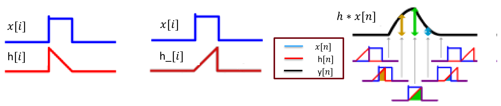

For two identical rectangular pulses, the overlap length rises and falls linearly, so their convolution is triangular.

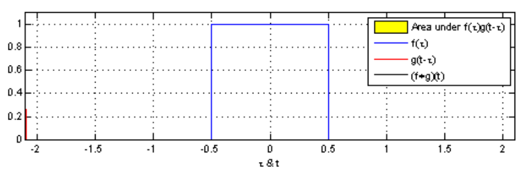

## EXAMPLE: 1D SIGNALS (AUDIO)

Let $x_i(t)=\sin(2\pi f_i t)$. The example starts with $f_0=440$ Hz and adds $f_1=294$ Hz. The sum has a more complex waveform than either tone alone.

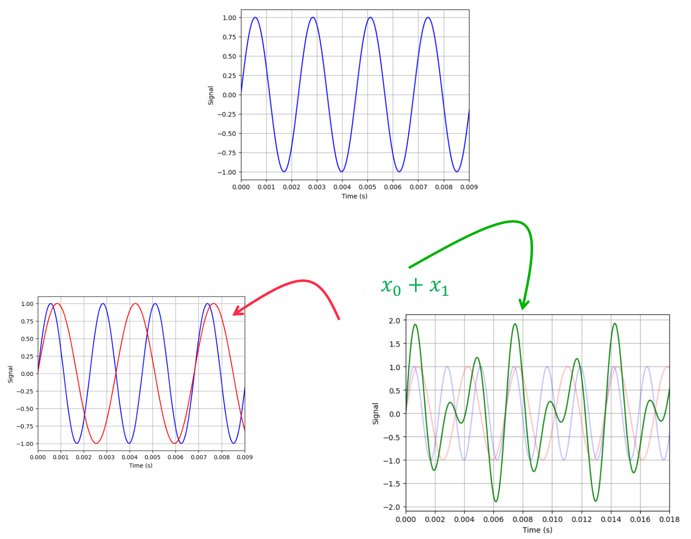

It then adds $f_2=349$ Hz and $f_3=523$ Hz. Compare the equal-weight sum with $0.5x_0+0.2x_1+0.8x_2+0.4x_3$. Changing amplitudes changes the waveform while retaining the same component frequencies. Slide 4 repeats the index $f_2$ for the fourth tone.

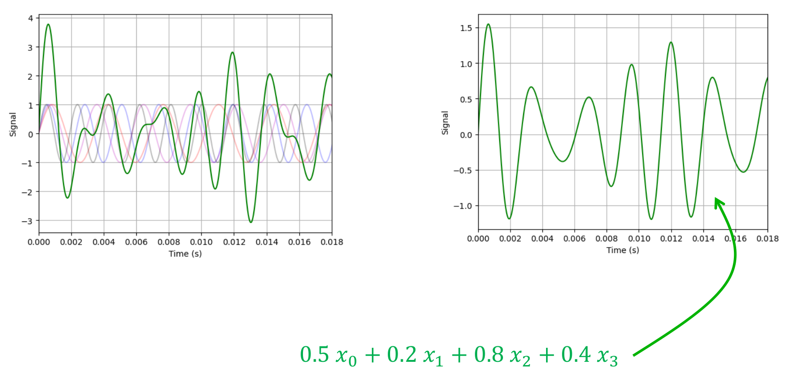

## FOURIER TRANSFORM

The Fourier transform measures how strongly a signal projects onto sine and cosine components. In the weighted example, a normalized projection onto $x_0$ recovers $0.5$ when the components are orthogonal over the observation interval. The other weights follow from the other projections. The forward kernel is $e^{-j2\pi ft}=\cos(2\pi ft)-j\sin(2\pi ft)$, with $j^2=-1$.

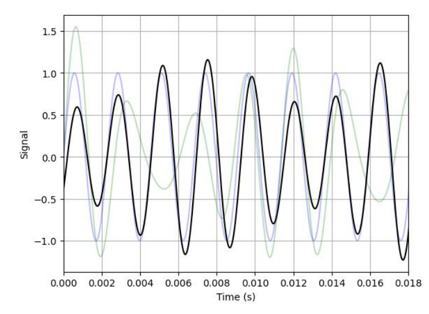

For continuous time, using $f$ in Hz:

$$
X_a(f)=\int_{-\infty}^{\infty}x_a(t)e^{-j2\pi ft}\,dt,\qquad
x_a(t)=\int_{-\infty}^{\infty}X_a(f)e^{j2\pi ft}\,df.
$$

The $1/(2\pi)$ factor shown on slide 6 belongs to the angular-frequency inverse integrated over $\omega=2\pi f$. [Fourier transform conventions](https://visionbook.mit.edu/image_processing_fourier.html#fourier-transform-for-continuous-signals)

For $N$ samples, the **DFT** and its inverse are:

$$
X[k]=\sum_{n=0}^{N-1}x[n]e^{-j2\pi kn/N},\qquad
x[n]=\frac{1}{N}\sum_{k=0}^{N-1}X[k]e^{j2\pi kn/N}.
$$

Here $k$ is a frequency-bin index. Each coefficient has magnitude $|X[k]|$ and phase $\arg X[k]$ in radians. The complete set of complex coefficients reconstructs the samples.

## FOURIER PROPERTIES

Linearity preserves sums and scalar weights. A time shift changes phase, modulation shifts the spectrum, and convolution in time becomes multiplication in frequency. The slide’s table uses angular frequency $\omega$.

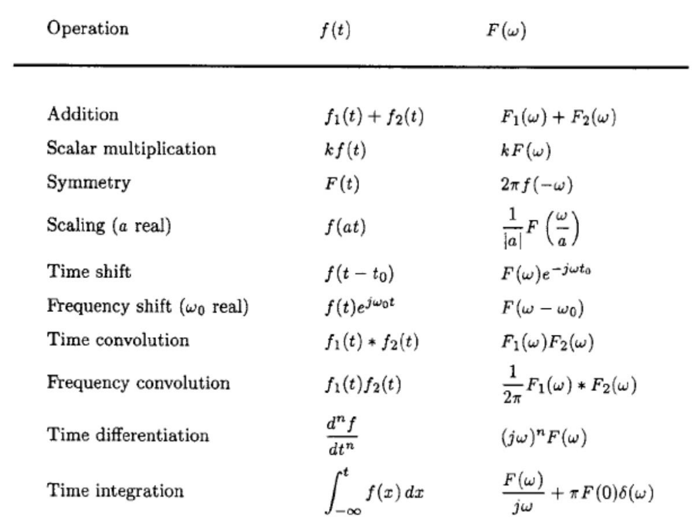

## FOURIER TRANSFORM: 1D EXAMPLES

For a causal exponential $x[n]=\alpha^n u[n]$, where $u[n]$ is the unit step and $|\alpha|<1$, the discrete-time spectrum is $X(e^{j\omega})=1/(1-\alpha e^{-j\omega})$. The time plot labels $\alpha=0.9$ and the spectrum formula uses $0.5$, so the panels illustrate different parameter settings.

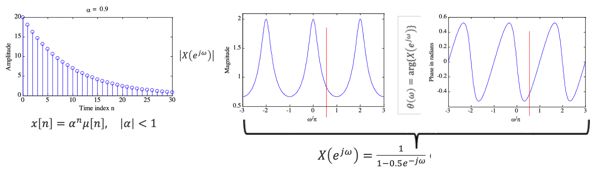

| Time signal | Spectrum |
|---|---|
| $\cos(2\pi f_0t)$ | Two impulses of weight $1/2$ at $\pm f_0$. Slide 8 repeats the same impulse argument. |
| $e^{-\pi t^2}$ | $e^{-\pi f^2}$ in the Hz convention. |
| $\operatorname{rect}(t/T)$ | $T\operatorname{sinc}(Tf)$, where $\operatorname{sinc}(z)=\sin(\pi z)/(\pi z)$ and $T$ is the pulse width. |

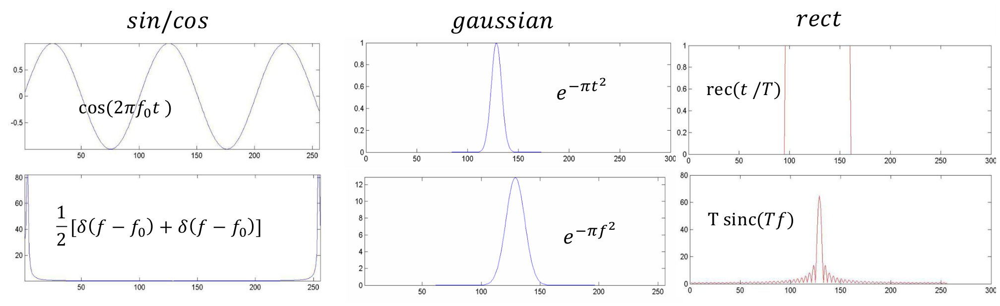

The speech example concentrates much of its energy below about 4 kHz. The music example extends over a wider band. A whole-record spectrum shows which frequencies are present across the recording.

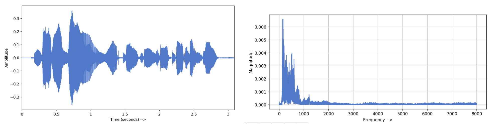

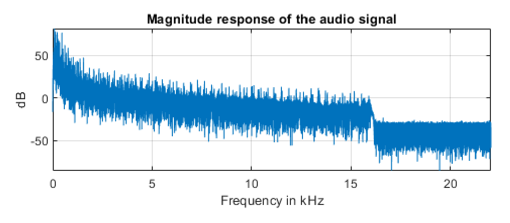

## SPECTROGRAMS

The **short-time Fourier transform (STFT)** tracks how frequency content changes. Multiply by a window $w$ centered at a frame position, transform that frame and shift by a hop of $R$ samples. For frame $d$ and sampling period $T$:

$$
X_d(f)=\sum_n x[n]w[n-dR]e^{-j2\pi fnT}.
$$

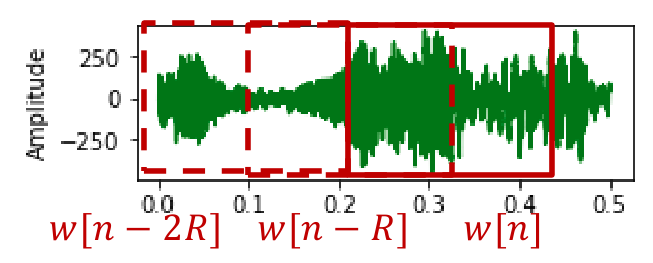

The spectrogram displays time frames along columns, frequencies along rows and, in the slides, $|X_d(f)|$ as pixel intensity. If the shifted windows sum to one for every sample, the full complex transforms satisfy $\sum_d X_d(f)=X(f)$. Longer windows resolve nearby frequencies more finely. Shorter windows localize changes in time more precisely.

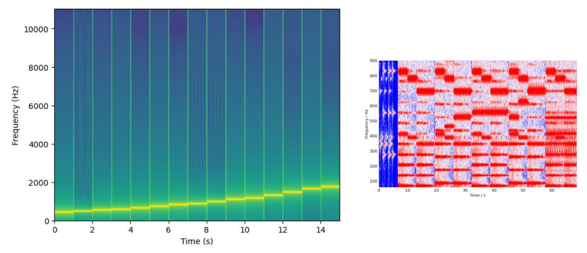

## SPECTROGRAMS-EXAMPLES

Six recordings from five male speakers show the same Finnish word, *puhujantunnistus*. Which two recordings share a speaker? **B and E**, according to the original exercise. The pair has similar contours and energy patterns despite slightly different durations. These visual similarities are clues for comparison. [Kinnunen, Fig. 1.2 and answer on p. 144](https://www.cs.joensuu.fi/pages/pums/public_results/2004_PhLic_Kinnunen_Tomi.pdf)

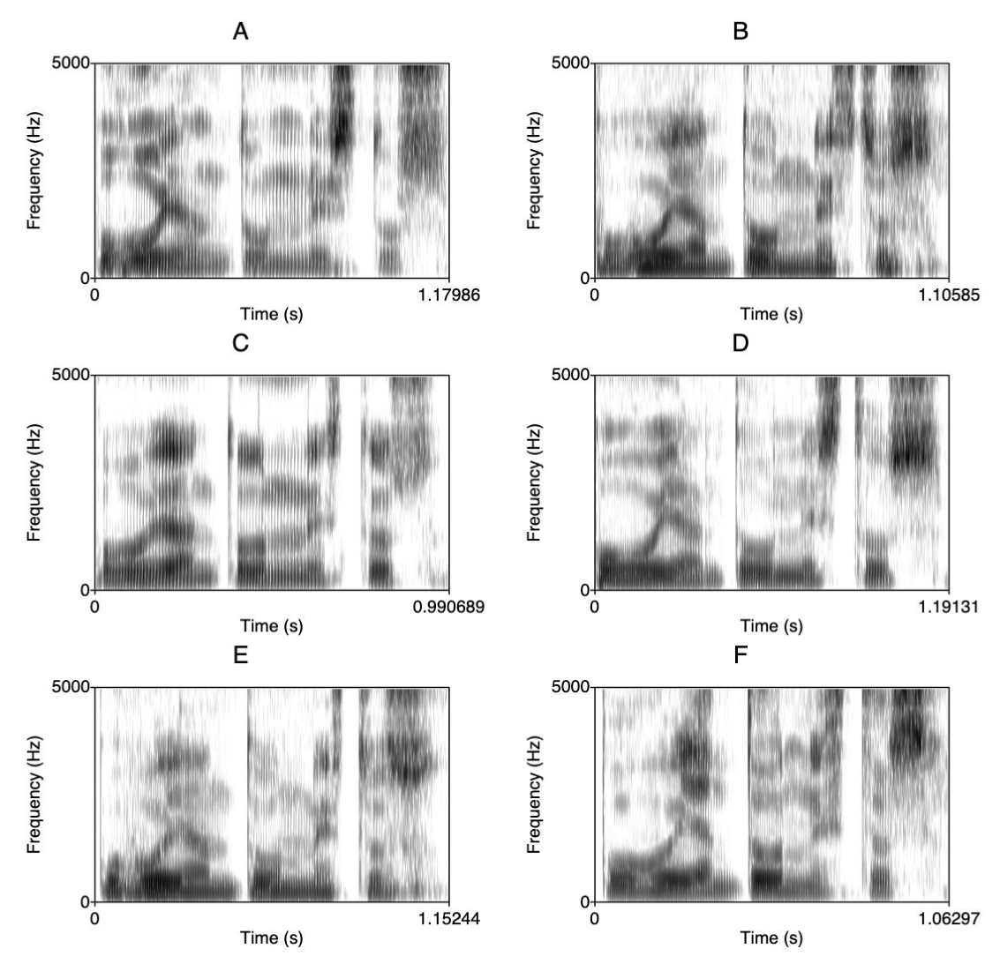

## DFT FOR IMAGES

For continuous coordinates, let $f_x,f_y$ be the spatial frequencies and $\phi=2\pi(f_xx+f_yy)$. The transform and inverse are:

$$
I_a(f_x,f_y)=\iint_{\mathbb R^2}i_a(x,y)e^{-j\phi}\,dx\,dy,\qquad
i_a(x,y)=\iint_{\mathbb R^2}I_a(f_x,f_y)e^{j\phi}\,df_x\,df_y.
$$

For an image $i[x,y]$ of size $N\times M$, the forward and inverse discrete transforms are:

$$
\begin{aligned}
I[u,v]&=\sum_{x=0}^{N-1}\sum_{y=0}^{M-1}
i[x,y]e^{-j2\pi(ux/N+vy/M)},\\
i[x,y]&=\frac{1}{NM}\sum_{u=0}^{N-1}\sum_{v=0}^{M-1}
I[u,v]e^{j2\pi(ux/N+vy/M)}.
\end{aligned}
$$

The frequency indices are $u,v$. The exponent divides each coordinate by its own axis length, correcting the shared denominator on slide 12. [2D DFT convention](https://visionbook.mit.edu/image_processing_fourier.html)

## 2D DFT: EXAMPLES

A rectangular patch gives a product of sinc-like profiles along the two frequency axes. A photograph often has strong low-frequency magnitude. Phase carries alignment and helps preserve the positions of edges.

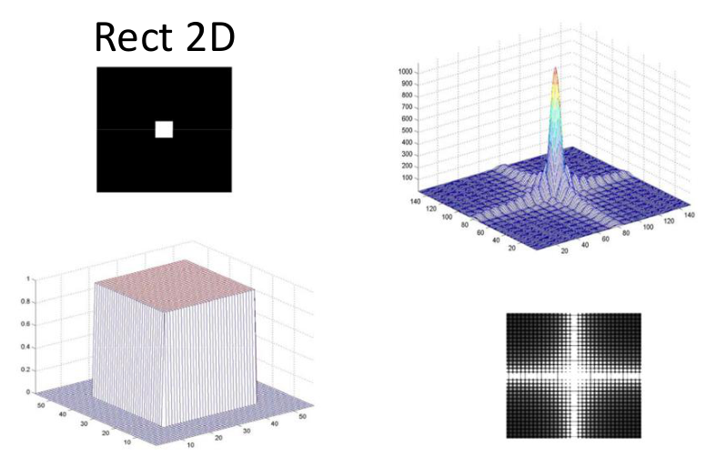

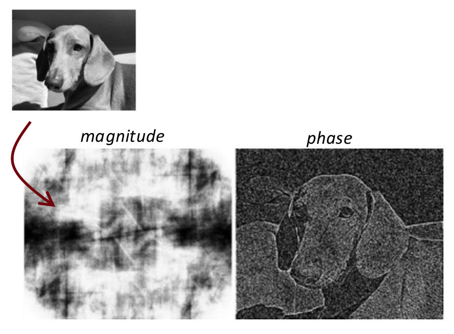

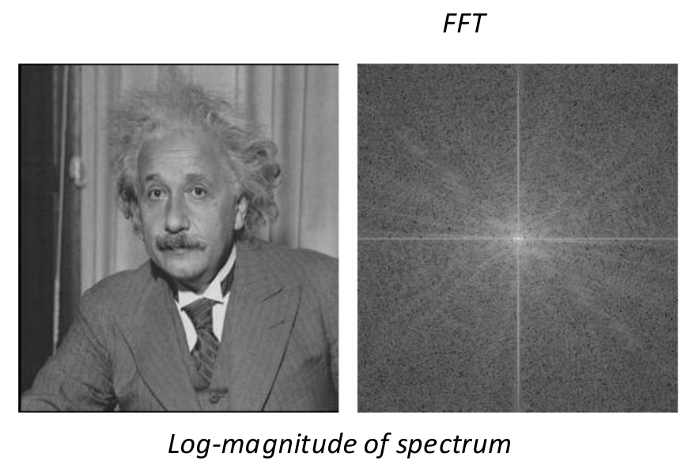

A local fingerprint patch resembles $w(x,y)=A\cos[2\pi f_0(x\cos\theta+y\sin\theta)]$. The peaks sit at $\pm f_0(\cos\theta,\sin\theta)$. Their distance from the origin gives the ridge frequency, or reciprocal spacing. Their direction is perpendicular to the ridges. $A$ controls the amplitude.

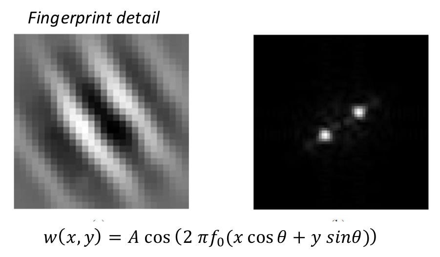

## FILTERING

### FILTERING IN FREQUENCY DOMAIN

Transform $x$ and $h$, multiply corresponding coefficients $Y=HX$, then invert $Y$. The DFT product implements circular convolution. Zero-padding to at least the full linear-convolution length gives the linear result. The response magnitude is often shown as $20\log_{10}|H|$ dB, with phase in radians.

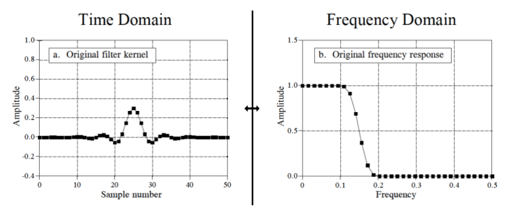

- **Low-pass / high-pass** retain low / high frequencies.
- **Band-pass / band-reject** retain / suppress a selected band. A narrow band-reject filter can reduce a tonal interference in a recording. Frequencies removed from the noise are also removed from the desired signal.

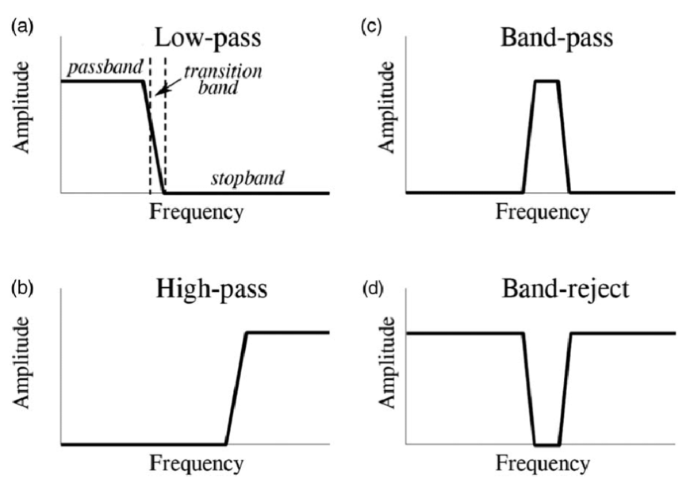

### EXAMPLES OF FILTERING

The slide adds additive white Gaussian noise (AWGN) to a sinusoid. An averaging filter retains much of the low-frequency tone and reduces broadband noise. The formula gives a period of 100 samples, while the plots show about 10 cycles over 10,000 samples. A $3\times3$ average with weights $1/9$ smooths pixel fluctuations and blurs edges.

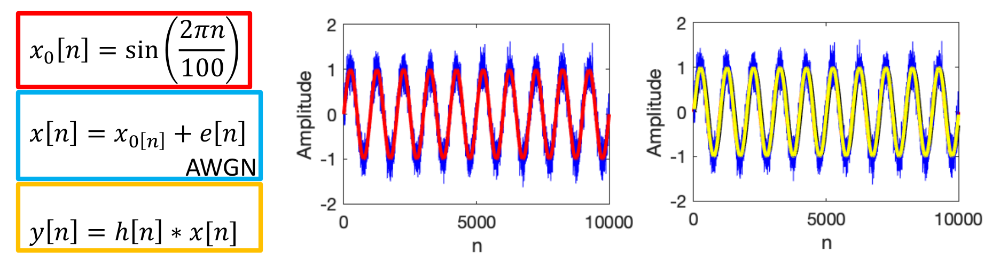

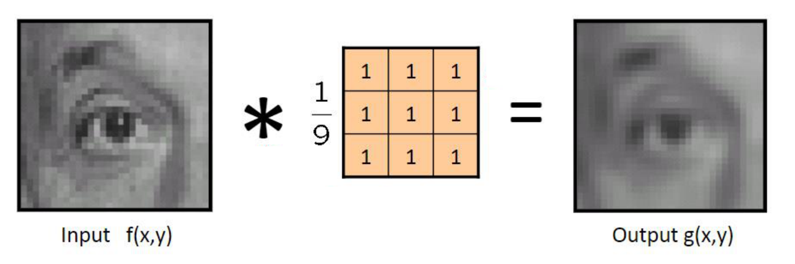

### FILTERING FOR BIOMETRICS

Fingerprint ridges can have bright pores, breaks from cuts or creases, or joins from moisture or pressure. A bank of oriented **Gabor filters** enhances the local ridge pattern at the expected orientation and spacing. Thresholding then separates the enhanced ridges and valleys. Audio filtering uses the same principle of selecting useful frequency content.

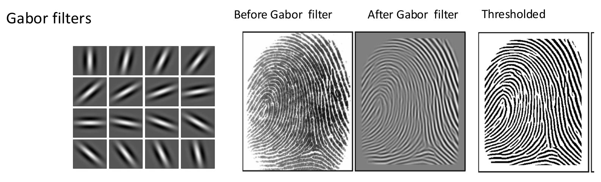

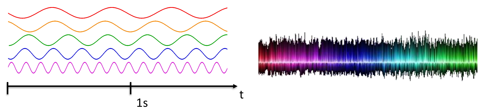

### SUBBAND DIVISION

A filter bank splits a signal into frequency bands. Each band can be analyzed or encoded separately and the bands can be combined to reconstruct the signal. In images, subbands represent structure at different scales. In audio, they separate frequency ranges that may contain different sources or noise.

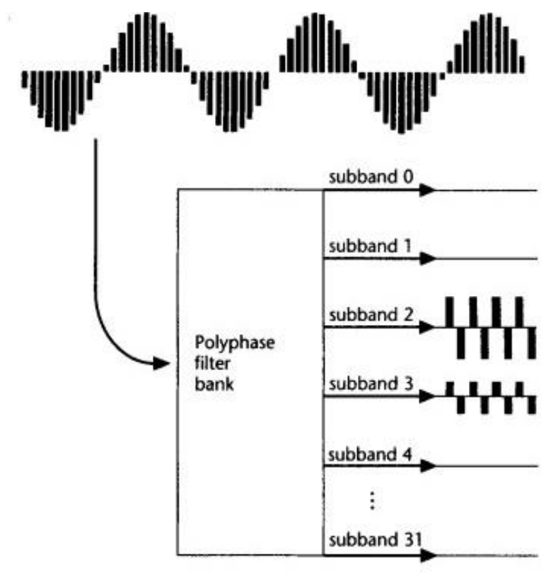

### EXAMPLE

Narrower bands track variations in $|S(f)|$ more closely. The voice demonstration compares reconstructions with 128, 512, 1,024 and 8,192 bands. Separate 64-band examples add impulsive noise or music. The band count needed depends on the signal and which details must survive.

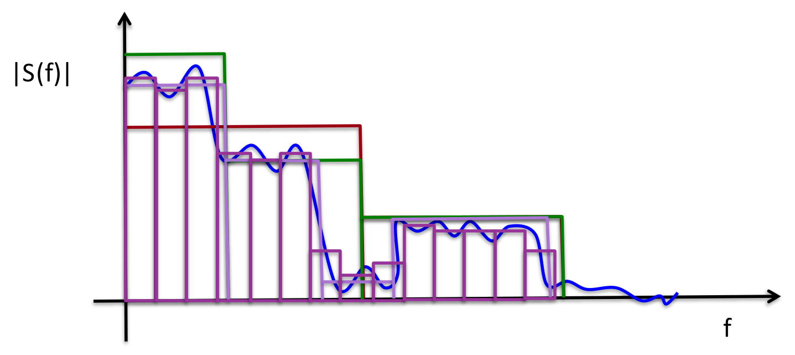

## DIGITAL CAMERAS

### DIGITAL CAMERA MODEL

Light reflected by the scene is focused onto a sensor array. A color filter array lets each photosite sample a color band. The sensor turns light into charge, readout electronics produce a voltage and an analog-to-digital converter (ADC) quantizes it. In-camera processing reconstructs color and may correct the image before storage. These stages leave pixel traces that can complement editable EXIF metadata.

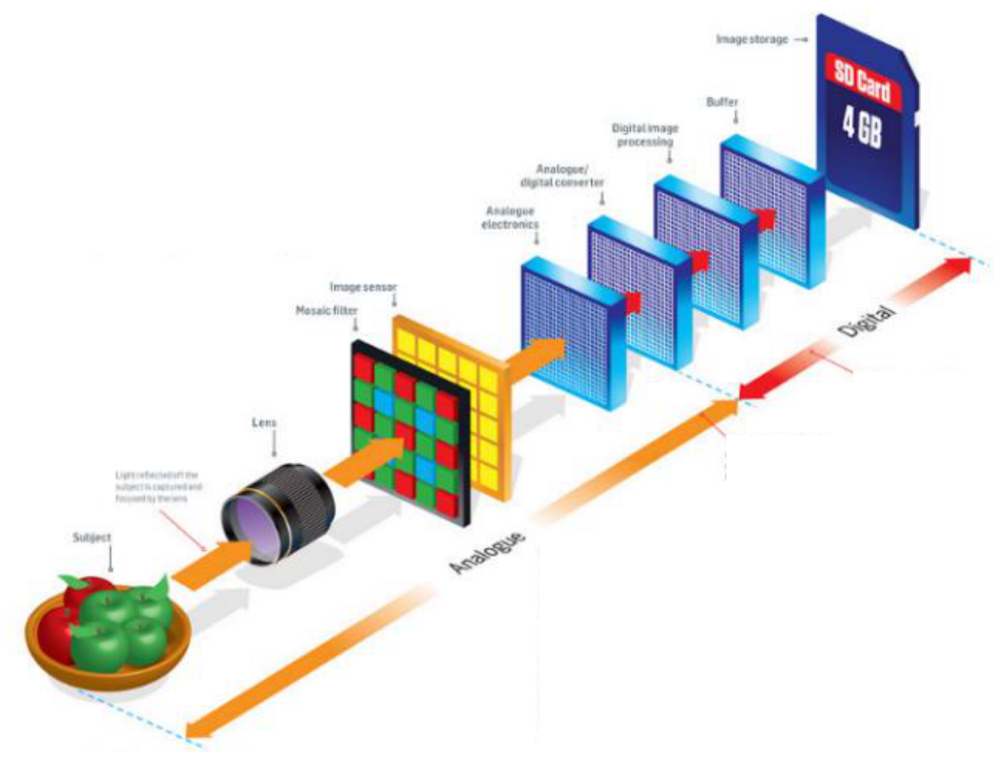

### LENS ABERRATION

The equation labeled “Fresnel’s equation” on slide 22 is **Snell’s law**, $n\sin\theta=n_f\sin\theta_f$. Angles are measured from the normal. The refractive index varies with wavelength, so red and blue rays can reach different points on the sensor. With $\cos\theta_R\approx\cos\theta_B$ and $\tan\theta_c=x_c/f$ in the slide’s geometry, $n_Bx_B\approx n_Rx_R$. Thus $x_R\approx\alpha x_B$ with $\alpha=n_B/n_R$. [Law of refraction](https://openstax.org/books/university-physics-volume-3/pages/1-3-refraction)

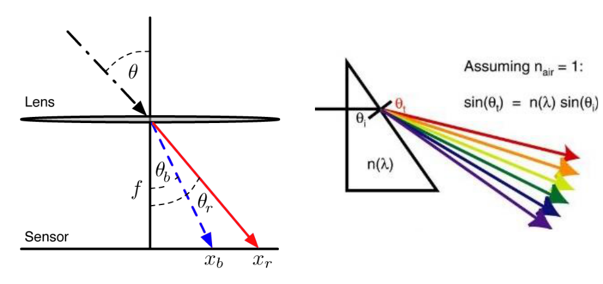

### CHROMATIC ABERRATION

Lateral chromatic aberration produces color fringes at high-contrast edges, especially toward the image periphery. An achromatic doublet reduces wavelength-dependent focus differences.

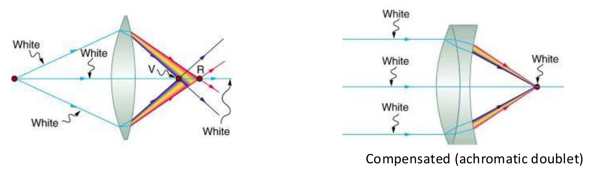

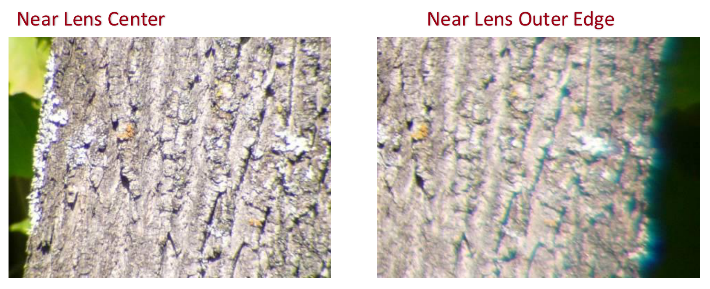

For color-channel positions $\mathbf p_R,\mathbf p_B$ and distortion center $\mathbf c=(x_0,y_0)$, the slide gives:

$$
\mathbf p_R=\alpha(\mathbf p_B-\mathbf c)+\mathbf c.
$$

In practice, use green as the reference and fit the red and blue alignments. A local displacement pattern that disagrees with the surrounding image can warrant closer examination.

### RADIAL DISTORTION

Radial distortion shifts image points toward or away from the distortion center, bending straight lines into barrel or pincushion shapes. The effect is conspicuous in fisheye images. Firmware can resample to correct it. Omnidirectional systems can also require tangential correction.

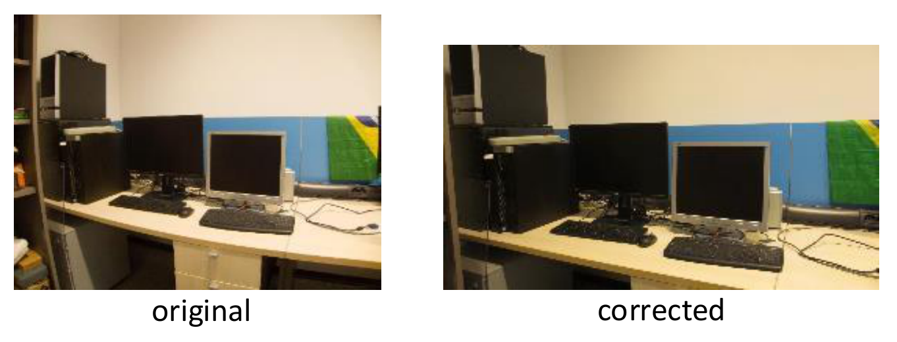

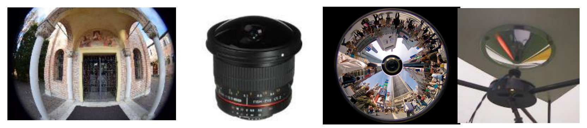

### LENS FORENSICS

The radial correction model maps distorted radius $r_d$ to corrected radius $r_u$, both measured from the distortion center:

$$
r_u=r_d+k_1r_d^3+k_2r_d^5.
$$

Calibration estimates $k_1,k_2$. Distortion and color-alignment parameters can help distinguish candidate lenses or camera models. Firmware corrections can weaken the traces. [Choi, Lam and Wong, source identification from lens aberration](https://www.eee.hku.hk/optima/pub/conference/0601_EIf.pdf)

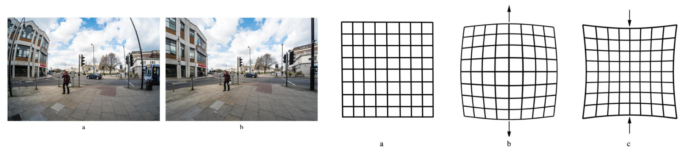

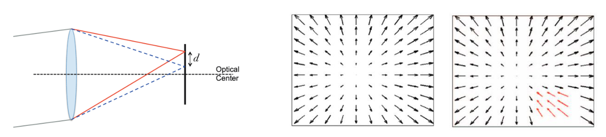

## PRINTER AND SCANNER FORENSICS

### A QUICK OVERVIEW

- **Inkjet.** A moving head places liquid droplets through fine nozzles while the paper advances.
- **Laser printer.** A laser writes an electrostatic image onto an optical photoconductor (OPC) drum. Toner attaches to the pattern, transfers to paper and is fused with heat and pressure. The slide’s laser-scanning diagram shows this internal optical path to the drum.
- **Document scanner.** A moving optical system illuminates the page. A sensor samples reflected light and the scanner assembles the measurements into a digital image.

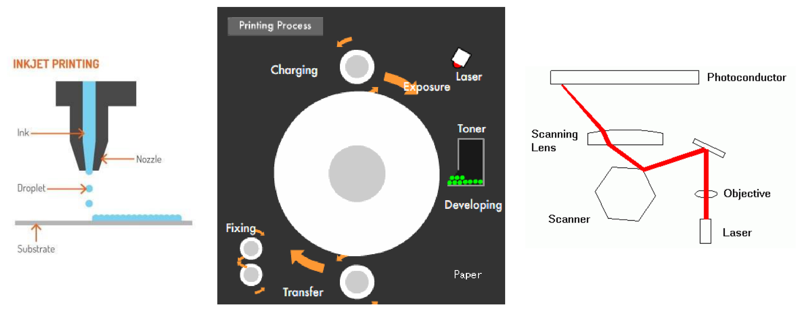

### PRINTER AND SCANNER FORENSICS

| Device | Intrinsic traces |
|---|---|
| Scanner | Sensor noise, motor or timing bands, color deviations, scratches or smudges on glass, lens or mirrors. |
| Laser printer | Banding from gears or drum speed variations, polygon-mirror wobble and toner texture. |
| Inkjet printer | Droplet shape and placement, nozzle condition, ink chemistry, missing jets and periodic paper-feed errors. |

Deliberately embedded marks, such as yellow tracking dots on some printers, are **extrinsic** signatures. The wine-label example uses print characteristics to compare a questioned label with a reference. A mismatch supports a different printing source under comparable conditions.

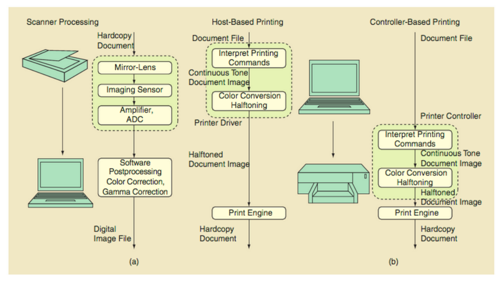

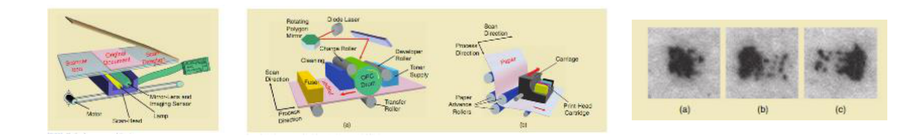

## SENSOR NOISE

### DIGITALIZATION

A photosite collects photo-generated charge during exposure. Readout converts that charge to a voltage. Within the linear, unsaturated range, the response scales with the collected light. The array samples this response at individual photosites.

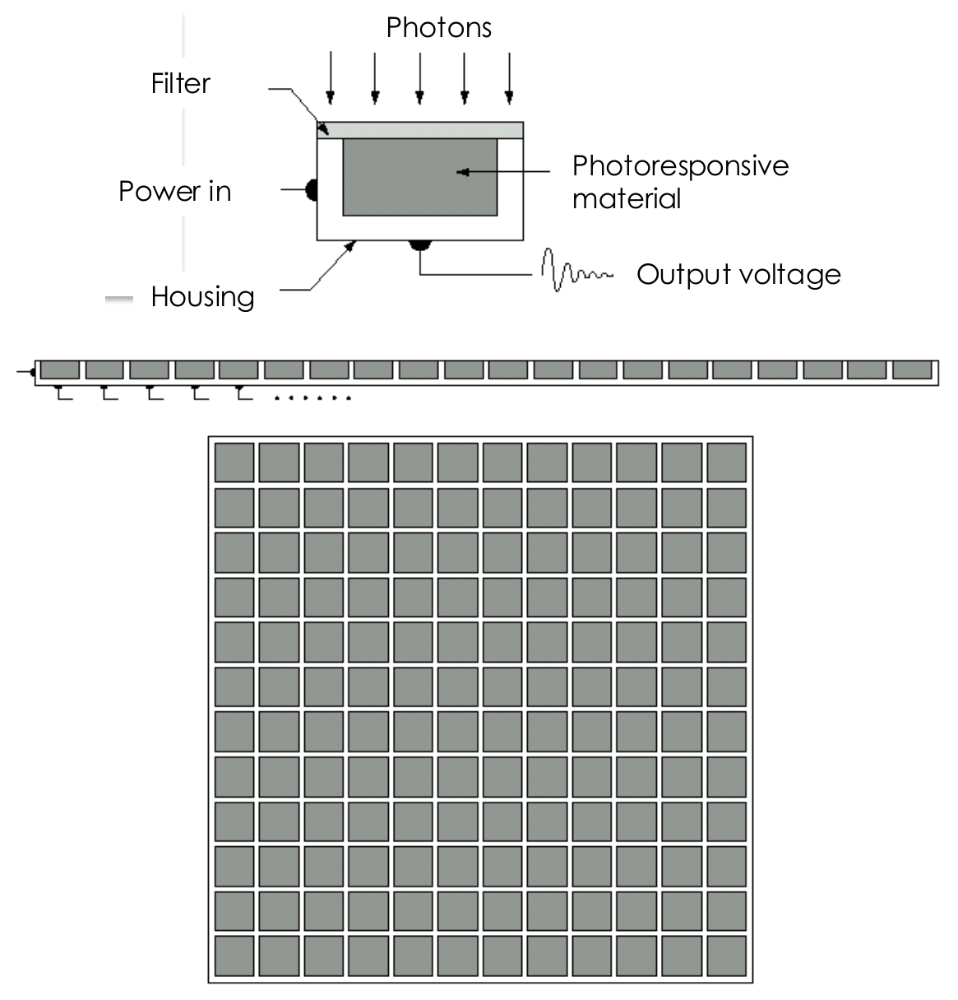

### CMOS ACTIVE-PIXEL SENSORS (APS)

The illustrated three-transistor pixel contains a photodiode, a reset transistor, a source follower and a row-select transistor. Each row connects its selected pixels to the column readout lines.

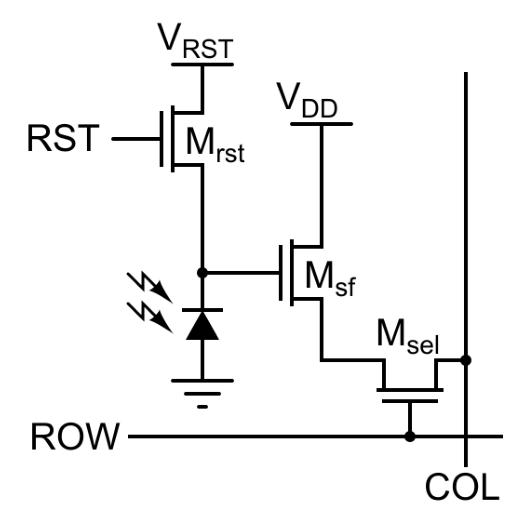

### CMOS APS

The animation demonstrates sequential row selection and voltage readout. The selection circuitry determines which pixel signals appear on the column lines.

### CCD

A **charge-coupled device** accumulates charge at the photosites during exposure. Clocked gates transfer charge packets through shift registers to an amplifier, which converts them into voltage for sampling. Exposure and charge transfer are distinct from the subsequent sequential readout.

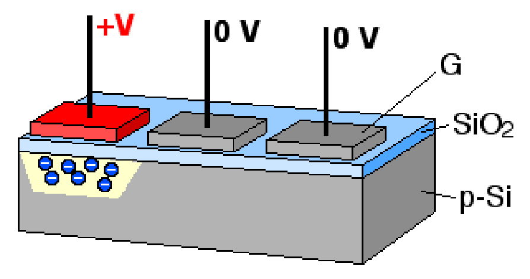

### PHOTOSENSORS IN A CAMERA

Under uniform illumination, ideal photosites give equal outputs. Real pixels vary slightly in size and sensitivity because of manufacturing. **Fixed-pattern noise** describes repeatable spatial differences, including dark-signal nonuniformity and **photo-response nonuniformity** (PRNU). Photon shot noise and readout noise add variation from one capture to another.

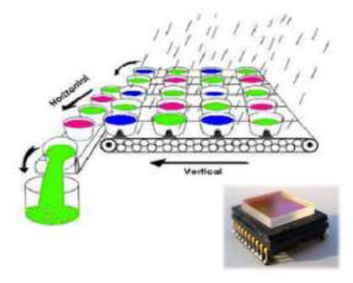

### CAMERA BALLISTIC

Acquisition traces can support links between an image and a candidate camera or help distinguish acquisition devices. Generative models may also leave systematic residual patterns related to their architecture or training. Camera PRNU comes from the physical sensor, while deliberate watermarks carry information added during generation or processing.

### PHOTO RESPONSE NON UNIFORMITY (PRNU)

The lecture models photosites as buckets exposed to uniform rain. Differences in the buckets produce unequal water levels. Pixel sensitivity similarly modulates the response even when the incident light is uniform.

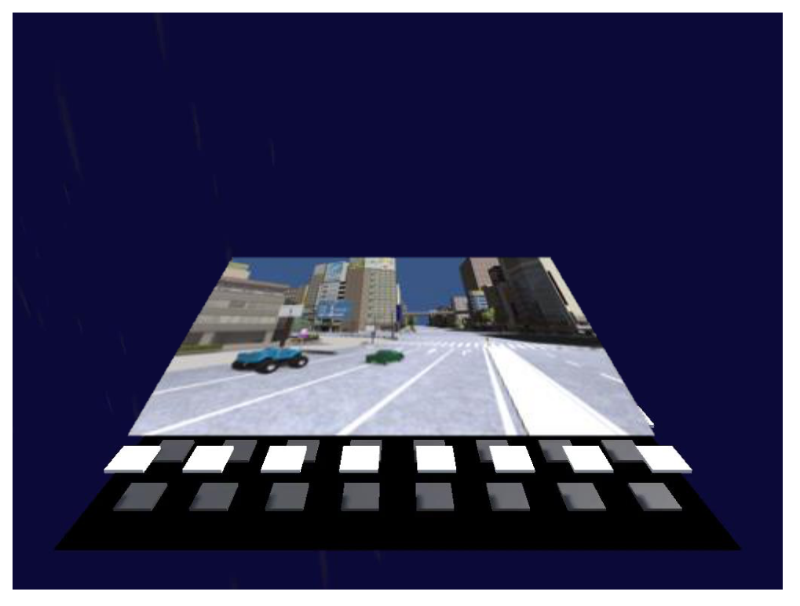

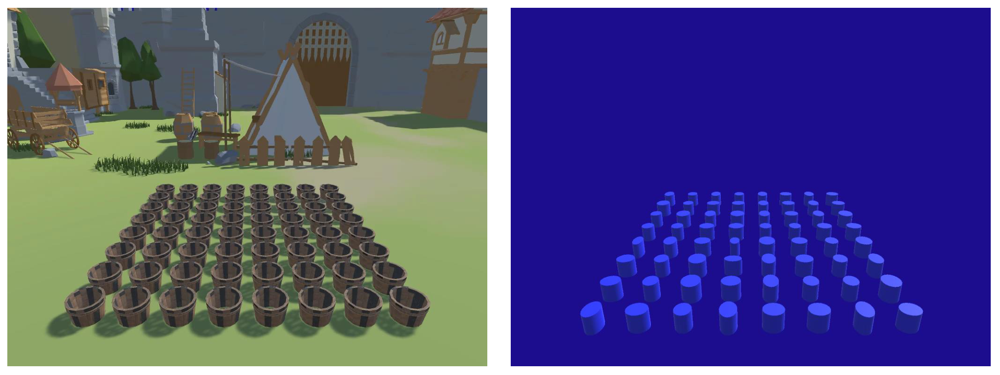

### PRNU (PHOTO-RESPONSE NON-UNIFORMITY)

At one photosite, let $I$ be the measured value, $I_0$ the ideal value, $K$ the repeatable sensor-specific gain variation and $\Theta$ other noise:

$$
I=I_0(1+K)+\Theta.
$$

The term $I_0K$ is multiplicative. Its absolute contribution grows with signal level before saturation. The underlying pattern $K$ is treated as stable across captures. The extended model $I=g^\gamma[I_0(1+K)+\Theta]^\gamma+Q$ adds gain $g$, gamma correction $\gamma$ and compression or quantization error $Q$.

#### PRNU estimation

Denoise each observed reference image $I_i$ with $F$. Subtract the denoised image to estimate a noise residual:

$$
W_i=I_i-F(I_i)\approx I_iK+\Sigma_i.
$$

$F(I_i)$ approximates the clean image. Replacing the ideal intensity by $I_i$ in the small multiplicative term lets the remaining error be absorbed in $\Sigma_i$, which the lecture models as additive noise. Across $N$ images, least squares fits the common pattern pixel by pixel:

$$
\widehat K=\frac{\sum_{i=1}^N W_i I_i}{\sum_{i=1}^N I_i^2}.
$$

Apply the denoiser to the measured image $I_i$. The displayed $F(I^{(0)})$ on slide 43 conflicts with the procedure given in the lecture and extended notes.

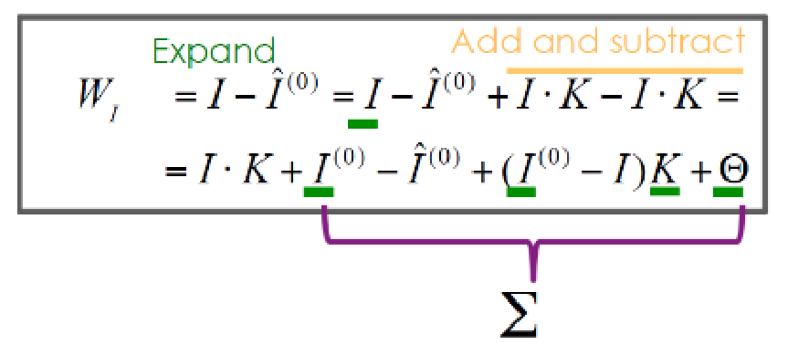

### PRNU DETECTION

The lecture suggests about 20 bright, unsaturated **flat-field** reference images. Uniform content reduces the scene structure in the residual. For questioned image $J$, compute $W_J=J-F(J)$ and compare it with the predicted residual $J\widehat K$ after aligning the pixel grids.

- **Normalized cross-correlation (NCC).** For aligned arrays $X,Y$, center both arrays and divide the dot product by the product of their centered norms:

  $$
  \rho=\frac{\langle X-\bar X,Y-\bar Y\rangle}
  {\lVert X-\bar X\rVert\,\lVert Y-\bar Y\rVert}.
  $$

- **Peak-to-correlation energy (PCE).** Let $\rho(s)$ be NCC at shift $s$, $s_p$ the peak shift and $\mathcal S$ the shifts used for the background estimate. The unsigned score compares the squared peak with the mean squared correlation:

  $$
  \mathrm{PCE}=\frac{\rho(s_p)^2}
  {\frac{1}{|\mathcal S|}\sum_{s\in\mathcal S}\rho(s)^2}.
  $$

  Slide 44 uses the whole correlation grid for $\mathcal S$. A common published form excludes a small neighborhood around the peak. [Goljan, Fridrich and Filler, PCE definition](https://ws.binghamton.edu/fridrich/Research/EI7254-18.pdf)

### PRNU IN PRACTICE

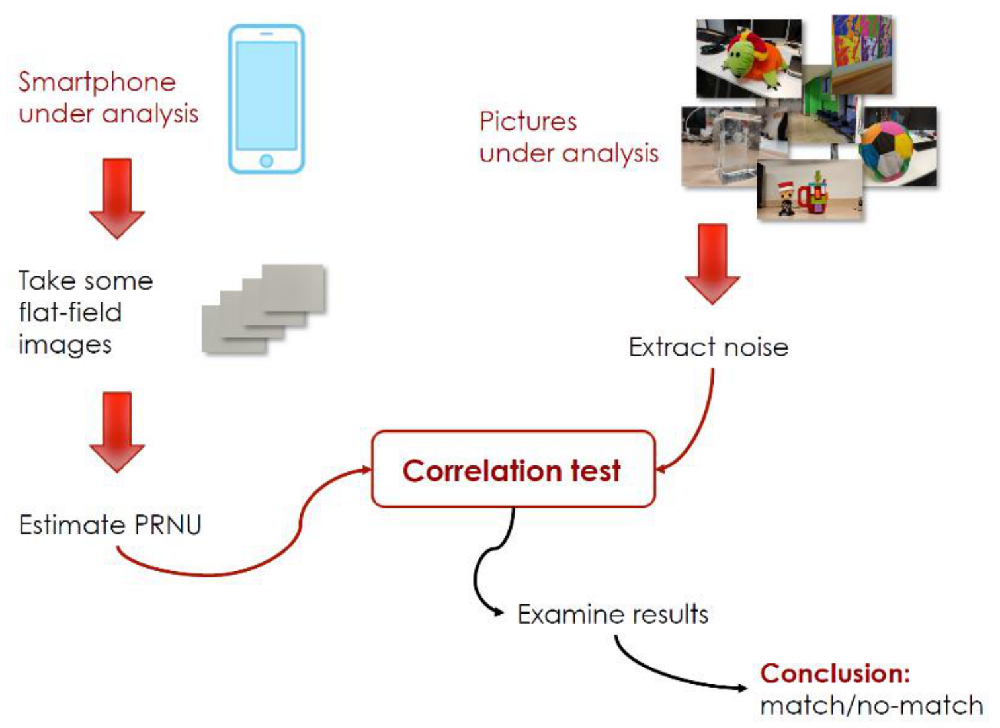

A strong match supports a common sensor origin. Strong compression, scaling, cropping and scene texture can weaken the measurement. A weak score can therefore reflect poor conditions for comparison. The lecturer deferred the practical demonstration.
