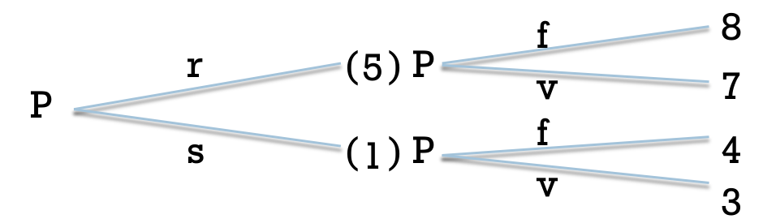

# 1. Introduction, preferences and decision problems

## Prerequisites you need

No previous Game Theory knowledge is required. A **set** collects possible objects: $A=\{r,s\}$ means that the available choices are ravioli and soup. The notation $a\in A$ means that $a$ belongs to $A$. A **function** assigns a value to each input; for example, $u(r)=5$ assigns utility 5 to ravioli. The symbol $\forall$ means “for every”, and $\iff$ means “if and only if”.

A **player** is a decision maker, such as a person, firm, or network device. An **action** is an available choice. An **outcome** is the resulting situation. A **payoff**, or utility, is a number describing how much a player values an outcome; larger numbers mean more preferred outcomes. A negative payoff can therefore be better than another negative payoff: $-1>-5$.

This lesson builds the foundations for games. It does not yet introduce methods for finding Nash equilibria.

## 1. Why several decision makers change the problem

*Sources: Gth2001.pdf, pp. 3–13.*

In an ordinary optimization problem, one decision maker chooses an action to obtain the best result. Uncertainty may come from noise, incomplete data, or random events. In a game, the result also depends on choices made by other decision makers who pursue their own objectives.

> [!info] Definition — Game
> A game is a mathematical model of interaction between multiple players, each with an objective, whose outcomes depend on their joint choices.

The central question becomes: **what should I choose when my result depends on what others choose?** The lecture normally assumes that rules are known in advance and players behave rationally. Knowing the rules does not mean knowing another player's actual move.

For player $i$, write $a_i$ for their action and $u_i(a_1,\ldots,a_n)$ for their payoff when $n$ players choose actions $a_1,\ldots,a_n$. Each player evaluates the same joint outcome using their own payoff function. There need not be one objective that all players maximize together.

### Worked example: congestion in a communication channel

**Original example, illustrating the application on slide 12.** Two devices independently choose whether to transmit ($T$) or wait ($W$). They know the following rules, but do not observe the other's choice before deciding. A successful transmission gives utility 2, a collision gives utility $-1$, and waiting gives utility 0.

Each table entry is ordered $(u_1,u_2)$: the row device's payoff comes first, the column device's second.

| Device 1 / Device 2 | $T$ | $W$ |
|---|---|---|
| $T$ | $(-1,-1)$ | $(2,0)$ |
| $W$ | $(0,2)$ | $(0,0)$ |

If device 2 waits, device 1 prefers transmitting because $2>0$. If device 2 transmits, device 1 prefers waiting because $0>-1$. Thus there is no single best action independent of the other device's choice. This is the strategic complication absent from a one-person maximization problem.

The lecture applies this modeling approach to markets, auctions and bargaining, distributed systems, resource access, cooperation in networks, spreading processes, heterogeneous Internet of Things devices, security, reputation, collusion, voting, and online platforms. The model should retain the relevant incentives while remaining simple enough to analyze. Predictions depend on whether the chosen utilities and information assumptions describe the actual agents well.

## 2. Economic background and future rewards

*Sources: Gth2001.pdf, pp. 15–19.*

### Monopoly, oligopoly, and competition

A **monopoly** has one supplier; an **oligopoly** has a small number of strategically interacting suppliers. A trust or collusive agreement can make several firms behave like a single supplier. A profit-seeking supplier maximizes its own profit, which need not maximize consumer welfare.

The slides motivate competition by contrasting competitive prices with monopoly prices. Treat this as an economic benchmark, not an unconditional theorem about every market: conclusions depend on demand, costs, and market rules. Their references to utilities, software, telecommunications, and public monopolies are illustrative lecture context.

**Original example.** Suppose demand is $q=10-p$ for prices $0\leq p\leq10$, where $p$ is price and $q$ is quantity sold. With zero production cost, monopoly profit is

$$
\pi(p)=p(10-p)=25-(p-5)^2.
$$

The square is smallest at $p=5$, so profit is maximized at $p=5$, with $q=5$ and profit 25. Under the additional idealized assumption of price competition between identical suppliers with zero marginal cost, the competitive benchmark price is 0. This illustrates why individual profit and consumer interests can differ; the numerical demand and cost assumptions are added for this example.

### Substitute goods

> [!info] Definition — Substitute goods
> Goods $x$ and $y$ are substitutes when an increase in the price of $x$ raises demand for $y$, with other relevant conditions held fixed.

Examples in the slides are butter and margarine, or coffee and tea. This is a **cross-price** effect. It differs from the usual **own-price** effect: demand for a good normally falls when its own price rises. The slides mention Giffen and Veblen goods as exceptions to that usual demand pattern.

**Original example.** If tea demand is $D_y=20-2p_y+p_x$, increasing coffee price $p_x$ from 3 to 4 raises tea demand by 1 when tea price $p_y$ stays fixed. The positive coefficient of $p_x$ captures substitution.

### Discount factor

How can a reward received later be compared with one received now? The lecture introduces a per-period factor that reduces the present value of future rewards.

> [!info] Definition — Discount factor
> For $0<\delta<1$, a reward $x$ received $t$ periods from now has present value $\delta^t x$. Here $t=0$ means today and $\delta$ is the value retained over one period.

**Original example.** With $\delta=0.9$, receiving 10 after two periods is worth $0.9^2\cdot10=8.1$ today. A player using this model prefers that delayed payment to 8 today, because $8.1>8$, but prefers 9 today to the delayed payment.

Discounting may model impatience, deterioration, inflation, or uncertainty. Another interpretation is that a player may stop participating: if the probability of continuing each period is a constant $\delta$, the probability of remaining for $t$ periods is $\delta^t$. This interpretation requires that continuation model; it is especially useful for devices or users that participate in a network only temporarily.

## 3. Decision problems and rational preferences

*Sources: Gth2001.pdf, pp. 21–22.*

A decision problem specifies **actions**, their **outcomes**, and **preferences** over those outcomes. When each action determines a known outcome, we can rank actions directly. If outcomes depend on another player, an action alone no longer determines the result.

### Expressing a ranking

> [!info] Definition — Weak preference
> Write $a\succeq b$ when alternative $a$ is at least as good as alternative $b$. Strict preference, $a\succ b$, means $a\succeq b$ but not $b\succeq a$. Indifference, $a\sim b$, means both $a\succeq b$ and $b\succeq a$.

“Weak” allows equality in the ranking. It does not mean that the preference is uncertain or unimportant.

> [!info] Definition — Rational preference
> A preference relation is rational when it is **complete** and **transitive**.
>
> Completeness means that, for every $a,b\in A$, $a\succeq b$ or $b\succeq a$, or both. Every pair can be compared.
>
> Transitivity means that $a\succeq b$ and $b\succeq c$ imply $a\succeq c$. Comparisons are consistent across alternatives.

Completeness also implies reflexivity: choosing $a=b$ gives $a\succeq a$.

> [!warning] Mathematical correction to slide 22
> The slide calls weak preference “antisymmetric” and a rational preference a “total order”. In the usual definition allowing indifference between distinct alternatives, it is a **total preorder**: complete and transitive, but not necessarily antisymmetric. Antisymmetry would require $a\succeq b$ and $b\succeq a$ to imply $a=b$, excluding distinct equally preferred alternatives. The corrected convention is consistent with the utility representation on slide 26.

### Worked example: ties and inconsistent comparisons

**Original example.** Let $A=\{r,s,v\}$, representing ravioli, soup, and vegetables. Suppose $r\sim v\succ s$. Every pair can be compared, and no comparisons conflict, so this is rational. Ravioli and vegetables remain different meals despite being equally preferred.

By contrast, $r\succ s$, $s\succ v$, and $v\succ r$ form a strict cycle. Transitivity would require $r\succ v$, contradicting $v\succ r$. A numerical utility cannot represent this cycle, because it would require $u(r)>u(s)>u(v)>u(r)$.

If a person cannot compare ravioli and soup at all, completeness fails. This differs from indifference: indifference is a definite judgment that neither is preferred to the other.

## 4. Utility represents preferences

*Sources: Gth2001.pdf, pp. 23–26.*

Instead of storing all pairwise comparisons, assign numbers that preserve the ranking.

> [!info] Definition — Utility representation
> A function $u:A\to\mathbb{R}$ represents preference $\succeq$ if, for every $a,b\in A$,
>
> $$
> a\succeq b\iff u(a)\geq u(b).
> $$

Thus equal utility means indifference, and strictly larger utility means strict preference. For the preceding example, $u(r)=u(v)=2$ and $u(s)=1$ represent the ranking.

Utilities here are **ordinal**: their ordering matters. The slide's canteen assignment $u(r)=5$, $u(s)=1$ means ravioli is preferred; it does not mean ravioli brings five times as much happiness. Applying the same strictly increasing function to every utility preserves this ranking. For instance, replacing 5 and 1 with 25 and 1 by squaring works for these positive numbers. Squaring is not a general valid transformation on all real utilities, since it reverses the ranking of some negative numbers.

This claim concerns rankings of deterministic alternatives. It should not later be used to justify arbitrary transformations inside expected-utility calculations involving random outcomes.

### Finite-set representation theorem

> [!info] Theorem — Utility representation on a finite set
> For a finite set $A$, a preference relation has a real-valued utility representation if and only if it is complete and transitive, using the weak-preference convention above.

**Why representation implies rationality.** Real numbers can always be compared, so representation gives completeness. If $u(a)\geq u(b)$ and $u(b)\geq u(c)$, then $u(a)\geq u(c)$, giving transitivity.

**Why rationality gives a representation.** Count the alternatives that each alternative weakly outranks:

$$
u(a)=\left|\{b\in A:a\succeq b\}\right|.
$$

The vertical bars denote the number of elements in the set. If $a\sim b$, transitivity makes their sets of weakly worse alternatives identical, so their counts agree. If $a\succ b$, every alternative weakly below $b$ is also weakly below $a$. Moreover, $a$ itself is in $a$'s set but not in $b$'s set. The finite counts therefore satisfy $u(a)>u(b)$. Completeness ensures these cases cover every comparison, proving the required equivalence.

**Worked example, using the original ranking $r\sim v\succ s$.** Soup weakly outranks only itself, while ravioli and vegetables each weakly outrank all three meals. The construction gives $u(s)=1$ and $u(r)=u(v)=3$. These numbers represent the same ranking as the earlier assignment $(2,1,2)$ in the order $(r,s,v)$. Use the theorem to construct a representation or show that an inconsistent finite ranking cannot have one. Do not remove its finite-set assumption without further argument.

### Increasing utility, diminishing gains, and rationality

For a quantity $q$ of a desirable good, the slides describe the common assumptions $u'(q)\geq0$ and $u''(q)\leq0$. The first says that more does not reduce utility; the second says that marginal utility does not increase. These are modeling assumptions, not consequences of rational preference.

**Original example.** For $q\geq0$, take $u(q)=\log(1+q)$. Its derivatives are $u'(q)=1/(1+q)>0$ and $u''(q)=-1/(1+q)^2<0$: more is preferred, but each additional unit adds less utility.

Rational behavior means choosing according to the specified preferences and correctly accounting for the modeled consequences. “Self-interest” means maximizing one's own utility; that utility can include concern for other people. Adding generosity to utility can explain generous choices. It cannot make a fixed cyclic ranking rational: the consistency requirements still apply. Rationality also does not give a player knowledge of another player's unobserved action.

## 5. Decision trees and one-person optimization

*Sources: Gth2001.pdf, pp. 27–31.*

A decision tree displays the available paths. Its root is the first decision node, branches are choices, later nodes are further decisions, and terminal nodes or leaves carry utilities. In this lesson, the same student $P$ controls every decision and all consequences are known.

### Worked lecture example: choosing lunch

First, the student chooses ravioli ($r$) or soup ($s$). With only those options, slide 28 assigns $u(r)=5$ and $u(s)=1$, so the maximizing choice is ravioli.

The expanded problem adds a choice between fish ($f$) and vegetables ($v$) after either starter:

*Source: Gth2001.pdf, PDF p. 29. The parenthesized 5 and 1 reproduce the earlier starter-only example; 8, 7, 4, and 3 are the terminal utilities used to solve the expanded problem.*

| Complete meal | Meaning | Terminal utility |
|---|---|---|
| $rf$ | Ravioli, then fish | 8 |
| $rv$ | Ravioli, then vegetables | 7 |
| $sf$ | Soup, then fish | 4 |
| $sv$ | Soup, then vegetables | 3 |

Solve from the later choices toward the root:

1. After ravioli, choose fish because $8>7$. This branch can deliver utility 8.
2. After soup, choose fish because $4>3$. This branch can deliver utility 4.
3. At the root, compare the best continuation values: $8>4$, so choose ravioli.

The optimal meal is $rf$, with utility 8. Checking all terminal alternatives confirms $8>7$, $8>4$, and $8>3$. The numbers in parentheses are not additional rewards to add to the leaves; the slide supplies terminal utilities directly.

The same problem can be flattened by treating each complete meal as one alternative:

*Source: Gth2001.pdf, PDF p. 31. Every complete path retains its original terminal utility.*

In mathematical notation,

$$
A=\{rf,rv,sf,sv\},\qquad
\max_{a\in A}u(a)=8,\qquad
\operatorname*{arg\,max}_{a\in A}u(a)=\{rf\}.
$$

The **maximum** is the best value; the **arg max** is the set of choices attaining it. If several alternatives tie for the largest utility, all belong to the arg max.

Flattening works here because one informed decision maker controls all choices in a finite deterministic tree. It does not assume that meal utilities are sums of independent component utilities. In a different example, the best starter in isolation need not belong to the best complete meal. Compare complete feasible outcomes or correctly calculated continuation values.

The lecture assumes that such single-agent optimization can be solved and focuses on the additional difficulty introduced by multiple players. A tree involving other players cannot be solved by choosing every branch to maximize one player's utility: the other players control their own decisions.

## 6. Practice

### Original practice: try before reading the answers

1. For $A=\{a,b,c\}$ with $a\succ b\sim c$, construct utility by counting weakly worse alternatives. Is antisymmetry satisfied?
2. With discount factor $\delta=0.8$, compare 7 today with 10 after two periods.
3. In the lunch tree, change only $u(sv)$ from 3 to 9. Determine the optimal continuation after each starter and the optimal complete meal.

### Answers

1. The count gives $u(a)=3$ and $u(b)=u(c)=2$. Antisymmetry fails because $b\succeq c$ and $c\succeq b$, while $b\neq c$. Completeness and transitivity still hold.
2. The delayed payment has present value $0.8^2\cdot10=6.4$. Choose 7 today because $7>6.4$.
3. After ravioli, choose fish for 8. After soup, choose vegetables for 9. Since $9>8$, the optimal meal is $sv$. This illustrates why continuation payoffs, rather than the old starter-only values, determine the root choice.

### Selected handbook tasks

The handbook's numbered exercises already involve strategic concepts taught after this introductory lesson. Use only the indicated introductory parts now; return to the remaining questions after learning the required methods. Page numbers below distinguish printed pages from PDF page indices.

| Verified reference | Task suitable now | What it trains |
|---|---|---|
| Chapter 1, Exercise 1.1, printed p. 8 / PDF p. 14 | Identify players, actions, and utilities; construct the payoff table for question 1. | Translating a story into a mathematical model and separating objectives. |
| Chapter 1, Exercise 1.2, printed p. 10 / PDF p. 16 | Calculate payoffs as revenue minus cost for question 1. | Evaluating utilities and keeping payoff order consistent. |

**Solution route for Exercise 1.1, introductory part.** Jorah ($J$) and Khaleesi ($K$) each choose Meeren ($M$) or Yunkai ($Y$), valued at 5 and 3. If they split, both cities are conquered and the total captured value is 8. If they choose the same city, only that city's value is counted; Jorah additionally receives a proximity bonus of 10. With payoff order $(u_J,u_K)$, the entries are $(15,5)$ for $(M,M)$, $(8,8)$ for either split, and $(13,3)$ for $(Y,Y)$. The handbook's final sentence reverses who has the crush compared with its earlier utility description; its displayed solution follows the bonus-to-Jorah interpretation used here. Finding equilibria is outside this lesson.

**Solution route for Exercise 1.2, introductory part.** Square's points are $A=(0,0)$, $B=(0,4)$, $C=(4,4)$, and $D=(4,0)$; Triangle's are $A$, $D$, and $E=(2,4)$. Each player's cost is their own $x+3y$. Revenue is 0 if both choose the same point and 10 otherwise. For example, choices $(A,D)$ yield $(10-0,10-4)=(10,6)$ in payoff order $(u_S,u_T)$; choices $(D,D)$ yield $(-4,-4)$. Calculate every other cell with the same rule. Questions 2–3 require later equilibrium methods.

## Exam quick reference

| Problem cue | Method and essential check |
|---|---|
| “Is this a game?” | Identify multiple players and explain how joint choices affect each player's payoff. |
| “Describe a decision problem” | List feasible actions, resulting outcomes, and preferences or utilities. |
| “Are preferences rational?” | Check every pair for completeness, then check transitivity; allow ties. |
| “Can utility represent this finite ranking?” | Use completeness and transitivity; a strict cycle rules representation out. |
| “Construct utility” | Set $u(a)=\left|\{b\in A:a\succeq b\}\right|$; tied alternatives must have equal utility. |
| “Find the best choice” | Compare utilities of every feasible alternative; report all maximizers and their value. |
| “Solve a one-person tree” | At each decision node retain the largest continuation utility, working back to the root. |
| “Compare future and present rewards” | Discount future amount $x$ by $\delta^t$, where $t$ counts periods and $0<\delta<1$. |
| “Are two goods substitutes?” | Raise one good's price while holding other conditions fixed; check whether demand for the other rises. |

**Keep these distinctions visible:** $a\succeq b$ means “at least as good”; $a\succ b$ means strictly better; $a\sim b$ means indifferent. Maximum means utility value, while arg max means maximizing choices. Ordinal utility represents rank, not interpersonal happiness or meaningful payoff ratios. Known rules do not reveal unobserved moves. In a payoff pair, explicitly state whose payoff comes first. At terminal leaves, use the stated total utility; do not add intermediate annotations unless the model says they are separate rewards.

## Sources and scope

- **Gth2001.pdf**, all 31 PDF pages: introduction and applications, pp. 3–13; economic background, pp. 15–19; decision problems, preferences and utility, pp. 21–26; canteen trees and optimization, pp. 27–31. Figure captions use 1-based PDF page indices. The preference terminology on p. 22 is explicitly corrected above.
- **2026-IN2898-005PD-2026-IN0000184-N0-IN2898 Lecture 1 STEM.transcript.txt**, read in full, 00:00:00–00:34:57. This recording concerns course organization, resources, assessment, and projects, then ends before the theoretical lecture. It supplies no spoken explanation of the concepts in Gth2001.pdf. Administrative schedules and grading details are omitted from these theory notes.
- **Game Theory. A Handbook of Problems and Excercises.pdf**, Chapter 1, introductory material and Exercises 1.1–1.2, especially printed pp. 8–10 / PDF pp. 14–16. Only the introductory modeling parts are assigned here. Examples labeled “Original” are added teaching examples, not claims about professor-assigned exercises.

The quick reference is designed for the user-provided format of a 75-minute written exam with printed material allowed and electronic devices forbidden. This note does not verify current assessment regulations.
