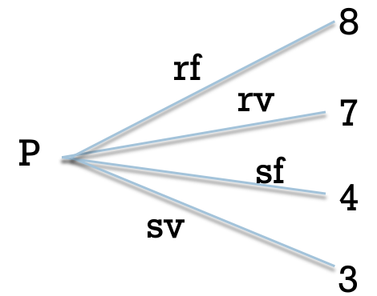

# 1. Introduction, preferences and decision problems

## Prerequisites you need

Game theory studies situations in which several decision makers affect one another's results. In the notation used here, a set such as $A=\{r,s\}$ collects possible alternatives, and $a\in A$ means that $a$ is one of them. A function assigns a value to each input: $u(r)=5$, for example, assigns utility 5 to alternative $r$. The symbols $\forall$ and $\iff$ mean “for every” and “if and only if.” A higher utility represents a more preferred outcome.

## 1. Games and strategic interaction

*Gth2001.pdf, PDF pp. 3–13.*

In a one-person decision problem, a decision maker selects an available action and evaluates the resulting outcome. In a game, each player's result depends on the actions chosen by several players. A person, firm, or network device can act as a player; its action is one of its available choices, and its payoff represents how it ranks the resulting outcome. Payoffs are player-specific: the same outcome can be valuable to one player and undesirable to another.

> [!info] Definition — Game
> A game models interaction between multiple players whose outcomes depend on their joint choices.

Players are commonly assumed to know the rules and to choose rationally according to their own preferences. Knowing the rules does not mean observing another player's choice before acting. If player $i$ chooses action $a_i$, their payoff can be written $u_i(a_1,\ldots,a_n)$, where $a_1,\ldots,a_n$ are the actions selected by all $n$ players. There need not be one objective that all players maximize together.

### Example — transmission choices

*Gth2001.pdf, PDF p. 12; illustrative payoff matrix below spells out the transmission example.*

Two devices independently choose whether to transmit ($T$) or wait ($W$). A successful transmission gives payoff 2, a collision gives payoff $-1$, and waiting gives payoff 0. Neither device observes the other's choice before deciding. Each cell lists payoffs in the order $(u_1,u_2)$, with device 1's payoff first.

| Device 1 / Device 2 | $T$ | $W$ |
|---|---|---|
| $T$ | $(-1,-1)$ | $(2,0)$ |
| $W$ | $(0,2)$ | $(0,0)$ |

Device 1's preferred action depends on device 2's choice. If device 2 waits, transmitting gives device 1 payoff 2 rather than 0. If device 2 transmits, waiting gives 0 rather than $-1$. So the best choice cannot be determined by looking at device 1 in isolation.

The same kind of interaction appears in markets, auctions, bargaining, distributed systems, access to shared resources, network cooperation, voting, and online platforms. A useful model retains incentives relevant to the question while keeping the analysis manageable.

## 2. Markets and rewards over time

*Gth2001.pdf, PDF pp. 15–19.*

A **monopoly** has one supplier; an **oligopoly** has a small number of suppliers whose decisions affect one another. Firms that coordinate through a trust or collusive agreement can act like a single supplier. A profit-maximizing firm pursues its own profit, which need not maximize consumer welfare. Competitive and monopoly prices provide useful benchmarks, but their comparison depends on demand, costs, and market rules.

### Substitute goods

Goods are **substitutes** when an increase in the price of one increases demand for the other, holding other relevant conditions fixed. Butter and margarine, and coffee and tea, are examples. This cross-price effect differs from the usual own-price effect, where demand for a good falls as its own price rises. Giffen and Veblen goods are exceptions to that usual pattern.

### Discount factor

A reward received later can be expressed in today's value using a discount factor. If $0<\delta<1$, a reward $x$ received $t$ periods from now has present value $\delta^t x$. Here $t=0$ means today, and each additional period applies the factor once more. Discounting can represent impatience, deterioration, inflation, uncertainty, or a constant probability of continuing to participate.

## 3. Decision problems and preferences

*Gth2001.pdf, PDF pp. 21–22.*

A decision problem identifies available actions, the outcomes they produce, and how those outcomes are ranked. Write $a\succeq b$ when alternative $a$ is at least as good as $b$. Strict preference, $a\succ b$, means $a$ is preferred to $b$ but not vice versa; indifference, $a\sim b$, means both alternatives are equally preferred.

A preference is **complete** if every pair of alternatives can be compared: for all $a,b\in A$, either $a\succeq b$, $b\succeq a$, or both. It is **transitive** if $a\succeq b$ and $b\succeq c$ imply $a\succeq c$. A rational preference relation satisfies both properties. Completeness also gives reflexivity, since setting $a=b$ yields $a\succeq a$.

### Example — indifference and inconsistent rankings

*Gth2001.pdf, PDF p. 22.*

For alternatives $A=\{r,s,v\}$, suppose ravioli ($r$) and vegetables ($v$) are equally preferred, and both are preferred to soup ($s$): $r\sim v\succ s$. Every pair can be compared consistently, so the preference is complete and transitive. Equal preference does not make ravioli and vegetables the same alternative.

By contrast, $r\succ s$, $s\succ v$, and $v\succ r$ form a cycle. Transitivity would require $r\succ v$, contradicting $v\succ r$. A person unable to compare two alternatives at all also violates completeness; that differs from indifference, which is a definite judgment that neither alternative is preferred.

> [!warning] Weak preferences and total preorders
> With indifference between distinct alternatives allowed, a complete and transitive weak preference is a **total preorder**. It need not be antisymmetric, so it is not necessarily a total order. Antisymmetry would rule out distinct alternatives such as $r$ and $v$ being equally preferred.

## 4. Utility as a representation of preference

*Gth2001.pdf, PDF pp. 23–26.*

A utility function represents a preference ranking by assigning numbers that preserve its order:

> [!info] Definition — Utility representation
> A function $u:A\to\mathbb{R}$ represents $\succeq$ when, for every $a,b\in A$,
>
> $$
> a\succeq b \iff u(a)\geq u(b).
> $$

Equal utility corresponds to indifference, while higher utility corresponds to strict preference. For $r\sim v\succ s$, values $u(r)=u(v)=2$ and $u(s)=1$ preserve the ranking. These utilities are **ordinal**: their order matters, not the size of the differences. Assignments 5 and 1 and assignments 25 and 1 represent the same ranking between two alternatives.

> [!info] Theorem — Utility representation on a finite set
> A preference on finite set $A$ has a real-valued utility representation if and only if it is complete and transitive.

Any utility representation is complete and transitive because real numbers can be compared and their ordering is transitive. Conversely, for a finite set, one construction assigns each alternative the number of alternatives it weakly outranks:

$$
u(a)=\left|\{b\in A:a\succeq b\}\right|.
$$

For $r\sim v\succ s$, soup weakly outranks only itself, while ravioli and vegetables weakly outrank all three alternatives. This gives $u(s)=1$ and $u(r)=u(v)=3$, representing the same ranking as $(2,1,2)$ in order $(r,s,v)$. Ties receive equal values; strict preference produces a larger count. The construction relies on $A$ being finite.

For a desirable quantity $q$, a utility function may satisfy $u'(q)\geq0$ and $u''(q)\leq0$. The first condition means that more does not reduce utility; the second means that marginal utility does not increase. These are assumptions about the model, not consequences of rational preferences.

## 5. Decision trees and one-person optimization

*Gth2001.pdf, PDF pp. 27–31.*

A decision tree represents choices as branches from a starting node to terminal outcomes. When one decision maker controls all choices and knows the consequences, the best complete path is the one with highest terminal utility. At intermediate nodes, compare the utilities attainable from each continuation.

### Example — choosing lunch

*Gth2001.pdf, PDF pp. 28–31.*

The student first chooses ravioli ($r$) or soup ($s$), then fish ($f$) or vegetables ($v$). The terminal utilities are 8 for $rf$, 7 for $rv$, 4 for $sf$, and 3 for $sv$.

*Figure 1. Canteen decision tree. Source: Gth2001.pdf, PDF p. 29. Parenthesized values 5 and 1 refer to the earlier starter-only example; terminal values determine this expanded choice.*

Solve from the final choices back to the start:

1. After ravioli, choose fish because $8>7$.
2. After soup, choose fish because $4>3$.
3. At the first choice, compare the best continuation values, 8 and 4. Choose ravioli.

The optimal meal is $rf$, with utility 8. The values in parentheses on the tree are not additional rewards to add to terminal utilities.

The same problem can be written as a single choice among complete meals:

*Figure 2. Complete meals and terminal utilities. Source: Gth2001.pdf, PDF p. 31.*

$$
A=\{rf,rv,sf,sv\},\qquad
\max_{a\in A}u(a)=8,\qquad
\operatorname*{arg\,max}_{a\in A}u(a)=\{rf\}.
$$

The maximum is the utility value; the arg max is the set of choices that attain it. If multiple alternatives tie for the maximum, each belongs to the arg max. Flattening works because one informed decision maker controls every choice. In a game involving multiple players, each player controls their own decisions, so one player's utility cannot determine every branch.