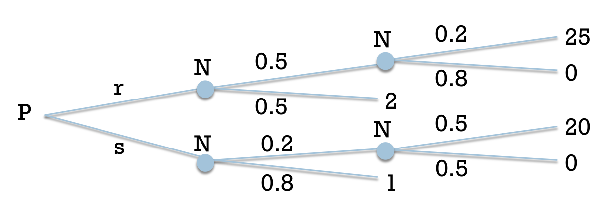
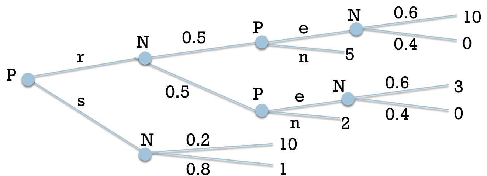
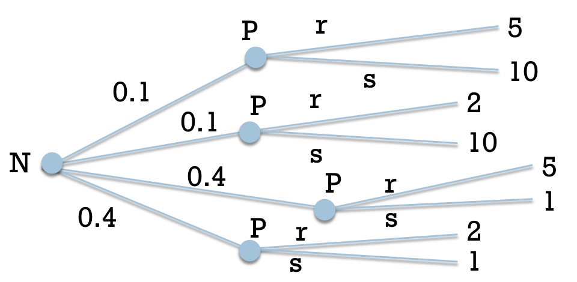

# 2. Lotteries, expected utility and decisions under uncertainty

## Prerequisites you need

A **player** is a decision maker. An **action** is a choice, and an **outcome** is its result. A utility function $u(x)$ assigns a number to outcome $x$: larger utility means a more preferred outcome. Write $p\succeq q$ when lottery $p$ is at least as good as lottery $q$, and $p\sim q$ for indifference.

A probability lies between 0 and 1: probability 0.2 means 20%. Probabilities of mutually exclusive, exhaustive outcomes sum to 1. An **expectation** is a probability-weighted average. It need not be an outcome that can actually occur.

Lesson 1 ranked certain outcomes. Here, one action can have several possible outcomes. We must specify both their probabilities and how the player values them. The lecture concerns decision theory that can be inserted into later games; Nature's randomness is not another strategic opponent.

## 1. Lotteries and Nature

*Sources: Gth2002.pdf, pp. 3–9; transcript, 00:01–00:15.*

How should a student choose lunch when neither dish has a predictable quality? An action now selects a probability distribution over possible outcomes.

> [!info] Definition — Lottery
> A lottery $p$ over a finite outcome set $X=\{x_1,\ldots,x_n\}$ assigns probabilities $p(x_k)\geq0$ satisfying $\sum_{k=1}^n p(x_k)=1$.
>
> If action $a$ determines the lottery, write $p(x_k\mid a)$: the probability of outcome $x_k$ **given that action $a$ is chosen**.

A **degenerate lottery** gives one outcome probability 1 and all others probability 0. Thus certain outcomes fit the same framework.

The canteen example has one student $P$ choosing ravioli ($r$) or soup ($s$). Conditional on that choice:

| Action | Possible outcome | Utility | Conditional probability |
|---|---|---|---|
| $r$ | Tasty ravioli | 5 | 0.5 |
| $r$ | Bland ravioli | 2 | 0.5 |
| $s$ | Tasty soup | 10 | 0.2 |
| $s$ | Bland soup | 1 | 0.8 |

The two probabilities after each action sum to 1. Do not add all four probabilities: they describe two different conditional lotteries.

In a decision tree, **Nature**, denoted $N$, represents random events. At a $P$ node the student selects an action; at an $N$ node the outgoing branches have specified probabilities. Nature does not maximize a payoff. Terminal numbers are utilities, while numbers on Nature's branches are probabilities.

The slides' introductory statement that rational players “do not like randomness” motivates the modeling difficulty. It is not a definition of rationality: rational players can be risk neutral, risk averse, or risk loving. Knowing a lottery's consequences means knowing their possible values and probabilities, not predicting its realization.

Slide 8 also considers a **different example**: both dishes give utility 10 when tasty and 1 otherwise, but ravioli are tasty with probability 0.5 and soup with probability 0.2. Under expected utility, ravioli are preferred because they provide a higher probability of the same better outcome. Do not carry those modified leaf utilities into the original example.

## 2. Expected utility: evaluate first, then choose

*Sources: Gth2002.pdf, pp. 10–15, 18; transcript, 00:15–00:30 and 00:37–00:42.*

> [!info] Definition — Expected utility
> Given outcome utility $u$ and lottery $p$,
>
> $$
> U(p)=\mathbb{E}_p[u(X)]=\sum_{k=1}^n p(x_k)u(x_k).
> $$
>
> For an action-dependent lottery, $U(a)=\sum_k p(x_k\mid a)u(x_k)$. Choose an action with the largest expected utility, provided the expected-utility model applies.

Here $X$ denotes the random outcome; $\mathbb{E}$ denotes expectation. The calculation weights **utilities**, which need not equal money, water, or other physical outcomes.

### Worked lecture example: ravioli or soup

Using the original canteen numbers,

$$
U(r)=0.5(5)+0.5(2)=3.5,
$$

$$
U(s)=0.2(10)+0.8(1)=2.8.
$$

Choose ravioli because $3.5>2.8$. This is an evaluation before observing food quality. It does not guarantee ravioli will be better today: bland ravioli still give 2 when tasty soup would give 10.

The lecture motivates expectation by long-run averages. Under suitable repeated sampling, averages approach expected values. This is intuition, not a requirement to repeat the lunch decision: the axioms below justify expected-utility comparisons even for a single choice.

### Why the original numerical utilities matter

For certain outcomes, any strictly increasing transformation preserves their ranking. For lotteries, preserving only that ranking is insufficient.

In slide 18, change only tasty soup utility from 10 to 100. The outcome order remains $100>5>2>1$, but now

$$
U(s)=0.2(100)+0.8(1)=20.8>3.5=U(r).
$$

The preferred dish changes. Therefore, an ordinal ranking of outcomes alone does not specify preferences over lotteries.

> [!info] Valid transformations of vNM utility
> If $u$ represents a player's expected-utility preferences, then $v(x)=\alpha u(x)+\beta$, with $\alpha>0$, represents the same lottery preferences:
>
> $$
> \mathbb{E}[v(X)]=\alpha\mathbb{E}[u(X)]+\beta.
> $$
>
> These are **positive affine transformations**. A negative multiplier reverses preferences, and a zero multiplier erases distinctions.

This sharpens slide 14's “any affine (linear) transformation” wording. The relevant numerical gaps matter up to positive affine rescaling; utilities do not acquire a unique absolute scale.

## 3. Why expected utility represents lottery preferences

*Sources: Gth2002.pdf, pp. 11–14; transcript, 00:17–00:30.*

Let $\mathcal{P}(X)$ be the set of lotteries over $X$. This notation means probability distributions, not the power set. A mixture $\lambda p+(1-\lambda)q$ means: select lottery $p$ with probability $\lambda$, otherwise select lottery $q$. Its probability of outcome $x$ is $\lambda p(x)+(1-\lambda)q(x)$.

The von Neumann–Morgenstern framework imposes four conditions on preferences over lotteries:

1. **Completeness:** every pair of lotteries can be compared, allowing ties.
2. **Transitivity:** if $p\succeq q$ and $q\succeq r$, then $p\succeq r$.
3. **Continuity:** preferences behave continuously when mixture probabilities vary.
4. **Independence:** mixing two alternatives with the same third lottery, in the same proportions, preserves their comparison.

### Continuity: no discontinuous priority at probability zero

For fixed lotteries $p,q,r$, the sets

$$
\{\lambda\in[0,1]:\lambda p+(1-\lambda)q\succeq r\},
$$

$$
\{\lambda\in[0,1]:r\succeq\lambda p+(1-\lambda)q\}
$$

must be closed. A closed set includes its limiting points. For example, if a sequence of mixtures is weakly preferred to $r$ and the mixture probabilities converge, the limiting mixture must also be weakly preferred.

**Original numerical version of the lecture's park example.** Staying home gives utility 0; a safe walk gives 1; being mugged gives $-99$. With mugging probability $\varepsilon$, walking gives $1-100\varepsilon$. Walking is strictly preferred for $\varepsilon<0.01$, the player is indifferent at 0.01, and home is preferred above it. The boundary belongs to both weak-preference sets.

The slide's informal phrase that tiny changes do not change preferences needs qualification: a tiny change **can** reverse a comparison near indifference. Continuity rules out jumps, rather than all changes of preference. The transcript's “no holes” explanation should not replace the closed-set definition.

### Independence: a shared alternative does not reverse the comparison

The standard condition, for $0<\lambda\leq1$, is

$$
p\succeq q\iff
\lambda p+(1-\lambda)r\succeq
\lambda q+(1-\lambda)r.
$$

At $\lambda=0$ both mixtures are $r$, whatever the original preference. This explains why the reverse implication is not stated at zero.

**Lecture example.** If betting on football is preferred to betting on horse races, then the same comparison holds between “50% football, 50% roulette” and “50% horse races, 50% roulette”. The roulette component is shared. This **preference axiom** is different from statistical independence of random events.

### The theorem and its useful proof idea

> [!info] Theorem — von Neumann–Morgenstern representation
> On lotteries over a finite outcome set, preferences satisfying completeness, transitivity, continuity, and independence admit an expected-utility representation:
>
> $$
> p\succeq q\iff U(p)\geq U(q),\qquad
> U(p)=\sum_x p(x)u(x).
> $$
>
> For nontrivial preferences, outcome utilities representing the same lottery preferences are unique up to a positive affine transformation.

The slide states only one implication; “represents” requires the equivalence above. Completeness and transitivity alone do not justify expectation: continuity and independence provide additional structure.

To understand the construction, choose a best outcome $b$ and worst outcome $w$, with $b\succ w$, and normalize their utilities to 1 and 0. Continuity and independence allow each intermediate outcome $x$ to be compared with a mixture of $b$ and $w$ and assigned the corresponding probability $u(x)$. Replacing each outcome of a lottery by its equivalent best–worst mixture reduces its overall best-outcome probability to $\sum_x p(x)u(x)$. That probability ranks the lottery. This is the construction idea; the lecture omits the full proof.

Equivalently, with $e_k$ the degenerate lottery giving $x_k$ for certain, $p=\sum_k p(x_k)e_k$. Expected utility is affine in mixture probabilities:

$$
U(\lambda p+(1-\lambda)q)=\lambda U(p)+(1-\lambda)U(q).
$$

This is linearity **in lotteries**, not a requirement that $u(x)$ be linear in money. Use the theorem to justify replacing chance nodes with expected utility when its assumptions apply.

## 4. Compound lotteries

*Sources: Gth2002.pdf, p. 16; transcript, 00:30–00:33.*

What if Nature moves more than once? Evaluate the final chance nodes first, then the earlier ones, or calculate the probability of every complete path.

*Source: Gth2002.pdf, PDF p. 16. Branch numbers are probabilities; leaf numbers are utilities.*

For ravioli, the upper continuation has expected utility $0.2(25)+0.8(0)=5$. The first chance node therefore gives

$$
U(r)=0.5[0.2(25)+0.8(0)]+0.5(2)=3.5.
$$

For soup,

$$
U(s)=0.2[0.5(20)+0.5(0)]+0.8(1)=2.8.
$$

The reduced ravioli lottery has probabilities 0.1 for utility 25, 0.4 for 0, and 0.5 for 2. They sum to 1 and give $0.1(25)+0.4(0)+0.5(2)=3.5$.

These compound lotteries have the **same expected utilities** as the original meals, not the same outcome distributions. The equivalence is for this expected-utility evaluation.

> [!warning] Conditional probabilities matter
> The probability of a path is the product of its branch probabilities, each conditional on reaching that branch. In general, $\Pr(A\cap B)=\Pr(A)\Pr(B\mid A)$. Replacing the conditional probability by $\Pr(B)$ requires statistical independence. Nested expectations themselves do **not** require independence when the correct conditional distributions are used. This qualifies the independence remark on slide 16 and in the recording.

## 5. Continuous lotteries and choosing well depth

*Sources: Gth2002.pdf, pp. 7, 17; transcript, 00:10–00:13 and 00:33–00:37.*

For an absolutely continuous outcome, individual points have probability zero. A density $f(x\mid a)$ describes probabilities through areas:

$$
\Pr(c\leq X\leq d\mid a)=\int_c^d f(x\mid a)\,dx,
\qquad U(a)=\int u(x)f(x\mid a)\,dx.
$$

The density is nonnegative and integrates to 1; its value at a point is not itself a probability. A finite-branch picture is inconvenient for continuously many outcomes, but the decision method remains valid.

### Worked lecture example: digging a well

One person chooses depth $d\geq0$. Extracted water is $W(d)\sim\operatorname{Uniform}[0,20d]$, and effort costs $d^2/2$. The model explicitly defines utility as water minus effort:

$$
u(W,d)=W-\frac{d^2}{2}.
$$

For $d>0$, uniform water yield has mean $(0+20d)/2=10d$. Since effort is deterministic,

$$
U(d)=10d-\frac{d^2}{2}.
$$

At $d=0$ water and utility are both zero. At $d=3.2$,

$$
U(3.2)=32-\frac{10.24}{2}=26.88.
$$

Differentiate: $U'(d)=10-d$, so the stationary point is $d=10$. Since $U''(d)=-1<0$, it is the unique global maximum on $d\geq0$. It is feasible, beats the boundary $U(0)=0$, and yields $U(10)=50$. Equivalently, $U(d)=50-(d-10)^2/2$ directly proves the maximum. If a specified upper limit is $D<10$, the best feasible depth is $D$; with $D\geq10$, it remains 10.

> [!warning] Correction to slide 17
> The slide writes $\mathbb{E}[W(d)-d^2]$ in one intermediate expression, omitting the factor $1/2$. Its stated effort, final formula, numerical example, optimum, and transcript explanation all use $W(d)-d^2/2$, as above.

## 6. Risk attitude: expected money is not expected utility

*Sources: Gth2002.pdf, pp. 19–22; transcript, 00:42–00:51.*

The lecture compares a sure euro with a lottery paying 20 euros with probability 0.05 and zero otherwise. Both have expected money 1:

$$
\mathbb{E}[X_A]=1,\qquad \mathbb{E}[X_B]=0.05(20)+0.95(0)=1.
$$

But their expected utilities are $u(1)$ and $0.95u(0)+0.05u(20)$, which need not agree.

> [!info] Definition — Risk attitude
> A risk-averse player weakly prefers a certain amount equal to a lottery's expected monetary outcome over the lottery. A risk-neutral player is indifferent. A risk-loving player weakly prefers the lottery. These statements compare lotteries with the **same expected monetary outcome**, not arbitrary gambles.

For increasing money utility on an interval, concavity corresponds to risk aversion, affine utility to risk neutrality, and convexity to risk loving. For twice differentiable utility, inspect the sign of $u''$. Strict curvature gives strict preferences for nonconstant lotteries under the usual integrability conditions.

### Worked lecture comparison with explicit utility functions

The functions below are added numerical illustrations, defined for $x\geq0$.

| Utility | Sure euro: $U(A)$ | Gamble: $U(B)$ | Choice |
|---|---|---|---|
| $u(x)=x$ | 1 | $0.05(20)=1$ | Indifferent |
| $u(x)=\sqrt{x}$ | 1 | $0.05\sqrt{20}\approx0.2236$ | Sure euro |
| $u(x)=x^2$ | 1 | $0.05(400)=20$ | Gamble |

The concave case follows the inequality $\mathbb{E}[u(X)]\leq u(\mathbb{E}[X])$; the convex case reverses it. A risk-averse player still prefers more money when utility is increasing: risk aversion does not mean wanting less money.

Slide 21's monotonic examples preserve the ranking of **certain amounts**, but can change lottery preferences and risk attitude. Respect domains: $\log x$ is undefined at zero, and $x^2$ is not increasing on the whole real line. Using a concave function such as $\sqrt{x}$ here avoids the logarithm-at-zero issue.

## 7. Decisions after observing Nature: backward induction

*Sources: Gth2002.pdf, pp. 23–29; transcript, 00:51–01:01.*

Suppose the student observes ravioli quality and can then add extra cheese ($e$) or decline it ($n$). Good cheese has probability 0.6. With good cheese, tasty ravioli give utility 10 and bland ravioli give 3; bad cheese gives 0. Declining cheese retains utility 5 or 2. Soup remains unchanged.

*Source: Gth2002.pdf, PDF p. 24. Here $P$ is the student, $N$ is Nature, and lowercase $n$ means no cheese. The student knows which of the two later decision nodes has been reached.*

> [!info] Method — Backward induction for a finite decision tree
> Begin at the leaves. At a Nature node, average continuation values using its conditional probabilities. At a player node, choose the largest continuation value. Replace each solved subtree by its value and repeat until reaching the root. This requires that the player can distinguish the decision nodes at which different choices are prescribed.

### Worked solution

1. **Tasty ravioli:** adding cheese yields $0.6(10)+0.4(0)=6$. Declining gives 5. Choose cheese, retaining value 6.
2. **Bland ravioli:** adding cheese yields $0.6(3)+0.4(0)=1.8$. Declining gives 2. Decline, retaining value 2.
3. **Before observing quality:** ravioli yield $0.5(6)+0.5(2)=4$, while soup yields 2.8. Choose ravioli.

The full optimal contingent plan is: **choose ravioli; add cheese if tasty; decline cheese if bland**. Its expected utility is 4, but realized utility remains random. There is no profitable local change: 6 beats 5, 2 beats 1.8, and 4 beats 2.8.

A **contingent plan** specifies what to do after each possible observation. A single action such as “add cheese” does not describe this whole plan. The slide groups final player decisions into group 1 and the initial decision into group 2. More generally, a player node's group is one plus the largest group among its later player nodes, or 1 if no later player node exists. The soup branch's lack of further decisions does not make the root group 1.

Do not average Nature's outcomes first and then force one common cheese action: that discards the student's observation. If quality were unobserved, the contingent plan would be unavailable. Always inspect what the player knows when choosing. Around 01:00:49 the transcript says “go for S”, then immediately states that $r$ is preferred; slide 29 and $4>2.8$ establish that $r$ is intended.

### Discounting a delayed cheese payoff

*Source: Gth2002.pdf, p. 30; transcript, 01:01–01:03.*

Slide 30 discounts only cheese outcomes by $0<\delta<1$, representing an additional delay. Declining cheese and the soup branch retain their existing values.

For tasty ravioli, cheese gives $6\delta$, versus 5 without it:

$$
6\delta\gtreqless5\iff\delta\gtreqless\frac56.
$$

Thus add cheese when $\delta>5/6$, decline when $\delta<5/6$, and allow either choice at equality. For bland ravioli, cheese gives $1.8\delta<2$ throughout $0<\delta<1$, so always decline. Therefore,

$$
U(r;\delta)=\frac12\max\{6\delta,5\}+\frac12(2)
=\begin{cases}
3.5,&0<\delta\leq5/6,\\
3\delta+1,&5/6<\delta<1.
\end{cases}
$$

Both expressions agree at the threshold. Ravioli remain preferred to soup's 2.8 for every allowed $\delta$. Discounting changes the later cheese choice, not the initial dish in this example. These threshold calculations extend the lecture's suggested parameter question.

## 8. Value of information

*Sources: Gth2002.pdf, pp. 31–35; transcript, 01:03–01:13.*

Return to the **original meals without cheese**. A friend can reveal both dishes' quality before the student orders. Information changes when the choice is made, not the menu or utility numbers. The lecture explicitly assumes the two dishes' qualities are statistically independent when constructing the joint states.

| Observed state | Probability | $u(r)$ | $u(s)$ | Optimal informed action | Contribution |
|---|---|---|---|---|---|
| Both tasty | $0.5(0.2)=0.1$ | 5 | 10 | $s$ | 1 |
| Bland ravioli, tasty soup | $0.5(0.2)=0.1$ | 2 | 10 | $s$ | 1 |
| Tasty ravioli, bland soup | $0.5(0.8)=0.4$ | 5 | 1 | $r$ | 2 |
| Both bland | $0.5(0.8)=0.4$ | 2 | 1 | $r$ | 0.8 |

The probabilities sum to 1. Their products use independence; marginal quality probabilities alone would not justify this joint-state table.

*Source: Gth2002.pdf, PDF p. 34. Nature moves first, and the student observes its choice before selecting a dish.*

Without information, the best expected utility is $\max\{3.5,2.8\}=3.5$. With perfect information,

$$
V_{\mathrm{info}}=0.1(10)+0.1(10)+0.4(5)+0.4(2)=4.8.
$$

> [!info] Definition — Expected value of perfect information
> For state $\theta$ with probability $\Pr(\theta)$, actions $a$, and utility $u(a,\theta)$,
>
> $$
> \operatorname{EVPI}=\sum_\theta\Pr(\theta)\max_a u(a,\theta)
> -\max_a\sum_\theta\Pr(\theta)u(a,\theta).
> $$
>
> The first term chooses after observing the state; the second chooses beforehand.

Here EVPI is $4.8-3.5=1.3$ **utility units**. Information is weakly valuable because the player can ignore it and use the old action. It need not strictly improve value if the same action is optimal in every state. Before learning the state, the informed plan still has a random realized payoff; information lets the student choose the best dish in each state, not guarantee a constant payoff.

An information fee of $c$ can be compared directly with 1.3 only when it subtracts $c$ in the same additive utility units. Then paying is strictly worthwhile for $c<1.3$ and gives indifference at equality. With nonlinear utility of money, a 1.3-utility improvement is not automatically a willingness to pay 1.3 euros: incorporate the monetary fee into outcomes and recompute expected utility. This decision value is distinct from Shannon information measured in bits.

> [!warning] Inconsistent diagram on slide 35
> The text repeats the original values 4.8 and 1.3, but the diagram changes tasty soup to utility 15 with probability 0.1 and bland soup probability to 0.9. The transcript and slide 34 support the original example used above. If the changed diagram is intentional and independence is retained, soup has expected utility $0.1(15)+0.9(1)=2.4$, informed value is $0.1(15)+0.9(3.5)=4.65$, and EVPI is $4.65-3.5=1.15$. Do not combine the changed diagram with the original numerical conclusion.

## 9. Practice

### Original practice: questions

1. Soup has tasty utility $H$, bland utility 1, and tasty probability 0.2. Ravioli retain expected utility 3.5. For which $H$ is soup strictly preferred?
2. A lottery gives utility 12 with probability 0.25; otherwise a second lottery gives 4 or 0 with equal probabilities. Reduce it to terminal probabilities and calculate expected utility.
3. In the cheese example, find the optimal plan and its expected utility for $\delta=0.8$ and $\delta=0.9$.
4. In the original information example, suppose the friend charges an additive fee of 1.4 utility units. Should the student buy the information?

### Answers

1. $0.2H+0.8>3.5$ requires $H>13.5$. At $H=13.5$ both dishes are optimal.
2. The terminal probabilities are 0.25, $0.75(0.5)=0.375$, and 0.375. They sum to 1. Expected utility is $0.25(12)+0.375(4)+0.375(0)=4.5$.
3. At 0.8, tasty cheese gives 4.8, below 5: choose ravioli and decline cheese in both quality states, for value 3.5. At 0.9, tasty cheese gives 5.4, above 5: choose ravioli, add cheese only if tasty, for value $0.5(5.4)+0.5(2)=3.7$. Bland cheese gives 1.44 or 1.62, both below 2.
4. No. Informed net value is $4.8-1.4=3.4$, below the uninformed value 3.5.

### Verified handbook exercises

Read Chapter 4, §4.1, printed pp. 67–68 / PDF pp. 73–74 for the lottery method. The selected exercises combine this method with later strategic analysis. Work on **question 1 only** now; defer equilibrium questions until those methods have been taught.

| Reference | What to practice now |
|---|---|
| Chapter 4, Exercise 4.1, printed pp. 71–72 / PDF pp. 77–78 | Multiply independent acceptance probabilities and compute expected utilities, including the bonus for being hired together. |
| Chapter 4, Exercise 4.2, printed pp. 73–74 / PDF pp. 79–80 | Replace a success/failure lottery by expected utility before constructing the game table. |

**Worked introductory part of Exercise 4.1.** Luca ($L$) and Marco ($M$) choose company $A$ or $B$. An internship at $A$ gives utility 100, at $B$ gives 110, and rejection gives 0. Being hired together doubles each utility. When both apply to one company, acceptance is independent, with probabilities 0.5 for Luca and 0.2 for Marco.

At $(A,A)$, both accepted has probability 0.1, only Luca 0.4, only Marco 0.1, and neither 0.4. Hence $U_L=0.4(100)+0.1(200)=60$ and $U_M=0.1(100)+0.1(200)=30$. At $(B,B)$, scale by 1.1 to obtain $(66,33)$. When applications split, each has acceptance probability 0.5. With rows for Luca, columns for Marco, and payoff order $(U_L,U_M)$:

| $L$ / $M$ | $A$ | $B$ |
|---|---|---|
| $A$ | $(60,30)$ | $(50,55)$ |
| $B$ | $(55,50)$ | $(66,33)$ |

These are expected utilities, not guaranteed internship outcomes.

**Solution route for Exercise 4.2, question 1.** Arthur and Crimilde separately choose bear, deer, or wolf. Choosing the same prey gives both 0. Hunting prey $j$ alone gives utility $+1$ with success probability $\rho_j$ and $-1$ otherwise, so expected utility is $2\rho_j-1$. For probabilities 0.4, 0.9, and 0.6, the expected utilities are $-0.2$, 0.8, and 0.2. Put zeros on the same-prey diagonal and the corresponding hunter's expected utility in every different-prey cell. State payoff order $(U_{\mathrm{Arthur}},U_{\mathrm{Crimilde}})$ before constructing the table.

## Exam quick reference

| Problem cue | Procedure | Main check |
|---|---|---|
| Discrete lottery | Compute $U(a)=\sum_x p(x\mid a)u(x)$. | Probabilities after each action sum to 1; weight utilities. |
| Several Nature nodes | Work backward or multiply conditional probabilities along paths. | Independence is needed only to replace conditional probabilities by marginals. |
| Continuous outcome | Compute $U(a)=\int u(x)f(x\mid a)\,dx$, then optimize. | Density integrates to 1; check feasible boundaries and maxima. |
| Equal expected money | Compare $u(\mathbb{E}[X])$ with $\mathbb{E}[u(X)]$. | Concave: risk averse; affine: neutral; convex: risk loving. |
| Player and Nature alternate | Average at Nature nodes; maximize at informed player nodes. | Record contingent choices; do not assume unavailable observations. |
| Delayed payoff | Multiply affected future utility by $\delta^t$; solve comparison inequalities. | Specify timing, discount only affected branches, and include ties. |
| Perfect information | Expected statewise maximum minus maximum expected utility. | Use joint-state probabilities and compare in the same utility units. |
| Rescale utility | Use $v=\alpha u+\beta$, $\alpha>0$. | Arbitrary increasing transformations need not preserve lottery preferences. |

**Numbers for recognition:** original meals give $U(r)=3.5$ and $U(s)=2.8$; optimal observed-quality cheese plan gives 4; tasty-cheese discount threshold is $5/6$; original perfect-information value is $4.8-3.5=1.3$ utility units; well depth is $d^*=10$ with expected utility 50.

**Do not confuse:** outcome with utility; expected utility with a guaranteed payoff; rationality with risk aversion; the independence axiom with statistical independence; an action with a full contingent plan; information value in utility units with a monetary fee under nonlinear money utility.

## Sources and scope

- **Gth2002.pdf**, all 35 PDF pages inspected. Lotteries and expected utility: pp. 3–15; compound and continuous cases: pp. 16–17; cardinal comparisons and risk: pp. 18–22; adaptive decisions and discounting: pp. 23–30; information: pp. 31–35. All slide references are 1-based PDF page indices.
- **2026-IN2898-005PD-2026-IN0000184-N0-IN2898 Lecture 2 extra STEM.transcript.txt**, read in full, 00:00:03–01:13:14. It follows the supplied slides and adds explanation. Transcription errors such as “actions” for “axioms” are reconciled with the slide notation. The companion MP3 was not separately transcribed or checked against the supplied transcript.
- **Game Theory. A Handbook of Problems and Excercises.pdf**, Chapter 4, §4.1 and Exercises 4.1–4.2; printed page numbers and PDF indices are distinguished above. Practice questions labeled “Original” are added teaching material.

Corrections and qualifications are explicit beside the relevant concepts. The quick reference supports the user-provided 75-minute written exam format with printed material and no electronic devices; current assessment regulations are not independently verified.
