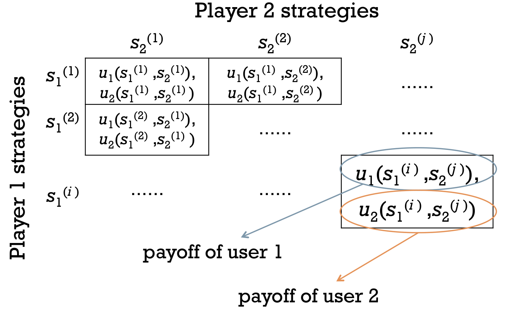
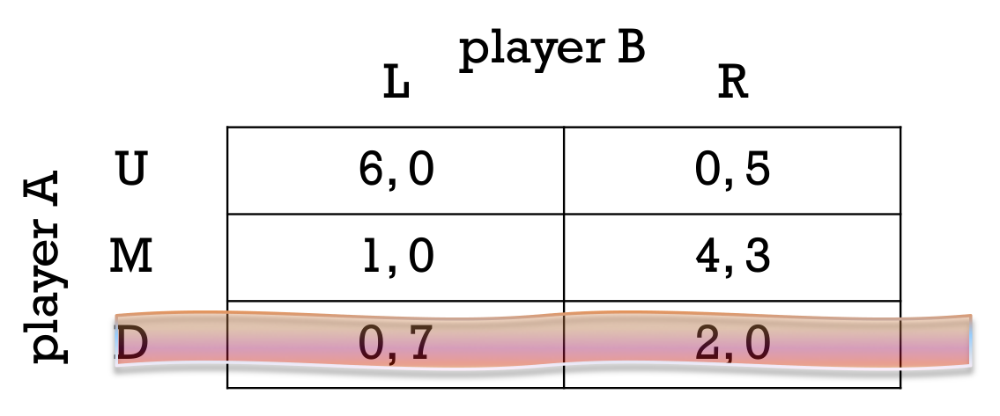

# 3. Static games, Pareto efficiency and dominance

## Prerequisites you need

A **player** is a decision maker, an **action** is an available choice, and a **payoff** or **utility** is a number representing how much a player values a result. Higher utility means a better result for that player. With negative utilities, $-1$ is better than $-20$.

A rational player chooses to maximize their own utility. This does not mean maximizing everyone's welfare. A utility function can already include concern for other people; rationality means pursuing the preferences represented by that function.

Earlier decision problems had one decision maker. Here, your payoff also depends on other people's choices. Knowing the rules does not necessarily tell you which choice they will make.

Throughout these notes, the first player chooses a **row**, the second chooses a **column**, and each cell contains $(u_1,u_2)$: row player's payoff first, column player's payoff second. We initially consider only deterministic choices, called pure strategies.

## 1. What makes a game static and of complete information?

*Sources: Gth2003.pdf, pp. 3–10; Part 1, 00:00–00:33.*

The practical question is: how should several people choose when each person's result depends on everyone else's decision?

> [!info] Definition — Static game
> Players choose without observing the other players' choices for that interaction. Their decisions are treated as simultaneous, even if they occur at different physical times.

For example, two people can write choices on opposite sides of a board at the same time. Alternatively, player 1 can write first, with the answer hidden until player 2 has committed. Both situations have the same relevant information structure: neither can react to the other's actual choice.

If player 2 sees player 1's choice before deciding, that is a different game. The second player can now use a conditional plan such as “choose left if the first player chose up.”

> [!info] Definition — Complete information and common knowledge
> In this lesson, the players, available actions, consequences, and payoff functions are common knowledge. A fact $E$ is **common knowledge** if everyone knows $E$, everyone knows that everyone knows $E$, and this continues through every level of “knowing that others know.”

The lecture also assumes **common knowledge of rationality**: everyone maximizes their own payoff, everyone knows that everyone does so, and so on. This is an additional behavioral assumption, used when eliminating strategies repeatedly.

**Worked interpretation.** Suppose both players have the same payoff table. Player A can calculate that a certain move is always worse for B. To predict that B will avoid it, A also needs to know that B is rational. To make further predictions based on what B predicts about A, another level of knowledge is needed. Common knowledge supports this repeated reasoning.

Complete information does **not** mean observing the opponent's chosen move. Also, choosing independently here means choosing without observing that move; it does not mean that choices or incentives have no effect on each other.

## 2. Actions, strategies, profiles, and normal form

*Sources: Gth2003.pdf, pp. 5–7 and 12–15; Part 1, 00:09–00:20 and 00:33–00:41.*

An **action** is a choice taken in the game. A **strategy** is a plan specifying what action to take. A **pure strategy** is a deterministic plan. In the one-decision static games considered here, choosing a pure strategy is equivalent to choosing one action.

For example, in rock–paper–scissors, “play rock” is a pure strategy. “Choose rock, paper, or scissors using specified probabilities” would be a **mixed strategy**, studied later. Complete information does not prohibit randomization; this lecture restricts attention to pure strategies.

> [!info] Definition — Normal form
> For $n$ players, the lecture writes
>
> $$
> G=\{S_1,\ldots,S_n;u_1,\ldots,u_n\}.
> $$
>
> $S_i$ is player $i$'s set of pure strategies. A **strategy profile** or **joint strategy** is $s=(s_1,\ldots,s_n)$, with $s_i\in S_i$. Player $i$'s payoff function is
>
> $$
> u_i:S_1\times\cdots\times S_n\longrightarrow\mathbb{R}.
> $$

The symbol $\times$ denotes a Cartesian product: all combinations with one choice from each set. For example, three rows and two columns give $3\cdot2=6$ profiles. The number $u_i(s)$ evaluates the entire profile, not only player $i$'s choice.

The normal form is the mathematical specification of players, strategy sets, and payoff functions. A finite two-player game can be displayed as a **bimatrix**, with both players' payoffs in each cell. With three players, each cell needs three payoffs; separate two-dimensional tables can represent different choices of the third player. Continuous strategy sets generally require functions rather than a finite table.

*Figure 1. Cropped from Gth2003.pdf, PDF p. 13. Superscripts such as $(j)$ label strategies; they are not powers. Each cell evaluates the same profile for two different players. The written labels identify the payoffs even in grayscale.*

### Worked lecture example: reading a payoff table

Players A and B choose independently. A has $S_A=\{U,M,D\}$, meaning up, middle, and down; B has $S_B=\{L,R\}$, meaning left and right. These labels have no further story attached.

| A \ B | $L$ | $R$ |
|---|---|---|
| $U$ | $(8,0)$ | $(0,5)$ |
| $M$ | $(1,0)$ | $(4,3)$ |
| $D$ | $(0,7)$ | $(2,0)$ |

If A chooses $M$ and B chooses $L$, the profile is $(M,L)$, while the payoff vector is $(1,0)$. These are different objects: choices versus their evaluations. Several profiles can even have identical payoff vectors.

**Source discrepancy.** This table follows slide 14. Slides 24–25 change only A's payoff at $(U,L)$ from $8$ to $6$. We retain $8$ in the text; the original crop below shows $6$. Every dominance comparison and the final elimination result are the same under either value.

## 3. Pareto efficiency: can someone improve without hurting anyone?

*Sources: Gth2003.pdf, pp. 19–21 and 26; Part 1, 00:55–01:02; Part 2, 00:10–00:12.*

Pareto comparisons evaluate whole profiles from **all players'** perspectives. They ask whether another feasible profile would make someone better off without making anyone worse off.

> [!info] Definition — Pareto dominance and efficiency
> Profile $s'$ **Pareto dominates** profile $s$ if
>
> $$
> u_i(s')\geq u_i(s)\quad\text{for every player }i,
> $$
>
> and
>
> $$
> u_j(s')>u_j(s)\quad\text{for at least one player }j.
> $$
>
> A profile is **Pareto efficient** if no feasible profile Pareto dominates it.

The weak inequalities prevent anyone from losing. The one required strict inequality ensures a real improvement; equal payoff vectors do not dominate each other. Efficiency means that improving one player requires worsening at least one other player.

Here the feasible alternatives are the **pure profiles in the given game**. Adding lotteries or transfers would change the set over which efficiency must be checked.

### Worked lecture example: the monetary prisoner's dilemma

Al chooses a row and Bob a column. Each chooses $M$, “pay one dollar yourself,” or $F$, “make the other player pay twenty dollars.” Choices are hidden until both commit. Payments add together, and utility equals the negative payment.

*Figure 2. Cropped from Gth2003.pdf, PDF p. 19. Payoff order is (Al, Bob). For instance, $(M,F)$ gives $(-21,0)$ because Al pays his own dollar and the twenty dollars imposed by Bob.*

At $(F,F)$, the payoff vector is $(-20,-20)$. At $(M,M)$, it is $(-1,-1)$. Since $-1>-20$ for both players, $(M,M)$ Pareto dominates $(F,F)$.

To find the **entire efficient set**, compare every candidate with every possible replacement:

| Profile | Payoff vector | Pareto assessment |
|---|---|---|
| $(M,M)$ | $(-1,-1)$ | Efficient: improving either player to $0$ makes the other fall to $-21$. |
| $(M,F)$ | $(-21,0)$ | Efficient: Bob already receives his unique maximum, $0$. Every other profile hurts him. |
| $(F,M)$ | $(0,-21)$ | Efficient by the corresponding argument for Al. |
| $(F,F)$ | $(-20,-20)$ | Inefficient: $(M,M)$ improves both players. |

Thus Pareto efficiency need not mean equality, fairness, or an attractive result for everyone. It also need not select one profile.

**Method.** For each cell, search the whole table for another cell whose two numbers are both at least as large, with one strictly larger. One such replacement proves inefficiency. To establish efficiency, rule out all replacements. Two profiles being incomparable with each other does not prove either efficient: a third profile might dominate both.

### The jail version has the same pure-choice incentives

Slide 20 replaces money with negative months in jail. $M$ means staying silent (“mum”), and $F$ means informing on the other prisoner (“fink”). Payoff order remains (Al, Bob).

| Al \ Bob | $M$ | $F$ |
|---|---|---|
| $M$ | $(-1,-1)$ | $(-9,0)$ |
| $F$ | $(0,-9)$ | $(-6,-6)$ |

Each player ranks the four situations in the same order as in the monetary version: exploiting silence, mutual silence, mutual informing, being informed on while silent. Both versions therefore give the same pure-strategy dominance and Pareto conclusions. Matching these rankings alone would not justify treating their preferences over lotteries as identical.

## 4. Strict dominance: is one of my choices always worse?

*Sources: Gth2003.pdf, pp. 22–24; Part 2, 00:00–00:05.*

Now the question concerns **one player's strategies**: can that player replace a choice with another that gives a strictly higher payoff, whatever the others choose?

Write $s_{-i}$ for the list of all players' strategies except player $i$'s, and $S_{-i}=\prod_{j\ne i}S_j$ for all possible such lists. The subscript $-i$ means “everyone except $i$.”

> [!info] Definition — Strictly dominated strategy
> Player $i$'s strategy $s_i$ is **strictly dominated** by another strategy $t_i\in S_i$ if
>
> $$
> u_i(t_i,s_{-i})>u_i(s_i,s_{-i})
> \quad\text{for every }s_{-i}\in S_{-i}.
> $$
>
> The opponent's choice is held fixed in each comparison. Only player $i$ changes strategy.

A rational player does not choose a strictly dominated strategy: replacing it raises their payoff in every possible case. No probability estimate about opponents is needed. If probabilities were assigned to these cases, the weighted average improvement would also be strictly positive.

### Worked lecture example: $M$ strictly dominates $D$

Return to the three-row game from Section 2. Compare **A's first payoffs** within each column:

| B's fixed choice | A's payoff from $D$ | A's payoff from $M$ | Improvement |
|---|---|---|---|
| $L$ | $0$ | $1$ | $1>0$ |
| $R$ | $2$ | $4$ | $4>2$ |

Both inequalities are strict, so A can discard $D$.

*Figure 3. Cropped from Gth2003.pdf, PDF p. 24. The crossed-out row is $D$. This later slide uses $6$ rather than $8$ at $(U,L)$; neither value affects $M$ dominating $D$.*

Do not compare $u_A(D,R)=2$ with $u_A(M,L)=1$ to challenge this result. That changes B's strategy too. Dominance compares $D$ and $M$ against the **same** column.

Nor is $M$ a strictly dominant strategy in the original game: against $L$, $U$ gives $8>1$. A strategy can dominate one alternative without dominating all alternatives.

### Strict, weak, dominated, and dominant

- A strategy is **strictly dominant** if it strictly dominates every other strategy of that player.
- A strategy is **strictly dominated** if some alternative strictly beats it against every opponent profile.
- A strategy $t_i$ **weakly dominates** $s_i$ if it is at least as good against every opponent profile and strictly better against at least one. An equality in even one case prevents strict dominance.

**Original example: the equality trap.** Suppose one player's payoffs across columns $L,R$ are $(1,2)$ from $X$ and $(1,0)$ from $Y$. Then $X$ weakly dominates $Y$, because $1=1$ and $2>0$. It does not strictly dominate $Y$. Against a known $L$, both choices maximize that player's payoff. Do not delete $Y$ using a rule that requires strict dominance.

| Comparison | Objects being compared | Whose utilities matter? | Required inequalities |
|---|---|---|---|
| Pareto dominance | Two complete profiles | Every player's | No player loses; at least one gains. |
| Strict strategy dominance | Two strategies of the same player | That player's only | A strict gain against every opponent profile. |

## 5. Iterated elimination of strictly dominated strategies

*Sources: Gth2003.pdf, pp. 24–27; Part 2, 00:05–00:13.*

Removing one irrational choice can reveal another choice that is irrational in the smaller game. This is **iterated elimination of strictly dominated strategies**, abbreviated **IESDS**.

1. Search for a strictly dominated strategy in the current game.
2. For A's rows, compare first payoffs column by column. For B's columns, compare second payoffs row by row.
3. Record the dominating strategy and every required strict inequality, then remove the dominated row or column.
4. Search again using only the remaining rows and columns. Stop when no further deletion is justified.

The first deletion uses the affected player's rationality. Later deletions also use knowledge of other players' rationality. Common knowledge supports arbitrarily many rounds.

### Worked lecture example: a unique surviving profile

Starting from the table in Section 2:

**Round 1: remove A's $D$.** $M$ gives $1>0$ against $L$ and $4>2$ against $R$.

| A \ B | $L$ | $R$ |
|---|---|---|
| $U$ | $(8,0)$ | $(0,5)$ |
| $M$ | $(1,0)$ | $(4,3)$ |

**Round 2: remove B's $L$.** Compare B's second payoffs: $R$ gives $5>0$ against $U$ and $3>0$ against $M$. This deletion was invalid in the original game, because against $D$, $L$ gave B $7$ while $R$ gave $0$.

**Round 3: remove A's $U$.** Only column $R$ remains, where $M$ gives $4>0$. The unique survivor is profile $(M,R)$, with payoff vector $(4,3)$.

Check the final prediction against the original table: with B choosing $R$, A cannot improve on $M$ because the other payoffs are $0$ and $2$. With A choosing $M$, B cannot improve on $R$ because $L$ gives $0<3$. These are checks of **unilateral** changes: one player changes while the other stays fixed.

### Worked lecture example: why the prisoner's dilemma is a dilemma

In the monetary version, Al compares $F$ with $M$:

- If Bob chooses $M$, $F$ gives $0>-1$.
- If Bob chooses $F$, $F$ gives $-20>-21$.

Thus $F$ is strictly dominant for Al. The same comparisons apply to Bob, so each player's $M$ can be removed immediately. The unique surviving profile is $(F,F)$ with payoffs $(-20,-20)$.

Yet $(M,M)$ gives $(-1,-1)$ and Pareto dominates it. The conflict is precise: **jointly** switching to $M$ helps both, but **individually** switching from $F$ to $M$ hurts a player who faces $F$. Even at $(M,M)$, either player can improve their own payoff from $-1$ to $0$ by switching alone to $F$. A collectively better outcome need not follow from individual payoff maximization.

## 6. When elimination cannot choose an outcome

*Sources: Gth2003.pdf, pp. 15–18 and 28–30; Part 1, 00:41–00:55; Part 2, 00:13–00:18.*

IESDS may leave several strategies or fail to start. That is a limit of the method, not permission to remove another row arbitrarily. Surviving a dominance test does not by itself prove that a profile is an equilibrium or that rational players must choose it. This lesson's elimination tests compare pure strategies; domination by a random mixture requires later tools.

### Example 2: an attractive profile without pure-strategy dominance

A chooses $U,M,D$, B chooses $L,C,R$, and payoff order is (A, B).

| A \ B | $L$ | $C$ | $R$ |
|---|---|---|---|
| $U$ | $(0,5)$ | $(4,0)$ | $(7,3)$ |
| $M$ | $(4,0)$ | $(0,5)$ | $(7,3)$ |
| $D$ | $(3,7)$ | $(3,7)$ | $(9,9)$ |

For A, $U$ beats $M$ against $C$, but $M$ beats $U$ against $L$. $D$ beats $U$ against $L$, but loses to $U$ against $C$; it beats $M$ against $C$, but loses to $M$ against $L$. No row strictly dominates another.

For B, $L$ and $C$ trade advantages against $U$ and $M$. $R$ loses to $L$ against $U$ ($3<5$), but beats it against $M$ ($3>0$). Likewise, $R$ beats $C$ against $U$ but loses against $M$. No column strictly dominates another. IESDS cannot start.

Nevertheless, $(D,R)$ gives both players their maximum payoff, $9$, and Pareto dominates every other pure profile. If B chooses $R$, A prefers $D$ because $9>7$; if A chooses $D$, B prefers $R$ because $9>7$. These conditional incentives support this candidate, but IESDS alone does not select it or establish a complete equilibrium set.

### Example 3: odds and evens, also called matching pennies

Roles are assigned before play: Odd wins an odd sum, Even wins an even sum. Each independently chooses $0$ or $1$, representing an even or odd number. The winner receives four euros from the loser; utility equals the monetary transfer. Odd chooses rows, Even columns.

| Odd \ Even | $0$ | $1$ |
|---|---|---|
| $0$ | $(-4,4)$ | $(4,-4)$ |
| $1$ | $(4,-4)$ | $(-4,4)$ |

Against Even's $0$, Odd prefers $1$; against Even's $1$, Odd prefers $0$. Even wants matching choices, while Odd wants different choices. Thus neither player has a strictly dominated pure strategy. This conflict is called **discoordination** in the transcript.

Every pure profile has a losing player who could gain by changing alone: when choices match, Odd can switch and win; when they differ, Even can switch and win. Therefore no deterministic profile has both players content to keep their choices. Randomized strategies will become useful later; no mixing probabilities are derived here.

Payoffs sum to zero in every cell, so this is a **zero-sum game**. Every pure profile is Pareto efficient: increasing one payoff necessarily decreases the other. Efficiency therefore does not solve the prediction problem either.

### Example 4: rock–paper–scissors

A and B independently choose rock ($R$), paper ($P$), or scissors ($S$). The winner gains four euros, the loser loses four, and a tie gives zero. A chooses rows; payoff order is (A, B).

| A \ B | $R$ | $P$ | $S$ |
|---|---|---|---|
| $R$ | $(0,0)$ | $(-4,4)$ | $(4,-4)$ |
| $P$ | $(4,-4)$ | $(0,0)$ | $(-4,4)$ |
| $S$ | $(-4,4)$ | $(4,-4)$ | $(0,0)$ |

No pure strategy dominates another: for example, paper beats rock against $R$, but rock beats paper against $S$. The corresponding comparisons cycle for all pairs. At a tie, either player can change to the winning symbol; at a non-tie, the loser can change to beat the winner's fixed symbol. Hence no pure profile passes the no-profitable-unilateral-change check.

Slide 17 mistakenly says “two strategies” while listing three. The correct set is $\{R,P,S\}$ for each player. Like odds and evens, this game is zero-sum and all its pure profiles are Pareto efficient.

### Example 5: Battle of the Sexes

Ann and Brian want to meet at a cinema but cannot communicate before choosing a movie. Both prefer meeting to missing each other. Ann prefers romance ($R$), Brian prefers science fiction ($S$). Ann chooses rows; payoff order is (Ann, Brian).

| Ann \ Brian | $R$ | $S$ |
|---|---|---|
| $R$ | $(2,1)$ | $(0,0)$ |
| $S$ | $(0,0)$ | $(1,2)$ |

For Ann, $R$ is better against Brian's $R$ ($2>0$), but $S$ is better against his $S$ ($1>0$). Brian likewise wants to match Ann's choice. No strictly dominated strategy can be removed.

Both $(R,R)$ and $(S,S)$ pass the unilateral-change check: leaving the shared movie would reduce the deviator's payoff to zero. Both are Pareto efficient, and neither Pareto dominates the other: Ann favors $(R,R)$, Brian favors $(S,S)$. Either coordinated profile dominates the mismatches. Thus individual rationality and efficiency still do not pick one shared movie. This is a **coordination game** with conflicting preferences over where to coordinate.

## 7. Practice from the professor's handbook

All references below are to **Chapter 1, Static games of complete information**, in *Game Theory. A Handbook of Problems and Excercises.pdf*. Printed page numbers differ from PDF page indices by six in these exercises. Work on the stated tasks first; solution routes follow separately. The handbook also asks for equilibria, including mixed strategies, which require later lessons.

### Tasks

1. **Exercise 1.4, choosing a thesis supervisor, printed p. 14 / PDF p. 20.** Construct the payoff table from the supervision rules, remove strictly dominated strategies, and identify where IESDS stops.
2. **Exercise 1.2, Mr. Square and Ms. Triangle, printed p. 10 / PDF p. 16.** Practice translating revenue minus coordinate-dependent cost into a bimatrix. Find the dominated strategies and reduce the game.
3. **Exercise 1.6, exhibition sport teams, printed p. 18 / PDF p. 24.** Treat each team as one decision maker. Build the table and remove the dominated playing style. As an additional application of this lesson, compare the surviving profiles for Pareto efficiency; this extra question is not a quoted handbook task.

### Worked solution: Exercise 1.4, through dominance reduction

Charlotte chooses a row and Daniel chooses a column. Both independently select supervisor Xavier ($X$), Yuan ($Y$), or Zingberry ($Z$). All supervision rules are known. A sole student gets help worth $40$, $60$, or $50$, respectively. Sharing a supervisor reduces each student's help to $70\%$ of that supervisor's value. The payoff vector is (Charlotte's help, Daniel's help).

For example, $(X,X)$ gives $(0.7\cdot40,0.7\cdot40)=(28,28)$, while $(X,Y)$ gives $(40,60)$ because the students use different supervisors.

| Charlotte \ Daniel | $X$ | $Y$ | $Z$ |
|---|---|---|---|
| $X$ | $(28,28)$ | $(40,60)$ | $(40,50)$ |
| $Y$ | $(60,40)$ | $(42,42)$ | $(60,50)$ |
| $Z$ | $(50,40)$ | $(50,60)$ | $(35,35)$ |

For Charlotte, $Y$ strictly dominates $X$: $60>28$, $42>40$, and $60>40$. For Daniel, compare second payoffs down the $Y$ and $X$ columns: $60>28$, $42>40$, and $60>40$. Remove $X$ for both.

| Charlotte \ Daniel | $Y$ | $Z$ |
|---|---|---|
| $Y$ | $(42,42)$ | $(60,50)$ |
| $Z$ | $(50,60)$ | $(35,35)$ |

IESDS stops: against $Y$, a player prefers $Z$ because $50>42$; against $Z$, they prefer $Y$ because $60>35$. There is no unique surviving profile. This answer completes the dominance task, not the handbook's full equilibrium problem.

### Solution route: Exercise 1.2

Square's available points are $A=(0,0)$, $B=(0,4)$, $C=(4,4)$, and $D=(4,0)$; Triangle's are $A$, $D$, and $E=(2,4)$. Both choose independently and know the payoff rules. Each player's payoff is revenue ($0$ for meeting at the same point, $10$ otherwise) minus their own point's cost $x+3y$.

Square's $A$ yields $(0,10,10)$ against columns $(A,D,E)$; $B$ yields $(-2,-2,-2)$ and $C$ yields $(-6,-6,-6)$. These lists contain only Square's payoffs. Hence $A$ strictly dominates both $B$ and $C$.

Triangle's $A$ yields second payoffs $(0,10,10,10)$ across Square's original rows, strictly exceeding $E$'s $(-4,-4,-4,-4)$. The reduced game is:

| Square \ Triangle | $A$ | $D$ |
|---|---|---|
| $A$ | $(0,0)$ | $(10,6)$ |
| $D$ | $(6,10)$ | $(-4,-4)$ |

No further strict deletion follows: each player prefers $D$ against $A$, but $A$ against $D$.

### Solution route: Exercise 1.6

Each team chooses aggressive ($A$), spectacular ($S$), or relaxed ($R$), without observing the other. Utility represents enjoyment, not the match score. An aggressive team has base payoff $1$; a spectacular team has base payoff $3$ and adds $1$ to the opponent's payoff; a relaxed team has base payoff $0$, or $5$ when both are relaxed. A spectacular opponent's bonus also adds to a relaxed team's payoff.

Against $(A,S,R)$, one's own $A$ gives $(1,2,1)$ and $S$ gives $(3,4,3)$. Thus $S$ strictly dominates $A$ for both teams. Team 1 chooses rows, and payoff order is (team 1, team 2):

| Team 1 \ Team 2 | $S$ | $R$ |
|---|---|---|
| $S$ | $(4,4)$ | $(3,1)$ |
| $R$ | $(1,3)$ | $(5,5)$ |

Neither remaining strategy dominates the other: $S$ is better against $S$, while $R$ is better against $R$.

For the additional Pareto question, $(R,R)$ dominates every other profile in the full table and is the unique Pareto-efficient pure profile. It still cannot be selected by IESDS alone.

## Exam quick reference

For the stated **75-minute written exam with printed material allowed and electronic devices forbidden**, use this section to identify which comparison a problem requires. This format is user-provided context.

**Notation:** $S_i$ is player $i$'s strategy set; $s=(s_1,\ldots,s_n)$ is a profile; $s_{-i}$ contains the opponents' choices; $u_i(s)$ is player $i$'s payoff. For a two-player table, rows belong to player 1, columns to player 2, and each pair is $(u_1,u_2)$.

| Problem cue | Method | Essential check |
|---|---|---|
| “Write the normal form” | List players, each $S_i$, and payoffs for every combination. | Use each player's own utility or cost rule; state payoff order. |
| “Is the interaction static?” | Check what is observed before a choice is committed. | Different physical times can still represent simultaneous decisions. |
| “Find Pareto-efficient profiles” | Compare complete payoff vectors across all cells. | A replacement must improve someone and hurt nobody. |
| “Find strictly dominated strategies” | Compare the same player's alternatives against each fixed opponent choice. | Every comparison must be strict; one equality invalidates strict dominance. |
| “Apply IESDS” | Delete a justified row or column, then search the reduced game again. | Record inequalities and deletion order; use common knowledge of rationality. |
| “No more deletions possible” | Report the surviving game. | Survival alone does not prove an equilibrium or a unique prediction. |

**Pareto test:** $s'$ dominates $s$ when $u_i(s')\geq u_i(s)$ for every $i$, with $u_j(s')>u_j(s)$ for at least one $j$. The efficient set contains every profile for which no such replacement exists.

**Strict dominance test:** $t_i$ dominates $s_i$ when $u_i(t_i,s_{-i})>u_i(s_i,s_{-i})$ for **every remaining** opponent profile $s_{-i}$. Rows: compare first payoffs within each column. Columns: compare second payoffs within each row.

**Memorable elimination:** In Example 1, remove A's $D$, then B's $L$, then A's $U$. Survivor: $(M,R)$; payoffs: $(4,3)$.

**Main trap:** An efficient profile concerns collective comparisons; a dominant strategy concerns individual incentives. In the monetary prisoner's dilemma, $(M,M)$ improves both players over $(F,F)$, but $F$ strictly dominates $M$ for each player. Do not delete an inefficient cell as though it were a dominated row or column.

**Other traps:** Negative utilities are maximized, not minimized. A payoff vector is not a strategy profile. Complete information does not reveal current choices. Being best in one column is not dominance. Finding two attractive pure profiles does not establish the complete equilibrium set, especially once randomization is allowed.

## Sources and corrections

- **Gth2003.pdf**, all 30 PDF pages inspected: static games and knowledge, pp. 3–10; matrix representation and examples, pp. 12–20; Pareto efficiency, p. 21; strict dominance and IESDS, pp. 23–30. Page 11 is a comic illustrating nested knowledge, not an additional mathematical result.
- **Lecture 3 - Part 1.transcript.txt**, 00:00–01:02:07, and **Lecture 3 - Part 2.transcript.txt**, 00:00–00:18:36, read in full. They supply explanations of simultaneous decisions, common knowledge, the examples, and elimination's limitations. Obvious transcription errors such as “operator” for “Pareto” and “think” for “fink” are resolved against the slides.
- **Game Theory. A Handbook of Problems and Excercises.pdf**, Chapter 1: characteristics, printed pp. 1–2 / PDF pp. 7–8; IESDS, printed p. 4 / PDF p. 10; Exercises 1.2, 1.4, and 1.6 at the verified pages given above. Only the relevant modeling and dominance portions are used here.
- **Explicit slide corrections:** Example 1's $(U,L)$ entry is $8$ on p. 14 and $6$ on pp. 24–25; both yield the stated elimination. Rock–paper–scissors on p. 17 has three strategies per player, despite its “two strategies” wording. The distinction between common knowledge of payoffs and the additional rationality assumption is made explicit in Section 1.

All cited page numbers for lecture slides are PDF page indices. Definitions, calculations, and source figures needed for this lesson are readable; no missing companion source blocks this summary.
