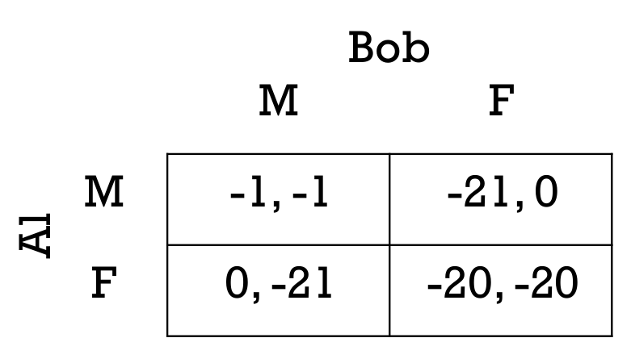

# 3. Static games, Pareto efficiency and dominance
## 1. What makes a game static and of complete information?

> [!info] Definition — Static game
> Players choose without observing the other players' choices for that interaction. Their decisions are treated as simultaneous, even if they occur at different physical times.

Imagine each player writing choices on opposite sides of a board, either at once or one after the other while the first choice remains hidden. In both cases, neither can react to the other's actual choice.

If player 2 sees player 1's choice before deciding, that is a different game. The second player can now use a conditional plan such as “choose left if the first player chose up.”

> [!info] Definition — Complete information and common knowledge
> The players, available actions, consequences, and payoff functions are assumed to be common knowledge. A fact $E$ is **common knowledge** if everyone knows $E$, everyone knows that everyone knows $E$, and this continues through every level of “knowing that others know.”

Assumption: **common knowledge of rationality**: everyone maximizes their own payoff, everyone knows that everyone does so, and so on. This is an additional behavioral assumption, used when eliminating strategies repeatedly.

Common knowledge matters when players reason about each other's reasoning. If $A$ predicts $B$ will avoid a move because it is always worse for $B$, $A$ relies on knowing that $B$ is rational. Further predictions can rely on $B$ knowing that $A$ is rational, and so on.

Complete information does **not** mean observing the opponent's chosen move. Also, choosing independently here means choosing without observing that move; it does not mean that choices or incentives have no effect on each other.

## 2. Actions, strategies, profiles, and normal form

- An **action** is a choice taken in the game. 
- A **strategy** is a plan specifying what action to take, while **pure strategy** is a deterministic plan. 
In the one-decision static games considered here, choosing a pure strategy is equivalent to choosing one action.

For example, in rock–paper–scissors, “play rock” is a pure strategy. “Choose rock, paper, or scissors using specified probabilities” is a **mixed strategy**. Complete information does not prohibit randomization; the analysis here focuses on pure strategies.

> [!info] Definition — Normal form
> For $n$ players:
>
> $$
> G=\{S_1,\ldots,S_n;u_1,\ldots,u_n\}.
> $$
>
> $S_i$ is player $i$'s set of pure strategies. A **strategy profile** or **joint strategy** is $s=(s_1,\ldots,s_n)$, with $s_i\in S_i$. Player $i$'s payoff function is
>
> $$
> u_i:S_1\times\cdots\times S_n\longrightarrow\mathbb{R}.
> $$

 $\times$ denotes a Cartesian product: all combinations with one choice from each set. 

The normal form is the mathematical specification of players, strategy sets, and payoff functions. A finite two-player game can be displayed as a **bimatrix**, with both players' payoffs in each cell. With three players, each cell needs three payoffs; separate two-dimensional tables can represent different choices of the third player. Continuous strategy sets generally require functions rather than a finite table.

*Figure 1. Cropped from Gth2003.pdf, PDF p. 13. Superscripts such as $(j)$ label strategies; they are not powers. Each cell evaluates the same profile for two different players. The written labels identify the payoffs even in grayscale.*

### Example: reading a payoff table

Players $A$ and $B$ choose independently. $A$ has $S_A=\{U,M,D\}$, meaning up, middle, and down; $B$ has $S_B=\{L,R\}$, meaning left and right. These labels have no further story attached.

| A \ B | $L$ | $R$ |
|---|---|---|
| $U$ | $(8,0)$ | $(0,5)$ |
| $M$ | $(1,0)$ | $(4,3)$ |
| $D$ | $(0,7)$ | $(2,0)$ |

If $A$ chooses $M$ and $B$ chooses $L$, the profile is $(M,L)$, while the payoff vector is $(1,0)$. These are different objects: choices versus their evaluations. Several profiles can even have identical payoff vectors.

Replacing the payoff $8$ at $(U,L)$ with $6$ leaves the dominance comparisons and elimination result unchanged.

## 3. Pareto efficiency: can someone improve without hurting anyone?

Pareto comparisons evaluate whole profiles from **all players'** perspectives. They ask whether another feasible profile would make someone better off without making anyone worse off.

> [!info] Definition — Pareto dominance and efficiency
> Profile $s'$ **Pareto dominates** profile $s$ if
>
> $$
> u_i(s')\geq u_i(s)\quad\text{for every player }i,
> $$
>
> and
>
> $$
> u_j(s')>u_j(s)\quad\text{for at least one player }j.
> $$
>
> A profile is **Pareto efficient** if no feasible profile Pareto dominates it.

The weak inequalities prevent anyone from losing. The one required strict inequality ensures a real improvement; equal payoff vectors do not dominate each other. Efficiency means that improving one player requires worsening at least one other player.

Here the feasible alternatives are the **pure profiles in the given game**. Adding lotteries or transfers would change the set over which efficiency must be checked.

### Example: the monetary prisoner's dilemma

Al chooses a row and Bob a column. Each chooses $M$, “pay one dollar yourself,” or $F$, “make the other player pay twenty dollars.” Choices are hidden until both commit. Payments add together, and utility equals the negative payment.

*Figure 2. Cropped from Gth2003.pdf, PDF p. 19. Payoff order is (Al, Bob). For instance, $(M,F)$ gives $(-21,0)$ because Al pays his own dollar and the twenty dollars imposed by Bob.*

At $(F,F)$, the payoff vector is $(-20,-20)$. At $(M,M)$, it is $(-1,-1)$. Since $-1>-20$ for both players, $(M,M)$ Pareto dominates $(F,F)$.

To find the **entire efficient set**, compare every candidate with every possible replacement:

| Profile | Payoff vector | Pareto assessment |
|---|---|---|
| $(M,M)$ | $(-1,-1)$ | Efficient: improving either player to $0$ makes the other fall to $-21$. |
| $(M,F)$ | $(-21,0)$ | Efficient: Bob already receives his unique maximum, $0$. Every other profile hurts him. |
| $(F,M)$ | $(0,-21)$ | Efficient by the corresponding argument for Al. |
| $(F,F)$ | $(-20,-20)$ | Inefficient: $(M,M)$ improves both players. |

Thus Pareto efficiency need not mean equality, fairness, or an attractive result for everyone. It also need not select one profile.

**Method.** For each cell, search the whole table for another cell whose two numbers are both at least as large, with one strictly larger. One such replacement proves inefficiency. To establish efficiency, rule out all replacements. Two profiles being incomparable with each other does not prove either efficient: a third profile might dominate both.

### The jail version has the same pure-choice incentives

We replace money with negative months in jail. $M$ means staying silent (“mum”), and $F$ means informing on the other prisoner (“fink”). Payoff order remains (Al, Bob).

| Al \ Bob | $M$ | $F$ |
|---|---|---|
| $M$ | $(-1,-1)$ | $(-9,0)$ |
| $F$ | $(0,-9)$ | $(-6,-6)$ |

Each player ranks the four situations in the same order as in the monetary version: exploiting silence, mutual silence, mutual informing, being informed on while silent. Both versions therefore give the same pure-strategy dominance and Pareto conclusions. Matching these rankings alone would not justify treating their preferences over lotteries as identical.

## 4. Strict dominance: is one of my choices always worse?

Now the question concerns **one player's strategies**: can that player replace a choice with another that gives a strictly higher payoff, whatever the others choose?

Write $s_{-i}$ for the list of all players' strategies except player $i$'s, and $S_{-i}=\prod_{j\ne i}S_j$ for all possible such lists. The subscript $-i$ means “everyone except $i$.”

> [!info] Definition — Strictly dominated strategy
> Player $i$'s strategy $s_i$ is **strictly dominated** by another strategy $t_i\in S_i$ if
>
> $$
> u_i(t_i,s_{-i})>u_i(s_i,s_{-i})
> \quad\text{for every }s_{-i}\in S_{-i}.
> $$
>
> The opponent's choice is held fixed in each comparison. Only player $i$ changes strategy.

A rational player does not choose a strictly dominated strategy: replacing it raises their payoff in every possible case. No probability estimate about opponents is needed. If probabilities were assigned to these cases, the weighted average improvement would also be strictly positive.

### Example: $M$ strictly dominates $D$

Return to the three-row game from Section 2. Compare **A's first payoffs** within each column:

| B's fixed choice | A's payoff from $D$ | A's payoff from $M$ | Improvement |
|---|---|---|---|
| $L$ | $0$ | $1$ | $1>0$ |
| $R$ | $2$ | $4$ | $4>2$ |

Both inequalities are strict, so A can discard $D$.

*Figure 3. Cropped from Gth2003.pdf, PDF p. 24. The crossed-out row is $D$. This matrix uses $6$ rather than $8$ at $(U,L)$; neither value affects $M$ dominating $D$.*

Do not compare $u_A(D,R)=2$ with $u_A(M,L)=1$ to challenge this result. That changes B's strategy too. Dominance compares $D$ and $M$ against the **same** column.

Nor is $M$ a strictly dominant strategy in the original game: against $L$, $U$ gives $8>1$. A strategy can dominate one alternative without dominating all alternatives.

### Strict, weak, dominated, and dominant

- A strategy is **strictly dominant** if it strictly dominates every other strategy of that player.
- A strategy is **strictly dominated** if some alternative strictly beats it against every opponent profile.
- A strategy $t_i$ **weakly dominates** $s_i$ if it is at least as good against every opponent profile and strictly better against at least one. An equality in even one case prevents strict dominance.

An equality in even one comparison prevents strict dominance. IESDS removes only strategies that are strictly worse against every remaining opponent profile.

| Comparison | Objects being compared | Whose utilities matter? | Required inequalities |
|---|---|---|---|
| Pareto dominance | Two complete profiles | Every player's | No player loses; at least one gains. |
| Strict strategy dominance | Two strategies of the same player | That player's only | A strict gain against every opponent profile. |

## 5. Iterated elimination of strictly dominated strategies

Removing one irrational choice can reveal another choice that is irrational in the smaller game. This is **iterated elimination of strictly dominated strategies**, abbreviated **IESDS**.

1. Search for a strictly dominated strategy in the current game.
2. For A's rows, compare first payoffs column by column. For B's columns, compare second payoffs row by row.
3. Record the dominating strategy and every required strict inequality, then remove the dominated row or column.
4. Search again using only the remaining rows and columns. Stop when no further deletion is justified.

The first deletion uses the affected player's rationality. Later deletions also use knowledge of other players' rationality. Common knowledge supports arbitrarily many rounds.

### Example: a unique surviving profile

**Round 1: remove A's $D$.** $M$ gives $1>0$ against $L$ and $4>2$ against $R$.

| A \ B | $L$ | $R$ |
|---|---|---|
| $U$ | $(8,0)$ | $(0,5)$ |
| $M$ | $(1,0)$ | $(4,3)$ |

**Round 2: remove B's $L$.** Compare B's second payoffs: $R$ gives $5>0$ against $U$ and $3>0$ against $M$. This deletion was invalid in the original game, because against $D$, $L$ gave B $7$ while $R$ gave $0$.

**Round 3: remove A's $U$.** Only column $R$ remains, where $M$ gives $4>0$. The unique survivor is profile $(M,R)$, with payoff vector $(4,3)$.

Check the final prediction against the original table: with B choosing $R$, A cannot improve on $M$ because the other payoffs are $0$ and $2$. With A choosing $M$, B cannot improve on $R$ because $L$ gives $0<3$. These are checks of **unilateral** changes: one player changes while the other stays fixed.

### Example: why the prisoner's dilemma is a dilemma

In the monetary version, Al compares $F$ with $M$:

- If Bob chooses $M$, $F$ gives $0>-1$.
- If Bob chooses $F$, $F$ gives $-20>-21$.

Thus $F$ is strictly dominant for Al. The same comparisons apply to Bob, so each player's $M$ can be removed immediately. The unique surviving profile is $(F,F)$ with payoffs $(-20,-20)$.

Yet $(M,M)$ gives $(-1,-1)$ and Pareto dominates it. The conflict is precise: **jointly** switching to $M$ helps both, but **individually** switching from $F$ to $M$ hurts a player who faces $F$. Even at $(M,M)$, either player can improve their own payoff from $-1$ to $0$ by switching alone to $F$. A collectively better outcome need not follow from individual payoff maximization.

## 6. When elimination cannot choose an outcome

IESDS may leave several strategies or fail to start. That is a limit of the method, not permission to remove another row arbitrarily. Surviving a dominance test does not by itself prove that a profile is an equilibrium or that rational players must choose it. These elimination tests compare pure strategies; checking domination by a random mixture requires expected utilities.

### Example — a profile without dominated strategies

A chooses $U,M,D$, B chooses $L,C,R$, and payoff order is (A, B).

| A \ B | $L$ | $C$ | $R$ |
|---|---|---|---|
| $U$ | $(0,5)$ | $(4,0)$ | $(7,3)$ |
| $M$ | $(4,0)$ | $(0,5)$ | $(7,3)$ |
| $D$ | $(3,7)$ | $(3,7)$ | $(9,9)$ |

For A, $U$ beats $M$ against $C$, but $M$ beats $U$ against $L$. $D$ beats $U$ against $L$, but loses to $U$ against $C$; it beats $M$ against $C$, but loses to $M$ against $L$. No row strictly dominates another.

For B, $L$ and $C$ trade advantages against $U$ and $M$. $R$ loses to $L$ against $U$ ($3<5$), but beats it against $M$ ($3>0$). Likewise, $R$ beats $C$ against $U$ but loses against $M$. No column strictly dominates another. IESDS cannot start.

Nevertheless, $(D,R)$ gives both players their maximum payoff, $9$, and Pareto dominates every other pure profile. If B chooses $R$, A prefers $D$ because $9>7$; if A chooses $D$, B prefers $R$ because $9>7$. These conditional incentives support this candidate, but IESDS alone does not select it or establish a complete equilibrium set.

### Example — odds and evens

Roles are assigned before play: Odd wins an odd sum, Even wins an even sum. Each independently chooses $0$ or $1$, representing an even or odd number. The winner receives four euros from the loser; utility equals the monetary transfer. Odd chooses rows, Even columns.

| Odd \ Even | $0$ | $1$ |
|---|---|---|
| $0$ | $(-4,4)$ | $(4,-4)$ |
| $1$ | $(4,-4)$ | $(-4,4)$ |

Against Even's $0$, Odd prefers $1$; against Even's $1$, Odd prefers $0$. Even wants matching choices, while Odd wants different choices. Thus neither player has a strictly dominated pure strategy. This conflict is called **discoordination**.

Every pure profile has a losing player who could gain by changing alone: when choices match, Odd can switch and win; when they differ, Even can switch and win. Therefore no deterministic profile has both players content to keep their choices. Mixed strategies allow players to make their realized choices unpredictable.

Payoffs sum to zero in every cell, so this is a **zero-sum game**. Every pure profile is Pareto efficient: increasing one payoff necessarily decreases the other. Efficiency therefore does not solve the prediction problem either.

### Example — rock–paper–scissors

A and B independently choose rock ($R$), paper ($P$), or scissors ($S$). The winner gains four euros, the loser loses four, and a tie gives zero. A chooses rows; payoff order is (A, B).

| A \ B | $R$ | $P$ | $S$ |
|---|---|---|---|
| $R$ | $(0,0)$ | $(-4,4)$ | $(4,-4)$ |
| $P$ | $(4,-4)$ | $(0,0)$ | $(-4,4)$ |
| $S$ | $(-4,4)$ | $(4,-4)$ | $(0,0)$ |

No pure strategy dominates another: for example, paper beats rock against $R$, but rock beats paper against $S$. The corresponding comparisons cycle for all pairs. At a tie, either player can change to the winning symbol; at a non-tie, the loser can change to beat the winner's fixed symbol. Hence no pure profile passes the no-profitable-unilateral-change check.

Each player's strategy set is $\{R,P,S\}$. Like odds and evens, this game is zero-sum and all its pure profiles are Pareto efficient.

### Example — Battle of the Sexes

Ann and Brian want to meet at a cinema but cannot communicate before choosing a movie. Both prefer meeting to missing each other. Ann prefers romance ($R$), Brian prefers science fiction ($S$). Ann chooses rows; payoff order is (Ann, Brian).

| Ann \ Brian | $R$ | $S$ |
|---|---|---|
| $R$ | $(2,1)$ | $(0,0)$ |
| $S$ | $(0,0)$ | $(1,2)$ |

For Ann, $R$ is better against Brian's $R$ ($2>0$), but $S$ is better against his $S$ ($1>0$). Brian likewise wants to match Ann's choice. No strictly dominated strategy can be removed.

Both $(R,R)$ and $(S,S)$ pass the unilateral-change check: leaving the shared movie would reduce the deviator's payoff to zero. Both are Pareto efficient, and neither Pareto dominates the other: Ann favors $(R,R)$, Brian favors $(S,S)$. Either coordinated profile dominates the mismatches. Thus individual rationality and efficiency still do not pick one shared movie. This is a **coordination game** with conflicting preferences over where to coordinate.