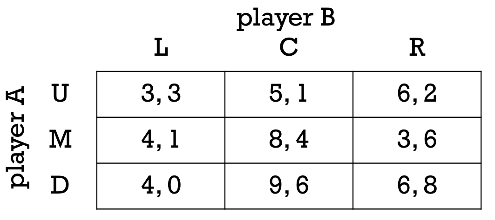
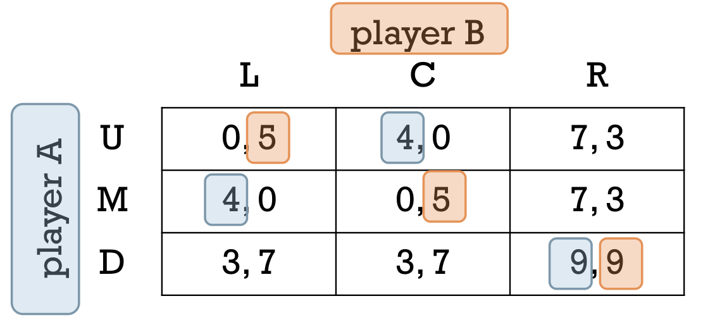

# 4. Best responses, beliefs and Nash equilibrium

## Prerequisites you need

A **player** is a decision maker. A **pure strategy** is a deterministic plan; in the one-decision static games here, it amounts to choosing one action. A **strategy profile** lists everyone's choices. A **payoff** or **utility** measures how much a player values the resulting profile: larger is better, so $-1$ is better than $-20$.

In a **static game**, players commit without observing the others' choices. **Complete information** means that the game's structure and payoff functions are known. The lecture also assumes common knowledge of rationality: everyone maximizes their own payoff, everyone knows this about everyone else, and so on. Knowing payoffs does not reveal chosen strategies.

The normal form is $G=\{S_1,\ldots,S_n;u_1,\ldots,u_n\}$, where $S_i$ is player $i$'s strategy set and $u_i(s)$ their payoff at profile $s$. Write $s_{-i}$ for everyone else's choices, and $S_{-i}=\prod_{j\ne i}S_j$ for all possible combinations of those choices. The symbol $\prod$ here denotes a Cartesian product of sets, not multiplication of payoffs.

For every two-player table below, the first named player chooses a row, the second a column, and payoff order is **(row player, column player)**. This lesson first finds **pure-strategy** Nash equilibria. Randomizing over pure strategies gives a mixed strategy, developed in the next lesson; finding all pure equilibria need not find all equilibria.

## 1. Best responses: what should I do if I know what others will do?

*Source: Gth2004.pdf, pp. 3–7.*

In a one-person decision problem, you can compare your choices directly. In a game, the best choice may depend on your opponent. Fixing the opponent's choice turns your part of the game into an ordinary maximization problem.

> [!info] Definition — Best response
> A strategy $s_i\in S_i$ is a **best response** to opponents' profile $s_{-i}$ if
>
> $$
> u_i(s_i,s_{-i})\geq u_i(t_i,s_{-i})
> \quad\text{for every alternative }t_i\in S_i.
> $$
>
> Opponents' choices stay fixed. There may be several best responses, tied at the largest payoff.

The **best-response correspondence** collects all maximizing choices:

$$
BR_i(s_{-i})=\operatorname*{arg\,max}_{t_i\in S_i}u_i(t_i,s_{-i}).
$$

Here $\max$ would return the largest **payoff**, while $\arg\max$ returns the **strategies attaining it**. Thus $BR_i$ returns a set, possibly a singleton containing one strategy. Formally, $BR_i:S_{-i}\to\mathcal{P}(S_i)$, where $\mathcal{P}(S_i)$ is the set of all subsets of $S_i$. For a finite, nonempty strategy set, at least one maximum exists.

Slide 7 calls this “not a function.” More precisely, it is not generally a single-strategy-valued function: it can be regarded as a function whose values are sets. Using $s_i\in BR_i(s_{-i})$, rather than equating a strategy to a set, keeps ties explicit.

### Worked lecture example: retain every tie

A chooses $U,M,D$ and B chooses $L,C,R$, independently. These are abstract row and column labels; all payoffs are known.

*Figure 1. Cropped from Gth2004.pdf, PDF p. 5. Each cell contains (A's payoff, B's payoff). Read first numbers down a fixed column for A, and second numbers across a fixed row for B.*

Against B's $R$, A compares $6,3,6$. Both $U$ and $D$ attain the maximum $6$, so $BR_A(R)=\{U,D\}$. Choosing either is rational against that fixed opponent choice. Do not discard one because its label comes later in the table.

The complete best-response lists are:

| B's choice | A's first payoffs, in order $U,M,D$ | $BR_A$ |
|---|---|---|
| $L$ | $3,4,4$ | $\{M,D\}$ |
| $C$ | $5,8,9$ | $\{D\}$ |
| $R$ | $6,3,6$ | $\{U,D\}$ |

| A's choice | B's second payoffs, in order $L,C,R$ | $BR_B$ |
|---|---|---|
| $U$ | $3,1,2$ | $\{L\}$ |
| $M$ | $1,4,6$ | $\{R\}$ |
| $D$ | $0,6,8$ | $\{R\}$ |

**Best response is conditional; dominance is uniform.** $U$ is a best response to $R$, but is not the best choice against $L$ or $C$. A dominant strategy would have to be at least as good as every alternative against every opponent choice.

> [!info] Result — Strictly dominated strategies are never best responses
> If another strategy $t_i$ satisfies $u_i(t_i,s_{-i})>u_i(s_i,s_{-i})$ for every opponents' profile, then $s_i$ is not a best response to any of those profiles.

**Proof and use.** For any fixed $s_{-i}$, $t_i$ gives a strictly larger payoff. That directly violates the best-response inequality for $s_i$. This justifies removing strictly dominated choices before searching for equilibria.

For example, in the lecture's Example 1 on p. 13, A's $D$ gives $0,2$ against $L,R$, whereas $M$ gives $1,4$. Since $1>0$ and $4>2$, $D$ cannot be a best response to either column.

## 2. Beliefs: rational decisions can rest on wrong predictions

*Source: Gth2004.pdf, pp. 6–7 and 19.*

A **belief** in this lecture's initial treatment is a predicted pure profile of the other players, an element of $S_{-i}$. If player $i$ believes opponents will choose $b_i\in S_{-i}$, rationality requires choosing a strategy in $BR_i(b_i)$.

This is an assumption about what the player expects, not observation of a move before acting. Later, beliefs can assign probabilities to several possible opponent profiles; those require expected-utility comparisons. No probability distribution is needed for the pure-profile beliefs used here.

**Original illustration using the lecture's Battle of the Sexes.** Ann and Brian separately choose romance ($R$) or science fiction ($S$). They prefer being together, but Ann prefers romance and Brian science fiction. Ann chooses rows; payoff order is (Ann, Brian).

| Ann \ Brian | $R$ | $S$ |
|---|---|---|
| $R$ | $(2,1)$ | $(0,0)$ |
| $S$ | $(0,0)$ | $(1,2)$ |

Suppose Ann believes Brian will choose $R$, so she chooses $R$ because $2>0$. Suppose Brian believes Ann will choose $S$, so he chooses $S$ because $2>0$. Both best respond to their own beliefs, but their actual choices are $(R,S)$ and both beliefs are wrong.

Thus **rationality conditional on beliefs does not ensure that beliefs are correct**. Nash equilibrium adds consistency between predictions and choices.

## 3. Nash equilibrium: everyone's prediction fits everyone's incentives

*Source: Gth2004.pdf, pp. 8–12 and 19.*

A proposed profile is self-enforcing if every player wants to keep their predicted choice when the others follow theirs. No player needs to change alone to obtain a strictly higher payoff.

> [!info] Definition — Pure-strategy Nash equilibrium
> A profile $s^*=(s_1^*,\ldots,s_n^*)$ is a **Nash equilibrium**, abbreviated **NE**, if
>
> $$
> u_i(s_i^*,s_{-i}^*)\geq u_i(t_i,s_{-i}^*)
> \quad\text{for every player }i\text{ and every }t_i\in S_i.
> $$
>
> Equivalently, $s_i^*\in BR_i(s_{-i}^*)$ for every player $i$. Everyone best responds, and everyone has correct beliefs about the opponents' equilibrium choices.

The star labels an equilibrium candidate, not an operation. The inequality is weak: a player may have equally good alternatives. What is excluded is a **strictly profitable unilateral deviation**, meaning one player changing while everyone else stays fixed.

**Why the condition is necessary.** If the inequality fails, there is a player and an alternative giving a strictly larger payoff against the proposed opponents' choices. That player has a reason to reject the prediction. One such deviation is enough to disprove equilibrium; verifying equilibrium requires checking every player and all their alternatives.

The “no regrets” intuition compares what a player could have earned by changing their own choice against fixed actual opponents. It does not assert that the profile maximizes their payoff over every cell of the table.

This is a **one-shot prediction**, not the last stage of an adjustment process. Players need not observe mistakes and repeatedly move until reaching it. Nor does the term “strategically stable” prove convergence of a learning process. With several equilibria, the definition restricts predictions but may not select one.

## 4. Finding all pure equilibria in a payoff table

*Source: Gth2004.pdf, pp. 13–17.*

1. For each column, compare only the first payoffs. Mark every maximum: these are the row player's best responses to that column.
2. For each row, compare only the second payoffs. Mark every maximum: these are the column player's best responses to that row.
3. Collect the cells marked for **both** players. They are exactly the pure-strategy Nash equilibria.
4. Report strategy profiles and payoff vectors separately. If there are no such cells, report **no pure-strategy NE**, not “no equilibrium of any kind.”

Never select the largest first and second numbers in the entire table independently. A unilateral deviation preserves the opponent's row or column; it does not allow the deviator to choose a different cell freely.

### Example 1: the equilibrium also found by elimination

A chooses $U,M,D$ and B chooses $L,R$. Payoff order is (A, B).

| A \ B | $L$ | $R$ |
|---|---|---|
| $U$ | $(6,0)$ | $(0,5)$ |
| $M$ | $(1,0)$ | $(4,3)$ |
| $D$ | $(0,7)$ | $(2,0)$ |

For A, $BR_A(L)=\{U\}$ and $BR_A(R)=\{M\}$. For B, $BR_B(U)=\{R\}$, $BR_B(M)=\{R\}$, and $BR_B(D)=\{L\}$. The only intersection is **$(M,R)$**, with payoffs **$(4,3)$**.

Directly, A's deviations from $M$ against $R$ yield $0$ or $2$, both below $4$. B's deviation from $R$ against $M$ yields $0<3$. The full best-response lists also exclude every other pure profile, establishing uniqueness among pure equilibria.

This PDF uses $6$ at $(U,L)$, consistently with the later slides of Lesson 3. Lesson 3's first presentation used $8$; both versions have the same best responses and elimination result.

### Example 2: Nash equilibrium when strict elimination cannot start

A chooses $U,M,D$ and B chooses $L,C,R$, with abstract labels and common knowledge of the following payoffs.

*Figure 2. Cropped from Gth2004.pdf, PDF p. 14. Boxes on first entries mark A's best responses; boxes on second entries mark B's. Only $(D,R)$ has both entries boxed. Number position makes the figure readable in grayscale.*

For A, $BR_A(L)=\{M\}$, $BR_A(C)=\{U\}$, and $BR_A(R)=\{D\}$. For B, $BR_B(U)=\{L\}$, $BR_B(M)=\{C\}$, and $BR_B(D)=\{R\}$. The only mutual best response is **$(D,R)$**, with payoff vector **$(9,9)$**.

A would get $7$ from either alternative against $R$, below $9$. B would get $7$ from either alternative against $D$, also below $9$. Neither player has a profitable unilateral deviation. Lesson 3 showed that no pure strategy strictly dominates another here: best-response checking can find an equilibrium even when that elimination method does nothing.

**Apply the method to Figure 1 as well.** Its complete best-response lists in Section 1 intersect only at $(D,R)$, giving $(6,8)$. In that game, $U$ is also a best response to $R$, but $(U,R)$ is not an NE because B prefers $L$ against $U$: $3>2$. One player's best response is insufficient.

### Examples with zero, two, or inefficient pure equilibria

**Odds and evens, p. 15.** Roles are fixed before play. Odd and Even each choose $0$ or $1$, without seeing the other. Equal choices make Even win; different choices make Odd win. The winner gains four euros and the loser loses four; utility equals the monetary transfer. Odd chooses rows.

| Odd \ Even | $0$ | $1$ |
|---|---|---|
| $0$ | $(-4,4)$ | $(4,-4)$ |
| $1$ | $(4,-4)$ | $(-4,4)$ |

At an equal-choice profile, Odd can switch and change their payoff from $-4$ to $4$. At a different-choice profile, Even can switch and do the same. Every cell has a profitable deviation, so there is **no pure-strategy NE**. Slide 15 explicitly anticipates an extension using randomized strategies; absence of a pure equilibrium is not absence of all Nash equilibria.

**Battle of the Sexes, p. 16.** Using Section 2's table, $BR_{\text{Ann}}(R)=\{R\}$ and $BR_{\text{Ann}}(S)=\{S\}$. Brian has the same matching best responses. Thus the complete pure equilibrium set is $\{(R,R),(S,S)\}$. At either shared movie, changing alone gives $0$, below the player's current $1$ or $2$. Each mismatch fails because a player can switch to the other's movie and gain. Neither strategy is dominant; both equilibria depend on coordination.

**Prisoner's dilemma, p. 17.** Al and Bob each choose $M$, paying one dollar themselves, or $F$, making the other pay twenty dollars. Payoff equals negative total payment. Al chooses rows.

| Al \ Bob | $M$ | $F$ |
|---|---|---|
| $M$ | $(-1,-1)$ | $(-21,0)$ |
| $F$ | $(0,-21)$ | $(-20,-20)$ |

For each player, $F$ is better against $M$ because $0>-1$, and better against $F$ because $-20>-21$. Therefore $F$ is their unique best response to either opponent choice. The only equilibrium is $(F,F)$, with payoffs $(-20,-20)$. This conclusion also excludes nondegenerate mixing: a player never benefits from placing positive probability on a strictly dominated $M$.

## 5. Strict elimination, dominant strategies, and Nash equilibrium

*Source: Gth2004.pdf, pp. 18 and 21–22.*

### Why strict elimination preserves equilibria

**Iterated elimination of strictly dominated strategies (IESDS)** repeatedly deletes a strategy that is strictly worse than another against every opponent profile remaining in the current game. After each deletion, recheck the smaller game. Later deletions rely on players knowing that opponents are rational.

> [!info] Results — IESDS and equilibrium in finite games
> Every Nash equilibrium survives IESDS. If exhaustive IESDS leaves exactly one strategy per player, the unique surviving profile is a Nash equilibrium. Exhaustive strict elimination is order independent under the fixed dominance rule used here; weak elimination does not share this general guarantee.

**Why an equilibrium survives.** At the first deletion, its strategy cannot be removed because it is a best response, while a strictly dominated strategy never is. Inductively, all equilibrium choices remain available, so the same argument applies at each later deletion. The argument also excludes positive equilibrium probability on an eliminated strategy when mixed strategies are considered.

**Why a sole survivor is an equilibrium.** Fix the final opponents' choices. Whenever one of a player's strategies was deleted, its replacement gave a strictly higher payoff against those opponents, since they survived every round. If the replacement was later deleted, follow its own superior replacement. In a finite game this chain reaches the player's final strategy. That final strategy therefore beats every deleted alternative against the final opponents. This holds for each player, proving the NE inequalities.

**Worked connection to Example 1.** Remove A's $D$ because $M$ gives $1>0$ against $L$ and $4>2$ against $R$. With $D$ gone, B's $R$ strictly dominates $L$: $5>0$ against $U$, and $3>0$ against $M$. With only $R$ left, A's $M$ strictly dominates $U$ because $4>0$. The sole survivor is $(M,R)$, already verified directly in Section 4.

If several strategies remain, **do not call all surviving profiles equilibria**. Figure 2 provides an example: all pure strategies survive the initial pure-strategy dominance test, but only one profile is a pure NE.

Slide 18 also states that a **unique rationalizable profile** is an NE. Rationalizability asks whether choices can be justified as best responses to beliefs consistent with repeated reasoning about rationality. Its full treatment allows probabilistic beliefs. The slides do not develop a separate rationalizability algorithm here; do not replace the NE test with “it is a best response to some pure opponent choice.” Equilibrium additionally requires mutually correct beliefs.

### Strict, weak, and the lecture's unqualified dominance

For two strategies $t_i,s_i$ of the same player:

| Term | Condition on $u_i(t_i,s_{-i})$ versus $u_i(s_i,s_{-i})$ |
|---|---|
| $t_i$ strictly dominates $s_i$ | $>$ for every $s_{-i}$. |
| $t_i$ weakly dominates $s_i$ | $\geq$ for every $s_{-i}$, and $>$ for at least one. |
| $t_i$ “dominates” $s_i$ on slide 21, without a qualifier | $\geq$ for every $s_{-i}$; no strict improvement is required. |

The last usage can include two strategies with identical payoff vectors. State whether dominance is strict or weak, since unqualified terminology varies.

A strategy is **dominant** if it dominates every other strategy of its player in the specified sense. If every player has such a strategy $s_i^*$, the profile $(s_1^*,\ldots,s_n^*)$ is an NE: each strategy maximizes that player's payoff against the actual opponents as well as all other opponents.

This condition is sufficient, not necessary. The prisoner's dilemma has strictly dominant $F$ for both players. Battle of the Sexes has equilibria without dominant strategies. Strict dominance of everyone's selected strategy yields uniqueness; weak or non-strict dominance alone does not ensure a unique equilibrium.

## 6. Why weakly dominated strategies cannot be deleted indiscriminately

*Source: Gth2004.pdf, p. 23.*

A weakly dominated strategy can still be a best response when the opponent chooses a case where the payoffs tie. Deleting it may erase a Nash equilibrium.

The lecture enlarges odds and evens with a third choice $P$, “punch the opponent.” This is a hypothetical payoff model: if either player chooses $P$, both receive $-5$. Otherwise the winner and loser receive $5$ and $-5$, respectively. Odd chooses rows, Even columns.

*Figure 3. Redrawn from Gth2004.pdf, PDF p. 23. Rows are Odd's choices, columns Even's; payoff order is (Odd, Even). The redraw removes overlapping deletion marks while preserving every strategy and payoff.*

For Odd, $P$ yields $(-5,-5,-5)$ across columns $0,1,P$, whereas $0$ yields $(-5,5,-5)$. Thus $0$ weakly dominates $P$ but does not strictly dominate it. For Even, $P$ yields second payoffs $(-5,-5,-5)$ across rows $0,1,P$, whereas $0$ yields $(5,-5,-5)$, so $P$ is weakly dominated for Even too.

Nevertheless, **$(P,P)$ is an NE**: given an opponent choosing $P$, all one's actions give $-5$. There is no strictly profitable deviation. The equilibrium permits indifference; players need not strictly prefer their equilibrium choices.

It is the **only pure NE**. With no $P$, the losing player can switch between $0$ and $1$ to win. With exactly one $P$, the player choosing $P$ can switch to the winning ordinary choice and increase their payoff from $-5$ to $5$.

Deleting $P$ for both players removes $(P,P)$ and leaves a game with no pure equilibrium. The slide's phrase “lost the only NE” must therefore be read as “lost the only **pure** NE.” It is not a statement that the game has no randomized equilibrium. Strict elimination preserves equilibria; weak elimination requires separate analysis.

## 7. Nash equilibrium, Pareto efficiency, and social cost

*Source: Gth2004.pdf, pp. 24–26.*

**Nash equilibrium** asks whether someone can improve by changing **alone**, keeping all other choices fixed. **Pareto efficiency** asks whether some feasible profile, possibly changing everyone's choices, makes everyone at least as well off and someone strictly better off.

The concepts test different alternatives. In the prisoner's dilemma, $(F,F)$ is an NE because switching alone to $M$ changes a player's payoff from $-20$ to $-21$. It is Pareto inefficient because a joint switch to $(M,M)$ changes both payoffs from $-20$ to $-1$.

Among that game's pure profiles, $(M,M)$, $(M,F)$, and $(F,M)$ are Pareto efficient. At $(M,F)$, Bob already has his unique maximum $0$, so every alternative hurts him; the reverse holds at $(F,M)$. At $(M,M)$, improving either player to $0$ hurts the other. None of these three profiles is an NE. This also shows why efficiency need not mean fairness.

The inefficiency arises from incentives in the specified payoffs. Rationality means maximizing one's utility; it need not mean selfishness if that utility already includes concern for others.

### Price of anarchy and price of stability

To measure inefficiency numerically, the problem must specify a **social cost** $K(s)$ to minimize. Two examples from slide 25, written with explicit player indices, are

$$
K_{\text{sum}}(s)=\sum_{j=1}^n[-u_j(s)],
\qquad
K_{\text{max}}(s)=\max_{1\leq j\leq n}[-u_j(s)].
$$

The first minimizes total disutility; the second minimizes the largest individual disutility. They express different social objectives. For a ratio interpretation, use the specified nonnegative cost with a **positive optimal cost**. Negating arbitrary positive utilities can produce negative costs; an arbitrary additive shift changes the ratio, so do not invent one silently.

Let $\mathcal{E}$ be the equilibrium set being considered, and let $K_{\mathrm{opt}}=\min_{s\in S}K(s)$ be the smallest cost over all feasible profiles $S$. For a finite game with a nonempty equilibrium set and positive $K_{\mathrm{opt}}$:

> [!info] Definition — Price of anarchy and price of stability
>
> $$
> \mathrm{PoA}=\frac{\max_{s\in\mathcal{E}}K(s)}{K_{\mathrm{opt}}},
> \qquad
> \mathrm{PoS}=\frac{\min_{s\in\mathcal{E}}K(s)}{K_{\mathrm{opt}}}.
> $$
>
> PoA compares the worst equilibrium with the social optimum. PoS compares the best equilibrium with the same optimum. Under these assumptions, $1\leq\mathrm{PoS}\leq\mathrm{PoA}$.

State whether $\mathcal{E}$ contains only pure equilibria or also mixed equilibria, and how cost is evaluated for randomized play. If there is no equilibrium in the stated class, or the denominator is zero, do not report an ordinary finite ratio using these formulas.

The social optimum is selected by $K$, not by calling any Pareto-efficient profile “best.” Minimizing total disutility selects a Pareto-efficient profile. A maximum-disutility objective can have tied optima, including Pareto-dominated ones; Pareto efficiency alone does not supply a unique scalar objective.

**Worked lecture application: prisoner's dilemma.** Use total monetary loss, $K(s)=-u_{\text{Al}}(s)-u_{\text{Bob}}(s)$.

| Profile | Total cost $K$ |
|---|---|
| $(M,M)$ | $2$ |
| $(M,F)$ or $(F,M)$ | $21$ |
| $(F,F)$ | $40$ |

The unique equilibrium has cost $40$; the optimum has cost $2$. Thus $\mathrm{PoA}=\mathrm{PoS}=40/2=20$. This measures total cost under the stated monetary model, not a universal ratio for every numerical version of the dilemma.

**Original example: different best and worst equilibria.** Suppose a coordination game has payoffs $(4,4)$ at $(X,X)$, $(2,2)$ at $(Y,Y)$, and $(0,0)$ at either mismatch. Both players independently choose $X$ or $Y$, and the two diagonal profiles are exactly the pure equilibria. Suppose the problem separately specifies social costs $2$ at $(X,X)$, $6$ at $(Y,Y)$, and $10$ at each mismatch. The optimum is $2$, so the **pure-equilibrium** prices are $\mathrm{PoA}=6/2=3$ and $\mathrm{PoS}=2/2=1$. Computing just the favorable equilibrium would miss the worst-equilibrium cost.

## 8. The grade game: a high joint payoff can unravel

*Source: Gth2004.pdf, pp. 27–28.*

Two students independently and secretly choose integers $x,y\in\{18,19,\ldots,30\}$. If their numbers match, both receive that number as their score. If they differ, let $L=\min\{x,y\}$. The student choosing $L$ receives $L+R$, while the other receives $L-R$, where $R>0$ is a known bonus/penalty parameter. The slide interprets scores below 18 as failure and above 30 as honors.

For the calculation, utility equals the **numeric score specified by the rule**. With player 1 choosing $x$ and player 2 choosing $y$,

$$
u_1(x,y)=
\begin{cases}
x, & x=y,\\
x+R, & x<y,\\
y-R, & x>y,
\end{cases}
\qquad u_2(x,y)=u_1(y,x).
$$

For $R=2$, choosing $(30,30)$ gives $(30,30)$, but player 1 can choose $29$ instead and get $29+2=31>30$. The resulting profile $(29,30)$ gives $(31,27)$, so the high common proposal is not self-enforcing.

### Deriving the equilibrium for $R>1$

**Exclude every equal pair above 18.** At $(k,k)$ with integer $k>18$, choosing $k-1$ instead yields

$$
k-1+R>k\quad\Longleftrightarrow\quad R>1.
$$

Therefore no such pair is an NE under the slide's assumption.

**Exclude every unequal pair.** Suppose $x<y$. Player 2 currently earns $x-R$ and can switch to $x$, earning $x$. Since $R>0$, this deviation is strictly profitable. The reverse argument applies when $y<x$.

**Check the boundary $(18,18)$.** A lower integer is unavailable. Choosing any larger integer against 18 gives $18-R<18$. Thus neither player improves by changing alone.

The unique **pure** NE is therefore **$(18,18)$**, with payoffs **$(18,18)$**, for $R>1$. It is Pareto dominated by $(30,30)$, but moving together and deviating alone are different comparisons. These checks cover every pure profile, not just the obvious symmetric candidates.

Slide 28 states uniqueness without a pure-strategy qualifier. Under the numeric-payoff model, randomization cannot add equilibria either. To see why, define a strategy's **support** as the numbers it chooses with positive probability, and take $k>18$ to be the largest number appearing in either player's support. If the opponent chooses $k$ with positive probability, replacing one's $k$ by $k-1$ never hurts against any number at most $k$ and strictly helps against $k$, since $R>1$. Its expected payoff, a probability-weighted average, is therefore strictly higher. If the opponent's largest supported number is instead $m<k$, replacing $k$ by $m$ leaves payoffs unchanged against every number below $m$ and improves them by $R$ against $m$. Either case contradicts choosing $k$ with positive probability at equilibrium. Hence only 18 can occur in equilibrium supports.

For $R=10$, the same equilibrium proof applies; the incentive to undercut a shared number is larger. Slide 28 comments that higher $R$ tends to discourage cooperation. Treat this as the lecture's behavioral observation, not a theorem predicting every student's behavior. The calculation assumes the stated numerical utility; alternative preferences over grades require checking incentives again. At $R=1$, the strict undercutting inequality fails, so the uniqueness proof cannot be reused.

## 9. Practice from the professor's handbook

References below are to **Chapter 1, Static games of complete information**, in *Game Theory. A Handbook of Problems and Excercises.pdf*. Each selected exercise also asks about mixed equilibria; here the tasks and solutions concern its **pure-strategy part**. Printed pages and PDF page indices are given separately.

### Tasks to attempt first

1. **Exercise 1.1, Jorah and Khaleesi attacking cities, printed p. 8 / PDF p. 14.** Construct the table and list every pure best response. Use a profitable deviation to exclude each pure profile.
2. **Exercise 1.3, transmitter and receiver, printed p. 12 / PDF p. 18.** Derive each payoff from the frequency and power rules, then find every pure NE. State whether your profile order is (transmitter, receiver).
3. **Exercise 1.4, choosing a thesis supervisor, printed p. 14 / PDF p. 20.** Eliminate the strictly dominated supervisor, then find all pure NE in the reduced game. Check that deviations to the removed choice cannot improve payoffs.

### Worked solution: Exercise 1.3

The transmitter $T$ chooses concentrated transmission ($C$), costing 2 power units, or spread-spectrum transmission ($S$), costing 9. The receiver $Q$ chooses one frequency ($A$) or two ($B$). They decide without coordinating or observing the other's move, and know the payoff rules. We label the receiver $Q$ here to avoid confusing the player with a strategy symbol.

Let $m$ be the number of frequencies used by the receiver: $m=1$ for $A$ and $m=2$ for $B$. Receiver utility is $2-m$ against $C$ and $2+m$ against $S$. Transmitter utility is twice receiver utility, plus $m$, minus its power cost.

Thus $(C,A)$ gives $u_Q=2-1=1$ and $u_T=2(1)+1-2=1$. Likewise, $(C,B)$ gives $u_Q=0$, $u_T=0$; $(S,A)$ gives $u_Q=3$, $u_T=6+1-9=-2$; $(S,B)$ gives $u_Q=4$, $u_T=8+2-9=1$.

| Transmitter \ Receiver | $A$ | $B$ |
|---|---|---|
| $C$ | $(1,1)$ | $(0,0)$ |
| $S$ | $(-2,3)$ | $(1,4)$ |

The transmitter prefers $C$ against $A$ ($1>-2$), but $S$ against $B$ ($1>0$). The receiver prefers $A$ against $C$ ($1>0$), but $B$ against $S$ ($4>3$). Therefore the pure NE are **$(C,A)$ and $(S,B)$**, with payoffs **$(1,1)$ and $(1,4)$**, respectively.

Each profile satisfies both deviation checks. The two other cells fail: at $(C,B)$, the transmitter gains by choosing $S$; at $(S,A)$, it gains by choosing $C$. This exhausts the four pure profiles. The handbook's prose lists these profiles in the reverse order $(A,C)$ and $(B,S)$; our answer follows the explicitly stated (transmitter, receiver) convention and its table.

### Solution routes for Exercises 1.1 and 1.4

**Exercise 1.1.** Each player chooses Meeren ($M$) or Yunkai ($Y$) without communication. Conquered cities have values 5 and 3. Khaleesi's payoff is the total value conquered; Jorah also gets 10 for choosing her city. Jorah chooses rows and Khaleesi columns:

| Jorah \ Khaleesi | $M$ | $Y$ |
|---|---|---|
| $M$ | $(15,5)$ | $(8,8)$ |
| $Y$ | $(8,8)$ | $(13,3)$ |

Jorah wants to match: $BR_J(M)=\{M\}$, $BR_J(Y)=\{Y\}$. Khaleesi wants different cities: $BR_K(M)=\{Y\}$, $BR_K(Y)=\{M\}$. No cell is a mutual best response. On either diagonal Khaleesi gains by switching; at either off-diagonal cell Jorah gains by switching. There is **no pure NE**. This does not answer the exercise's later mixed-strategy question.

**Exercise 1.4.** Charlotte and Daniel each choose Xavier ($X$), Yuan ($Y$), or Zingberry ($Z$). A sole student gets utility $40$, $60$, or $50$, respectively; sharing a supervisor reduces each student's utility to $70\%$ of that value. Choices and rules are known, but each choice is made without seeing the other's.

For either student, $Y$ strictly dominates $X$: against opponents' choices $(X,Y,Z)$, the payoffs from $Y$ are $(60,42,60)$, exceeding $X$'s $(28,40,40)$ in every position. Remove $X$ for both. With Charlotte on rows:

| Charlotte \ Daniel | $Y$ | $Z$ |
|---|---|---|
| $Y$ | $(42,42)$ | $(60,50)$ |
| $Z$ | $(50,60)$ | $(35,35)$ |

Each player wants $Z$ against $Y$ ($50>42$), and $Y$ against $Z$ ($60>35$). The complete pure NE set is **$\{(Y,Z),(Z,Y)\}$**. At $(Y,Z)$, Charlotte gets $60$; changing to $Z$ yields $35$, and changing to removed $X$ yields $40$. Daniel gets $50$; changing to $Y$ yields $42$, and changing to $X$ yields $40$. Neither improves. The symmetric argument checks $(Z,Y)$. Both diagonal cells fail, and no profile involving strictly dominated $X$ can be an NE.

## Exam quick reference

For the stated **75-minute written exam with printed material allowed and electronic devices forbidden**, the table below supports quick method selection. This exam format is user-provided context.

**Notation:** $s_i$ is player $i$'s strategy; $s_{-i}$ contains opponents' choices; $u_i$ is that player's payoff; $BR_i$ is their set of maximizing choices. In a bimatrix, payoffs are (row player, column player).

| Problem cue | Method | Main trap |
|---|---|---|
| “Best response to this choice” | Fix opponents; maximize only the responding player's payoff. | Retain every tied maximum. |
| “Find all pure NE” | Mark first-payoff maxima down each column and second-payoff maxima across each row; collect mutual marks. | One best-response mark is insufficient. |
| “Show this is not an NE” | Exhibit one player, one unilateral deviation, and a strict payoff gain. | Keep opponents' choices fixed. |
| “Show this is an NE” | Check every player's alternatives against the candidate opponents. | The test uses $\geq$, not $>$. |
| “Strict dominance / IESDS” | Compare strategies against every remaining opponent profile, then repeat after deleting. | A surviving profile need not be an equilibrium. |
| “Weakly dominated strategy” | Check equality cases and their equilibrium incentives. | Deleting it may remove an NE. |
| “Efficiency” | Compare full payoff vectors; a Pareto improvement hurts nobody and helps someone. | Joint improvements do not disprove an NE. |
| “Price of anarchy / stability” | Find the social optimum and costs of all equilibria in the specified class. | PoA uses the worst NE; PoS uses the best. |

**Core NE test:** $u_i(s_i^*,s_{-i}^*)\geq u_i(t_i,s_{-i}^*)$ for every player $i$ and alternative $t_i\in S_i$. Equivalently, $s_i^*\in BR_i(s_{-i}^*)$. Rational best responses plus **correct** beliefs are required.

**Cost ratios:** For specified social cost $K$, equilibrium set $\mathcal{E}$, and positive $K_{\mathrm{opt}}=\min_s K(s)$, use $\mathrm{PoA}=\max_{s\in\mathcal{E}}K(s)/K_{\mathrm{opt}}$ and $\mathrm{PoS}=\min_{s\in\mathcal{E}}K(s)/K_{\mathrm{opt}}$. Specify pure versus mixed equilibria and the associated feasible profiles.

**Grade game:** If integers lie in $\{18,\ldots,30\}$ and $R>1$, a shared $k>18$ is defeated by $k-1$ because $k-1+R>k$. At an unequal pair, the higher chooser benefits by matching the lower number. At $(18,18)$ no lower number is feasible and moving higher loses $R$. Equilibrium: $(18,18)$.

**Remember:** No pure NE does not mean no mixed NE. Multiple NE do not select one prediction. A strategy profile names choices; a payoff vector evaluates them. Complete information does not reveal current choices. Nash equilibrium does not require dominant strategies, Pareto efficiency, or a history of repeated adjustment.

## Sources, scope, and notation corrections

- **Gth2004.pdf**, all 28 PDF pages read and visually inspected. Best responses and beliefs: pp. 3–7; NE definition and interpretation: pp. 9–12 and 19; examples: pp. 13–17; IESDS and dominance: pp. 18, 21–23; efficiency and social cost: pp. 24–26; grade game: pp. 27–28.
- **Game Theory. A Handbook of Problems and Excercises.pdf**, Chapter 1, sections 1.2–1.4, printed pp. 2–4 / PDF pp. 8–10; Exercise 1.1, printed p. 8 / PDF p. 14; Exercise 1.3, printed p. 12 / PDF p. 18; Exercise 1.4, printed p. 14 / PDF p. 20. Only their relevant modeling, dominance, and pure-equilibrium material is used.
- **No transcript is present in the requested lesson folder.** Explanations and proof expansions above are based on the supplied slides and verified mathematics, not claims about an unrecorded lecture.
- On slide 4, the product of opponents' strategy sets must run over every player except $i$, ending at $S_n$ where appropriate. Slide 10's $\arg\max$ is written here using membership to preserve tied best responses. Slide 7's correspondence is explained as set-valued. Slides 15 and 23 are qualified explicitly as statements about **pure** equilibria. Slide 25's social-cost notation is expanded to $u_j(s)$, since each player's utility depends on the whole profile. The handbook's reversed profile order in Exercise 1.3 is made explicit in its worked solution.

Lecture page references are PDF page indices; handbook references distinguish printed pages from PDF indices. The three figures retain the original choices and payoff values, with the third redrawn for grayscale readability.
