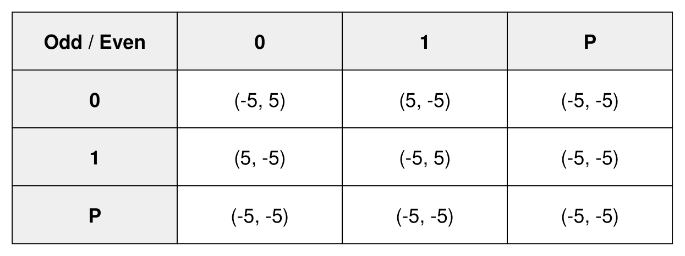

# 4. Best responses, beliefs and Nash equilibrium

## 1. Best responses

*Source: Gth2004.pdf, pp. 3–7.*

In a one-person decision problem, you can compare your choices directly. In a game, the best choice may depend on your opponent. Fixing the opponent's choice turns your part of the game into an ordinary maximization problem.

> [!info] Definition — Best response
> A strategy $s_i\in S_i$ is a **best response** to opponents' profile $s_{-i}$ if
>
> $$
> u_i(s_i,s_{-i})\geq u_i(t_i,s_{-i})
> \quad\text{for every alternative }t_i\in S_i.
> $$
>
> Opponents' choices stay fixed. There may be several best responses, tied at the largest payoff.

The **best-response correspondence** collects all maximizing choices:

$$
BR_i(s_{-i})=\operatorname*{arg\,max}_{t_i\in S_i}u_i(t_i,s_{-i}).
$$

Here $\max$ would return the largest **payoff**, while $\arg\max$ returns the **strategies attaining it**. Thus $BR_i$ returns a set, possibly a singleton containing one strategy. Formally, $BR_i:S_{-i}\to\mathcal{P}(S_i)$, where $\mathcal{P}(S_i)$ is the set of all subsets of $S_i$. For a finite, nonempty strategy set, at least one maximum exists.

Because ties are possible, $BR_i$ returns a set of strategies. A unique best response makes that set a singleton.

### Example — tied best responses

A chooses $U,M,D$ and B chooses $L,C,R$, independently. These are abstract row and column labels; all payoffs are known.

*Figure 1. Cropped from Gth2004.pdf, PDF p. 5. Each cell contains (A's payoff, B's payoff). Read first numbers down a fixed column for A, and second numbers across a fixed row for B.*

Against B's $R$, A compares $6,3,6$. Both $U$ and $D$ attain the maximum $6$, so $BR_A(R)=\{U,D\}$. Choosing either is rational against that fixed opponent choice. Do not discard one because its label comes later in the table.

The complete best-response lists are:

| B's choice | A's first payoffs, in order $U,M,D$ | $BR_A$ |
|---|---|---|
| $L$ | $3,4,4$ | $\{M,D\}$ |
| $C$ | $5,8,9$ | $\{D\}$ |
| $R$ | $6,3,6$ | $\{U,D\}$ |

| A's choice | B's second payoffs, in order $L,C,R$ | $BR_B$ |
|---|---|---|
| $U$ | $3,1,2$ | $\{L\}$ |
| $M$ | $1,4,6$ | $\{R\}$ |
| $D$ | $0,6,8$ | $\{R\}$ |

Best response depends on the opponents' choices. A strictly dominated strategy is never a best response: its dominating alternative gives a higher payoff against every opponents' profile.

## 2. Beliefs: rational decisions can rest on wrong predictions

Here, a **belief** is what a player expects the opponents to choose. It is a pure strategy profile $b_{-i}\in S_{-i}$; rationality requires choosing a strategy in $BR_i(b_{-i})$. A belief is a prediction, not an observed move.

### Example — beliefs in the Battle of the Sexes

*Gth2004.pdf, PDF p. 16.* Ann and Brian separately choose romance ($R$) or science fiction ($S$). Both prefer meeting, Ann prefers romance, and Brian prefers science fiction. Ann chooses rows; payoff order is (Ann, Brian).

| Ann \ Brian | $R$ | $S$ |
|---|---|---|
| $R$ | $(2,1)$ | $(0,0)$ |
| $S$ | $(0,0)$ | $(1,2)$ |

Suppose Ann believes Brian will choose $R$, so she chooses $R$ because $2>0$. Suppose Brian believes Ann will choose $S$, so he chooses $S$ because $2>0$. Both best respond to their own beliefs, but their actual choices are $(R,S)$ and both beliefs are wrong.

Thus **rationality conditional on beliefs does not ensure that beliefs are correct**. Nash equilibrium adds consistency between predictions and choices.

## 3. Nash equilibrium

A proposed profile is self-enforcing if every player wants to keep their predicted choice when the others follow theirs. No player needs to change alone to obtain a strictly higher payoff.

> [!info] Definition — Pure-strategy Nash equilibrium
> A profile $s^*=(s_1^*,\ldots,s_n^*)$ is a **Nash equilibrium**, abbreviated **NE**, if
>
> $$
> u_i(s_i^*,s_{-i}^*)\geq u_i(t_i,s_{-i}^*)
> \quad\text{for every player }i\text{ and every }t_i\in S_i.
> $$
>
> Equivalently, $s_i^*\in BR_i(s_{-i}^*)$ for every player $i$. Everyone best responds, and everyone has correct beliefs about the opponents' equilibrium choices.

The star labels an equilibrium candidate.
The inequality is weak: a player may have equally good alternatives. What is excluded is a **strictly profitable unilateral deviation**, meaning one player changing while everyone else stays fixed.

**Why the condition is necessary.** If the inequality fails, there is a player and an alternative giving a strictly larger payoff against the proposed opponents' choices. That player has a reason to reject the prediction. One such deviation is enough to disprove equilibrium; verifying equilibrium requires checking every player and all their alternatives.

The “no regrets” intuition compares what a player could have earned by changing their own choice against fixed actual opponents. It does not assert that the profile maximizes their payoff over every cell of the table.

This is a **one-shot prediction**, not the last stage of an adjustment process. Players need not observe mistakes and repeatedly move until reaching it. Nor does the term “strategically stable” prove convergence of a learning process. With several equilibria, the definition restricts predictions but may not select one.

## 4. Finding all pure equilibria in a payoff table

1. For each column, compare only the first payoffs. Mark every maximum: these are the row player's best responses to that column.
2. For each row, compare only the second payoffs. Mark every maximum: these are the column player's best responses to that row.
3. Collect the cells marked for **both** players. They are exactly the pure-strategy Nash equilibria.
4. Report strategy profiles and payoff vectors separately. If there are no such cells, report **no pure-strategy NE**, not “no equilibrium of any kind.”

Never select the largest first and second numbers in the entire table independently. A unilateral deviation preserves the opponent's row or column; it does not allow the deviator to choose a different cell freely.

### Example — equilibrium also found by elimination

A chooses $U,M,D$ and B chooses $L,R$. Payoff order is (A, B).

| A \ B | $L$ | $R$ |
|---|---|---|
| $U$ | $(6,0)$ | $(0,5)$ |
| $M$ | $(1,0)$ | $(4,3)$ |
| $D$ | $(0,7)$ | $(2,0)$ |

For A, $BR_A(L)=\{U\}$ and $BR_A(R)=\{M\}$. For B, $BR_B(U)=\{R\}$, $BR_B(M)=\{R\}$, and $BR_B(D)=\{L\}$. The only intersection is **$(M,R)$**, with payoffs **$(4,3)$**.

Directly, A's deviations from $M$ against $R$ yield $0$ or $2$, both below $4$. B's deviation from $R$ against $M$ yields $0<3$. The full best-response lists also exclude every other pure profile, establishing uniqueness among pure equilibria.

### Example — equilibrium when strict elimination cannot start

A chooses $U,M,D$ and B chooses $L,C,R$, with abstract labels and common knowledge of the following payoffs.

*Figure 2. Cropped from Gth2004.pdf, PDF p. 14. Boxes on first entries mark A's best responses; boxes on second entries mark B's. Only $(D,R)$ has both entries boxed. Number position makes the figure readable in grayscale.*

For A, $BR_A(L)=\{M\}$, $BR_A(C)=\{U\}$, and $BR_A(R)=\{D\}$. For B, $BR_B(U)=\{L\}$, $BR_B(M)=\{C\}$, and $BR_B(D)=\{R\}$. The only mutual best response is **$(D,R)$**, with payoff vector **$(9,9)$**.

A would get $7$ from either alternative against $R$, below $9$. B would get $7$ from either alternative against $D$, also below $9$. Neither player has a profitable unilateral deviation. Lesson 3 showed that no pure strategy strictly dominates another here: best-response checking can find an equilibrium even when that elimination method does nothing.

**Apply the method to Figure 1 as well.** Its complete best-response lists in Section 1 intersect only at $(D,R)$, giving $(6,8)$. In that game, $U$ is also a best response to $R$, but $(U,R)$ is not an NE because B prefers $L$ against $U$: $3>2$. One player's best response is insufficient.

### Further lecture examples

**Lecture example — Odds and evens, Gth2004.pdf, p. 15.** Odd and Even each choose $0$ or $1$ without seeing the other. Equal choices make Even win; different choices make Odd win. The winner gains four euros and the loser loses four; utility equals the monetary transfer. Odd chooses rows; payoffs are $(\text{Odd},\text{Even})$.

| Odd \ Even | $0$ | $1$ |
|---|---|---|
| $0$ | $(-4,4)$ | $(4,-4)$ |
| $1$ | $(4,-4)$ | $(-4,4)$ |

At an equal-choice profile, Odd can switch and change their payoff from $-4$ to $4$. At a different-choice profile, Even can switch and do the same. Every cell has a profitable deviation, so there is **no pure-strategy NE**. The slide later considers randomized strategies; absence of a pure equilibrium does not establish absence of all Nash equilibria.

Using Section 2's Battle of the Sexes table, $BR_{\text{Ann}}(R)=\{R\}$ and $BR_{\text{Ann}}(S)=\{S\}$. Brian has the same matching best responses. Thus the complete pure equilibrium set is $\{(R,R),(S,S)\}$. At either shared movie, changing alone gives $0$, below the player's current $1$ or $2$. Each mismatch fails because a player can switch to the other's movie and gain. Neither strategy is dominant; both equilibria depend on coordination.

**Lecture example — Prisoner's dilemma, Gth2004.pdf, p. 17.** Al and Bob each choose $M$, paying one dollar themselves, or $F$, making the other pay twenty dollars. Payoff equals negative total payment. Al chooses rows; payoffs are $(\text{Al},\text{Bob})$.

| Al \ Bob | $M$ | $F$ |
|---|---|---|
| $M$ | $(-1,-1)$ | $(-21,0)$ |
| $F$ | $(0,-21)$ | $(-20,-20)$ |

For each player, $F$ is better against $M$ because $0>-1$, and better against $F$ because $-20>-21$. Therefore $F$ is their unique best response to either opponent choice. The only equilibrium is $(F,F)$, with payoffs $(-20,-20)$. This conclusion also excludes nondegenerate mixing: a player never benefits from placing positive probability on a strictly dominated $M$.

## 5. Strict elimination, dominant strategies, and Nash equilibrium
### Why strict elimination preserves equilibria

**Iterated elimination of strictly dominated strategies (IESDS)** repeatedly deletes a strategy that is strictly worse than another against every opponent profile remaining in the current game. After each deletion, recheck the smaller game. Later deletions rely on players knowing that opponents are rational.

> [!info] Results — IESDS and equilibrium in finite games
> Every pure Nash equilibrium survives IESDS. If exhaustive IESDS leaves exactly one strategy per player, the unique surviving profile is a pure NE. Strict elimination is order independent; weak elimination does not share this guarantee.

**Worked connection to Example 1.** Remove A's $D$ because $M$ gives $1>0$ against $L$ and $4>2$ against $R$. With $D$ gone, B's $R$ strictly dominates $L$: $5>0$ against $U$, and $3>0$ against $M$. With only $R$ left, A's $M$ strictly dominates $U$ because $4>0$. The sole survivor is $(M,R)$, already verified directly in Section 4.

If several strategies remain, **do not call all surviving profiles equilibria**. Figure 2 provides an example: all pure strategies survive the initial pure-strategy dominance test, but only one profile is a pure NE.

A unique rationalizable profile is also an NE. The slides name this result without developing rationalizability further here.

### Strict, weak, and the lecture's unqualified dominance

For two strategies $t_i,s_i$ of the same player:

| Term | Condition on $u_i(t_i,s_{-i})$ versus $u_i(s_i,s_{-i})$ |
|---|---|
| $t_i$ strictly dominates $s_i$ | $>$ for every $s_{-i}$. |
| $t_i$ weakly dominates $s_i$ | $\geq$ for every $s_{-i}$, and $>$ for at least one. |
| $t_i$ “dominates” $s_i$ on slide 21, without a qualifier | $\geq$ for every $s_{-i}$; no strict improvement is required. |

The last usage can include two strategies with identical payoff vectors. State whether dominance is strict or weak, since unqualified terminology varies.

A strategy is **dominant** if it dominates every other strategy of its player in the specified sense. If every player has such a strategy $s_i^*$, the profile $(s_1^*,\ldots,s_n^*)$ is an NE: each strategy maximizes that player's payoff against the actual opponents as well as all other opponents.

This condition is sufficient, not necessary. The prisoner's dilemma has strictly dominant $F$ for both players, while Battle of the Sexes has equilibria without dominant strategies.

## 6. Weakly dominated strategies and equilibrium

A weakly dominated strategy can still be a best response when the opponent chooses a case where the payoffs tie. Deleting it may erase a Nash equilibrium.

A variant of odds and evens adds a third choice $P$, “punch the opponent.” If either player chooses $P$, both receive $-5$; otherwise the winner and loser receive $5$ and $-5$, respectively. Odd chooses rows, Even columns.

*Figure 3. Redrawn from Gth2004.pdf, PDF p. 23. Rows are Odd's choices, columns Even's; payoff order is (Odd, Even). The redraw removes overlapping deletion marks while preserving every strategy and payoff.*

For Odd, $P$ yields $(-5,-5,-5)$ across columns $0,1,P$, whereas $0$ yields $(-5,5,-5)$. Thus $0$ weakly dominates $P$ but does not strictly dominate it. For Even, $P$ yields second payoffs $(-5,-5,-5)$ across rows $0,1,P$, whereas $0$ yields $(5,-5,-5)$, so $P$ is weakly dominated for Even too.

Nevertheless, **$(P,P)$ is an NE**: given an opponent choosing $P$, all one's actions give $-5$. There is no strictly profitable deviation. The equilibrium permits indifference; players need not strictly prefer their equilibrium choices.

It is the **only pure NE**. With no $P$, the losing player can switch between $0$ and $1$ to win. With exactly one $P$, the player choosing $P$ can switch to the winning ordinary choice and increase their payoff from $-5$ to $5$.

Deleting $P$ for both players removes $(P,P)$ and leaves a game with no pure equilibrium. The slide's phrase “lost the only NE” must therefore be read as “lost the only **pure** NE.” It is not a statement that the game has no randomized equilibrium. Strict elimination preserves equilibria; weak elimination requires separate analysis.

## 7. Nash equilibrium, Pareto efficiency, and social cost

**Nash equilibrium** asks whether someone can improve by changing **alone**, keeping all other choices fixed. **Pareto efficiency** asks whether some feasible profile, possibly changing everyone's choices, makes everyone at least as well off and someone strictly better off.

The concepts test different alternatives. In the prisoner's dilemma, $(F,F)$ is an NE because switching alone to $M$ changes a player's payoff from $-20$ to $-21$. It is Pareto inefficient because a joint switch to $(M,M)$ improves both payoffs to $-1$.

Among that game's pure profiles, $(M,M)$, $(M,F)$, and $(F,M)$ are Pareto efficient. At $(M,F)$, Bob already has his unique maximum $0$, so every alternative hurts him; the reverse holds at $(F,M)$. At $(M,M)$, improving either player to $0$ hurts the other. None of these three profiles is an NE. This also shows why efficiency need not mean fairness.

### Price of anarchy and price of stability

To measure inefficiency numerically, the problem must specify a **social cost** $K(s)$ to minimize. Two examples from slide 25, written with explicit player indices, are

$$
K_{\text{sum}}(s)=\sum_{j=1}^n[-u_j(s)],
\qquad
K_{\text{max}}(s)=\max_{1\leq j\leq n}[-u_j(s)].
$$

The first minimizes total disutility; the second minimizes the largest individual disutility. They express different social objectives.

Let $\mathcal{E}$ be the equilibrium set and $K_{\mathrm{opt}}=\min_{s\in S}K(s)$ the lowest feasible social cost. Then:

> [!info] Definition — Price of anarchy and price of stability
>
> $$
> \mathrm{PoA}=\frac{\max_{s\in\mathcal{E}}K(s)}{K_{\mathrm{opt}}},
> \qquad
> \mathrm{PoS}=\frac{\min_{s\in\mathcal{E}}K(s)}{K_{\mathrm{opt}}}.
> $$
>
> PoA compares the worst equilibrium with the social optimum. PoS compares the best equilibrium with the same optimum.

**Lecture example — prisoner's dilemma, Gth2004.pdf, p. 26.** Use total monetary loss, $K(s)=-u_{\text{Al}}(s)-u_{\text{Bob}}(s)$.

| Profile | Total cost $K$ |
|---|---|
| $(M,M)$ | $2$ |
| $(M,F)$ or $(F,M)$ | $21$ |
| $(F,F)$ | $40$ |

The unique equilibrium has cost $40$; the optimum has cost $2$. Thus $\mathrm{PoA}=\mathrm{PoS}=40/2=20$ for this payoff table.

## 8. The grade game: a high joint payoff can unravel

Two students independently and secretly choose integers $x,y\in\{18,19,\ldots,30\}$. If their numbers match, both receive that number as their score. If they differ, let $L=\min\{x,y\}$. The student choosing $L$ receives $L+R$, while the other receives $L-R$, where $R>0$ is a known bonus/penalty parameter. The slide interprets scores below 18 as failure and above 30 as honors.

The calculation treats each numeric score as utility. With player 1 choosing $x$ and player 2 choosing $y$,

$$
u_1(x,y)=
\begin{cases}
x, & x=y,\\
x+R, & x<y,\\
y-R, & x>y,
\end{cases}
\qquad u_2(x,y)=u_1(y,x).
$$

For $R=2$, $(30,30)$ gives both 30, but one student can choose 29 and receive $29+2=31$. So $(30,30)$ is not an equilibrium.

### Deriving the equilibrium for $R>1$

At $(k,k)$ with $k>18$, choosing $k-1$ instead gives $k-1+R>k$ because $R>1$. So no such pair is an equilibrium.

At an unequal pair $x<y$, the student choosing $y$ improves by matching $x$, since $x>x-R$. The same argument applies with the players reversed. At $(18,18)$, choosing a higher number gives $18-R<18$, and no lower number is available. Hence $(18,18)$ is the unique **pure-strategy** NE for $R>1$. For $R=10$, the same result holds; the slide observes that the higher penalty discourages cooperation.