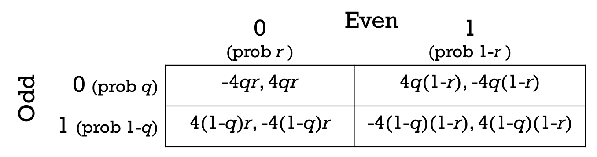
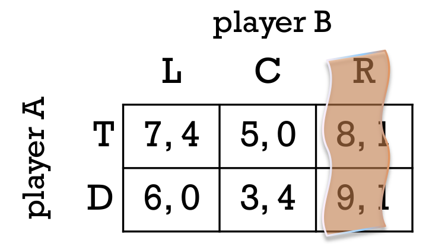
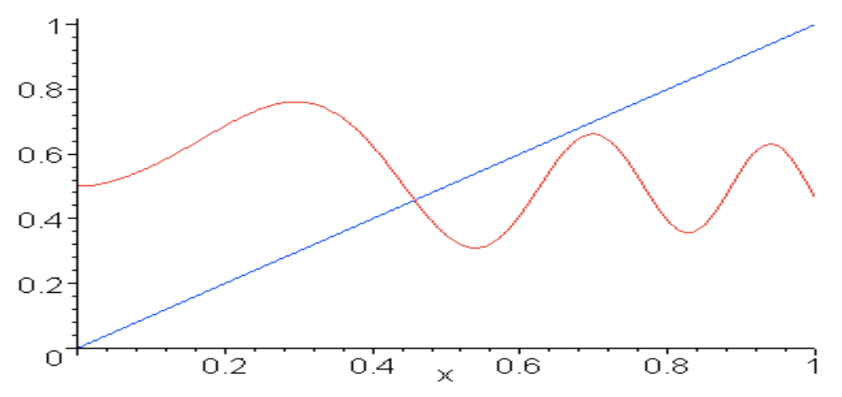

# 5. Mixed strategies and Nash theorem

## Prerequisites you need

A **strategy profile** lists one strategy for each player. In a payoff table, the first number belongs to the row player and the second to the column player. A **best response** gives a player the highest utility against the other players' fixed strategies. A **Nash equilibrium (NE)** is a profile where every player is best responding, so no one can gain by changing strategy alone.

Utilities can be averaged when outcomes are uncertain. An expected utility is a probability-weighted average, so payoff magnitudes matter, not only their ranking.

**Source scope.** The supplied recordings are named *Lecture 7 - Part 1* and *Lecture 7 - Part 2*, although this folder is Lesson 5. They cover Gth2007.pdf, PDF pp. 2–25. The PDF continues into other topics after p. 35; this note includes its relevant extension on best responses and the proof of Nash's theorem (pp. 26–35). Later material on dynamics, potential games, and complexity belongs outside this lesson.

## 1. Mixed strategies and expected utility

In odds and evens, either player can exploit a predictable pure choice. A player can instead choose a probability distribution over pure strategies. This makes the realized choice unpredictable while specifying a precise plan.

> [!info] Definition — Mixed strategy, simplex, and support
> For player $i$ with finite pure-strategy set $S_i$, a **mixed strategy** $m_i$ assigns a probability $m_i(s_i)$ to every $s_i\in S_i$ such that
>
> $$
> m_i(s_i)\geq 0,\qquad \sum_{s_i\in S_i}m_i(s_i)=1.
> $$
>
> The set of such distributions is the **simplex** $\Delta S_i$. Its **support** is the set of strategies played with positive probability:
>
> $$
> \operatorname{supp}(m_i)=\{s_i\in S_i:m_i(s_i)>0\}.
> $$

A pure strategy is a **degenerate mixed strategy** that assigns probability 1 to one choice. A mixture does not create a physical action between the original choices: the player ultimately selects one pure strategy according to the stated probabilities.

Assume players randomize independently. For pure profile $s=(s_1,\ldots,s_n)$, its probability under mixed profile $m=(m_1,\ldots,m_n)$ is $\prod_jm_j(s_j)$. Player $i$'s expected utility is

$$
u_i(m)=\sum_{s\in S_1\times\cdots\times S_n}\left(\prod_{j=1}^n m_j(s_j)\right)u_i(s).
$$

For a two-player table, multiply the row and column probabilities to get each cell's probability, multiply by its payoff, and add across cells.

### Lecture example — odds and evens

*Gth2007.pdf, PDF pp. 2–10; Lecture 7 - Part 1, 00:00–00:23.*

Odd and Even simultaneously choose 0 or 1. Odd wins if the sum is odd; Even wins if it is even. The winner receives four euros from the loser. Odd chooses rows; payoff order is (Odd, Even).

| Odd \\ Even | $0$ | $1$ |
|---|---:|---:|
| $0$ | $(-4,4)$ | $(4,-4)$ |
| $1$ | $(4,-4)$ | $(-4,4)$ |

Every pure outcome lets the loser switch and win, so no pure NE exists. Let $q=\Pr[\text{Odd chooses }0]$ and $r=\Pr[\text{Even chooses }0]$. Thus their probabilities of choosing 1 are $1-q$ and $1-r$.

*Figure 1. Gth2007.pdf, PDF p. 7. Each cell shows its payoff multiplied by its probability; for example, outcome $(0,1)$ occurs with probability $q(1-r)$.*

Adding Odd's weighted payoffs gives

$$
\begin{aligned}
u_O(q,r)&=-4qr+4q(1-r)+4(1-q)r-4(1-q)(1-r)\\
&=-16qr+8q+8r-4\\
&=-4(2q-1)(2r-1).
\end{aligned}
$$

The game is zero-sum, so $u_E(q,r)=-u_O(q,r)$. For example, at $(q,r)=(1/4,3/4)$, the outcome probabilities are $3/16,1/16,9/16,3/16$ in table order; they sum to 1, and Odd's expected utility is 1.

## 2. Mixed Nash equilibrium and support condition

A player may deviate to any other distribution while opponents' distributions stay fixed.

> [!info] Definition — Nash equilibrium in mixed strategies
> A mixed profile $m$ is an NE if, for every player $i$ and every alternative distribution $m_i'\in\Delta S_i$,
>
> $$
> u_i(m_i,m_{-i})\geq u_i(m_i',m_{-i}).
> $$
>
> Thus no player can improve expected utility by changing their own distribution, including by switching to a pure strategy.

Against fixed opponents, expected utility is linear in a player's probabilities:

$$
u_i(m_i,m_{-i})=\sum_{s_i\in S_i}m_i(s_i)u_i(s_i,m_{-i}).
$$

This weighted average cannot exceed its largest term. A best response therefore includes at least one pure best response; mixing among tied pure best responses is also optimal.

> [!info] Theorem — Support characterization
> A mixed profile $m$ is an NE exactly when, for every player $i$, all strategies in their support yield the same utility $v_i$, and every strategy outside the support yields no more:
>
> $$
> u_i(s_i,m_{-i})=v_i\quad(s_i\in\operatorname{supp}(m_i)),
> $$
>
> $$
> u_i(t_i,m_{-i})\leq v_i\quad(t_i\notin\operatorname{supp}(m_i)).
> $$

If two supported strategies gave different utilities, shifting probability toward the better one would improve the player's expected utility. The unused-strategy inequality is also essential: an unused choice that pays more would be a profitable deviation.

### Solving odds and evens

Odd's pure-choice utilities against Even's probability $r$ are

$$
u_O(0,r)=4-8r,\qquad u_O(1,r)=8r-4.
$$

Odd can mix only if these are equal, which gives $r=1/2$. Even's pure-choice utilities against Odd's $q$ are

$$
u_E(q,0)=8q-4,\qquad u_E(q,1)=4-8q.
$$

Even's indifference gives $q=1/2$. Against a fair mixture, both choices give each player utility 0, so neither can improve. The mixed NE is $(q,r)=(1/2,1/2)$.

It is unique. If Odd's current utility is negative, Odd can switch to $q=1/2$ and obtain zero. If it is positive, Even can switch to $r=1/2$ and obtain zero. If it is zero, the payoff formula implies $q=1/2$ or $r=1/2$. Unless both equal $1/2$, the player facing the biased mixture can choose a pure action and obtain a positive payoff. Hence no other profile is an NE. This follows the three-case exercise on Gth2007.pdf, p. 15.

## 3. Mixed dominance and elimination

Mixed strategies can dominate pure strategies even when no single pure strategy does. Strict dominance means a strategy gives strictly higher utility against every opponent profile. Weak dominance means it gives at least as much against every profile and strictly more against at least one.

In finite games, dominance by a mixed strategy can be checked against each pure opponent profile. Against a mixed profile, the utility difference is a weighted average of those pure-profile differences.

### Lecture example — a pure choice dominated by a mixture

*Gth2007.pdf, PDF pp. 17–19; Lecture 7 - Part 2, 00:01–00:06.*

Player A chooses $T$ or $D$; B chooses $L,C,R$. Payoff order is (A, B).

*Figure 2. Gth2007.pdf, PDF p. 17. The table marks B's choice $R$ for elimination.*

Against A's rows $T,D$, B's payoffs from $L$ are $4,0$, from $C$ are $0,4$, and from $R$ are $1,1$. The mixture $\tfrac12L+\tfrac12C$ gives B utility 2 against either row, strictly more than $R$'s utility 1. So $R$ is strictly dominated by this mixture, though neither $L$ nor $C$ alone strictly dominates it.

After removing $R$, A's $T$ strictly dominates $D$ because $7>6$ against $L$ and $5>3$ against $C$. With only $T$ left, B chooses $L$ because $4>0$. The surviving profile $(T,L)$ is an NE of the original game, with payoff $(7,4)$.

The slides state that exhaustive iterated elimination of strictly dominated strategies by mixed dominators preserves NE and has an order-independent surviving strategy set. Use strict dominance for these results: weakly dominated strategies can occur in an NE or its support.

## 4. Finding mixed equilibria

1. Check pure profiles for mutual best responses; eliminate strictly dominated strategies if useful.
2. Choose candidate supports and assign probabilities to strategies in them.
3. For each player who mixes, equalize the utilities of that player's supported pure strategies. This equation determines the **opponent's** probabilities.
4. Check each probability lies in range, support probabilities are positive, and probabilities sum to 1.
5. Check every unused strategy gives no more than the common support utility. Check boundary supports and pure equilibria before claiming the full set.

### Lecture example — Battle of the Sexes

*Gth2007.pdf, PDF pp. 21–22; Lecture 7 - Part 2, 00:14–00:22.*

Ann and Brian choose romance ($R$) or science fiction ($S$) simultaneously. Both prefer meeting to missing each other; Ann prefers $R$, while Brian prefers $S$. Ann chooses rows; payoff order is (Ann, Brian).

| Ann \\ Brian | $R$ | $S$ |
|---|---:|---:|
| $R$ | $(2,1)$ | $(0,0)$ |
| $S$ | $(0,0)$ | $(1,2)$ |

Let $q=\Pr[\text{Ann chooses }R]$ and $r=\Pr[\text{Brian chooses }R]$. Their expected utilities are

$$
u_A(q,r)=2qr+(1-q)(1-r),\qquad
u_B(q,r)=qr+2(1-q)(1-r).
$$

The pure NE are $(R,R)$ and $(S,S)$. If both players mix, Ann's indifference requires $2r=1-r$, so $r=1/3$. Brian's indifference requires $q=2(1-q)$, so $q=2/3$. Both probabilities are strictly between 0 and 1; each supported choice gives its player utility $2/3$. The mixed NE is $(q,r)=(2/3,1/3)$.

These are all the equilibria. Against a pure choice, the other player's best response is uniquely to match, so an equilibrium cannot have exactly one player mixing. If both mix, the indifference equations determine the probabilities uniquely. Thus the full set is

$$
\{(0,0),(1,1),(2/3,1/3)\}.
$$

At the mixed NE, they meet with probability $4/9$ and miss with probability $5/9$. An NE describes stable strategies, not a guaranteed outcome in one play.

## 5. Interpreting mixed strategies

The recordings discuss three interpretations.

- **Randomization:** a private random device can implement the probabilities. Across many independent repetitions, observed frequencies may approach the probabilities. Repeated strategic play with memory is a different model from repeated one-shot games.
- **Uncertainty or indecision:** the slides mention a fuzzy interpretation, but the model's mixed strategy remains an ordinary probability distribution over pure choices.
- **Beliefs:** a mixed strategy can represent an opponent's uncertainty about a player's hidden pure choice. At equilibrium, each player's strategy is a best response to the others' distributions, and those distributions match the beliefs used to predict play.

The belief interpretation is emphasized in the recording. It explains how an observer can predict a distribution without knowing the realized action. Uniform randomization is not automatic: equilibrium probabilities come from incentives. Odds and evens gives one half for each choice; Battle of the Sexes gives different probabilities.

## 6. Best responses and Nash's existence theorem

### Lecture example — Art and Bea

*Gth2007.pdf, PDF pp. 27–30.*

Art chooses $U,D$ and Bea chooses $F,G$ simultaneously. Payoff order is (Art, Bea).

| Art \\ Bea | $F$ | $G$ |
|---|---:|---:|
| $U$ | $(6,1)$ | $(0,4)$ |
| $D$ | $(2,5)$ | $(4,0)$ |

Let $q=\Pr[U]$ and $r=\Pr[F]$. Art's pure utilities are $6r$ from $U$ and $4-2r$ from $D$. Therefore Art chooses $D$ if $r<1/2$, $U$ if $r>1/2$, and can use any mixture if $r=1/2$. Bea's utilities are $5-4q$ from $F$ and $4q$ from $G$. Bea chooses $F$ if $q<5/8$, $G$ if $q>5/8$, and can mix if $q=5/8$.

The best-response correspondences intersect only at $(q,r)=(5/8,1/2)$. At that profile each player is indifferent between their two pure choices, so neither can gain by changing to another mixture. It is the unique NE.

*Figure 3. Gth2007.pdf, PDF p. 30. The intersection has $r=1/2$ horizontally and $q=5/8$ vertically. At each indifference threshold, the connecting segment represents every mixture that is a best response. The prose under the original slide swaps the probability labels; the plotted coordinates and payoff calculations give the values used here.*

### Nash's theorem

> [!info] Theorem — Nash
> Every finite normal-form game with finitely many players, finite nonempty strategy sets, and real-valued payoffs has at least one NE in mixed strategies.

The theorem guarantees existence, not uniqueness, efficiency, or an easy way to find an equilibrium. “In mixed strategies” includes pure equilibria represented as degenerate distributions. If a finite game has no pure NE, the theorem guarantees at least one equilibrium that uses non-pure mixing.

### Fixed points and the proof idea

A fixed point of a function $f$ is a point $x^*$ with $f(x^*)=x^*$. For a continuous function from $[0,1]$ to itself, a fixed point exists: $g(x)=f(x)-x$ is continuous, with $g(0)\geq0$ and $g(1)\leq0$, so it has a zero by the intermediate value theorem (or at an endpoint).

*Figure 4. Gth2007.pdf, PDF p. 34. A crossing of $f(x)$ with $y=x$ is a fixed point; multiple crossings show that existence does not imply uniqueness.*

In games, a best response may not be unique, especially when a player is indifferent. The correct object is therefore a **correspondence**, which returns a set of best responses. For each player $i$, let $BR_i(m_{-i})$ be the set of distributions maximizing expected utility against opponents' profile $m_{-i}$. Define the joint correspondence

$$
BR(m)=BR_1(m_{-1})\times\cdots\times BR_n(m_{-n}).
$$

A profile $m$ is an NE exactly when $m\in BR(m)$. The mixed-profile space $\Delta S=\prod_i\Delta S_i$ is nonempty, compact, and convex. Each best-response set is nonempty because expected utility is continuous on a compact simplex; it is convex because mixtures of best responses remain best responses. Continuity of expected utility also gives $BR$ a closed graph.

Kakutani's fixed-point theorem states that a correspondence from a nonempty compact convex set to itself has a fixed point when its values are nonempty and convex and its graph is closed. Applying it to $BR$ gives $m^*\in BR(m^*)$, which is precisely an NE. The PDF's one-dimensional fixed-point step names Bolzano–Weierstrass; the sign-change argument uses the intermediate value theorem.

## Exam quick reference

| Task | Procedure | Check |
|---|---|---|
| Expected utility | Multiply independent action probabilities; weight payoffs; sum. | Joint outcome probabilities sum to 1. |
| Mixed equilibrium | Equalize each player's supported pure payoffs. | The equation solves for opponent's probabilities. |
| Candidate support | Check positivity and sum-to-one. | Every unused strategy pays no more than support strategies. |
| Mixed dominance | Compare expected payoffs against each pure opponent profile. | Strict dominance requires strict gain in every case. |
| Existence | Apply Nash's theorem to a finite game. | Existence gives no uniqueness or efficiency claim. |

## Sources

- *Gth2007.pdf*, PDF pp. 2–35. Figures 1–4 use crops stored in this lesson's `Pics/` folder.
- *Lecture 7 - Part 1.transcript.txt*, 00:00–00:33; *Lecture 7 - Part 2.transcript.txt*, 00:00–00:37. Part 2 ends before the existence proof; proof details above come from the PDF.

Slide references are PDF page indices. Transcript speech-recognition slips were checked against the payoff tables and equations.
