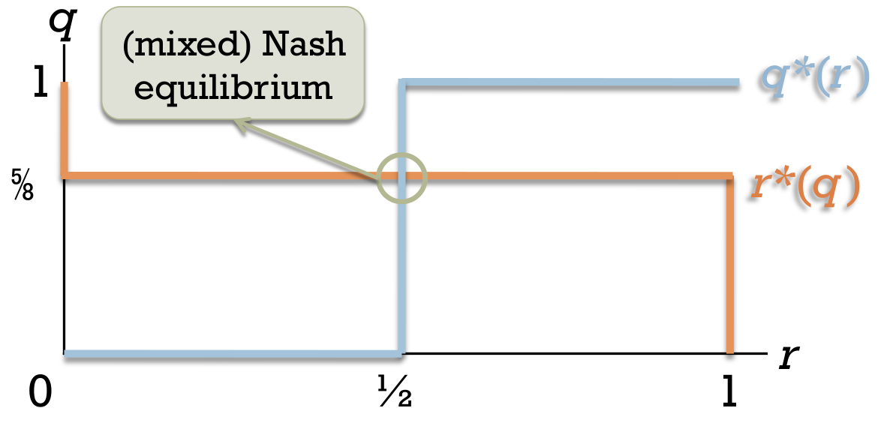
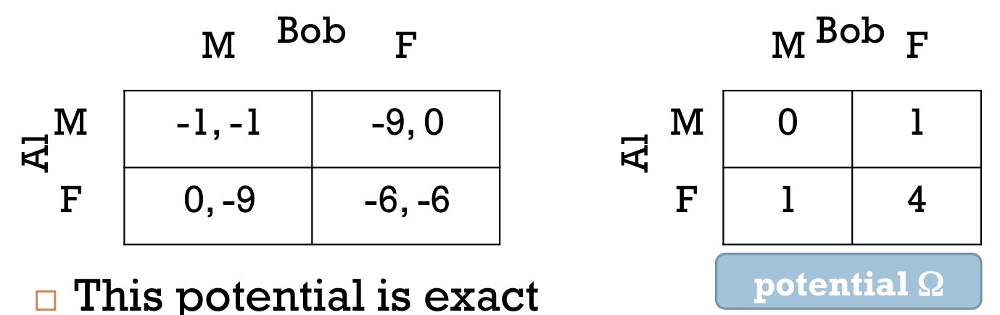
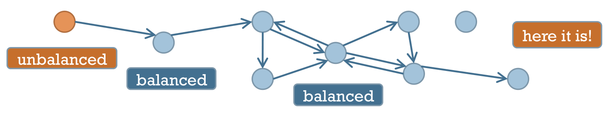

# 5. Mixed strategies and Nash theorem

## Prerequisites you need

A **player** chooses a strategy to maximize their own **utility**, a numerical evaluation of the result. A **pure strategy** specifies a definite choice. A **profile** lists everyone's strategies. In a two-player payoff table, player A chooses a row, B chooses a column, and each pair is **(A's utility, B's utility)**.

A **best response** maximizes your utility while opponents' strategies stay fixed. A **Nash equilibrium (NE)** is a profile in which every player best responds: nobody can improve by changing alone. Equality is allowed. A strategy is **strictly dominated** if another strategy gives its player strictly more utility against every opponent profile.

A probability is between 0 and 1. Probabilities of all alternatives sum to 1. An **expected utility** is a probability-weighted average of utilities; it need not be a payoff that occurs in any single play. The numerical payoffs here are interpreted as expected-utility values. Their magnitudes, not just their ranking, matter when calculating averages.

**Source scope.** The folder's recordings are named **Lecture 7**, although this folder is Lesson 5. Part 1 covers mixed strategies and odds and evens; Part 2 covers mixed dominance, the support theorem, Battle of the Sexes, Nash's existence statement, and interpretations of mixing. They correspond approximately to PDF pp. 2–24. The supplied `Gth2007.pdf` also contains pp. 25–55 on best responses, the existence proof, dynamics, potential games, and complexity. Those additional supplied topics are included separately below; they are not attributed to these two recordings.

## 1. Mixed strategies: choose a distribution, then a pure action

*Sources: Gth2007.pdf, pp. 2–10; Part 1, 00:00–00:23.*

In odds and evens, any predictable pure choice can be exploited. Can a player instead commit to an unpredictable choice rule? A mixed strategy makes this precise.

> [!info] Definition — Mixed strategy, simplex, and support
> For player $i$ with finite pure-strategy set $S_i$, a **mixed strategy** $m_i$ assigns a probability $m_i(s_i)$ to each $s_i\in S_i$, with
>
> $$
> m_i(s_i)\geq0,\qquad\sum_{s_i\in S_i}m_i(s_i)=1.
> $$
>
> The set of all these distributions is the **simplex** $\Delta S_i$. The **support** is
>
> $$
> \operatorname{supp}(m_i)=\{s_i\in S_i:m_i(s_i)>0\}.
> $$

For $S_i=\{R,P,S\}$, the distribution $(1/2,1/2,0)$ mixes rock and paper; its support is $\{R,P\}$. The distribution $(1,0,0)$ is the pure strategy rock represented as a **degenerate** mixed strategy. A **fully mixed** strategy gives every pure strategy positive probability. A non-pure mixture need not be fully mixed when more than two choices exist.

Mixing does not create a physical action halfway between two original actions. If you mix between 0 and 1, you eventually play either 0 or 1. The probability distribution is your plan; the realized pure action is its random result.

### Expected utility under independent mixing

Let $S=S_1\times\cdots\times S_n$ be all pure profiles, and $m=(m_1,\ldots,m_n)$ a mixed profile. With **independent private randomizations**, the probability of pure profile $s=(s_1,\ldots,s_n)$ is $\prod_j m_j(s_j)$. Therefore

$$
u_i(m)=\sum_{s\in S}\left[\prod_{j=1}^{n}m_j(s_j)\right]u_i(s).
$$

For two players, multiply row probability by column probability, multiply that joint probability by the utility, and sum over all cells. This product assumption concerns how random choices are generated; knowledge of the payoff table alone does not establish independence. A shared correlating signal would require a different joint distribution.

### Worked lecture example: odds and evens

Odd and Even simultaneously choose 0 or 1. Odd wins when the sum is odd; Even wins when it is even. A winner receives four euros from the loser, and utilities equal these transfers. Odd chooses rows, Even columns:

| Odd \ Even | $0$ | $1$ |
|---|---|---|
| $0$ | $(-4,4)$ | $(4,-4)$ |
| $1$ | $(4,-4)$ | $(-4,4)$ |

At every pure profile the loser can switch and win, so there is no pure NE. Define

$$
q=\Pr[\text{Odd chooses }0],\qquad
r=\Pr[\text{Even chooses }0].
$$

These probabilities describe each player's randomization before the actions are revealed. Conditional on the chosen distribution, Odd chooses 1 with probability $1-q$, and Even chooses 1 with probability $1-r$.

*Figure 1. Cropped from Gth2007.pdf, PDF p. 7. Entries are probability-weighted contributions, not new realized payoffs. For example, $(0,1)$ occurs with probability $q(1-r)$ and contributes $4q(1-r)$ to Odd's expectation.*

Adding Odd's four contributions gives

$$
\begin{aligned}
u_O(q,r)
&=-4qr+4q(1-r)+4(1-q)r-4(1-q)(1-r)\\
&=-16qr+8q+8r-4\\
&=-4(2q-1)(2r-1).
\end{aligned}
$$

The game is **zero-sum**, so $u_E(q,r)=-u_O(q,r)$. For example, with $q=1/4$ and $r=3/4$, the four outcome probabilities are $3/16,1/16,9/16,3/16$. They sum to 1, and Odd's expected utility is $1$.

**Endpoint trap:** because $q$ is the probability of action **0**, $q=1$ means always playing 0; $q=0$ means always playing 1. The numerical action label and the probability parameter are different objects.

## 2. Mixed Nash equilibrium and why support strategies tie

*Sources: Gth2007.pdf, pp. 13–15 and 20; Part 1, 00:29–00:33; Part 2, 00:06–00:14.*

Write $m_{-i}$ for all distributions except player $i$'s. A unilateral deviation changes $m_i$, while $m_{-i}$ remains fixed.

> [!info] Definition — Nash equilibrium in mixed strategies
> A mixed profile $m$ is an NE if
>
> $$
> u_i(m_i,m_{-i})\geq u_i(m_i',m_{-i})
> \quad\text{for every player }i\text{ and every }m_i'\in\Delta S_i.
> $$
>
> Players cannot improve expected utility by changing their own distribution, including switching to a pure strategy.

Against fixed opponents, your expected payoff is linear in your probabilities:

$$
u_i(m_i,m_{-i})
=\sum_{s_i\in S_i}m_i(s_i)u_i(s_i,m_{-i}).
$$

A weighted average cannot exceed its largest component. Therefore a best response always includes a pure maximizer, although mixtures among tied maximizers are also best responses.

> [!info] Support characterization — Indifference plus no profitable unused choice
> In a finite game, $m$ is an NE exactly when, for every player $i$, there is a value $v_i$ such that
>
> $$
> u_i(s_i,m_{-i})=v_i\quad\text{for every }s_i\in\operatorname{supp}(m_i),
> $$
>
> and
>
> $$
> u_i(t_i,m_{-i})\leq v_i\quad\text{for every }t_i\notin\operatorname{supp}(m_i).
> $$
>
> The equilibrium expected payoff is $u_i(m)=v_i$.

**Why this holds.** If a supported choice paid less than another choice, transferring probability to the better choice would improve utility. All positive-probability choices must therefore attain the same maximum. Conversely, if every supported choice attains that maximum and no unused choice is better, no alternative mixture can improve on their average.

A pure NE remains an NE when mixed deviations are admitted: if no pure alternative beats it, no average of alternatives can beat it either. Thus “mixed-strategy space” includes pure equilibria; “non-pure equilibrium” specifically means some player actually randomizes.

### Solving odds and evens, including uniqueness

Odd's utilities from the two pure choices against Even's $r$ are

$$
u_O(0,r)=4-8r,\qquad u_O(1,r)=8r-4.
$$

For Odd to mix, these must tie: $4-8r=8r-4$, giving $r=1/2$. Even's pure utilities against Odd's $q$ are

$$
u_E(q,0)=8q-4,\qquad u_E(q,1)=4-8q,
$$

so Even's indifference requires $q=1/2$. Both probabilities are valid, and both utilities are 0. Against an opponent mixing equally, every pure choice, and hence every mixture, gives utility 0: neither player has a profitable deviation.

To show this is the **only** NE, follow slide 15's three cases:

1. If $u_O(q,r)<0$, Odd can switch to $q=1/2$ and obtain 0.
2. If $u_O(q,r)>0$, Even's utility is negative, and Even can switch to $r=1/2$ to obtain 0.
3. If $u_O(q,r)=0$, at least one parameter is $1/2$. If only $q=1/2$, Odd can exploit the biased $r$: choose 0 if $r<1/2$, or 1 if $r>1/2$, obtaining a positive payoff. If only $r=1/2$, Even can exploit the biased $q$: choose 0 if $q>1/2$, or 1 if $q<1/2$.

Only $(q,r)=(1/2,1/2)$ survives. A zero payoff alone does not prove equilibrium: both players' deviation incentives must be checked. This also corrects Part 1's slip near 00:31:44: if Even always chooses 0 ($r=1$), Odd should choose **1**, meaning $q=0$.

## 3. Dominance by a mixture and iterative elimination

*Sources: Gth2007.pdf, pp. 11–12 and 17–19; Part 1, 00:23–00:29; Part 2, 00:01–00:06.*

The definitions of strict and weak dominance extend to mixed strategies: compare expected utilities against every opponents' mixed profile. **Strict** dominance requires a strict improvement everywhere; **weak** dominance requires no loss anywhere and a strict improvement somewhere.

For finite games, it is enough to test each opponents' **pure profile**. Any mixed-opponent payoff difference is a weighted average of the pure-profile differences. If every such difference is positive, their average is positive; nonnegative differences similarly remain nonnegative. Conversely, pure opponents are included among the possible mixed opponents.

### Worked lecture example: a pure choice dominated only by mixing

A independently chooses $T$ or $D$; B chooses $L,C,R$. Labels are abstract and the payoffs are known.

*Figure 2. Cropped from Gth2007.pdf, PDF p. 17. The marked column is $R$. Payoff order is (A, B).*

For B, $L$ gives $(4,0)$ against rows $(T,D)$, $C$ gives $(0,4)$, and $R$ gives $(1,1)$. Neither pure $L$ nor pure $C$ strictly dominates $R$. But the mixture $m_B=\tfrac12L+\tfrac12C$ gives

$$
u_B(T,m_B)=\tfrac12(4)+\tfrac12(0)=2,
\qquad
u_B(D,m_B)=\tfrac12(0)+\tfrac12(4)=2.
$$

Both exceed $R$'s payoff 1, so remove $R$. This guarantees an **expected** utility of 2 against either row, not a realized payoff of 2 on every draw.

More generally, $pL+(1-p)C$ dominates $R$ when $4p>1$ and $4(1-p)>1$, or $1/4<p<3/4$. The fair mixture is one convenient witness.

After removing $R$, A's $T$ strictly dominates $D$: $7>6$ against $L$ and $5>3$ against $C$. With only $T$ remaining, B prefers $L$ because $4>0$. The sole surviving profile is **$(T,L)$**, giving **$(7,4)$**. In the original game, A's alternatives against $L$ give $6<7$, and B's alternatives against $T$ give $0,1<4$, verifying the result.

In finite games, exhaustive **iterated elimination of strictly dominated strategies allowing mixed dominators**, abbreviated IESDSm in the slides, preserves all NE and has an order-independent surviving pure-strategy set under that elimination rule. A strictly dominated pure strategy cannot have positive equilibrium probability. Use strict dominance: weak elimination can remove equilibria or members of an equilibrium support. Part 2's “order ... relevant” at 00:05:20 is a recognition error; slide 19 says **irrelevant**.

## 4. How to calculate mixed equilibria in exercises

*Sources: Gth2007.pdf, pp. 20–22; Part 2, 00:14–00:22; handbook, §1.5.*

1. Find all pure NE by checking mutual best responses. Remove strictly dominated strategies if useful.
2. Choose candidate supports: the strategies each player will use with positive probability.
3. Introduce probabilities, defining exactly whose choice each probability describes.
4. Make each player's **supported pure choices** equally good against the opponent's distribution. Your indifference equation determines the **opponent's** probability.
5. Check nonnegativity, sum-to-one constraints, strict positivity for all proposed support members, and inequalities for every unused strategy.
6. Include valid boundary cases and other support combinations before claiming a complete equilibrium set. A zero probability means a smaller support.

If an indifference equation has no solution, that proposed support cannot be an equilibrium. If it holds identically, a range of probabilities may be possible; do not divide by zero or assume uniqueness.

### Worked lecture example: Battle of the Sexes

Ann and Brian choose romance ($R$) or science fiction ($S$) without communicating. Both prefer meeting to missing each other; Ann prefers romance, Brian science fiction. Ann chooses rows:

| Ann \ Brian | $R$ | $S$ |
|---|---|---|
| $R$ | $(2,1)$ | $(0,0)$ |
| $S$ | $(0,0)$ | $(1,2)$ |

Let $q=\Pr[\text{Ann chooses }R]$ and $r=\Pr[\text{Brian chooses }R]$. Expected utilities are

$$
u_A(q,r)=2qr+(1-q)(1-r),\qquad
u_B(q,r)=qr+2(1-q)(1-r).
$$

The pure NE are $(R,R)$ and $(S,S)$. For an equilibrium where both mix, Ann must be indifferent:

$$
u_A(R,r)=2r=1-r=u_A(S,r)
\quad\Longrightarrow\quad r=\frac13.
$$

Brian must also be indifferent:

$$
u_B(q,R)=q=2(1-q)=u_B(q,S)
\quad\Longrightarrow\quad q=\frac23.
$$

Both probabilities lie strictly between 0 and 1. Each supported pure choice gives its player $2/3$, and there are no unused choices to check. Therefore $(q,r)=(2/3,1/3)$ is an NE.

This completes the equilibrium set: if one player is pure, the other's best response is uniquely to match, so an equilibrium with exactly one mixing player is impossible. If both mix, the preceding equations determine a unique pair. In probability notation the full set is

$$
\mathcal E=\{(0,0),(1,1),(2/3,1/3)\}.
$$

At the mixed equilibrium, the four outcome probabilities are $2/9$ for $(R,R)$, $4/9$ for $(R,S)$, $1/9$ for $(S,R)$, and $2/9$ for $(S,S)$. They meet with probability $4/9$ and miss with probability $5/9$. Neither independently mixing nor being in equilibrium guarantees coordination or an efficient outcome. Both pure NE give both players a larger payoff than $2/3$.

### Original example: indifference equations can miss an unused deviation

Add a third row $X$ to the odds-and-evens table, giving Odd utility 1 against either column; set Even's utility at those new cells to 0. Keep all original cells unchanged. The old candidate still makes rows 0 and 1 tie at utility 0 when $r=1/2$, and makes Even's columns tie against Odd's old fair mixture. Yet Odd can switch to unused $X$ and get $1>0$. The candidate is **not** an NE. This is why the unused-strategy inequalities in the support theorem are essential.

## 5. Interpretation: probability is a plan, not a guaranteed result

*Sources: Gth2007.pdf, pp. 23–25; Part 2, 00:23–00:37.*

The recordings discuss three interpretations of mixing:

- **Randomization and frequencies:** a player can use a private random device with the chosen probabilities. In many independent repetitions, the empirical proportion approaches the probability; it need not equal exactly $qM$ in $M$ plays. Repeated interaction with memory and strategic responses is a different model from independent one-shot repetitions.
- **Uncertain choice:** the slides' “fuzzy values” motivate indecision informally. The mathematical strategy here remains a probability distribution, not a fractional physical action or a replacement of probability by fuzzy logic.
- **Beliefs:** a distribution can express an opponent's uncertainty about a player's hidden action. At equilibrium, choices best respond to the appropriate beliefs, and beliefs match the equilibrium distributions. Knowing the distribution does not reveal the realized move.

The lecturer emphasizes the belief interpretation. This does not make deliberate private randomization irrational: selecting a distribution can itself maximize expected utility. A player chooses a plan before observing the opponent's realization. Losing after both actions are revealed does not disprove that the distributions formed an NE beforehand.

Likewise, choosing uniformly is not justified merely by saying “I do not know.” In odds and evens, the equilibrium calculation and symmetry justify the fair distribution. In Battle of the Sexes, the equilibrium probabilities are not uniform.

## 6. Additional supplied PDF material: best responses and Nash's theorem

*Source: Gth2007.pdf, pp. 25–35. The recordings introduce the existence theorem on p. 23 but defer its proof.*

### Worked lecture example: Art and Bea

Art chooses $U,D$ and Bea chooses $F,G$, simultaneously and independently. These are abstract choices with the following utilities, ordered (Art, Bea):

| Art \ Bea | $F$ | $G$ |
|---|---|---|
| $U$ | $(6,1)$ | $(0,4)$ |
| $D$ | $(2,5)$ | $(4,0)$ |

Let $q=\Pr[\text{Art chooses }U]$ and $r=\Pr[\text{Bea chooses }F]$. Art compares $6r$ from $U$ with $2r+4(1-r)=4-2r$ from $D$. The difference is $8r-4$, so

$$
BR_A(r)=
\begin{cases}
\{0\},&r<1/2,\\
[0,1],&r=1/2,\\
\{1\},&r>1/2,
\end{cases}
$$

where the returned values are possible **$q$ probabilities**, not action labels. Bea compares $q+5(1-q)=5-4q$ from $F$ with $4q$ from $G$, giving

$$
BR_B(q)=
\begin{cases}
\{1\},&q<5/8,\\
[0,1],&q=5/8,\\
\{0\},&q>5/8.
\end{cases}
$$

The only intersection is **$(q,r)=(5/8,1/2)$**. Art's two choices each pay $3$; Bea's each pay $5/2$. Thus every unilateral mixture also gives that same player's current payoff. Every pure profile has someone wanting to switch, and one pure player would induce a unique pure response, so there are no additional equilibria.

*Figure 3. Cropped from Gth2007.pdf, PDF p. 30. Horizontal coordinate is $r=1/2$, vertical coordinate is $q=5/8$. The graph is correct; the sentence below it in the original slide swaps the probability labels. At an indifference threshold, the connecting segment represents all optimal mixtures, not a uniquely chosen jump value. The curves are labelled, so color is not needed to identify them.*

**Other graph correction:** slide 31's step-function expression for Ann in Battle of the Sexes has the wrong direction. Ann chooses $R$ when $r>1/3$, $S$ when $r<1/3$, and any mixture at equality. Brian chooses $R$ when $q>2/3$, $S$ when $q<2/3$, and any mixture at equality. These give the three intersections drawn on p. 32.

### Nash's existence theorem

> [!info] Theorem — Nash
> Every normal-form game with finitely many players, finite nonempty pure-strategy sets, and real-valued payoffs has at least one NE in independent mixed strategies.

Use this when a finite payoff table has no pure NE: at least one non-pure NE must exist. The theorem does not give uniqueness, a quick algorithm, efficiency, or convergence of actual behavior. “Possibly mixed” includes a pure equilibrium; it does not promise an equilibrium where everyone mixes with positive probability on every choice. Infinite strategy spaces need additional assumptions.

### Why fixed points enter the proof

For a single-valued function $f$, a **fixed point** satisfies $f(x^*)=x^*$. On a nonempty closed bounded interval $[0,1]$, any continuous $f:[0,1]\to[0,1]$ has one: $g(x)=f(x)-x$ is continuous, $g(0)\geq0$, and $g(1)\leq0$. Either an endpoint is a zero or the **intermediate value theorem** gives a zero between them. Slide 34's name “Bolzano-Weierstrass” is incorrect for this step.

*Figure 4. Cropped from Gth2007.pdf, PDF p. 34. A crossing of the wavy curve $f(x)$ and the diagonal $y=x$ is a fixed point. Several crossings illustrate that existence need not mean uniqueness.*

Best responses return **sets**, especially at ties, and a selected pure best response can jump discontinuously. We therefore use the correspondence version, **Kakutani's fixed-point theorem**:

> [!info] Theorem — Kakutani, in the form used here
> Let $A$ be a nonempty compact convex subset of a finite-dimensional Euclidean space. If $F:A\rightrightarrows A$ has nonempty convex values and a closed graph, there exists $x^*\in A$ with $x^*\in F(x^*)$.

“Compact” here means closed and bounded; “convex” means containing the segment between any two of its points. A **closed graph** means that if $x^k\to x$, $y^k\to y$, and $y^k\in F(x^k)$, then $y\in F(x)$.

Apply this to the mixed-profile set $\Delta S=\prod_i\Delta S_i$ and

$$
BR(m)=\prod_i BR_i(m_{-i}).
$$

The assumptions follow from the finite game's expected-utility structure:

1. $\Delta S$ is nonempty, compact, and convex because probabilities are nonnegative and sum to 1.
2. Every player's maximizers exist, since a continuous payoff attains a maximum on a compact simplex. At least one pure maximizer exists by linearity.
3. Mixtures of maximizers remain maximizers: averaging equal maximal payoffs preserves that value. Hence best-response values are convex.
4. If best-response profiles converge, continuity preserves every best-response inequality in the limit. Hence $BR$ has a closed graph.

Kakutani yields $m^*\in BR(m^*)$, exactly the Nash conditions. The geometric intersections in the preceding games are low-dimensional illustrations of this argument, not proofs for every game by themselves.

## 7. Additional supplied PDF material: dynamics and potential games

*Source: Gth2007.pdf, pp. 36–48.*

### Learning is distinct from equilibrium existence

The slides discuss players reacting to past choices under the name **fictitious play**. A clarification is necessary: standard fictitious play best responds to **empirical frequencies of past actions**, whereas reacting only to the most recent action is a best-response dynamic. Whether actions or empirical beliefs converge are different questions. In standard fictitious play, finite two-player zero-sum games have convergence in beliefs; individual actions can keep changing. Thus slide 38's claim about rock–paper–scissors must not be read as failure of empirical convergence in the standard zero-sum game. The slides also mention convergence for dominance-solvable and potential games, and suitable generic $2\times N$ games; the update rule and meaning of convergence matter. See [Monderer and Shapley, *Fictitious Play Property for Games with Identical Interests*, pp. 258–259](https://www1.cmc.edu/pages/faculty/MONeill/math188/papers/shapley4.pdf).

**Original illustration using the lecture's coordination game.** In Battle of the Sexes, simultaneous best responses to the last profile can cycle: $(R,S)\to(S,R)\to(R,S)$. Each player switches to match where the other just was. Updating one player at a time instead reaches a shared movie. Existence of NE alone therefore says nothing about this simultaneous update rule. A pure NE is absorbing if a player retains its choice when indifferent; arbitrary changes among tied responses can leave it.

### What a potential records

Let $S$ be the pure-profile set and $\Delta u_i=u_i(s_i',s_{-i})-u_i(s_i,s_{-i})$ the utility change from player $i$'s unilateral move. A scalar function $\Omega:S\to\mathbb R$ is:

| Potential type | Requirement for every unilateral change |
|---|---|
| **Exact** | $\Omega(s_i',s_{-i})-\Omega(s_i,s_{-i})=\Delta u_i$. |
| **Weighted**, with fixed $w_i>0$ | $\Omega(s_i',s_{-i})-\Omega(s_i,s_{-i})=w_i\Delta u_i$, using the slide's weight convention. |
| **Ordinal** | $\Omega(s_i',s_{-i})>\Omega(s_i,s_{-i})$ exactly when $\Delta u_i>0$. |

Exact and weighted potentials are ordinal potentials. An ordinal potential records the direction of incentives; it need not record total welfare.

> [!info] Theorem — Finite ordinal potential games have a pure NE
> If the pure-profile set is finite and admits an ordinal potential, there is at least one pure NE. Starting anywhere and repeatedly making one player's **strictly improving** move must terminate at one.

Every strict improvement raises $\Omega$. A finite number of profiles prevents infinitely many such increases or revisiting a profile. At termination nobody has a strictly improving deviation, so the profile is an NE. A global maximum of $\Omega$ is sufficient, but a coordinatewise maximum, where no **unilateral** change improves it, is enough. Simultaneous updates, neutral moves, and continuous strategy spaces are not covered by this finite-improvement proof.

### Worked lecture example: a potential does not imply good social outcomes

Al and Bob, isolated from each other, choose silence ($M$) or informing ($F$). Utilities are negative jail terms. Al chooses rows:

*Figure 5. Cropped from Gth2007.pdf, PDF p. 41. The left table gives (Al, Bob) utilities; the right gives the single potential value $\Omega$ at the same profile.*

The proposed potential is $\Omega(M,M)=0$, $\Omega(M,F)=\Omega(F,M)=1$, and $\Omega(F,F)=4$. Against Bob's $M$, Al's change $M\to F$ raises his utility from $-1$ to $0$, a gain of 1, matching the potential gain $1-0$. Against Bob's $F$, it raises utility from $-9$ to $-6$, a gain of 3, matching $4-1$. Symmetry checks Bob's moves; reverse moves negate the same differences. Thus the potential is exact.

One improvement path is $(M,M)\to(F,M)\to(F,F)$, with potential $0\to1\to4$. The final profile is the unique NE even though $(M,M)$ is better for both players. The potential aligns incentives, not welfare.

### Cournot example and its boundary condition

Slide 42 considers two firms independently choosing quantities $q_1,q_2$, facing price $a-q_1-q_2$ and constant unit cost $c$. Firm $i$ earns $u_i=q_i(a-c-q_i-q_j)$. Its proposed ordinal potential is $\Omega=q_1q_2(a-c-q_1-q_2)$.

For fixed **positive** $q_j$, this equals $q_j u_i$, so its changes have the same sign as firm $i$'s utility changes. If $q_j=0$, however, it is identically zero while $u_i$ can vary. **Correction:** the displayed ordinal-potential argument needs strictly positive quantities. The original potential-games paper explicitly uses that domain. On nonnegative quantities, a valid exact potential for this linear Cournot model is

$$
\Omega_{\mathrm{exact}}(q_1,q_2)
=(a-c)(q_1+q_2)-q_1^2-q_2^2-q_1q_2.
$$

Changing $q_i$ to $q_i'$ changes both this potential and $u_i$ by $(a-c)(q_i'-q_i)-(q_i'^2-q_i^2)-q_j(q_i'-q_i)$. For example, when $a-c=6$, $q_j=1$, changing $q_i$ from 1 to 2 changes utility from 4 to 6 and potential from 9 to 11: both gains are 2. This numerical check is an **original illustration** of the lecture's formula. See [Monderer and Shapley, *Potential Games*, pp. 124–125](https://www.tau.ac.il/~mansour/sem-game-02-03/monderer-potential-96.pdf).

### Congestion, coordination, and externalities

In a **congestion game**, players select resources, such as network links; each resource's cost depends on how many players use it. Standard finite congestion games have an exact potential. The slides mention the converse representation of finite exact potential games as congestion games; this is not a statement about every arbitrary ordinal potential.

**Original congestion example.** Two users independently select route $A$ or $B$. Route cost is 1 with one user and 3 with two; each user's utility is negative own cost. For occupancy $n_e$ on route $e$, the exact utility potential is $-\sum_e\sum_{k=1}^{n_e}c_e(k)$, where $c_e(1)=1$ and $c_e(2)=3$. At $(A,A)$ it is $-4$. Switching one user to $B$ gives potential $-2$ and raises that user's utility from $-3$ to $-1$: both gains are 2. Profiles $(A,B)$ and $(B,A)$ are pure NE.

In **coordination** examples, both players favor compatible choices. In the lecture's **Stag Hunt**, Brunt and Grunt choose stag ($S$) or hare ($H$). A stag is worth 20 shared between the hunters, but requires both; a hare yields 7 individually. Brunt chooses rows:

| Brunt \ Grunt | $S$ | $H$ |
|---|---|---|
| $S$ | $(10,10)$ | $(0,7)$ |
| $H$ | $(7,0)$ | $(7,7)$ |

Both $(S,S)$ and $(H,H)$ are pure NE. The supplied exact potential is $[\begin{smallmatrix}-4&-7\\-7&0\end{smallmatrix}]$, in row/column order $(S,H)$. Switching from $H$ to $S$ against $S$ gains utility $10-7=3$ and potential $-4-(-7)=3$; against $H$ it loses 7 in both. These verify exactness. Both equilibria are coordinatewise potential maxima; $(H,H)$ has the larger potential even though $(S,S)$ gives greater welfare. “Coordination game” is a structural description, not an unconditional theorem that every game given that label has several NE.

In **anti-coordination**, both want different choices. Slide 47's Hawk–Dove game, with row and column choices Hawk ($H$) or Dove ($D$), is

| Player 1 \ Player 2 | $H$ | $D$ |
|---|---|---|
| $H$ | $(-99,-99)$ | $(10,-10)$ |
| $D$ | $(-10,10)$ | $(0,0)$ |

Hawk means refusing to yield and Dove means yielding. Against Hawk, Dove is better ($-10>-99$); against Dove, Hawk is better ($10>0$). Thus the pure NE are $(H,D)$ and $(D,H)$. If the opponent chooses Hawk with probability $p$, indifference requires $10-109p=-10p$, giving $p=10/99$. The full equilibrium set also includes both choosing Hawk with probability $10/99$: both mix with valid probabilities, there are no unused choices, and one-sided mixing is impossible because each response to a pure choice is unique. This differs from **discoordination**, such as odds and evens, where one player wants a match and the other a mismatch.

Finally, a **dummy** or **pure externality** payoff depends only on opponents' choices. For an exact potential game,

$$
u_i(s_i,s_{-i})=\Omega(s_i,s_{-i})+d_i(s_{-i}).
$$

To see this, subtract $\Omega$ from $u_i$. Exactness makes the difference unchanged when only $s_i$ changes. Thus the game decomposes into identical-interest payoffs $\Omega$ plus externalities $d_i$.

Slide 48 uses $\Omega'=\Omega-1$ in the prisoner's dilemma: shared payoffs are $-1,0,0,3$ across $(M,M),(M,F),(F,M),(F,F)$. Al's externality is 0 when Bob chooses $M$, and $-9$ when Bob chooses $F$; Bob's is symmetric. For example, at $(M,F)$ the sum is $(0,0)+(-9,0)=(-9,0)$, recovering the original cell.

**Scope correction to slides 40 and 48:** an ordinal potential preserves pure best responses and pure NE when utilities are replaced by that potential, but need not preserve mixed NE. The additive decomposition above holds for **exact** potential games; it does not follow from ordinal sign agreement alone. The distinction is made explicitly in [*Potential Games*, pp. 124–125](https://www.tau.ac.il/~mansour/sem-game-02-03/monderer-potential-96.pdf).

## 8. Additional supplied PDF material: finding an equilibrium can be hard

*Source: Gth2007.pdf, pp. 49–55; technical qualifications below distinguish the slides' intuition from precise complexity claims.*

An existence theorem need not give an efficient algorithm. **Polynomial time** means running time bounded by a polynomial in the encoded input length. **PPAD** is a class of total search problems: a parity argument guarantees some solution. For rational-payoff two-player games, finding an exact NE is PPAD-complete, meaning it is among the hardest problems in that class. This is a search statement, not the usual NP-completeness statement about yes/no decision problems. See [Chen, Deng and Teng, *Settling the Complexity of Computing Two-Player Nash Equilibria*](https://arxiv.org/abs/0704.1678).

Slide 52's schematic $P<PPAD<NP$ is **not a proved chain of strict inclusions** and mixes search and decision terminology. Nor does $P\ne NP$ alone prove PPAD problems require superpolynomial time. Exact equilibrium computation with three or more players also requires a distinction: equilibria may be irrational, and the corresponding algebraic exact-search classification is **FIXP**, rather than an unrestricted blanket PPAD claim. See [Etessami and Yannakakis, *On the Complexity of Nash Equilibria and Other Fixed Points*](https://www.pure.ed.ac.uk/ws/portalfiles/portal/17540438/Etessami_Yannakakis_2007_One_the_Complexity_of_Nash_Equilibria_and_Other_Fixed_Points_Extended_Abstract_.pdf). These qualifications repair the slides' overview; they are not additional algorithms to memorize for payoff-table exercises.

*Figure 6. Cropped from Gth2007.pdf, PDF p. 53. The arrows and labels illustrate a parity argument: imbalance at one node must be balanced elsewhere. This picture is intuition, not the precise input specification of END-OF-LINE.*

The standard **END-OF-LINE** search problem uses an implicitly represented directed graph with at most one incoming and one outgoing edge per node, specified by efficiently computable predecessor/successor rules. Given one designated endpoint, find another endpoint or a corresponding inconsistency in the rules. Following a path guarantees a destination but can require many steps; an implicit graph can have exponentially many nodes relative to its description. In the slide's picture, a simple chain from one endpoint to another illustrates the guaranteed extra imbalance. The Nash-to-fixed-point-to-path connection explains the complexity analogy; the PDF does not supply the full reduction. For the computational formulation, see [Daskalakis, Goldberg and Papadimitriou](https://www.cs.ox.ac.uk/people/paul.goldberg/papers/SICOMP-dgp09.pdf).

### Approximation: check the maximum profitable gain

An **$\varepsilon$-NE** permits unilateral improvements of at most $\varepsilon\geq0$:

$$
u_i(m_i',m_{-i})-u_i(m)\leq\varepsilon
\quad\text{for every }i\text{ and every }m_i'.
$$

In a finite game, compute each player's maximum gain using pure deviations; linearity makes those sufficient. This measures incentives, not distance between probability vectors and an exact equilibrium.

**Original approximation example using odds and evens.** At $(q,r)=(1/2,0.6)$, both current expected payoffs are 0. Odd's pure payoffs are $-0.8$ from 0 and $0.8$ from 1, so Odd's maximum gain is $0.8$. Even gets 0 from either choice against $q=1/2$, so Even's maximum gain is 0. The profile is an $\varepsilon$-NE exactly when $\varepsilon\geq0.8$ in the specified euro-utility scale. It is not an exact NE.

## 9. Practice from the professor's handbook

All references are to **Chapter 1, Static games of complete information**, of *Game Theory. A Handbook of Problems and Excercises.pdf*. Its §1.5, printed pp. 4–7 / PDF pp. 10–13, reviews mixing, expected utility, indifference, and checking unused choices. The handbook's odds-and-evens example assigns its row player the matching role and uses $\pm1$; our lecture example assigns the row player the odd-sum role and uses $\pm4$. Do not combine those conventions.

### Tasks to attempt before reading the answers

1. **Exercise 1.1, Jorah and Khaleesi, printed pp. 8–9 / PDF pp. 14–15.** Find the mixed equilibrium in a game without pure NE. Define both probabilities and verify both players' expected utilities.
2. **Exercise 1.3, transmitter and receiver, printed pp. 12–13 / PDF pp. 18–19.** Find both pure equilibria and the additional mixed equilibrium. Practice the fact that one player's indifference determines the other player's probability.
3. **Exercise 1.4, thesis supervisors, printed pp. 14–15 / PDF pp. 20–21.** Reduce the game by strict dominance, solve the remaining $2\times2$ game, and check the excluded supervisor against the equilibrium mixture.

### Worked solution: Exercise 1.3

The transmitter chooses concentrated transmission $C$ or spread transmission $S$; the receiver chooses one frequency $A$ or two $B$. Choices are simultaneous and payoff rules are known. Receiver utility is $2-m$ against $C$, and $2+m$ against $S$, with $m=1$ or 2. Transmitter utility is twice receiver utility plus $m$, minus power cost 2 for $C$ or 9 for $S$. In order (transmitter, receiver):

| Transmitter \ Receiver | $A$ | $B$ |
|---|---|---|
| $C$ | $(1,1)$ | $(0,0)$ |
| $S$ | $(-2,3)$ | $(1,4)$ |

The pure NE are $(C,A)$ and $(S,B)$. Let $p=\Pr[\text{transmitter chooses }C]$ and $q=\Pr[\text{receiver chooses }A]$. For the transmitter,

$$
u_T(C,q)=q,\qquad u_T(S,q)=-2q+(1-q)=1-3q.
$$

Indifference gives $q=1/4$. For the receiver,

$$
u_R(p,A)=p+3(1-p)=3-2p,\qquad
u_R(p,B)=4(1-p)=4-4p.
$$

Indifference gives $p=1/2$. Both probabilities are interior, both transmitter choices pay $1/4$, and both receiver choices pay 2. There are no unused strategies. Thus the additional NE is $(p,q)=(1/2,1/4)$, with payoff vector $(1/4,2)$. One-sided mixing is impossible because responses to pure actions are unique; the pure profiles plus this full-support solution exhaust the equilibrium set. The handbook reverses the order of strategy labels in its prose for the pure equilibria; the order here follows its table.

### Brief solution routes for the other exercises

**Exercise 1.1.** Jorah and Khaleesi independently choose Meeren ($M$) or Yunkai ($Y$), worth 5 and 3. Both value the total conquered cities; Jorah gets an additional 10 for choosing Khaleesi's city. Jorah chooses rows, with payoff table $[\begin{smallmatrix}(15,5)&(8,8)\\(8,8)&(13,3)\end{smallmatrix}]$ in order $(M,Y)$ for both axes. Jorah wants to match, Khaleesi to differ, so there is no pure NE. Let $p=\Pr[J\text{ chooses }M]$, $q=\Pr[K\text{ chooses }M]$. Jorah's indifference is $15q+8(1-q)=8q+13(1-q)$, giving $q=5/12$. Khaleesi's is $5p+8(1-p)=8p+3(1-p)$, giving $p=5/8$. Both are interior; Jorah's supported utilities both equal $131/12$, and Khaleesi's both equal $49/8$. No unused choices exist, and unique responses to pure choices rule out one-sided mixing. This is the unique NE.

**Exercise 1.4.** Charlotte and Daniel each select supervisor $X,Y,Z$. A student alone gets 40, 60, or 50, respectively; sharing gives 70% of that amount. $Y$ strictly dominates $X$: against $(X,Y,Z)$, choosing $Y$ gives $(60,42,60)$ whereas $X$ gives $(28,40,40)$. Remove $X$ for both. The remaining table, with Charlotte on rows and both axes ordered $(Y,Z)$, is $[\begin{smallmatrix}(42,42)&(60,50)\\(50,60)&(35,35)\end{smallmatrix}]$. Pure NE are $(Y,Z)$ and $(Z,Y)$. If the opponent chooses $Y$ with probability $p$, your payoff is $60-18p$ from $Y$ and $35+15p$ from $Z$. Equalizing gives $p=25/33$ for each player's distribution. Both utilities equal $510/11$. Against an opponent mixing only $Y,Z$, unused $X$ yields 40, below $510/11$, so the outside-support check passes. There are no equilibria involving strictly dominated $X$ and no one-sided mixed equilibria in the reduced game. The full set consists of those two pure profiles and both students independently playing $(0,25/33,8/33)$ over $(X,Y,Z)$.

## Exam quick reference

This reference is for the user-provided **75-minute written exam with printed material allowed and electronic devices forbidden**.

| Problem cue | Procedure | Essential check |
|---|---|---|
| “Compute utility of a mixed profile” | Multiply independent action probabilities, weight each utility, sum. | Probabilities sum to 1; payoff order is explicit. |
| “Find all NE” | Find pure NE; eliminate strict dominance; enumerate candidate supports. | Do not stop after one full-support candidate. |
| “Both players mix” | Equalize each player's supported pure payoffs. | Your equation determines the opponent's probability. |
| “Some strategies unused” | Compare every unused pure payoff with the support's common payoff. | An unused payoff may tie, but cannot exceed it. |
| “Dominated by a mixture?” | Compute the mixture's utility against each pure opponent profile. | Strict improvement in every case is required for safe deletion. |
| “Prove an equilibrium exists” | Check the finite-game assumptions and invoke Nash; for a finite ordinal potential game, maximize the potential or use strict improvement. | Existence does not imply uniqueness or fast computation. |
| “Check a potential” | Compare potential and utility differences for unilateral changes. | Exact compares magnitudes; ordinal compares signs. |
| “Check $\varepsilon$-NE” | Find each player's best pure deviation payoff minus current expected payoff. | Every gain must be at most $\varepsilon$. |

**Support test:** $m_i(s_i)>0$ implies $u_i(s_i,m_{-i})=v_i$; $m_i(t_i)=0$ requires $u_i(t_i,m_{-i})\leq v_i$. All probabilities must be nonnegative and sum to 1.

**Generic $2\times2$ formula.** Let rows be $U,D$, columns $L,R$, and cells be $(a,e),(b,f)$ in row $U$, $(c,g),(d,h)$ in row $D$. Define $q=\Pr[U]$, $r=\Pr[L]$. For nonzero denominators, a full-support candidate is

$$
r=\frac{d-b}{a-b-c+d},\qquad
q=\frac{h-g}{e-f-g+h}.
$$

These come from $ar+b(1-r)=cr+d(1-r)$ and $eq+g(1-q)=fq+h(1-q)$. Require $0<q,r<1$. If a denominator is zero, inspect the original equality: it may hold for every probability or for none. Check pure and boundary cases separately.

**Named lecture results:** odds and evens has the unique NE $(q,r)=(1/2,1/2)$ and expected payoffs $(0,0)$. Battle of the Sexes has $(q,r)=(0,0),(1,1),(2/3,1/3)$, where both probabilities refer to $R$. Art–Bea has the unique NE $(q,r)=(5/8,1/2)$, where $q$ refers to $U$ and $r$ to $F$.

**Common traps:** mixing need not be 50–50; mixing does not guarantee the expected payoff in one play; indifference is conditional on opponents staying fixed; arbitrary beliefs do not prove equilibrium; zero utility is not an equilibrium test; a potential is not generally social welfare; finite potential-game convergence uses unilateral strict improvements; existence, empirical convergence, and computational efficiency are separate claims.

## Sources and coverage

- **Gth2007.pdf:** all 55 PDF pages read and visually inspected. Definitions and odds and evens, pp. 2–15; dominance and support theorem, pp. 17–20; Battle of the Sexes and interpretations, pp. 21–25; best-response plots and Nash proof, pp. 26–35; dynamics and potential games, pp. 36–48; complexity and approximation, pp. 49–55.
- **Lecture 7 - Part 1.transcript.txt**, 00:00:05–00:33:21, and **Lecture 7 - Part 2.transcript.txt**, 00:00:04–00:37:35, read in full. Duplicated timestamps, repeated word loops, and recognition errors are omitted. Part 2 ends by deferring the existence proof; it does not cover the PDF's later potential-game and complexity material.
- **Game Theory. A Handbook of Problems and Excercises.pdf:** Chapter 1, §1.5, printed pp. 4–7 / PDF pp. 10–13; Exercises 1.1, 1.3, and 1.4, at the verified page pairs above. Indifference is used with the support qualification, not as a requirement that every available strategy must tie.
- Primary research linked locally beside the relevant corrections distinguishes standard fictitious play from last-action responses, ordinal from exact potentials, and two-player PPAD results from exact multiplayer FIXP results. The other explicit slide corrections are the swapped probabilities on p. 30, reversed Ann step on p. 31, and the theorem name in p. 34's one-dimensional proof.

All slide references are PDF page indices. Six local source crops accompany the note. There is no transcript for the later topics within this folder; their coverage is based on the supplied PDF and the clearly identified mathematical qualifications above.
