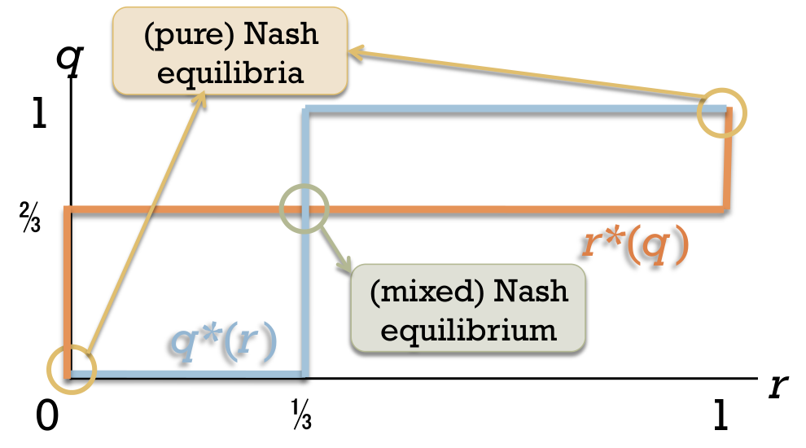
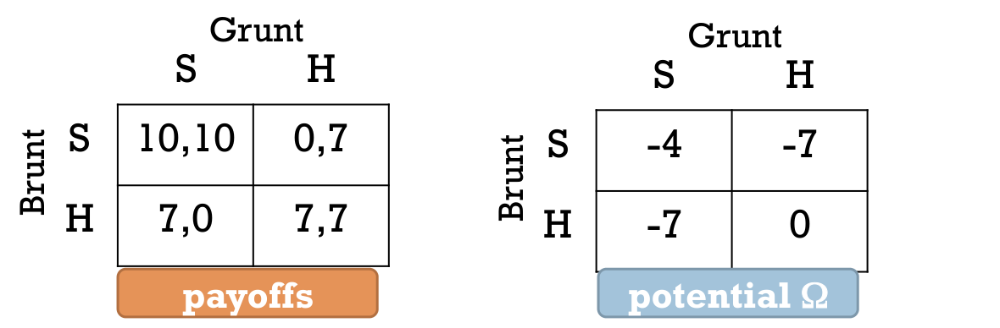
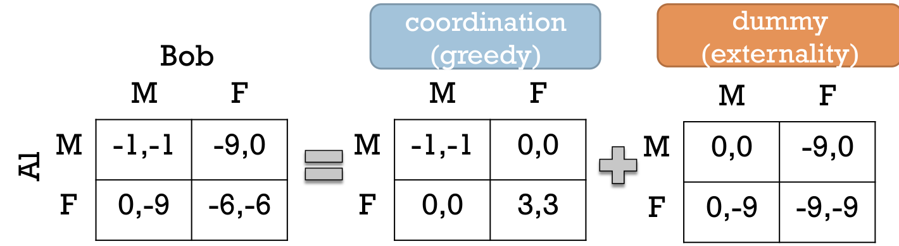

# 5. Mixed strategies and Nash theorem

## Prerequisites you need

A **strategy profile** lists one strategy for each player. In a payoff table, the first number belongs to the row player and the second to the column player. A **best response** gives a player the highest utility against the other players' fixed strategies. A **Nash equilibrium (NE)** is a profile where every player is best responding, so no one can gain by changing strategy alone.

Utilities can be averaged when outcomes are uncertain. An expected utility is a probability-weighted average, so payoff magnitudes matter, not only their ranking.

## 1. Mixed strategies and expected utility

In odds and evens, either player can exploit a predictable pure choice. A player can instead choose a probability distribution over pure strategies. This makes the realized choice unpredictable while specifying a precise plan.

> [!info] Definition — Mixed strategy, simplex, and support
> For player $i$ with finite pure-strategy set $S_i$, a **mixed strategy** $m_i$ assigns a probability $m_i(s_i)$ to every $s_i\in S_i$ such that
>
> $$
> m_i(s_i)\geq 0,\qquad \sum_{s_i\in S_i}m_i(s_i)=1.
> $$
>
> The set of such distributions is the **simplex** $\Delta S_i$. Its **support** is the set of strategies played with positive probability:
>
> $$
> \operatorname{supp}(m_i)=\{s_i\in S_i:m_i(s_i)>0\}.
> $$

A pure strategy is a **degenerate mixed strategy** that assigns probability 1 to one choice. A mixture does not create a physical action between the original choices: the player ultimately selects one pure strategy according to the stated probabilities.

Assume players randomize independently. For pure profile $s=(s_1,\ldots,s_n)$, its probability under mixed profile $m=(m_1,\ldots,m_n)$ is $\prod_jm_j(s_j)$. Player $i$'s expected utility is

$$
u_i(m)=\sum_{s\in S_1\times\cdots\times S_n}\left(\prod_{j=1}^n m_j(s_j)\right)u_i(s).
$$

For a two-player table, multiply the row and column probabilities to get each cell's probability, multiply by its payoff, and add across cells.

### Example — odds and evens

Odd and Even simultaneously choose 0 or 1. Odd wins if the sum is odd; Even wins if it is even. The winner receives four euros from the loser. Odd chooses rows; payoff order is (Odd, Even).

| Odd \\ Even | $0$ | $1$ |
|---|---:|---:|
| $0$ | $(-4,4)$ | $(4,-4)$ |
| $1$ | $(4,-4)$ | $(-4,4)$ |

Every pure outcome lets the loser switch and win, so no pure NE exists.
Let $q=\Pr[\text{Odd chooses }0]$ and $r=\Pr[\text{Even chooses }0]$. Thus their probabilities of choosing 1 are $1-q$ and $1-r$.

*Figure 1. Gth2007.pdf, PDF p. 7. Each cell shows its payoff multiplied by its probability; for example, outcome $(0,1)$ occurs with probability $q(1-r)$.*

Adding Odd's weighted payoffs gives

$$
\begin{aligned}
u_O(q,r)&=-4qr+4q(1-r)+4(1-q)r-4(1-q)(1-r)\\
&=-16qr+8q+8r-4\\
&=-4(2q-1)(2r-1).
\end{aligned}
$$

The game is zero-sum, so $u_E(q,r)=-u_O(q,r)$. For example, at $(q,r)=(1/4,3/4)$, the outcome probabilities are $3/16,1/16,9/16,3/16$ in table order; they sum to 1, and Odd's expected utility is 1.

## 2. Mixed Nash equilibrium and support condition

A player may deviate to any other distribution while opponents' distributions stay fixed.

> [!info] Definition — Nash equilibrium in mixed strategies
> A mixed profile $m$ is an NE if, for every player $i$ and every alternative distribution $m_i'\in\Delta S_i$,
>
> $$
> u_i(m_i,m_{-i})\geq u_i(m_i',m_{-i}).
> $$
>
> Thus no player can improve expected utility by changing their own distribution, including by switching to a pure strategy.

Against fixed opponents, expected utility is linear in a player's probabilities:

$$
u_i(m_i,m_{-i})=\sum_{s_i\in S_i}m_i(s_i)u_i(s_i,m_{-i}).
$$

This weighted average cannot exceed its largest term. A best response therefore includes at least one pure best response; mixing among tied pure best responses is also optimal.

> [!info] Theorem — Support characterization
> A mixed profile $m$ is an NE exactly when, for every player $i$, all strategies in their support yield the same utility $v_i$, and every strategy outside the support yields no more:
>
> $$
> u_i(s_i,m_{-i})=v_i\quad(s_i\in\operatorname{supp}(m_i)),
> $$
>
> $$
> u_i(t_i,m_{-i})\leq v_i\quad(t_i\notin\operatorname{supp}(m_i)).
> $$

If two supported strategies gave different utilities, shifting probability toward the better one would improve the player's expected utility. The unused-strategy inequality is also essential: an unused choice that pays more would be a profitable deviation. A pure-strategy NE remains an NE when mixed deviations are allowed: every such deviation averages pure deviations, none of which can improve utility.

### Solving odds and evens

Odd's pure-choice utilities against Even's probability $r$ are

$$
u_O(0,r)=4-8r,\qquad u_O(1,r)=8r-4.
$$

Odd can mix only if these are equal, which gives $r=1/2$. Even's pure-choice utilities against Odd's $q$ are

$$
u_E(q,0)=8q-4,\qquad u_E(q,1)=4-8q.
$$

Even's indifference gives $q=1/2$. Against a fair mixture, both choices give each player utility 0, so neither can improve. The mixed NE is $(q,r)=(1/2,1/2)$.

It is unique. If Odd's current utility is negative, Odd can switch to $q=1/2$ and obtain zero. If it is positive, Even can switch to $r=1/2$ and obtain zero. If it is zero, the payoff formula implies $q=1/2$ or $r=1/2$. Unless both equal $1/2$, the player facing the biased mixture can choose a pure action and obtain a positive payoff. Hence no other profile is an NE. The three cases exclude every other candidate profile.

## 3. Mixed dominance and elimination

Mixed strategies can dominate pure strategies even when no single pure strategy does. Strict dominance means a strategy gives strictly higher utility against every opponent profile. Weak dominance means it gives at least as much against every profile and strictly more against at least one.

*Gth2007.pdf, PDF pp. 11–12.*

Write $m_{-i}$ for the mixed strategies of every player except $i$. For two mixed strategies $m_i',m_i\in\Delta S_i$, strict dominance means

$$
u_i(m_i',m_{-i})>u_i(m_i,m_{-i})\quad\text{for every }m_{-i}.
$$

Weak dominance replaces $>$ with $\geq$ for every opponents' profile and requires $>$ for at least one. Both the dominated strategy and its dominator may be mixed; pure strategies are included as degenerate distributions.

In finite games, dominance by a mixed strategy can be checked against each pure opponent profile. Against a mixed profile, the utility difference is a weighted average of those pure-profile differences.

### Example — a pure choice dominated by a mixture

*Gth2007.pdf, PDF pp. 17–19.*

Player A chooses $T$ or $D$; B chooses $L,C,R$. Payoff order is (A, B).

*Figure 2. Gth2007.pdf, PDF p. 17. The table marks B's choice $R$ for elimination.*

Against A's rows $T,D$, B's payoffs from $L$ are $4,0$, from $C$ are $0,4$, and from $R$ are $1,1$. The mixture $\tfrac12L+\tfrac12C$ gives B utility 2 against either row, strictly more than $R$'s utility 1. So $R$ is strictly dominated by this mixture, though neither $L$ nor $C$ alone strictly dominates it.

After removing $R$, A's $T$ strictly dominates $D$ because $7>6$ against $L$ and $5>3$ against $C$. With only $T$ left, B chooses $L$ because $4>0$. The surviving profile $(T,L)$ is an NE of the original game, with payoff $(7,4)$.

Exhaustive iterated elimination of strictly dominated strategies by mixed dominators preserves NE and has an order-independent surviving strategy set. Use strict dominance for these results: weakly dominated strategies can occur in an NE or its support.

## 4. Finding mixed equilibria

1. Check pure profiles for mutual best responses; eliminate strictly dominated strategies if useful.
2. Choose candidate supports and assign probabilities to strategies in them.
3. For each player who mixes, equalize the utilities of that player's supported pure strategies. This equation determines the **opponent's** probabilities.
4. Check each probability lies in range, support probabilities are positive, and probabilities sum to 1.
5. Check every unused strategy gives no more than the common support utility. Check boundary supports and pure equilibria before claiming the full set.

### Example — Battle of the Sexes

*Gth2007.pdf, PDF pp. 21–22.*

Ann and Brian choose romance ($R$) or science fiction ($S$) simultaneously. Both prefer meeting to missing each other; Ann prefers $R$, while Brian prefers $S$. Ann chooses rows; payoff order is (Ann, Brian).

| Ann \\ Brian | $R$ | $S$ |
|---|---:|---:|
| $R$ | $(2,1)$ | $(0,0)$ |
| $S$ | $(0,0)$ | $(1,2)$ |

Let $q=\Pr[\text{Ann chooses }R]$ and $r=\Pr[\text{Brian chooses }R]$. Their expected utilities are

$$
u_A(q,r)=2qr+(1-q)(1-r),\qquad
u_B(q,r)=qr+2(1-q)(1-r).
$$

The pure NE are $(R,R)$ and $(S,S)$. If both players mix, Ann's indifference requires $2r=1-r$, so $r=1/3$. Brian's indifference requires $q=2(1-q)$, so $q=2/3$. Both probabilities are strictly between 0 and 1; each supported choice gives its player utility $2/3$. The mixed NE is $(q,r)=(2/3,1/3)$.

These are all the equilibria. Against a pure choice, the other player's best response is uniquely to match, so an equilibrium cannot have exactly one player mixing. If both mix, the indifference equations determine the probabilities uniquely. Thus the full set is

$$
\{(0,0),(1,1),(2/3,1/3)\}.
$$

At the mixed NE, they meet with probability $4/9$ and miss with probability $5/9$. An NE describes stable strategies, not a guaranteed outcome in one play.

### Best-response intersections

*Gth2007.pdf, PDF pp. 31–32.*

Ann chooses $R$ when $r>1/3$, $S$ when $r<1/3$, and any mixture at equality. Brian chooses $R$ when $q>2/3$, $S$ when $q<2/3$, and any mixture at equality. Thus both best-response correspondences increase at their respective thresholds. The sets at equality must include the whole interval $[0,1]$.

*Figure 3. Cropped from Gth2007.pdf, PDF p. 32. Horizontal axis: Brian's $r$; vertical axis: Ann's $q$. The intersections are $(r,q)=(0,0),(1,1),(1/3,2/3)$. Curves are identified by labels, so their meaning does not depend on color.*

## 5. Interpreting mixed strategies

Mixed strategies have three interpretations:

- **Randomization:** a private random device can implement the probabilities. Across many independent repetitions, observed frequencies may approach the probabilities. Repeated strategic play with memory is a different model from repeated one-shot games.
- **Uncertainty or indecision:** probabilities can express uncertainty about which pure choice will be made. A mixed strategy remains an ordinary probability distribution over pure choices.
- **Beliefs:** a mixed strategy can represent an opponent's uncertainty about a player's hidden pure choice. At equilibrium, each player's strategy is a best response to the others' distributions, and those distributions match the beliefs used to predict play.

The belief interpretation explains how an observer can predict a distribution without knowing the realized action. Uniform randomization is not automatic: equilibrium probabilities come from incentives. Odds and evens gives one half for each choice; Battle of the Sexes gives different probabilities.

## 6. Best responses and Nash's existence theorem

*Gth2007.pdf, PDF pp. 25–26 and 33.*

A belief describes what a player expects the opponents to choose. In the independent-mixing model, $m_{-i}\in\prod_{j\ne i}\Delta S_j$ lists their mixed strategies. The best-response correspondence is

$$
BR_i(m_{-i})=\operatorname*{arg\,max}_{x_i\in\Delta S_i}u_i(x_i,m_{-i}).
$$

It returns the **set of maximizing distributions**, rather than a utility value. Ties allow multiple best responses, and a pure best response always exists in a finite game.

### Example — Art and Bea

*Gth2007.pdf, PDF pp. 27–30.*

Art chooses $U,D$ and Bea chooses $F,G$ simultaneously. Payoff order is (Art, Bea).

| Art \\ Bea | $F$ | $G$ |
|---|---:|---:|
| $U$ | $(6,1)$ | $(0,4)$ |
| $D$ | $(2,5)$ | $(4,0)$ |

Let $q=\Pr[U]$ and $r=\Pr[F]$. Art's pure utilities are $6r$ from $U$ and $4-2r$ from $D$. Therefore Art chooses $D$ if $r<1/2$, $U$ if $r>1/2$, and can use any mixture if $r=1/2$. Bea's utilities are $5-4q$ from $F$ and $4q$ from $G$. Bea chooses $F$ if $q<5/8$, $G$ if $q>5/8$, and can mix if $q=5/8$.

The best-response correspondences intersect only at $(q,r)=(5/8,1/2)$. At that profile each player is indifferent between their two pure choices, so neither can gain by changing to another mixture. It is the unique NE.

*Figure 4. Gth2007.pdf, PDF p. 30. The intersection has $r=1/2$ horizontally and $q=5/8$ vertically. At each indifference threshold, the connecting segment represents every mixture that is a best response. Keep the axis order $(r,q)$ distinct from the player order $(q,r)$.*

### Nash's theorem

> [!info] Theorem — Nash
> Every finite normal-form game with finitely many players, finite nonempty strategy sets, and real-valued payoffs has at least one NE in mixed strategies.

The theorem guarantees existence, not uniqueness, efficiency, or an easy way to find an equilibrium. “In mixed strategies” includes pure equilibria represented as degenerate distributions. If a finite game has no pure NE, the theorem guarantees at least one equilibrium that uses non-pure mixing.

### Fixed points and the proof idea

A fixed point of a function $f$ is a point $x^*$ with $f(x^*)=x^*$. For a continuous function from $[0,1]$ to itself, a fixed point exists: $g(x)=f(x)-x$ is continuous, with $g(0)\geq0$ and $g(1)\leq0$, so it has a zero by the intermediate value theorem (or at an endpoint).

*Figure 5. Gth2007.pdf, PDF p. 34. A crossing of $f(x)$ with $y=x$ is a fixed point; multiple crossings show that existence does not imply uniqueness.*

In games, a best response may not be unique, especially when a player is indifferent. The correct object is therefore a **correspondence**, which returns a set of best responses. For each player $i$, let $BR_i(m_{-i})$ be the set of distributions maximizing expected utility against opponents' profile $m_{-i}$. Define the joint correspondence

$$
BR(m)=BR_1(m_{-1})\times\cdots\times BR_n(m_{-n}).
$$

A profile $m$ is an NE exactly when $m\in BR(m)$. The mixed-profile space $\Delta S=\prod_i\Delta S_i$ is nonempty, compact, and convex. Each best-response set is nonempty because expected utility is continuous on a compact simplex; it is convex because mixtures of best responses remain best responses. Continuity of expected utility also gives $BR$ a closed graph.

Here **compact** means closed and bounded in the finite-dimensional probability space; **convex** means containing every line segment between its points. A **closed graph** means that if $m^k\to m$, $b^k\to b$, and $b^k\in BR(m^k)$ for all $k$, then $b\in BR(m)$. A limiting best-response pair remains valid.

Kakutani's fixed-point theorem states that a correspondence from a nonempty compact convex set to itself has a fixed point when its values are nonempty and convex and its graph is closed. Applying it to $BR$ gives $m^*\in BR(m^*)$, which is precisely an NE. The one-dimensional sign-change argument uses the intermediate value theorem, also called Bolzano's theorem, rather than Bolzano–Weierstrass.

## 7. Best-response updates and convergence

*Gth2007.pdf, PDF pp. 36–38.*

An equilibrium can exist without being reached by successive adjustments. To search by **best-response updates**, start from a profile, let one player choose a best response while the others remain fixed, and repeat. This is an algorithm applied to a static game, rather than a specification of a dynamic game with contingent plans.

If a player keeps their current action whenever it is already a best response, every NE is **absorbing**: after reaching it, no further change occurs. Allowing switches between tied best responses can prevent the profile from staying fixed.

In rock–paper–scissors, best responding to the opponent's latest action can cycle. For example, with $R$ for rock, $P$ for paper, and $S$ for scissors, successive moves by the losing player give

$$
(R,P)\to(S,P)\to(S,R)\to(P,R)\to(P,S)\to(R,S)\to(R,P).
$$

Each mover changes a loss into a win, but the sequence never settles. The existence of a mixed equilibrium therefore does not guarantee convergence of current-action updates.

**Fictitious play** instead forms beliefs from the empirical frequencies of opponents' past actions and best responds to those beliefs. Convergence concerns those frequency distributions; the current pure actions need not stop changing. It must be distinguished from responding only to the most recent action. Convergence results cover dominance-solvable games, finite exact potential games, and nondegenerate two-player $2\times N$ games, with the appropriate update assumptions. Cycling of individual actions alone does not disprove convergence of empirical frequencies. See [Berger, *Fictitious play in 2 × n games*](https://1.618034.com/blog-data/pdfs/references/berger-journal-of-economic-theory-2005A.pdf), pp. 139–140, for this distinction and the $2\times N$ result.

## 8. Potential games

*Gth2007.pdf, PDF pp. 39–43.*

A potential assigns one number to every pure profile and tracks the incentives of whichever player changes strategy. It can turn equilibrium search into improvement of a shared function, even when players have different utilities.

Let $s=(s_i,s_{-i})$ and let $s_i'$ be a unilateral alternative. Define

$$
\Delta u_i=u_i(s_i',s_{-i})-u_i(s_i,s_{-i}),\qquad
\Delta\Omega=\Omega(s_i',s_{-i})-\Omega(s_i,s_{-i}).
$$

> [!info] Definition — Exact, weighted, and ordinal potential
> A function $\Omega:S_1\times\cdots\times S_n\to\mathbb R$ is:
>
> - an **exact potential** if $\Delta\Omega=\Delta u_i$;
> - a **weighted potential** if $\Delta\Omega=w_i\Delta u_i$, with a fixed $w_i>0$ for each player;
> - an **ordinal potential** if $\Delta\Omega>0$ exactly when $\Delta u_i>0$.
>
> Each condition must hold for every player, every opponents' profile, and every unilateral alternative. A game admitting the corresponding function is an exact, weighted, or ordinal potential game.

Exact potentials are weighted potentials with weights 1. Positive weights preserve signs, so weighted potentials are ordinal as well. The potential need not equal total utility or have an immediate physical meaning.

Replacing every player's utility with an ordinal potential preserves the **pure** NE: the same unilateral moves are profitable. This does not generally preserve mixed equilibria, because an ordinal comparison need not preserve expected utilities. Exact potential identities also preserve these expected-payoff comparisons.

### Example — prisoner's dilemma

*Gth2007.pdf, PDF p. 41.*

Al chooses a row, Bob a column. Each chooses silence ($M$) or confession ($F$); negative payoffs measure punishment, so a value closer to zero is better.

*Figure 6. Cropped from Gth2007.pdf, PDF p. 41. Left: payoffs in (Al, Bob) order. Right: potential values 0, 1, 1, and 4 in row order. Both tables use rows and columns $M,F$.*

For Al, $(M,M)\to(F,M)$ changes utility from $-1$ to 0 and potential from 0 to 1: both increase by 1. The move $(M,F)\to(F,F)$ changes utility from $-9$ to $-6$ and potential from 1 to 4: both increase by 3. Symmetry gives Bob's changes, and reversing a move reverses both differences. Thus the potential is exact.

Confession strictly dominates silence for both players, making $(F,F)$ the unique NE. Its potential is maximal at 4, but both players would prefer $(-1,-1)$ at $(M,M)$ to $(-6,-6)$. **Maximizing potential does not mean maximizing welfare.**

### Example — Cournot quantities and the zero-output boundary

*Gth2007.pdf, PDF p. 42.*

Two firms independently choose quantities $q_1,q_2$. Price is $a-q_1-q_2$, unit production cost is $c$, and firm $i$'s profit is

$$
u_i(q_i,q_j)=q_i(a-c-q_i-q_j),\qquad i\ne j.
$$

Consider the product function

$$
\Omega(q_1,q_2)=q_1q_2(a-c-q_1-q_2).
$$

When only firm $i$ changes output, the other quantity $q_j$ stays fixed and

$$
\Delta\Omega=q_j\Delta u_i.
$$

For **strictly positive quantities**, $q_j>0$, this preserves the sign of every unilateral profit change, so $\Omega$ is an ordinal potential. It is not an ordinal potential on the full nonnegative domain: when $q_j=0$, $\Omega$ remains zero even if firm $i$ can increase profit. The quantity-domain restriction is essential. This is a continuous-choice example; the finite termination theorem below cannot be applied to it directly.

### Pure equilibrium and finite termination

> [!info] Theorem — Finite ordinal potential games
> Every ordinal potential game with finitely many players and finite nonempty pure-strategy sets has at least one pure NE. A pure profile is an NE exactly when no unilateral alternative increases its potential.

A global potential maximum exists because there are finitely many profiles. A profitable unilateral deviation from it would increase potential, contradicting maximality.

A constructive procedure is:

1. Start from any pure profile.
2. Select a player with a strictly profitable deviation and let that player improve while everyone else stays fixed.
3. Continue until no such player exists.

Every move strictly increases potential, so no profile is revisited. Finitely many profiles imply termination at a pure NE. “Local maximum” means no increase from **any unilateral alternative**, not just comparison with one nearby numerical value. A local maximum need not be a global maximum. The argument requires one mover at a time and strict improvement; it does not establish a polynomial running time.

## 9. Congestion, coordination, and externalities

### Congestion games

*Gth2007.pdf, PDF p. 44.*

In a congestion game, each player chooses resources, such as a network route or a transmission channel. The payoff from a resource depends on how many players use it. Players therefore have incentives to choose less congested resources, and their choices affect the service available to others.

Finite unweighted congestion games have exact potentials and therefore pure NE. Conversely, every finite **exact** potential game has an isomorphic congestion-game representation, preserving its strategic structure. This representation result requires exactness; it is not a general claim about every ordinal potential. See [Monderer and Shapley, *Potential Games*](https://people.csail.mit.edu/jrennie/trg/papers/monderer-potential-96.pdf), Theorems 3.1–3.2.

### Example — coordination and Stag Hunt

*Gth2007.pdf, PDF pp. 45–46.*

Coordination rewards compatible choices, as in Battle of the Sexes. In **Stag Hunt**, hunters Brunt and Grunt each choose stag ($S$) or hare ($H$). A stag is worth 20 but requires both hunters, who split the value and receive 10 each. A hare gives its hunter 7 independently; hunting stag alone gives 0.

*Figure 7. Cropped from Gth2007.pdf, PDF p. 46. Brunt chooses rows, Grunt columns; payoff order is (Brunt, Grunt). The potential is $-4$ at $(S,S)$, $-7$ at each mismatch, and 0 at $(H,H)$.*

Both $(S,S)$ and $(H,H)$ are pure NE. Against stag, staying with stag gives $10>7$; against hare, staying with hare gives $7>0$. A mismatch is not an equilibrium because at least one hunter can profitably switch.

The potential is exact: changing from $(S,H)$ to $(H,H)$ raises Brunt's payoff and potential by 7; changing from $(H,S)$ to $(S,S)$ raises both by 3. The two coordinated profiles are unilateral local maxima, but $(H,H)$ has the higher potential even though $(S,S)$ gives both hunters higher utility. Convergence to an equilibrium therefore does not select the outcome with greatest welfare.

### Example — anti-coordination, Hawk–Dove, and Chicken

*Gth2007.pdf, PDF p. 47.*

In **anti-coordination**, both players prefer different choices. In Hawk–Dove, each player chooses aggression ($H$) or peaceful behavior ($D$). Player 1 chooses rows, player 2 columns; payoff order is (player 1, player 2).

| Player 1 / Player 2 | $H$ | $D$ |
|---|---|---|
| $H$ | $(-99,-99)$ | $(10,-10)$ |
| $D$ | $(-10,10)$ | $(0,0)$ |

Against $H$, choose $D$ because $-10>-99$; against $D$, choose $H$ because $10>0$. Thus $(H,D)$ and $(D,H)$ are the two pure NE. Aggression may represent acquiring nuclear weapons, with $D$ representing a peaceful policy. The Chicken interpretation uses $H$ for holding the wheel and $D$ for steering away; mutual aggression is disastrous, while each prefers the other to yield.

This differs from **discoordination**: in odds and evens, one player wants matching choices and the other wants different choices. Anti-coordination can satisfy both players' incentives at an asymmetric pure profile; discoordination need not have a pure NE.

### Dummy games and the decomposition of an exact potential game

*Gth2007.pdf, PDF p. 48.*

> [!info] Definition — Dummy or pure externality game
> Player $i$'s payoff depends only on the opponents' choices:
>
> $$
> u_i(s_i,s_{-i})=d_i(s_{-i}).
> $$
>
> Changing their own action cannot change their own payoff. Consequently every profile is an NE, although opponents can still affect a player's welfare.

An exact potential game decomposes as

$$
u_i(s)=\Omega(s)+d_i(s_{-i}).
$$

To see why, subtract the exact potential from $u_i$. Any unilateral change produces the same difference in $u_i$ and $\Omega$, so their difference is independent of $s_i$. The first component gives everyone the same payoff, while the second contains effects imposed by opponents. This numerical decomposition requires an **exact** potential; for weighted potentials, utilities must first be rescaled.

*Figure 8. Cropped from Gth2007.pdf, PDF p. 48. All three matrices use Al's rows $M,F$, Bob's columns $M,F$, and (Al, Bob) payoff order. The middle common payoff equals the earlier potential minus 1; adding a constant preserves its unilateral differences.*

At $(M,F)$, the components are $(0,0)+(-9,0)=(-9,0)$. At $(F,F)$, they are $(3,3)+(-9,-9)=(-6,-6)$. Bob's confession imposes a loss of 9 on Al independently of Al's choice; Al's confession does the same to Bob. These externalities explain why aligned potential incentives can coexist with an inefficient equilibrium.

## 10. Computing equilibria: PPAD and approximation

*Gth2007.pdf, PDF pp. 49–55.*

### Existence and search

Nash's theorem proves that a finite game has an equilibrium; it does not supply a fast algorithm for finding one. Checking a proposed profile, deciding whether some equilibrium exists, and computing equilibrium probabilities are different tasks. Special structures, such as a finite potential, can give constructive methods, but their running time still needs analysis.

**PPAD** means **Polynomial Parity Arguments on Directed graphs**. It is a class of total search problems whose valid inputs are guaranteed to have solutions. Finding an exact NE in a finite two-player game with rational payoff tables is PPAD-complete: it belongs to this class and can express every problem in it through polynomial-time reductions.

> [!warning] Complexity classes and guaranteed solutions
> $P$ and $NP$ conventionally classify decision problems, whereas PPAD concerns search problems. The expression $P<PPAD<NP$ is not a proved strict hierarchy. Existence of a solution does not establish an efficient search method, and PPAD-completeness alone does not prove that every algorithm requires exponential time.

### End-of-Line and fixed points

*Figure 9. Cropped from Gth2007.pdf, PDF p. 53. Arrows and labels illustrate the balance argument. This branching graph provides intuition; the formal End-of-Line problem uses at most one predecessor and one successor per vertex.*

In **End-of-Line**, a directed graph is described implicitly by predecessor and successor rules. Starting from a known source, the task is to find another source or a sink. The endpoint is guaranteed, but a compact description can encode a very large graph, so tracing a path can require many steps.

Equilibrium search is connected to this problem through fixed-point constructions: an NE is a fixed point of the aggregate best-response correspondence, and fixed-point search can be encoded using directed paths. This links the existence argument to PPAD without making the actual search automatic.

### Epsilon-Nash equilibrium

When exact equilibrium is costly to compute, a model may tolerate small unilateral gains.

> [!info] Definition — Additive $\varepsilon$-Nash equilibrium
> For $\varepsilon\geq0$, a mixed profile $m$ is an $\varepsilon$-NE if
>
> $$
> u_i(m_i',m_{-i})-u_i(m)\leq\varepsilon
> \quad\text{for every player }i\text{ and every }m_i'\in\Delta S_i.
> $$
>
> Every player's maximum unilateral gain is at most the tolerance. Setting $\varepsilon=0$ recovers exact NE.

To check a candidate in a finite game, calculate the largest pure-deviation gain for each player:

$$
\rho_i(m)=\max_{s_i\in S_i}u_i(s_i,m_{-i})-u_i(m).
$$

Pure deviations suffice because mixed deviations are averages. The candidate is an $\varepsilon$-NE precisely when every $\rho_i(m)\leq\varepsilon$. The tolerance measures payoff gain, not distance between probability vectors; its meaning depends on payoff units. Approximation does not automatically imply a polynomial-time algorithm.