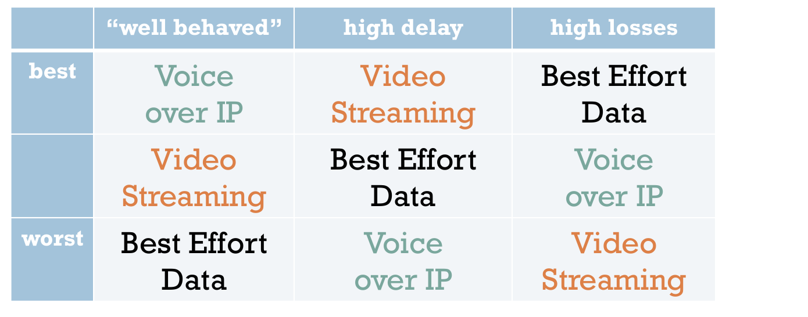
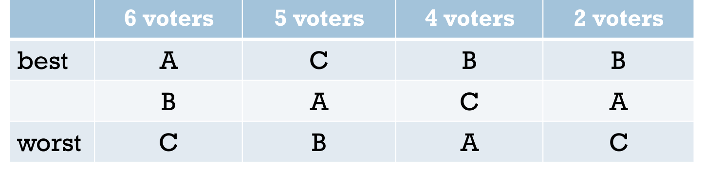

# 6. Utility functions, preferences and constitutions

## Prerequisites you need

A **preference ranking** orders alternatives from better to worse. Write $a\succeq_i b$ when individual $i$ regards $a$ as at least as good as $b$, $a\succ_i b$ when they strictly prefer $a$, and $a\sim_i b$ when they are indifferent. A rational preference is **complete** (every pair can be compared) and **transitive** (if $a\succeq_i b$ and $b\succeq_i c$, then $a\succeq_i c$).

For a finite alternative set, a utility function $u_i$ can represent a ranking: $a\succeq_i b$ exactly when $u_i(a)\geq u_i(b)$. For certain outcomes, any strictly increasing transformation preserves that ranking. The ranking alone does not specify how much better an alternative is or make different people's numerical utilities directly comparable. Adding utilities therefore introduces assumptions beyond merely listing preferences.

This lesson asks how to combine **different people's rankings** into a collective decision. Voters can also represent optimization criteria or network scheduling criteria. The supplied PDF concerns social choice, rather than another derivation of expected utility. No transcript is present in the folder.

In a **preference table**, a column describes a voter or a group of identical voters, and entries run from best to worst. These are not payoff matrices. Group sizes weight every count; a column headed “5 voters” contributes five votes, not one.

## 1. Constitutions: turn individual preferences into a social ranking

*Source: Gth2005.pdf, pp. 2–6.*

Let $A$ be the set of alternatives and $\mathcal R(A)$ the set of complete, transitive preferences over $A$. For $n$ individuals, the **preference profile** is $P=(\succeq_1,\ldots,\succeq_n)$.

> [!info] Definition — Constitution or social welfare function
> A constitution is a rule
>
> $$
> f:\mathcal R(A)^n\longrightarrow\mathcal R(A).
> $$
>
> It assigns one complete, transitive **social ranking** $f(P)$ to every admissible individual profile. “One ranking” does not exclude ties within that ranking.

Here “social welfare function” means an aggregation of rankings, not necessarily a numerical sum of utilities. A rule that selects a single winner instead has a different output type, introduced in Section 7.

For $Y\subseteq A$, the **restriction** of a preference relation is

$$
\succeq_i|_Y=\succeq_i\cap(Y\times Y).
$$

It keeps only comparisons between alternatives in $Y$. For example, restricting $A\succ_i C\succ_i B$ to $\{A,B\}$ gives $A\succ_i B$.

### Properties to distinguish

| Property | Meaning | How to check it |
|---|---|---|
| **Independence of irrelevant alternatives (IIA)** | The social comparison of $a$ and $b$ depends only on how every individual compares that pair. | Compare two profiles preserving all individual $a$–$b$ comparisons. Their social $a$–$b$ comparisons must agree. |
| **Pareto unanimity** | If everyone strictly prefers $a$ to $b$, society strictly prefers $a$ to $b$. | Look for a unanimous pair that society reverses or ties. |
| **Non-dictatorship** | No fixed individual dictates every strict social pairwise comparison, at every profile. | A person being decisive in one election is not enough to establish dictatorship. |
| **Monotonicity**, informally as on p. 6 | Promoting an alternative in individual rankings should not worsen its social treatment. | A winning candidate losing solely after being raised is a violation; Section 5 gives one. |
| **Non-imposition**, as on p. 6 | Every rational social ranking can be produced by some profile: $f$ is surjective. | Check the range of possible output rankings, not just who sometimes wins. |

Formally, IIA requires

$$
\left[\forall i,\ \succeq_i|_{\{a,b\}}=\succeq_i'|_{\{a,b\}}\right]
\ \Longrightarrow\ 
f(P)|_{\{a,b\}}=f(P')|_{\{a,b\}}.
$$

**Original illustration.** If everyone keeps their comparison of $A$ with $B$, but moves $C$ elsewhere in their rankings, an IIA constitution must preserve its social comparison of $A$ and $B$. A rule that consults their positions relative to $C$ may violate IIA even when $C$ is never selected.

The slide's description in terms of adding or removing alternatives is useful intuition. The formal axiom above compares profiles on a fixed set; a dropout example can also be converted into such a comparison, as shown below.

**Original example: a dictatorial constitution.** Define $f(P)=\succeq_1$. The output is rational, it satisfies IIA and unanimity, and every ranking can occur because voter 1 can report any ranking. Its defect is precisely that everyone else's preferences are irrelevant. A fixed ranking independent of all inputs has the opposite issue: it is imposed and fails unanimity on profiles where everyone disagrees with it.

## 2. Arrow's theorem: the assumptions cannot all hold together

*Source: Gth2005.pdf, p. 7, revisited on p. 50.*

> [!info] Theorem — Arrow's impossibility theorem
> For a finite society and at least three alternatives, suppose a constitution accepts every profile of rational individual preferences (**unrestricted domain**) and always produces a complete, transitive social ranking. If it satisfies strict Pareto unanimity and IIA, it must have a dictator. Consequently, these requirements cannot all coexist with non-dictatorship.

The dictator condition means that there is a fixed individual $d$ such that, at every profile and for every pair, $a\succ_d b$ implies $a\succ b$ socially. How to resolve that individual's indifference is a separate matter when ties are allowed.

**Why the omitted assumptions matter.** The theorem does not rule out majority voting between two alternatives. Nor does it rule out rational aggregation on a restricted class of profiles, or selection rules that relax IIA. The contradiction concerns a package of requirements, not the bare existence of elections or collective choice.

Slide 7 also gives the earlier formulation using non-dictatorship, monotonicity, IIA, and non-imposition. In both formulations, unrestricted individual orderings and rational social output are part of the framework. [Arrow's original paper](https://www.stat.uchicago.edu/~lekheng/meetings/mathofranking/ref/arrow.pdf) makes the at-least-three-alternatives and unrestricted-orderings requirements explicit.

**Precision correction.** Slide 5 writes only the weak implication “if everyone has $a\succeq_i b$, then socially $a\succeq b$.” This is weaker than the strict unanimity needed in the familiar theorem statement: a rule declaring every pair socially indifferent would satisfy that weak implication and IIA. The theorem above uses $a\succ_i b$ for all individuals and concludes $a\succ b$, avoiding that loophole. Do not identify this unanimity axiom with the task of finding Pareto-efficient payoff profiles in earlier lessons.

The PDF states the theorem without a full proof. Its voting examples demonstrate failures of particular rules; they do not by themselves prove impossibility for every conceivable rule.

## 3. Pairwise majority and the Condorcet paradox

*Source: Gth2005.pdf, pp. 9–22 and 51.*

To compare two alternatives, count the individuals who prefer each one. With strict rankings and no tied pairwise counts, $a$ **beats** $b$ if more voters rank $a$ above $b$ than vice versa. Write $a\succ_M b$ for this social majority comparison. This symbol describes a comparison, not a subtraction of utility values.

With ties in individual preferences, the slide defines the weak majority relation as

$$
a\succeq_M b
\quad\Longleftrightarrow\quad
|\{i:a\succeq_i b\}|\geq|\{i:b\succeq_i a\}|.
$$

The vertical bars count individuals. An indifferent individual belongs to both sets, so their contribution cancels. The relation is complete and respects unanimous strict comparisons, but it can fail transitivity. Pairwise comparisons satisfy IIA because only each person's comparison of that pair is counted.

> [!info] Definition — Condorcet winner, loser, and cycle
> A **Condorcet winner** strictly beats every other candidate in a head-to-head majority contest. A **Condorcet loser** loses every such contest. A **Condorcet cycle** is a loop such as $A\succ_M B$, $B\succ_M C$, and $C\succ_M A$.

### Worked lecture example: rational voters, cyclic majority

*Figure 1. Cropped from Gth2005.pdf, PDF p. 12. The columns are voters, ordered from best to worst; each column contributes one vote.*

Voter 1 has $A\succ B\succ C$, voter 2 has $C\succ A\succ B$, and voter 3 has $B\succ C\succ A$. Therefore:

| Pair | Voters supporting the first candidate | Result |
|---|---|---|
| $A$ versus $B$ | 1 and 2 | $A$ beats $B$, 2–1. |
| $B$ versus $C$ | 1 and 3 | $B$ beats $C$, 2–1. |
| $C$ versus $A$ | 2 and 3 | $C$ beats $A$, 2–1. |

Each individual ranking is transitive. The majority relation is not, because the majority supporting one comparison can differ from the majority supporting another. Thus pairwise majority is not a constitution on the unrestricted domain: it may output a relation outside $\mathcal R(A)$.

For comparison, slide 11 uses $A\succ B\succ C$, $A\succ C\succ B$, and $B\succ C\succ A$. Then $A$ beats both $B$ and $C$ by 2–1, while $B$ beats $C$ by 2–1. Here $A$ is the Condorcet winner and the majority ranking is transitive.

### Adding an alternative does not determine where it belongs

Slides 14–17 keep voters 1 and 2 preferring $A$ to $B$, and voter 3 preferring $B$ to $A$. Depending on where $C$ is inserted:

- Rankings $(A\succ B\succ C,\ C\succ A\succ B,\ C\succ B\succ A)$ make $C$ beat both $A$ and $B$, 2–1.
- Rankings $(A\succ B\succ C,\ A\succ B\succ C,\ B\succ C\succ A)$ make $C$ lose to $A$ and $B$, 1–2 and 0–3, respectively.
- The rankings in Figure 1 produce a cycle instead.

In all three cases the individual $A$–$B$ comparisons stay fixed and $A$ still beats $B$. IIA requires that invariance; it does not require the same overall winner when a new candidate is considered.

**Boundary conditions.** With finitely many alternatives, strict rankings, and an odd number of voters, pairwise majority is a tournament: every distinct pair has exactly one winner. In that setting, absence of a Condorcet winner implies some cycle. With tied contests, the blanket implication on slide 13 needs qualification. Also, a Condorcet winner can coexist with a cycle among the losers when at least four candidates exist.

### How common are cycles?

Slides 18–19 use randomized preferences to illustrate that paradoxes are not isolated constructions. The probability depends on the assumed distribution of rankings; it is not a universal rate for actual elections. Under **independent uniformly random strict rankings**, three voters and three alternatives yield a cycle with probability $1/18\approx5.6\%$.

**Correction to the table heading on p. 19.** “At least one cycle” and “no Condorcet winner” differ once more than three alternatives exist. A direct enumeration for three voters and five alternatives gives **16% with no Condorcet winner**, matching the table's entry, but **about 32.43% with at least one cycle anywhere**. For this calculation one voter's order can be fixed by relabeling symmetry; among the $5!^2=14{,}400$ remaining profiles, 2,304 have no winner and 4,670 have a cycle. These are mathematical checks of the table's interpretation, not empirical election data. The slide's large-number claims likewise require a specified random-preference model.

### The same issue appears outside elections

In slide 21, three policy viewpoints rank three tax/spending packages cyclically. Label the packages $X$ (taxes up, spending up), $Y$ (taxes down, spending down), and $Z$ (taxes up, spending down). The rankings are $X\succ Y\succ Z$, $Z\succ X\succ Y$, and $Y\succ Z\succ X$. Pairwise aggregation yields $X\succ_M Y\succ_M Z\succ_M X$.

*Figure 2. Cropped from Gth2005.pdf, PDF p. 22. Columns are three criteria or viewpoints, not groups with stated population sizes. Labels identify every traffic class in grayscale.*

In the QoS example, the orders are voice $\succ$ video $\succ$ best effort, video $\succ$ best effort $\succ$ voice, and best effort $\succ$ voice $\succ$ video. Giving each criterion one vote yields voice over video, video over best effort, and best effort over voice, each 2–1. Scheduling or multiobjective optimization can therefore inherit the same inconsistency. These are the lecture's illustrative rankings, not universal priorities for network traffic.

## 4. Voting rules: calculate the outcome before judging the rule

*Source: Gth2005.pdf, pp. 25–36.*

All examples below assume sincere rankings until strategic reports are explicitly introduced. If a rule produces a tie, a tie-breaking rule is needed to identify a single winner. None of the worked winners below depends on an unspecified tie-break.

### Plurality: count first places

The candidate with the most first-place votes wins. **Plurality is not necessarily an absolute majority**: a winner can have fewer than half of all votes.

Slide 27 gives nine voters:

| Number of voters | Ranking |
|---|---|
| 4 | $A\succ B\succ C$ |
| 3 | $B\succ C\succ A$ |
| 2 | $C\succ B\succ A$ |

First-place totals are $A=4$, $B=3$, $C=2$, so plurality selects $A$. Yet $B$ beats $A$ by 5–4 and $C$ beats $A$ by 5–4. Moreover $B$ beats $C$ by 7–2. Thus **$B$ is the Condorcet winner, while the plurality winner $A$ is the Condorcet loser**. First-place support alone discards relevant comparisons.

### Two-phase run-off: shortlist, then a head-to-head ballot

Select the two candidates with the most first-place votes, then compare those finalists by majority. The first round is decisive because a strong compromise candidate may never reach the final.

Slide 29 changes the first group to $A\succ C\succ B$, keeping the other groups $3:B\succ C\succ A$ and $2:C\succ B\succ A$. First totals are still $(4,3,2)$, so finalists are $A,B$. In the final, $B$ wins 5–4. However, $C$ beats $A$ by 5–4 and $B$ by 6–3: **the Condorcet winner $C$ was eliminated before the final**. A two-round run-off is therefore not automatically Condorcet-consistent.

### Borda count: award points to every rank

With $M$ candidates, a voter gives $M-1$ points to their best candidate, $M-2$ to their second, down to 0 for last place. Sum over voters. The points are assigned by the rule; they are not measured strengths of voters' preferences.

In slide 31, five voters rank $A\succ B\succ C$, three rank $B\succ C\succ A$, and one ranks $C\succ B\succ A$. With points $(2,1,0)$:

$$
\begin{aligned}
S(A)&=5(2)+3(0)+1(0)=10,\\
S(B)&=5(1)+3(2)+1(1)=12,\\
S(C)&=5(0)+3(1)+1(2)=5.
\end{aligned}
$$

The checksum is $10+12+5=27$, equal to nine ballots each awarding $2+1+0=3$ points. Borda selects $B$, but $A$ beats each rival by 5–4 and is the Condorcet winner. Incorporating more ranks still does not guarantee Condorcet consistency.

### Borda with dropout: unchanged pairwise preferences, reversed social order

*Figure 3. Cropped from Gth2005.pdf, PDF p. 32. The three columns represent 5, 2, and 2 voters.*

Before withdrawal, the groups rank $D\succ C\succ B\succ A$, $A\succ D\succ B\succ C$, and $A\succ B\succ D\succ C$. Using $(3,2,1,0)$ gives

$$
S(A)=0+6+6=12,\quad S(B)=5+2+4=11,
$$

$$
S(C)=10+0+0=10,\quad S(D)=15+4+2=21.
$$

The social order is $D\succ A\succ B\succ C$, and the sum $54$ equals $9(3+2+1+0)$.

*Figure 4. Cropped from Gth2005.pdf, PDF p. 33. Blank positions mark the removed $D$; compress each column to read its surviving order.*

After removing $D$, the first five voters have $C\succ B\succ A$ and the other four have $A\succ B\succ C$. Recalculate with $(2,1,0)$:

$$
S(A)=8,\qquad S(B)=9,\qquad S(C)=10.
$$

The surviving order reverses from $A\succ B\succ C$ to $C\succ B\succ A$, even though nobody changed any comparison among $A,B,C$.

To obtain a formal **fixed-alternative-set IIA counterexample**, keep all four candidates but move $D$ to last in every ballot. All $A$–$B$ comparisons stay the same. The new four-candidate Borda totals are $A=17$, $B=18$, $C=19$, $D=0$: socially $B$ now outranks $A$, whereas previously $A$ outranked $B$. Thus Borda's ranking violates IIA without changing the alternative set.

### Approval voting and a common profile giving four different winners

An approval ballot gives one point to each approved candidate. The slides study **top-$N$ approval**, where every voter approves their first $N$ choices, with $1\leq N\leq M$. For $N=1$ this is plurality. General free approval allows voters to choose their own approved subset; a ranking alone does not specify where they place the approval cutoff.

Slides 35–36 use this profile:

| Number | Ranking |
|---|---|
| 3 | $A\succ C\succ D\succ B$ |
| 3 | $D\succ B\succ C\succ A$ |
| 2 | $B\succ D\succ C\succ A$ |
| 1 | $A\succ B\succ C\succ D$ |

| Rule | $A$ | $B$ | $C$ | $D$ | Winner |
|---|---|---|---|---|---|
| Plurality / top 1 | 4 | 2 | 0 | 3 | $A$ |
| Top 2 approval | 4 | 6 | 3 | 5 | $B$ |
| Top 3 approval | 4 | 6 | 9 | 8 | $C$ |
| Borda $(3,2,1,0)$ | 12 | 14 | 12 | 16 | $D$ |

For example, top-2 approvals for $B$ come from the three $D$-first voters, two $B$-first voters, and the last voter: $3+2+1=6$. Each approval row sums to $9N$; Borda sums to $9\cdot6=54$. **The same sincere rankings can select four different winners under four rules.**

## 5. Instant run-off can fail monotonicity

*Source: Gth2005.pdf, pp. 37–39.*

**Instant run-off (IRV)** repeatedly counts each ballot's highest-ranked remaining candidate. If nobody has an absolute majority, eliminate the candidate with the fewest such votes and transfer their ballots to the next remaining choices. Continue until a candidate has a majority. All example ballots rank every candidate, so there are no exhausted ballots.

*Figure 5. Cropped from Gth2005.pdf, PDF p. 38. Columns represent 6, 5, 4, and 2 voters.*

The initial rankings are $6:A\succ B\succ C$, $5:C\succ A\succ B$, $4:B\succ C\succ A$, and $2:B\succ A\succ C$. First totals are $A=6$, $B=6$, $C=5$. A majority requires 9 of 17 votes. Eliminate $C$; its five ballots transfer to $A$. Final totals are $A=11$, $B=6$, so **$A$ wins**.

*Figure 6. Cropped from Gth2005.pdf, PDF p. 39. Only the final group's ranking changes from $B\succ A\succ C$ to $A\succ B\succ C$.*

Now first totals are $A=8$, $B=4$, $C=5$. Nobody has 9, so eliminate $B$. Its four remaining ballots rank $C$ next and transfer there. Final totals are $A=8$, $C=9$: **$A$ loses after two voters promoted it**.

The cause is a change in elimination order: eliminating $C$ helped $A$, whereas eliminating $B$ helps $C$. No voter lowered $A$, and no tie-break is involved. This is a direct monotonicity counterexample, distinct from IIA and from an individual voter strategically changing a report to improve their true outcome.

## 6. Setting the agenda can select among cyclic alternatives

*Source: Gth2005.pdf, pp. 24 and 40–42.*

In a sequential pairwise procedure, first compare two candidates, then compare the winner with the next candidate. With $A\succ_M B$, $B\succ_M C$, and $C\succ_M A$:

- Compare $A,B$ first: $A$ advances, then loses to $C$. Final winner: $C$.
- Compare $B,C$ first: $B$ advances, then loses to $A$. Final winner: $A$.
- Compare $C,A$ first: $C$ advances, then loses to $B$. Final winner: $B$.

Thus an agenda setter can influence the result without changing preferences. These calculations use sincere pairwise comparisons; forward-looking voting would require an additional strategic model.

Slides 41–42 use groups $4:A\succ B\succ C$, $3:C\succ A\succ B$, and $2:B\succ C\succ A$. They give the cycle $A\succ_M B$ (7–2), $B\succ_M C$ (6–3), $C\succ_M A$ (5–4).

If $D$ is last for everyone, it loses to each rival 0–9 and cannot win a pairwise knockout. In a four-candidate bracket with two semifinals and a final, the candidate facing $D$ in a semifinal wins the whole bracket: the other semifinal removes the rival that could have defeated it. For example, $(A,D)$ and $(B,C)$ produce finalists $A,B$, then $A$ wins.

If $D$ is first for everyone, it beats every rival 9–0 and wins any sincere pairwise agenda in which every candidate participates. The relative treatment of $A,B,C$ can still depend on the bracket. Agenda power is therefore substantial but cannot make a universal pairwise loser beat a universal pairwise winner.

## 7. Strategic voting: true preferences and reported ballots differ

*Source: Gth2005.pdf, pp. 43–49.*

A voter may prefer a different report because the voting rule responds to other people's ballots. Their **true ranking** need not change, become intransitive, or be irrational. “Cheating” in the slide titles means strategic misreporting in this model.

### Worked lecture example: coalition changes under plurality

The nine voters' true rankings on p. 44 are:

| Group size | True ranking |
|---|---|
| 4 | $A\succ D\succ C\succ B$ |
| 3 | $B\succ A\succ D\succ C$ |
| 2 | $C\succ B\succ D\succ A$ |

Sincere plurality gives $A=4$, $B=3$, $C=2$, $D=0$: $A$ wins. The pairwise cycle among $A,C,B$ is $A\succ_M C$ (7–2), $C\succ_M B$ (6–3), and $B\succ_M A$ (5–4).

The last two voters prefer $B$ to $A$. If **both** report $B$ first, the totals become $A=4$, $B=5$, $C=0$: $B$ wins and they benefit. The three original $B$ supporters also welcome that outcome, while the four $A$ supporters dislike it.

The later slides present alternative strategic responses to the anticipated sincere outcome:

| Reporting pattern | First-place totals $(A,B,C,D)$ | Winner and incentive |
|---|---|---|
| All sincere | $(4,3,2,0)$ | $A$ wins. |
| Last two report $B$ first | $(4,5,0,0)$ | $B$ wins; those two prefer $B$ to $A$. |
| First four report $C$ first; other groups sincere | $(0,3,6,0)$ | $C$ wins; first group prefers $C$ to the threatened $B$. |
| Middle three report $A$ first; other groups sincere | $(7,0,2,0)$ | $A$ wins; middle group prefers $A$ to the threatened $C$. |

These are **different report profiles**, not an automatic cumulative sequence of ballot changes. For example, if the first group switches to $C$ while the last group still reports $B$, totals are $(0,5,4,0)$ and $B$ still wins. Later incentives depend on which other reports are fixed. The PDF's story illustrates strategic interdependence; it does not specify a complete extensive-form game or prove a unique strategic equilibrium.

The two-voter deviation is a **coalition** manipulation. It is not automatically a one-voter counterexample to strategy-proofness: switching just one of them gives $A=4$, $B=4$, $C=1$, so the outcome would depend on a tie-break.

### Strategy-proofness and Gibbard–Satterthwaite

For this theorem, distinguish a **social choice function** $g$, selecting one alternative, from a constitution $f$, producing an entire ranking. Let $P$ denote true preferences and $P_j'$ a possible report by voter $j$, holding everyone else's report $P_{-j}$ fixed.

> [!info] Definition — Strategy-proof social choice
> Truthful reporting is strategy-proof if, for every voter and every admissible profile and alternative report,
>
> $$
> g(P_j,P_{-j})\succeq_j g(P_j',P_{-j}).
> $$
>
> The comparison uses voter $j$'s **true** preference. A profitable misreport at even one profile disproves strategy-proofness.

> [!info] Theorem — Gibbard–Satterthwaite
> For a finite set of at least three alternatives, a deterministic, single-winner, onto social choice function on the unrestricted domain of strict individual rankings is strategy-proof only if it is dictatorial. “Onto” means every alternative can win at some profile; a dictator always obtains their own top alternative.

The result concerns the existence of some individually manipulable profile for a nondictatorial rule under these assumptions. It does not say that every voter can manipulate every election. Nor is it a claim about comparing whole social rankings with an individual's ranking of alternatives: slide 49's output notation needs the single-winner interpretation. See [Gibbard, *Manipulation of Voting Schemes: A General Result*](https://rohitvaish.in/data/Papers/%5BGibbard%5D%20Manipulation%20of%20Voting%20Schemes%20-%20A%20General%20Result.pdf).

**Original individual-manipulation example.** Under plurality, suppose sincere ballots are $2:A\succ B\succ C$, $1:B\succ C\succ A$, and $2:C\succ B\succ A$, with a fixed tie-break giving priority to $B$, then $A$, then $C$. Sincere totals $(A,B,C)=(2,1,2)$ select $A$, which has priority over the tied $C$. One of the $C$-first voters instead votes $B$, giving $(2,2,1)$; now $B$ wins the tie against $A$. The voter truly prefers $C\succ B\succ A$, so obtaining $B$ instead of $A$ is a strict improvement. Everyone else's report and the tie-break remain fixed. This is a profitable unilateral deviation and therefore disproves strategy-proofness for this plurality rule.

## 8. Ways out: change the assumptions, especially the preference domain

*Source: Gth2005.pdf, pp. 50–52.*

Arrow's theorem forces a tradeoff among requirements; it does not declare every practical method useless. A procedure can relax IIA, allow an incomplete or nontransitive social relation, change the information elicited, or restrict admissible preferences.

Free approval ballots, mentioned on p. 50, elicit an approved subset rather than a full ranking. This changes the formal input model; it is not a general guarantee of immunity to strategic voting or all other paradoxes.

### Restricting profiles can make majority consistent

The slide associates cycle-avoiding domains with Sen. The relevant lesson is that excluding certain combinations of individual rankings can restore majority transitivity. Sen's result studies sufficient preference restrictions more general than single-peakedness; the PDF does not state his full condition or proof. See [Sen, *A Possibility Theorem on Majority Decisions*](https://www.jstor.org/stable/1909947).

With strict rankings and an odd number of voters, an acyclic pairwise tournament is transitive: if $A$ beat $B$ and $B$ beat $C$ but $A$ did not beat $C$, then $C$ would beat $A$, creating a three-cycle. Excluding cycles among **all** candidates is stronger than merely ensuring that a Condorcet winner exists.

### Black's condition: a shared axis and single-peaked preferences

**Clarification to p. 52.** Merely requiring every individual ranking to be a strict total order does not prevent cycles: Figure 1 already has such rankings. The standard Black restriction is **single-peakedness on a common linear order of alternatives**. Every voter has a most preferred point, their peak, and moving away from it along either side of the same axis makes alternatives worse. Cross-side comparisons can differ between voters.

For a finite alternative set, odd electorate, and strict rankings single-peaked on a common axis, pairwise majority is transitive and the **median peak** is a Condorcet winner. For an alternative left of that peak, at least half-plus-one voters have peaks at or to its right and prefer the median peak; the corresponding argument holds for alternatives to its right. This is the substantive restriction behind the slide's reference to Black, not merely the existence of an arbitrary ordering of candidate names. See [Black's original paper, *On the Rationale of Group Decision-making*](https://pdfcoffee.com/on-the-rationale-of-group-decision-making-pdf-free.html).

**Original example.** Put alternatives on the common axis $L<M<H$. Let three voters have $L\succ M\succ H$, $M\succ L\succ H$, and $H\succ M\succ L$. All are single-peaked. Their peaks are $L,M,H$, whose median is $M$. Pairwise, $M$ beats $L$ by 2–1, $M$ beats $H$ by 2–1, and $L$ beats $H$ by 2–1, giving the transitive social order $M\succ_M L\succ_M H$. This does not create a fixed dictator: the voter whose peak is median can change from profile to profile. Arrow is avoided by restricting the domain.

## 9. Practice from the professor's handbook

References below are to **Chapter 4, Lotteries and Other Variations**, of *Game Theory. A Handbook of Problems and Excercises.pdf*. Section 4.2, **Tampering with elections**, printed p. 68 / PDF p. 74, connects preference reports with strategic voting. These are the relevant exercises, even though the lesson folder is under static games.

### Tasks to attempt first

1. **Exercise 4.8, selecting a class representative, printed p. 84 / PDF p. 90.** Compute sincere plurality, a coalition's strategic deviation, and possible responses. Check every numerical claim in the supplied solution.
2. **Exercise 4.9, mayoral election with two rounds, printed p. 85 / PDF p. 91.** Trace both rounds under sincere voting and under a strategic first-round report. Then test a counterstrategy that changes who reaches the final.

### Worked solution: Exercise 4.8

Thirteen students select one representative from $A,B,C$ by most first-place votes. Their true rankings are:

| Students | Number | Ranking |
|---|---|---|
| 1–5 | 5 | $A\succ B\succ C$ |
| 6–9 | 4 | $B\succ C\succ A$ |
| 10–12 | 3 | $C\succ B\succ A$ |
| 13 | 1 | $C\succ A\succ B$ |

Sincere plurality gives $(A,B,C)=(5,4,4)$, so $W=A$. If students 10–12 all vote $B$, totals become $(5,7,1)$: $W'=B$. They improve according to their true $C\succ B\succ A$ ranking.

Holding these strategic votes fixed, students 1–5 cannot restore $A$: their own five ballots are its maximum available support, below $B$'s seven. Even moving all five votes to $C$ would give $(0,7,6)$, so $B$ still wins. **Source correction:** the handbook says this creates a tie; the actual counts give $B=7$, $C=6$. Moreover, those students prefer $B$ to $C$, so forcing $C$ would not improve their true outcome anyway.

For the original true rankings, $B$ beats $A$ by 7–6 and $C$ by 9–4, so it is the Condorcet winner. That fact helps explain its broad pairwise support, but the concrete no-countermeasure conclusion here follows from the fixed plurality counts. The handbook's phrase “simple majority” describes a most-votes rule in this exercise; it is plurality, not a requirement to exceed half of all votes.

### Worked route: Exercise 4.9

Four candidates $A,B,C,D$ have supporter groups of 42%, 11%, 27%, and 20%, with true rankings:

$$
42\%:A\succ B\succ C\succ D,\quad
11\%:B\succ A\succ C\succ D,
$$

$$
27\%:C\succ B\succ D\succ A,\quad
20\%:D\succ C\succ B\succ A.
$$

Under sincere first-round voting, $A$ and $C$ reach the final. The first two groups prefer $A$ to $C$, so $A$ wins 53%–47%.

If all $D$ supporters vote $B$ in the first round, totals become $(A,B,C,D)=(42,31,27,0)\%$. The final is now $A$ versus $B$, which $B$ wins 58%–42%. This benefits $D$'s supporters because they prefer $B$ to the original winner $A$. Checking other pairs, $B$ also beats $C$ 53%–47% and $D$ 80%–20%, so it is the true Condorcet winner.

However, $A$ supporters can respond by moving **7 percentage points of all voters** from $A$ to $C$ in the first round. This is $7/42$ of the $A$-supporter group. Totals become $(35,31,34,0)\%$, so finalists are again $A,C$, and sincere head-to-head preferences give $A$ the original 53%. The response avoids facing $B$ rather than beating it directly.

More generally, a transfer of $x$ percentage points produces $A=42-x$, $B=31$, $C=27+x$. Both $A$ and $C$ exceed $B$ when $4<x<11$; $x=7$ is a valid choice with no first-round tie. This verifies the handbook's counterstrategy. It is a conditional calculation for the stated reports, not a complete characterization of every strategic equilibrium.

## Exam quick reference

For the user-provided **75-minute written exam with printed material allowed and electronic devices forbidden**, use the following distinctions and checks.

| Problem cue | Method | Common trap |
|---|---|---|
| “Find a Condorcet winner” | Compare each candidate against every other; weight voter groups by size. | Most first places is not enough. |
| “Find a cycle” | Identify $A\succ_M B$, $B\succ_M C$, $C\succ_M A$. | Individuals need not be intransitive. A winner may coexist with a cycle among losers. |
| “Plurality” | Count only first places. | Do not require an absolute majority unless the rule says so. |
| “Two-round run-off” | Select top two first-place totals; recount preferences between those finalists. | An eliminated Condorcet winner cannot return. |
| “Borda” | Assign $M-1,\ldots,0$; multiply by group sizes; sum. | After dropout, remove the candidate and recompute ranks and scores. |
| “Top-$N$ approval” | Give one point to each ballot's top $N$. | Check total approvals equal $nN$; free approval requires separate cutoff information. |
| “IRV” | Eliminate the fewest current first choices; transfer to highest remaining choices. | Recompute the elimination order after any ballot change. |
| “IIA counterexample” | Keep every individual's comparison of a chosen pair fixed, but show the social comparison reverses. | A change of overall winner alone does not prove IIA failure. |
| “Monotonicity counterexample” | Raise the winning candidate, changing no other relative comparisons, and show it loses. | This is a different property from IIA. |
| “Strategic manipulation” | Fix true preferences, change specified reports, recalculate, and compare true outcomes. | Distinguish one voter from a coalition and specify tie-breaking. |

**Borda checksum:** each complete ballot awards $M(M-1)/2$ points. With $n$ voters, all candidates' totals must sum to $nM(M-1)/2$.

**Arrow:** at least three alternatives, unrestricted domain, complete/transitive social output, strict Pareto unanimity, and IIA imply dictatorship. A constitution returns a **ranking**.

**Gibbard–Satterthwaite:** a deterministic, onto, single-winner rule on unrestricted strict rankings with at least three alternatives is strategy-proof only if dictatorial. A social choice function returns an **alternative**. Non-imposition for all rankings and onto for winners concern different output spaces.

**Restricted-domain escape:** single-peaked rankings on one common axis, with an odd electorate, give a median-peak Condorcet winner and consistent majority comparisons. Merely requiring each individual to have a total order is insufficient.

**Recognizable lecture witnesses:** plurality can elect a Condorcet loser (p. 27); run-off can eliminate the Condorcet winner (p. 29); Borda can reject a Condorcet winner (p. 31) and reverse surviving rankings after dropout (pp. 32–33); IRV can make a promoted winner lose (pp. 38–39).

## Sources and coverage

- **Gth2005.pdf**, all 52 PDF pages read and visually inspected. Constitutions and Arrow: pp. 2–7; majority examples and applications: pp. 9–22; agenda and voting systems: pp. 24–42; strategic reports and Gibbard–Satterthwaite: pp. 43–49; majority and restricted domains: pp. 50–52. Selected repeated examples are merged without treating the rules as interchangeable.
- **Game Theory. A Handbook of Problems and Excercises.pdf**, Chapter 4, §4.2, printed p. 68 / PDF p. 74; Exercises 4.8–4.9, printed pp. 84–85 / PDF pp. 90–91. The incorrect tie in Exercise 4.8 is corrected explicitly; genuine individual preferences and reported ballots remain distinct.
- **No transcript is present in this lesson folder.** The note uses the supplied PDF, relevant handbook material, and labelled mathematical clarifications. Original illustrations and the direct enumeration check are not presented as professor-assigned problems.
- Primary material linked beside the relevant claims clarifies Arrow's framework, Gibbard's single-winner manipulation theorem, Sen's restricted-domain objective, and Black's single-peaked condition. These clarify assumptions omitted by the slides; the note does not claim that the PDF supplies proofs of all these theorems.

All lecture page references are PDF page indices. Six local images preserve the selected preference tables, including both stages of the Borda dropout and IRV examples. Their labels, rankings, and group counts are readable without color.
