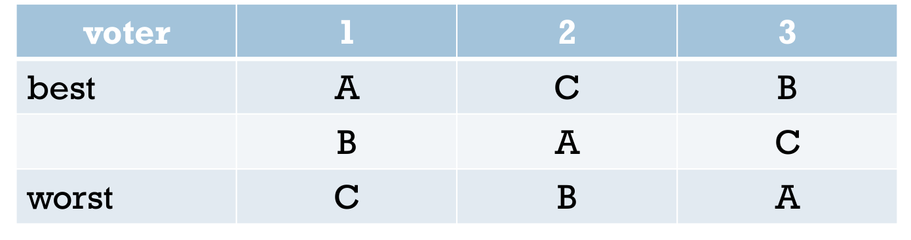

# 6. Utility functions, preferences and constitutions

## Prerequisites you need

A **preference ranking** orders alternatives from best to worst. Write $a\succeq_i b$ when voter $i$ considers $a$ at least as good as $b$, and $a\succ_i b$ when they strictly prefer $a$. A ranking is **complete** if every pair can be compared and **transitive** if $a\succeq_i b$ and $b\succeq_i c$ imply $a\succeq_i c$.

Preference tables are not payoff matrices. Each column gives one voter's ranking or a group of voters with identical rankings. Always multiply counts by group size.

A utility function can represent a preference ranking by assigning higher numbers to preferred alternatives. For these certain alternatives, only number order represents preference; adding utilities across voters requires assumptions the lecture does not make.

**Source scope.** This lesson folder contains *Gth2005.pdf* (52 PDF pages) and no transcript. This note follows the full supplied lecture, including its voting rules, strategic reports, and discussion of restricted preference profiles. The handbook is not needed for these lecture topics.

## 1. Constitutions and social rankings

A constitution combines individual rankings into one social ranking. Let $A$ be the set of alternatives, $\mathcal R(A)$ the set of complete and transitive rankings over $A$, and $P=(\succeq_1,\ldots,\succeq_n)$ the profile of $n$ voters' preferences.

> [!info] Definition — Constitution or social welfare function
> A constitution is a rule
>
> $$
> f:\mathcal R(A)^n\longrightarrow\mathcal R(A).
> $$
>
> It maps every admissible profile to one complete and transitive social ranking. It need not select a single winner.

For a subset $Y\subseteq A$, restricting a ranking to $Y$ keeps only comparisons between alternatives in $Y$. For example, restricting $A\succ_i C\succ_i B$ to $\{A,B\}$ gives $A\succ_i B$.

The lecture studies these properties:

- **Independence of irrelevant alternatives (IIA):** the social comparison of $a$ and $b$ depends only on how each voter compares $a$ with $b$. If all individual $a$–$b$ comparisons are unchanged between two profiles, the social comparison must also remain unchanged.
- **Pareto unanimity:** a unanimous preference for one alternative over another must be reflected in the social ranking. The slides use weak-preference notation in their formula and describe unanimous preference in words; the standard strict version says that if everyone strictly prefers $a$ to $b$, society must strictly prefer $a$ to $b$.
- **Non-dictatorship:** no fixed voter determines every social pairwise comparison at every profile.
- **Monotonicity:** raising an alternative in a voter's ranking should not worsen its social treatment.
- **Non-imposition:** every rational social ranking can occur as an output of the rule.

IIA is a condition on pairwise comparisons. A change in the overall winner alone does not show an IIA violation; a counterexample must keep individual comparisons of a fixed pair unchanged and reverse their social comparison.

## 2. Arrow's impossibility theorem

> [!info] Theorem — Arrow
> With at least three alternatives and an unrestricted domain of individual rankings, a constitution that always produces a complete and transitive social ranking and satisfies Pareto unanimity and IIA must be dictatorial. Equivalently, these requirements cannot all hold together with non-dictatorship.

The theorem concerns the combination of assumptions, not elections in general. It does not rule out majority voting between two alternatives or aggregation after restricting which preference profiles are allowed. The PDF gives theorem statements, not a proof.

The slides also give a formulation using non-dictatorship, monotonicity, IIA, and non-imposition. Keep the output type clear: Arrow's constitution returns a **ranking**, rather than one winning alternative.

## 3. Pairwise majority and Condorcet cycles

In a head-to-head comparison, count how many voters prefer each alternative. Write $a\succ_M b$ when more voters prefer $a$ to $b$ than prefer $b$ to $a$.

> [!info] Definition — Condorcet winner and cycle
> A **Condorcet winner** beats every other alternative in pairwise majority votes. A **Condorcet cycle** is a loop such as $A\succ_M B$, $B\succ_M C$, and $C\succ_M A$.

### Lecture example — three rational rankings, cyclic majority

*Gth2005.pdf, PDF p. 12.*

*Figure 1. Voters are columns, ordered from best to worst. Each column contributes one vote.*

The voters rank $A\succ B\succ C$, $C\succ A\succ B$, and $B\succ C\succ A$. Pairwise counts give:

| Contest | Majority result |
|---|---|
| $A$ versus $B$ | $A$ wins 2–1. |
| $B$ versus $C$ | $B$ wins 2–1. |
| $C$ versus $A$ | $C$ wins 2–1. |

Each voter's ranking is transitive, but society's pairwise majority relation is not. Therefore pairwise majority need not produce a valid social ranking.

With three voters and three alternatives, another profile in the PDF has $A$ beating both $B$ and $C$ by 2–1, so $A$ is a Condorcet winner. With more alternatives, a Condorcet winner can coexist with a cycle among the remaining alternatives.

The same cycle can occur outside elections. In the lecture's quality-of-service example, three criteria rank voice, video, and best-effort traffic differently. Giving each criterion one vote yields voice over video, video over best effort, and best effort over voice, each by 2–1.

*Figure 2. Gth2005.pdf, PDF p. 22. Columns are criteria, not voter groups with stated population sizes.*

The lecture notes that cycle likelihood depends on how rankings are distributed; its percentages assume randomized preferences and are not universal predictions for real elections.

## 4. Voting rules can select different winners

Each rule uses the same preference information differently. Count by voter group size, and distinguish a most-votes rule from a majority threshold.

### Plurality

Plurality selects the alternative with the most first-place votes. It does not require more than half of all votes.

*Lecture example — Gth2005.pdf, PDF p. 27.* Nine voters rank four as $A\succ B\succ C$, three as $B\succ C\succ A$, and two as $C\succ B\succ A$. First-place totals are $A=4$, $B=3$, $C=2$, so plurality selects $A$. But $B$ beats $A$ 5–4, beats $C$ 7–2, and is the Condorcet winner. $A$ loses to both opponents.

### Two-phase run-off

The first round selects the two candidates with the most first-place votes. Voters then choose between those finalists.

*Lecture example — Gth2005.pdf, PDF p. 29.* Four voters rank $A\succ C\succ B$, three rank $B\succ C\succ A$, and two rank $C\succ B\succ A$. First-place totals send $A$ and $B$ to the final, where $B$ wins 5–4. Yet $C$ beats $A$ 5–4 and $B$ 6–3. The Condorcet winner is eliminated before the final.

### Borda count

With $M$ alternatives, each voter gives $M-1$ points to their top choice, $M-2$ to the next, down to 0 for last. Sum points across voters. These scores are assigned by the voting rule; they do not measure the intensity of preference.

*Lecture example — Gth2005.pdf, PDF p. 31.* Five voters rank $A\succ B\succ C$, three rank $B\succ C\succ A$, and one ranks $C\succ B\succ A$. With scores $(2,1,0)$:

$$
S(A)=10,\qquad S(B)=12,\qquad S(C)=5.
$$

Borda selects $B$, although $A$ beats both rivals 5–4. A useful check is that total points equal $nM(M-1)/2$ for $n$ complete ballots.

#### Borda and candidate withdrawal

*Lecture example — Gth2005.pdf, PDF pp. 32–33.* The groups of five, two, and two voters rank, respectively, $D\succ C\succ B\succ A$, $A\succ D\succ B\succ C$, and $A\succ B\succ D\succ C$. Using $(3,2,1,0)$ gives $D=21$, $A=12$, $B=11$, $C=10$.

*Figure 3. Gth2005.pdf, PDF p. 32. Columns represent groups of 5, 2, and 2 voters.*

After $D$ withdraws, compress each ballot to its remaining order and recalculate with $(2,1,0)$. The five voters' order becomes $C\succ B\succ A$; the other four voters rank $A\succ B\succ C$. New totals are $A=8$, $B=9$, $C=10$, reversing the order among the survivors even though no voter changed their comparison of those alternatives.

*Figure 4. Gth2005.pdf, PDF p. 33. Blank cells mark withdrawn candidate $D$; remaining rankings and group sizes remain visible.*

### Top-$N$ approval

In top-$N$ approval, each voter gives one point to each of their first $N$ choices. Top 1 is plurality. General approval ballots allow voters to select their own approved subset, which a ranking alone does not determine.

*Lecture example — Gth2005.pdf, PDF pp. 35–36.* For the profile with voter groups $3:A\succ C\succ D\succ B$, $3:D\succ B\succ C\succ A$, $2:B\succ D\succ C\succ A$, and $1:A\succ B\succ C\succ D$, the same rankings give four winners:

| Rule | Totals $(A,B,C,D)$ | Winner |
|---|---|---|
| Plurality / top 1 | $(4,2,0,3)$ | $A$ |
| Top 2 approval | $(4,6,3,5)$ | $B$ |
| Top 3 approval | $(4,6,9,8)$ | $C$ |
| Borda $(3,2,1,0)$ | $(12,14,12,16)$ | $D$ |

For top-$N$, total approvals must equal $nN$. The outcome depends on the rule and, for approval, on the cutoff.

## 5. Instant run-off can violate monotonicity

Instant run-off repeatedly counts first choices among remaining alternatives. If nobody has a majority, eliminate the alternative with the fewest current first-place votes and transfer those ballots to each voter's next remaining choice.

*Lecture example — Gth2005.pdf, PDF pp. 38–39.* Initially, groups of 6, 5, 4, and 2 voters rank $A\succ B\succ C$, $C\succ A\succ B$, $B\succ C\succ A$, and $B\succ A\succ C$. First-place totals are $A=6$, $B=6$, $C=5$. Eliminating $C$ transfers five votes to $A$, which wins 11–6.

*Figure 5. Gth2005.pdf, PDF p. 38.*

Now the last two voters raise $A$ above $B$, changing their rankings to $A\succ B\succ C$. First-place totals become $A=8$, $B=4$, $C=5$. Eliminate $B$; its four votes transfer to $C$, which wins 9–8. Thus two voters promote $A$, yet $A$ loses because the elimination order changes.

*Figure 6. Gth2005.pdf, PDF p. 39. Only the final group's ranking changes.*

This is a monotonicity failure. It differs from IIA, which concerns unchanged pairwise comparisons and social rankings, and from strategic voting, which changes a reported ballot while true preferences remain fixed.

## 6. Agenda setting in pairwise votes

When pairwise majority has a cycle, the order of comparisons can determine the final winner.

*Lecture example — Gth2005.pdf, PDF pp. 24, 40–42.* Given $A\succ_M B$, $B\succ_M C$, and $C\succ_M A$:

- Compare $A$ with $B$ first; $A$ then loses to $C$, so $C$ wins.
- Compare $B$ with $C$ first; $B$ then loses to $A$, so $A$ wins.
- Compare $C$ with $A$ first; $C$ then loses to $B$, so $B$ wins.

The agenda setter can choose among the cycle's candidates by choosing the first pair. The PDF also shows a fourth alternative that loses to each of $A,B,C$; it cannot win a pairwise bracket. If the fourth alternative beats every other candidate, it wins any such sincere bracket.

## 7. Strategic voting and strategy-proofness

True preferences and reported ballots are different objects. A voter may report a ranking that differs from their true ranking if the voting rule makes the report advantageous. The lecture calls this “cheating”; here it means strategic misreporting.

*Lecture example — Gth2005.pdf, PDF pp. 44–47.* In the plurality example, four voters rank $A\succ D\succ C\succ B$, three rank $B\succ A\succ D\succ C$, and two rank $C\succ B\succ D\succ A$. Sincere first-place totals are $(A,B,C,D)=(4,3,2,0)$, so $A$ wins. If the last two voters report $B$ first, totals become $(4,5,0,0)$ and $B$ wins; those voters prefer $B$ to $A$. Other groups may then respond with different reports. These slides illustrate strategic interdependence; they do not specify a full strategic game or a unique equilibrium.

> [!info] Definition — Strategy-proof social choice rule
> A single-winner rule $g$ is strategy-proof if no voter can obtain a more preferred winner by misreporting while all other reports stay fixed. The comparison uses that voter's true ranking.

> [!info] Theorem — Gibbard–Satterthwaite
> For at least three alternatives, every deterministic, onto, strategy-proof single-winner rule on the unrestricted domain of strict rankings is dictatorial. “Onto” means every alternative can win for some profile.

The theorem means that, under these assumptions, every nondictatorial rule has some profile where an individual can benefit from a false report. It does not mean every voter can manipulate every election. The PDF states the result as a “constitution”; its single-winner formulation is the precise output type for this theorem, distinct from Arrow's social-ranking constitution.

## 8. Restricting the domain

The PDF lists several ways to respond to Arrow's result: relax requirements, change the information voters report, or restrict the allowed preference profiles. Free approval ballots, for example, ask voters to mark an approved subset rather than provide a complete ranking; this changes the input format but does not by itself guarantee immunity from strategic voting.

Pairwise majority is complete but may be nontransitive because of cycles. If admissible profiles are restricted so majority cycles cannot occur, majority can produce a transitive social ranking. The slides refer to results by Sen and Black but do not state their conditions or proofs in detail. In particular, “a linear order on alternatives” needs a precise domain condition before it can be applied as a theorem; a total ranking by each individual alone does not prevent the cycle in Figure 1.

## Exam quick reference

| Task | Method | Check |
|---|---|---|
| Find Condorcet winner | Compare every pair; weight voter groups. | First-place totals alone do not establish one. |
| Count plurality | Count first choices only. | Most votes need not be more than half. |
| Count Borda | Assign $M-1,\ldots,0$; multiply by group sizes. | Total points equal $nM(M-1)/2$. |
| Count top-$N$ approval | Give one point for each top-$N$ position. | Total approvals equal $nN$. |
| Run instant run-off | Recount after every elimination. | A changed elimination order can change transfers. |
| Show IIA violation | Hold voters' comparison of a fixed pair constant; show social pair reverses. | A changed winner alone is insufficient. |
| Show monotonicity failure | Promote a winner in some ballots and recalculate. | Distinguish this from misreporting true preferences. |
| Analyze strategic voting | Fix true rankings, change stated reports, recalculate winner. | Specify whether deviation is individual or coalition. |

## Sources

- *Gth2005.pdf*, PDF pp. 2–52. Examples and figures are cited beside the relevant sections; all PDF page references are indices.
- No transcript is present in this lesson folder. The PDF states Arrow's, Gibbard–Satterthwaite's, Sen's, and Black's results without full proofs; this note preserves that limitation.
