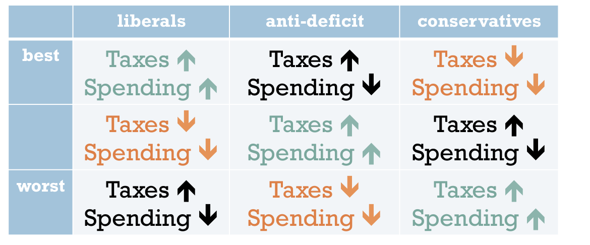
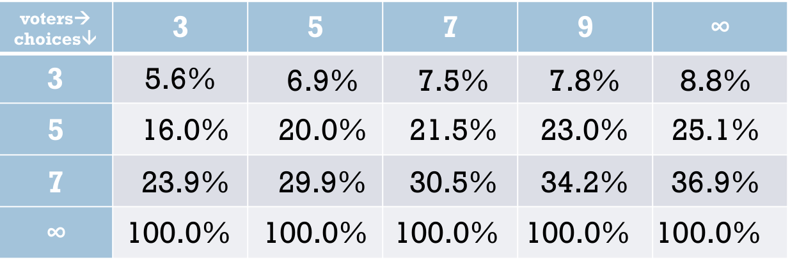
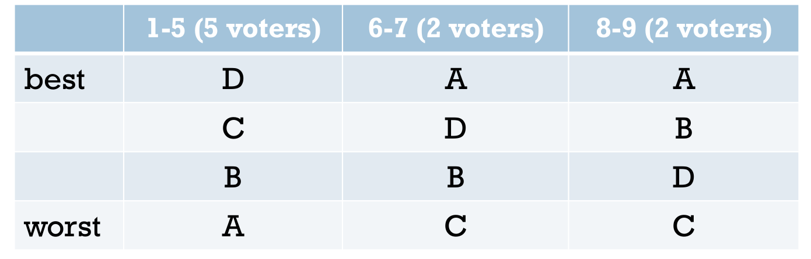
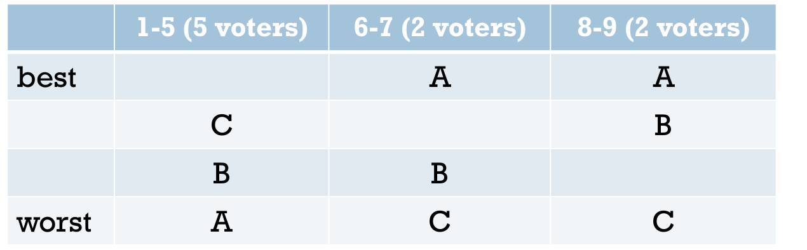
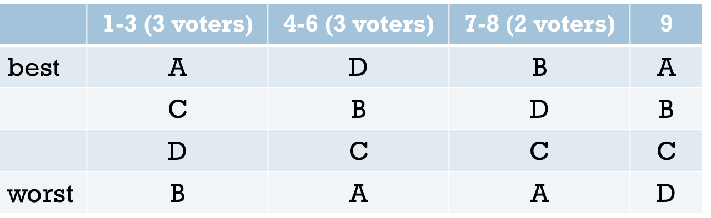
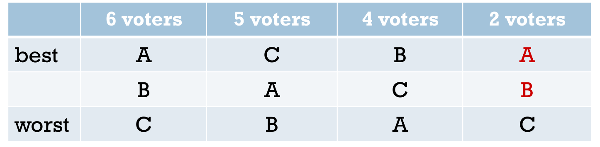
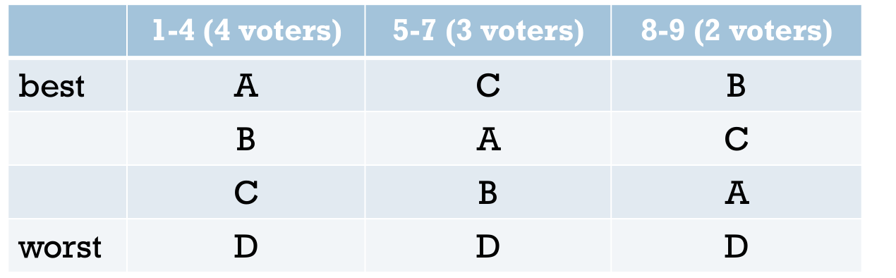
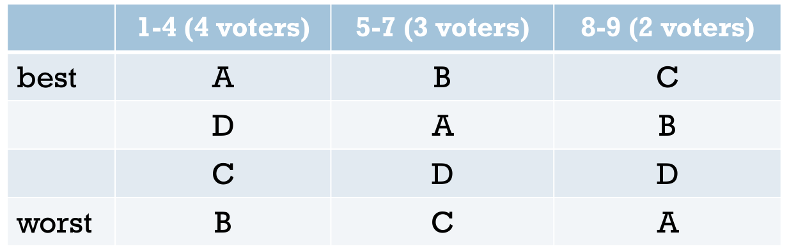
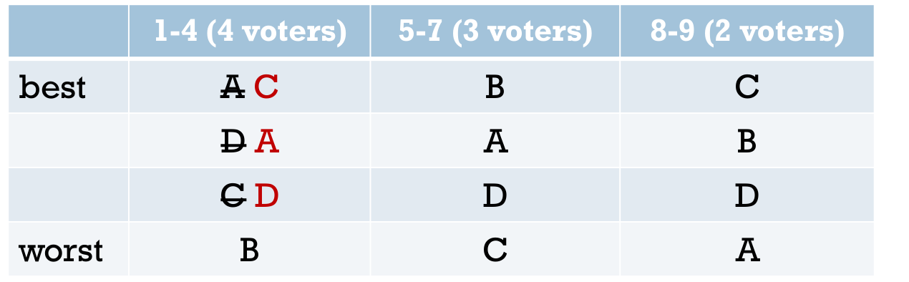
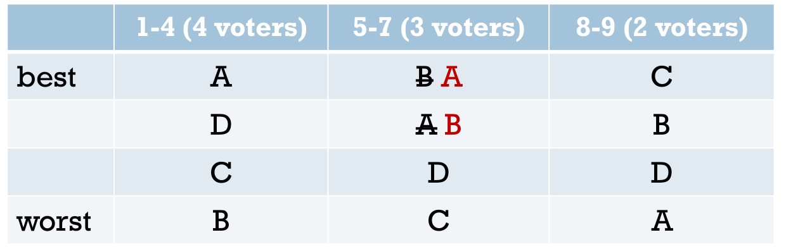

# 6. Utility functions, preferences and constitutions

## Prerequisites you need

A **preference ranking** orders alternatives from best to worst. Write $a\succeq_i b$ when voter $i$ considers $a$ at least as good as $b$, and $a\succ_i b$ when they strictly prefer $a$. A ranking is **complete** if every pair can be compared and **transitive** if $a\succeq_i b$ and $b\succeq_i c$ imply $a\succeq_i c$.

Preference tables are not payoff matrices. Each column gives one voter's ranking or a group of voters with identical rankings. Always multiply counts by group size.

A utility function can represent a preference ranking by assigning higher numbers to preferred alternatives. For these certain alternatives, only number order represents preference; adding utilities across voters requires additional assumptions about interpersonal comparability.

## 1. Constitutions and social rankings

*Gth2005.pdf, PDF pp. 3–6.*

A constitution combines individual rankings into one social ranking.
Let $A$ be the set of alternatives, $\mathcal R(A)$ the set of complete and transitive rankings over $A$, and $P=(\succeq_1,\ldots,\succeq_n)$ the profile of $n$ voters' preferences.

> [!info] Definition — Constitution or social welfare function
> A constitution is a rule
>
> $$
> f:\mathcal R(A)^n\longrightarrow\mathcal R(A).
> $$
>
> It maps every admissible profile to one complete and transitive social ranking. It need not select a single winner.

For a subset $Y\subseteq A$, restricting a ranking to $Y$ keeps only comparisons between alternatives in $Y$. For example, restricting $A\succ_i C\succ_i B$ to $\{A,B\}$ gives $A\succ_i B$.

A preference relation is a set of ordered pairs. Its restriction is therefore

$$
\succeq_i|_Y=\succeq_i\cap(Y\times Y).
$$

Properties of aggregation rules include:

- **Independence of irrelevant alternatives (IIA):** the social comparison of $a$ and $b$ depends only on how each voter compares $a$ with $b$. If all individual $a$–$b$ comparisons are unchanged between two profiles, the social comparison must also remain unchanged.
- **Pareto unanimity:** a unanimous preference for one alternative over another must be reflected in the social ranking. In the strict version, if everyone strictly prefers $a$ to $b$, society must strictly prefer $a$ to $b$.
- **Non-dictatorship:** no fixed voter determines every social pairwise comparison at every profile.
- **Monotonicity:** raising an alternative in a voter's ranking should not worsen its social treatment.
- **Non-imposition:** every rational social ranking can occur as an output of the rule.

IIA is a condition on pairwise comparisons. A change in the overall winner alone does not show an IIA violation; a counterexample must keep individual comparisons of a fixed pair unchanged and reverse their social comparison.

For profiles $P=(\succeq_1,\ldots,\succeq_n)$ and $P'=(\succeq_1',\ldots,\succeq_n')$, IIA can be written as

$$
\left[\succeq_i|_{\{a,b\}}=\succeq_i'|_{\{a,b\}}\text{ for every }i\right]
\Longrightarrow
f(P)|_{\{a,b\}}=f(P')|_{\{a,b\}}.
$$

The weak unanimity condition is $a\succeq_i b$ for every voter implying $a\succeq_{f(P)}b$. Its strict counterpart requires a strict social preference when every voter strictly prefers $a$ to $b$. This is a property of aggregation across voters, rather than a comparison of two strategy profiles as in a game's Pareto-efficiency test.

## 2. Arrow's impossibility theorem

*Gth2005.pdf, PDF p. 7.*

> [!info] Theorem — Arrow
> With at least three alternatives and an unrestricted domain of individual rankings, a constitution that always produces a complete and transitive social ranking and satisfies Pareto unanimity and IIA must be dictatorial. Equivalently, these requirements cannot all hold together with non-dictatorship.

The theorem concerns the combination of assumptions, not elections in general. It does not rule out majority voting between two alternatives or aggregation after restricting which preference profiles are allowed.

An alternative formulation combines non-dictatorship, monotonicity, IIA, and non-imposition: under the unrestricted-domain and rational-social-ranking requirements, these conditions cannot all be satisfied. Non-imposition is surjectivity onto the allowed social rankings. Arrow's constitution returns a **ranking**, rather than one winning alternative.

## 3. Pairwise majority and Condorcet cycles

In a head-to-head comparison, count how many voters prefer each alternative. Write $a\succ_M b$ when more voters prefer $a$ to $b$ than prefer $b$ to $a$. With two candidates and three strict votes, two supporters of $A$ against one supporter of $B$ give $A$ a majority. With three or more candidates, winning a majority against one opponent need not imply winning against every other opponent.

> [!info] Definition — Condorcet winner and cycle
> A **Condorcet winner** beats every other alternative in pairwise majority votes. A **Condorcet cycle** is a loop such as $A\succ_M B$, $B\succ_M C$, and $C\succ_M A$.

### Example — three rational rankings, cyclic majority

*Gth2005.pdf, PDF p. 12.*

*Figure 1. Voters are columns, ordered from best to worst. Each column contributes one vote.*

The voters rank $A\succ B\succ C$, $C\succ A\succ B$, and $B\succ C\succ A$. Pairwise counts give:

| Contest | Majority result |
|---|---|
| $A$ versus $B$ | $A$ wins 2–1. |
| $B$ versus $C$ | $B$ wins 2–1. |
| $C$ versus $A$ | $C$ wins 2–1. |

Each voter's ranking is transitive, but society's pairwise majority relation is not. Therefore pairwise majority need not produce a valid social ranking.

With three voters and three alternatives, another possible profile has $A$ beating both $B$ and $C$ by 2–1, so $A$ is a Condorcet winner. With more alternatives, a Condorcet winner can coexist with a cycle among the remaining alternatives.

### Example — inserting a third candidate

*Gth2005.pdf, PDF pp. 14–17.*

Keep the comparison of $A$ with $B$ fixed: voters 1 and 2 prefer $A$ to $B$, while voter 3 prefers $B$ to $A$. Inserting $C$ at different positions produces different majority structures without changing any voter's $A$–$B$ comparison.

| Case | Voter 1 | Voter 2 | Voter 3 | Pairwise result |
|---|---|---|---|---|
| $C$ wins | $A\succ B\succ C$ | $C\succ A\succ B$ | $C\succ B\succ A$ | $C$ beats both $A$ and $B$ by 2–1. |
| $C$ loses | $A\succ B\succ C$ | $A\succ C\succ B$ | $B\succ C\succ A$ | Both $A$ and $B$ beat $C$ by 2–1. |
| Cycle | $A\succ B\succ C$ | $C\succ A\succ B$ | $B\succ C\succ A$ | $A\succ_M B$, $B\succ_M C$, $C\succ_M A$. |

A **Condorcet loser** loses to every other candidate in pairwise votes. Two alternatives cannot form a strict majority cycle; at least three are needed. For an odd number of voters with strict rankings, no pairwise ties occur. In that setting, absence of a Condorcet winner implies a majority cycle. If ties are allowed, lack of a strict winner can instead result from ties.

### Applications beyond elections

*Gth2005.pdf, PDF pp. 20–22.*

The alternatives can be packets or jobs to schedule, with scheduling criteria acting as voters. They can also be candidate solutions to an optimization problem, ranked by different objective functions. A majority of criteria need not provide a consistent global priority.

In a fiscal-policy example, write $X$ for higher taxes and higher spending, $Y$ for higher taxes and lower spending, and $Z$ for lower taxes and lower spending. The three groups rank $X\succ Z\succ Y$, $Y\succ X\succ Z$, and $Z\succ Y\succ X$.

*Figure 2. Cropped from Gth2005.pdf, PDF p. 21. Columns are the three preference groups, each given one vote in this comparison; arrows specify the tax and spending changes without relying on color.*

Pairwise votes give $X\succ_M Z$, $Z\succ_M Y$, and $Y\succ_M X$, each by 2–1. The policy alternatives therefore form a cycle even though each group's ranking is transitive.

The same cycle can occur outside elections. In a quality-of-service example, three criteria rank voice, video, and best-effort traffic differently. Giving each criterion one vote yields voice over video, video over best effort, and best effort over voice, each by 2–1.

*Figure 3. Gth2005.pdf, PDF p. 22. Columns are criteria, not voter groups with stated population sizes.*

### Random preferences and paradox probabilities

*Gth2005.pdf, PDF pp. 18–19.*

The likelihood of a majority paradox depends on the number of voters, the number of alternatives, and the probability model for rankings. Increasing the number of alternatives can make paradoxes more likely under random-preference models; this does not mean every real election with many candidates must have a cycle.

*Figure 4. Cropped from Gth2005.pdf, PDF p. 19. Rows count alternatives and columns count voters. The entries reproduce the original numerical table, including its limiting cases; no precise sampling model is specified.*

> [!warning] Specify the event and probability model
> With more than three alternatives, “some majority cycle exists” and “no Condorcet winner exists” are different events: a winner can coexist with a cycle among the remaining candidates. The table's percentages cannot be treated as universal probabilities of either event without specifying the random-ranking model and the event being counted. The infinite rows and columns denote model limits, not finite elections.

## 4. Voting rules can select different winners

Each rule uses the same preference information differently. Count by voter group size, and distinguish a most-votes rule from a majority threshold.

### Plurality

Plurality selects the alternative with the most first-place votes. It does not require more than half of all votes.

*Example — Gth2005.pdf, PDF p. 27.* Nine voters rank four as $A\succ B\succ C$, three as $B\succ C\succ A$, and two as $C\succ B\succ A$. First-place totals are $A=4$, $B=3$, $C=2$, so plurality selects $A$. But $B$ beats $A$ 5–4, beats $C$ 7–2, and is the Condorcet winner. $A$ loses to both opponents.

### Two-phase run-off

The first round selects the two candidates with the most first-place votes. Voters then choose between those finalists.

*Example — Gth2005.pdf, PDF p. 29.* Four voters rank $A\succ C\succ B$, three rank $B\succ C\succ A$, and two rank $C\succ B\succ A$. First-place totals send $A$ and $B$ to the final, where $B$ wins 5–4. Yet $C$ beats $A$ 5–4 and $B$ 6–3. The Condorcet winner is eliminated before the final.

### Borda count

Plurality and two-phase run-off can exclude a compromise candidate with broad second-place support because they initially count only first choices. Borda uses every position in each ranking.

With $M$ alternatives, each voter gives $M-1$ points to their top choice, $M-2$ to the next, down to 0 for last. Sum points across voters. These scores are assigned by the voting rule; they do not measure the intensity of preference.

*Example — Gth2005.pdf, PDF p. 31.* Five voters rank $A\succ B\succ C$, three rank $B\succ C\succ A$, and one ranks $C\succ B\succ A$. With scores $(2,1,0)$:

$$
S(A)=10,\qquad S(B)=12,\qquad S(C)=5.
$$

Borda selects $B$, although $A$ beats both rivals 5–4. A useful check is that total points equal $nM(M-1)/2$ for $n$ complete ballots.

#### Borda and candidate withdrawal

*Example — Gth2005.pdf, PDF pp. 32–33.* The groups of five, two, and two voters rank, respectively, $D\succ C\succ B\succ A$, $A\succ D\succ B\succ C$, and $A\succ B\succ D\succ C$. Using $(3,2,1,0)$ gives $D=21$, $A=12$, $B=11$, $C=10$.

*Figure 5. Gth2005.pdf, PDF p. 32. Columns represent groups of 5, 2, and 2 voters.*

After $D$ withdraws, compress each ballot to its remaining order and recalculate with $(2,1,0)$. The five voters' order becomes $C\succ B\succ A$; the other four voters rank $A\succ B\succ C$. New totals are $A=8$, $B=9$, $C=10$, reversing the order among the survivors even though no voter changed their comparison of those alternatives.

*Figure 6. Gth2005.pdf, PDF p. 33. Blank cells mark withdrawn candidate $D$; remaining rankings and group sizes remain visible.*

### Top-$N$ approval

In top-$N$ approval, each voter gives one point to each of their first $N$ choices. Top 1 is plurality. General approval ballots allow voters to select their own approved subset, which a ranking alone does not determine.

*Example — Gth2005.pdf, PDF pp. 35–36.* For the profile with voter groups $3:A\succ C\succ D\succ B$, $3:D\succ B\succ C\succ A$, $2:B\succ D\succ C\succ A$, and $1:A\succ B\succ C\succ D$, the same rankings give four winners:

| Rule | Totals $(A,B,C,D)$ | Winner |
|---|---|---|
| Plurality / top 1 | $(4,2,0,3)$ | $A$ |
| Top 2 approval | $(4,6,3,5)$ | $B$ |
| Top 3 approval | $(4,6,9,8)$ | $C$ |
| Borda $(3,2,1,0)$ | $(12,14,12,16)$ | $D$ |

For top-$N$, total approvals must equal $nN$. The outcome depends on the rule and, for approval, on the cutoff.

*Figure 7. Cropped from Gth2005.pdf, PDF p. 35. Groups contain 3, 3, 2, and 1 voters. Applying top 1, top 2, top 3, and Borda to these same rankings selects $A,B,C,D$, respectively. The cutoff satisfies $1\leq N\leq M$; at $N=M$, all candidates receive every voter's approval and tie.*

## 5. Instant run-off can violate monotonicity

Instant run-off repeatedly counts first choices among remaining alternatives. If nobody has a majority, eliminate the alternative with the fewest current first-place votes and transfer those ballots to each voter's next remaining choice.

*Example — Gth2005.pdf, PDF pp. 38–39.* Initially, groups of 6, 5, 4, and 2 voters rank $A\succ B\succ C$, $C\succ A\succ B$, $B\succ C\succ A$, and $B\succ A\succ C$. First-place totals are $A=6$, $B=6$, $C=5$. Eliminating $C$ transfers five votes to $A$, which wins 11–6.

*Figure 8. Gth2005.pdf, PDF p. 38.*

Now the last two voters raise $A$ above $B$, changing their rankings to $A\succ B\succ C$. First-place totals become $A=8$, $B=4$, $C=5$. Eliminate $B$; its four votes transfer to $C$, which wins 9–8. Thus two voters promote $A$, yet $A$ loses because the elimination order changes.

*Figure 9. Gth2005.pdf, PDF p. 39. Only the final group's ranking changes.*

This is a monotonicity failure. It differs from IIA, which concerns unchanged pairwise comparisons and social rankings, and from strategic voting, which changes a reported ballot while true preferences remain fixed.

## 6. Agenda setting in pairwise votes

When pairwise majority has a cycle, the order of comparisons can determine the final winner.

*Example — Gth2005.pdf, PDF pp. 24, 40–42.* Given $A\succ_M B$, $B\succ_M C$, and $C\succ_M A$:

- Compare $A$ with $B$ first; $A$ then loses to $C$, so $C$ wins.
- Compare $B$ with $C$ first; $B$ then loses to $A$, so $A$ wins.
- Compare $C$ with $A$ first; $C$ then loses to $B$, so $B$ wins.

The agenda setter can choose among the cycle's candidates by choosing the first pair. A fourth alternative that loses to each of $A,B,C$ cannot win a pairwise bracket. If the fourth alternative beats every other candidate, it wins any such sincere bracket.

### Example — a four-candidate bracket

*Gth2005.pdf, PDF pp. 41–42.*

*Figure 10. Cropped from Gth2005.pdf, PDF p. 41. The columns contain 4, 3, and 2 voters; all rank $D$ last.*

The rankings give $A\succ_M B$ by 7–2, $B\succ_M C$ by 6–3, and $C\succ_M A$ by 5–4. In a bracket with two semifinals and a final, whichever candidate first faces $D$ wins the tournament:

| Semifinals | Final | Winner |
|---|---|---|
| $A$–$D$ and $B$–$C$ | $A$–$B$ | $A$ |
| $B$–$D$ and $A$–$C$ | $B$–$C$ | $B$ |
| $C$–$D$ and $A$–$B$ | $C$–$A$ | $C$ |

The agenda can select among $A,B,C$ but cannot make the Condorcet loser $D$ win. If every voter instead places $D$ first while retaining the cyclic rankings of $A,B,C$, then $D$ wins every bracket. The agenda may still affect which other candidate reaches the final. Selecting a voting rule or a bracket can therefore favor candidates, but cannot override every pairwise constraint.

## 7. Strategic voting and strategy-proofness

True preferences and reported ballots are different objects. A voter may report a ranking that differs from their true ranking if the voting rule makes the report advantageous. This behavior is **strategic misreporting**.

### Example — alternative strategic reports

*Gth2005.pdf, PDF pp. 44–48.*

*Figure 11. Cropped from Gth2005.pdf, PDF p. 44. Groups contain 4, 3, and 2 voters. Their true rankings remain fixed throughout the comparisons.*

The true pairwise majority cycle is $A\succ_M C$ by 7–2, $C\succ_M B$ by 6–3, and $B\succ_M A$ by 5–4. Sincere voting selects $A$ not only under plurality but also under Borda and top-2 approval: Borda totals are $(18,13,10,13)$ and top-2 totals are $(7,5,2,4)$ in $(A,B,C,D)$ order.

The different reports below give different plurality outcomes. Each row is a separate proposed ballot profile, rather than an automatic sequence of best responses.

| First choices reported by groups of sizes $(4,3,2)$ | Totals $(A,B,C,D)$ | Winner | Incentive |
|---|---|---|---|
| $(A,B,C)$ | $(4,3,2,0)$ | $A$ | Sincere baseline. |
| $(A,B,B)$ | $(4,5,0,0)$ | $B$ | The last two voters prefer $B$ to $A$. |
| $(C,B,C)$ | $(0,3,6,0)$ | $C$ | The first four prefer $C$ to $B$ and can preempt support for $B$ by supporting $C$. |
| $(A,A,C)$ | $(7,0,2,0)$ | $A$ | The middle three prefer $A$ to $C$ and can support $A$ instead of $B$. |

*Figure 12. Cropped from Gth2005.pdf, PDF p. 47. Crossed-out entries show the original ranking; replacement letters show the report $C\succ A\succ D\succ B$ for the first group. This profile gives $C$ six votes despite only two sincere first-place supporters.*

*Figure 13. Cropped from Gth2005.pdf, PDF p. 48. The first group's sincere ranking is restored; only the middle group's report changes, to $A\succ B\succ D\succ C$. This is a different profile from Figure 12, not a cumulative change to it.*

These examples involve coordinated reports by voter groups. They demonstrate manipulation and dependence on anticipated reports; they do not alone establish a unique equilibrium or an individual voter's profitable deviation with everyone else's ballot fixed.

> [!info] Definition — Strategy-proof social choice rule
> A single-winner rule $g$ is strategy-proof if no voter can obtain a more preferred winner by misreporting while all other reports stay fixed. The comparison uses that voter's true ranking.

Let $R_j$ be voter $j$'s true ranking, $R_j'$ an alternative report, and $R_{-j}$ the other voters' fixed reports. Strategy-proofness requires

$$
g(R_j,R_{-j})\succeq_j g(R_j',R_{-j})
\quad\text{for every }j,R_j,R_j',R_{-j}.
$$

The outcomes are compared using $j$'s **true** preference, even when their ballot changes. The rule returns a winning alternative, so this comparison differs from comparing entire social rankings.

> [!info] Theorem — Gibbard–Satterthwaite
> For at least three alternatives, every deterministic, onto, strategy-proof single-winner rule on the unrestricted domain of strict rankings is dictatorial. “Onto” means every alternative can win for some profile.

The theorem means that, under these assumptions, every nondictatorial rule has some profile where an individual can benefit from a false report. It does not mean every voter can manipulate every election. Gibbard–Satterthwaite concerns a **single-winner rule**, whereas Arrow's theorem concerns a constitution that returns a **social ranking**.

## 8. Restricting the domain

Ways to respond to Arrow's result include relaxing requirements, changing the information voters report, or restricting the allowed preference profiles. Free approval ballots, for example, ask voters to mark an approved subset rather than provide a complete ranking; this changes the input format but does not by itself guarantee immunity from strategic voting.

*Gth2005.pdf, PDF pp. 50–52.*

Write $N_{ab}=|\{i:a\succeq_i b\}|$ for the number of voters weakly preferring $a$ to $b$. The weak majority relation is

$$
a\succeq_M b\iff N_{ab}\geq N_{ba}.
$$

For strict rankings and distinct alternatives, these counts are ordinary votes for each side; a tie puts both comparisons in the weak relation. Majority is complete because two counts can always be compared. It respects unanimity and IIA, and with at least three voters it need not be dictatorial. It nevertheless fails to be a constitution on the unrestricted domain because it need not be transitive. Thus it does not contradict Arrow's theorem.

Pairwise majority is complete but may be nontransitive because of cycles. For an odd electorate with strict individual rankings, restricting admissible profiles so majority cycles cannot occur makes the majority relation transitive and hence a valid social ranking. Results by Sen and Black require precise restrictions on admissible preference profiles. A linear order on alternatives alone is not enough: a total ranking by each individual alone does not prevent the cycle in Figure 1.

## Exam quick reference

| Task | Method | Check |
|---|---|---|
| Find Condorcet winner | Compare every pair; weight voter groups. | First-place totals alone do not establish one. |
| Count plurality | Count first choices only. | Most votes need not be more than half. |
| Count Borda | Assign $M-1,\ldots,0$; multiply by group sizes. | Total points equal $nM(M-1)/2$. |
| Count top-$N$ approval | Give one point for each top-$N$ position. | Total approvals equal $nN$. |
| Run instant run-off | Recount after every elimination. | A changed elimination order can change transfers. |
| Show IIA violation | Hold voters' comparison of a fixed pair constant; show social pair reverses. | A changed winner alone is insufficient. |
| Show monotonicity failure | Promote a winner in some ballots and recalculate. | Distinguish this from misreporting true preferences. |
| Analyze strategic voting | Fix true rankings, change stated reports, recalculate winner. | Specify whether deviation is individual or coalition. |
| Analyze agenda setting | Compute pairwise winners, then follow each bracket. | A Condorcet loser cannot win a sincere elimination bracket. |
| Test a majority constitution | Compute pairwise counts, then check transitivity. | Completeness, IIA, and unanimity alone are insufficient. |
| Interpret paradox probabilities | Identify the event and random-ranking model. | A cycle among some candidates can coexist with a Condorcet winner. |

## Sources

- *Gth2005.pdf*, PDF pp. 2–52. Examples and figures are cited beside the relevant sections; all PDF page references are indices.
