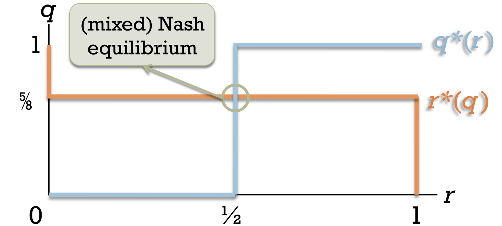
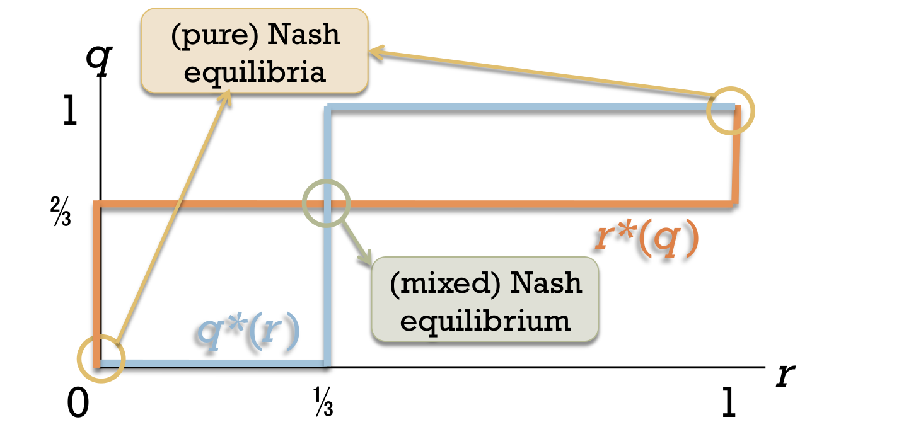
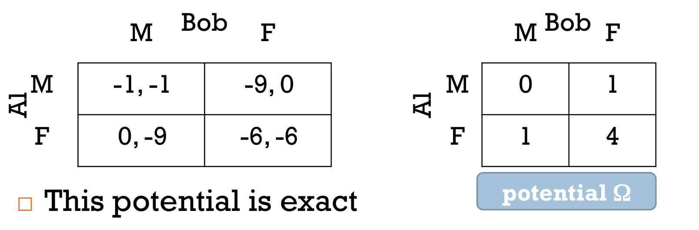
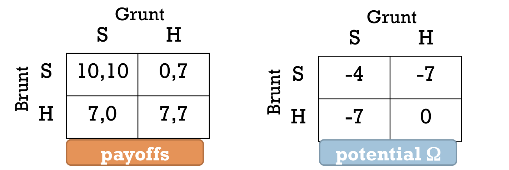
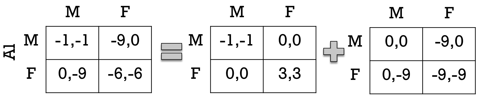
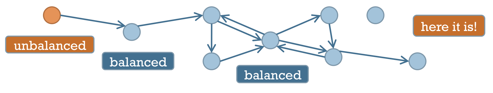

# 7. Nash theorem, potential games and PPAD

## Prerequisites you need

A **player** chooses a strategy to maximize their own **payoff**, also called utility. In a static game, players choose without observing the others' choices. **Complete information** means that the rules, available choices, and payoff functions are known; it does not mean that opponents' choices are known.

A **pure strategy** specifies a definite action in this setting. A **mixed strategy** specifies probabilities over pure strategies. The plan may be random, but the action eventually performed is pure. A **strategy profile** lists everyone's strategies. In every two-player table below, the first player chooses a row, the second chooses a column, and payoffs are **(row player's utility, column player's utility)**. Larger utilities are better, including when all numbers are negative.

A **best response** maximizes your expected utility while opponents' strategies remain fixed. A **Nash equilibrium (NE)** is a profile in which everyone plays a best response: nobody can improve by changing alone. A **strictly profitable deviation** gives a strictly larger payoff; an equally good alternative does not invalidate equilibrium.

**Notation.** There are $n$ players. Player $i$ has a nonempty pure-strategy set $S_i$; $s=(s_1,\ldots,s_n)$ is a pure profile, and $s_{-i}$ lists everyone except $i$. Write $M_i=\Delta S_i$ for the set of probability distributions over $S_i$, and $M=\prod_i M_i$ for mixed profiles. Similarly, $m=(m_1,\ldots,m_n)$ and $m_{-i}$ describe distributions. The lecture sometimes abbreviates this product as $\Delta S$.

## 1. Mixed strategies: the bridge to existence

*Sources: Gth2007.pdf, pp. 2–24; Lecture 8, Part 1, 00:00–00:08.*

### Probabilities, expected utility, and support

For a finite $S_i$, a mixed strategy satisfies

$$
m_i(s_i)\geq 0,\qquad \sum_{s_i\in S_i}m_i(s_i)=1.
$$

The **simplex** $\Delta S_i$ is the set of all such probability vectors. Its **support** consists of choices assigned positive probability. A pure strategy is included as a distribution assigning probability 1 to one choice. Thus, allowing mixed strategies preserves every pure strategy.

With independent private randomizations, a pure profile $s$ has probability $\prod_jm_j(s_j)$. Expected utility is the probability-weighted average

$$
u_i(m)=\sum_{s\in S_1\times\cdots\times S_n}
\left[\prod_{j=1}^{n}m_j(s_j)\right]u_i(s).
$$

The same symbol $u_i$ denotes the original payoff and its expected value. Against fixed $m_{-i}$, expected utility is linear in your own probabilities. An average cannot exceed its largest component, so at least one pure strategy is a best response.

> [!info] Equilibrium test — Supported choices must maximize utility
> In a finite game, $m$ is an NE exactly when each player $i$ has a value $v_i$ such that every supported pure choice gives $v_i$, and every unused pure choice gives at most $v_i$, against $m_{-i}$. Then $u_i(m)=v_i$.

If two supported choices gave different payoffs, transferring probability to the better one would improve utility. Conversely, a mixture of maximizers is itself a best response. **Indifference is necessary only among choices actually used; unused choices must also be checked.** Your indifference equation determines the opponent's probabilities.

Mixing can describe deliberate randomization or an opponent's uncertainty about your eventual choice. Over many independent plays, observed frequencies tend toward the assigned probabilities; exactly $qN$ occurrences in $N$ plays are not required. A belief is a probability assessment, not an extra physical action. For more than two players, a general belief over opponents' joint actions may be correlated; the Nash mixed profiles used here specify independent randomizations.

### Worked lecture example: odds and evens

Odd and Even independently choose 0 or 1. Odd wins when the sum is odd, and Even wins when it is even. The winner receives 4 from the loser.

| Odd \ Even | $0$ | $1$ |
|---|---|---|
| $0$ | $(-4,4)$ | $(4,-4)$ |
| $1$ | $(4,-4)$ | $(-4,4)$ |

Every pure profile lets the loser switch and win, so there is no pure NE. Let $q=\Pr[\text{Odd chooses }0]$ and $r=\Pr[\text{Even chooses }0]$. These are pre-play choice probabilities, not probabilities conditional on winning. Then

$$
u_O(q,r)=-4qr+4q(1-r)+4(1-q)r-4(1-q)(1-r)
=-4(2q-1)(2r-1).
$$

Odd's pure choices give $4-8r$ and $8r-4$; they tie at $r=1/2$. Even's give $8q-4$ and $4-8q$; they tie at $q=1/2$. Thus $(q,r)=(1/2,1/2)$ is an NE with expected utilities $(0,0)$.

It is the **only** NE. A player receiving a negative payoff can switch to a fair mixture and obtain 0. If both payoffs are already 0 but only one player mixes fairly, that player can exploit the other's biased distribution and obtain a positive payoff. Therefore both probabilities must be $1/2$. In particular, a zero expected payoff by itself does not establish equilibrium.

### Worked lecture example: a mixture can dominate a pure choice

Players A and B choose abstract actions in this known table:

| A \ B | $L$ | $C$ | $R$ |
|---|---|---|---|
| $T$ | $(7,4)$ | $(5,0)$ | $(8,1)$ |
| $D$ | $(6,0)$ | $(3,4)$ | $(9,1)$ |

Neither $L$ nor $C$ strictly dominates $R$ for B. However, the mixture $\tfrac12L+\tfrac12C$ gives B expected utility $2$ against either row, exceeding $R$'s payoff 1. After deleting $R$, $T$ strictly dominates $D$ for A. With $T$ left, B chooses $L$. The resulting $(T,L)$ is the unique NE, including mixed strategies, and gives $(7,4)$.

Strict dominance means improvement against **every** opponents' profile; weak dominance permits equality but requires strict improvement somewhere. For finite games, mixed-strategy dominance can be checked against opponents' pure profiles because other comparisons are weighted averages. Iterated elimination of strictly dominated strategies, including domination by mixtures, preserves all NE and has an order-independent surviving set under this rule. Weak elimination has no such general guarantee.

## 2. Nash equilibria as intersections of best responses

*Sources: Gth2007.pdf, pp. 25–33; Part 1, 00:06–00:27.*

At equilibrium, each player's strategy is a best response to the strategies the others choose. Best responses therefore intersect at an NE.

> [!info] Definition — Best-response correspondence
> Against opponents' mixed profile $m_{-i}$,
>
> $$
> BR_i(m_{-i})=\operatorname*{arg\,max}_{x_i\in M_i}u_i(x_i,m_{-i}).
> $$
>
> The symbol $\operatorname{arg\,max}$ means the **set of maximizing strategies**, not the maximum payoff. This is a correspondence because several strategies may tie.

### Worked lecture example: Art and Bea

Art chooses $U$ or $D$, and Bea chooses $F$ or $G$, simultaneously. The labels are abstract actions; their known payoffs are:

| Art \ Bea | $F$ | $G$ |
|---|---|---|
| $U$ | $(6,1)$ | $(0,4)$ |
| $D$ | $(2,5)$ | $(4,0)$ |

Define $q=\Pr[\text{Art chooses }U]$ and $r=\Pr[\text{Bea chooses }F]$. Conditional on Art fixing his own action, Bea's randomization gives him

$$
u_A(U,r)=6r,\qquad u_A(D,r)=2r+4(1-r)=4-2r.
$$

Thus $U$ is better when $6r>4-2r$, or $r>1/2$. The full best-response set, expressed as possible $q$ values, is

$$
q^*(r)=
\begin{cases}
\{0\},&r<1/2,\\
[0,1],&r=1/2,\\
\{1\},&r>1/2.
\end{cases}
$$

At the threshold, both actions give 3, so **every mixture** is a best response. This entire segment matters; discarding it would remove the equilibrium intersection.

For Bea,

$$
u_B(q,F)=q+5(1-q)=5-4q,\qquad u_B(q,G)=4q.
$$

Consequently,

$$
r^*(q)=
\begin{cases}
\{1\},&q<5/8,\\
[0,1],&q=5/8,\\
\{0\},&q>5/8.
\end{cases}
$$

*Figure 1. Cropped from Gth2007.pdf, PDF p. 30. The correspondence labelled $q^*(r)$ jumps vertically at $r=1/2$; the one labelled $r^*(q)$ runs horizontally at $q=5/8$. Their crossing is $(r,q)=(1/2,5/8)$ in the graph's axis order.*

The equilibrium **strategy profile**, written in player order, is therefore

$$
\boxed{(q,r)=(5/8,1/2).}
$$

Art obtains 3 from either pure action; Bea obtains $5/2$ from either pure action. No mixed deviation can improve on those values. There are no pure NE: successive profitable deviations follow

$$
(U,F)\to(U,G)\to(D,G)\to(D,F)\to(U,F).
$$

If one player chose a pure strategy, the other would have a unique pure best response, which would require a pure NE. Thus there are no equilibria with only one player genuinely mixing. The displayed fully mixed equilibrium is the complete equilibrium set.

> [!warning] Source correction — The probabilities were swapped
> The sentence below the graph on PDF p. 30, repeated around Part 1, 00:17:42, swaps $q$ and $r$. The payoff equations and graph give $q=5/8$, $r=1/2$. The horizontal axis is $r$, so reading a plotted point directly as $(q,r)$ causes this error.

### Worked lecture example: several intersections in Battle of the Sexes

Ann and Brian independently choose a romance film $R$ or science fiction $S$. They prefer meeting; Ann prefers romance, Brian science fiction.

| Ann \ Brian | $R$ | $S$ |
|---|---|---|
| $R$ | $(2,1)$ | $(0,0)$ |
| $S$ | $(0,0)$ | $(1,2)$ |

Let $q=\Pr[\text{Ann chooses }R]$ and $r=\Pr[\text{Brian chooses }R]$. Ann compares $2r$ with $1-r$, so she chooses $R$ when $r>1/3$, $S$ when $r<1/3$, and any mixture at equality. Brian compares $q$ with $2(1-q)$, so he chooses $R$ when $q>2/3$, $S$ when $q<2/3$, and any mixture at equality.

*Figure 2. Cropped from Gth2007.pdf, PDF p. 32. The axes are again horizontal $r$, vertical $q$. Labels identify the two pure intersections and the interior mixed intersection independently of color.*

There are exactly three NE: $(R,R)$, $(S,S)$, and the mixed profile $(q,r)=(2/3,1/3)$. In the interior, each player gets $2/3$ from either action. Against a pure opponent the best response is unique, excluding additional equilibria with only one player mixing.

**Source correction:** the two expressions using $1-h(\cdot)$ on p. 31 have the wrong direction for the usual increasing Heaviside step $h$. Both best responses increase at their thresholds, as the payoff comparisons and p. 32 show. Use the inequalities above, including the full sets at equality.

## 3. Why a Nash equilibrium must exist

*Sources: Gth2007.pdf, pp. 23 and 33–35; Part 1, 00:22–00:35.*

### From mutual best responses to a fixed point

Aggregate the individual best-response sets into

$$
BR(m)=BR_1(m_{-1})\times\cdots\times BR_n(m_{-n}).
$$

This Cartesian product contains every profile obtained by choosing one best response for each player against the original opponents' profile. The equilibrium condition is

$$
\boxed{m^*\in BR(m^*).}
$$

This is a **fixed point of a correspondence**. Membership replaces equality because $BR(m^*)$ is a set. In Art–Bea, both players' best-response sets at the equilibrium contain every mixture, so $BR(m^*)=[0,1]^2$. This does **not** make every point in that square an equilibrium: each candidate must belong to its **own** best-response set.

### Brouwer: the one-dimensional intuition

For a continuous function $f:[0,1]\to[0,1]$, a fixed point satisfies $f(x^*)=x^*$. Let $g(x)=f(x)-x$. Since $f$ maps into the interval,

$$
g(0)\geq0,\qquad g(1)\leq0.
$$

If an endpoint gives equality, it is already a fixed point. Otherwise continuity and the **intermediate value theorem** give an interior zero of $g$.

The general Brouwer theorem applies to a continuous self-map of a nonempty compact convex subset of finite-dimensional Euclidean space. The interval argument is its simplest instance. **Source correction:** p. 34 calls the zero-crossing argument “Bolzano–Weierstrass”; the relevant result here is the intermediate value theorem, also called Bolzano's theorem. Continuity on an arbitrary unbounded closed interval would not be sufficient.

### Kakutani: the version needed for best responses

Best responses need not be single-valued or continuous as functions, as Art–Bea illustrates. Kakutani permits sets of possible responses.

> [!info] Theorem — Kakutani's fixed-point theorem
> Let $A$ be a nonempty, compact, convex subset of $\mathbb{R}^d$. Suppose $F:A\rightrightarrows A$ has nonempty convex values and a closed graph. Then some $x^*\in A$ satisfies $x^*\in F(x^*)$.

In this finite-dimensional setting, **compact** means closed and bounded; **convex** means that the line segment between any two points remains in the set. A **closed graph** means that if $x^k\to x$, $y^k\to y$, and $y^k\in F(x^k)$ for every $k$, then $y\in F(x)$. A limiting valid input-output pair cannot disappear from the graph.

> [!info] Theorem — Nash's existence theorem
> Every normal-form game with finitely many players, nonempty finite pure-strategy sets, and real payoffs has at least one NE when independent mixed strategies and expected utilities are allowed.

**Why Kakutani applies.** The following steps supply the assumptions rather than merely naming the fixed-point theorem.

1. **The domain $M$ is nonempty, compact, and convex.** Every $M_i$ is a finite-dimensional probability simplex, defined by closed probability constraints and bounded between 0 and 1. Products preserve these properties.
2. **Best-response values are nonempty.** Against fixed opponents, some pure action maximizes the finite list of expected payoffs. Its probability-1 distribution is a best response.
3. **Best-response values are convex.** If $x_i$ and $y_i$ both give the maximum payoff, so does $\lambda x_i+(1-\lambda)y_i$ for $0\leq\lambda\leq1$, because expected utility is linear in one's own mixture.
4. **The graph is closed.** Suppose $m^k\to m$, $b^k\to b$, and $b^k\in BR(m^k)$. For every player and every fixed alternative $z_i$,

$$
u_i(b_i^k,m_{-i}^k)\geq u_i(z_i,m_{-i}^k).
$$

Expected utilities are finite sums of products of probabilities, hence continuous. Taking limits preserves the inequality for every $z_i$, proving $b\in BR(m)$.

Kakutani now gives $m^*\in BR(m^*)$, which is exactly an NE. Mixing supplies both the convex domain and the mixtures of tied best responses needed by the proof.

**What to conclude in exercises.** If a finite game has no pure NE, at least one equilibrium must involve genuine randomization. The theorem does not give probabilities, uniqueness, convergence of a learning process, social efficiency, or a fast algorithm. It does not automatically cover games with continuous quantities; those require their own assumptions or a direct solution.

## 4. Updating strategies: existence does not guarantee convergence

*Sources: Gth2007.pdf, pp. 36–38 and 43; Part 2, 00:00–00:09 and 00:21–00:22.*

The lecture considers successive best-response updates on a static payoff table. This procedure searches for a profile; it does not specify a dynamic game with contingent future plans.

1. Start from a proposed profile.
2. Select one player while holding everyone else's current choice fixed.
3. If the player can improve, replace their strategy with a best response.
4. Continue until no player can improve.

With the rule **stay when already best responding**, every NE is absorbing: once reached, the profile remains unchanged. Without that rule, a player could switch between tied best responses, so absorption would not follow automatically. An update schedule must give every player an opportunity to move; otherwise an improving player might be ignored forever.

### Worked lecture example: a cycle in rock–paper–scissors

Two players choose rock ($R$), paper ($P$), or scissors ($S$). A win gives $+1$, a loss $-1$, and a tie 0, with payoff order (player 1, player 2). Paper beats rock, scissors beats paper, and rock beats scissors. Starting at $(R,P)$ and allowing the loser to best respond gives

$$
(R,P)\to(S,P)\to(S,R)\to(P,R)\to(P,S)\to(R,S)\to(R,P).
$$

Every move raises the mover's payoff from $-1$ to $+1$, yet the process repeats forever. A mixed NE exists, with both choosing each action with probability $1/3$, but these pure-action updates never reach it. Thus an existence proof is not a convergence proof.

The slide calls successive best-response updating **fictitious play**. Its rock–paper–scissors example shows that this updating process need not converge. The potential argument below proves termination of **one-player-at-a-time strict improvements on finite pure profiles**.

## 5. Potential games: one function tracks individual incentives

*Sources: Gth2007.pdf, pp. 39–43; Part 2, 00:09–00:22.*

If every player's unilateral improvement raises the same scalar function, a strictly improving cycle is impossible. The potential is shared across players, although their actual utilities may differ.

Fix a pure profile $s=(s_i,s_{-i})$ and an alternative $s_i'$. Define the mover's gain and the potential change by

$$
\Delta u_i=u_i(s_i',s_{-i})-u_i(s_i,s_{-i}),\qquad
\Delta\Omega=\Omega(s_i',s_{-i})-\Omega(s_i,s_{-i}).
$$

> [!info] Definition — Exact, weighted, and ordinal potentials
> A single function $\Omega:S_1\times\cdots\times S_n\to\mathbb{R}$ is:
>
> - an **exact potential** if $\Delta\Omega=\Delta u_i$ for every unilateral change;
> - a **weighted potential** if $\Delta\Omega=w_i\Delta u_i$ for fixed player-specific constants $w_i>0$;
> - an **ordinal potential** if $\Delta\Omega>0$ exactly when $\Delta u_i>0$.
>
> These conditions must hold for every player, every opponents' profile, and every pair of that player's choices. The weighted convention here is the one on p. 39; some sources put the weight on the other side.

Exact potentials are weighted potentials with all weights 1. Positive weights preserve signs, so every weighted potential is also ordinal. In the ordinal definition, applying the condition to the reverse move also preserves decreases and ties. The potential tracks **the mover's** incentive; its increase need not improve the other players' payoffs.

### Worked lecture example: the prisoner's dilemma has an exact potential

Al and Bob independently choose to remain silent ($M$) or confess ($F$). Negative payoffs measure an undesirable punishment, so closer to zero is better. The lecture supplies this payoff table and potential:

*Figure 3. Cropped from Gth2007.pdf, PDF p. 41. Rows belong to Al, columns to Bob. Payoff tuples are (Al, Bob); the potential table contains one scalar per profile.*

To verify an exact potential, compare horizontal changes using **Bob's** utility and vertical changes using **Al's** utility:

| Unilateral change | Mover | Utility change | Potential change |
|---|---|---|---|
| $(M,M)\to(F,M)$ | Al | $0-(-1)=1$ | $1-0=1$ |
| $(M,F)\to(F,F)$ | Al | $-6-(-9)=3$ | $4-1=3$ |
| $(M,M)\to(M,F)$ | Bob | $0-(-1)=1$ | $1-0=1$ |
| $(F,M)\to(F,F)$ | Bob | $-6-(-9)=3$ | $4-1=3$ |

Reverse changes negate both columns, so this verifies all unilateral changes. The unique NE is $(F,F)$: confessing strictly dominates silence for both players. Its potential 4 is maximal, although its payoffs $(-6,-6)$ are worse for both than $(-1,-1)$ at $(M,M)$. **Potential maximization is not social-welfare maximization.**

### How to construct an exact potential in a finite table

Choose one cell's potential arbitrarily, often 0. Assign other values by adding the **mover's utility difference** along unilateral changes. Check that different paths to the same profile produce the same value.

For a $2\times2$ game with row choices $T,D$ and columns $L,R$, the sole consistency condition is

$$
\begin{aligned}
&[u_1(D,L)-u_1(T,L)]+[u_2(D,R)-u_2(D,L)]\\
={}&[u_2(T,R)-u_2(T,L)]+[u_1(D,R)-u_1(T,R)].
\end{aligned}
$$

Both sides construct $\Omega(D,R)-\Omega(T,L)$ by a different route. In the prisoner's dilemma, each route gives $1+3=4$. In a larger game all relevant cycles must be consistent; checking one rectangle is insufficient. Adding a constant to every potential value preserves all differences.

A **strict improvement cycle** rules out even an ordinal potential: the potential would have to rise at every step and return to its starting value. The rock–paper–scissors cycle therefore proves nonexistence of such a potential. Finding a pure NE alone does not prove that a potential exists.

### Existence and termination in finite potential games

> [!info] Theorem — A finite ordinal potential game has a pure NE
> With finite nonempty pure-strategy sets, any global maximizer of an ordinal potential is a pure NE. More generally, a pure profile is an NE exactly when no unilateral change can increase its potential.

**Proof and algorithm.** A finite set of potential values has a maximum. At a maximizing profile, a profitable deviation would increase the potential, contradicting maximality. Alternatively, start anywhere and repeatedly make a unilateral strict improvement. Potential strictly rises, so no pure profile can be revisited. There are finitely many profiles, so the process stops at an NE.

“Local maximum” here means **with respect to every unilateral alternative**: compare all choices of one player, keeping the others fixed. A global maximum is sufficient but not necessary. Simultaneous changes by several players fall outside the argument; changes to equally good choices may cycle. Finite termination also does not by itself give a polynomial-time bound in the size of a compact game description.

Replacing every payoff $u_i$ by an ordinal potential preserves **pure** NE. It need not preserve mixed NE because ordinal comparisons alone do not preserve expected-payoff comparisons. Exact and positive-weight potential identities also hold for expected utilities.

## 6. Applications and limits of the potential method

### Cournot quantities: check the boundary

*Sources: Gth2007.pdf, p. 42; Part 2, 00:19–00:21. The boundary check and repaired potential below are mathematical additions.*

Two firms independently choose quantities $q_1,q_2\geq0$. In the lecture's linear-price model, price is $a-q_1-q_2$ and unit cost is $c$, giving

$$
u_i(q_i,q_j)=q_i(a-c-q_i-q_j),\qquad i\ne j.
$$

Here $a>c$ is the demand intercept, and there is no price truncation in the displayed formula. The slide proposes

$$
\Omega_{\mathrm{slide}}(q_1,q_2)=q_1q_2(a-c-q_1-q_2).
$$

For firm $i$'s unilateral change, the other firm's $q_j$ is fixed, so

$$
\Delta\Omega_{\mathrm{slide}}=q_j\Delta u_i.
$$

This preserves signs when **$q_j>0$**. It fails when $q_j=0$: the potential stays zero even if firm $i$ can increase profit. Thus the slide's function is ordinal on a strictly positive quantity domain, but not on the usual domain that includes zero. Nonnegativity alone is insufficient.

An exact potential valid also at zero for these profit functions is

$$
\Phi(q_1,q_2)=(a-c)(q_1+q_2)-q_1^2-q_2^2-q_1q_2.
$$

With $q_j$ fixed, its terms depending on $q_i$ are exactly $q_i(a-c-q_j)-q_i^2=u_i(q_i,q_j)$; the remaining terms depend only on $q_j$. Hence $\Delta\Phi=\Delta u_i$.

For an equilibrium calculation, the profit derivative is $9-2q_i-q_j$ and the second derivative is $-2$. The negative second derivative makes profit strictly concave in one's own quantity, so a feasible point with zero first derivative is the global maximum. If that point is negative, the constrained maximum is at zero. Thus each best response is

$$
q_i^*(q_j)=\max\{0,(9-q_j)/2\}.
$$

The two positive best-response equations give $q_1=q_2=3$. Each firm receives $3(10-3-3-1)=9$. No equilibrium can have $q_1=0$: then firm 2 would choose $4.5$, against which firm 1 would prefer $2.25>0$. The symmetric argument excludes $q_2=0$. Thus $(3,3)$ is the unique NE of this numerical model. This direct concavity and boundary check, rather than the **finite** potential-game theorem, justifies the continuous-choice result.

### Congestion games: account for entry and departure

*Sources: Gth2007.pdf, p. 44; Part 2, 00:22–00:25. The formula expresses the lecture's resource-use intuition.*

In a standard finite, unweighted congestion game, each player chooses a resource or a set of resources, such as a route. If $n_e(s)$ players use resource $e$, every user incurs the same cost $c_e(n_e(s))$. A player's total cost is the sum over resources they use; utility is its negative.

An exact potential in the utility-maximizing convention is

$$
\Omega(s)=-\sum_e\sum_{k=1}^{n_e(s)}c_e(k).
$$

When a player leaves resource $e$, the potential rises by the cost they were paying, $c_e(n_e)$. Joining resource $f$ lowers it by their new cost $c_f(n_f+1)$. The net change equals the mover's utility change. This is why the potential is a cumulative sum, rather than necessarily the negative of total congestion cost.

At either split profile, switching would raise the mover's cost from 1 to 3, so both split profiles are pure NE. There is also a mixed NE in which both choose each channel with probability $1/2$: against a fair opponent each channel has expected cost 2. At $(A,A)$ the total cost is 6, while the cumulative potential cost is 4; they are different quantities.

Routing and channel allocation fit this idea when their payoffs depend on how many players use each resource.

### Coordination: reaching equilibrium does not select the best one

*Sources: Gth2007.pdf, pp. 45–46; Part 2, 00:25–00:32.*

In coordination examples, both players benefit from compatible choices. A transmitter and its receiver may need the same channel. Battle of the Sexes has this structure despite disagreement about which meeting point is preferable.

In the lecture's **Stag Hunt**, Brunt and Grunt each choose stag ($S$) or hare ($H$). A stag is worth 20 but requires both hunters, who split it and receive 10 each. Hunting a hare gives 7 independently; hunting a stag alone gives 0.

*Figure 4. Cropped from Gth2007.pdf, PDF p. 46. Rows belong to Brunt, columns to Grunt. Payoff order is (Brunt, Grunt). The exact potential is $-4$ at $(S,S)$, $-7$ off the diagonal, and 0 at $(H,H)$.*

For example, $(S,H)\to(H,H)$ raises Brunt's utility by $7-0=7$ and potential by $0-(-7)=7$. From $(H,S)\to(S,S)$, Brunt gains $10-7=3$ and potential rises by $-4-(-7)=3$. Symmetry verifies Grunt's corresponding changes.

Both $(S,S)$ and $(H,H)$ are pure NE. At $(S,S)$, changing to hare reduces the mover's payoff from 10 to 7; at $(H,H)$, changing to stag reduces it from 7 to 0. Yet $(S,S)$ gives both players more utility, while **$(H,H)$ has higher potential**. Potential levels compare incentives, not social desirability.

At a mismatch, either hunter's strict improvement can determine which equilibrium is reached: from $(S,H)$, Brunt can switch to $H$ and reach $(H,H)$, or Grunt can switch to $S$ and reach $(S,S)$. The initial profile and update order matter.

### Anti-coordination and discoordination are different

*Sources: Gth2007.pdf, p. 47; Part 2, 00:32–00:36.*

In **anti-coordination**, both players prefer different roles or choices. Two transmitters avoiding the same channel are an example. The lecture's Hawk–Dove table uses aggressive action $H$ and peaceful action $D$:

| Player 1 \ Player 2 | $H$ | $D$ |
|---|---|---|
| $H$ | $(-99,-99)$ | $(10,-10)$ |
| $D$ | $(-10,10)$ | $(0,0)$ |

Against $H$, choose $D$ because $-10>-99$; against $D$, choose $H$ because $10>0$. Thus $(H,D)$ and $(D,H)$ are pure NE. If the opponent chooses $H$ with probability $p$, the two utilities are $10-109p$ and $-10p$. Equality gives $p=10/99$. The third NE has each choosing $H$ with this probability. As in the other strict $2\times2$ examples, a pure opponent has a unique pure best response, so these are all equilibria.

In **discoordination**, one player wants matching choices and the other wants different choices. Odds and evens and matching pennies have this conflict, lack pure NE, and cannot have an ordinal potential on their finite pure-strategy spaces. Relabelling a column can turn a two-choice anti-coordination table into a coordination table; it cannot remove the conflict of incentives in a discoordination game.

### Dummy games and the decomposition of an exact potential game

*Sources: Gth2007.pdf, p. 48; Part 2, 00:36–00:42.*

A **dummy game**, or pure externality game, gives player $i$ a payoff $d_i(s_{-i})$ depending only on opponents' choices. Their own choice cannot change their own utility. Therefore every strategy profile, including every mixed profile in a finite dummy game, is an NE. Others' choices can still affect their welfare.

For an **exact** potential, define

$$
d_i(s_{-i})=u_i(s_i,s_{-i})-\Omega(s_i,s_{-i}).
$$

Its difference between any two $s_i$ values is zero, because exactness cancels the utility and potential changes. Thus this expression really is independent of $s_i$, giving

$$
\boxed{u_i(s)=\Omega(s)+d_i(s_{-i}).}
$$

The first part is a common-payoff game: everyone receives the same $\Omega(s)$. The second is a dummy component. The slide calls the first part “pure coordination”; here that means **identical payoffs**, not that every pair of matching action labels must be stable. For weighted potentials, rescale utilities first. An ordinal potential alone does not imply this numerical additive decomposition.

*Figure 5. Cropped from Gth2007.pdf, PDF p. 48. Left: original prisoner's dilemma. Middle: common payoff $C=\Omega-1$ for both players. Right: dummy component. All three tables have Al's rows $M,F$, Bob's columns $M,F$, and tuple order (Al, Bob). Corresponding tuples add component by component.*

For example, at $(M,F)$, the common component is $(0,0)$ and the dummy component is $(-9,0)$, giving $(-9,0)$. At $(F,F)$, $(3,3)+(-9,-9)=(-6,-6)$. Bob's confession imposes $-9$ on Al regardless of Al's own action; Al's confession similarly affects Bob. These terms change welfare without changing the affected player's ranking of their own choices against fixed opponents. This explains how identical incentive changes can coexist with the prisoner's dilemma's inefficient equilibrium.

## 7. Computing equilibria: PPAD and approximation

*Sources: Gth2007.pdf, pp. 49–55; Part 3 in full. The qualifications below correct the lecture's informal complexity claims.*

### Existence, verification, and search ask different questions

For a finite game, Nash's theorem guarantees a mixed NE. Checking a proposed profile requires checking deviations; finding an NE requires producing probabilities.

Running time is measured against the length of the encoded input. A polynomial-time method uses a number of steps bounded by a fixed power of that length. Exact rational numbers also require bits to represent; counting only arithmetic operations can hide this cost.

A standard benchmark is that finding an exact NE of a finite two-player game with rational payoff tables is PPAD-complete. Complexity claims depend on how the game and payoffs are represented.

### End-of-Line: guaranteed existence can hide a long search

**PPAD** stands for **Polynomial Parity Arguments on Directed graphs**. It is a class of total search problems: a valid output is guaranteed for every valid input. Its defining problem is **End-of-Line**.

*Figure 6. Cropped from Gth2007.pdf, PDF p. 53. Arrows and the words “balanced”, “unbalanced”, and “here it is!” carry the meaning without color. This is a general balance illustration with branching, not the degree-at-most-one graph in the formal End-of-Line problem.*

In formal End-of-Line, vertices have at most one predecessor and one successor. A known source has a successor and no predecessor; find another source or a sink. Predecessor and successor rules are given by Boolean circuits, so a compact input can describe exponentially many vertices and a path can take exponentially many steps.

A problem is in PPAD if it reduces to End-of-Line in polynomial time. **PPAD-complete** means that it is in the class and every problem in the class reduces to it. Fixed-point constructions connect Nash search to these directed paths.

> [!warning] Source correction — Complexity claims need qualifications
> The slogan $P<PPAD<NP$ on p. 52 is not a proved strict hierarchy. $P$ and $NP$ conventionally classify decision problems, while PPAD classifies search problems. PPAD-completeness does not prove that every algorithm needs exponential time. Likewise, a guaranteed solution does not make search trivial. Keep the existence decision separate from finding an output.

Potential games give a constructive route to a pure NE under the finite improvement assumptions. That guarantee still requires a running-time analysis if efficiency matters; termination alone does not establish a general fast algorithm.

### An epsilon-Nash equilibrium bounds profitable deviations

*Source: Gth2007.pdf, p. 55; Part 3, 00:11–00:14.*

Engineering applications may accept a profile where every possible gain is small, rather than exactly zero.

> [!info] Definition — Additive $\varepsilon$-Nash equilibrium
> For tolerance $\varepsilon\geq0$, profile $m$ is an $\varepsilon$-NE if
>
> $$
> u_i(m_i',m_{-i})-u_i(m)\leq\varepsilon
> \quad\text{for every player }i\text{ and every }m_i'\in M_i.
> $$
>
> Equivalently, each player's maximum deviation gain, or regret,
>
> $$
> \rho_i(m)=\max_{s_i\in S_i}u_i(s_i,m_{-i})-u_i(m),
> $$
>
> is at most $\varepsilon$. Pure deviations suffice because mixed deviations are averages. An exact NE has every $\rho_i=0$.

The tolerance measures **payoff gain**, not geometric distance between probability vectors. Its interpretation depends on payoff units: multiplying all utilities by 100 multiplies the required tolerance by 100.

**Source correction:** Part 3, around 00:12:54–00:13:19, presents approximation as making the general search polynomial-time. This claim needs qualifications: computational guarantees depend on the game, payoff scale, and tolerance.

## 8. Practice with verified handbook references

The references below are to **Chapter 1, “Static games of complete information”** of `Game Theory. A Handbook of Problems and Excercises.pdf`. Printed page numbers are six lower than PDF page indices in these sections. The handbook has relevant matrix exercises; no dedicated potential-game or PPAD exercise is listed here.

### Prompts

| Verified exercise | Location | What to practise |
|---|---|---|
| **1.1 — Jorah and Khaleesi choosing cities** | Printed pp. 8–9; PDF pp. 14–15 | Explain why Nash guarantees mixing after excluding pure NE; calculate both best-response thresholds. |
| **1.3 — Radio transmitter–receiver pair** | Printed pp. 12–13; PDF pp. 18–19 | Build payoffs, distinguish coordination from discoordination, and find all best-response intersections. |
| **1.4 — Charlotte and Daniel choosing supervisors** | Printed pp. 14–15; PDF pp. 20–21 | Eliminate a strictly dominated action, find the complete equilibrium set, and check the unused action. |

### Solution routes and checks

**Exercise 1.1.** Both choose Meeren $M$ or Yunkai $Y$. Capturing both cities gives value 8, one Meeren gives 5, and one Yunkai gives 3. Jorah additionally values choosing the same city as Khaleesi by 10. In order (Jorah, Khaleesi), the rows and columns $M,Y$ give

$$
\begin{pmatrix}
(15,5)&(8,8)\\
(8,8)&(13,3)
\end{pmatrix}.
$$

There is no pure NE: Jorah wants matching choices, whereas Khaleesi wants different cities. Set $p=\Pr[J\text{ chooses }M]$, $q=\Pr[K\text{ chooses }M]$. Jorah's indifference is $8+7q=13-5q$, so $q=5/12$. Khaleesi's is $8-3p=3+5p$, so $p=5/8$. Both probabilities are interior, and every pure choice is a maximizer against the calculated opponent. The strict best responses to pure opponents exclude partially mixed cases, so this is the unique NE. Draw it with axes explicitly labelled; unlike Figures 1–2 above, the handbook puts the first player's probability horizontally.

**Exercise 1.3.** The transmitter chooses concentrated transmission $C$ or spread spectrum $S$, costing 2 or 9. The receiver listens to one frequency $A$ or two $B$. Its utility is $2-k$ against $C$ and $2+k$ against $S$, where $k$ is the number listened to. Transmitter utility is twice receiver utility, plus $k$, minus power cost. This produces the table, in order (transmitter, receiver):

| Transmitter \ Receiver | $A$ | $B$ |
|---|---|---|
| $C$ | $(1,1)$ | $(0,0)$ |
| $S$ | $(-2,3)$ | $(1,4)$ |

The pure NE are $(C,A)$ and $(S,B)$ in this player order. With $p=\Pr[T\text{ chooses }C]$ and $q=\Pr[R\text{ chooses }A]$, transmitter indifference gives $q=1-3q$, so $q=1/4$. Receiver indifference gives $3-2p=4-4p$, so $p=1/2$. These probabilities give equal payoffs to both of each player's choices. Strict pure best responses exclude additional cases, leaving exactly these two pure NE and this mixed one.

**Exercise 1.4.** A student alone gets 40, 60, or 50 from supervisors $X,Y,Z$; sharing gives 70% of the corresponding amount. For either student, $Y$ strictly dominates $X$: against opponents choosing $X,Y,Z$, their respective payoffs are $(60,42,60)$ versus $(28,40,40)$. The reduced game, in order (Charlotte, Daniel), is

| Charlotte \ Daniel | $Y$ | $Z$ |
|---|---|---|
| $Y$ | $(42,42)$ | $(60,50)$ |
| $Z$ | $(50,60)$ | $(35,35)$ |

The pure NE are $(Y,Z)$ and $(Z,Y)$. If the opponent chooses $Y$ with probability $p$, the two surviving choices give $60-18p$ and $35+15p$. Equality gives $p=25/33$. Applying the equation separately to both players gives a third NE: each assigns probabilities $(0,25/33,8/33)$ to $(X,Y,Z)$. The common supported payoff is $510/11>40$, so the unused $X$ cannot improve utility. Pure opponents induce unique best responses, excluding other partially mixed cases. The equal mixing probabilities follow from the two equations, rather than from symmetry alone.

## Exam quick reference

Use this section to look up methods and their assumptions.

| Problem cue | Method | Essential condition or check |
|---|---|---|
| Problem cue | Method | Essential condition or check |
|---|---|---|
| Equilibrium existence | Apply Nash's theorem. | Finite players, finite nonempty actions, real expected utilities; mixing allowed. |
| Complete equilibrium set | Check pure profiles, then candidate supports. Equalize supported payoffs and test unused choices. | Check probabilities, support, and boundary cases. |
| Best-response graph | Compare expected payoffs against the opponent's probability. | At equality, include every mixture of tied maximizers. Label axes and player order. |
| Fixed-point proof | Use $M=\prod_i\Delta S_i$ and $m^*\in BR(m^*)$. | $M$ nonempty, compact, convex; $BR$ nonempty convex-valued with closed graph. |
| Potential verification | Compare unilateral utility and potential differences. | Use mover's payoff; test each player and alternatives; check path consistency. |
| Pure equilibrium or convergence | Show an ordinal potential rises on every strict improvement. | Finite pure profiles; one mover at a time; stay on ties. |
| Equilibrium comparison | Compare actual utilities or specified welfare. | Potential levels alone do not rank welfare. |
| Nash computation | Distinguish existence, verification, and search. | Specify encoding, game class, and precision. |
| $\varepsilon$-NE check | Calculate each maximum pure-deviation gain. | Every gain must be $\leq\varepsilon$. |

**Mixed equilibrium test.** For player $i$ against fixed $m_{-i}$,

$$
u_i(s_i,m_{-i})=v_i\quad\text{on the support},\qquad
u_i(t_i,m_{-i})\leq v_i\quad\text{outside it}.
$$

Here $v_i=u_i(m)$ is their equilibrium payoff. One player's indifference determines the **other** player's mixing probabilities.

**Potential test.** With $\Delta$ comparing a unilateral alternative to the current profile,

$$
\text{exact: }\Delta\Omega=\Delta u_i;\qquad
\text{weighted: }\Delta\Omega=w_i\Delta u_i,\ w_i>0;\qquad
\text{ordinal: }\Delta\Omega>0\iff\Delta u_i>0.
$$

A pure NE has $\Omega(s)\geq\Omega(s_i',s_{-i})$ for every player and every unilateral alternative. It need not globally maximize $\Omega$, and $\Omega$ need not equal total utility. For an exact potential, $u_i(s)=\Omega(s)+d_i(s_{-i})$.

**Approximation test.** For a candidate mixed profile $m$,

$$
\varepsilon_{\min}(m)=\max_i\left[\max_{s_i\in S_i}u_i(s_i,m_{-i})-u_i(m)\right].
$$

The profile is an $\varepsilon$-NE exactly when $\varepsilon\geq\varepsilon_{\min}(m)$. Approximation does not automatically give a polynomial-time algorithm.

**Specific traps from this lecture:**

- Art–Bea has $(q,r)=(5/8,1/2)$; threshold segments cannot be dropped.
- The Cournot slide's product potential fails when an opponent produces zero.
- The finite termination proof does not cover continuous quantities.
- Ordinal replacement preserves pure equilibria, while a numerical common-payoff-plus-dummy decomposition requires exactness.

## Sources

- **Lecture slides:** Leonardo Badia, [Gth2007.pdf](Gth2007.pdf), all 55 PDF pages. Mixed-strategy bridge: pp. 2–24; best responses and fixed points: pp. 25–35; dynamics, potential games, and applications: pp. 36–48; complexity and approximation: pp. 49–55. All six figures are crops of this PDF.
- **Recordings supplied as text:** [Lecture 8, Part 1](<Lecture 8 - Part 1.transcript.txt>), approximately 34:53; [Part 2](<Lecture 8 - Part 2.transcript.txt>), 41:57; [Part 3](<Lecture 8 - Part 3.transcript.txt>), 14:23. These expand the shared slides and motivate the engineering interpretation.
- **Professor's exercise source:** [Game Theory. A Handbook of Problems and Excercises.pdf](<../../Game Theory. A Handbook of Problems and Excercises.pdf>), Chapter 1, §1.5, printed pp. 5–7 / PDF pp. 11–13, and Exercises 1.1, 1.3, 1.4 at the verified pages listed above. The original filename spelling is preserved.
