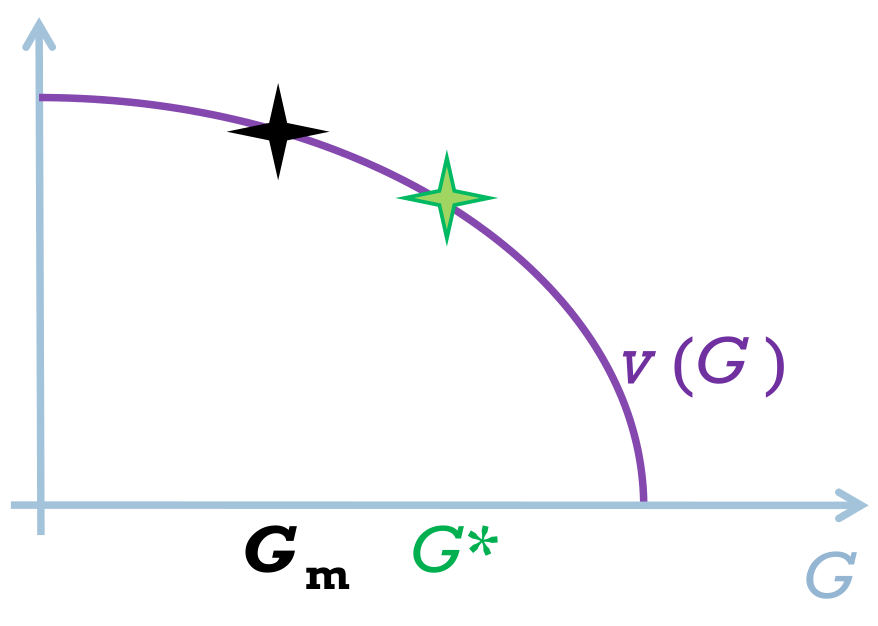
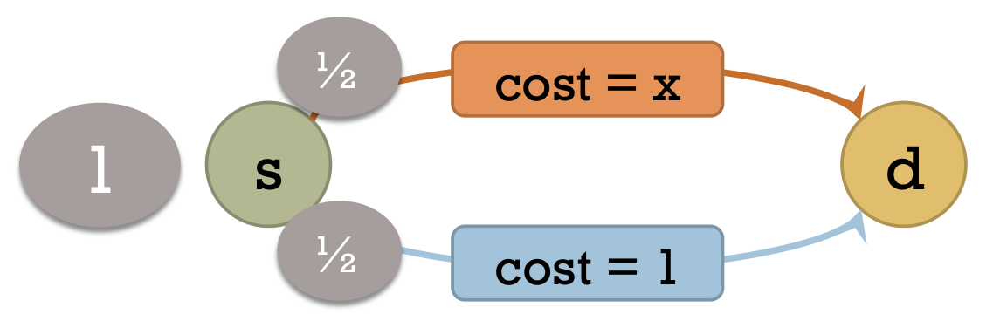
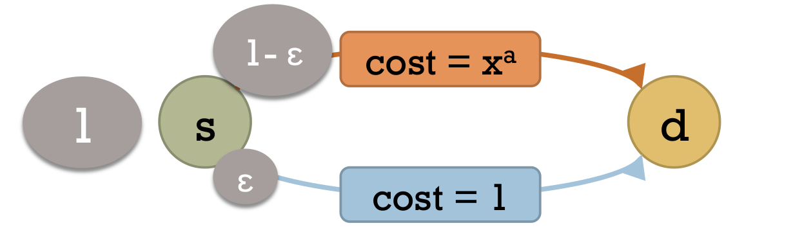
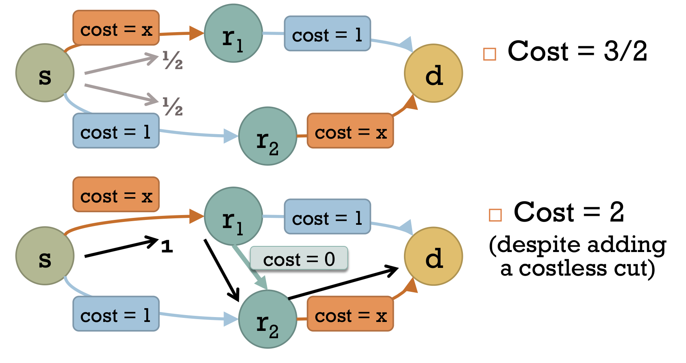

# 8. Applications of Nash equilibrium, duopolies and commons

## Prerequisites you need

A **player** chooses a strategy to maximize their own **utility**, or payoff. In this lesson, a player may be a firm, a street vendor, a farmer, or a network user. In a static game, choices are made without observing the other players' choices. **Complete information** means that the rules and payoff functions are known; opponents' chosen actions need not be known.

A **pure strategy** specifies a definite choice, such as a quantity, price, location, or route. A **mixed strategy** is a probability distribution over pure choices. A **profile** lists everyone's strategies. The calculations below concern pure choices and, for routing, aggregate traffic flows; they do not enumerate distributions over prices or quantities.

> [!info] Definition — Best response and Nash equilibrium
> A **best response** maximizes a player's utility while opponents' choices remain fixed. A **Nash equilibrium (NE)** is a profile in which every player best responds. No player can gain by changing alone, although an equally good alternative is allowed.

For two players, write $u_i(s_i,s_j)$ for player $i$'s payoff, with $j$ denoting the other player. A star marks an equilibrium choice. The notation $\operatorname{arg\,max}_{s_i}u_i(s_i,s_j)$ means the set of maximizing **choices**, whereas $\max_{s_i}u_i(s_i,s_j)$ is the maximum **payoff**. In payoff tables, tuples always give **(row player's payoff, column player's payoff)**.

**Optimization bridge.** A derivative measures the marginal change in a function. For a differentiable function, an interior maximum must have zero first derivative. A negative second derivative makes the function strictly concave, so its stationary point is the unique maximum. Constraints still matter: if the unconstrained optimum is negative but choices must be nonnegative, check zero. At a discontinuity, derivatives alone cannot find or verify the optimum.

**Source scope.** The folder contains only `Gth2006.pdf`, whose 29 pages are all covered here. No transcript is supplied, so no explanation is attributed to an unprovided recording. Numerical additions and practice questions are labelled **Original example** or **Original practice**. The output follows folder number **Lesson 8**, not the PDF's number 6.

## 1. What equilibrium predicts, and what it does not

*Source: Gth2006.pdf, p. 2.*

An equilibrium predicts choices that are mutually consistent with individual incentives. It can help even when iterated elimination of strictly dominated strategies leaves several possibilities. A strictly dominated choice is worse than some alternative against every opponents' profile; an equilibrium instead compares choices against the particular profile being played. Equilibria can also be multiple, requiring an additional selection argument.

A profile is **Pareto efficient** if no feasible change can make someone better off without making anyone worse off. Nash stability and Pareto efficiency ask different questions: the first permits only unilateral deviations, while the second compares outcomes for all affected players. The examples below repeatedly separate private incentives from a specified collective objective.

Nash's finite-game existence theorem allows mixed strategies, but it does not automatically cover the continuous quantity and price spaces used here. We verify each proposed pure equilibrium directly. Changing what firms choose—quantities rather than prices, for example—changes the game and can change its answer.

## 2. Cournot duopoly: firms choose quantities

*Sources: Gth2006.pdf, pp. 4–9.*

### Set up the game before differentiating

Two firms simultaneously choose quantities $q_1,q_2\geq0$ of an identical good. Total production is $Q=q_1+q_2$. Each firm has production cost $C_i(q_i)=cq_i$, where $c$ is its constant cost per unit. Consumers determine the market-clearing price

$$
P(Q)=\max\{a-Q,0\},
$$

where $a>c>0$. The positive-cost assumption makes unwanted overproduction costly. Firm $i$'s utility is its profit, revenue minus cost:

$$
u_i(q_i,q_j)=q_i[P(q_i+q_j)-c].
$$

On the positive-price branch, this becomes $q_i(a-c-q_i-q_j)$. If total output reaches $a$, price is zero and a firm producing a positive quantity loses $cq_i$. Thus the quadratic formula must not be applied indiscriminately beyond the price cutoff. The slide uses the Heaviside step function to express the same price truncation.

### Derive and intersect best responses

Hold the rival's quantity $q_j$ fixed. On the relevant branch,

$$
\frac{\partial u_i}{\partial q_i}=a-c-2q_i-q_j,
\qquad
\frac{\partial^2u_i}{\partial q_i^2}=-2.
$$

The stationary quantity is $(a-c-q_j)/2$. If it is nonpositive, zero production is optimal; positive production on the zero-price branch would lose money. Therefore

$$
\boxed{BR_i(q_j)=\max\{0,(a-c-q_j)/2\}.}
$$

At an equilibrium with both outputs positive,

$$
2q_1^*+q_2^*=a-c,\qquad
q_1^*+2q_2^*=a-c.
$$

Subtracting gives $q_1^*=q_2^*$, and then

$$
\boxed{q_1^*=q_2^*=\frac{a-c}{3},\quad
Q^*=\frac{2(a-c)}{3},\quad
P^*=\frac{a+2c}{3},\quad
u_i^*=\frac{(a-c)^2}{9}.}
$$

These quantities are positive and give a price above cost, so the branch and feasibility checks pass. There is no boundary equilibrium: if $q_1=0$, firm 2's best response is $(a-c)/2$, against which firm 1 would prefer $(a-c)/4>0$. The same argument excludes $q_2=0$. Thus this is the unique **pure-strategy** NE under the stated assumptions.

**Parameter qualification.** If $c=0$, the zero-price branch can introduce additional equilibria on an unrestricted output space: when both firms produce at least $a$, neither can obtain a positive price by changing alone. The usual positive-cost assumption, or an explicit restriction excluding these outputs, matters when claiming uniqueness.

### Monopoly and the proposed cartel

A monopolist controls total output $Q$ and maximizes total profit $Q(a-c-Q)$. The derivative is $a-c-2Q$, giving

$$
Q_m=\frac{a-c}{2},\qquad
P_m=\frac{a+c}{2},\qquad
\Pi_m=\frac{(a-c)^2}{4}.
$$

The subscript $m$ denotes the monopoly quantity, not one firm's Cournot output. Although each Cournot firm produces less than the monopolist, the **two firms together** produce more than the monopolist.

If the two firms act as a cartel, each could produce $Q_m/2=(a-c)/4$. Each would then earn half the monopoly profit, $(a-c)^2/8$, exceeding the Cournot profit $(a-c)^2/9$.

However, hold firm 2 at the cartel quantity. Firm 1's best response is

$$
BR_1((a-c)/4)=\frac{3(a-c)}8>\frac{a-c}{4}.
$$

Its deviation profit is $9(a-c)^2/64$, compared with the agreed $(a-c)^2/8=8(a-c)^2/64$. The positive gain $(a-c)^2/64$ disproves equilibrium. The same incentive applies to firm 2. This verifies instability without assuming that any particular adjustment process converges to Cournot.

### Original example: $a=10$, $c=1$

Here $a-c=9$.

| Situation | Firm 1 output | Firm 2 output | Market price | Profit of each firm |
|---|---|---|---|---|
| Cournot NE | $3$ | $3$ | $4$ | $9$ |
| Equal cartel split | $2.25$ | $2.25$ | $5.5$ | $10.125$ |
| Firm 1 deviates against $q_2=2.25$ | $3.375$ | $2.25$ | $4.375$ | Firm 1: $11.390625$; firm 2: $7.59375$ |

The cartel improves both firms' profits relative to Cournot, but the deviator improves further at its partner's expense. Calling the cartel better **for the firms** does not establish an improvement for society including consumers, who face a higher price and lower total supply.

## 3. Bertrand duopoly: firms choose prices

*Sources: Gth2006.pdf, pp. 10–14.*

### Identical goods and equal costs

Both firms can supply all demand, sell perfect substitutes, and have constant unit cost $c$, with $a>c\geq0$. They choose prices $p_i\geq0$ simultaneously. Market demand at price $p$ is $D(p)=\max\{a-p,0\}$. The cheaper firm serves all demand; equal prices split demand equally. Thus firm $i$ sells

$$
q_i(p_i,p_j)=
\begin{cases}
D(p_i),&p_i<p_j,\\
D(p_i)/2,&p_i=p_j,\\
0,&p_i>p_j,
\end{cases}
\qquad
u_i=(p_i-c)q_i.
$$

At $(p_1,p_2)=(c,c)$, both earn zero profit. Raising your price loses all demand and still gives zero. Cutting below cost sells at a negative margin and gives a loss. Neither deviation improves utility, so

$$
\boxed{p_1^*=p_2^*=c,\qquad u_1^*=u_2^*=0.}
$$

To exclude other pure equilibria, check the cases rather than merely describing a price war:

- A firm selling below cost can avoid its loss by choosing a price that sells nothing.
- If the lowest price lies above cost and below $a$, a losing firm can profitably undercut it, or a firm sharing a positive-margin market can slightly undercut to capture almost all the previous joint demand.
- If both prices give zero demand, one firm can choose a price strictly between $c$ and $a$ and earn positive profit.
- If only one firm charges $c$, it can raise its price slightly while remaining cheaper than its rival and obtain a positive margin.

Hence $(c,c)$ is the unique pure NE. This conclusion depends on identical goods, equal constant costs, no capacity constraint, and the specified tie rule.

### Checking one player's best response is insufficient

Against an opponent charging $c$, every own price $p_i\geq c$ gives zero profit and is a best response. Yet $(c+\varepsilon,c)$, with $\varepsilon>0$, is not an NE: the firm charging $c$ can raise its price slightly, remain cheaper, and earn positive profit.

**Original example.** Let $a=10$, $c=1$, and consider prices $(1.2,1)$. Firm 1 receives zero and cannot beat zero against price 1. Firm 2 currently also earns zero, but changing its price to $1.1$ sells $8.9$ units and yields $0.1(8.9)=0.89>0$. One profitable deviation is enough to reject a candidate.

The firms could instead agree on the monopoly price $(a+c)/2$ and split demand, earning $(a-c)^2/8$ each. A small undercut would nearly double a deviator's market share while barely reducing its margin. Therefore this high-price agreement is not an NE either.

### Imperfect substitutes: derive the new formula from the new demand

The slide changes demand to $q_i=a-p_i+bp_j$. Here $b$ measures how demand for firm $i$ responds to the other firm's price. Use $0\leq b<2$ for this substitutes model, $a>c\geq0$, and interpret the affine demand on its positive-demand branch, with zero sales when it would be negative. This is a different game from the cheaper-firm-takes-all model.

For fixed $p_j$, profit is $(p_i-c)(a-p_i+bp_j)$. Its first derivative is $a+c+bp_j-2p_i$, and its second derivative is $-2$. Thus the unique best response is

$$
p_i=\frac{a+c+bp_j}{2}.
$$

At an intersection, subtracting the two equations shows $(2+b)(p_1-p_2)=0$. Therefore both prices are equal, and

$$
\boxed{p_1^*=p_2^*=\frac{a+c}{2-b}.}
$$

The common quantity is $q_i^*=p_i^*-c=[a-(1-b)c]/(2-b)>0$, validating the demand branch. Strict concavity verifies the best response, rather than only a stationary point. This gives a unique pure NE for the stated model.

**Original example.** With $a=10$, $c=1$, $b=1/2$, each firm sets $p_i^*=22/3$, sells $q_i^*=19/3$, and earns $361/9$. Positive profit is possible because customers do not all switch to the slightly cheaper firm. These quantities come from a different demand system and should not be inserted into the homogeneous-good formulas.

### Unequal costs and price grids

The slide gives $c_1=1$, $c_2=2$ and prices in steps of $0.01$, proposing $(1.99,2.00)$. **Qualification:** cost advantage alone does not determine this price pair; demand must also make $1.99$ optimal against $2.00$.

**Original completion of the slide's example.** Set $a=4$, use $D(p)=\max\{4-p,0\}$, split ties equally, and allow grid prices $0,0.01,\ldots,4$.

- Against $p_2=2$, firm 1's full-market profit $(p_1-1)(4-p_1)$ increases up to the unconstrained monopoly price $2.5$. Among prices below 2, its best grid choice is therefore $1.99$, giving $1.9899$. Charging exactly 2 splits demand and gives only 1; charging above 2 gives zero.
- Against $p_1=1.99$, firm 2 would have to charge below its cost 2 to win or share demand. It prefers zero sales and zero profit, which price 2 provides.

Thus the proposed pair is indeed an NE of this completed grid model. With continuous prices, $(2,2)$ is not an NE: firm 1 can undercut to $1.99$ and raise its profit from 1 to $1.9899$. The jump in market share at a tie explains why continuity and attained best responses require care. Discretizing the strategy space can help, but it does not guarantee a pure equilibrium in an arbitrary game.

## 4. Hotelling: firms choose locations

*Sources: Gth2006.pdf, pp. 15–16.*

Two ice-cream vendors A and B choose locations on a 1 km street. Allowed locations are $0,1,\ldots,100$, in units of 10 m. Customers are uniformly distributed along the street and buy from the nearer vendor. Prices are fixed and identical, so take each vendor's utility to be its fraction of customers; customers split equally between vendors at the same location.

For distinct locations $x_A<x_B$, the indifferent customer is at their midpoint $(x_A+x_B)/2$. Therefore

$$
u_A=\frac{x_A+x_B}{200},\qquad
u_B=1-\frac{x_A+x_B}{200}.
$$

These formulas use customer mass distributed continuously along the street. The vendors' **allowed locations** are discrete; that does not make the population discrete.

### Worked lecture example and equilibrium check

With A at 22 and B at 35, the boundary is 28.5, so A receives $28.5\%$ and B $71.5\%$ of customers. The slide describes A's catchment as locations 0–28; with continuous customers the exact cutoff is 28.5. A can jump to 36, just to B's right: the new boundary is 35.5, and A now receives the right-hand $64.5\%$. The choice is profitable even though it crosses the rival's location.

At $(x_A,x_B)=(50,50)$, each serves half the street. Moving to $y<50$ gives the deviator $(y+50)/200<1/2$; moving to $y>50$ gives $(150-y)/200<1/2$. Hence both best respond.

To verify uniqueness among pure profiles, exclude the alternatives:

1. If locations differ by at least two grid steps, the left vendor can move one step toward the right vendor, remain to its left, and expand its catchment.
2. If locations are adjacent, the midpoint is not exactly 50. The vendor serving less than half can co-locate with the other and obtain half.
3. If vendors co-locate away from 50, one can move a step toward the longer side of the street and obtain more than half.

Thus $(50,50)$ is the unique pure NE. The slide connects this to political convergence toward the median voter: under an analogous two-candidate, one-dimensional, nearest-platform model, the center attracts both candidates. This is a consequence of those modelling assumptions, not a general empirical prediction about politics.

## 5. The tragedy of the commons: individuals choose resource use

*Sources: Gth2006.pdf, pp. 17–23.*

The practical question is: **why can every user want to increase their own activity even though reducing total activity would benefit everyone?** Each user bears only part of the congestion damage their activity causes.

### Farmers, goats, and shared spectrum

There are $n$ identical users. Farmer $i$ chooses $g_i$ goats to feed on a shared pasture. Total use is $G=\sum_{i=1}^{n}g_i$. Each goat provides value $v(G)$, decreasing with total crowding, and costs $c$ to maintain. Therefore

$$
u_i(g_i,g_{-i})=g_i[v(G)-c].
$$

The lecture's engineering interpretation replaces farmers by WiFi users and goats by active processes: $v(G)$ is value or throughput **per process**, not total network throughput. The same payoff formula applies when each user values its own aggregate service net of process costs.

For differentiation, treat $g_i\geq0$ as a continuous amount of activity. Actual integer counts require checking discrete alternatives around a candidate rather than applying a derivative mechanically. Write $G_{-i}=\sum_{j\ne i}g_j$ for opponents' **total** use, so $G=g_i+G_{-i}$. The vector $g_{-i}$ itself is not a number to add to $g_i$.

Assume $v(0)>c$, $v'(G)<0$ and $v''(G)\leq0$ on the relevant positive-use range, and that $v$ eventually falls to or below cost. The slide uses the stricter $v''(G)<0$ and sketches a carrying capacity $G_{\max}$ where $v(G_{\max})=0$. The concavity assumption makes the following first-order conditions useful global-maximization tests on the relevant range.

### Private best response and Nash equilibrium

Holding $G_{-i}$ fixed, differentiate the user's payoff:

$$
\frac{\partial u_i}{\partial g_i}
=v(G)-c+g_i v'(G),\qquad
\frac{\partial^2u_i}{\partial g_i^2}
=2v'(G)+g_i v''(G)<0.
$$

The term $v(G)-c$ is the net return from the new unit. The term $g_i v'(G)$ is the damage that extra crowding causes to the user's **own** existing units. The user does not count losses suffered by others.

At a symmetric interior NE, $g_i^*=G^*/n$, giving

$$
\boxed{v(G^*)-c+\frac{G^*}{n}v'(G^*)=0.}
$$

Why is symmetry justified here? At an interior equilibrium, subtracting two players' first-order conditions gives $(g_i-g_j)v'(G)=0$, hence $g_i=g_j$. An inactive user would have a positive entry incentive when active users satisfy these conditions, since $v(G)-c=-g_i v'(G)>0$. Thus inactivity cannot coexist with such an equilibrium. Check these facts and feasibility rather than inferring equal actions merely from identical names or parameters.

The left side of the boxed condition decreases strictly with $G$, since its derivative is $(1+1/n)v'(G)+(G/n)v''(G)<0$. It starts positive at zero and becomes negative by the point where $v(G)=c$. Therefore it has one interior root, which strict concavity verifies as the best-response solution for each user.

### Socially optimal use

Total welfare here is the sum of the users' utilities:

$$
W(G)=\sum_i u_i=G[v(G)-c].
$$

A planner choosing total use internalizes crowding losses on **all** units, not only one user's share. Its optimum $G_m$ satisfies

$$
\boxed{v(G_m)-c+G_m v'(G_m)=0,\qquad
W''(G)=2v'(G)+Gv''(G)<0.}
$$

The subscript $m$ here labels the welfare-maximizing total in the lecture; it is not a particular user's action. For $n>1$, substitute this condition into the private marginal expression at $G_m$:

$$
v(G_m)-c+\frac{G_m}{n}v'(G_m)
=-\left(1-\frac1n\right)G_m v'(G_m)>0.
$$

Since the private expression decreases with $G$, its zero lies further right: **$G^*>G_m$**. Users overuse the shared resource. For $n=1$, the private and social objectives coincide, so this wedge disappears.

*Figure 1. Cropped from Gth2006.pdf, PDF p. 22. The left filled marker is $G_m$ and the right outlined marker is $G^*$. The curve is per-unit value $v(G)$, not welfare $W(G)$; the marked points are selected by the marginal conditions above, not by maximizing the curve itself.*

The **externality** is the effect of your action on others' payoffs. Here an extra unit also reduces the value of others' $(G-g_i)$ units, by marginal amount $(G-g_i)v'(G)<0$. This missing term explains the difference between private and social incentives.

### Original example: four users with $v(G)=13-G^2$ and $c=1$

Use the decreasing positive-value range; values beyond it cannot make positive costly activity attractive. Private symmetry gives

$$
12-(G^*)^2-\frac{2(G^*)^2}{4}=0
\quad\Longrightarrow\quad
G^*=2\sqrt2,\qquad g_i^*=\frac{\sqrt2}{2}.
$$

At this profile, each user's net return per unit is $12-8=4$, so each earns $2\sqrt2$ and total welfare is $8\sqrt2\approx11.314$. The second derivative of each user's profit is negative at every positive relevant total, verifying the maximum.

The planner solves $12-3G_m^2=0$, obtaining $G_m=2$ and $W(G_m)=2(12-4)=16$. With an equal allocation $g_i=1/2$, each user gets 4, exceeding their equilibrium payoff $2\sqrt2$.

Nevertheless, the equal social allocation is unstable. Holding the other users at $1/2$ each, a user's marginal payoff at $G=2$, $g_i=1/2$ is $12-4-2(1/2)(2)=6>0$. A small unilateral increase is profitable. This checks both the welfare improvement and the reason it does not occur through individual optimization alone.

## 6. Selfish routing: equilibrium traffic can waste capacity

*Sources: Gth2006.pdf, pp. 24–29.*

### Define the routing model and the cost objective

Traffic must travel from source $s$ to destination $d$. Each user chooses a route to minimize its own travel time or latency. These examples use **nonatomic traffic**: each individual controls a negligible amount, so its unilateral route change does not alter aggregate link loads. Aggregate traffic can be split across routes. This differs from a game with a few users controlling large indivisible flows.

> [!info] Definition — Wardrop equilibrium
> A feasible traffic flow is an equilibrium if every used route has minimum latency among all available routes for the same source and destination. Used routes must tie; an unused route may be equally costly or more costly, but cannot be cheaper.

If link $e$ carries flow $x_e$ and has latency $\ell_e(x_e)$ **per unit**, its contribution to total cost is $x_e\ell_e(x_e)$. Thus

$$
C=\sum_e x_e\ell_e(x_e).
$$

For total demand 1, total cost also equals average latency. For demand $r$, average latency is $C/r$. Always multiply latency by the flow experiencing it before adding costs.

For a cost-minimization problem with positive optimal cost, the **Price of Anarchy** is

$$
\operatorname{PoA}=
\frac{\text{highest total cost among equilibrium flows}}
{\text{minimum total cost among feasible flows}}\geq1.
$$

The same demand and network must be used in numerator and denominator. At equilibrium no user can reduce their own latency by changing routes; the social optimum minimizes aggregate cost, which is a different test.

### Worked lecture example: Pigou's two parallel paths

One unit of traffic chooses between an upper route with latency $\ell_U(x)=x$, where $x$ is upper-route flow, and a lower route with constant latency $\ell_L=1$. The lower flow is $1-x$.

At any split with $x<1$, the upper route is cheaper than the lower. Positive lower-route traffic would want to switch upward. Therefore equilibrium puts all traffic on the upper route: $x^{NE}=1$, with cost $C^{NE}=1$. The unused lower route also costs 1, so no user can improve by deviating. The slide's “dominant” wording means that the upper route is weakly cheaper here; it ties at full load rather than being strictly better everywhere.

The planner instead minimizes

$$
C(x)=x\cdot x+(1-x)\cdot1=x^2+1-x,\qquad 0\leq x\leq1.
$$

Since $C'(x)=2x-1$ and $C''(x)=2>0$, the minimum is at $x^{opt}=1/2$. Its cost is $1/4+1/2=3/4$, below either endpoint's cost 1.

*Figure 2. Cropped from Gth2006.pdf, PDF p. 26. At the displayed split, the upper half experiences latency $1/2$ and the lower half latency 1. Their contributions are $1/4$ and $1/2$, respectively.*

The social optimum is not an equilibrium because a user on the lower route could reduce its own latency from 1 to $1/2$. Consequently,

$$
\boxed{\operatorname{PoA}=\frac{1}{3/4}=\frac43.}
$$

The marginal social cost of extra flow on the upper route is $\frac{d}{dx}[x\ell_U(x)]=2x$, whereas a selfish user sees only $\ell_U(x)=x$. At the optimal split the marginal social costs $2x$ and 1 tie. This is the routing version of the missing congestion externality in the commons model.

### Nonlinear latencies: why the ratio can be unbounded

Keep total demand 1 and the lower latency 1, but change upper latency to $x^\alpha$, with exponent $\alpha>1$. The slide calls this exponent $a$; $\alpha$ avoids confusing it with the demand intercept in the duopoly models.

*Figure 3. Cropped from Gth2006.pdf, PDF p. 27. The upper latency is $x^a$, written $x^\alpha$ in these notes; the fractions $1-\varepsilon$ and $\varepsilon$ describe traffic, not mixed probabilities assigned by one large routing player.*

Equilibrium still puts all traffic above, costing 1. The correct total-cost function is

$$
C_\alpha(x)=x^{\alpha+1}+1-x.
$$

Its derivative is $(\alpha+1)x^\alpha-1$, giving

$$
x^{opt}=(\alpha+1)^{-1/\alpha},\qquad
C_\alpha^{opt}=1-\frac{\alpha}{\alpha+1}(\alpha+1)^{-1/\alpha}.
$$

This interior point is the unique minimum: the derivative increases from $-1$ to $\alpha$ on $[0,1]$. As $\alpha\to\infty$, $(\alpha+1)^{-1/\alpha}=\exp[-\log(\alpha+1)/\alpha]\to1$. Hence $C_\alpha^{opt}\to0$, while equilibrium cost remains 1, so the Price of Anarchy is unbounded over this family.

> [!warning] Source correction — Weight by flow and state the limit correctly
> On p. 27, sending fraction $\varepsilon$ below gives total cost **$(1-\varepsilon)^{\alpha+1}+\varepsilon$**, not $(1-\varepsilon)^\alpha+\varepsilon$. The upper latency must be multiplied by upper flow. For fixed $\varepsilon>0$, the limit as $\alpha\to\infty$ is $\varepsilon$, not zero. The optimized split above lets the lower fraction tend to zero as the exponent grows and establishes the claimed unbounded ratio.

### Worked lecture example: Braess's paradox

Adding a route cannot worsen the **best achievable** routing cost: a planner could keep using the old routes. However, the new equilibrium can become worse because the added option changes individual incentives.

*Figure 4. Cropped from Gth2006.pdf, PDF p. 28. Top: the original network, with two routes carrying $1/2$ each. Bottom: the new directed link $r_1\to r_2$ has latency 0 and equilibrium uses the central route. Each label “cost = x” means the flow on that particular link; it is not one shared variable imposed on both links.*

**Before the added link.** The upper route $s\to r_1\to d$ has latencies $x$ and 1. The lower route $s\to r_2\to d$ has latencies 1 and $1-x$, where $x$ is upper-route flow. For both routes to be used at equilibrium,

$$
1+x=1+(1-x)\quad\Longrightarrow\quad x=1/2.
$$

Each route then costs $3/2$, so total cost is $3/2$. It is also optimal: $x(1+x)+(1-x)(2-x)=3/2+2(x-1/2)^2$ is minimized at $1/2$.

**After adding $r_1\to r_2$.** If all traffic uses $s\to r_1\to r_2\to d$, both variable-latency links carry 1, so this route costs $1+0+1=2$. Either outer route also costs 2 at these loads. Thus nobody gains by switching, and this is an equilibrium.

It is the unique equilibrium route-flow pattern. Let $u,l,z$ be flows on the upper, lower, and central routes, respectively, with $u+l+z=1$. The two variable-link loads are $1-l$ and $1-u$. Route costs are

$$
L_U=2-l,\qquad L_L=2-u,\qquad L_Z=2-u-l.
$$

If $u>0$, upper-route users could improve by $L_U-L_Z=u>0$ through the central route. Similarly, $l>0$ permits improvement by $l$. Hence equilibrium requires $u=l=0$, $z=1$.

The social optimum still costs $3/2$ and ignores the new link. To check that the planner cannot do even better, fix central flow $z$. The two variable-link loads sum to $1+z$; their squared-cost contributions are minimized by equal loads. The fixed-latency links carry total flow $1-z$, so

$$
C\geq2\left(\frac{1+z}{2}\right)^2+1-z
=\frac32+\frac{z^2}{2}\geq\frac32.
$$

Equality is feasible at $z=0$, $u=l=1/2$. The added zero-latency link therefore raises equilibrium cost from $3/2$ to 2 while leaving optimal cost unchanged. After the addition, $\operatorname{PoA}=2/(3/2)=4/3$. This is **Braess's paradox**: more available infrastructure can worsen selfish equilibrium, rather than worsen the feasible optimum.

### The $4/3$ theorem: a tight bound, not a universal equality

> [!info] Theorem — Affine-latency routing bound
> For nonatomic routing with fixed demands and nonnegative affine link latencies $\ell_e(x)=a_ex+b_e$, where $a_e,b_e\geq0$, equilibrium total latency is at most $4/3$ times optimal total latency. Pigou's example attains the bound.

This precise statement is [Roughgarden and Tardos, *How Bad is Selfish Routing?*, Theorem 4.5](https://www.cs.cornell.edu/timr/papers/routing.pdf). The paper calls affine functions “linear”, as the slide does.

**Source correction:** p. 29 displays equality as its general theorem. The correct general relation is $C^{NE}\leq(4/3)C^{opt}$; equality describes worst-case examples. The bound is independent of network topology, while the actual ratio can depend on the network and demand. A single available route has PoA 1. The theorem does not automatically apply to atomic players with substantial indivisible flows, or to nonlinear latencies such as $x^\alpha$.

## 7. Practice

### Original practice prompts

1. **Quantity competition.** Two firms face $P(Q)=\max\{13-Q,0\}$ and unit cost 1. Find their Cournot quantities and profits, the equal cartel quantities and profits, and one firm's best deviation against a partner obeying the cartel agreement. Check feasibility and show the deviation gain.
2. **An inefficient-equilibrium bound need not be attained.** Route one unit of nonatomic traffic on parallel links with latencies $x$ on the upper link and 2 on the lower link. Find equilibrium, social optimum, and PoA. Explain why equalizing the two ordinary route latencies would give a wrong method for the optimum.
3. **Commons versus coordination.** Explain why the optimal commons allocation can give each user more utility and still fail the unilateral-deviation test. Contrast this with two devices needing to select compatible transmission settings.

### Original practice answers

1. Here $a-c=12$. The Cournot outputs are $(4,4)$, price 5, and profits $(16,16)$. The equal cartel outputs are $(3,3)$, price 7, and profits $(18,18)$. Against $q_2=3$, firm 1 chooses $(12-3)/2=4.5$. Price becomes $13-7.5=5.5$, and firm 1 earns $4.5(5.5-1)=20.25$, gaining $2.25$. All outputs are nonnegative and prices exceed cost; the quadratic branches are valid.
2. The upper latency never exceeds 1 at feasible loads, so all traffic uses it at equilibrium and cost is 1. Total cost is $C(x)=x^2+2(1-x)$, with derivative $2x-2\leq0$ on $[0,1]$. Its constrained minimum is at $x=1$, also costing 1. Hence PoA is 1. The optimum can lie at a boundary with different ordinary route latencies; equalization is required only for used routes at equilibrium, not for all available routes or for ordinary latencies at a social optimum.
3. At the equal social allocation in the worked commons example, every user's payoff is 4 rather than $2\sqrt2$, but their private derivative is $6>0$, so an increase is attractive while everyone else stays fixed. In a coordination problem, compatible choices may themselves be mutual best responses. Similar engineering settings can have different payoff structures and different incentives.

### Relevant handbook exercises

The checked contents and relevant sections of `Game Theory. A Handbook of Problems and Excercises.pdf` do not supply a dedicated Cournot, commons, or routing exercise. The following **Chapter 1, “Static games of complete information”** exercises provide useful related practice. Printed pages and PDF indices differ by six here.

| Verified exercise | Location | What it trains |
|---|---|---|
| **1.3 — Radio transmitter–receiver pair** | Printed pp. 12–13; PDF pp. 18–19 | Construct utilities from engineering rules and distinguish coordination from selfish congestion. |
| **1.4 — Charlotte and Daniel choosing supervisors** | Printed pp. 14–15; PDF pp. 20–21 | Model a shared resource whose value decreases when users choose the same provider. |

Try their original prompts before using these solution routes:

- **Exercise 1.3.** Transmitter actions are concentrated transmission $C$ and spread spectrum $S$; receiver actions are listening to one frequency $A$ or two $B$. In (transmitter, receiver) order, the payoff rows are $C:(1,1),(0,0)$ and $S:(-2,3),(1,4)$. The pure NE are $(C,A)$ and $(S,B)$. For the additional mixed NE, write $p=\Pr[T\text{ chooses }C]$, $q=\Pr[R\text{ chooses }A]$. Indifference gives $q=1-3q$ and $3-2p=4-4p$, hence $(p,q)=(1/2,1/4)$. Both probabilities are valid and all actions are best responses at that profile. Strict best responses against pure opponents exclude partially mixed cases, so these are all NE.
- **Exercise 1.4.** Each student gets 40, 60, or 50 from supervisor $X,Y,Z$ when alone, and 70% of that value when sharing. Choice $Y$ strictly dominates $X$: against opponents choosing $X,Y,Z$, payoffs are $(60,42,60)$ versus $(28,40,40)$. In the reduced $Y,Z$ table, pure NE are $(Y,Z)$ and $(Z,Y)$. If the opponent chooses $Y$ with probability $p$, equate $60-18p=35+15p$, obtaining $p=25/33$. Both players therefore use $(0,25/33,8/33)$ on $(X,Y,Z)$ in the additional NE. Supported payoff $510/11>40$ also checks the unused $X$. The two pure NE and this mixed profile form the full equilibrium set. This is a finite congestion example; it does not use the nonatomic $4/3$ theorem.

## Exam quick reference

Use this section as a paper lookup for the user-described 75-minute written exam.

| Problem cue | What to hold fixed | Method and essential check |
|---|---|---|
| Firms choose quantities | Rival quantities | Differentiate each profit in its own quantity; check concavity, zero output, and price truncation; intersect best responses. |
| Firms cooperate as a monopoly | Joint total output | Maximize total producer profit, then test a unilateral deviation from the proposed split. |
| Identical firms choose prices | Rival price | Write sales in cheaper, equal, and dearer cases. Check price cuts, price rises, and discontinuities. |
| Demand is $a-p_i+bp_j$ | Rival price $p_j$ | Maximize $(p_i-c)(a-p_i+bp_j)$; this is not winner-takes-all demand. Verify positive quantity. |
| Vendors choose locations | Rival location | Identify the midpoint customer; also allow crossing or co-locating with the rival. |
| Users choose shared-resource use | Other users' total $G_{-i}$ | Private derivative uses $g_i v'(G)$; social derivative uses $Gv'(G)$. Check interior and symmetry assumptions. |
| Find a routing equilibrium | Aggregate link loads, for an infinitesimal user | Used routes must be cheapest. Check unused routes and boundary flows. |
| Find optimal routing or PoA | Same fixed total demand | Minimize flow-weighted total cost, then divide worst equilibrium cost by optimal cost. |

**Quantity competition.** With $P(Q)=\max\{a-Q,0\}$, equal unit cost $c$, and $a>c>0$, define $A=a-c$ locally:

$$
BR_i(q_j)=\max\{0,(A-q_j)/2\},\qquad
q_i^{NE}=A/3,\qquad u_i^{NE}=A^2/9.
$$

Monopoly total output is $A/2$, with total profit $A^2/4$. Equal cartel outputs are $A/4$ per firm, with profit $A^2/8$ each. Against a cartel partner, a deviator chooses $3A/8$ and earns $9A^2/64>A^2/8$.

**Price competition.** With homogeneous goods, equal cost $c$, equal tie splitting, and no capacity constraints, pure equilibrium is $(c,c)$ with zero profit. For the different demand $q_i=a-p_i+bp_j$ and $0\leq b<2$, the interior price is $(a+c)/(2-b)$; check $q_i=p_i-c>0$ and second derivative $-2$.

**Commons.** Here $G=\sum_i g_i$, $v(G)$ is value per unit, and $c$ is per-unit cost:

$$
\text{Private: }v(G)-c+g_i v'(G)=0;
\qquad
\text{symmetric NE: }v(G^*)-c+\frac{G^*}{n}v'(G^*)=0.
$$

$$
\text{Social: }W(G)=G[v(G)-c],\qquad
v(G_m)-c+G_m v'(G_m)=0.
$$

Under decreasing concave value, positive interior use, and $n>1$, equilibrium overuses the resource: $G^*>G_m$. Do not substitute $g_i=G/n$ without justifying symmetry.

**Routing.** Link $e$ carries flow $x_e$ and has per-unit latency $\ell_e(x_e)$:

$$
C=\sum_e x_e\ell_e(x_e),\qquad
\operatorname{PoA}=\frac{\max_{\text{equilibria}}C}{\min_{\text{feasible flows}}C}.
$$

For Pigou's unit-demand network with latencies $x$ and 1: $x^{NE}=1$, $C^{NE}=1$, $x^{opt}=1/2$, $C^{opt}=3/4$, and PoA $=4/3$. For latency $x^\alpha$, total upper cost is $x^{\alpha+1}$, not $x^\alpha$. Nonnegative affine latencies give the nonatomic bound PoA $\leq4/3$; it is not always equality.

**Braess check.** Original network: half traffic per outer route, cost $3/2$. Add directed zero-latency $r_1\to r_2$: central-route equilibrium costs 2, while optimal routing still costs $3/2$. More routes can worsen equilibrium without worsening the feasible optimum.

**Common traps:** optimizing both players' choices at once when finding a private best response; forgetting nonnegative quantities or zero demand; treating zero profit as a profitable deviation; assuming both players best respond after checking only one; confusing per-unit value or latency with total welfare or cost; identifying Nash stability with efficiency; interpreting a continuous-flow calculation as an indivisible-user game.

## Sources

- **Lecture:** Leonardo Badia, [Gth2006.pdf](Gth2006.pdf), all 29 PDF pages. General applications: p. 2; Cournot: pp. 4–9; Bertrand and variants: pp. 10–14; Hotelling: pp. 15–16; commons: pp. 17–23; selfish routing and PoA: pp. 24–29. All four figures are cropped from this PDF. No transcript is present in the lesson folder.
- **Professor's exercise source:** [Game Theory. A Handbook of Problems and Excercises.pdf](<../../Game Theory. A Handbook of Problems and Excercises.pdf>), Chapter 1, Exercises 1.3–1.4, printed pp. 12–15 / PDF pp. 18–21. The original filename spelling is preserved. The continuous-model numerical exercises in these notes are original additions.
- **Primary-source check for the routing theorem:** Tim Roughgarden and Éva Tardos, [*How Bad is Selfish Routing?*](https://www.cs.cornell.edu/timr/papers/routing.pdf), author-hosted manuscript dated December 5, 2001, §4 and Theorem 4.5. Used to state the assumptions and the inequality behind the slide's $4/3$ claim.
