# Dynamic Nash equilibria

*Game theory - Prof. Leonardo Badia. Lesson 11 folder; Lecture 12 recordings.*

Sources: [lecture slides](Gth2009.pdf), [transcript - part 1](<2026-IN2898-005PD-2026-IN0000184-N0-IN2898 Lecture 12 STEM.transcript.txt>), [transcript - part 2](<2026-IN2898-005PD-2026-IN0000184-N0-IN2898 Lecture 12 STEM-1.transcript.txt>).

Page numbers refer to the PDF. Each example states its payoff order; clarification callouts identify corrections to the lecture.

## NE of a dynamic game

*Slides 3-7; part 1, 00:00-14:09.*

Enumerating each player's **complete contingent strategies** converts a dynamic game into normal form. A strategy profile is a Nash equilibrium if no player can improve by changing their strategy alone.

For a pure strategy profile $s^*=(s_1^*,\ldots,s_n^*)$, this means

$$
u_i(s_i^*,s_{-i}^*)\geq u_i(s_i,s_{-i}^*)
\qquad\text{for every player }i\text{ and every }s_i\in S_i.
$$

Here $S_i$ contains complete plans, including actions at unreached nodes. For randomized strategies, compare expected payoffs.

Normal form hides the order of moves in the table, though each plan still specifies how a player would respond to earlier moves. Imagining those plans chosen in advance is a way to analyze the game; it gives no player a new commitment device.

### Sequential Battle of the Sexes

Ann chooses romance $R$ or science fiction $S$ first. Brian observes her choice and then chooses $r$ or $s$. Payoffs are $(2,1)$ if both choose romance, $(1,2)$ if both choose science fiction, and $(0,0)$ if they choose different films. Throughout this example, payoff order is **(Ann, Brian)**.

Ann has two pure strategies, $R$ and $S$. Brian has two actions but four pure strategies:

$$
S_B=\{rr,rs,sr,ss\}.
$$

The first letter specifies his response to $R$; the second specifies his response to $S$. $rs$ means “follow Ann”; $rr$ means “choose romance regardless of Ann's choice”.

|Ann / Brian|$rr$|$rs$|$sr$|$ss$|
|---|---|---|---|---|
|$R$|$(2,1)$|$(2,1)$|$(0,0)$|$(0,0)$|
|$S$|$(0,0)$|$(1,2)$|$(0,0)$|$(1,2)$|

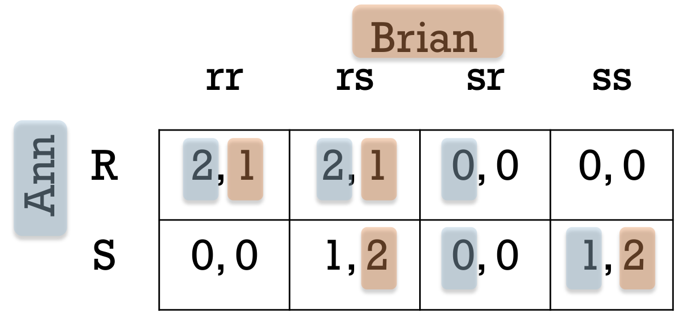

*Slide 3. Blue highlights identify Ann's best responses within each column; orange highlights identify Brian's best responses within each row. Their intersections give the pure Nash equilibria.*

The best-response highlights intersect at three **pure** Nash equilibria:

$$
(R,rr),\qquad(R,rs),\qquad(S,ss).
$$

- In $(R,rr)$, Ann obtains $2$ rather than $0$ by choosing $R$. Given $R$, Brian obtains $1$ by choosing $r$; changing only his unused response to $S$ does not improve his payoff.
- In $(R,rs)$, Ann obtains $2$ from $R$ rather than $1$ from $S$. Brian follows her and has no profitable deviation.
- In $(S,ss)$, Ann obtains $1$ from $S$ rather than $0$ from $R$. Brian obtains $2$, his highest payoff.

$(S,rs)$ fails the test: Brian follows Ann, so she gains by switching to $R$.

### Same outcome, different off-path behavior

The equilibria $(R,rr)$ and $(R,rs)$ both produce the realized actions $(R,r)$ and payoffs $(2,1)$. After the hypothetical choice $S$, however, Brian would choose $r$ under $rr$ and $s$ under $rs$.

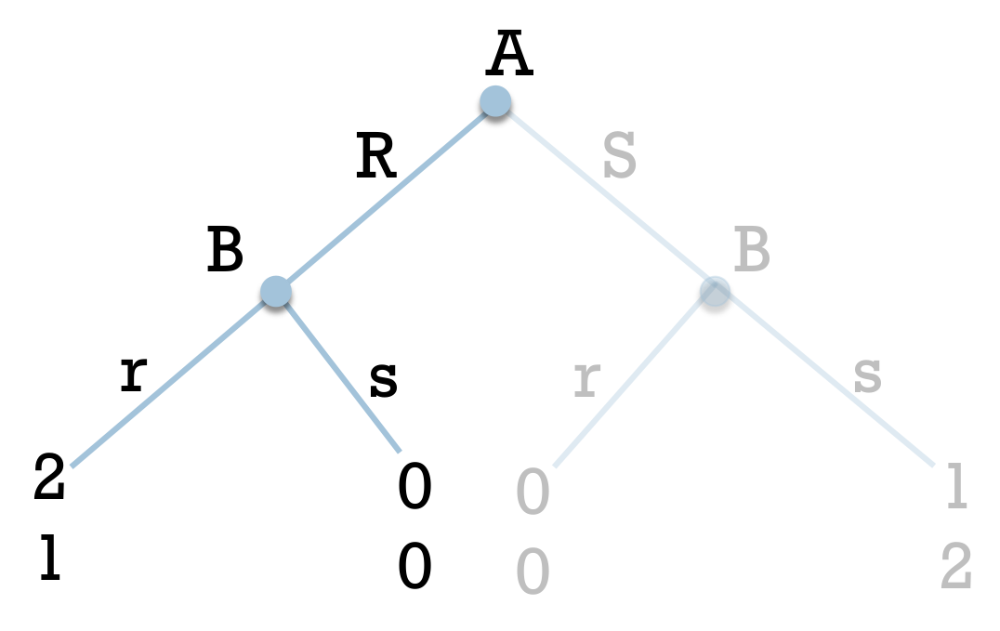

*Slide 5. The faded branch is not reached in either equilibrium, but Brian's prescribed behavior there still belongs to his strategy.*

After observing $S$, Brian would prefer $s$, giving him $2$, to $r$, giving him $0$. Under $rr$, Brian plans a poor choice **if that node is reached**. Nash equilibrium permits it: changing the unused response does not improve his payoff while Ann plays $R$.

Complete plans must also specify responses to histories inconsistent with a player's own earlier prescribed actions. For example, in the two-night simultaneous Battle of the Sexes, Brian's strategy can be written as

$$
(a_1,a_{2Rr},a_{2Rs},a_{2Sr},a_{2Ss}).
$$

The plan $(r,s,r,r,r)$ prescribes $r$ on the first night and $s$ on the second only after $Rr$. It also specifies a response to $Ss$, even though Brian's prescribed first-night $r$ prevents that history. That response still belongs in Brian's complete plan, even though the plan's first action makes $Ss$ unreachable.

## Equilibrium path

*Slides 8-9; part 1, 14:10-19:17.*

> [!info] Definition — Equilibrium path
> Given a Nash equilibrium profile $m^*=(m_1^*,\ldots,m_n^*)$, its equilibrium path contains the nodes reached with strictly positive probability under that profile.

Pure strategies without random events produce one path. Randomization can put several branches on the equilibrium path. Nodes reached with probability zero are **off the equilibrium path**.

For $(S,ss)$, the path consists of Ann choosing $S$ and Brian choosing $s$, ending at $(1,2)$.

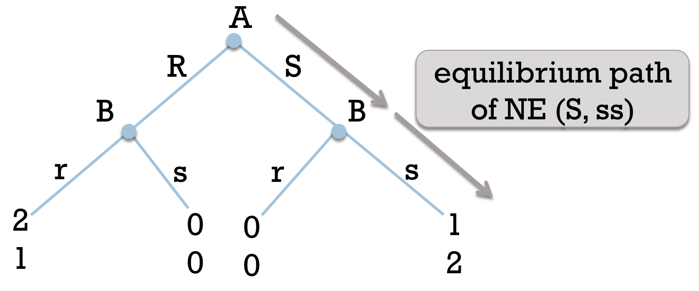

*Slide 8. Gray arrows show the equilibrium path.*

Why does the unused first letter of $ss$ matter? Checking Ann's incentive to deviate requires knowing Brian's response to $R$:

$$
u_A(S,ss)=1,\qquad u_A(R,ss)=0.
$$

Her deviation is unprofitable because Brian's plan prescribes $s$ after $R$. If that component were $r$, giving Brian the strategy $rs$, Ann's deviation would instead yield $2$ and would be profitable.

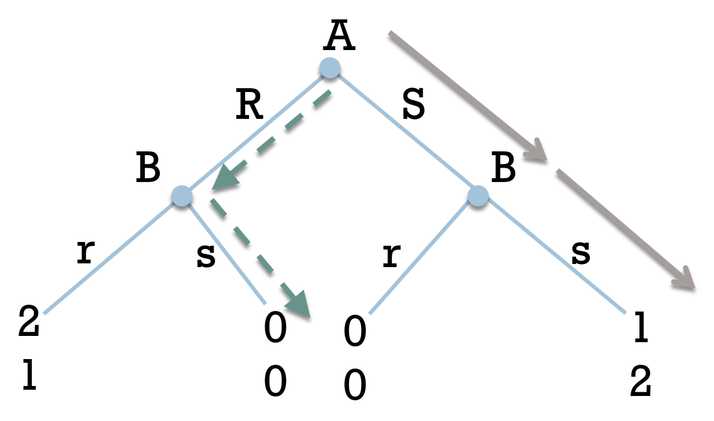

*Slide 9. Dashed arrows show Ann's deviation to $R$ followed by Brian's prescribed $s$, yielding $(0,0)$.*

The response $s$ after $R$ therefore acts as a **threat** supporting $(S,ss)$. But Brian would receive $1$ from $r$ and $0$ from $s$ after $R$: would he carry it out?

Brian sends no message in this game. The “threat” is an off-path response in his strategy that Ann anticipates when choosing her move.

## Example: Ultimatum game

*Slides 10-11; part 1, 19:17-27:46.*

A proposer $P$ and a responder $R$ divide ten candies. The proposer selects a split; the responder observes it and accepts or rejects. Acceptance implements the split, whereas rejection gives both players zero.

|Proposal|Proposer's share|Responder's share|Payoffs if accepted|
|---|---|---|---|
|$D$|9|1|$(9,1)$|
|$F$|5|5|$(5,5)$|
|$G$|2|8|$(2,8)$|

Payoff order is **(proposer, responder)**. The proposer has three actions and three pure strategies. The responder has two actions, $Y$ and $N$, but $2^3=8$ pure strategies:

$$
s_R=(x_D,x_F,x_G),\qquad x_D,x_F,x_G\in\{Y,N\}.
$$

For example, $NYY$ means “reject $D$, accept $F$, accept $G$”. Each response belongs to a separate singleton information set because the responder sees the offer.

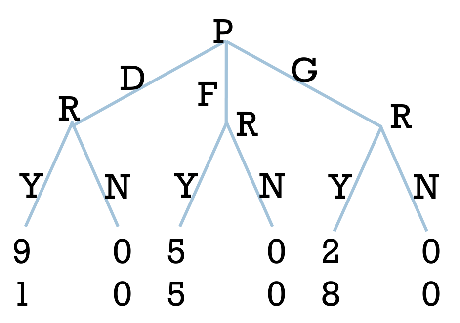

*Slide 11. Every rejection leads to $(0,0)$.*

### Pure Nash equilibria

For a proposed offer to be part of a Nash equilibrium, the responder must accept it: rejecting a strictly positive share could be profitably changed to acceptance. The proposer must also have no accepted alternative that gives them a higher share.

|Proposer's strategy|Responder's strategies supporting a Nash equilibrium|Outcome|
|---|---|---|
|$D$|$YYY$, $YYN$, $YNY$, $YNN$|$(9,1)$|
|$F$|$NYY$, $NYN$|$(5,5)$|
|$G$|$NNY$|$(2,8)$|

The restricted game has **seven pure Nash equilibria**; the lecture gives examples rather than this full enumeration.

Consider $(F,NYY)$. If $P$ deviates to $D$, rejection reduces their payoff from $5$ to $0$. Deviating to $G$ gives only $2$. The responder cannot improve upon accepting $F$: rejection yields $0$, while changing responses to unoffered proposals leaves the realized payoff unchanged. Neither player has a profitable unilateral deviation.

The generous outcome $(G,NNY)$ works the same way. Both profiles depend on the responder's plan to reject a positive share after an unchosen offer. Would the responder follow that plan if offered it?

## Rationality and credibility

*Slide 12; part 2, 00:01-01:24.*

Nash equilibrium tests complete strategies against unilateral deviations from the start. It can therefore leave an unreached continuation in which a player would prefer to abandon their plan.

### Perfect vs imperfect information

*Slide 13; part 2, 01:24-03:39.*

The lecturer calls a dynamic game with perfect information a **sequential game**. Each decision-maker knows the preceding history: all decision information sets are singletons.

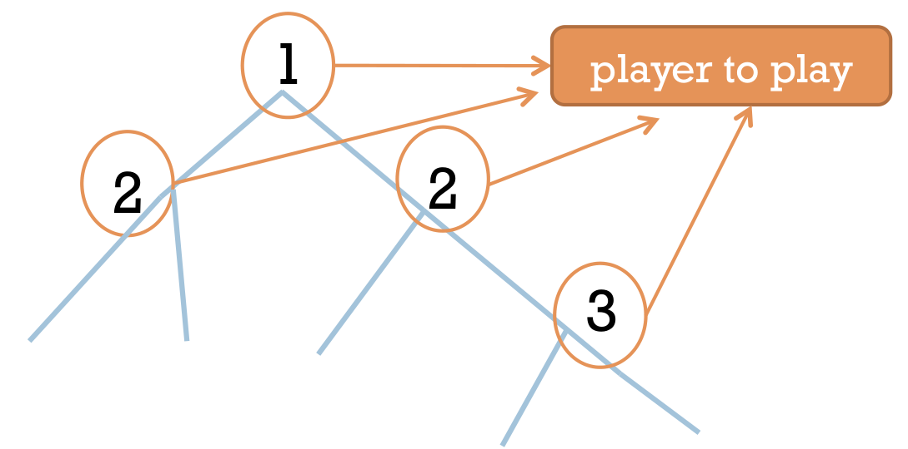

*Slide 13. A player may move at several distinct nodes; each node identifies the history at which that decision is made.*

All players know this information structure. The earlier player can therefore anticipate that the later player will observe their move before responding.

Perfect information concerns observed history. Complete information concerns knowledge of the game, including payoff functions. In the examples below, both properties support backward reasoning.

### Dynamic game, perfect inf.

*Slides 14-15; part 2, 03:39-07:32.*

Consider two players:

1. Player 1 chooses $a_1\in A_1$.
2. Player 2 observes $a_1$ and chooses $a_2\in A_2(a_1)$.
3. Their payoffs are $u_1(a_1,a_2)$ and $u_2(a_1,a_2)$.

The later action set can depend on the first move. If the game effectively ends after player 1's choice, player 2 can be represented as having one forced action.

Player 2 can optimize at each decision node, knowing the history and available consequences. Player 1 knows player 2's preferences and can anticipate that optimization.

> [!info] Result — Backward induction
> Every **finite** extensive-form game with perfect information has a pure-strategy solution obtained by choosing an optimal action at every decision node, working backward from the end. The resulting complete profile is sequentially rational and subgame-perfect.

> [!warning] Clarification — Finiteness and uniqueness
> Slide 15 states the result for “any dynamic game of perfect information”; finite horizon and a finite tree are the assumptions used by this lecture's backward-induction argument. The argument does not automatically extend to infinite games. The claim that the solution is unique when “terminal payoffs are all different” requires absence of ties in the **moving player's own payoff** at every comparison. Distinct payoff vectors alone do not ensure this. With ties, several backward-induction solutions and SPEs may exist.

### Backward induction

*Slide 16; part 2, 07:32-10:31.*

After observing the particular history $a_1^h$, player 2 solves

$$
\max_{a_2\in A_2(a_1^h)}u_2(a_1^h,a_2).
$$

Let $R_2(a_1^h)$ denote a maximizing action. More precisely,

$$
R_2(a_1^h)\in\operatorname*{arg\,max}_{a_2\in A_2(a_1^h)}u_2(a_1^h,a_2).
$$

The **maximum** is a payoff value; an **argmax** is an action attaining it. If several actions tie, specify which continuation is chosen.

Player 1 anticipates the entire reaction rule $R_2(\cdot)$ and chooses

$$
a_1^*\in\operatorname*{arg\,max}_{a_1\in A_1}u_1\bigl(a_1,R_2(a_1)\bigr).
$$

The realized outcome is

$$
\bigl(a_1^*,R_2(a_1^*)\bigr),
$$

whereas the **strategy profile** is $(a_1^*,R_2(\cdot))$: player 2's full rule includes responses to first moves that are not actually chosen.

For a longer finite tree, solve the last decision nodes first. Replace each resolved continuation by its resulting payoff vector, then solve the preceding nodes. At each step, maximize the payoff of the player moving there, rather than another player's payoff or the sum of payoffs.

### Example: Trust game

*Slides 17-20; part 2, 10:31-16:05.*

Players are $A$ and $B$, with payoff order **(A, B)**:

|Decision|Action ending the game|Terminal payoff|Action continuing the game|
|---|---|---|---|
|First move by $A$|$L$|$(2,0)$|$R$, giving $B$ the next move|
|Move by $B$|$L'$|$(1,1)$|$R'$, giving $A$ another move|
|Last move by $A$|$L''$ or $R''$|$(5,0)$ or $(3,2)$|None|

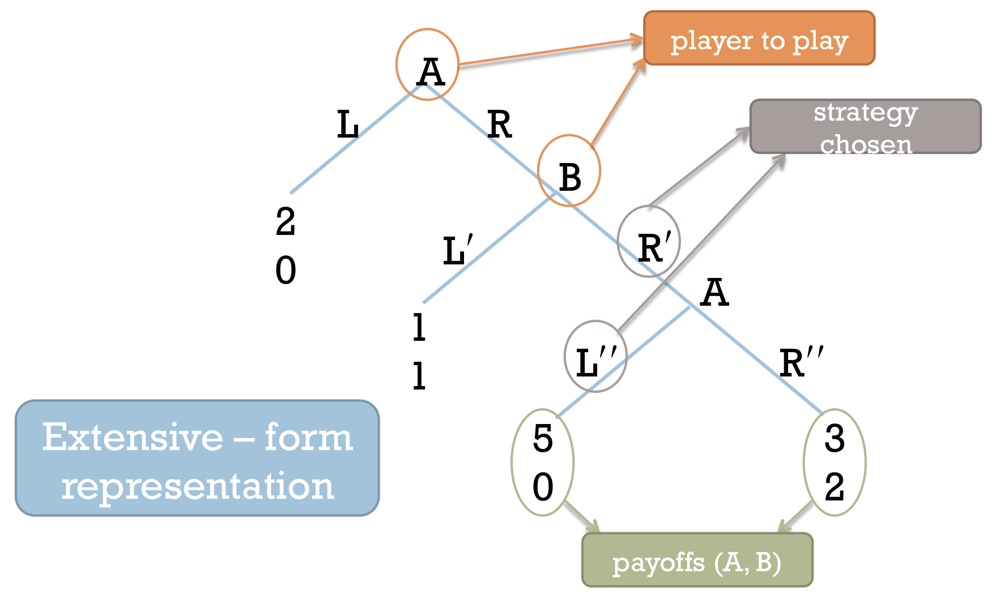

*Slide 18. The annotation “strategy chosen” points to individual branch actions; $A$'s complete strategy must specify both of $A$'s decisions.*

Backward induction gives three steps:

1. At the last node, $A$ chooses $L''$, since $5>3$.
2. Anticipating this, $B$ compares $1$ from $L'$ with $0$ from $R'$ and chooses $L'$.
3. At the root, $A$ compares $2$ from $L$ with $1$ from continuing through $R$ and chooses $L$.

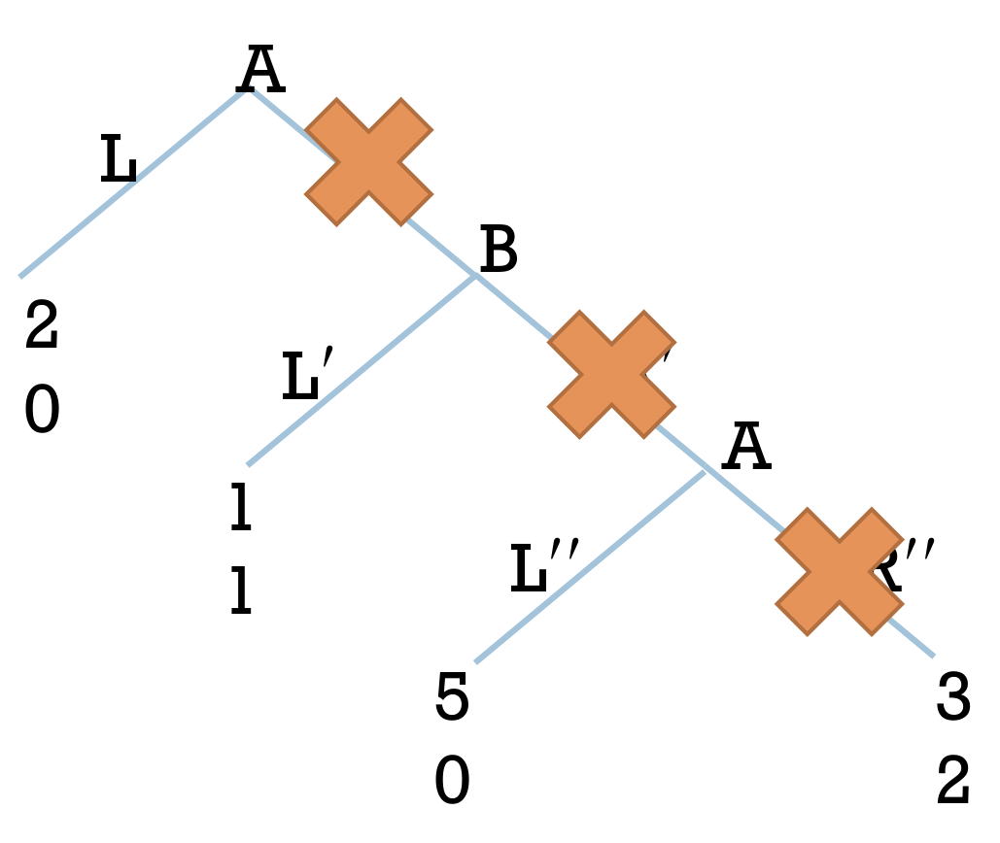

*Slide 19. Crosses mark the discarded actions $R''$, $R'$, and $R$, in that backward order. Some branch labels are covered by the original annotations; the unmarked tree above supplies them.*

The realized outcome is immediate exit, with payoffs $(2,0)$. The full equilibrium profile is

$$
\boxed{\bigl(s_A^*,s_B^*\bigr)=\bigl((L,L''),L'\bigr).}
$$

Here $A$'s first strategy component is the root decision and the second is the decision after $(R,R')$. Although the latter node is not reached, its prescribed action explains $B$'s decision and hence $A$'s initial choice.

The outcome $(3,2)$ would make both players better off than $(2,0)$. Yet if $B$ let play continue, $A$ would choose $(5,0)$ instead. $B$ therefore stops at $L'$; knowing this, $A$ stops at $L$.

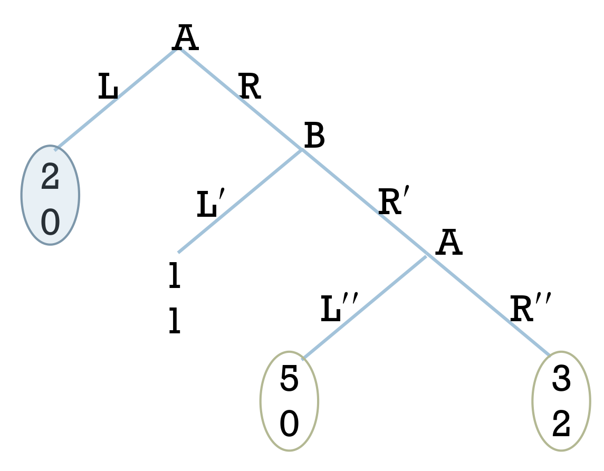

*Slide 20. The equilibrium payoff $(2,0)$ is Pareto inefficient: $(3,2)$ improves both payoffs, and $(5,0)$ improves $A$'s without reducing $B$'s.*

### Imperfect information

*Slides 21-22; part 2, 16:05-20:19.*

With simultaneous decisions inside a dynamic game, individual decision nodes cannot always be optimized separately. A continuation may itself be a simultaneous-move game that must be solved jointly.

The lecture considers two stages:

1. Players 1 and 2 simultaneously choose $a_1\in A_1$ and $a_2\in A_2$.
2. Players 3 and 4 observe $(a_1,a_2)$ and then simultaneously choose $a_3\in A_3$ and $a_4\in A_4$.

Payoffs are $u_j(a_1,a_2,a_3,a_4)$. The labels need not denote four distinct people: the same two players can act in both stages, as in the two-night Battle of the Sexes. When players reappear, their utilities must represent the payoff from the full play being evaluated.

For every first-stage history $(a_1,a_2)$, select a Nash equilibrium of the continuation game:

$$
\bigl(a_3^*(a_1,a_2),a_4^*(a_1,a_2)\bigr).
$$

Players 1 and 2 anticipate these continuation choices. Their reduced first-stage game has payoffs

$$
\widetilde{u}_j(a_1,a_2)=u_j\bigl(a_1,a_2,a_3^*(a_1,a_2),a_4^*(a_1,a_2)\bigr),
\qquad j=1,2.
$$

Find a Nash equilibrium $(a_1^*,a_2^*)$ of this reduced game. With pure continuation choices, the resulting outcome is

$$
\bigl(a_1^*,a_2^*,a_3^*(a_1^*,a_2^*),a_4^*(a_1^*,a_2^*)\bigr).
$$

Backward reasoning now requires solving each **continuation game** jointly, since simultaneous choices cannot be optimized one player at a time.

> [!warning] Clarification — Continuation equilibrium selection
> The stars in slides 21-22 must not be read as guaranteeing pure equilibria. Finite simultaneous games have equilibria when mixed strategies are allowed; then the reduced payoffs are expected utilities. Multiple continuation equilibria require an equilibrium choice after **every** first-stage history and can produce several solutions. Earlier players do not automatically control which equilibrium later players select, and the first-stage game can also have multiple equilibria even if every continuation equilibrium is unique.

## Subgame-perfect NE

*Slide 23; part 2, 20:21-20:47.*

A **subgame-perfect Nash equilibrium** (SPE) remains a Nash equilibrium in every admissible continuation game.

### Subgames

*Slides 24-25; part 2, 20:47-24:14.*

> [!info] Definition — Subgame
> A subgame starts at a decision node that is a singleton information set, includes that node and **all** its successors, and does not cut any information set. It inherits the original players, actions, information structure, and payoffs.

Writing $G$ for its nodes, the information-set condition in the slides is

$$
x_j\in G,\quad x_k\in h_i(x_j)\quad\Longrightarrow\quad x_k\in G.
$$

If a node is included, every node in its information set must also be included. Otherwise the proposed continuation would give the player information they did not possess in the original game.

The whole game is a subgame of itself; a **proper subgame** is a subgame smaller than the whole game. Thus the subtree condition alone is insufficient, and the whole game is not called a proper subgame.

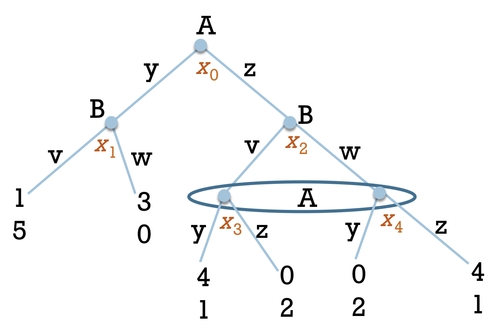

*Slide 25. Valid subgame roots are $x_0$, $x_1$, and $x_2$. The latter two generate proper subgames.*

- The subtree at $x_1$ contains $B$'s choice between $v$ and $w$ and both terminal outcomes. It is a subgame; $B$ chooses $v$, since $5>0$.
- The subtree at $x_2$ contains both $x_3$ and $x_4$, including their shared information set. It is also a subgame, even though it contains imperfect information.
- Neither $x_3$ nor $x_4$ can start a subgame: starting at one would exclude the other node in the same information set.

Imperfect information restricts where a subgame can begin; the subtree at $x_2$ remains valid.

### Subgame-perfect NE

*Slides 26-27; part 2, 24:14-33:09.*

> [!info] Definition — Subgame-perfect Nash equilibrium
> Following Selten's definition, a strategy profile is subgame-perfect if its restriction to **every subgame** is a Nash equilibrium of that subgame, including subgames reached with probability zero.

Since the whole game is itself a subgame, every SPE is a Nash equilibrium:

$$
\{\text{SPE profiles}\}\subseteq\{\text{Nash equilibrium profiles}\}.
$$

For finite perfect-information games, backward induction constructs an SPE by specifying an optimal continuation at every node. With strict choices throughout, this SPE is unique. More generally, finite extensive-form games admit SPEs when mixed strategies are allowed in continuation games; the general existence statement is not a pure-strategy or uniqueness guarantee.

An existence theorem does not provide a practical shortcut for solving a huge game such as chess. Nor does it establish that the first mover necessarily wins: equilibrium play can lead to a draw or another outcome determined by the rules and payoffs.

#### Applying the definition to the trust game

The backward-induction profile $((L,L''),L')$ passes all three tests:

|Subgame|Prescribed continuation|Why it is a Nash equilibrium|
|---|---|---|
|Last decision by $A$|$L''$|$A$ obtains $5$ instead of $3$.|
|Subgame beginning at $B$|$B$: $L'$; $A$: $L''$|$B$ obtains $1$ instead of $0$; $A$'s last-node action is optimal if reached.|
|Whole game|$A$: $(L,L'')$; $B$: $L'$|$A$ obtains $2$ instead of $1$ by exiting; $B$ cannot improve the realized payoff by deviating.|

> [!warning] Clarification — Unique SPE does not mean unique NE
> At part 2, approximately 27:27-27:37, the lecturer describes the trust game as having “only one Nash equilibrium”. Direct calculation gives two pure Nash equilibria: $((L,L''),L')$ and $((L,R''),L')$. In the second profile, $A$ still prefers $2$ from $L$ to $1$ from deviating to $R$ while $B$ keeps $L'$; $B$'s deviation cannot affect the outcome because $A$ exits immediately. However, that profile fails the subgame test: $A$ would prefer $L''$ at the last node, and $B$ would prefer $R'$ in its continuation if $A$ prescribed $R''$. Only $((L,L''),L')$ is an SPE.

> [!warning] Exam point — Specify strategies, not only the realized path
> “$A$ plays $L$” describes the outcome, not the full equilibrium. State $A$'s choices at both decision nodes and $B$'s choice, including decisions that equilibrium play never reaches. Subgame perfection cannot be checked from the realized path alone.

### Credibility of threats

*Slides 28-30; part 2, 33:09-41:43.*

A continuation threat is **credible** when carrying it out is optimal for the player who would act if the threatened history were reached. In the two-player model, the response must belong to the best-response set:

$$
a_2\in\operatorname*{arg\,max}_{b\in A_2(a_1)}u_2(a_1,b).
$$

If the best response is unique, this becomes $a_2=R_2(a_1)$. With ties, a response different from one selected representative $R_2(a_1)$ can still be optimal; credibility excludes suboptimal responses, not alternative maximizers.

In finite perfect-information games, SPE removes threats based on suboptimal behavior in unreached subgames. For imperfect-information games, SPE imposes rationality at the subgame level; it need not resolve every credibility issue inside information sets where no proper subgame begins.

#### Battle of the Sexes and Hawk-and-Dove

In $(S,ss)$, Brian's threatened response to $R$ is $s$. After observing $R$, he would instead prefer $r$, giving him $1$ rather than $0$. Ann can anticipate this. The threat cannot support an SPE.

Likewise, $rr$ is not optimal after $S$. The only strategy for Brian that is optimal after both choices is $rs$. Ann therefore chooses $R$, and the unique SPE is

$$
\boxed{(R,rs),\qquad\text{outcome }(R,r),\qquad\text{payoffs }(2,1).}
$$

In the lecturer's sequential Hawk-and-Dove example, responding to Hawk with Hawk is likewise an empty threat if Dove gives the second player a higher payoff. The first-mover advantage follows from those payoffs.

#### Extreme illustrative threat

In a modified film example, $S$ now means **stay at home**, yielding $(0,0)$, while $R$ means attend a romance film that Brian dislikes. After $R$, Brian has two actions:

|Brian's action after $R$|Payoffs (Ann, Brian)|
|---|---|
|$r$: accompany Ann|$(2,-10)$|
|$k$: the self-destructive action in the lecture's hypothetical example|$(-10,-99)$|

After $S$, Brian has only the forced action $s$.

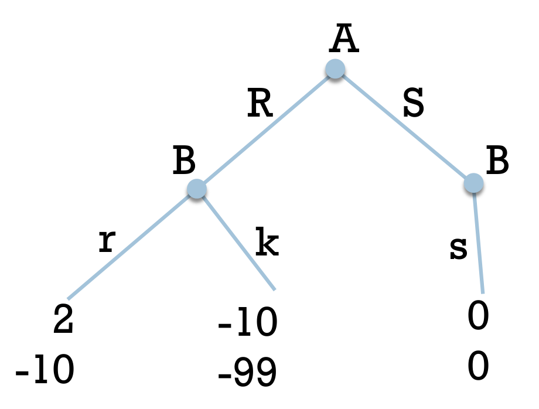

*Slide 30. These are stipulated utilities in an illustrative game; the conclusion follows from their numerical ordering.*

With strategy order **(response to $R$, response to $S$)**, Brian's threatened plan is $(k,s)$. The profile $(S,(k,s))$ is a Nash equilibrium: Ann would obtain $-10$ by deviating to $R$ against that fixed plan, while Brian cannot change the $(0,0)$ outcome given $S$.

It is not subgame-perfect. After $R$, Brian prefers $-10$ from $r$ to $-99$ from $k$. Backward induction selects $(r,s)$ for Brian and $R$ for Ann, giving the SPE $(R,(r,s))$ and payoffs $(2,-10)$.

> [!warning] Clarification — Reversed strategy notation
> Slide 29 writes Brian's plan as $(s,k)$, but slide 30 and the oral correction at approximately 39:00 use $(k,s)$. With the response-to-$R$ component first, $(k,s)$ is the correct order. Staying home can equivalently be represented as ending the game immediately; the displayed forced $s$ adds no strategic choice.

### back to Example 11

*Slide 31; part 2, 41:43-47:36.*

In each ultimatum subgame, accepting gives the responder a positive payoff; rejecting gives zero. The responder therefore chooses

$$
s_R^*=(Y,Y,Y).
$$

Anticipating acceptance after every offer, the proposer compares $9$, $5$, and $2$ and selects $D$. The unique SPE of this restricted game is

$$
\boxed{(D,YYY),\qquad\text{payoffs }(9,1).}
$$

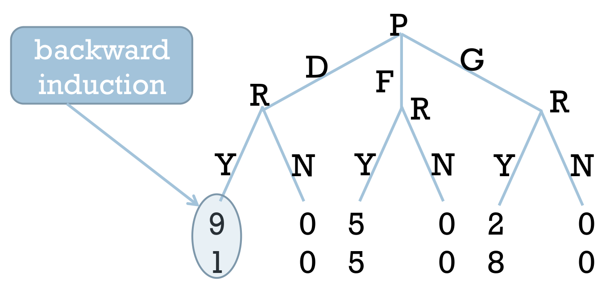

*Slide 31. Accepting $D$ is the realized response, but accepting $F$ and $G$ must also be included in the equilibrium strategy.*

The other six pure Nash equilibria fail because some off-path responder subgame prescribes rejecting a positive share. Such a rejection can influence the proposer's incentives in the normal-form Nash test, yet the responder would not want to carry it out once facing the offer.

The conclusion depends on the **specified utility functions**. With utility equal to one's own candy share, any positive amount is better than zero. If an expanded game permits an offer of zero, the responder is indifferent between accepting and rejecting that offer; strict acceptance and uniqueness then require further care. For a continuously divisible resource, there is no smallest strictly positive offer, so the lecturer's “smallest epsilon” wording describes the incentive to reduce offers, rather than an automatically attained minimum.

In practice, someone may reject an unequal offer because fairness matters to them. That choice can be rational under a utility function that includes fairness, even though it differs from this model's candy-share prediction.
