# Dynamic games

*Game theory - Prof. Leonardo Badia. Lesson 9 folder; Lecture 11 recordings.*

This summary follows the slides and the lecturer's explanation, first recording followed by second recording. Repeated slide titles are grouped into single sections. Original figures are embedded beside the relevant explanation; page numbers refer to the PDF. Explicit clarification callouts distinguish mathematical corrections from the lecture's wording.

Sources: [lecture slides](Gth2008.pdf), [transcript - part 1](<2026-IN2898-005PD-2026-IN0000184-N0-IN2898 Lecture 11 STEM.transcript.txt>), [transcript - part 2](<2026-IN2898-005PD-2026-IN0000184-N0-IN2898 Lecture 11 STEM-01.transcript.txt>).

## Dynamic games

*Slides 2-3; part 1, 00:00-04:07.*

A **dynamic game** introduces a time dimension: some decisions occur before others, so players may condition their choices on the history of play. Timing and observability both matter.

Two different information concepts must be separated:

|Concept|Meaning|
|---|---|
|Complete information|Players know the game's rules and payoff functions; this knowledge is common knowledge.|
|Perfect information|At each decision, the player knows the preceding history of play.|
|Imperfect information|A player cannot distinguish between some possible histories when choosing an action.|

Complete information does **not** imply perfect information: knowing everyone's preferences does not reveal their actual choices. Chess illustrates sequential play with observed previous moves. The simultaneous Battle of the Sexes has known payoffs but unobserved choices.

The lecture also associates imperfect information with random interventions by **Nature**. Its specific convention is recorded and qualified under “Perfect/imperfect info. (repr’d)”.

## Battle of the sexes, revisited

*Slides 4-5; part 1, 04:11-08:33.*

Ann and Brian want to see a film together. Ann prefers romance; Brian prefers science fiction. Both prefer being together to attending different films. Uppercase letters denote Ann's actions; lowercase letters denote Brian's.

|Ann / Brian|$r$: romance|$s$: sci-fi|
|---|---|---|
|$R$: romance|$(2,1)$|$(0,0)$|
|$S$: sci-fi|$(0,0)$|$(1,2)$|

Payoffs are ordered **(Ann, Brian)**.

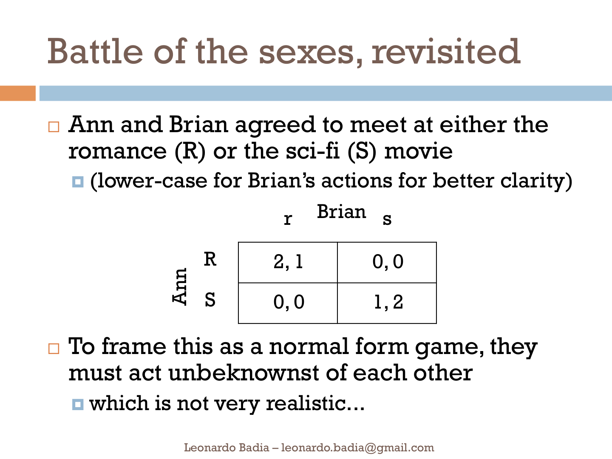

In the original static game, neither player observes the other's choice before deciding. Physical simultaneity is unnecessary: decisions made at different times are strategically simultaneous if the later player cannot observe the earlier choice.

Now let Ann choose first and communicate her choice to Brian:

1. After $R$, Brian prefers $r$ because $1>0$.
2. After $S$, Brian prefers $s$ because $2>0$.
3. Ann anticipates that Brian will follow her and chooses $R$, obtaining $2$ rather than $1$.

The resulting path is $(R,r)$, with payoffs $(2,1)$. Ann's ability to move first and be observed gives her an advantage in this example. The reasoning works because Ann also knows that Brian will observe her choice.

This anticipates reasoning backward through the tree. Formal dynamic equilibrium refinements are left for later lectures; the conclusion should not be read as claiming that the game has only one normal-form Nash equilibrium.

## Extensive form

*Slide 6; part 1, 08:33-10:07.*

A payoff matrix alone does not explicitly show **who moves when**, what earlier moves are observed, or how later choices depend on them. The **extensive form** specifies this structure; its graphical representation is a decision tree.

For the film example, it must distinguish Brian's decision after $R$ from his decision after $S$. It must also represent whether Brian actually knows which choice occurred.

Extensive form does not permanently replace normal form: once complete strategies are defined, a dynamic game can also be represented by a normal-form payoff table.

## Extensive form: ingredients

*Slide 7; part 1, 10:07-15:22.*

An extensive-form specification includes:

1. The set of players.
2. Their payoff functions.
3. The order of their moves.
4. The actions available whenever each player moves.
5. The information available at each decision.
6. The probabilities of external random events, when present.
7. Common knowledge of this entire structure.

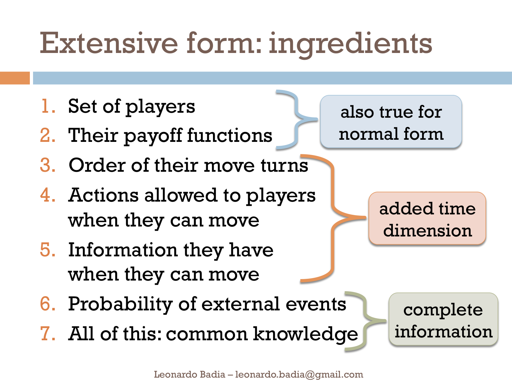

Players and payoffs are already present in normal form. Timing, available actions at each decision, and information make the dynamic structure explicit. In chess, for example, legal actions depend on the current position.

**Common knowledge** goes beyond everyone knowing the rules: everyone knows that everyone knows them, and so on. Here it includes knowledge of the information structure. Ann knows that Brian will know her choice, and Brian knows that Ann knows this.

## Sequential Battle of Sexes

*Slide 8; part 1, 15:22-17:26.*

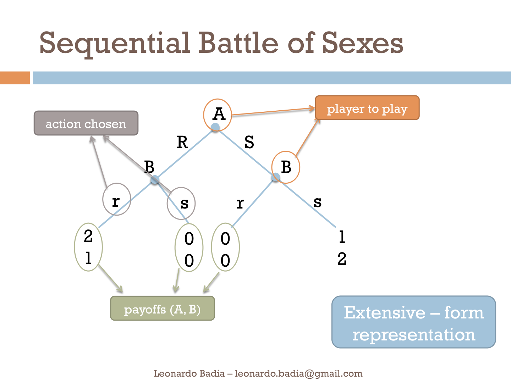

Read the tree as follows:

- A decision node identifies the player whose turn it is.
- An outgoing branch identifies an available action.
- A terminal node gives the payoff vector, in a declared player order.
- A path from the root to a terminal node gives one possible realized history.

Ann moves at the root. Brian has two possible decision nodes, one after each of Ann's choices. Only one is reached during actual play, but both matter when defining Brian's strategy.

## Dummy players

*Slide 9; part 1, 17:26-22:01.*

A player can receive a payoff without making a meaningful choice. Such a player may never move, may move only on some paths, or may have only one available action at a particular point.

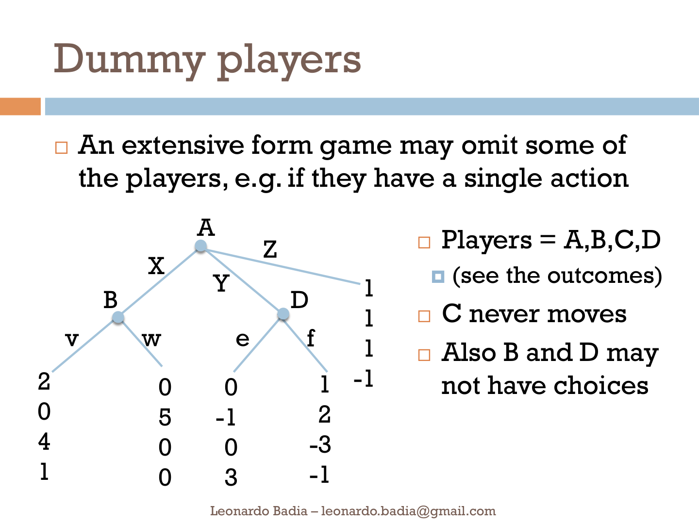

In this example, payoff entries follow the order $(A,B,C,D)$:

|History|Player choosing after A|Final payoffs $(A,B,C,D)$|
|---|---|---|
|$X,v$|B|$(2,0,4,1)$|
|$X,w$|B|$(0,5,0,0)$|
|$Y,e$|D|$(0,-1,0,3)$|
|$Y,f$|D|$(1,2,-3,-1)$|
|$Z$|No further choice|$(1,1,1,-1)$|

C never moves but still has a payoff. B moves only after $X$; D moves only after $Y$. Choosing $Z$ ends the game immediately.

A node with one outgoing action can be omitted without changing strategic choices. Therefore, infer the player set from the full specification and payoff vectors, not only from visible decision labels.

## Information sets

*Slides 10-15; part 1, 22:01-34:44.*

### Nodes represent histories

The two Brian nodes have the same available actions but different preceding histories and payoff consequences. If Brian observes Ann's move, he can distinguish them and choose differently.

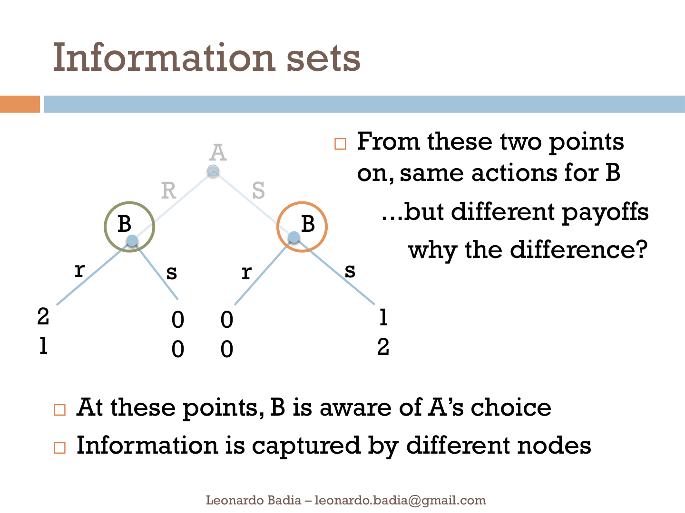

The labeled tree uses:

- $x_0$: root, where Ann moves.
- $x_1$: Brian's decision after $R$.
- $x_2$: Brian's decision after $S$.
- $x_3,x_4,x_5,x_6$: terminal nodes for $Rr,Rs,Sr,Ss$, respectively.

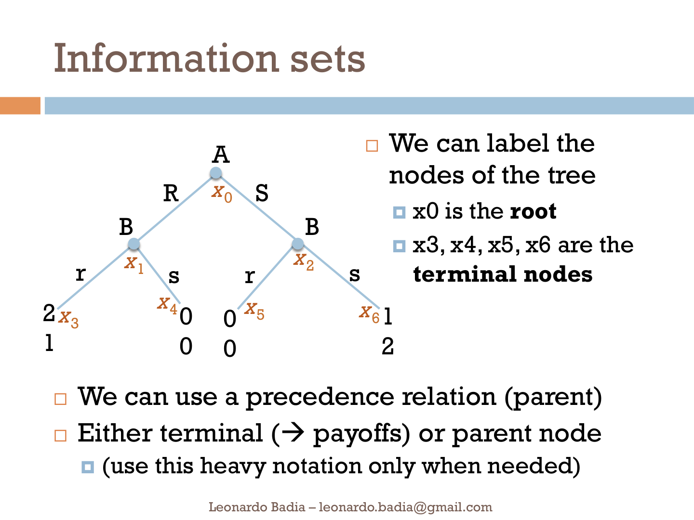

A parent relation records the immediate predecessor of a node. The root has no parent. Terminal nodes carry payoffs; nonterminal nodes describe further decisions.

### What an information set means

> [!info] Definition - Information set
> An information set groups decision nodes that the same player cannot distinguish when choosing an action.

Let $H_i$ be player $i$'s collection of information sets, and let $h_i(x_j)$ denote the information set containing node $x_j$. In particular,

$$
x_j\in h_i(x_j).
$$

If $h_i(x_j)=\{x_j\}$, the player knows exactly which history has occurred. If the set contains multiple nodes, the player knows the actual node belongs to that set but cannot identify it more precisely.

In the sequential film game with observation:

$$
H_B=\big\{\{x_1\},\{x_2\}\big\}.
$$

Without observation:

$$
H_B=\big\{\{x_1,x_2\}\big\}.
$$

The latter reproduces the original simultaneous game. Brian cannot choose $r$ specifically after $R$ and $s$ specifically after $S$, because he cannot observe which condition applies.

### Graphical conventions and action consistency

Nodes in the same information set may be joined by an oval or a dashed line. Both conventions express indistinguishability; neither connection is an action branch.

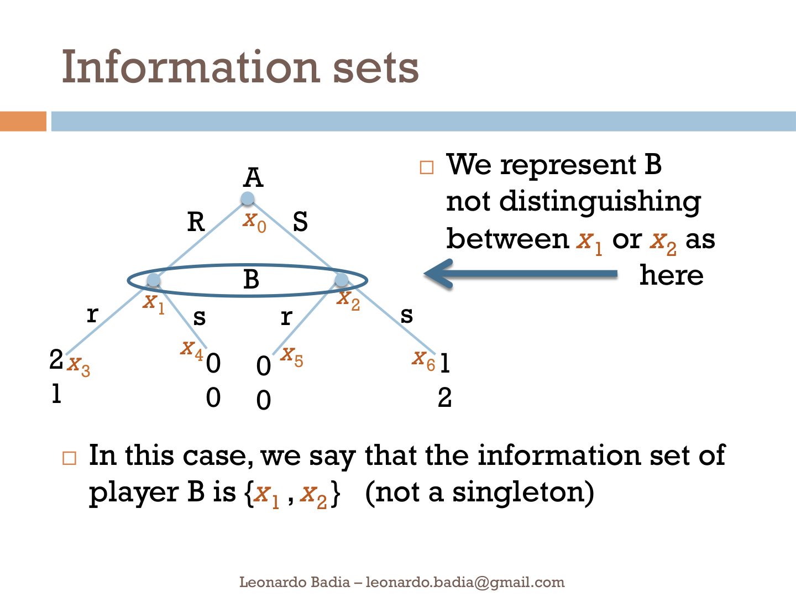

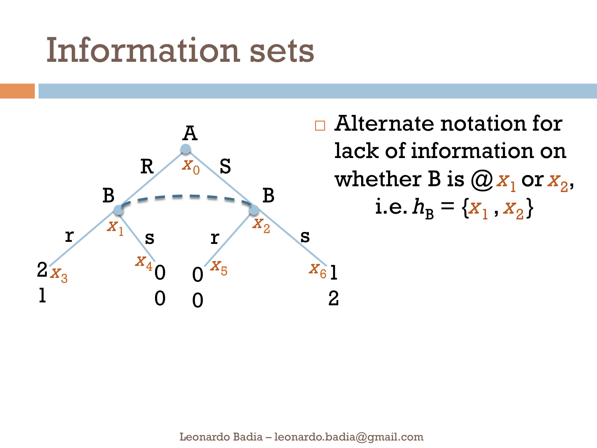

At all nodes in one information set, a pure strategy specifies the **same action**, and a behavioral strategy specifies the **same action distribution**.

Available action sets must also coincide:

$$
x_k\in h_i(x_j)\quad\Longrightarrow\quad A(x_j)=A(x_k).
$$

Otherwise, observing which actions are available could reveal the actual node.

## Set of available actions

*Slide 16; part 1, 34:44-37:04.*

The lecturer describes a modeling trick for actions that are unavailable at some nodes: add the missing action and assign it a sufficiently bad payoff.

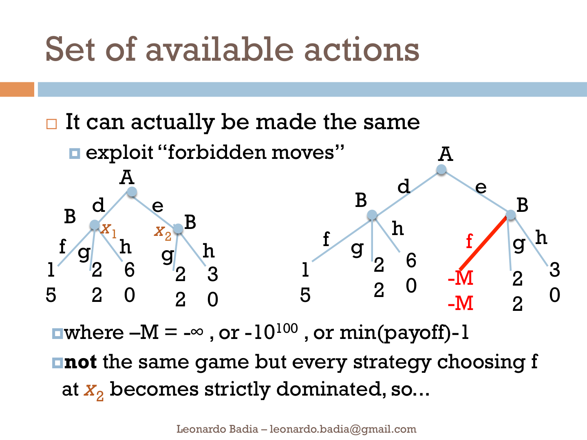

Originally, B can choose $f,g,h$ at $x_1$, but only $g,h$ at $x_2$. In the modified tree, $f$ is available at both nodes; at $x_2$ it gives payoff $-M$, chosen below every legitimate payoff. The slide suggests $-\infty$, $-10^{100}$, or $\min(\text{payoff})-1$; a finite value avoids infinite-utility calculations.

The intended effect is to make the added move unattractive to a rational player. The modified game is **not literally identical**: its action and strategy sets have changed.

> [!warning] Clarification - Dominance of a complete strategy
> The slide calls every strategy choosing $f$ at $x_2$ “strictly dominated”. More precisely, replacing that choice by a better action improves the payoff if $x_2$ is reached, but leaves it unchanged if the other branch is reached. In the displayed normal form, this generally yields weak dominance of the complete strategy, even though $f$ is strictly worse locally at $x_2$.

## Perfect/imperfect info. (repr’d)

*Slide 17; part 1, 37:04-39:08.*

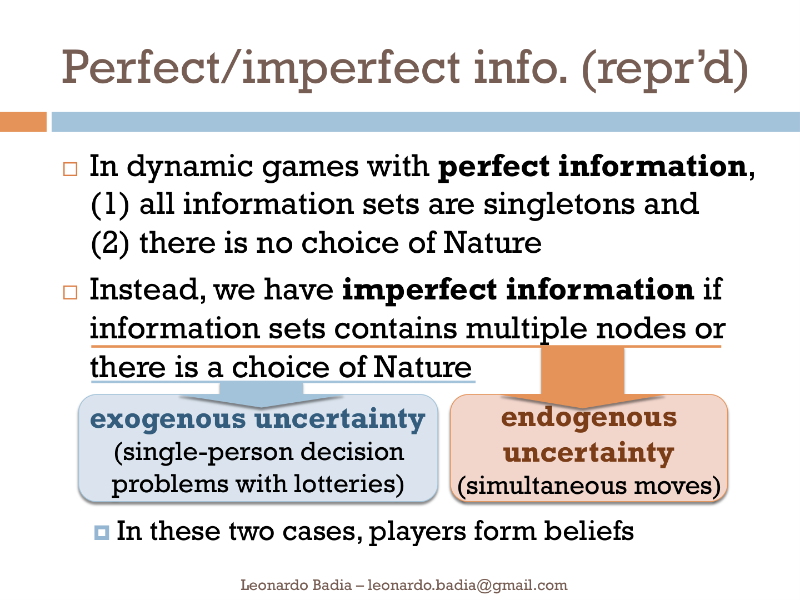

The slide's classification is:

- **Perfect information:** every information set is a singleton and Nature makes no random choice.
- **Imperfect information:** some information set has multiple nodes, or Nature makes a random choice.

It distinguishes two sources of uncertainty:

|Source|Meaning|Lecture example|
|---|---|---|
|Exogenous uncertainty|Randomness external to players' decisions|Nature determines the quality of food in a canteen lottery.|
|Endogenous uncertainty|Uncertainty about other players' unobserved choices|Simultaneous Battle of the Sexes.|

Players use **beliefs** to reason under uncertainty. A belief about an unobserved history is conceptually different from a player's own randomized action rule.

> [!info] Terminology clarification
> Preserve the slide's convention when reading this course. In standard extensive-form terminology, chance moves can coexist with perfect information when their realized outcomes are observed before subsequent decisions. The information-set criterion concerns knowledge of past play; randomness about future events is a separate issue.

## Re-defining strategies

*Slides 18-21; part 1, 39:09-57:37.*

### A pure strategy is a complete contingent plan

> [!info] Definition - Pure strategy
> A pure strategy specifies one allowed action at every information set belonging to the player, including information sets that will not be reached under that strategy.

In a one-shot static game, a pure strategy is just an action. In a dynamic game, it is a program of conditional instructions: **if this information is available, choose this action; otherwise, choose another**.

An **action** is one move. A **strategy** specifies what to do in every possible decision situation. History-dependent behavior can be entirely deterministic and therefore pure.

### Sequential Battle of the Sexes

Ann has two pure strategies, $R$ and $S$. Brian has two actions but four pure strategies:

$$
s_B=(a_R,a_S),\qquad S_B=\{rr,rs,sr,ss\}.
$$

The first coordinate is Brian's action after Ann chooses $R$; the second is his action after $S$.

|Brian's strategy|After $R$|After $S$|Interpretation|
|---|---|---|---|
|$rr$|$r$|$r$|Always choose romance.|
|$rs$|$r$|$s$|Follow Ann.|
|$sr$|$s$|$r$|Avoid Ann.|
|$ss$|$s$|$s$|Always choose sci-fi.|

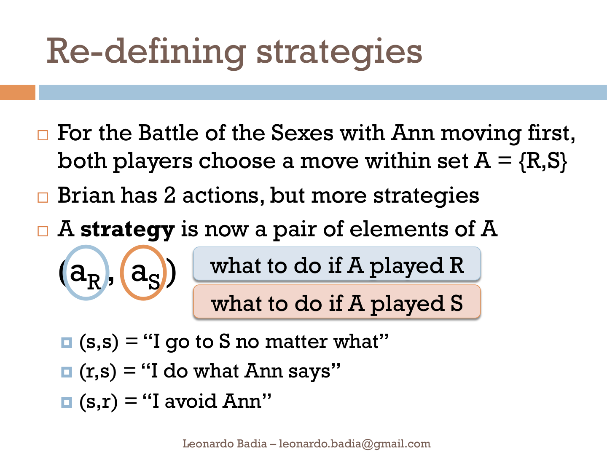

The strategy set includes unattractive plans such as $sr$. Define all admissible strategies first; evaluate rationality and equilibria afterward.

### Two consecutive nights

Now repeat the original simultaneous game on two nights, observing the first night's outcome before the second night. Each player must specify a first-night action and a second-night action after each of the four possible first-night outcomes:

$$
s_i=(a_1,a_{2Rr},a_{2Rs},a_{2Sr},a_{2Ss}).
$$

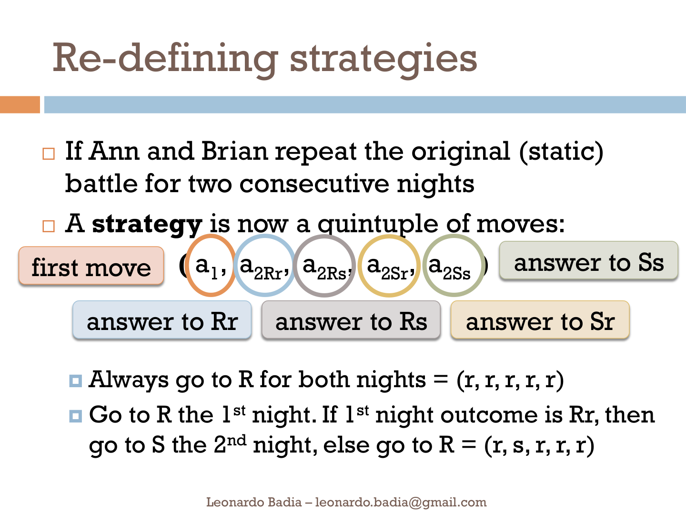

For Brian:

- $(r,r,r,r,r)$ means choose romance on both nights, whatever happens.
- $(r,s,r,r,r)$ means choose romance first; choose sci-fi next only after $Rr$, otherwise choose romance again.

**All five entries are required.** Even if Brian chooses $r$ first, making histories $Rs$ and $Ss$ unreachable under his own plan, his complete strategy still assigns actions there. Only two information sets are actually visited, but the strategy specifies five choices.

The lecturer emphasizes this for exams: state the order and meaning of every coordinate. A shorter tuple that omits contingencies is not a complete strategy in the representation being used.

### Why strategy sets grow quickly

For finite games, the number of pure strategies is

$$
|S_i|=\prod_{h\in H_i}|A_i(h)|.
$$

Thus, three available actions at each of three information sets give player 2 $3^3=27$ strategies. The first mover with one information set and three actions has only three strategies. In the two-night example, each player has $2^5=32$ complete pure strategies.

A verbal description can be more readable than a long tuple, provided it covers every contingency unambiguously.

## What about mixed strategies?

*Slide 22; part 2, 00:03-02:44.*

A **mixed strategy** remains a probability distribution over pure strategies:

$$
m_i\in\Delta(S_i),\qquad
m_i(s_i)\geq 0,\qquad
\sum_{s_i\in S_i}m_i(s_i)=1.
$$

Here, a pure strategy is an entire contingent plan. The player randomly selects a plan before play and follows it throughout the game. That plan still reacts to observed histories; what is fixed in advance is its deterministic rule.

For example, choosing among three programs with probabilities $0.6,0.3,0.1$ is a mixed strategy. A pure strategy is the special case assigning probability one to a single program.

The alternative is to randomize while play unfolds, directly at decision situations.

## Behavioral strategies

*Slide 23; part 2, 02:44-06:42.*

> [!info] Definition - Behavioral strategy
> A behavioral strategy assigns an independent probability distribution over available actions at every information set of a player.

Write

$$
\sigma_i(\cdot\mid h)\in\Delta(A_i(h)),\qquad h\in H_i.
$$

Here $\sigma_i(a_i\mid h)$ is the probability of choosing $a_i$ when the player reaches information set $h$. It satisfies

$$
\sigma_i(a_i\mid h)\geq 0,\qquad
\sum_{a_i\in A_i(h)}\sigma_i(a_i\mid h)=1.
$$

The player cannot choose different distributions for indistinguishable nodes within $h$. If using a common action universe $A_i$, write $\sigma_i:H_i\to\Delta(A_i)$ and assign probability zero to actions unavailable at $h$.

For Brian in the observed sequential film game, two parameters suffice:

$$
\alpha=\sigma_B(r\mid\{x_1\}),\qquad
\beta=\sigma_B(r\mid\{x_2\}).
$$

The probabilities of $s$ are $1-\alpha$ and $1-\beta$. Without observation there is only one information set, so Brian has a single action distribution.

## Mixed ↔ behavioral

*Slides 24-25; part 2, 06:47-14:15.*

The lecturer's handbook analogy captures the distinction:

|Strategy type|Handbook interpretation|Randomization|
|---|---|---|
|Pure|One handbook with deterministic instructions|None.|
|Mixed|Choose one deterministic handbook at random|Before play.|
|Behavioral|One handbook containing randomized instructions|At each information set.|

### Converting probabilities in the film example

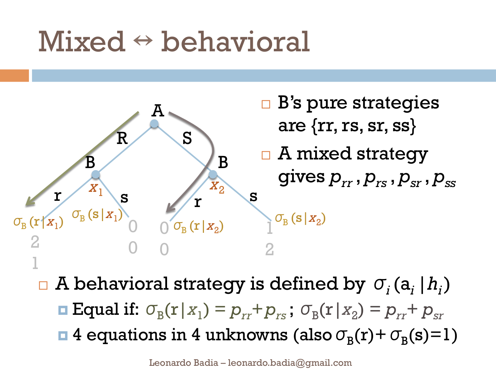

Let $p_{rr},p_{rs},p_{sr},p_{ss}$ be Brian's probabilities over his four pure strategies. Then

$$
\begin{aligned}
\alpha&=p_{rr}+p_{rs},&1-\alpha&=p_{sr}+p_{ss},\\
\beta&=p_{rr}+p_{sr},&1-\beta&=p_{rs}+p_{ss}.
\end{aligned}
$$

At $x_1$, only the first coordinate matters; at $x_2$, only the second matters. A mixed strategy therefore determines behavioral probabilities that generate the same outcome distribution against every strategy of Ann.

Conversely, given $\alpha,\beta$, one equivalent mixed strategy is

$$
\begin{aligned}
p_{rr}&=\alpha\beta,&p_{rs}&=\alpha(1-\beta),\\
p_{sr}&=(1-\alpha)\beta,&p_{ss}&=(1-\alpha)(1-\beta).
\end{aligned}
$$

> [!warning] Clarification - Equivalence does not mean a unique inverse
> The lecture describes the equation system as uniquely determined. The inverse is generally not unique: the two behavioral parameters specify marginals, not correlations between actions at mutually exclusive nodes. For example, both a 50-50 mixture of $rr$ and $ss$ and a 50-50 mixture of $rs$ and $sr$ give $\alpha=\beta=1/2$.

Equivalence concerns **distributions over realized terminal outcomes**, not equality of probability distributions over complete plans.

## Perfect recall

*Slide 26; part 2, 14:15-18:09.*

> [!info] Definition - Perfect recall
> A player never forgets information previously available to them, including their own earlier actions and information sets.

Perfect recall does not require knowing every other player's move. Brian can have perfect recall while never having observed Ann's decision: he has forgotten nothing.

For a finite extensive-form game with perfect recall, every mixed strategy has a **realization-equivalent** behavioral strategy, and conversely. Equivalence holds against all opponents' strategies. This is the content of **Kuhn's theorem**, and explains why the course can often treat the two kinds of randomization interchangeably. See [CMU lecture slides on behavioral strategies and Kuhn's theorem](https://www.cs.cmu.edu/~sandholm/cs15-888F25/Lecture5-Slides.pdf).

> [!warning] Clarification - Recall is a memory condition
> The lecturer illustrates imperfect recall through confusion between different tree levels. The general criterion is whether a player forgets their own past actions or information. Tree depth alone is not a sufficient test; forgetting can occur between nodes at the same depth too.

Unless explicitly stated otherwise, the lecturer assumes perfect recall in subsequent games. Recall and rationality are distinct: rationality concerns choosing well with the available information; recall concerns retaining information over time.

## Counter-example

*Slides 27-28; part 2, 18:09-26:55.*

### The absent-minded driver

Andrew drives toward home. There are two decision points followed by the road end:

|Outcome|Payoff|
|---|---|
|Exit at the first junction: bad neighborhood|$0$|
|Continue first, exit second: direct route home|$4$|
|Continue at both: long route home|$1$|

At either junction, Andrew chooses $e$ (exit) or $s$ (stay on the highway). Because he cannot remember whether he already passed the first junction, both decision nodes belong to one information set:

$$
h_A=\{x_0,x_1\}.
$$

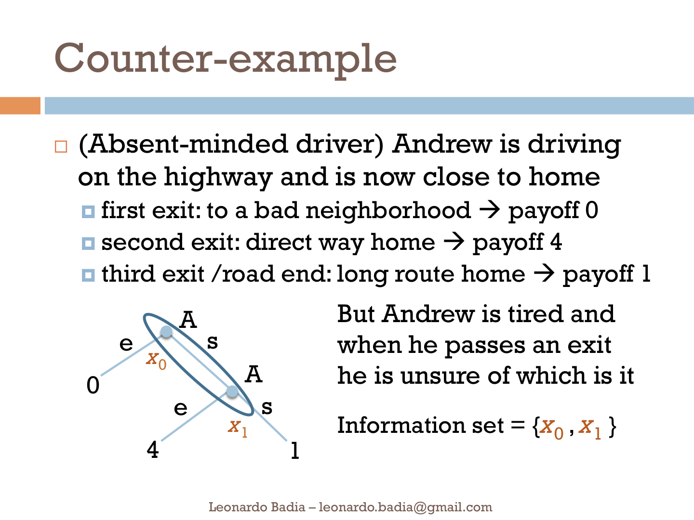

This violates perfect recall: when at the second junction, he does not remember having already chosen to continue at the first.

### The calculation presented in the lecture

If Andrew independently exits with probability $p$ whenever he encounters a junction, terminal probabilities are

$$
P(0)=p,\qquad P(4)=(1-p)p,\qquad P(1)=(1-p)^2.
$$

Therefore,

$$
\mathbb{E}[u_A]=4(1-p)p+(1-p)^2=-3p^2+2p+1.
$$

Differentiation gives

$$
\frac{d\mathbb{E}[u_A]}{dp}=-6p+2=0
\quad\Longrightarrow\quad p^*=\frac13,
\qquad \mathbb{E}[u_A]=\frac43.
$$

The slide then introduces a belief $q=P(x_0\mid h_A)$ about being at the first junction and considers

$$
\mathbb{E}[u_A\mid h_A]
=q\big[4(1-p)p+(1-p)^2\big]+(1-q)\big[4p+(1-p)\big]
=-3qp^2-qp+3p+1.
$$

Treating $q>0$ as fixed, the unconstrained maximizer is

$$
p^*(q)=\frac{3-q}{6q},
$$

clipped to $[0,1]$. It equals $1/3$ when $q=1$ and increases as $q$ falls. At $q=0$, the displayed expression is increasing in $p$, so its maximum is at $p=1$.

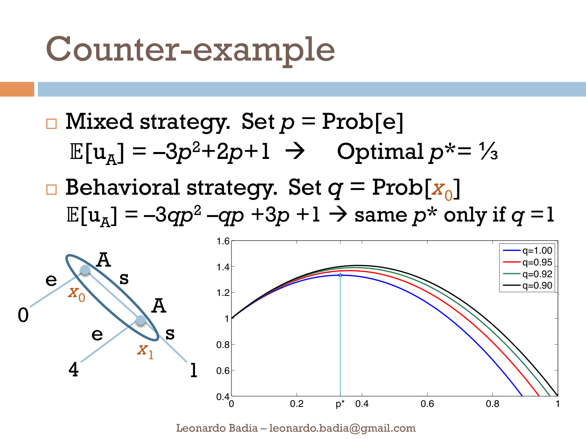

### Clarifying mixed versus behavioral strategies

> [!warning] Clarification - Slide 28 uses inconsistent labels
> The slide calls the polynomial $-3p^2+2p+1$ a “mixed strategy” calculation. Under the definitions introduced earlier, independent randomization at each visit is behavioral. A true mixed strategy selects a deterministic plan once before the trip.

There are only two pure plans for Andrew's single information set:

- Always exit: he exits immediately and receives $0$.
- Always stay: he passes both junctions and receives $1$.

A genuine mixed strategy assigning probability $\lambda$ to “always exit” gives

$$
\mathbb{E}[u_A]=\lambda\cdot0+(1-\lambda)\cdot1=1-\lambda\leq1.
$$

By contrast, independent behavioral randomization achieves $4/3$. This provides a direct counterexample to mixed-behavioral equivalence without perfect recall. The distinction between drawing a complete strategy once and independently randomizing at successive visits is formalized in [Tewolde et al., *Imperfect-Recall Games: Equilibrium Concepts and Their Complexity*, definitions 2-3](https://www.cs.cmu.edu/~conitzer/imperfectIJCAI24.pdf).

The slide's $q$ is a **belief about the current node**, not an extra parameter of a behavioral strategy. Its conditional calculation illustrates the complications of reasoning after forgetting; by itself, it should not be interpreted as the formal mixed-versus-behavioral comparison.

**Lecture takeaway:** perfect recall guarantees equivalence; without it, equivalence can fail. The lecturer presents this example mainly to establish that limitation.

## Extensive ↔ normal form

*Slides 29-31; part 2, 26:55-32:12.*

### Converting an extensive-form game

Once complete pure strategies are listed, normal form can represent a dynamic game:

1. List each player's pure strategies, with one action for every information set.
2. For each strategy profile, follow its induced path through the tree.
3. Enter the resulting payoff vector in the corresponding cell; if Nature moves, use expected payoffs.

Players can be viewed as choosing complete programs before play. Those programs then determine conditional actions during play.

For the observed sequential Battle of the Sexes:

|Ann / Brian|$rr$|$rs$|$sr$|$ss$|
|---|---|---|---|---|
|$R$|$(2,1)$|$(2,1)$|$(0,0)$|$(0,0)$|
|$S$|$(0,0)$|$(1,2)$|$(0,0)$|$(1,2)$|

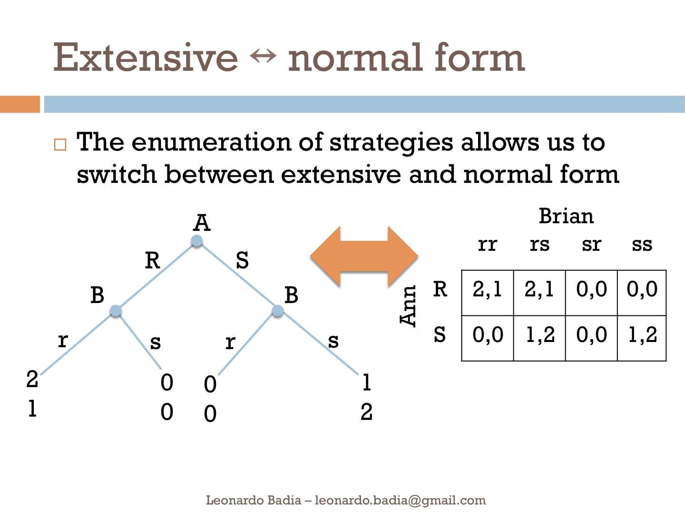

For instance, $(S,rs)$ produces $(S,s)$: Brian's second coordinate applies, giving $(1,2)$. The matrix columns must be **strategies**, not merely Brian's two available actions.

### The original simultaneous game

Without observing Ann's move, Brian has one information set and only two pure strategies, $r$ and $s$. Conversion therefore yields the original two-by-two payoff matrix.

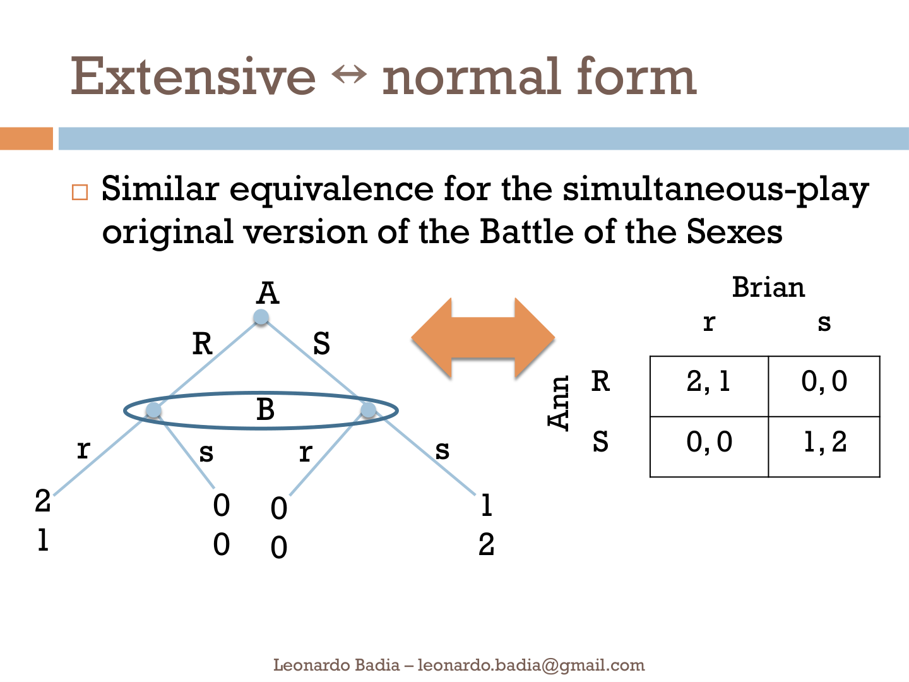

The different matrices show why information matters even when available physical actions and terminal payoffs are unchanged.

### Multiple extensive forms can share a normal form

The last example involves Alex and Beth:

|Alex / Beth|$f$|$g$|
|---|---|---|
|$K$|$(1,5)$|$(3,0)$|
|$E$|$(2,2)$|$(2,2)$|

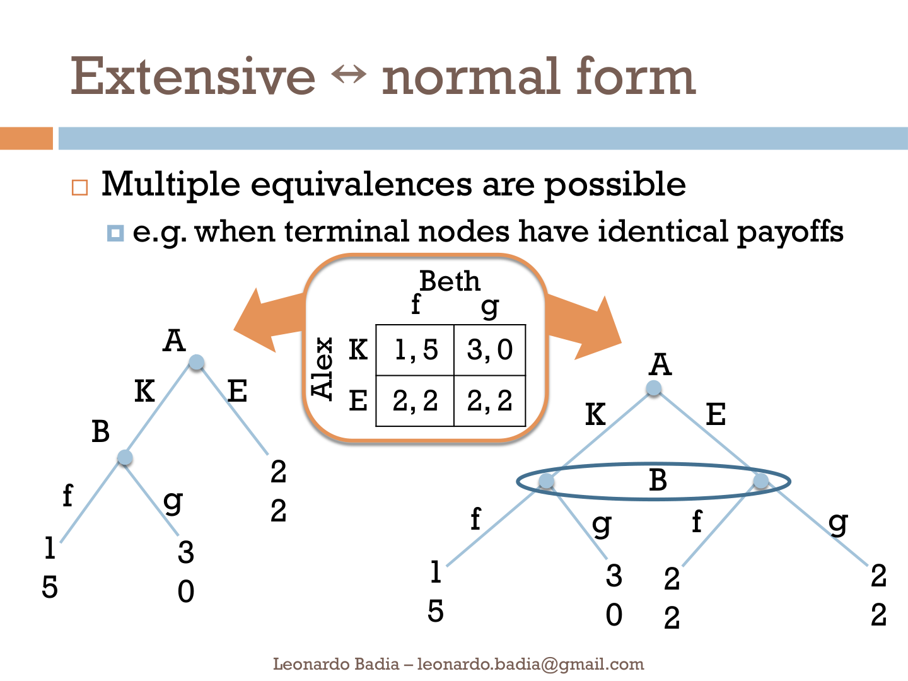

Two trees produce this table:

- Alex's $E$ ends the game immediately; Beth chooses $f$ or $g$ only after $K$.
- Beth moves after either choice without observing Alex's move, but both actions after $E$ yield $(2,2)$.

Beth's additional move after $E$ has no effect on payoffs. Thus, these distinct trees induce the same normal-form payoff table. Conversion to normal form is possible, but reconstructing a unique tree from that table is not.

The lecture ends here. Dynamic equilibrium concepts and systematic equilibrium selection are developed later.
