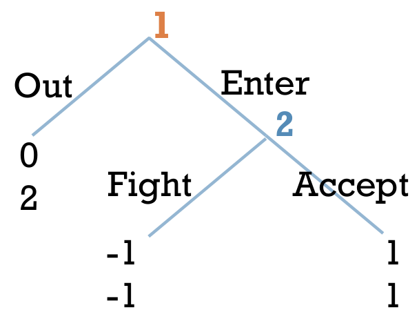
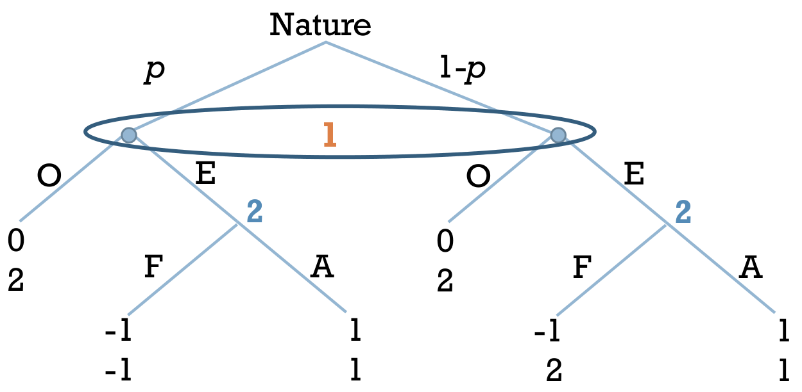
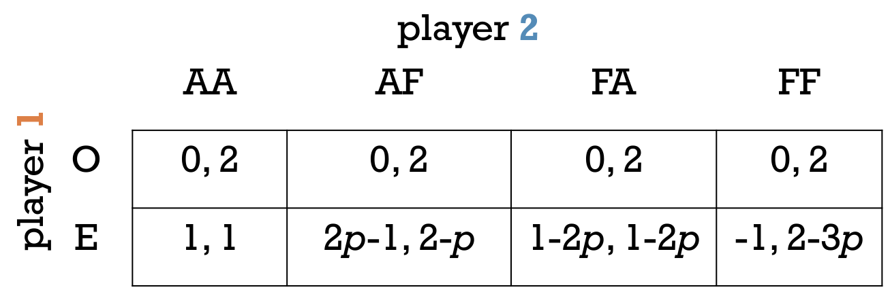
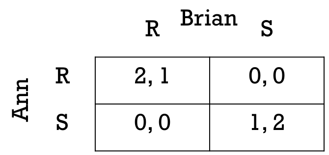
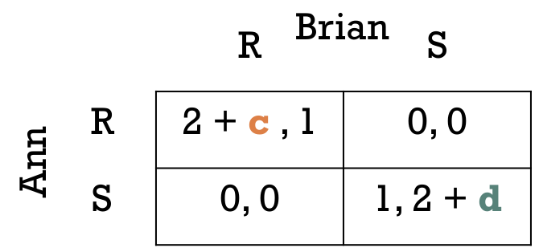

# Bayesian games

## Incomplete information and Nature’s move

*Gth2014.pdf, pp. 3–6, 10, 15–17. Lecture 18, part 1, 00:00–17:10 and 28:35–33:28.*

A player's **payoff** measures how much they value an outcome. A **best response** is a choice that maximizes their payoff given the other players' strategies. If the outcome is uncertain, compare expected payoffs by multiplying each possible payoff by its probability and adding the results. In a **Nash equilibrium**, each player's strategy is a best response to the others.

In a game of incomplete information, a player can also be uncertain about what another player values. Harsanyi's approach represents this uncertainty through **types**. An incumbent who benefits from fighting an entrant may respond differently from one who finds fighting costly. The entrant needs beliefs about both the incumbent's type and the action that type would take.

> [!info] Definition — Type and common prior
> A player's **type** records private information relevant to the game, such as their payoff function or what they know about other players. The **common prior** is the joint probability distribution that Nature uses to draw the players' types. It is common knowledge when every player knows it, knows that the others know it, and so on.

Nature first draws a type for each player and privately reveals each player’s own type. The players then act and receive payoffs. In a **static Bayesian game**, their actions are simultaneous after this draw. The extensive form, or game tree, represents uncertainty about payoffs as uncertainty about Nature's earlier move. Knowing the prior gives players the probabilities of the possible draws. A hidden draw still creates imperfect information in the tree. Page 23 and part 2 (15:07–16:19) use “perfect information” for exact knowledge of the prior. This wording refers to knowledge of the distribution. If that distribution is unknown, players' beliefs may differ from the actual probabilities.

## Entry game

**Lecture example** · *Gth2014.pdf*, pp. 7–17 and 26–28. Lecture 18, part 1, 17:10–54:29 and part 2, 19:28–25:07.

### Entry with known payoffs

Player 1 is a newcomer who chooses Enter ($E$) or Out ($O$). If they enter, player 2, the incumbent, chooses Accept ($A$) or Fight ($F$). Staying out ends the game. Payoffs are ordered **(newcomer, incumbent)**, including in the trees, where they are stacked top to bottom.

*Gth2014.pdf, p. 7. The incumbent makes a decision only after entry.*

1. **Work backward from entry.** The incumbent prefers accepting ($1$) to fighting ($-1$). The newcomer therefore chooses $E$, which gives $1$ against $0$ for $O$. The result $(E,A)$ is **subgame-perfect** because the prescribed choices are optimal in the whole game and in the continuation game after entry.
2. **Check the other pure Nash equilibrium.** At $(O,F)$, entry would give the newcomer $-1$ instead of $0$. The incumbent gets $2$ under either plan because the newcomer stays out. Thus neither can gain by changing strategy alone. The plan to fight is a noncredible threat because, if entry occurs, accepting gives the incumbent a higher payoff.

### Entry with a privately known incumbent type

Nature draws the incumbent's type. The lecture calls the types rational ($r$, probability $p$) and crazy ($c$, probability $1-p$). Only the incumbent sees the draw. The sole payoff change is that fighting after entry gives a type $c$ incumbent $2$ instead of $-1$. Fighting is therefore optimal after entry for type $c$, whereas type $r$ prefers to accept.

*Gth2014.pdf, p. 9. The left branch is type $r$. The right branch is type $c$. The oval marks the two decision nodes the newcomer cannot distinguish.*

1. **List complete plans.** The newcomer has one information set and can choose either $O$ or $E$. The incumbent can distinguish the two nodes where they might act, so their pure strategies are $AA$, $AF$, $FA$ and $FF$. The first letter is the response to entry for type $r$, and the second is the response for type $c$. Each plan has two instructions, of which at most one is used.
2. **Build the normal form.** Put the newcomer's strategies in rows and the incumbent's strategies in columns. For $(E,AF)$, the payoff pair is $(1,1)$ with probability $p$ and $(-1,2)$ with probability $1-p$. The newcomer's expected payoff is $p(1)+(1-p)(-1)=2p-1$. The incumbent's is $p(1)+(1-p)(2)=2-p$. All cells in row $O$ are $(0,2)$ because the incumbent never moves.

*Gth2014.pdf, p. 13. Each cell is the expected payoff pair for a fixed pair of complete plans.*

3. **Find mutual best responses.** For $p=2/3$, the newcomer's payoffs from entering against $AA$, $AF$, $FA$ and $FF$ are $1$, $1/3$, $-1/3$ and $-1$. Compare each with $0$ for staying out. The incumbent's payoffs against $E$ are $1$, $4/3$, $-1/3$ and $0$, so $AF$ is the unique best response to $E$. Against $O$, all four incumbent plans give $2$. The **pure Nash equilibria of the expected-payoff matrix** are $(E,AF)$, $(O,FA)$ and $(O,FF)$. Only $(E,AF)$ is subgame-perfect. In the continuation game after entry with type $r$, the plans $FA$ and $FF$ prescribe fighting even though accepting pays more.

The prior affects entry incentives. Against $AF$, the newcomer enters if $p>1/2$, stays out if $p<1/2$, and is indifferent at $p=1/2$ because the expected gain from entering is $2p-1$.

The normal-form column represents the incumbent before the type is drawn. This **type-agent representation** averages the incumbent's payoff over their own types because it evaluates a complete plan. At an actual decision node the incumbent knows their type and compares the payoffs there. In this example, $AF$ induces acceptance with probability $p$ conditional on entry from the newcomer's perspective. Each type still follows a pure strategy instruction. A mixed strategy would assign probabilities to complete plans. When both plans and types are random, average over both sources of uncertainty.

## Static Bayesian games

*Gth2014.pdf, pp. 19–28. Lecture 18, part 2, 00:06–19:21.*

Let $\mathcal{N}=\{1,\ldots,n\}$ be the player set. Player $i$ has an action set $A_i$, a type space $T_i$, and a realized type $t_i\in T_i$. Write $a=(a_1,\ldots,a_n)$ for the action profile and $t=(t_1,\ldots,t_n)$ for the type profile. The joint prior is $\phi(t)$. What the type affects distinguishes two payoff models.

- **Private values.** The payoff $u_i(a,t_i)$ depends on the action profile and player $i$'s own type. Opponents' types can still affect the payoff indirectly through their choices.
- **Common values.** In the more general specification on slide 20, the pay off $u_i(a,t)$ can depend directly on other players' types as well.

**Lecture example** · *Gth2014.pdf*, p. 21. If $T_i=\{t_a,t_b\}$, the two types can select different payoff functions, $u_{i,a}(a)$ and $u_{i,b}(a)$. The same construction can encode action availability. If $H$ is available with probability $q$, assign type $t_a$ with probability $q$ and type $t_b$ with probability $1-q$. Keep the common action set $\{F,G,H\}$ and assign $H$ payoff $-\infty$ under $t_b$ regardless of the opponents' actions.

### Beliefs conditional on your own type

The subscript $-i$ means all players other than $i$. Once player $i$ learns $t_i$, they use the **posterior** $\phi_i(t_{-i}\mid t_i)$, the probability of a particular opponents' type profile given their own. For a discrete prior, sum the joint probabilities with $t_i$ fixed to get its marginal probability $\phi(t_i)$. Then normalize by that marginal.

$$
\phi(t_i)=\sum_{t_{-i}}\phi(t_i,t_{-i}),
\qquad
\phi_i(t_{-i}\mid t_i)=\frac{\phi(t_i,t_{-i})}{\phi(t_i)}
\quad\text{if }\phi(t_i)>0.
$$

If all types are independent, the joint prior factorizes as $\phi(t)=\prod_{j=1}^n\phi(t_j)$. The factor $\phi(t_i)$ cancels, leaving $\prod_{j\ne i}\phi(t_j)$. With dependent types, use the joint prior and condition on $t_i$. The common prior and the rule for revealing types determine how everyone forms these beliefs. The model can therefore specify each player's beliefs about types directly, without listing a separate hierarchy of beliefs about beliefs.

**Lecture example** · Lecture 18, part 2, 11:14–12:13. Forty players draw role cards without replacement. Before the draw, each other player has probability $1/40$ of getting the unique killer card. Once you see that card in your own hand, the conditional probability that any other player has it is $0$. Your own type changes your beliefs about theirs.

### Type-contingent strategies

The static Bayesian game is specified by its player set $\mathcal{N}$ and, for each player $i$, their action set $A_i$, type space $T_i$, conditional beliefs $\phi_i$, and payoff function $u_i$.

> [!info] Definition — Pure and mixed Bayesian strategies
> A pure strategy is a rule $s_i\colon T_i\to A_i$ assigning an action $s_i(t_i)$ to each possible type. A mixed strategy is a probability distribution over such rules.

A full rule lets opponents predict how a player would act across types and average over their posterior. In a sequential Bayesian game, the rule must also specify what the player does at each information set where they might have to act.

## Bayesian Nash equilibrium

*Gth2014.pdf, pp. 29–30.*

> [!info] Definition — Bayesian Nash equilibrium
> With discrete types, a profile of pure strategies $s^*=(s_1^*,\ldots,s_n^*)$ is a Bayesian Nash equilibrium (BNE) if every player, at every type with positive probability, maximizes their expected payoff given that type and the opponents' strategies.

Write $s_{-i}^*(t_{-i})$ for the action profile the opponents choose at types $t_{-i}$. To test an action $a_i\in A_i$ at the known type $t_i$, compute the conditional expected payoff

$$
U_i(a_i\mid t_i;s_{-i}^*)=
\sum_{t_{-i}}\phi_i(t_{-i}\mid t_i)
\,u_i\bigl(a_i,s_{-i}^*(t_{-i}),t_i\bigr).
$$

The prescribed action $s_i^*(t_i)$ must attain the maximum of $U_i$ over $A_i$. Changing a whole strategy at a single type gives the same comparison, since only the instruction at that type enters this payoff. Repeat for all players and types. With a conditional density over continuous types, use an integral in place of the sum.

In the simultaneous game, a profitable deviation at one type of positive probability also improves the prior-weighted payoff of a complete plan. This explains why comparing complete plans in the expected-payoff normal form and comparing actions type by type after the draw give the same equilibrium test.

## Battle of the Sexes with private payoff variation

**Lecture example** · *Gth2014.pdf*, pp. 31–36.

Ann and Brian simultaneously choose between romance ($R$) and science fiction ($S$). Both prefer going together. Ann prefers coordinating on $R$, while Brian prefers coordinating on $S$. Payoff pairs are ordered **(Ann, Brian)**.

*Gth2014.pdf, p. 32. Each player strictly prefers to match a known choice by the other player.*

There are two pure Nash equilibria, $(R,R)$ and $(S,S)$. Let $\alpha$ and $\beta$ be Ann's and Brian's respective probabilities of choosing $R$. For both to mix, Ann must be indifferent between $R$ and $S$, so $2\beta=1-\beta$. Brian must also be indifferent, so $\alpha=2(1-\alpha)$. The solution is $(\alpha,\beta)=(2/3,1/3)$. Both probabilities are strictly between zero and one. The strict best responses to pure choices rule out an equilibrium with only one player mixing.

Now add a private bonus $c$ to Ann's payoff at $(R,R)$ and a private bonus $d$ to Brian's payoff at $(S,S)$. Each player knows their own bonus. Take $c$ and $d$ to be independently uniform on $[0,x]$, with $x>0$ common knowledge. This is the distribution used by the cutoff probabilities in the slide calculations.

*Gth2014.pdf, p. 33. The bonuses increase each player's payoff at their preferred coordinated outcome.*

1. **Specify cutoff strategies.** Ann chooses $R$ if $c>C$ and $S$ otherwise. Brian chooses $S$ if $d>D$ and $R$ otherwise. For interior cutoffs, Brian plays $R$ with probability $D/x$ and Ann plays $S$ with probability $C/x$. Each of these probabilities is unchanged by conditioning on the other player's bonus because the draws are independent.
2. **Find each best-response cutoff.** Ann compares $(2+c)D/x$ from $R$ with $1-D/x$ from $S$. Thus $R$ is optimal for $c\geq x/D-3$. Brian compares $(2+d)C/x$ from $S$ with $1-C/x$ from $R$. Thus $S$ is optimal for $d\geq x/C-3$. At equality either action is optimal.
3. **Make the cutoffs consistent.** The conditions are $D(C+3)=x$ and $C(D+3)=x$, so $C=D$. The common cutoff satisfies $C^2+3C-x=0$. Its positive root is

   $$
   C=D=\frac{\sqrt{9+4x}-3}{2}.
   $$

   Since $x=C(C+3)$, we have $0<C<x$. The two cutoffs are feasible, and each type's prescribed action is optimal by the comparisons above.

Ann's probability of choosing $R$ is $1-C/x$ and Brian's is $C/x$. Since $C/x=1/(C+3)$ and $C\to 0$ as $x\to 0^+$, these probabilities approach $(2/3,1/3)$. This is Harsanyi's interpretation of the mixed equilibrium in this example. In the perturbed game, each player chooses a definite action at each realized type, and the random type draws generate the action probabilities.

## Handbook exercise

**Handbook exercise** · Chapter 6, Exercise 6.4 (Franco and Gino), printed pp. 125–126, PDF pp. 131–132. Find the normal form at $p=0.3$ and all pure BNEs. The solution follows the handbook's best-response method.

Franco and Gino simultaneously choose conspicuous ($C$) or inconspicuous ($I$) behavior. Gino is a henchman. Franco privately knows whether he is an undercover officer (probability $p$) or another henchman. A henchman gets $-30$ if both choose $C$, $10$ if exactly one chooses $C$, and $0$ if both choose $I$. The undercover Franco gets $20$ when both choose $C$ and $0$ otherwise. In Franco's plan, the first letter is his action when undercover and the second is his action when a henchman.

For example, at $(C,CI)$ in **(Gino, Franco)** order, the two possible payoff pairs are $(-30,20)$ and $(10,10)$. Weighting them by $0.3$ and $0.7$ gives $(-2,13)$. Filling the remaining entries by the same method gives

| Gino / Franco | $CC$ | $CI$ | $IC$ | $II$ |
| --- | --- | --- | --- | --- |
| $C$ | $(-30,-15)$ | $(-2,13)$ | $(-18,-21)$ | $(10,7)$ |
| $I$ | $(10,7)$ | $(3,0)$ | $(7,7)$ | $(0,0)$ |

Gino's best replies in column order are $I,I,I,C$. Franco's best reply to $C$ is $CI$, and to $I$ both $CC$ and $IC$ are best replies. The pure BNEs are therefore $(I,CC)$ and $(I,IC)$. Given Gino's $I$, the henchman type of Franco strictly prefers $C$ and the undercover type earns $0$ from either action. Gino strictly prefers $I$ against either of those plans.

## Sources

- [Gth2014.pdf, Bayesian Games](Gth2014.pdf), pp. 1–36. References use PDF page numbers.
- Lecture 18 transcripts, [part 1](<2025-IN2898-009PD-2025-INP9087836-N0-IN2898 Lecture 18 STEM.transcript.txt>) and [part 2](<2025-IN2898-009PD-2025-INP9087836-N0-IN2898 Lecture 18 STEM-01.transcript.txt>).
- [Game Theory. A Handbook of Problems and Excercises.pdf](<../../Game Theory. A Handbook of Problems and Excercises.pdf>), Chapter 6, Exercise 6.4.
