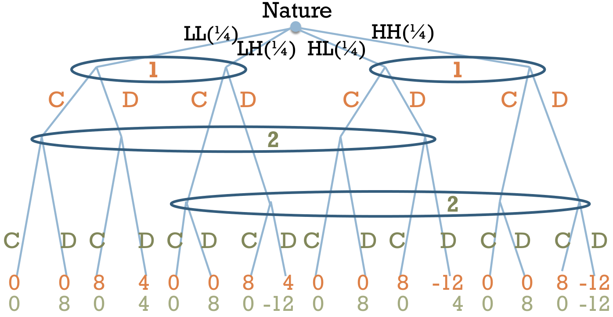
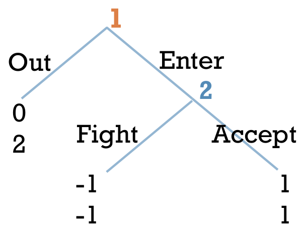
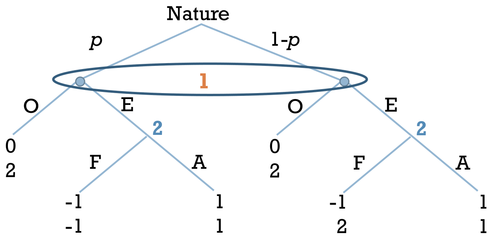
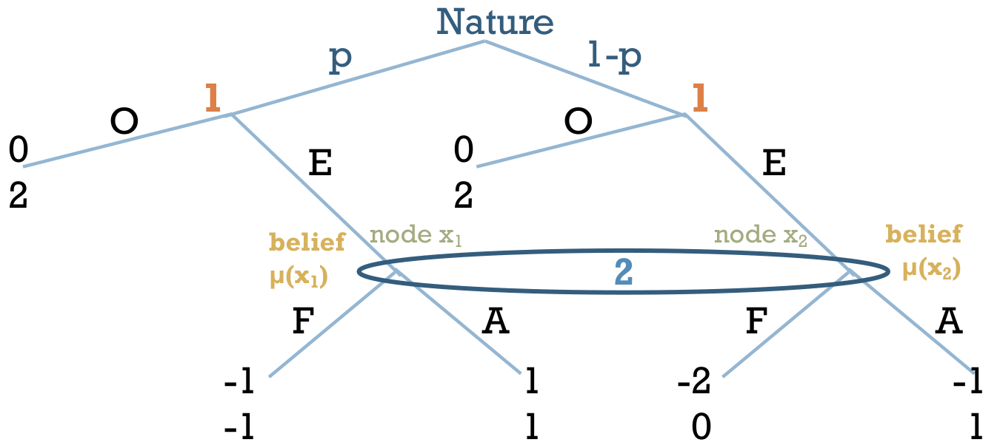
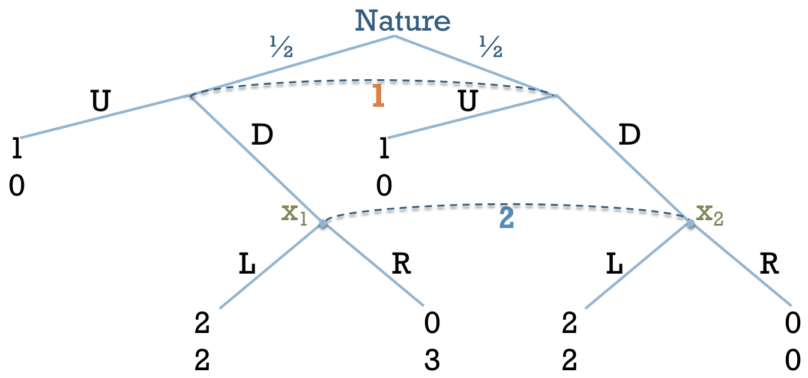

# Bayesian Nash equilibrium and dynamic Bayesian games

## Strategies and best responses with private information

*Lecture 19a, 00:00–16:55. See also [[18. Bayesian games]].*

Nature draws the players’ **types** from a commonly known joint distribution. A player knows their own type and uses it to form beliefs about the others. A type can describe a payoff-relevant circumstance, such as the punishment a player faces, or a private signal about the state of the world. If types are independent, learning your own type leaves the probabilities of the other types unchanged. In the odds-and-evens illustration (Lecture 19a, 04:07–04:48), exactly one player is assigned each role. Learning that you are Odd therefore tells you that the other player is Even.

In a static Bayesian game, the players choose their actions without observing each other’s choices. A pure strategy $s_i$ assigns an action $s_i(t_i)$ to each possible type $t_i$ of player $i$. Only one action is taken in any play, but an opponent uses the full plan when predicting what you might do. A mixed strategy randomizes over pure plans. In a game tree, a pure plan specifies an action at every **information set**, a group of decision nodes that the player cannot distinguish when choosing.

> [!info] Definition — Bayesian Nash equilibrium (BNE)
> A strategy profile is a Bayesian Nash equilibrium if each player’s plan maximizes their expected payoff against the other players’ plans, conditional on each of their own types that can occur. A **best response** is a choice that achieves this maximum. Ties are allowed.

To check a pure profile, fix player $i$’s type $t_i$. Write $t_{-i}$ for the other players’ types, $s_{-i}(t_{-i})$ for their prescribed actions, and $u_i$ for player $i$’s payoff. Compare the following quantity across the available actions $a_i$.

$$
\sum_{t_{-i}} \Pr(t_{-i}\mid t_i)\,
u_i\bigl(a_i,s_{-i}(t_{-i});t_i,t_{-i}\bigr)
$$

Alternatively, build a normal-form matrix of full plans. Compute each cell before types are drawn by summing over all type profiles with their joint probabilities. A profitable change for any positive-probability type also improves the payoff of the full plan, since the player can change that action alone. This is why checking the matrix and checking each type give the same pure BNE.

## Chicken with private punishments

**Lecture example** — Gth2015.pdf, pp. 3–5, and Lecture 19b, 00:51–18:04.

Two players simultaneously choose to steer ($C$) or keep driving ($D$). Steering gives zero. A lone driver earns $8$. If both drive, each earns $4$ minus a punishment of $0$ with lenient parents ($L$) or $16$ with hard parents ($H$). Each player knows their own parents’ type. Types are independent and equiprobable, so each ordered pair $(L,L),(L,H),(H,L),(H,H)$ has probability $1/4$.

*Gth2015.pdf, p. 4. Player 1’s information sets group nodes with the same first type. Player 2’s sets group nodes with the same second type, regardless of player 1’s action. Terminal payoffs are stacked in player order.*

A plan such as $DC$ means drive with lenient parents and steer with hard parents. To compute the $(CD,DC)$ cell, apply both plans to $LL,LH,HL,HH$ in turn. The resulting payoff pairs, in player order, are $(0,8),(0,0),(-12,4),(8,0)$. Their average is $(-1,3)$. For $(CD,CD)$, each player earns $8$ in one state, $-12$ in another, and zero in the other two, so the expected payoff is $-1$ each.

| Player 1 \ Player 2 | $CC$ | $CD$ | $DC$ | $DD$ |
|---|---|---|---|---|
| $CC$ | $(0,0)$ | $(0,4)$ | $(0,4)$ | $(0,8)$ |
| $CD$ | $(4,0)$ | $(-1,-1)$ | $(-1,3)$ | $(-6,2)$ |
| $DC$ | $(4,0)$ | $(3,-1)$ | $(3,3)$ | $(2,2)$ |
| $DD$ | $(8,0)$ | $(2,-6)$ | $(2,2)$ | $(-4,-4)$ |

The $DC$ column gives player 1 the highest payoff at $DC$, and the game is symmetric. Thus $(DC,DC)$ is a BNE. The type-by-type check also shows uniqueness for these parameters. If $r$ is the opponent’s probability of driving, a lenient type earns $8(1-r)+4r>0$ from driving and therefore always drives. This implies $r\ge 1/2$. A hard type then earns $8(1-r)-12r=8-20r\le -2$, so always steers. The equilibrium gives total expected payoff $6$, while $(DD,CC)$ gives $8$ split as $(8,0)$.

*Source correction.* The slides’ lenient punishment of $0$ matches the tree and matrix. Lecture 19b also mentions a punishment of $4$ and reports $2$ for player 2 in the $(CD,DC)$ cell. The cell calculation above uses the slide payoffs. If the lenient probability changes to $\ell$ with independent types, the four weights become $\ell^2,\ell(1-\ell),(1-\ell)\ell,(1-\ell)^2$. Changing the punishment also changes incentives. For the recording’s suggested punishments $15$ and $16$, a lenient type facing $DC$ would earn $(8-11)/2=-3/2$ by driving, so $(DC,DC)$ would fail.

## Committee voting and pivotal decisions

**Lecture example** — Gth2015.pdf, pp. 6–15, and Lecture 19b, 18:06–51:20.

Two jurors cast sealed votes to acquit ($A$) or convict ($C$). Conviction requires two $C$ votes. Both jurors earn $1$ for a correct verdict and $0$ for an incorrect one. The defendant is guilty ($G$) with prior probability $q>1/2$ and innocent ($I$) with probability $1-q$. With only the prior, the expected payoff is $q$ each if both vote $C$ and $1-q$ each otherwise. Voting $C$ weakly dominates voting $A$. Both $(C,C)$ and $(A,A)$ are Nash equilibria in pure strategies. At $(A,A)$, either juror switching alone still produces acquittal, so the recording’s uniqueness claim fails.

### Private signals and the one-juror benchmark

Juror $i$ privately receives $t_i\in\{t_G,t_I\}$. The signals are independent **conditional on the true state**. The accuracy is symmetric, with $\Pr(t_G\mid G)=\Pr(t_I\mid I)=p>1/2$ and error probability $1-p$ in either state. This is a binary symmetric channel. Use $1/2<q,p<1$ for the calculations below so that all signal pairs can occur.

The **posterior** $\Pr(G\mid t)$ is the probability of guilt after observing signal $t$. Divide the joint probability of guilt and that signal by the total probability of that signal, adding the contributions from guilt and innocence.

$$
\Pr(G\mid t_G)=\frac{qp}{qp+(1-q)(1-p)}>q,
\qquad
\Pr(G\mid t_I)=\frac{q(1-p)}{q(1-p)+(1-q)p}<q.
$$

A sole juror convicts when the posterior exceeds $1/2$. After $t_G$ that always happens. After $t_I$, acquittal is strictly better exactly when $q(1-p)<(1-q)p$, or $p>q$. At $p=q$, the juror is indifferent after $t_I$. At $p=1/2$, both posteriors equal $q$, since the signal provides no information. At $p=1$ the signal reveals the state.

### Two jurors and the event that a vote matters

Each juror has four pure plans $AA,AC,CA,CC$, with actions ordered by $(t_G,t_I)$. The following table gives the joint probabilities of the signals. For example, $(t_G,t_I)$ has probability $qp(1-p)+(1-q)(1-p)p=p(1-p)$.

| Juror 1 \ Juror 2 | $t_G$ | $t_I$ |
|---|---|---|
| $t_G$ | $qp^2+(1-q)(1-p)^2$ | $p(1-p)$ |
| $t_I$ | $p(1-p)$ | $q(1-p)^2+(1-q)p^2$ |

A juror is **pivotal** if changing their vote changes the verdict. If the other juror votes $A$, acquittal is automatic. If the other plays $CA$, the pivotal event is that they received $t_G$. In comparing votes, the expected payoff difference is the conditional probability of being pivotal times the payoff difference conditional on being pivotal. For juror 1, the relevant beliefs in the pivotal event are

$$
\Pr(G\mid t_1=t_G,t_2=t_G)
=\frac{qp^2}{qp^2+(1-q)(1-p)^2}>q,
\qquad
\Pr(G\mid t_1=t_I,t_2=t_G)=q.
$$

The opposite signals in the second expression have the same likelihood under either state, so they cancel in the update. Both posteriors exceed $1/2$, and pivotal events have positive probability for both types. Therefore $CC$ is the strict best response to $CA$. The proposed $(CA,CA)$ fails even when $p>q$ and a sole juror strictly prefers to follow the signal.

*Source correction, verified by the best-response calculation.* Against $CC$, a juror is always pivotal. The other vote conveys no information, so the one-juror posteriors apply. The slides’ $(CC,CC)$ is a BNE precisely when $p\le q$ within the range above. For $p>q$, $CA$ is the strict best response to $CC$, so the two asymmetric profiles $(CC,CA)$ and $(CA,CC)$ are BNE. $(AA,AA)$ is also a BNE because a unilateral change cannot affect the verdict. The pivotal-event argument explains the failure of symmetric signal following without requiring that both jurors always convict.

## Dynamic entry games and subgame perfection

*Gth2015.pdf, pp. 16–28.*

A move by Nature can represent private types even when the players act simultaneously. In the entry games, the players also move in sequence. A **subgame** starts at a single decision node and includes all its successors without cutting any information set. A **subgame-perfect equilibrium** (SPE) induces a Nash equilibrium in every subgame, including the whole game. When later decision nodes are separate and their payoffs are known, backward induction starts by finding the optimal later actions and then uses them to evaluate earlier choices.

### Entry with a known incumbent

**Lecture example** — Gth2015.pdf, p. 19.

Player 1 chooses whether to stay out ($O$) or enter ($E$). If entry occurs, player 2, the incumbent, chooses to fight ($F$) or accept ($A$). Payoffs in player order are $(0,2)$ for $O$, $(-1,-1)$ for entry with a fight, and $(1,1)$ for entry with acceptance.

*Gth2015.pdf, p. 19. The incumbent’s node after entry starts a proper subgame. Terminal payoffs are stacked in player order.*

At $(O,F)$, staying out gives the entrant $0$ instead of $-1$, and a change by the incumbent leaves the payoff unchanged. This is a Nash equilibrium. In the subgame following entry, the incumbent prefers $A$ because $1>-1$. Anticipating acceptance, the entrant prefers $E$ because $1>0$. Thus $(E,A)$ is the SPE.

### Entry with a privately informed incumbent

**Lecture example** — Gth2015.pdf, pp. 20–21.

Nature chooses a Normal incumbent with probability $p$ and the slide’s “Crazy” type with probability $1-p$. The entrant does not observe which type Nature drew. The incumbent sees their own type and chooses only after entry. Normal has the same payoffs as before. For the other type, fighting now gives the incumbent $2$, while the entrant still gets $-1$.

*Gth2015.pdf, p. 20. The entrant has one information set across both types. The incumbent’s two nodes after entry start separate subgames. Terminal payoffs are stacked in player order.*

The incumbent’s plan lists its actions in Normal, Crazy order. At $p=2/3$, weighting each type’s terminal payoffs gives the following table.

| Entrant \ Incumbent | $AA$ | $AF$ | $FA$ | $FF$ |
|---|---|---|---|---|
| $O$ | $(0,2)$ | $(0,2)$ | $(0,2)$ | $(0,2)$ |
| $E$ | $(1,1)$ | $(1/3,4/3)$ | $(-1/3,-1/3)$ | $(-1,0)$ |

*Source correction.* The incumbent’s payoff at $(E,AF)$ is $(2/3)1+(1/3)2=4/3$, correcting p. 21.

The pure Nash profiles are $(O,FA),(O,FF),(E,AF)$. Following $O$, the incumbent is indifferent across plans, while $FA$ and $FF$ make entry unprofitable. Following $E$, each incumbent type has a strict best response, yielding $AF$. The two entry subgames require $AF$ in an SPE, and then entry earns $p-(1-p)=2p-1$. Hence $E$ is optimal for $p>1/2$, $O$ for $p<1/2$, and either action is optimal at equality.

### Entry with a privately informed entrant

**Lecture example** — Gth2015.pdf, pp. 22–28 and 33–35.

Now player 1 knows whether they are Competitive ($C$) with probability $p$ or Weak ($W$) with probability $1-p$. An incumbent who observes entry cannot distinguish which type entered. The entrant’s plan lists actions in $(C,W)$ order. Both types get payoff $0$ by staying out. A Competitive entrant gets $-1$ if fought and $1$ if accepted. A Weak entrant gets $-2$ and $-1$, respectively. The incumbent earns $2$ if the entrant stays out, $-1$ for fighting a Competitive entrant, $0$ for fighting a Weak entrant, and $1$ whenever it accepts.

*Gth2015.pdf, p. 33. The incumbent’s decision nodes $x_1,x_2$ correspond to Competitive and Weak entry. The oval marks a single information set. Terminal payoffs are stacked in player order.*

At $p=1/2$ the two branches contribute equally. For instance, $(OE,A)$ produces $(0,2)$ with a Competitive entrant and $(-1,1)$ with a Weak entrant, so the expectation is $(-1/2,3/2)$.

| Entrant \ Incumbent | $F$ | $A$ |
|---|---|---|
| $OO$ | $(0,2)$ | $(0,2)$ |
| $OE$ | $(-1,1)$ | $(-1/2,3/2)$ |
| $EO$ | $(-1/2,1/2)$ | $(1/2,3/2)$ |
| $EE$ | $(-3/2,-1/2)$ | $(0,1)$ |

*Source correction.* The $(OE,A)$ and $(EO,A)$ cells both give the incumbent $3/2$. At $(EE,F)$ the entrant averages $-1$ and $-2$, giving $-3/2$. These values follow from the tree on pp. 23 and 33 and correct the entries on pp. 25–26.

The two pure BNE are $(OO,F)$ and $(EO,A)$. Under $F$, both types prefer staying out, and the incumbent’s plan cannot affect the result under $OO$. Under $A$, only the Competitive type enters, and the incumbent prefers acceptance against $EO$. Both profiles are SPE because the whole tree is the only subgame. Starting a subgame at either entrant-type node would cut the incumbent’s information set. This leaves SPE unable to test the threat in $(OO,F)$ directly at the unreached information set.

## Perfect Bayesian equilibrium

*Gth2015.pdf, pp. 29–35.*

An information set $H$ is **on the equilibrium path** if the strategy profile and Nature together give it positive probability. A **system of beliefs** $\mu$ assigns a probability distribution over the nodes of every information set. If $H$ is reached with positive probability, the belief at node $x\in H$ is $\mu(x\mid H)=\Pr(x)/\Pr(H)$, using the probabilities induced by the profile and Nature. At a singleton information set, the sole node has belief $1$.

> [!info] Definition — Perfect Bayesian equilibrium (PBE)
> A PBE consists of a Bayesian Nash equilibrium strategy profile $s^*$ and a system of beliefs $\mu$. Beliefs follow Bayes’ rule at every reached information set. At an unreached information set, Bayes’ rule leaves beliefs free under the lecture’s weak definition. At every information set, reached or unreached, the prescribed continuation must maximize expected payoff given the beliefs and the other players’ strategies. This last condition is **sequential rationality**.

### Beliefs and incentives in the privately informed entrant game

**Lecture example continued** — Gth2015.pdf, pp. 33–35.

Let $q_C$ and $q_W$ be the probabilities of entry conditional on each entrant type. If entry has positive probability, the incumbent’s belief that the entrant is Competitive upon seeing entry is

$$
\mu(x_1)=\Pr(C\mid E)
=\frac{p q_C}{p q_C+(1-p)q_W},
\qquad
\mu(x_2)=1-\mu(x_1).
$$

For $EO$, $q_C=1$ and $q_W=0$, so $\mu(x_1)=1$ when $p>0$. Accepting gives the incumbent $1$ instead of $-1$. Against acceptance, each entrant type chooses its preferred action, so $(EO,A)$ with this belief is a PBE.

For $OO$, both entry probabilities are zero, so the denominator is zero. Although the incumbent can hold any belief $\mu(x_1)\in[0,1]$, its expected payoff from fighting is $-\mu(x_1)$, while accepting gives $1$. No belief makes the threat in $(OO,F)$ sequentially rational. Since acceptance is strictly optimal under every belief, including when entry is off path, no equilibrium mixing can sustain fighting here.

## Limits of weak PBE and sequential equilibrium

*Gth2015.pdf, pp. 36–42.*

Weak PBE permits off-path beliefs even when those beliefs cannot arise from any small change in how players act. If a **Bayesian Nash equilibrium** reaches every information set with positive probability, its Bayes beliefs support a PBE. At a reached set, an improvement in conditional expected payoff would also raise expected payoff in the whole game, violating the equilibrium condition. Positive reach alone gives a way to compute beliefs. The BNE assumption, missing from the statement on p. 37, is needed for optimal play.

### An off-path belief that cannot come from nearby play

**Lecture example** — Gth2015.pdf, pp. 39–41.

Nature selects one of two equally likely branches. Player 1 cannot see the branch and chooses $U$ or $D$. With $U$, payoffs are $(1,0)$. With $D$, player 2 chooses $L$ or $R$ without seeing the branch. $L$ yields $(2,2)$ on either branch. $R$ yields $(0,3)$ at $x_1$ and $(0,0)$ at $x_2$.

*Gth2015.pdf, p. 39. The upper dashed link shows why player 1 uses the same probability of $D$ in both branches. The lower link marks player 2’s information set. Payoffs are stacked in player order.*

Player 1’s information set is always reached, so Bayes’ rule gives probability $1/2$ to each Nature branch in both assessments below.

1. If player 1 chooses $D$ with positive probability, the two nodes following $D$ are equally likely by Bayes’ rule. Player 2 gets $2$ from $L$ and $3/2$ from $R$. Against $L$, player 1 prefers $D$ to $U$, so $(D,L)$ with belief $\mu(x_1)=1/2$ is a PBE.
2. If player 1 always chooses $U$, player 2’s information set is off path. $R$ earns $3\mu(x_1)$ and is optimal if $\mu(x_1)\ge 2/3$. Against $R$, $U$ gives player 1 payoff $1$ and $D$ gives $0$. Thus $(U,R)$ with such a belief is also a weak PBE.

> [!info] Definition — Sequential equilibrium
> A sequential equilibrium adds **consistency** to sequential rationality. The strategies and beliefs must be the limit of a sequence of completely mixed strategy profiles and their Bayes beliefs. A completely mixed profile assigns positive probability to each available action at each information set, so the sequence determines beliefs even at sets unreached in the limit.

Any positive probability of $D$, however small, gives posterior $1/2$ at $x_1$ because player 1 cannot condition on Nature’s branch. This stays $1/2$ in the limit, ruling out the beliefs needed for $(U,R)$. The profile $(D,L)$ is sequentially rational under the limiting beliefs obtained by letting the probabilities of $U$ and $R$ tend to zero. Consistency takes more work to check in general, and the appropriate refinement depends on the game.

## Battle of the Sexes and the interpretation of mixing

**Lecture example** — Lecture 19c, 00:08–17:25. The original payoff convention also appears in Gth2014.pdf, p. 32.

Anne and Brian simultaneously choose romance ($R$) or sci-fi ($S$). In the complete-information version, payoffs in Anne–Brian order are $(2,1)$ at $(R,R)$, $(1,2)$ at $(S,S)$, and $(0,0)$ when they choose different films. Both coordinated profiles are pure equilibria. In a mixed equilibrium using both actions, Anne must be indifferent. If Brian plays $R$ with probability $b$, her payoffs from $R$ and $S$ are $2b$ and $1-b$. These are equal at $b=1/3$. If Anne plays $R$ with probability $a$, Brian compares $a$ from $R$ with $2(1-a)$ from $S$, giving $a=2/3$.

To see how these probabilities can arise from private types, add $c$ to Anne’s payoff at $(R,R)$ and $d$ to Brian’s at $(S,S)$. Each bonus is drawn independently and uniformly on $[0,X]$ for $X>0$, and only the corresponding player observes it. Anne plays $R$ for $c>C$ and $S$ for $c<C$. Brian plays $S$ for $d>D$ and $R$ for $d<D$. Either action is optimal at a type that is exactly indifferent.

1. Given Brian’s interior cutoff $D$, his probability of choosing $R$ is $D/X$. Anne compares $(2+c)D/X$ from $R$ with $1-D/X$ from $S$. Her best response therefore has cutoff $C=X/D-3$.
2. Given Anne’s interior cutoff $C$, her probability of choosing $S$ is $C/X$. Brian compares $(2+d)C/X$ from $S$ with $1-C/X$ from $R$. His best response has cutoff $D=X/C-3$.
3. Multiplication gives $CD+3D=X=CD+3C$, so $C=D$. The positive root of $C^2+3C=X$ satisfies $C/X=2/(3+\sqrt{9+4X})$. This is strictly between $0$ and $1$, so both cutoffs are interior and each plan is a best response for every type.
4. As $X$ tends to zero, $C/X$ tends to $1/3$. Anne chooses $R$ with probability $1-C/X\to 2/3$ and Brian with probability $D/X\to 1/3$. The limit reproduces the complete-information mixed equilibrium. At each positive $X$, the cutoff plans are pure: uncertainty about private preferences supplies the observed action probabilities.

## Sources

- [Gth2015.pdf](Gth2015.pdf), pp. 1–42. Page numbers in this note are PDF page indices.
- Lecture transcripts [19a](<Game theory 2020 - Badia - Lecture 19a.transcript.txt>), [19b](<Game theory 2020 - Badia - Lecture 19b.transcript.txt>), and [19c](<Game theory 2020 - Badia - Lecture 19c.transcript.txt>).
- [Gth2014.pdf](<../Lesson 18/Gth2014.pdf>), p. 32, for the original Battle of the Sexes payoff convention.
