The lecture resumes the deterministic CAC model from [[9. Exercises and call admission control - Integrated notes]]. Sources share a link of capacity $C$ with an input buffer of capacity $B$.

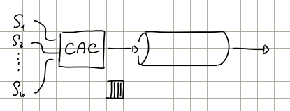
*Lesson 10.pdf, p. 1: admission decisions regulate access to the shared resource.*

Each source $i$ conforms to a token bucket filter (TBF), described by:

- $\rho_i$: **Committed Information Rate (CIR)**, the token generation rate.
- $b_i$: **burst size**, the amount that may be transmitted above the sustained-rate allowance using stored tokens.

Aggregate traffic is sustainable under the deterministic conditions

$$
\sum_{i=1}^{N}\rho_i\leq C,
\qquad
\sum_{i=1}^{N}b_i\leq B.
$$

The first condition provides sustained transmission capacity; the second accommodates the worst-case simultaneous bursts. All sources must respect their declared TBF limits, and data amounts must use consistent units with token allowances.

The notes initially use strict inequalities. The lecturer explicitly confirms that **equality is allowed for this TBF model** (transcript 1, 00:05:27–00:05:47). A bounded traffic envelope gives more information than an average rate alone: it controls how much excess traffic may accumulate.

For comparison, consider a queue with mean arrival rate $\lambda$ and service rate $\mu$.

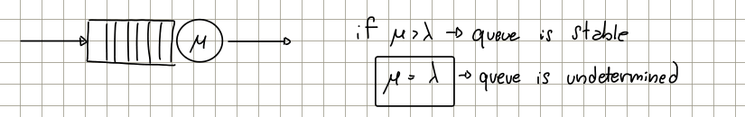
*Original queue model, p. 1. The equality case is labeled “undetermined”: mean rates alone do not establish its stability.*

For the usual nondegenerate random queueing models, $\lambda<\mu$ provides a service margin. Temporary input peaks can build a backlog, but later spare service capacity can drain it. At $\lambda=\mu$, stability cannot generally be inferred: critical random queues need not have a stationary distribution with finite mean queue length. The lecturer postpones the formal queueing analysis to later lectures.

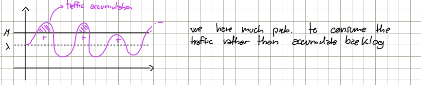
*Original qualitative plot, p. 1: traffic above service capacity accumulates; spare capacity in other intervals can remove it. Shaded areas represent amounts of traffic, not probabilities.*

The explanation concerns **integrated rate differences**, rather than the fraction of time one rate exceeds another. An average-rate margin does not by itself specify those fractions.

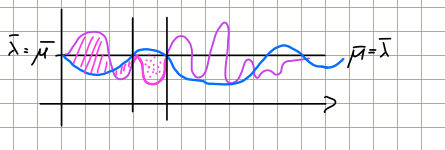
*Original second construction, p. 1: arrival and service rates fluctuate around the same mean. Their relative areas explain accumulated backlog and unused service.*

If the queue empties while service capacity exceeds current arrivals, the unused capacity is lost: it cannot be stored for a future burst. Thus, matching average arrival and service rates does not automatically make random fluctuations harmless. Deterministic, suitably scheduled input and service can operate at equality; conforming TBF traffic also retains a deterministic backlog bound under the conditions above. These are different from assuming equality of unconstrained random mean rates.

With a **finite** buffer, queue occupancy is bounded by construction, but excess arrivals are dropped. Bounded occupancy must not be confused with a guarantee of loss-free operation.

# Stochastic CAC

The deterministic burst condition reserves memory for all permitted bursts arriving simultaneously. If sources are not synchronized, this event may be extremely rare, so its exclusion can lead to poor utilization.

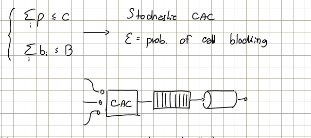
*Original scheme, p. 2: the CAC controls sources entering a buffer and link; the two deterministic constraints are recalled above it.*

A stochastic CAC accepts a prescribed risk of failing to meet a QoS requirement. In this example, the design question is:

> How many sources can be admitted while keeping the probability of buffer overflow below $\varepsilon$?

Formally, the target is

$$
\Pr[\text{buffer overflow}]\leq\varepsilon.
$$

Although the handwritten annotation calls $\varepsilon$ a “probability of call blocking,” the event discussed here is a **QoS violation after admission**, specifically overflow. It differs from rejecting a new call at admission. The event and observation convention must be specified when applying the criterion.

Exact overflow probabilities are often difficult to compute. Instead, suppose an upper bound $U$ can be evaluated:

$$
\Pr[\text{buffer overflow}]\leq U.
$$

Imposing $U\leq\varepsilon$ is sufficient. The example in the notes sets $\varepsilon=10^{-6}$ and considers a design ensuring an overflow probability at most $5\cdot10^{-7}$. This is illustrative, not a computed admission result.

A loose upper bound makes dimensioning simpler but more conservative: actual violation probability may be much lower than the target, at the cost of admitting fewer sources. The lecture therefore pauses CAC design to review probability bounds.

# Recall [Main Bounds of Statistical Analysis]

## Markov inequality

> [!info] Markov inequality
> Let $X\geq0$ almost surely, with finite mean $m_x=\mathbb E[X]$. For every **$a>0$**,
> $$
> \Pr[X\geq a]\leq\frac{m_x}{a}.
> $$

The threshold must be strictly positive because it appears in the denominator. The handwritten nonnegative-threshold notation is understood with this restriction, as in Theorem B.1 of `NDbook-Chapter-Appendix-RandomProcesses.pdf`, PDF p. 1 (printed p. 65).

No particular distribution is required, but **nonnegativity is essential**. The bound only uses the mean and can be very loose. Since probabilities cannot exceed one, it can always be combined with the trivial bound:

$$
\Pr[X\geq a]\leq\min\left\{1,\frac{m_x}{a}\right\}.
$$

For $0<a<m_x$, the raw ratio exceeds one and provides no improvement. At $a=m_x$ it equals one; for larger thresholds it decreases as $1/a$. For nonnegative $X$, $\Pr[X\geq0]=1$.

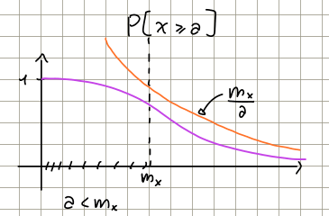
*Original qualitative plot, p. 2: the tail probability lies below $m_x/a$. The mean marks where the raw bound crosses one.*

### Ex:

For $X\sim\mathcal E(\lambda)$, with rate parameter $\lambda>0$,

$$
m_x=\frac1\lambda,
\qquad
\Pr[X\geq a]=e^{-\lambda a},\quad a\geq0.
$$

Markov gives

$$
\Pr[X\geq4m_x]
\leq\frac{m_x}{4m_x}=\frac14=0.25,
$$

whereas the exact probability is

$$
e^{-\lambda(4/\lambda)}=e^{-4}\simeq0.0183.
$$

The bound is valid but substantially larger than the true probability.

The lecturer then asks whether the same argument works for $X\sim\mathcal N(m_x,\sigma_x^2)$. A nondegenerate Gaussian can be negative, regardless of how positive its mean is, so Markov **cannot be applied directly to $X$**.

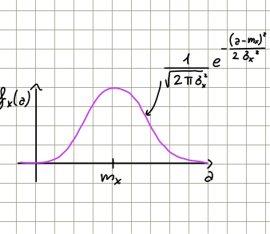
*Original Gaussian density sketch, p. 2: for a large positive mean relative to the standard deviation, the negative tail may be small, but is not absent.*

> [!info] Clarification — A small negative tail is not nonnegativity
> The end of p. 2 and beginning of p. 3 suggest using Markov approximately when $F_x(0)=\Pr[X\leq0]\ll1$ (transcript 1, 00:32:08–00:34:59). This is a heuristic, not a proof of the bound $m_x/a$. A rigorous alternative is to apply Markov to $X_+=\max\{X,0\}$: for $a>0$, $\Pr[X\geq a]=\Pr[X_+\geq a]\leq\mathbb E[X_+]/a$. Its numerator is generally different from $m_x$. This correction preserves the nonnegativity assumption of Theorem B.1.

### Proof

Define an auxiliary random variable

$$
Y=
\begin{cases}
0, & X<a,\\
a, & X\geq a.
\end{cases}
$$

Equivalently,

$$
Y=a\,\chi\{X\geq a\},
$$

where the **indicator function** $\chi\{A\}$ equals one when event $A$ occurs and zero otherwise.

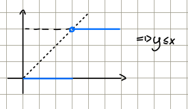
*Original construction, p. 3: the step function $Y$ never exceeds $X$ for $X\geq0$.*

Since $Y\leq X$, monotonicity and linearity of expectation give

$$
\mathbb E[Y-X]=\mathbb E[Y]-\mathbb E[X]\leq0.
$$

The expectation of an indicator is the probability of its event. Hence,

$$
\mathbb E[Y]=a\,\mathbb E[\chi\{X\geq a\}]
=a\Pr[X\geq a].
$$

Substitution yields

$$
a\Pr[X\geq a]-m_x\leq0.
$$

Dividing by $a>0$ proves the inequality without changing its direction.

### Corollary

For a random variable $X$ of either sign, choose a transformation $\varphi:\mathbb R\to\mathbb R$ that is nondecreasing and nonnegative on the nonnegative axis. The handwritten conditions $\varphi'(u)\geq0$ and $\varphi(0)\geq0$ are sufficient when the derivative exists; differentiability is not essential.

For $a>0$, also require **$\varphi(a)>0$** and a finite numerator. Then

$$
\Pr[|X|\geq a]
\leq\frac{\mathbb E[\varphi(|X|)]}{\varphi(a)}.
$$

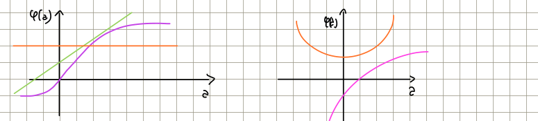
*Original two-panel sketch, p. 3: nondecreasing transformations on the left; violations of monotonicity or nonnegativity on the right. The relevant arguments are $|X|\geq0$.*

The transformation makes the random variable to which Markov is applied nonnegative, while preserving the ordering needed for a tail bound. A constant nonnegative transformation can satisfy these conditions, but only gives a trivial bound when its value is positive. An identically zero transformation cannot be used in the displayed ratio.

### Proof

If $|X|\geq a$, monotonicity implies $\varphi(|X|)\geq\varphi(a)$. Thus,

$$
\Pr[|X|\geq a]
\leq\Pr[\varphi(|X|)\geq\varphi(a)]
\leq\frac{\mathbb E[\varphi(|X|)]}{\varphi(a)}.
$$

The second step is Markov applied to the nonnegative variable $\varphi(|X|)$.

**Correction to p. 3 and the book's Theorem B.2 proof (PDF p. 2):** the first step is an inequality for a merely nondecreasing function. Equality follows for a strictly increasing transformation, but need not hold if it has flat portions. Event inclusion is sufficient for the corollary, including the constant-function example given in class.

## Chebishev Bound

The heading follows the handwritten notes; the usual spelling is **Chebyshev**.

> [!info] Chebyshev inequality
> For any real random variable $X$ with finite mean $m_x$ and finite variance $\sigma_x^2$, and any $a>0$,
> $$
> \Pr[|X-m_x|\geq a]\leq\frac{\sigma_x^2}{a^2}.
> $$

Unlike direct Markov, this statement does not require $X\geq0$. It bounds deviations on **both sides** of the mean. For a continuous density, the event corresponds to the two tail areas outside $(m_x-a,m_x+a)$; symmetry is not required.

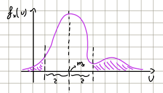
*Original density sketch, p. 4: the shaded tails are bounded by $\sigma_x^2/a^2$.*

Variance measures dispersion around the mean. A smaller variance gives a smaller bound at a fixed deviation threshold; increasing $a$ reduces this upper bound as $1/a^2$. This describes the bound, not necessarily the exact decay rate of every distribution's tails. As before, values above one provide only a trivial probability estimate.

### Proof:

Set $Y=X-m_x$, and use the transformation from the notes:

$$
\varphi(u)=
\begin{cases}
0, & u<0,\\
u^2, & u\geq0.
\end{cases}
$$

It is nondecreasing and nonnegative, with $\varphi(a)=a^2>0$ for $a>0$.

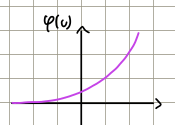
*Original qualitative transformation sketch, p. 4. The defining formula specifies the flat zero branch for $u<0$ and square branch for $u\geq0$.*

Applying the corollary gives

$$
\Pr[|Y|\geq a]
\leq\frac{\mathbb E[\varphi(|Y|)]}{\varphi(a)}
=\frac{\mathbb E[|Y|^2]}{a^2}
=\frac{\mathbb E[(X-m_x)^2]}{a^2}
=\frac{\sigma_x^2}{a^2}.
$$

This completes the unfinished derivation on p. 4, following transcript 1, 00:52:59–00:56:10.

Return to $X\sim\mathcal E(\lambda)$ and the probability $\Pr[X\geq4m_x]$. Chebyshev uses distance **from the mean**, so the deviation threshold is

$$
\widetilde a=3m_x=\frac3\lambda,
$$

rather than $4m_x$. For $\widetilde a>0$, the two deviation events are disjoint:

$$
\Pr[|X-m_x|\geq\widetilde a]
=\Pr[X\geq m_x+\widetilde a]
+\Pr[X\leq m_x-\widetilde a].
$$

Here $m_x-\widetilde a=-2m_x<0$. Since the exponential variable is nonnegative, the second event is impossible. Therefore,

$$
\Pr[X\geq4m_x]
=\Pr[|X-m_x|\geq3m_x]
\leq\frac{\sigma_x^2}{9m_x^2}
=\frac{1/\lambda^2}{9/\lambda^2}
=\frac19.
$$

The exponential variance is **$1/\lambda^2$**. The lecturer corrects the earlier verbal slip during transcript 2, 00:13:03–00:13:41. The comparison is

$$
e^{-4}\simeq0.0183
<\frac19\simeq0.1111
<\frac14=0.25.
$$

Chebyshev is tighter here than Markov, but still loose.

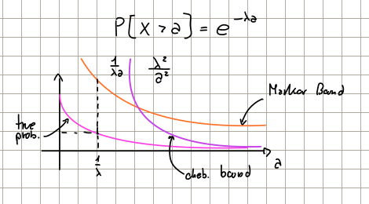
*Original sketch, p. 5: exact exponential tail and the two bounds. The Chebyshev label requires the threshold correction below.*

For a general **unshifted** threshold $a>m_x$, event inclusion gives

$$
\Pr[X\geq a]
\leq\Pr[|X-m_x|\geq a-m_x]
\leq\frac{1}{\lambda^2(a-1/\lambda)^2}.
$$

The Chebyshev curve for $\Pr[X\geq a]$ must therefore use this shifted denominator. The handwritten label $\lambda^2/a^2$ on p. 5 is not the bound for that tail; even $1/(\lambda^2a^2)$ would concern a deviation threshold, rather than the unshifted traffic value. The correction follows the $\widetilde a=3m_x$ construction on p. 4 and transcript 2, 00:00:18–00:05:14.

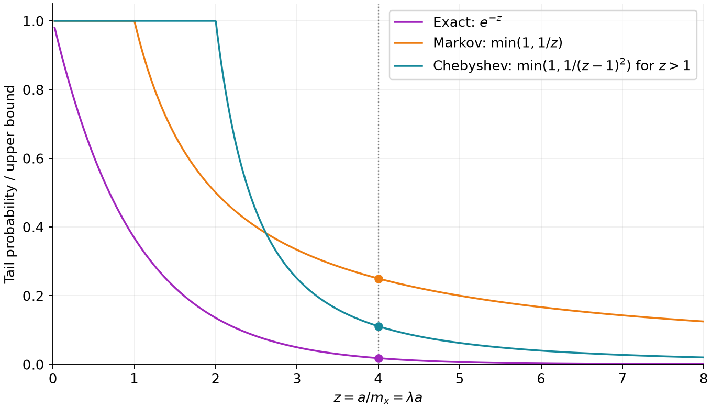
*Exact redraw with $z=a/m_x=\lambda a$. Both bounds are capped at one. For $z\leq1$, the Chebyshev curve shows only the trivial bound one. At $z=4$, the values are $e^{-4}$, $1/4$ and $1/9$.*

### Question by prof

Can Chebyshev be improved for the whole class of random variables with finite mean and variance, without further information?

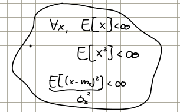
*Original circled class, p. 5: finite moments and finite variance define the variables under discussion.*

The notes recall

$$
\sigma_x^2=\mathbb E[X^2]-\mathbb E[X]^2.
$$

A finite second moment implies a finite absolute first moment and a finite variance. Conversely, with finite mean, finite variance implies finite second moment.

To show that the bound can be attained, it is sufficient to exhibit a variable and threshold where equality holds. Consider

$$
X\in\{-1,0,1\},
\qquad
\Pr[X=-1]=\Pr[X=1]=\frac14,
\qquad
\Pr[X=0]=\frac12.
$$

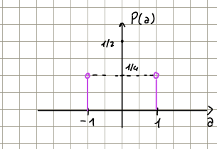
*Original probability-mass sketch, p. 5. The probabilities stated beside it specify the central mass $1/2$ as well as the two masses $1/4$.*

By symmetry, or direct calculation,

$$
m_x=-\frac14+0\cdot\frac12+\frac14=0,
$$

and

$$
\sigma_x^2=\mathbb E[X^2]
=(-1)^2\frac14+0^2\frac12+1^2\frac14
=\frac12.
$$

At $a=1$,

$$
\Pr[|X-m_x|\geq1]
=\Pr[X=-1]+\Pr[X=1]
=\frac12
=\frac{\sigma_x^2}{1^2}.
$$

The bound is **tight**, meaning attained with equality. The lecture occasionally calls this “strict”; here that word does not mean a strict inequality.

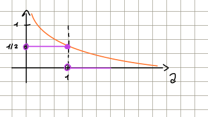
*Original tail sketch, p. 5: the upper bound touches the exact probability at $a=1$.*

For this discrete variable, endpoint conventions matter:

$$
\Pr[|X|\geq a]=
\begin{cases}
1, & a=0,\\
1/2, & 0<a\leq1,\\
0, & a>1.
\end{cases}
$$

In particular, the probability at $a=1$ is $1/2$, whereas $\Pr[|X|>1]=0$. The equality example requires **$\geq$**. Chebyshev's ratio itself is used only for $a>0$.

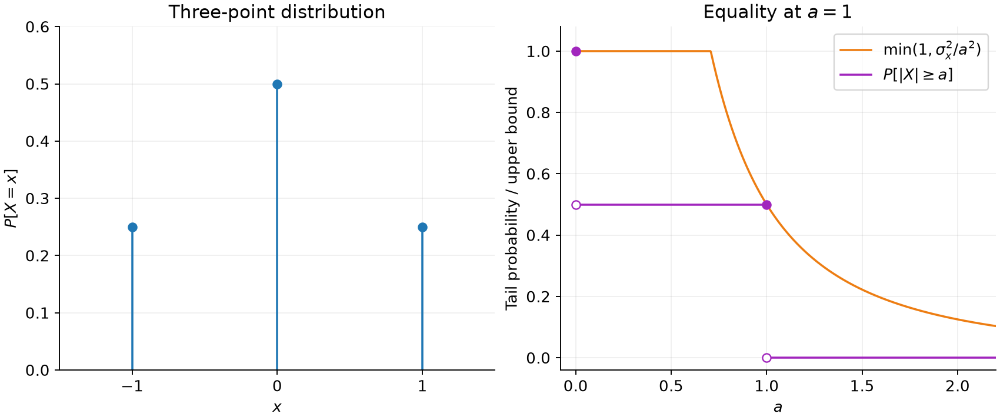
*Faithful redraw from the stated probabilities: the central mass and all open/closed endpoints are explicit. Both this figure and the exponential comparison are regenerated by `Pics/redraw_plots.py`.*

This example rules out a uniformly stricter replacement that would lower the bound at this attainable case while retaining validity for all such variables. Chebyshev is nevertheless loose for many particular distributions. Additional structural information can allow sharper bounds for narrower classes.

# Chernoff Bound

The handwritten heading anticipates the next topic. The lecturer explicitly defers the Chernoff derivation to the next lecture (transcript 2, 00:19:23–00:19:38). No Chernoff formula is developed here.

The final discussion instead returns to stochastic CAC: use a computable upper bound on the undesired-event probability, then require that bound to satisfy the target.

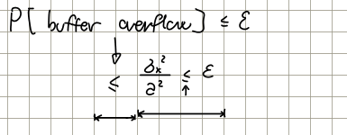
*Original concluding scheme, p. 6: the upper bound must itself be at most $\varepsilon$. The distance between actual probability and bound represents conservative design margin.*

Schematically, if a justified model relates overflow to a deviation of a random variable $X$, Chebyshev could give a sufficient condition of the form

$$
\Pr[\text{buffer overflow}]
\leq\frac{\sigma_x^2}{a^2}
\leq\varepsilon.
$$

Here $X$ and $a$ must be identified from the queueing model before applying the condition: the final sketch does not supply that model or calculate an admissible number of sources. Constraining an upper bound guarantees the target, but a loose bound can waste resources. The next lecture is intended to develop sharper bounds and their CAC applications.
