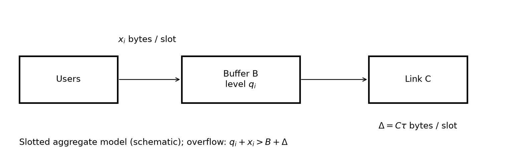
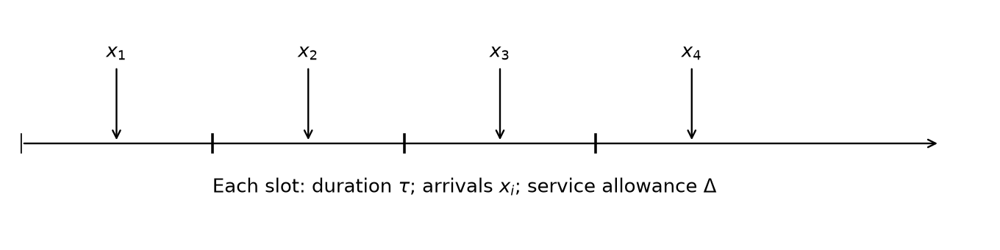
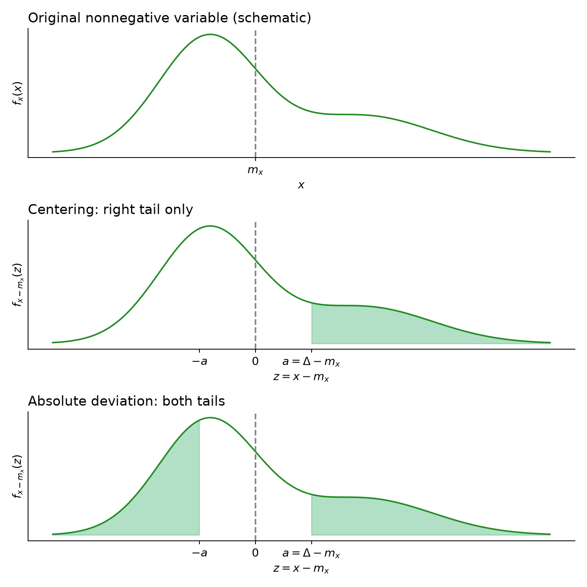
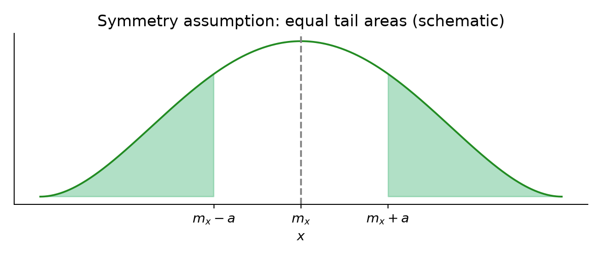
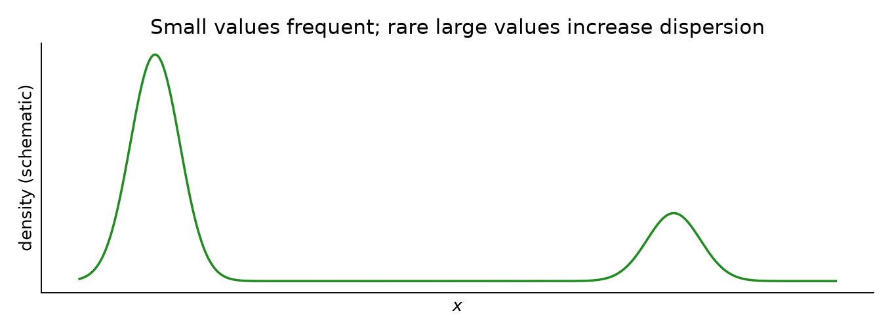
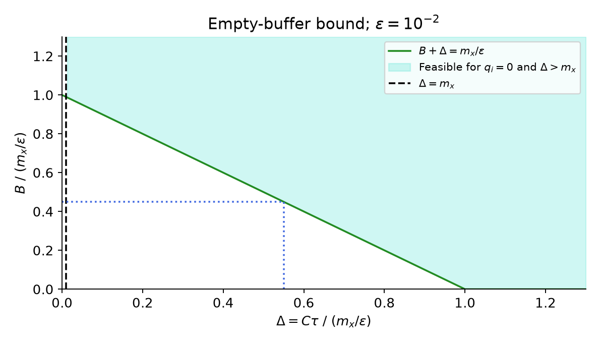
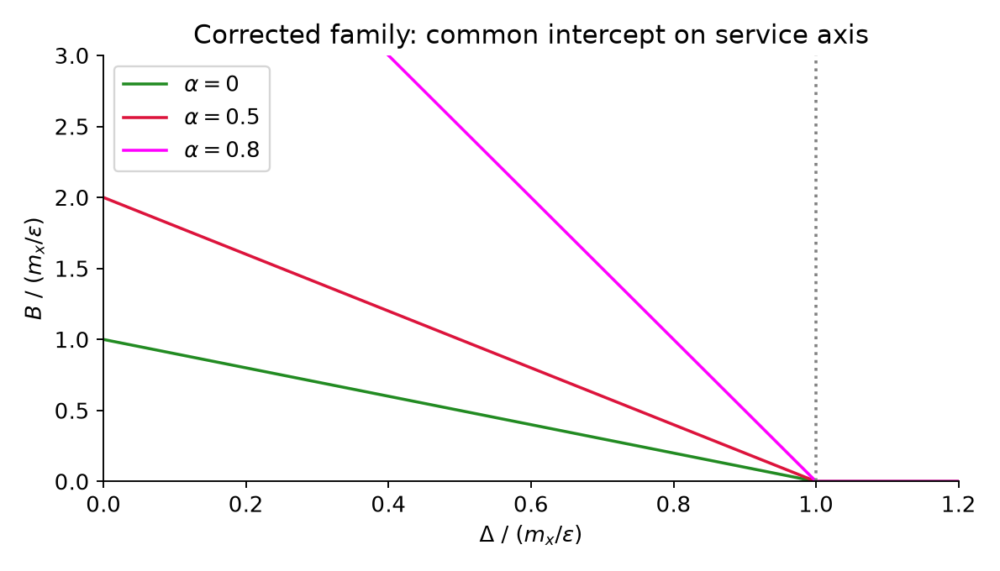
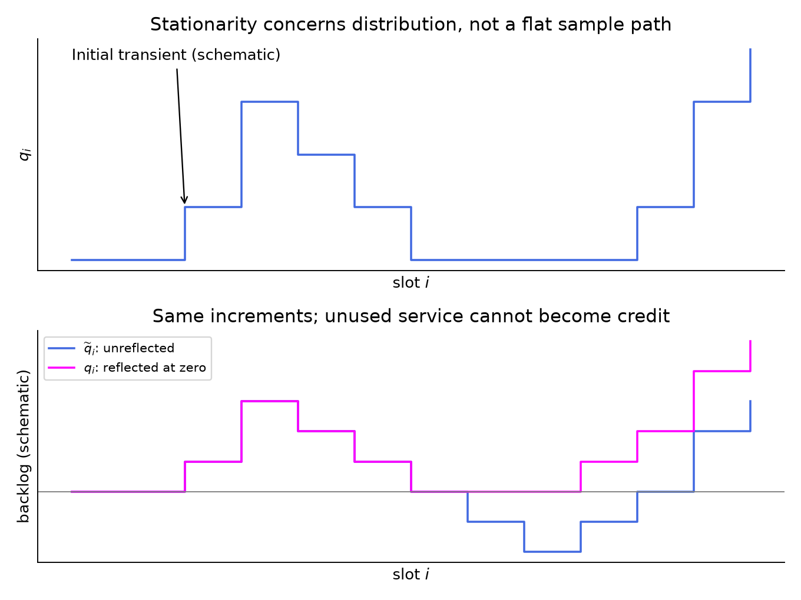
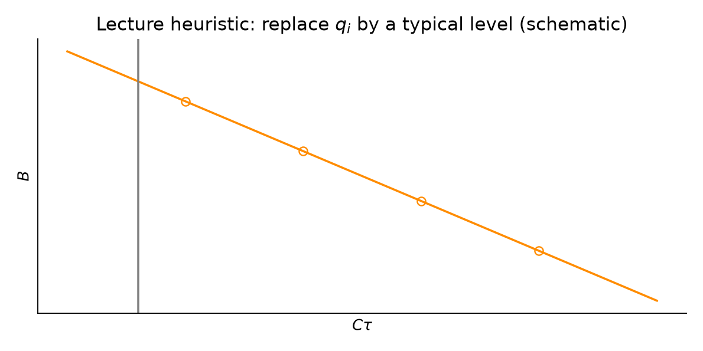

# Markov Inequality

For a nonnegative random variable $x$, with finite mean $m_x=\mathbb E[x]$, and $a>0$,

$$
\Pr[x>a]\leq\frac{m_x}{a}.
$$

The same upper bound holds for $\Pr[x\geq a]$. Nonnegativity is essential; no particular distribution is assumed. A bound above one is valid but uninformative, so it can be capped at one.

# Chebishev

The original heading is retained; the standard spelling is **Chebyshev**. For finite mean and variance,

$$
\Pr[|x-m_x|>a]\leq\frac{\sigma_x^2}{a^2},\qquad a>0.
$$

This controls deviations in **both directions** from the mean. It follows by applying Markov to $(x-m_x)^2$, whose expectation is $\sigma_x^2$. The threshold in the denominator is the distance from the mean, not the unshifted traffic value.

These are the bounds developed in [[10. Stochastic CAC and probability bounds - Integrated notes]]. The supporting course appendix, `Lesson 10/NDbook-Chapter-Appendix-RandomProcesses.pdf`, §B.3, PDF pp. 1–3, states the same results. Tightness over a broad class of variables does not mean either bound equals the probability for our traffic, or that Chebyshev always beats Markov for a one-sided event.

# Problem

We must choose link capacity $C$ and buffer size $B$ when the full traffic distribution is unknown. The exercise is developed progressively: first remove the buffer, then restore it at a known occupancy, and finally investigate how occupancy evolves.

*Redraw of the system on pp. 1 and 3. The downward loss branch in the original buffered system corresponds to the overflow event shown below the diagram.*

The model uses equal slots of duration $\tau$ and the following quantities:

|Symbol|Meaning|Units|
|---|---|---|
|$x_i$|Aggregate arrivals during slot $i$|bytes|
|$m_x$|$\mathbb E[x_i]$|bytes|
|$\sigma_x^2$|$\mathbb E[(x_i-m_x)^2]$|bytes$^2$|
|$C$|Link transmission capacity|bytes/s|
|$\Delta=C\tau$|Maximum service in one slot|bytes|
|$B$|Buffer capacity|bytes|
|$q_i$|Occupancy at the beginning of slot $i$|bytes|

If $C$ is expressed in bit/s, use $\Delta=C\tau/8$ instead. The notes initially use a slot-duration symbol resembling $\delta_i$; the lecture standardizes it to $\tau$ because durations are constant.

*Redraw of the time axis on p. 1. Arrows denote amounts per slot, not measured instantaneous rates.*

Assume $\{x_i\}$ are nonnegative and i.i.d., with known finite $m_x$ and $\sigma_x^2$. Their distribution is otherwise unspecified. The goal is a probability of an undesired event per slot at most $\varepsilon$, illustrated with $\varepsilon=10^{-2}$.

> [!info] What we are doing
> We cannot compute the exact probability without more distributional information. Instead, identify the event, bound its probability using known moments, and require the **upper bound** to be at most $\varepsilon$. This gives a sufficient design condition, usually conservative. It does not identify the minimum capacity truly needed by the unknown traffic.

The lecture's slot model compares total arrivals and available service over a slot. We adopt that convention throughout. Slot totals alone do not specify the maximum occupancy inside a slot: arbitrarily concentrated arrivals could overflow before later service becomes available. Thus the results concern this slotted abstraction, not every possible within-slot arrival pattern.

## Supposition: no buffer

This handwritten label on p. 1 introduces the first simplification: $B=0$. Congestion occurs when arrivals exceed service:

$$
\{\text{congestion in slot }i\}=\{x_i>\Delta\},
\qquad \Pr[x_i>\Delta]\leq\varepsilon.
$$

Equality $x_i=\Delta$ means everything fits; it is not overflow. The bounds remain applicable to the strict event even for discrete byte counts.

**Using Markov.** Since $x_i\geq0$,

$$
\Pr[x_i>\Delta]\leq\frac{m_x}{\Delta}
\overset{\text{require}}{\leq}\varepsilon.
$$

Consequently,

$$
\Delta\geq\frac{m_x}{\varepsilon},
\qquad
C\geq C_M:=\frac{m_x}{\tau\varepsilon}.
$$

The symbol “require” distinguishes the proven probability bound from the design condition we impose on it. For $\varepsilon=10^{-2}$,

$$
C_M=100\frac{m_x}{\tau}.
$$

Here $m_x/\tau$ is the mean arrival rate. Reserving 100 times this rate is sufficient under Markov, but can waste substantial capacity.

**Now we try to use the Chebyshev bound.** This transition follows p. 2. Assume $\Delta>m_x$ and center the variable:

$$
\Pr[x_i>\Delta]
=\Pr[x_i-m_x>\Delta-m_x]
\leq\Pr[|x_i-m_x|>\Delta-m_x]
\leq\frac{\sigma_x^2}{(\Delta-m_x)^2}.
$$

The first step merely subtracts the same constant on both sides. The second enlarges the event: an absolute deviation can also be a sufficiently large **negative** deviation. The third applies Chebyshev with $a=\Delta-m_x>0$.

*Three schematic redraws from p. 2: original density, centered right tail, then both centered tails. Shapes illustrate the event transformation; they are not an assumed or estimated traffic distribution.*

Explicitly,

$$
\{|x_i-m_x|>a\}
=\{x_i-m_x>a\}\cup\{x_i-m_x<-a\}.
$$

The events are disjoint. They need not have equal probabilities. If the distribution is symmetric about its mean, then

$$
\Pr[|x_i-m_x|>a]=2\Pr[x_i-m_x>a].
$$

*Schematic redraw of the fourth density on p. 2. Symmetry would permit a factor $1/2$ in the one-sided Chebyshev estimate, but symmetry is not among the exercise's assumptions.*

Impose the bound:

$$
\frac{\sigma_x^2}{(\Delta-m_x)^2}\leq\varepsilon
\quad\Longrightarrow\quad
\Delta-m_x\geq\frac{\sigma_x}{\sqrt\varepsilon}.
$$

The positive square root is selected because $\Delta>m_x$. Therefore,

$$
C\geq C_C:=\frac{m_x}{\tau}
+\frac{\sigma_x}{\tau\sqrt\varepsilon}.
$$

For $\varepsilon=10^{-2}$, this is the average rate plus ten standard deviations of the per-slot rate:

$$
C_C=\frac{m_x+10\sigma_x}{\tau}.
$$

If $\sigma_x=0$, arrivals equal their mean almost surely; $C=m_x/\tau$ already avoids congestion. That deterministic case can be handled directly rather than dividing by a zero deviation threshold.

**Which design is better?** Here “better” means **requiring a smaller link capacity while still guaranteeing the same congestion target** $\Pr[x_i>\Delta]\leq\varepsilon$. It does not mean that we have computed the true congestion probability.

Recall the two sufficient capacity thresholds:

$$
C_M=\frac{m_x}{\tau\varepsilon},
\qquad
C_C=\frac{m_x}{\tau}+\frac{\sigma_x}{\tau\sqrt\varepsilon}.
$$

Either condition, $C\geq C_M$ **or** $C\geq C_C$, is enough on its own. We can therefore choose the less demanding one:

$$
C\geq\min\{C_M,C_C\}.
$$

For example, if the two methods certify capacities of 100 and 21 bytes/s, buying a link of 21 bytes/s already satisfies the second method's sufficient condition. We do not need to satisfy both methods simultaneously; that would require the maximum and would reserve unnecessary capacity.

To determine which threshold is smaller, compare their formulas. Since $\tau>0$ and $0<\varepsilon<1$,

$$
\begin{aligned}
C_C<C_M
&\quad\Longleftrightarrow\quad
\frac{m_x}{\tau}+\frac{\sigma_x}{\tau\sqrt\varepsilon}
<\frac{m_x}{\tau\varepsilon}\\
&\quad\Longleftrightarrow\quad
m_x+\frac{\sigma_x}{\sqrt\varepsilon}<\frac{m_x}{\varepsilon}\\
&\quad\Longleftrightarrow\quad
\sigma_x<m_x\frac{1-\varepsilon}{\sqrt\varepsilon}.
\end{aligned}
$$

For $m_x>0$, dividing by the mean gives the equivalent comparison

$$
\frac{\sigma_x}{m_x}<\frac{1-\varepsilon}{\sqrt\varepsilon}.
$$

The ratio $\sigma_x/m_x$ is the **coefficient of variation**: it measures the size of traffic fluctuations relative to the average arrival amount.

At $\varepsilon=10^{-2}$, the formulas become particularly transparent:

$$
C_M=\frac{100m_x}{\tau},
\qquad
C_C=\frac{m_x+10\sigma_x}{\tau}.
$$

Markov's threshold stays fixed when $m_x$ and $\tau$ are fixed, because it uses only the mean. Chebyshev's threshold increases with $\sigma_x$, because it adds a safety margin proportional to traffic variability. Their crossover follows from

$$
m_x+10\sigma_x=100m_x
\quad\Longleftrightarrow\quad
\sigma_x=9.9m_x.
$$

Thus “below” and “above” refer to **the value of $\sigma_x$ relative to $9.9m_x$**, not to traffic samples lying below or above $\sigma_x$:

|Traffic variability, with fixed $m_x$ and $\tau$|Comparison|Smaller certified capacity|
|---|---|---|
|$\sigma_x<9.9m_x$|$C_C<C_M$|Chebyshev|
|$\sigma_x=9.9m_x$|$C_C=C_M$|Same capacity|
|$\sigma_x>9.9m_x$|$C_M<C_C$|Markov|

For illustration, suppose $m_x=1$ byte per slot and $\tau=1$ s. These are added numerical examples, not values supplied in the exercise.

|$\sigma_x$ (bytes)|$C_M$ (bytes/s)|$C_C$ (bytes/s)|Choice|
|---|---|---|---|
|$2$|$100$|$1+10\cdot2=21$|Chebyshev certifies the target with less capacity|
|$9.9$|$100$|$1+10\cdot9.9=100$|Equal thresholds|
|$12$|$100$|$1+10\cdot12=121$|Markov certifies the target with less capacity|

Knowing the variance gives us an additional option; it does not force us to use Chebyshev. When variability is very large, this particular Chebyshev estimate becomes more conservative than Markov. We retain both valid estimates and choose whichever requires fewer resources. This comparison concerns the **two sufficient design thresholds derived here**, not a universal ranking of the inequalities for every event or distribution.

The lecturer initially says 90, then corrects the arithmetic around 00:46:29–00:47:10. The handwritten $9.9m_x$ on p. 3 is correct. Compare **standard deviation** with mean: both have units of bytes, whereas variance has units of bytes squared.

*Schematic redraw from p. 3: frequent small arrivals and rare large arrivals can produce a large standard deviation relative to the mean. No sample probabilities or locations are inferred from the sketch.*

A large ratio $\sigma_x/m_x$ is not excluded by the assumptions; the lecturer's observation that it seems unlikely is not a mathematical restriction on the model.

## This is fine if we don't have a buffer, but if we have a buffer?

The handwritten question on p. 3 restores the buffer. Now $x_i>\Delta$ need not cause loss: unused memory can absorb excess arrivals. Conversely, a buffer already full leaves no such protection.

The event in the slot model is

$$
\{q_i+x_i>B+\Delta\}
=\{x_i>B+\Delta-q_i\}.
$$

We compare queued bytes plus new bytes with buffer space plus bytes that can leave. It is insufficient to check only whether $q_i=B$: a sufficiently large arrival can overflow an initially partly empty buffer.

Since $q_i$ depends on past arrivals and $x_i$ is independent of them, $q_i$ and $x_i$ are independent under the i.i.d. exogenous-arrival assumption. Consecutive occupancies $q_i$ and $q_{i+1}$ generally are not independent. This distinction becomes essential later.

### Suppose $q_i=0$

For an empty buffer,

$$
\Pr[\text{overflow}\mid q_i=0]
=\Pr[x_i>B+\Delta]
\leq\frac{m_x}{B+\Delta}.
$$

Thus the lecture imposes

$$
B+C\tau\geq\frac{m_x}{\varepsilon},
\qquad C\tau>m_x.
$$

The second condition gives a mean-service margin for the associated queue without an upper cap; it is separate from the first-slot probability bound. A finite buffer cannot grow without limit, but may instead lose data.

*Redraw of p. 4 in normalized units, using the lecture's $\varepsilon=10^{-2}$. The line expresses the resource tradeoff; the shaded region also respects the mean-service margin. Blue guides show one illustrative boundary choice, not measured data.*

For each fixed $\Delta>m_x$, the smallest buffer certified by this empty-state calculation is

$$
B\geq\max\left\{0,\frac{m_x}{\varepsilon}-\Delta\right\}.
$$

Buying more service allows less memory under this particular condition. Without prices or another objective, no unique optimum $(C,B)$ is determined.

> [!warning] An empty-state guarantee is conditional
> This calculation does not establish $\Pr[\text{overflow}]\leq\varepsilon$ during normal operation. After previous bursts, $q_i$ can be positive and the available headroom is smaller. The lecturer emphasizes this limitation at 00:58:50–01:00:22.

### Suppose $q_i=\alpha B$, $\alpha\in[0,1]$

Fixing an occupancy fraction generalizes the previous calculation. Available headroom plus service is

$$
B+\Delta-q_i=(1-\alpha)B+\Delta.
$$

Using independence and Markov gives the statewise bound

$$
\Pr[\text{overflow}\mid q_i=\alpha B]
\leq\frac{m_x}{(1-\alpha)B+\Delta}.
$$

This expression describes a prescribed state; it need not be a state having positive probability in a discrete implementation. Requiring the bound to be at most $\varepsilon$ gives

$$
(1-\alpha)B+\Delta\geq\frac{m_x}{\varepsilon}.
$$

**Correction to p. 4:** the coefficient is $1-\alpha$, not $1-\varepsilon$. It follows directly from subtracting $q_i=\alpha B$. The lecturer also corrects a sign in this derivation at 01:02:52–01:05:07.

For $0\leq\alpha<1$,

$$
B\geq\max\left\{0,\frac{m_x/\varepsilon-\Delta}{1-\alpha}\right\}.
$$

For a fixed service amount below $m_x/\varepsilon$, higher assumed occupancy requires a larger buffer. At $\alpha=1$, division by $1-\alpha$ is invalid: the condition becomes simply $\Delta\geq m_x/\varepsilon$. A full buffer offers no spare space regardless of its total size.

*Corrected redraw of the family on p. 4. Every boundary has the same horizontal intercept $\Delta=m_x/\varepsilon$; increasing $\alpha$ changes slope and vertical intercept. The original sketch's different horizontal intercepts do not follow its equation.*

The same procedure could use Chebyshev (the lecturer mentions this but continues with Markov for simplicity). Supplementary algebra, for headroom threshold above $m_x$, yields

$$
(1-\alpha)B+\Delta
\geq m_x+\frac{\sigma_x}{\sqrt\varepsilon}.
$$

The difficulty remains: **what occupancy fraction is representative, and how often does a worse state occur?** Replacing $q_i$ by its mean does not answer that probability question.

### Queue evolution and stationary behaviour

The remaining derivation on pp. 4–5 has no separate handwritten heading. These explanatory subsections retain its order.

First consider a buffer without an upper capacity limit. Starting at $q_0=0$,

$$
q_{i+1}=\max\{q_i+x_i-\Delta,0\}.
$$

For example, $q_1=\max\{x_0-\Delta,0\}$ and $q_2=\max\{q_1+x_1-\Delta,0\}$. The maximum prevents negative occupancy. If available service exceeds queued plus new bytes, the queue empties and the remaining service is unused.

For the actual finite buffer, under the same slot convention, the update instead is

$$
q_{i+1}=\min\{B,\max\{q_i+x_i-\Delta,0\}\},
\qquad
\text{lost bytes in slot }i=\max\{q_i+x_i-\Delta-B,0\}.
$$

The uncapped model helps study backlog before imposing a memory limit; these two updates must not be confused.

*Schematic redraws of both step plots on p. 4. Upper panel: a changing queue after an initial transient. Lower panel: the unreflected process and actual nonnegative queue driven by the same increments. No numerical sample path was supplied by the lecture; axes therefore have no numerical ticks.*

For mean service $\Delta>m_x$, the uncapped i.i.d. queue has a stationary regime under the usual construction. **Stationary** means its distribution no longer depends on the slot index; individual paths still fluctuate. A sketch of one path cannot itself establish stationarity.

The lecturer next drops the maximum and defines an auxiliary process

$$
\widetilde q_{i+1}=\widetilde q_i+x_i-\Delta,
\qquad \widetilde q_0=q_0=0.
$$

For the **uncapped** reflected queue, induction gives $\widetilde q_i\leq q_i$: apply the same increment to both sides, then observe that taking the maximum with zero can only increase the right side. This pathwise comparison does not transfer to a capped queue after losses without further argument.

Negative $\widetilde q_i$ represents fictitious stored service credits. A real link cannot save unused transmission opportunities for a later burst. This explains both the auxiliary process's lower values and why removing the maximum changes the model substantially.

### Correction to the final moment calculation

At 01:25:20–01:33:37, the lecturer tries to find a stationary mean for $\widetilde q_i$ by taking expectations and then squaring its recursion. The first-moment calculation already exposes the problem:

$$
\mathbb E[\widetilde q_{i+1}]
=\mathbb E[\widetilde q_i]+m_x-\Delta,
\qquad
\mathbb E[\widetilde q_i]=i(m_x-\Delta).
$$

When $\Delta>m_x$, this tends to $-\infty$. The unreflected process does **not** share the reflected queue's stationary regime with finite mean. Setting its consecutive means equal would require $\Delta=m_x$, contradicting the strict service margin used in the exercise.

Nevertheless, imposing equality of its consecutive second moments formally produces

$$
0=\mathbb E[x_i^2]+\Delta^2-2\Delta m_x
+2(m_x-\Delta)m_{\widetilde q},
$$

and hence the expression written on p. 5:

$$
\frac{m_x^2+\sigma_x^2+\Delta^2-2\Delta m_x}
{2(\Delta-m_x)}
=\frac{\sigma_x^2+(\Delta-m_x)^2}{2(\Delta-m_x)}.
$$

The expansion of the square is correct; the stationarity premise is not. Therefore this expression is **not** a derived stationary mean of $\widetilde q_i$, and the claimed lower bound on the real stationary mean does not follow. A pathwise lower bound between processes cannot validate a nonexistent stationary mean.

Independence itself was used correctly: $q_i$ and $\widetilde q_i$ depend on previous arrivals, while $x_i$ concerns the new slot. Thus $\mathbb E[q_ix_i]=\mathbb E[q_i]m_x$. In contrast, $q_{i+1}$ depends on $x_i$, so that factorization would not generally hold with index $i+1$.

*Schematic redraw of p. 5: the lecturer proposes replacing occupancy by a typical mean value to choose points along a resource boundary. This remains a heuristic, not an unconditional overflow guarantee.*

The lecture ends by proposing $q_i$ approximately equal to its mean, or $1.5$ times its mean (01:34:26–01:35:23). It completes the exploratory discussion but does not establish a valid stationary mean through the auxiliary calculation, nor a final probabilistic buffer-sizing guarantee. Your difficulty following this ending is therefore not only a missing algebraic step: the argument needs correction.

### Supplementary completion — a valid bound and a certified design

The following is an added correction/completion, **not a result proved in class**. It uses the same squared-recursion idea on the actual finite-buffer queue. Assume a stationary regime and $\Delta>m_x$; since $0\leq q_i\leq B$, its first two moments are finite.

For every real $u$, $\min\{B,\max\{u,0\}\}^2\leq u^2$. Therefore,

$$
q_{i+1}^2\leq(q_i+x_i-\Delta)^2.
$$

Take expectations, use stationarity to cancel $\mathbb E[q_{i+1}^2]$ with $\mathbb E[q_i^2]$, and use independence of $q_i$ and $x_i$:

$$
0\leq 2\mathbb E[q_i](m_x-\Delta)
+\sigma_x^2+(\Delta-m_x)^2.
$$

Rearranging gives

$$
\mathbb E[q_i]\leq K,
\qquad
K:=\frac{\sigma_x^2+(\Delta-m_x)^2}{2(\Delta-m_x)}.
$$

Thus the same algebraic expression has a justified interpretation here as an **upper bound**, not the lower bound asserted in the final classroom argument. The bound may be loose; for deterministic arrivals below service, the queue is zero although $K>0$.

To turn it into a probability statement, choose any fixed $0<h\leq B$. If $q_i\leq h$ and $x_i\leq B+\Delta-h$, overflow cannot occur. Event inclusion and the union bound imply

$$
\Pr[q_i+x_i>B+\Delta]
\leq\Pr[q_i>h]+\Pr[x_i>B+\Delta-h]
\leq\frac{K}{h}+\frac{m_x}{B+\Delta-h}.
$$

This is a stationary per-slot guarantee. Unlike substituting a mean occupancy, it explicitly accounts for the chance that occupancy exceeds the chosen reference level. Cap the result at one if necessary. Chebyshev can replace the second Markov term when its positive-deviation condition holds.

A concrete, conservative construction using only the supplied moments is:

1. Choose any service amount $\Delta>m_x$, and set $C=\Delta/\tau$.
2. Compute $K$ from the preceding formula.
3. Choose a positive buffer satisfying $B\geq4K/\varepsilon$ and $B\geq4m_x/\varepsilon$.

With $h=B/2$, the first term is at most $\varepsilon/2$, while

$$
\frac{m_x}{B+\Delta-B/2}
\leq\frac{2m_x}{B}\leq\frac\varepsilon2.
$$

Hence this construction certifies $\Pr[\text{overflow in a stationary slot}]\leq\varepsilon$ within the stated slot model. It is deliberately conservative and not an optimum; minimizing the displayed bound over $h$ and comparing available bounds can improve the design. No numerical $(C,B)$ can be computed because the exercise supplies no numerical $m_x$, $\sigma_x$ or $\tau$.

A simpler alternative also closes the original probability question: since $q_i\leq B$, overflow implies $x_i>\Delta$. Choosing $C\geq\min\{C_M,C_C\}$ therefore guarantees the target uniformly over every initial occupancy, even with a buffer. This is the valid no-buffer design reused as a fallback; it gains no capacity reduction from memory.

The distinctions to retain are: a known-state bound sizes headroom **conditional on that state**; a stationary guarantee must also control the distribution of occupancy; a finite-horizon probability of at least one overflow is another quantity again. Over $N$ slots, per-slot bounds of $\varepsilon$ yield at most $N\varepsilon$ by a union bound, not automatically $\varepsilon$ for the whole period.
