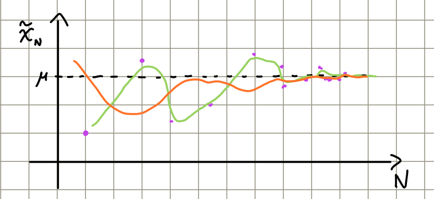
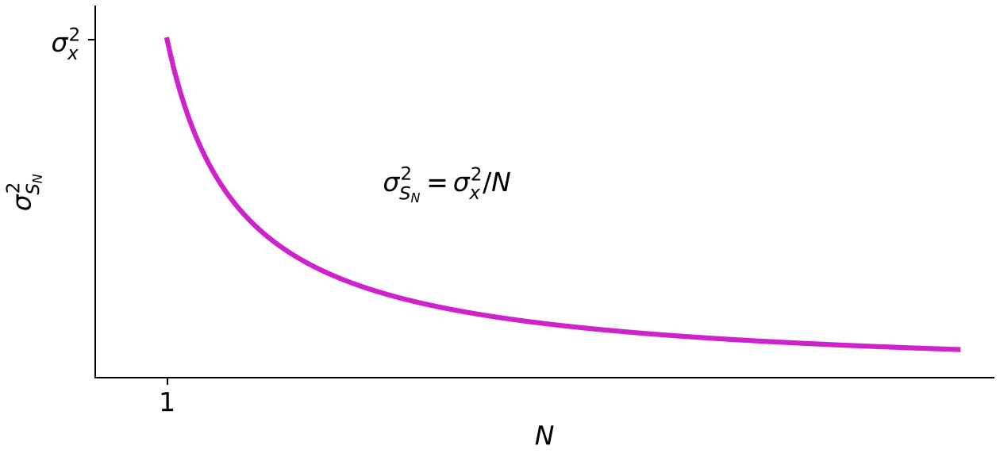
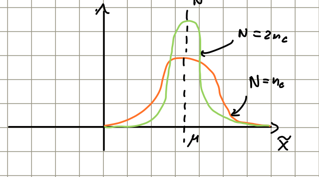
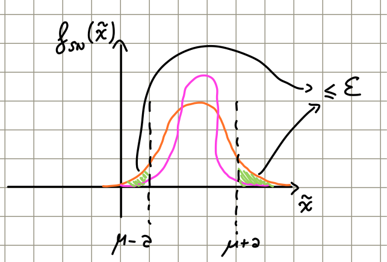
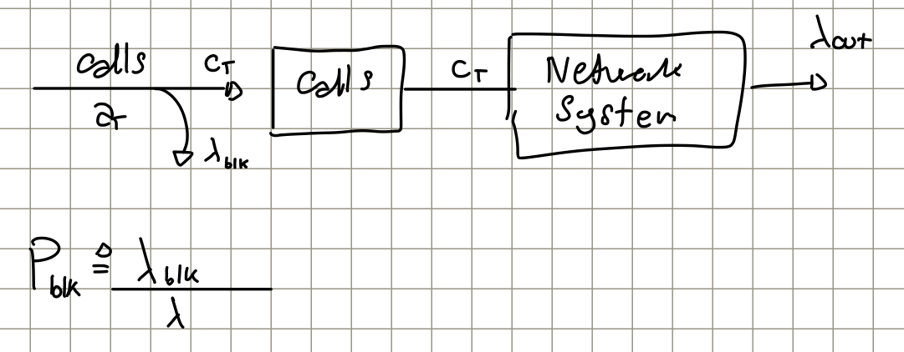
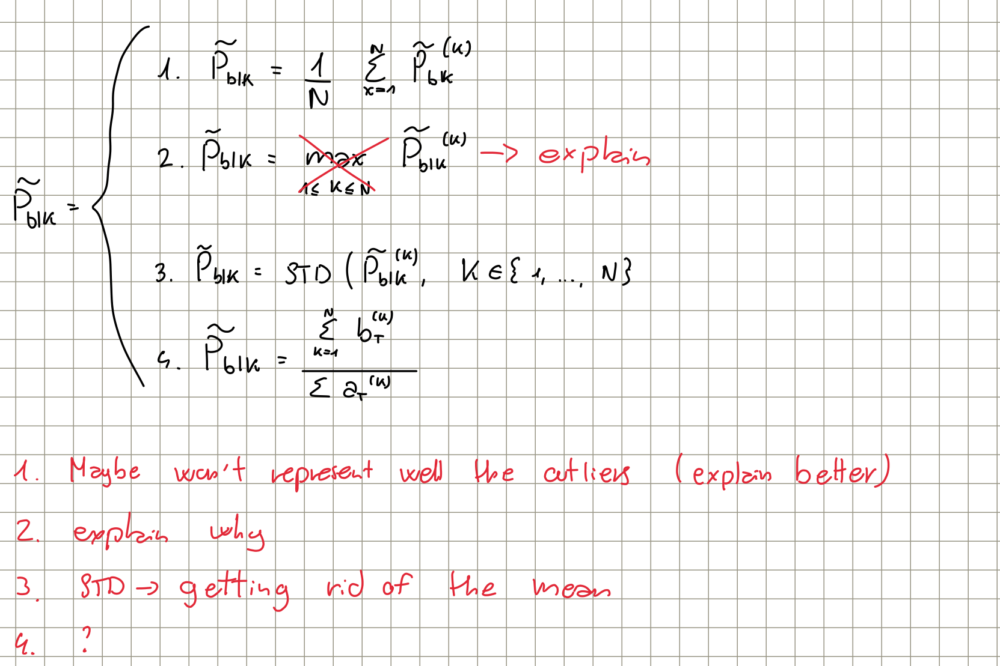
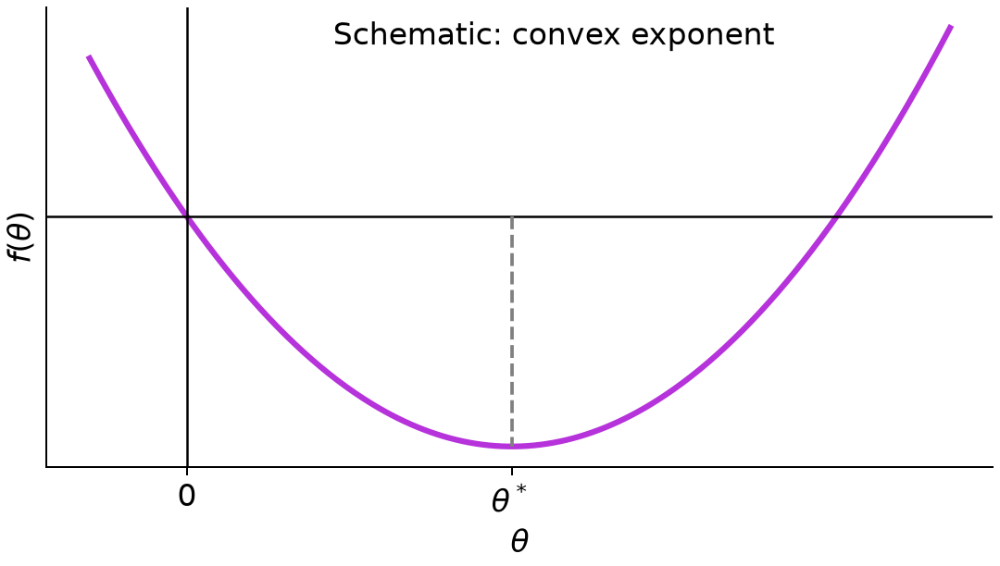

# Riprese da lezione 12

*Lecture reference: 00:00:00–00:12:12. Explanations follow the transcript; original handwritten figures and section titles are retained. Where speech recognition corrupts mathematical symbols, formulas follow the original handwritten notes.*

Let $\{X_i\}$ be i.i.d. random variables with finite mean $\mu=\mathbb E[X_i]$ and finite variance $\sigma_x^2$. In a simulation, $X_i$ can represent a performance measurement, such as the number of calls blocked during one run. A lowercase $x_i$ denotes an **observed realization**, not the random variable before observation.

From $N$ observations, the empirical mean is

$$
\tilde x=\frac{1}{N}\sum_{i=1}^{N}x_i.
$$

Repeating the whole experiment gives another set of observations:

$$
\{x_1,\ldots,x_N\}\longrightarrow
\tilde x^{(1)}=\frac1N\sum_{i=1}^{N}x_i,
\qquad
\{x'_1,\ldots,x'_N\}\longrightarrow
\tilde x^{(2)}=\frac1N\sum_{i=1}^{N}x'_i.
$$

There is no guarantee that $\tilde x^{(1)}=\tilde x^{(2)}$: the realizations change between experiments. Equality can occur, but is not a property of the estimator. The theoretical mean $\mu$ is a fixed number; our estimate fluctuates because it depends on the observations.

*Original p. 1: two schematic trajectories approach the same $\mu$ as $N$ increases. The lecturer explains that repeating the experiment can produce different paths towards the mean.*

Before observing the samples, model their arithmetic mean as the random variable

$$
S_N\triangleq\frac1N\sum_{i=1}^{N}X_i.
$$

Then

$$
\mu_{S_N}\triangleq\mathbb E[S_N]
=\frac1N\mathbb E\!\left[\sum_{i=1}^{N}X_i\right]
=\frac1N\sum_{i=1}^{N}\mathbb E[X_i]
=\mu.
$$

The lecturer states that the variance is

$$
\sigma_{S_N}^2=\frac{\sigma_x^2}{N}.
$$

The expectation remains $\mu$, while the variance tends to zero as $N$ grows.

*Redraw of the variance decrease described at 00:10:03–00:10:36: $\sigma_{S_N}^2=\sigma_x^2/N$.*

*Original p. 1: schematic distributions centered at $\mu$. The lecturer describes a more concentrated distribution when the sample count increases, including the example of doubling it (00:11:16–00:12:12).*

> [!note] Notation correction
> On p. 1, the definition of the random variable $S_N$ uses lowercase samples. Here it uses $X_i$ to distinguish the estimator from its observed value $\tilde x$, following the lecturer's explanation at 00:00:26–00:00:54 and 01:16:48–01:18:44.

# Question from last lecture: how many samples...?

*Lecture reference: 00:12:17–00:22:31.*

For an absolute error tolerance $a>0$ and a failure probability $0<\varepsilon<1$, find a sufficient sample count $N$ such that

$$
\Pr[|S_N-\mu|>a]\leq\varepsilon.
$$

Equivalently,

$$
\Pr[|S_N-\mu|\leq a]\geq1-\varepsilon.
$$

Here $a$ is the permitted deviation from the mean, and $\varepsilon$ bounds the probability of exceeding that deviation.

*Original p. 2: the total probability outside $[\mu-a,\mu+a]$ must be at most $\varepsilon$. Increasing $N$ reduces the variance; the curves and shading are schematic.*

Suppose we know a finite upper bound on the variance:

$$
\mathbb E[(X_i-\mu)^2]=\sigma_x^2\leq s^2.
$$

Applying Chebyshev's inequality to $S_N$ gives

$$
\Pr[|S_N-\mu|>a]
\leq\frac{\sigma_{S_N}^2}{a^2}
=\frac{\sigma_x^2}{Na^2}
\leq\frac{s^2}{Na^2}.
$$

It is therefore sufficient to impose

$$
\frac{s^2}{Na^2}\leq\varepsilon
\quad\Longleftrightarrow\quad
N\geq\frac{s^2}{a^2\varepsilon}.
$$

This is a **conservative sufficient count**, not necessarily the true minimum: we constrain an upper bound, rather than the exact tail probability. The actual failure probability may be much smaller than $\varepsilon$, but the inequality does not say how much smaller.

- A larger variance bound $s^2$ requires more samples because individual outcomes fluctuate more widely.
- A smaller tolerance $a$ requires more samples, with quadratic dependence on $1/a$.
- A smaller failure probability $\varepsilon$ requires more samples, with dependence on $1/\varepsilon$.

# Example

*Lecture reference: 00:23:32–00:30:36.*

New information flows arrive according to a Poisson process of rate $\lambda$ calls/s. Each call corresponds to a CBR flow of rate $r$ bit/s.

A call admission control algorithm (CAC) accepts or blocks incoming calls according to the system state. If $\lambda_{\mathrm{blk}}$ is the blocked-call rate, the target blocking probability is

$$
P_{\mathrm{blk}}=\frac{\lambda_{\mathrm{blk}}}{\lambda}.
$$

*Original p. 2: arrival stream, blocked-call branch, admitted stream and network output. The first box, handwritten “Calls”, represents the admission stage discussed in the transcript; $\lambda_{\mathrm{out}}$ labels the output rate.*

Run the simulator for a period $T$ of **simulated time**. This is the modeled duration, not the elapsed time required by the computer. Simulating one second may take less or more than one real second, depending on implementation and system complexity.

The arrival count is a random variable

$$
A_T\sim\operatorname{Poisson}(\lambda T).
$$

Its observed value $a_T$ changes between runs. The lecturer gives 131 and 98 arrivals as examples of different observed counts (00:29:49–00:30:19).

## What value do we need?

*Lecture reference: 00:30:40–00:34:55.*

Besides $a_T$, collect the admitted-call count $c_T$, or directly the blocked-call count $b_T$. For the same observation period,

$$
b_T=a_T-c_T.
$$

## How do we compute the block prob.?

*Lecture reference: 00:33:32–00:54:39.*

For one run, the estimate discussed in class is

$$
\tilde P_{\mathrm{blk}}
=1-\frac{c_T}{a_T}
=\frac{b_T}{a_T}.
$$

The ratio $c_T/a_T$ estimates the admitted fraction; subtracting it from one gives the blocked fraction.

After $N$ repetitions, collect

$$
\left(a_T^{(1)},\ldots,a_T^{(N)}\right),\qquad
\left(b_T^{(1)},\ldots,b_T^{(N)}\right),\qquad
\left(\tilde P_{\mathrm{blk}}^{(1)},\ldots,
\tilde P_{\mathrm{blk}}^{(N)}\right).
$$

The lecture considers four ways to combine these results:

|Approach|Expression|Interpretation|
|---|---|---|
|1. Mean of run ratios|$\displaystyle\frac1N\sum_{k=1}^{N}\tilde P_{\mathrm{blk}}^{(k)}$|Every run receives equal weight. A rare large value affects the mean, but its individual contribution decreases with $N$.|
|2. Maximum|$\displaystyle\max_{1\leq k\leq N}\tilde P_{\mathrm{blk}}^{(k)}$|Keeps only the largest observed ratio. One unusually congested run can dominate all later estimates. This does not estimate the mean blocking probability.|
|3. Standard deviation|$\operatorname{STD}(\tilde P_{\mathrm{blk}}^{(1)},\ldots,\tilde P_{\mathrm{blk}}^{(N)})$|Measures dispersion between runs, not their average level. It helps assess variability but is not an estimate of blocking probability.|
|4. Ratio of pooled counts|$\displaystyle\frac{\sum_{k=1}^{N}b_T^{(k)}}{\sum_{k=1}^{N}a_T^{(k)}}$|Combines all blocked calls and all arrivals across the simulations before taking their ratio.|

*Original p. 3: four proposals, the rejection of the maximum, and the requests to explain unusual runs and standard deviation. Their explanations are supplied in the table and derivation below.*

The difference between approaches 1 and 4 is clearer when written explicitly:

$$
\tilde P_{\mathrm{blk},1}
=\frac1N\left(
\frac{b_T^{(1)}}{a_T^{(1)}}+\cdots+
\frac{b_T^{(N)}}{a_T^{(N)}}\right),
$$

$$
\tilde P_{\mathrm{blk},4}
=\frac{b_T^{(1)}+\cdots+b_T^{(N)}}
{a_T^{(1)}+\cdots+a_T^{(N)}}.
$$

The extra subscripts $1$ and $4$ identify the two proposals. The lecturer compares the mean of ratios with the ratio of aggregate counts.

To illustrate sensitivity to an unusual run, suppose the first run blocks almost all arrivals, approximated in the classroom calculation by

$$
b_T^{(1)}=a_T^{(1)},
$$

while all other runs have blocked fraction $\alpha$:

$$
b_T^{(k)}=\alpha a_T^{(k)},\qquad k=2,\ldots,N.
$$

Then

$$
\tilde P_{\mathrm{blk},1}
=\frac{1+(N-1)\alpha}{N}
=\frac1N+\alpha-\frac\alpha N
\longrightarrow\alpha.
$$

For the pooled counts,

$$
\begin{aligned}
\tilde P_{\mathrm{blk},4}
&=\frac{a_T^{(1)}+\alpha\sum_{k=2}^{N}a_T^{(k)}}
{\sum_{k=1}^{N}a_T^{(k)}}\\
&=\frac{a_T^{(1)}}{\sum_{k=1}^{N}a_T^{(k)}}
+\frac{\alpha}{1+a_T^{(1)}/\sum_{k=2}^{N}a_T^{(k)}}
\longrightarrow\alpha,
\end{aligned}
$$

The lecturer explains this limit by holding the first run fixed while the aggregate arrivals from the other runs grow (00:52:03–00:52:33). With $a_T^{(k)}=a_T$ for every $k$,

$$
\tilde P_{\mathrm{blk},4}
=\frac1N+\frac{\alpha}{1+1/(N-1)}
=\frac1N+\frac{N-1}{N}\alpha
=\tilde P_{\mathrm{blk},1}.
$$

The lecturer reports that pooled counts are often more robust in his experience, but says that the comparison depends on the realizations. With equal arrival counts, the two approaches give the same expression (00:52:40–00:54:39).

## Consider the first approach

*Lecture reference: 00:54:57–00:59:44.*

Choose the mean of run ratios and ask how many repetitions ensure

$$
\Pr\!\left[
\left|\tilde P_{\mathrm{blk}}-P_{\mathrm{blk}}\right|
>10^{-2}\right]\leq1\%.
$$

Here $P_{\mathrm{blk}}$ is the actual blocking probability referred to by the lecturer. Equivalently, the estimate should lie within $10^{-2}$ of that value with probability at least $99\%$ (00:56:07–00:57:24).

The lecturer answers that more data improve the statistical estimate: there is no upper limit on the number of simulations motivated by the possibility of observing more unusual events (00:57:30–00:57:59).

The lecturer also refines the word **outlier**: the earlier example is a rare event that still belongs to the model. A measurement outside the assumed model can instead indicate faulty sensing, a system fault, or an inadequate model (00:57:24–00:59:44).

## How do we find N? (the bounds)

*Lecture reference: 00:59:44–01:00:30 and 01:40:08–01:40:39.*

Chebyshev would require a known variance or a valid upper bound on it. The variance of the run ratio is not supplied. However, its range is known:

$$
0\leq X_k\leq1.
$$

This boundedness allows Hoeffding's inequality to give a guarantee without computing that variance.

# Hoeffding’s Inequality

*Lecture reference: 01:00:30–01:08:47; independence is explicitly used at 01:29:41.*

Let $X_1,\ldots,X_N$ be **independent** random variables satisfying finite bounds

$$
a_i\leq X_i\leq b_i,\qquad
\Delta_i\triangleq b_i-a_i,\qquad
\mu_i\triangleq\mathbb E[X_i].
$$

Define

$$
S_N\triangleq\frac1N\sum_{i=1}^{N}X_i,
\qquad
\mu_S\triangleq\mathbb E[S_N]
=\frac1N\sum_{i=1}^{N}\mu_i.
$$

For an error threshold $a>0$,

$$
\Pr[S_N-\mu_S>a]
\leq\exp\!\left(-\frac{2a^2N^2}{\sum_{i=1}^{N}\Delta_i^2}\right).
$$

The threshold $a$ is distinct from the lower support endpoint $a_i$. The negative sign and $N^2$ in the exponent are essential; the lecturer corrects the missing $N^2$ at 01:04:22–01:04:47. Independence, omitted from the handwritten statement, is used explicitly in the proof.

If all interval widths equal $\Delta$, then $\sum_i\Delta_i^2=N\Delta^2$, so

$$
\Pr[S_N-\mu_S>a]\leq e^{-2a^2N/\Delta^2}.
$$

The same bound holds for the opposite tail. Hence

$$
\Pr[|S_N-\mu_S|>a]\leq2e^{-2a^2N/\Delta^2}.
$$

For a fixed common width, the bound decreases exponentially in $N$, rather than in $N^2$, because the denominator in the general formula also grows with $N$.

- Larger $a$ relaxes the accuracy requirement and reduces the tail bound.
- Larger $N$ improves the guarantee.
- Larger $\Delta$ allows greater variability and weakens the guarantee.

## Remind

*Lecture reference: 01:16:48–01:18:44.*

The arithmetic mean and its expectation are different objects:

$$
\underbrace{S_N=\frac1N\sum_{k=1}^{N}X_k}_{\text{random estimator}}
\qquad\text{versus}\qquad
\underbrace{\mathbb E[S_N]=\frac1N\sum_{k=1}^{N}\mu_k}_{\text{fixed statistical mean}}.
$$

Repeating the experiment produces numerical realizations

$$
\tilde x^{(1)}=\frac1N\sum_{k=1}^{N}x_k^{(1)},
\qquad
\tilde x^{(2)}=\frac1N\sum_{k=1}^{N}x_k^{(2)},\quad\ldots
$$

We use both because $S_N$ models how these empirical means vary before we know their outcomes, whereas $\mathbb E[S_N]$ is the fixed center against which estimation errors are measured. This answers the handwritten “Why we use both?” on p. 5.

## Proof [H2F]

*Lecture reference: 01:18:53–01:41:47.*

The bracketed handwritten label is retained from p. 5; the following proof derives Hoeffding's inequality from Hoeffding's lemma. The lemma itself was stated without proof in class.

### Hoeffding’s Lemma

If $X\in[a,b]$, with finite endpoints and $\Delta=b-a$, then for $\theta\geq0$,

$$
\mathbb E\!\left[e^{\theta(X-\mathbb E[X])}\right]
\leq e^{\theta^2\Delta^2/8}.
$$

The bounded-support assumption is essential. It is missing from the handwritten lemma on p. 5, but the lecturer explicitly adds it at 01:20:42–01:20:58.

### Hoeffding’s ineq.

For independent $X_i\in[a_i,b_i]$ and the definitions above, we want to prove

$$
\Pr[|S_N-\mu_S|>a]
\leq2\exp\!\left(-\frac{2a^2N^2}{\sum_{i=1}^{N}\Delta_i^2}\right).
$$

First bound the right tail, then apply the same argument to the left tail.

### Proof of Lemma

This is the original p. 6 heading. Despite its wording, these steps prove the **inequality using the lemma**, not the lemma itself, as the lecturer specifies at 01:21:20–01:22:16.

For $\theta>0$, the exponential is strictly increasing. Therefore

$$
\begin{aligned}
\Pr[S_N-\mu_S>a]
&=\Pr\!\left[e^{\theta(S_N-\mu_S)}>e^{\theta a}\right]\\
&\leq\frac{\mathbb E[e^{\theta(S_N-\mu_S)}]}{e^{\theta a}}.
\end{aligned}
$$

The inequality is Markov's inequality, applied to the positive random variable $e^{\theta(S_N-\mu_S)}$. The event equivalence requires $\theta>0$, not $\theta=0$.

Substitute $S_N-\mu_S=N^{-1}\sum_i(X_i-\mu_i)$, rewrite the exponential of a sum as a product, and use independence:

$$
\begin{aligned}
\frac{\mathbb E[e^{\theta(S_N-\mu_S)}]}{e^{\theta a}}
&=e^{-a\theta}\,
\mathbb E\!\left[e^{\frac\theta N\sum_{i=1}^{N}(X_i-\mu_i)}\right]\\
&=e^{-a\theta}\,
\mathbb E\!\left[\prod_{i=1}^{N}e^{\frac\theta N(X_i-\mu_i)}\right]\\
&=e^{-a\theta}\prod_{i=1}^{N}
\mathbb E\!\left[e^{\frac\theta N(X_i-\mu_i)}\right]\\
&\leq e^{-a\theta}\prod_{i=1}^{N}
\exp\!\left(\frac{\theta^2\Delta_i^2}{8N^2}\right)\\
&=\exp\!\left(-a\theta+
\frac{\theta^2}{8N^2}\sum_{i=1}^{N}\Delta_i^2\right).
\end{aligned}
$$

The last inequality applies Hoeffding's lemma separately to each factor, with parameter $\theta/N$. The product over $i$ must remain until it is combined into the final exponential; the single-factor shorthand in the handwriting is expanded here.

The result holds for every $\theta>0$. To obtain the tightest bound from this expression, minimize its exponent,

$$
f(\theta)\triangleq-a\theta+
\frac{\theta^2}{8N^2}\sum_{i=1}^{N}\Delta_i^2.
$$

*Schematic redraw of the p. 6 parabola: $f(0)=0$, its initial slope is negative, and its minimum occurs at positive $\theta^*$. The curve represents the exponent $f$, not the positive bound $e^f$.*

The lecturer describes $f$ as a convex quadratic and sets its first derivative to zero:

$$
f'(\theta)=-a+\frac{\theta}{4N^2}\sum_{i=1}^{N}\Delta_i^2=0.
$$

Setting $f'(\theta)=0$ gives

$$
\theta^*=\frac{4aN^2}{\sum_{i=1}^{N}\Delta_i^2}.
$$

The factor $1/8$ in $f$ must also appear when differentiating; it leads to the factor $4$ above. This is the correction made during the lecture at 01:36:46–01:37:38 and reflected in the final handwritten expression.

The lecturer instructs substituting $\theta^*$ into the bound and states the resulting expression, without working through all the remaining algebra (01:37:52–01:39:23).

Thus

$$
\Pr[S_N-\mu_S>a]
\leq\exp\!\left(-\frac{2a^2N^2}{\sum_i\Delta_i^2}\right).
$$

The lecturer states that following the same reasoning for the opposite deviation gives

$$
\Pr[\mu_S-S_N>a]
\leq\exp\!\left(-\frac{2a^2N^2}{\sum_i\Delta_i^2}\right).
$$

These are different events: the estimate is too large in the first and too small in the second. The lecturer explains that the same bound applies to each tail, so considering deviations on either side gives twice the one-sided bound (01:40:56–01:41:47).

### Application to the blocking estimate

At 01:40:08–01:40:39, the lecturer returns to the earlier problem: the blocking estimate is between zero and one, so its interval width is $\Delta=1$. He says to use Hoeffding's inequality with this width to find the required number of experiments.

The transcript does not give a numerical value for $N$ or carry out that final calculation.
