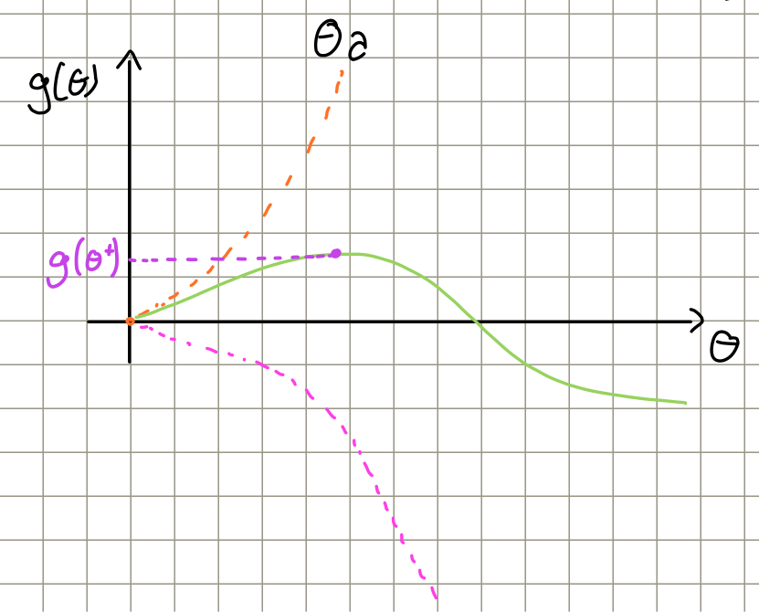
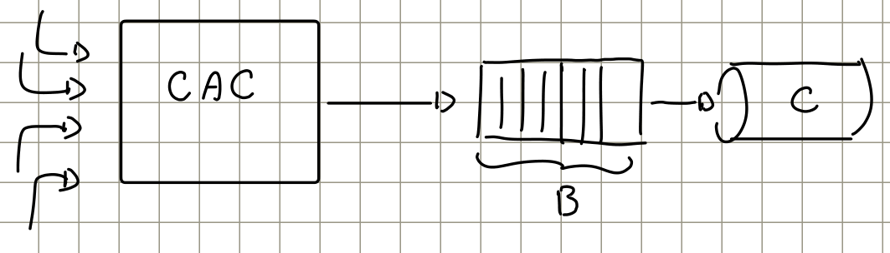
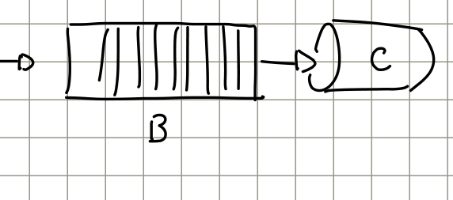
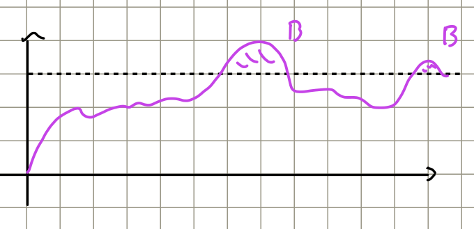

# Bounds recap

*Source coverage: pp. 1–2 of `Lesson 13.pdf` precede the recording. Their formulas and derivation are reconstructed from the handwritten notes, with the Hoeffding recap checked against Lesson 12. The transcript starts at p. 3, during the optimization of the Chernoff bound. The blackboard photograph on p. 3 is transcribed into formulas below, as requested, rather than embedded. Relevant CAC material is integrated from `5a-CAC.pdf`, §3.2–3.2.1; page references below give printed pages and PDF pages.*

## 1. Markov Inequality

For a **nonnegative** random variable $x$ with finite expectation and a threshold $a>0$,

$$
\Pr[x\geq a]\leq\frac{\mathbb E[x]}{a}.
$$

Only the mean is needed; no particular distribution is assumed. If the right-hand side exceeds one, the trivial probability bound of one is tighter.

The handwritten condition on p. 1 is incomplete: nonnegativity concerns the random variable, while positivity is required of the threshold $a$.

## 2. Chebyshev Inequality

For a random variable $x$ with finite mean and variance $\sigma_x^2$, and $a>0$,

$$
\Pr\!\left[|x-\mathbb E[x]|\geq a\right]
\leq\frac{\sigma_x^2}{a^2}.
$$

This is a two-sided deviation bound. It follows by applying Markov to the nonnegative variable $(x-\mathbb E[x])^2$, using the threshold $a^2$.

## 3. Hoeffding's Inequality

Let $x_1,\ldots,x_N$ be independent random variables with finite support bounds

$$
x_i\in[a_i,b_i].
$$

For $a>0$,

$$
\Pr\!\left[
\left|\frac1N\sum_{i=1}^{N}(x_i-\mathbb E[x_i])\right|>a
\right]
\leq2\exp\!\left(
-\frac{2a^2N^2}{\sum_{i=1}^{N}(b_i-a_i)^2}
\right).
$$

Identical distributions are not required. Independence allows the exponential moment of the sum to factorize; boundedness supplies a distribution-independent bound on each factor.

### 3 bis. If $\{x_i\}$ are i.i.d.

Define the common mean and the sample mean as

$$
\mu\triangleq\mathbb E[x_i],
\qquad
\bar x\triangleq\frac1N\sum_{i=1}^{N}x_i.
$$

If the common support width is $\Delta=b_i-a_i$, then

$$
\Pr[|\bar x-\mu|>a]
\leq2\exp\!\left(-\frac{2Na^2}{\Delta^2}\right).
$$

### 3 ter. $\{x_i\}$ i.i.d., $\Delta=1$

$$
\Pr[|\bar x-\mu|>a]\leq2e^{-2Na^2}.
$$

> [!note] Corrections to the recap
> On p. 1, the general denominator must contain $(b_i-a_i)^2$, the i.i.d. exponent must retain the factor $2$, and the last expression is an upper bound ($\leq$), not an equality. These forms follow from the full Hoeffding derivation in Lesson 12. For either single tail, omit the prefactor $2$.

## 4. Chernoff bound

Let $\{x_i\}$ be i.i.d. random variables and define

$$
\bar x_N\triangleq\frac1N\sum_{i=1}^{N}x_i.
$$

The **moment-generating function** (MGF) of their common distribution is

$$
M(\theta)\triangleq\mathbb E[e^{\theta x_i}].
$$

For the upper-tail bound, consider $\theta>0$ for which $M(\theta)$ is finite. Then

$$
\Pr[\bar x_N>a]
\leq\exp\!\left[
-N\sup_{\substack{\theta>0\\M(\theta)<\infty}}
\{a\theta-\log M(\theta)\}
\right].
$$

All logarithms here are natural. Unlike Hoeffding's distribution-independent bound for bounded variables, this expression uses the distribution through its MGF. The same proof also bounds $\Pr[\bar x_N\geq a]$.

> [!note] Sign correction
> The recap on p. 1 writes a plus before $\log M(\theta)$ inside the supremum. It must be a minus, as shown by the derivation on p. 2 and the formula on p. 3: $e^{-Na\theta}M(\theta)^N=e^{-N(a\theta-\log M(\theta))}$.

The name “moment-generating” comes from its derivatives. When the MGF is finite in a neighborhood of zero, differentiation under the expectation gives

$$
\begin{aligned}
M(0)&=\mathbb E[1]=1,\\
M'(\theta)&=\frac{dM(\theta)}{d\theta}
=\mathbb E\!\left[\frac{d}{d\theta}e^{\theta x_i}\right]
=\mathbb E[x_i e^{\theta x_i}],\\
M'(0)&=\mathbb E[x_i],\\
M''(\theta)&=\mathbb E[x_i^2e^{\theta x_i}],\\
M''(0)&=\mathbb E[x_i^2].
\end{aligned}
$$

Thus the derivatives at zero give the first and second **raw moments**. In particular, $M''(0)$ is not the variance: $\sigma_x^2=M''(0)-M'(0)^2$.

### Derivation

*Reconstructed from handwritten p. 2; this part is outside the recording.*

For $\theta>0$, multiplying by $N\theta$ preserves the direction of the inequality. Since the exponential is strictly increasing,

$$
\begin{aligned}
\Pr[\bar x_N>a]
&=\Pr\!\left[\theta\sum_{i=1}^{N}x_i>Na\theta\right]\\
&=\Pr\!\left[e^{\theta\sum_{i=1}^{N}x_i}>e^{Na\theta}\right]\\
&\leq\frac{\mathbb E[e^{\theta\sum_{i=1}^{N}x_i}]}{e^{Na\theta}}.
\end{aligned}
$$

The last step applies Markov to a positive random variable, even if the original $x_i$ can be negative. The restriction $\theta>0$ answers the handwritten question beside this step: $\theta<0$ reverses the inequality and $\theta=0$ loses the event information.

Rewrite the exponential of a sum as a product and use independence:

$$
\begin{aligned}
e^{-Na\theta}\mathbb E\!\left[e^{\theta\sum_{i=1}^{N}x_i}\right]
&=e^{-Na\theta}\mathbb E\!\left[\prod_{i=1}^{N}e^{\theta x_i}\right]\\
&=e^{-Na\theta}\prod_{i=1}^{N}\mathbb E[e^{\theta x_i}]\\
&=e^{-Na\theta}\prod_{i=1}^{N}M_{x_i}(\theta).
\end{aligned}
$$

Identical distributions give $M_{x_i}(\theta)=M(\theta)$ for every $i$. Therefore

$$
\begin{aligned}
\Pr[\bar x_N>a]
&\leq e^{-Na\theta}M(\theta)^N\\
&=e^{-Na\theta+\log(M(\theta)^N)}\\
&=e^{-Na\theta+N\log M(\theta)}\\
&=e^{-N(a\theta-\log M(\theta))}.
\end{aligned}
$$

The denominators and exponential arguments in the intermediate handwritten lines must retain $\theta$; it cannot disappear before optimization.

### Choosing $\theta$

*Transcript: 00:00:01–00:03:48; handwritten p. 3.*

The bound holds for every admissible $\theta>0$. To obtain the smallest right-hand side, maximize the expression multiplied by $-N$:

$$
\theta^*\in\operatorname*{arg\,max}_{\substack{\theta>0\\M(\theta)<\infty}}
\{a\theta-\log M(\theta)\}.
$$

Hence

$$
\inf_{\substack{\theta>0\\M(\theta)<\infty}}
e^{-N(a\theta-\log M(\theta))}
=e^{-N\sup_{\substack{\theta>0\\M(\theta)<\infty}}
\{a\theta-\log M(\theta)\}}.
$$

The supremum formulation also covers cases where no finite maximizing $\theta^*$ exists. The optimization depends on the MGF, so different source distributions generally give different bounds.

### Special case: $x_i\in\{0,1\}$

*Transcript: 00:03:56–00:28:42; handwritten pp. 3–4.*

The variables are **binary**: they take only zero or one, rather than any real value in $[0,1]$. Write

$$
\Pr[x_i=1]=p,\qquad
\Pr[x_i=0]=1-p\triangleq q.
$$

The formulas in the blackboard photograph are

$$
\begin{aligned}
\mathbb E[x_i]
&=0\Pr[x_i=0]+1\Pr[x_i=1]\\
&=\Pr[x_i=1]=p,\\[3pt]
\mathbb E[f(x_i)]
&=f(0)\Pr[x_i=0]+f(1)\Pr[x_i=1]\\
&=f(0)(1-p)+f(1)p.
\end{aligned}
$$

Apply this identity to $f(x_i)=e^{\theta x_i}$:

$$
\begin{aligned}
M_{x_i}(\theta)
&=\mathbb E[e^{\theta x_i}]\\
&=e^{\theta\cdot0}(1-p)+e^{\theta\cdot1}p\\
&=1-p+pe^\theta.
\end{aligned}
$$

As a basic check, $M(0)=1-p+p=1$, regardless of $p$. The MGF is a function of $\theta$, not the mean $p$ or a fixed probability such as $1/2$.

Substitution into Chernoff gives

$$
\Pr\!\left[\frac1N\sum_{i=1}^{N}x_i>a\right]
\leq e^{-N\sup_{\theta>0}g(\theta)},
\qquad
g(\theta)\triangleq a\theta-\log(pe^\theta+1-p).
$$

For the nontrivial upper-tail case, assume $0<p<a<1$. We have $g(0)=0$, and for large $\theta$,

$$
\log(pe^\theta+1-p)
\simeq\log(pe^\theta)=\log p+\theta,
$$

so

$$
g(\theta)\simeq(a-1)\theta-\log p.
$$

The logarithmic term therefore becomes asymptotically linear in $\theta$. Since $a<1$, $g$ eventually decreases; since $g'(0)=a-p>0$, it initially increases.

*Original p. 3: green $g(\theta)$, its maximum $g(\theta^*)$, and dashed component sketches. The drawing is qualitative: the positive component $a\theta$ is a straight line, despite its curved appearance in the handwriting; the negative component is $-\log(pe^\theta+1-p)$.*

It has a max somewhere: impose $g'(\theta)\overset{!}=0$, where the exclamation mark means that this condition is being required, not that it holds for every $\theta$.

$$
g'(\theta)=a-\frac{pe^\theta}{pe^\theta+1-p}.
$$

Thus

$$
\begin{aligned}
a(pe^\theta+1-p)-pe^\theta&=0,\\
pe^\theta(1-a)&=a(1-p),\\
pe^{\theta^*}&=\frac{a(1-p)}{1-a},\\
\theta^*&=\log\frac{a(1-p)}{p(1-a)}.
\end{aligned}
$$

This $\theta^*$ is positive exactly when $a>p$. To verify that the stationary point is a maximum,

$$
g''(\theta)=-\frac{p(1-p)e^\theta}{(pe^\theta+1-p)^2}<0.
$$

Substituting the optimizer,

$$
\begin{aligned}
g(\theta^*)
&=a\log\frac{a(1-p)}{p(1-a)}
-\log\left(\frac{a(1-p)}{1-a}+1-p\right)\\
&=a\log\frac{a(1-p)}{p(1-a)}-\log\frac{1-p}{1-a}\\
&=a\log\frac ap+a\log\frac{1-p}{1-a}-\log\frac{1-p}{1-a}\\
&=a\log\frac ap+(a-1)\log\frac{1-p}{1-a}\\
&=a\log\frac ap+(1-a)\log\frac{1-a}{1-p}.
\end{aligned}
$$

The final step changes both the coefficient's sign and the sign of the logarithm by inverting its argument.

> [!info] Definition — Binary Kullback–Leibler divergence
> For Bernoulli distributions with parameters $a$ and $p$,
> $$
> D(a\mid p)\triangleq a\log\frac ap+(1-a)\log\frac{1-a}{1-p}.
> $$
> It measures the difference between the two distributions. It is zero when $a=p$ and positive otherwise; for fixed $p$, it increases as $a$ moves away from $p$ on either side.

Therefore, for i.i.d. Bernoulli variables and $p<a<1$,

$$
\boxed{\Pr\!\left[\frac1N\sum_{i=1}^{N}x_i>a\right]
\leq e^{-ND(a\mid p)}}.
$$

The same upper bound holds with $\geq a$. The condition $a>p$ matters: for $a\leq p$, optimizing over positive $\theta$ gives only the trivial bound one. For the event $\bar x_N> a$ with $a\geq1$, the probability is zero; at $a=1$, the different event $\bar x_N\geq1$ has probability $p^N$, matching the limiting Chernoff expression with $D(1\mid p)=\log(1/p)$.

For continuous distributions with densities $f_x$ and $f_y$, the lecturer gives the general definition

$$
D(f_x\mid f_y)\triangleq
\int_{-\infty}^{+\infty}f_x(z)\log\frac{f_x(z)}{f_y(z)}\,dz.
$$

For discrete variables, replace the integral by a sum over possible values:

$$
D(P_x\mid P_y)=\sum_z P_x(z)\log\frac{P_x(z)}{P_y(z)}.
$$

Here $P_x$ and $P_y$ denote probability mass functions. For Bernoulli variables, the sum has only the two terms above. These are all the probability bounds needed for the course; the lecturer closes this part at 00:29:18.

# CAC again

*Transcript: 00:36:15–00:59:38; handwritten pp. 5–6.*

We return to admission control for several sources sharing a link of transmission capacity $C$ and an input buffer of capacity $B$.

*Original p. 5: sources request access through the CAC; admitted traffic shares the buffer $B$ and the output link $C$.*

The objective is to admit as many sources as possible while keeping the congestion probability below a target $\varepsilon$. Here congestion means loss of offered data because the system cannot transmit or store it; it differs from the blocking of a new call by the CAC.

## Book chapter: ON-OFF

Each source $S_i$ alternates between ON and OFF periods. During ON it generates traffic at a constant rate $\lambda$; during OFF it is idle:

$$
G_{\mathrm{ON}}=\lambda,\qquad G_{\mathrm{OFF}}=0,
$$

$$
\overline T_{\mathrm{ON}}=t_{\mathrm{ON}},\qquad
\overline T_{\mathrm{OFF}}=t_{\mathrm{OFF}}.
$$

The durations are random; $t_{\mathrm{ON}}$ and $t_{\mathrm{OFF}}$ are their means. At an arbitrary observation time in the stationary regime, the ON probability is

$$
P_{\mathrm{ON}}=
\frac{t_{\mathrm{ON}}}{t_{\mathrm{ON}}+t_{\mathrm{OFF}}}.
$$

The mean rate of one source is its ON rate times the fraction of time spent ON:

$$
\overline G_i=G_{\mathrm{ON}}P_{\mathrm{ON}}
=\lambda\frac{t_{\mathrm{ON}}}{t_{\mathrm{ON}}+t_{\mathrm{OFF}}}.
$$

For $N$ statistically identical sources, the instantaneous and mean aggregate rates are respectively

$$
G(t)=\sum_{i=1}^{N}G_i(t),
\qquad
\overline G=\sum_{i=1}^{N}\overline G_i
=N\lambda P_{\mathrm{ON}}.
$$

The sustainability condition used in the lecture is

$$
\boxed{\overline G=N\lambda
\frac{t_{\mathrm{ON}}}{t_{\mathrm{ON}}+t_{\mathrm{OFF}}}<C}.
$$

For the usual nondegenerate stochastic queue, a strict mean-rate margin is required for stability. This is necessary for sustainable admission, but does not by itself guarantee a small loss probability with finite $B$: simultaneous bursts can exceed the available service and storage even when the mean rate is below $C$.

## If $B=0$

*Transcript: 00:41:32–00:52:56. Supplementary clarification: `5a-CAC.pdf`, §3.2.1, printed pp. 22–23 (PDF pp. 6–7). The chapter's $c,r,n(t)$ correspond to $C,\lambda,A(t)$ here.*

Without buffering, congestion occurs whenever the instantaneous aggregate offered rate exceeds $C$:

$$
G(t)>C.
$$

Using the handwritten indicator notation $\chi\{\cdot\}$, define

$$
x_i\triangleq\chi\{\text{source }i\text{ is ON at time }t\}
\in\{0,1\}.
$$

Then

$$
G(t)=\sum_{i=1}^{N}G_{\mathrm{ON}}\,
\chi\{\text{source }i\text{ is ON at time }t\}
=\lambda\sum_{i=1}^{N}x_i.
$$

The number of active sources is

$$
A(t)\triangleq\#\{\text{active sources at }t\}
=\sum_{i=1}^{N}x_i,
\qquad G(t)=\lambda A(t).
$$

If sources are independent and statistically identical, their indicators at a fixed stationary observation time are i.i.d. Bernoulli variables with parameter $P_{\mathrm{ON}}$. Therefore

$$
A(t)\sim\mathcal B(N,P_{\mathrm{ON}}),
$$

$$
\Pr[A(t)=k]=\binom NkP_{\mathrm{ON}}^k(1-P_{\mathrm{ON}})^{N-k},
\qquad k=0,\ldots,N.
$$

> [!note] Binomial, not Bernoulli
> The label “Bernoulli” under $\mathcal B(N,P_{\mathrm{ON}})$ on p. 6 is incorrect. Each indicator $x_i$ is Bernoulli; their sum $A(t)$ is **binomial**, as confirmed by the chapter and the probability mass function. Independence here is across sources; ON–OFF states at different times need not be independent.

The congestion probability is thus a binomial tail:

$$
\begin{aligned}
\Pr[G(t)>C]
&=\Pr[\lambda A(t)>C]\\
&=\Pr\!\left[A(t)>\frac C\lambda\right]\\
&=\sum_{k=\lfloor C/\lambda\rfloor+1}^{N}
\binom Nk P_{\mathrm{ON}}^k(1-P_{\mathrm{ON}})^{N-k},
\end{aligned}
$$

when $C/\lambda<N$; otherwise the probability is zero. In particular, if $N\lambda\leq C$, even simultaneous activation of all sources causes no overload.

> [!warning] Strict threshold and integer rounding
> The handwriting and the explanation at 00:49:55–00:50:42 start the sum at $\lceil C/\lambda\rceil$. For the stated event $A(t)>C/\lambda$, the correct lower index is $\lfloor C/\lambda\rfloor+1$, as in `5a-CAC.pdf`, equations (3.6)–(3.8). The two indices coincide only when $C/\lambda$ is not an integer. If it is an integer, equality means $G(t)=C$ and causes no loss in this fluid model, so that term must be excluded.

The exact CAC criterion is to require

$$
\sum_{k=\lfloor C/\lambda\rfloor+1}^{N}
\binom Nk P_{\mathrm{ON}}^k(1-P_{\mathrm{ON}})^{N-k}
\leq\varepsilon.
$$

*Supplementary operational detail from the chapter:* upon a new request, evaluate this condition with $N+1$ sources. Admit the call if it still holds; otherwise block it. This implements the search for the maximum admissible $N$ discussed in class.

The exact probability is available here, so bounds are optional. They can simplify analytical dimensioning or replace an inconvenient tail evaluation. Since $A(t)$ is a sum of independent bounded variables, Chebyshev, Hoeffding and Chernoff can all be applied. The lecturer suggests comparing the exact tail with these bounds while varying the source and capacity parameters.

*Supplementary link to today's bound (`5a-CAC.pdf`, equation (3.9)):* set

$$
a=\frac{\lfloor C/\lambda\rfloor+1}{N}.
$$

If $P_{\mathrm{ON}}<a\leq1$, then

$$
\Pr[G(t)>C]
=\Pr\!\left[\frac{A(t)}N\geq a\right]
\leq e^{-ND(a\mid P_{\mathrm{ON}})}.
$$

At $a=1$ use the limiting expression. Requiring the bound to be at most $\varepsilon$ provides a conservative sufficient admission rule. If $a\leq P_{\mathrm{ON}}$, this upper-tail optimization gives only one; if $\lfloor C/\lambda\rfloor\geq N$, use the exact zero probability instead.

## Easy part, now we add the buffer

*Transcript: 00:51:39–00:59:38; handwritten p. 6.*

With a buffer, an instantaneous excess $G(t)>C$ can be queued, so it no longer implies immediate loss. Both the amount of excess traffic and the duration of the overload matter.

*Original p. 6: the buffer stores excess incoming data while the output link serves at rate $C$.*

*Original p. 6: qualitative traffic trace and two shaded excursions, annotated $B$. Following the lecturer's explanation, the horizontal axis is time, the vertical axis is instantaneous rate $G(t)$, and the dashed line represents $C$. Shaded excess areas represent amounts of data to be buffered, rather than rates.*

During an interval with $G(t)>C$, the excess input accumulates. If the available buffer space is sufficient, the burst causes no loss. If the excess continues long enough to fill the buffer, additional incoming data must be dropped. Intervals with $G(t)<C$ can drain an existing queue.

### Cong. Condition?

Let $q(t)$ denote the queued amount of data. In the finite-buffer fluid model, loss occurs when the buffer is full and the offered rate still exceeds the service rate:

$$
\{q(t)=B,\ G(t)>C\}.
$$

The corresponding congestion probability is

$$
\Pr[q(t)=B,\ G(t)>C].
$$

The comma means that both conditions hold. The event $G(t)>C$ alone is necessary for loss at that instant but is not sufficient with buffering.

To simplify the analysis, the lecturer introduces a queue threshold $\widetilde B$, possibly slightly below the physical capacity, and considers

$$
\Pr[q(t)>\widetilde B].
$$

This replaces a joint event by a queue-tail condition. It is a chosen congestion indicator, rather than an identity with the physical loss event. It lets us express a dimensioning requirement as

$$
\boxed{\Pr[q(t)>\widetilde B]\leq\varepsilon}.
$$

If the threshold is identified with the actual capacity $B$, use a **virtual queue** that is allowed to grow beyond $B$: in that model, data beyond the threshold represent data that the real buffer could not store. A real finite queue always satisfies $q(t)\leq B$, so applying $\Pr[q(t)>B]$ literally to it would give zero and would not describe losses.

*Clarification from `5a-CAC.pdf`, §3.2, printed p. 22 (PDF p. 6): the statistical buffer criterion concerns queue occupancy at an arbitrary observation time. A requirement that the threshold never be crossed anywhere in a whole time interval is a different event and is not derived here.*

The lecture stops at this queue-tail requirement. The derivation of a bound with buffering, and its numerical implementation, are deferred to the next lecture.
