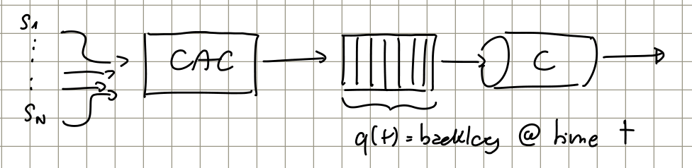
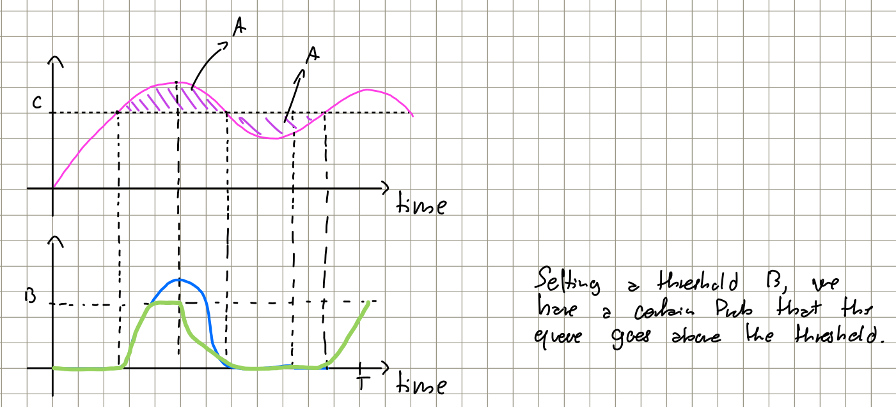
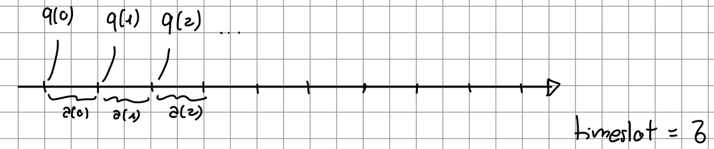
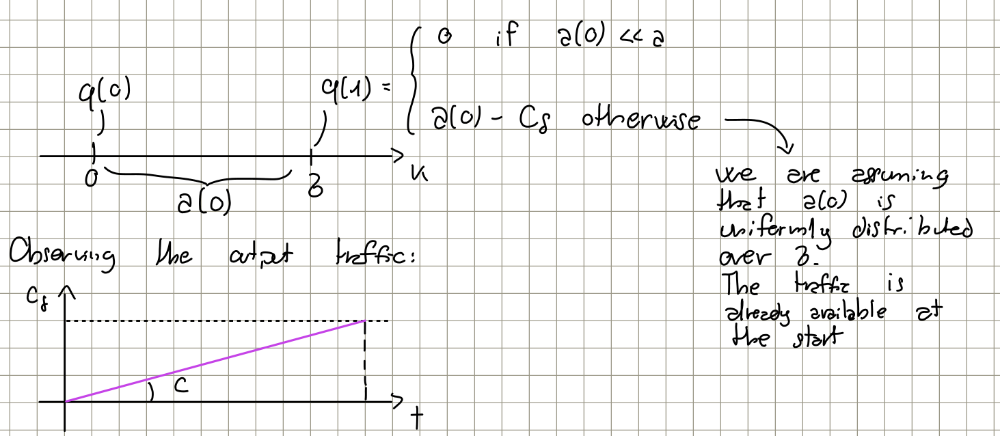
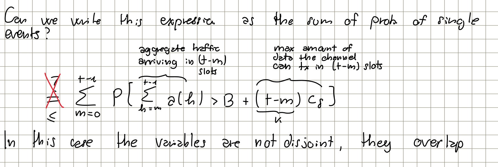
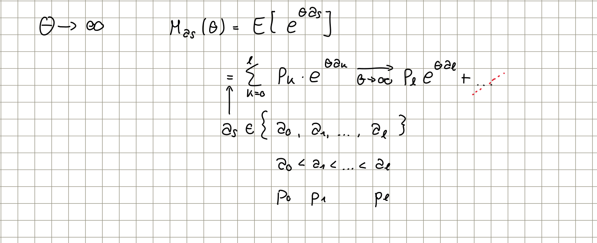

# Last lesson we had:

*13 November 2026. Integrated from all six pages of `Lesson 14.pdf`, the complete transcript `13 nov 2026, 12-33.transcript.txt`, and Moodle §3.2.2, supplied in `5a-CAC pages 9-12.pdf` (printed pp. 25–28). The handwritten section order and notation are retained. Moodle uses packets and slot duration $\tau$; these notes use bits and the handwritten slot duration $\delta$.*

The Call Admission Control (**CAC**) decides whether another source can share a link. There are $N$ admitted sources, a link of capacity $C$ bits/s, and an input buffer of size $B$ bits. The backlog is the amount of data waiting for transmission.

*Original scheme, handwritten p. 1. CAC controls admission; the buffer absorbs temporary excess arrivals.*

We want to choose $B$ so that the congestion probability is below a target $\varepsilon$. In the continuous fluid model, congestion means that the finite buffer is full while the incoming aggregate rate $\lambda(t)$ exceeds the service rate:

$$
\{\text{congestion at time }t\}
=\{q_B(t)=B,\ \lambda(t)>C\}.
$$

Here $q_B(t)$ explicitly denotes the **finite-buffer** backlog. Its evolution is clipped at $B$: data arriving beyond the available space are discarded. Analyzing only $q_B(t)$ is insufficient to identify congestion, because a full buffer without excess incoming traffic is not currently losing fluid.

Instead, consider a **virtual infinite buffer** driven by the same arrivals and served by the same link. It retains data that the real buffer would discard. Write $q(t)$ for its backlog from now on. The lecture bounds congestion using the tail probability

$$
\Pr[q(t)>B].
$$

*Original compound diagram, handwritten p. 1. The upper panel shows the input rate relative to $C$. The lower panel compares the virtual backlog rising above $B$ with the real backlog capped at $B$. The marked areas $A$ illustrate accumulated and subsequently drained data. These are qualitative curves, not measured samples.*

Starting from an empty queue, no data accumulate until the incoming rate $\lambda(t)$ exceeds the link capacity $C$. The excess traffic is then stored, so the backlog grows and reaches its maximum when the incoming rate falls back below $C$. The link continues transmitting at $C$ while queued data remain, gradually emptying the buffer; in the infinite-buffer case, it becomes empty when the accumulated excess traffic has been fully served, as illustrated by the equal areas $A$. 

A real buffer of size $B$ follows the same trajectory until it fills, then remains at $B$ and discards excess arrivals while $\lambda(t)>C$. 
Once the incoming rate drops below $C$, it starts draining and empties earlier because the discarded data were never stored. 

The key comparison is between time intervals: real congestion lasts only while the finite buffer is full and the input exceeds $C$, whereas the virtual backlog can remain above $B$ during part of its subsequent drainage. Therefore, over the same observation period $T$, the fraction of time with virtual backlog above $B$ upper-bounds the fraction of time with real congestion.

Over an observation interval of length $T$, the empirical exceedance fraction is

$$
\frac{1}{T}\int_0^T \mathbf 1_{\{q(t)>B\}}\,dt,
$$

where the indicator is 1 during exceedance and 0 otherwise. Interpreting a long-run fraction as a stationary probability requires the usual stationarity and ergodicity assumptions. This is a time-congestion measure; it is not automatically the fraction of arriving packets or bits lost.

Thus the design approach is to make the virtual tail small enough to control real congestion. The derivation below calculates a bound within a simplified slotted model; the approximation of within-slot arrivals must also be kept in mind.

## Consider a discrete time system:

Divide time into slots of duration $\delta$ seconds. In one slot the link can transmit at most

$$
C_\delta=C\delta\quad[\text{bits}].
$$

We reuse $t=0,1,2,\ldots$ as a **slot index**, so $q(t)$ is the virtual backlog at the beginning of slot $t$. Let $\tilde a_k(t)$ be the bits generated by source $k$ during slot $t$. The aggregate arrival amount is

$$
\tilde a(t)=\sum_{k=1}^{N}\tilde a_k(t).
$$

These are amounts in bits per slot, not instantaneous rates in bits/s. The generic single-source random variable is denoted $\tilde a_s$. For the moment-generating-function factorization used later, arrivals are assumed **independent and identically distributed across both sources and slots**. Independence across sources alone would not justify multiplying transforms across time.

*Original timeline, handwritten p. 2. The arrivals $\tilde a(0)$ occur between the observations $q(0)$ and $q(1)$, and similarly for later slots.*

Start from an empty queue, $q(0)=0$. The first update is

$$
q(1)=[\tilde a(0)-C_\delta]^+
=\max\{0,\tilde a(0)-C_\delta\},
$$

where $[x]^+=\max\{0,x\}$. A queue cannot have negative backlog: unused service capacity disappears rather than becoming credit for future arrivals. An absolute value would incorrectly turn unused capacity into positive queued data.

### Another small correction (that we'll neglect)

The update uses the total service budget $C_\delta$ as if all arrivals for the slot were already available at its beginning. This is a modeling assumption, not a consequence of knowing the total number of arrivals.

If data arrive near the end of the slot, the link may have been idle beforehand. It cannot use earlier idle time to transmit those later arrivals, so the actual end-of-slot backlog can exceed $[\tilde a(0)-C_\delta]^+$. The lecturer explicitly adopts the beginning-of-slot availability approximation (transcript, 00:20:19–00:24:38).

#### Observing the output traffic:

*Original compound drawing, handwritten p. 2. The upper timeline identifies the interval generating $\tilde a(0)$; the lower plot shows potential cumulative service with slope $C$ and endpoint $C_\delta$. The handwritten “uniformly distributed” wording is clarified by the lecturer's final assumption that the traffic is available at the start.*

With enough data available from the beginning, cumulative output grows linearly with slope $C$ and can reach $C_\delta$. Otherwise it is limited by available data. The correct piecewise update under the adopted slotted model is

$$
q(1)=
\begin{cases}
0,&\tilde a(0)\leq C_\delta,\\
\tilde a(0)-C_\delta,&\tilde a(0)>C_\delta.
\end{cases}
$$

The service threshold is $C_\delta$; the abbreviated handwritten condition beside this drawing is replaced by this explicit boundary. The model is a fluid/bit approximation and does not introduce packet serialization or rounding.

At the next slot,

$$
\begin{aligned}
q(2)
&=\max\{0,q(1)+\tilde a(1)-C_\delta\}\\
&=\max\{0,\max\{0,\tilde a(0)-C_\delta\}
                  +\tilde a(1)-C_\delta\}.
\end{aligned}
$$

Using the identity

$$
\max\{A,\max\{B,C\}+D\}
=\max\{A,B+D,C+D\},
$$

we obtain

$$
q(2)=\max\{0,\tilde a(1)-C_\delta,
                 \tilde a(0)+\tilde a(1)-2C_\delta\}.
$$

In general,

$$
q(t+1)=\max\{0,q(t)+\tilde a(t)-C_\delta\}.
$$

Unfolding the recursion with $q(0)=0$ gives

$$
q(t+1)=\max\left\{
0,\tilde a(t)-C_\delta,
\tilde a(t)+\tilde a(t-1)-2C_\delta,
\ldots,\sum_{j=0}^{t}\tilde a(j)-(t+1)C_\delta
\right\}.
$$

Each term considers an interval ending at the current observation and subtracts the service budget for its number of slots. The final term must sum all arrivals from 0 to $t$; the isolated $\tilde a(0)$ written at the end of the handwritten expansion on p. 3 is incomplete (compare Moodle Eq. 3.16).

## Going back to our initial condition:

For $t\geq1$, shift the preceding expression back by one slot:

$$
q(t)=\max\left\{0,
\max_{0\leq m\leq t-1}
\left[\sum_{h=m}^{t-1}\tilde a(h)-(t-m)C_\delta\right]
\right\}.
$$

The interval from slot $m$ to slot $t-1$ contains **$t-m$ slots**. Its incoming data amount is $\sum_{h=m}^{t-1}\tilde a(h)$ and its maximum service amount is $(t-m)C_\delta$. Both are measured in bits.

For a threshold $B\geq0$, the zero term cannot exceed $B$. Hence $q(t)>B$ occurs if at least one of these intervals has excess arrivals larger than $B$.

### Compact manner:

For any collection of random variables,

$$
\{\max(X_1,\ldots,X_n)>a\}
=\bigcup_{j=1}^{n}\{X_j>a\}.
$$

This is an event identity and requires no independence. Applied here,

$$
\Pr[q(t)>B]
=\Pr\left[
\bigcup_{m=0}^{t-1}
\left\{\sum_{h=m}^{t-1}\tilde a(h)>B+(t-m)C_\delta\right\}
\right].
$$

### Can we write this expression as the sum of prob. of single events?

Only an **upper bound** is available in general:

$$
\Pr[q(t)>B]
\leq\sum_{m=0}^{t-1}
\Pr\left[\sum_{h=m}^{t-1}\tilde a(h)>B+(t-m)C_\delta\right].
$$

*Original annotations, handwritten p. 3. The braces identify arrivals and available service over $t-m$ slots. The crossed-out equality records the essential correction: the interval events can overlap.*

One traffic realization can make several intervals exceed their respective thresholds. Adding the event probabilities then counts that realization several times. Even though individual slot arrivals are independent, these **events share arrivals** and need not be independent or mutually exclusive.

### Remind [Prob]

For two events,

$$
\Pr[A\cup B]=\Pr[A]+\Pr[B]-\Pr[A\cap B].
$$

If the events are disjoint, their intersection is empty and the union probability equals the sum. If instead they are independent,

$$
\Pr[A\cap B]=\Pr[A]\Pr[B].
$$

Independence and disjointness are different properties. The union bound $\Pr[\bigcup_j E_j]\leq\sum_j\Pr[E_j]$ is valid without either assumption. This resolves the transcript's occasional interchange of the two terms around 00:39–00:44.

### Supplementary explanation — applying the Chernoff bound

*This heading labels the continuation of the derivation on handwritten p. 4, which has no separate section title.*

Set $k=t-m$, the number of slots in an interval. As $m$ ranges from $0$ to $t-1$, $k$ ranges over $1,\ldots,t$. Identically distributed independent slot arrivals allow us to write each interval probability in the form

$$
\Pr\left[\sum_{j=1}^{k}\tilde a(j)>B+kC_\delta\right].
$$

The actual time labels do not affect this distribution. Independence across time then allows the factorization below. For any $\theta>0$ at which the moment-generating function is finite, Chernoff's bound gives

$$
\begin{aligned}
\Pr\left[\sum_{j=1}^{k}\tilde a(j)>B+kC_\delta\right]
&\leq e^{-\theta(B+kC_\delta)}
\mathbb E\left[e^{\theta\sum_{j=1}^{k}\tilde a(j)}\right]\\
&=e^{-\theta(B+kC_\delta)}
\prod_{j=1}^{k}\mathbb E[e^{\theta\tilde a(j)}]\\
&=e^{-\theta(B+kC_\delta)}M_{\tilde a}(\theta)^k.
\end{aligned}
$$

Here $M_{\tilde a}(\theta)=\mathbb E[e^{\theta\tilde a}]$ is the moment-generating function (**MGF**) of one aggregate slot arrival. Because that arrival is the sum of $N$ independent, identically distributed source amounts,

$$
M_{\tilde a}(\theta)=M_{\tilde a_s}(\theta)^N.
$$

Therefore the interval bound is

$$
M_{\tilde a_s}(\theta)^{Nk}e^{-\theta(B+kC_\delta)}
=e^{-\theta B}
\left[M_{\tilde a_s}(\theta)^Ne^{-\theta C_\delta}\right]^k.
$$

Define the dimensionless quantity

$$
r_\theta=M_{\tilde a_s}(\theta)^N e^{-\theta C_\delta}.
$$

Since the arrivals and $B$ are in bits, $\theta$ has inverse-bit units, so all exponential arguments are dimensionless. Combining Chernoff with the union bound,

$$
\Pr[q(t)>B]\leq e^{-\theta B}\sum_{k=1}^{t}r_\theta^k
\leq e^{-\theta B}\sum_{k=1}^{\infty}r_\theta^k.
$$

The infinite sum adds nonnegative terms, giving a bound independent of the observation time. It converges only for $r_\theta<1$, in which case

$$
\sum_{k=1}^{\infty}r_\theta^k
=\frac{1}{1-r_\theta}-1
=\frac{r_\theta}{1-r_\theta}.
$$

> [!info] Backlog tail bound
> For $q(0)=0$, i.i.d. source/slot arrivals, and any $\theta>0$ with finite MGF and $r_\theta<1$,
>
> $$
> \Pr[q(t)>B]\leq
> e^{-\theta B}\frac{r_\theta}{1-r_\theta}.
> $$
>
> The same time-independent bound carries over to the stationary tail when the queue has a stationary limiting distribution. A value above 1 can be replaced by the trivial probability bound 1.

**Index correction.** There are $t$ nonempty intervals ending at the beginning of slot $t$: lengths $1,\ldots,t$. Some intermediate handwriting/transcript expressions end at $t-1$ or start at 0. The lecturer corrects the geometric sum's starting index at 01:00:56–01:02:25. Starting at 1 explains the numerator $r_\theta$; Moodle Eqs. 3.17–3.20 confirm the consistent finite-horizon range $1,\ldots,t$.

The finite sum remains valid when $r_\theta\geq1$, but its extension to an infinite geometric series gives no finite uniform bound. This failure alone does not prove that the actual exceedance probability is 1.

## So:

What does $r_\theta<1$ mean? Write

$$
r_\theta
=\exp\left[-\theta C_\delta+N\log M_{\tilde a_s}(\theta)\right].
$$

An exponential is below 1 precisely when its exponent is negative. Dividing by $N\theta>0$ yields

$$
\frac{\log M_{\tilde a_s}(\theta)}{\theta}
<\frac{C_\delta}{N}.
$$

### effective capacity of a source

This is the handwritten name for the left-hand side. The lecturer also calls it **effective bandwidth**, as does Moodle §3.2.2. It describes the statistical service requirement of a source. Its units here are **bits per slot**. Dividing by $\delta$ would express it as a bitrate.

The right-hand side is the equal share of the link's per-slot service budget. Thus the bound is feasible when each source's effective bandwidth is below that share, or equivalently when the aggregate effective bandwidth of $N$ sources is below $C_\delta$.

For any feasible fixed $\theta$, increasing $B$ reduces the bound exponentially. For a fixed $B$, however, one must optimize both factors:

$$
\inf_{\substack{\theta>0:\ M_{\tilde a_s}(\theta)<\infty\\r_\theta<1}}
\left[e^{-\theta B}\frac{r_\theta}{1-r_\theta}\right].
$$

If the infimum is attained, call its minimizing parameter $\theta^*$. Then

$$
\Pr[q(t)>B]\leq
e^{-\theta^*B}\frac{r_{\theta^*}}{1-r_{\theta^*}}.
$$

**Optimization correction.** Handwritten p. 5 writes an $\arg\min$ of $r(\theta)$ alone. That need not minimize the complete bound, because $e^{-\theta B}$ also depends on $\theta$. The lecturer refers to minimizing the product subject to feasibility at 01:03:20–01:03:39 and 01:11:16–01:11:42; Moodle printed p. 27 explicitly specifies the whole expression. An unconstrained minimizer outside $r_\theta<1$ cannot be used.

*Supplementary dimensioning consequence.* For a chosen feasible $\theta$ and target $0<\varepsilon<1$, the bound is at most $\varepsilon$ whenever

$$
B\geq\frac{1}{\theta}
\log\left[\frac{r_\theta}{\varepsilon(1-r_\theta)}\right].
$$

Also require $B\geq0$, and round upward if buffer allocation uses discrete units. This rearranges the derived bound; it does not identify the exact minimum buffer of the real system.

## If we consider:

First let $\theta\to0^+$. Since $M_{\tilde a_s}(0)=1$, both $\log M_{\tilde a_s}(\theta)$ and $\theta$ tend to zero. Applying l'Hôpital's rule,

$$
\begin{aligned}
\lim_{\theta\to0^+}
\frac{\log M_{\tilde a_s}(\theta)}{\theta}
&=\lim_{\theta\to0^+}
\frac{M'_{\tilde a_s}(\theta)}{M_{\tilde a_s}(\theta)}\\
&=\frac{M'_{\tilde a_s}(0)}{M_{\tilde a_s}(0)}
=\mathbb E[\tilde a_s].
\end{aligned}
$$

The derivative identity follows from $M'_{\tilde a_s}(\theta)=\mathbb E[\tilde a_s e^{\theta\tilde a_s}]$, under the MGF regularity assumed here. The effective bandwidth therefore approaches the **mean amount generated by one source in one slot**.

The limiting feasibility requirement is

$$
N\mathbb E[\tilde a_s]<C_\delta,
$$

or, in bitrate units, $N\mathbb E[\tilde a_s]/\delta<C$. This is the usual strict average-load stability condition for nondegenerate random arrivals. The equality boundary cannot generally guarantee stability; deterministic arrivals exactly equal to service are a special case, not a reason to replace the strict inequality in the bound.

If $C_\delta<N\mathbb E[\tilde a_s]$, the infinite queue has positive mean drift and cannot have a stable finite-backlog regime under this i.i.d. model. Increasing a finite buffer does not remove sustained overload. The lecturer distinguishes this physical argument from the logical limitation of a failed upper bound at 01:16:25–01:16:49: an unusable bound, by itself, does not establish an exact probability or a packet-loss fraction.

Next consider $\theta\to\infty$. Suppose the single-source amount has finite support

$$
\tilde a_s\in\{a_0,a_1,\ldots,a_\ell\},
\qquad a_0<a_1<\cdots<a_\ell,
$$

with $p_k=\Pr[\tilde a_s=a_k]$ and $p_\ell>0$. Then

$$
M_{\tilde a_s}(\theta)=\sum_{k=0}^{\ell}p_k e^{\theta a_k}.
$$

*Original support and probability annotations, handwritten p. 5. The largest supported amount $a_\ell$ determines the asymptotic growth; lower terms are retained in the exact sum but become negligible relative to it.*

## Taking

Factor out the highest exponential:

$$
M_{\tilde a_s}(\theta)
=e^{\theta a_\ell}
\left[p_\ell+\sum_{k=0}^{\ell-1}p_k e^{-\theta(a_\ell-a_k)}\right].
$$

Consequently,

$$
\frac{\log M_{\tilde a_s}(\theta)}{\theta}
=a_\ell+
\frac{\log\left[p_\ell+\sum_{k=0}^{\ell-1}p_k e^{-\theta(a_\ell-a_k)}\right]}{\theta}
\longrightarrow a_\ell.
$$

For large $\theta$, the statistical service requirement approaches the **peak amount per slot** rather than the mean. The large-$\theta$ strict feasibility comparison is $C_\delta/N>a_\ell$.

More directly, if $C_\delta\geq Na_\ell$, the total arrival amount never exceeds service in a slot. Starting empty, the queue remains empty in the adopted model and the overflow probability is zero. **Moodle clarification:** equality is sufficient for this no-backlog conclusion, even though the geometric-series derivation asks for a strict feasibility inequality. The handwritten comparison on p. 6 uses $C$ beside per-slot quantities; dimensional consistency requires $C_\delta=C\delta$ there.

Between the mean and peak requirements,

$$
N\mathbb E[\tilde a_s]<C_\delta<Na_\ell,
$$

some bursts can exceed capacity, but the finite-support MGF is finite and a sufficiently small positive $\theta$ satisfies $r_\theta<1$. The exponential bound then shows that a sufficiently large $B$ can make the virtual exceedance probability arbitrarily small. Strict mean slack guarantees a feasible interval near zero because

$$
\log r_\theta
=\theta\bigl(N\mathbb E[\tilde a_s]-C_\delta\bigr)+o(\theta).
$$

Here $o(\theta)$ denotes terms whose ratio to $\theta$ tends to zero. This expansion makes explicit the lecturer's existence argument. Extending the conclusion beyond bounded sources requires an MGF finite for some positive $\theta$; a finite mean alone does not supply an exponential Chernoff bound.

## Question: write down...

The recording completes the unfinished prompt on handwritten p. 6 (01:24:52–01:25:41): **if increasing the buffer can make congestion arbitrarily unlikely, why not choose capacity only slightly above the mean and use a very large buffer?**

The missing constraint is **delay**. A large backlog may take a long time to serve. In the fluid FIFO interpretation, $q$ bits ahead of an arriving bit correspond to approximately $q/C$ seconds of waiting, excluding any other delays. Thus a low overflow probability obtained through a large buffer does not imply acceptable latency. Capacity and buffering must be selected together with delay requirements.

---

*Source and visual coverage:* the note follows handwritten pp. 1–6 in order. All source schemes, compound plots, timelines, and visual annotations are retained through six local images; mathematical arrows and braces in the derivations are also transcribed into the equations and explanations. The visual mapping is recorded in `Pics/visual-inventory.md`. The complete transcript (00:00:01–01:25:41) supplies the explanations, assumptions, corrections, and final delay question. Moodle §3.2.2, printed pp. 25–28 / extracted PDF pp. 1–4 (original PDF pp. 9–12), supports the index corrections, independence assumptions, full-bound optimization, and mean/peak boundary distinctions. The Moodle packet service budget is translated into the handwritten bit service budget $C_\delta$, without importing packet rounding or other chapter topics.*
