# Communication Network Design (CDN)

*20 November 2026. Sources for the lecture and the supplementary figures and proofs.*
[Handwritten notes](Lesson%2015.pdf) ·
[Transcript part 1](1%2020%20nov%202026%2C%2012-36.transcript.txt) ·
[Transcript part 2](2%2020%20nov%202026%2C%2013-27.transcript.txt) ·
[L01](L01-Utility-Maximization.pdf) ·
[L02, pp. 2–7](L02-UtilityFunctions-Fairness-Slides.pdf) ·
[Book chapter, pp. 1–5](Book%20Chapter%20-%20Utility%20maximization.md)

## Reference scenario: resource sharing

Traffic sources $s_1,\ldots,s_n$ share a link of capacity $C$ bit/s. A **Resource Manager** (RM)
assigns a rate $r_i$ to each source $s_i$, so the vector $\bar r=(r_1,\ldots,r_n)$ describes
how the link is shared. The same decision arises when several users share storage or computing
capacity. Here each rate is a continuous allocation of one resource.

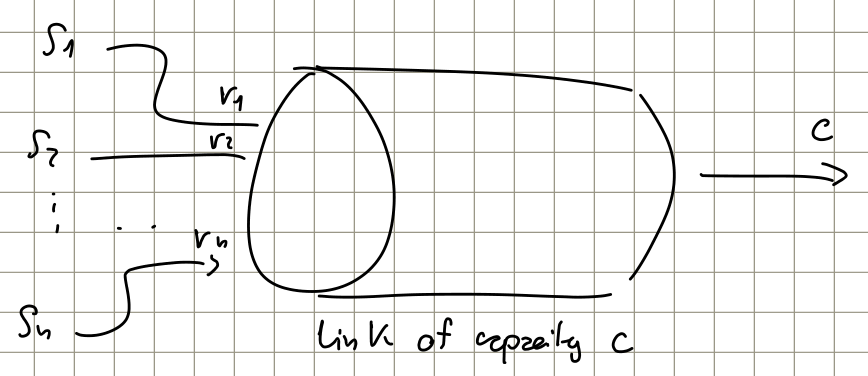

*The link carries the traffic of all sources, so their assigned rates draw on the same capacity
$C$.*

### Feasibility condition

Each allocation must be nonnegative, and the total rate must fit within the link capacity.

$$
r_i\ge 0 \quad (i=1,\ldots,n),
\qquad
\sum_{i=1}^{n}r_i\le C.
$$

### Feasibility set

The **feasibility set**, or feasible region, contains every allocation that meets both
conditions. The RM will choose one of these vectors according to the utility it produces.

$$
\mathcal R=\left\{\bar r\in\mathbb R_{\ge 0}^{n}:\sum_{i=1}^{n}r_i\le C\right\}.
$$

### Utility functions

A user's utility function $U_i$ measures the benefit the user obtains from its allocation.
With $k$ resource dimensions, the function takes $k$ inputs, $U_i:\mathbb R^k\to\mathbb R$ on
the applicable domain. For example, a wireless resource block occupies a subchannel during a
time slot, and the number of bits a user can transmit in that block depends on the channel
conditions at that frequency and time. With only one resource type, the utility reduces to
$U_i(r_i)$.

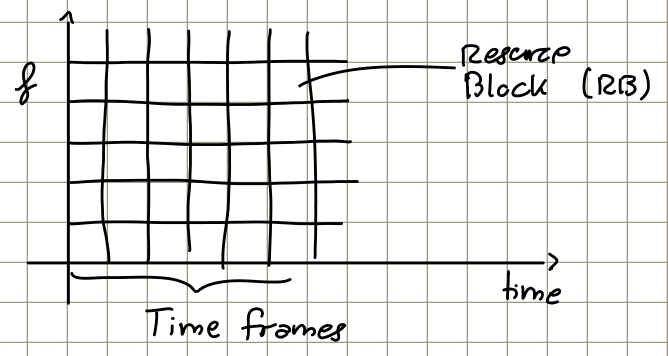

*Each cell identifies a resource block by its subchannel and time slot.*

### Example 1: image trasmission

A dashcam generates an image every $T$ seconds and sends it to a roadside unit over a shared
wireless channel. If the original image has size $M^*$ bits, transmitting at full quality
requires a rate $R^*=M^*/T$. Compressing the image to $M$ bits lowers the required rate to
$M/T$, but stronger compression can reduce image quality.

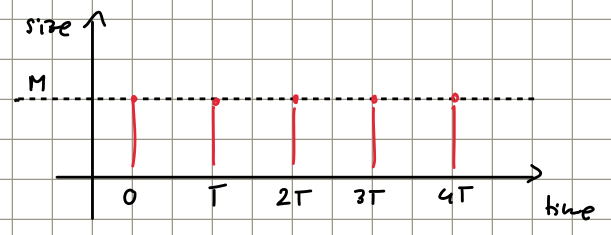

*One image is generated in each period $T$, so the stream offers traffic at rate $M/T$.*

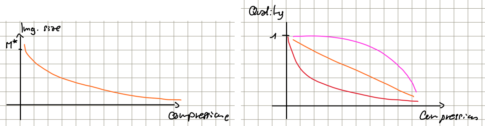

*The left panel shows how compression reduces image size. The right panel shows that the
corresponding quality loss can follow different curves depending on the compression method.*

With an assigned rate $r_i$, the source can transmit up to $r_iT$ bits per period. It therefore
chooses a compressed size $M_i$ that satisfies

$$
M_i\le r_iT,
\qquad
\frac{M_i}{M^*}\le\frac{r_i}{R^*}.
$$

The source can retain more image data as $r_i$ increases, so a quality curve expressed in
terms of image size can also be expressed in terms of the allocated rate. Once $r_i$ reaches
$R^*$, the original image fits within one period. A higher rate can send it faster, while its
visual quality stays at the maximum.

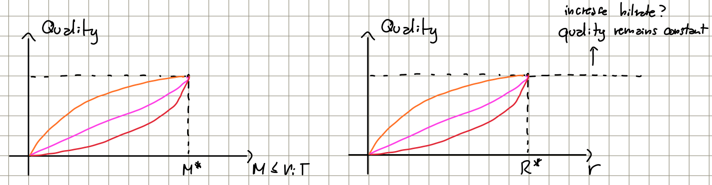

*The same quality response is shown against image size on the left and bitrate on the right.
Full quality is reached at $M^*$ or, equivalently, at $R^*$.*

A simple model treats quality as proportional to retained image size up to full quality. It
gives $U_i(r_i)=\min(r_iT/M^*,1)$ and can be used when an approximate allocation is sufficient.

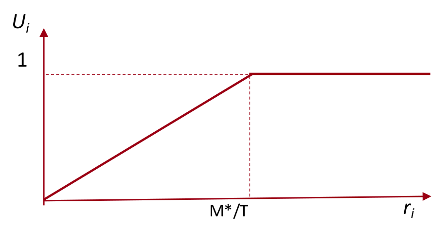

*L01, p. 6. The linear approximation reaches utility 1 at $r_i=R^*$.*

### Ex. 2 video streaming

A video stream can also reduce its bitrate through compression, at the cost of lower
perceived quality. The lecture uses an empirical approximation for the **Quality of
Experience** (QoE) in the tested compression range.

$$
U_i(r_i)\simeq 1+\alpha\rho^3,
\qquad
\rho=\log\left(\frac{M}{M^*}\right).
$$

For a fixed content duration, $M/M^*$ is the compressed rate as a fraction of the reference
rate. When this ratio is 1, $\rho=0$ and the model gives full quality. As the ratio decreases,
$\rho$ becomes negative, and the fitted coefficient $\alpha$ determines how quickly quality
falls for that content.

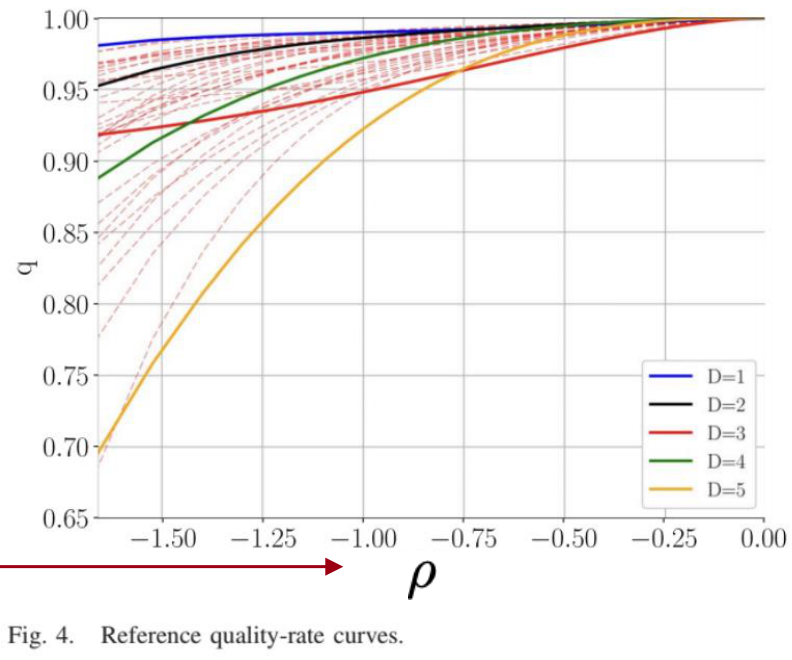

*L01, p. 7. The fitted curves share the reference point at $\rho=0$ and differ in how much
quality they lose under compression.*

### Example 3: alarm application

An industrial alarm must deliver a message of $L$ bits within $\delta$ seconds. If transmission
time is the only delay in the model, then the message takes $d=L/r_i$ seconds at rate $r_i>0$.
Meeting the deadline $d\le\delta$ requires at least $r^*=L/\delta$, which gives the threshold
utility

$$
U_i(r_i)=\mathbf 1\{r_i\ge r^*\}.
$$

The step model assigns full utility as soon as the deadline is met. If finishing well before
the deadline has additional value, a smoother model can assign utility gradually above
$r^*$, which can also make the allocation problem easier to handle numerically.

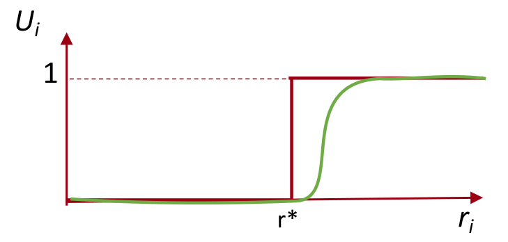

*L01, p. 8. The red step models a deadline test, and the green curve models the benefit of
further delay reductions.*

### Example 4: massive file transfer

For a fixed file size and a loss-free transfer, completion time falls in proportion to
$1/r_i$. A simple model rewards throughput directly with $U_i(r_i)=\alpha r_i$, where
$\alpha>0$ sets the utility scale. If a further speedup matters less once the transfer is
already fast, a logarithmic model $U_i(r_i)=\alpha\log(r_i/r_{\mathrm{ref}})$ for $r_i>0$
captures the diminishing gain. The fixed reference rate $r_{\mathrm{ref}}>0$ sets the
utility baseline.

### Perception laws

The *Weber–Fechner law* models perceived intensity $S$ as a logarithmic function of physical
intensity $I$, relative to a perception threshold $I_0$.

$$
S=k\ln\left(\frac{I}{I_0}\right).
$$

The coefficient $k$ depends on the sensory modality. The lecture uses webpage loading to
illustrate diminishing perceived gains. Reducing a long wait from ten to five seconds is
noticeable, while shaving another quarter-second off an already quick load may barely
register.

*Stevens' power law* describes the response with $S=kI^\alpha$. The exponent determines
whether perception is compressive ($0<\alpha<1$), linear ($\alpha=1$), or expansive
($\alpha>1$). In the expansive case, such as the lecture's weight-lifting example, the
perceived effort grows faster than the physical stimulus.

### Global utility function

Each allocation produces a combination of user utilities. One way to compare these
combinations is to sum the utilities with nonnegative weights $a_i$ that reflect the relative
importance of the users.

$$
U(\bar r)=\sum_{i=1}^{n}a_iU_i(r_i).
$$

When all users have equal priority, the weights can all be set to 1. For one shared resource,
$U$ depends on the $n$ rates. With $k$ resource types per user, the allocations can be arranged
as a $k\times n$ matrix, with a capacity constraint for each resource.

### Utility max = cost minimization

The RM seeks a feasible allocation $\bar r^*$ that maximizes global utility. Defining
$F(\bar r)=-U(\bar r)$ reverses the ordering of objective values, so the same allocations
minimize the cost.

$$
\bar r^*
\in\operatorname*{arg\,max}_{\bar r\in\mathcal R} U(\bar r)
=\operatorname*{arg\,min}_{\bar r\in\mathcal R} F(\bar r).
$$

The lecture mainly writes the problem as a utility maximization. The $\arg\max$ denotes
the maximizing allocations, while $\max$ denotes the utility value they achieve.

### Local and global optimal point

A feasible point $\bar r^*$ is **locally optimal** if there is a radius $\delta>0$ such that
every feasible $\bar v$ with $\lVert\bar v-\bar r^*\rVert<\delta$ satisfies
$U(\bar r^*)\ge U(\bar v)$. Equivalently, $F(\bar v)\ge F(\bar r^*)$ in that neighborhood.
A **globally optimal** point satisfies the same inequality for every feasible $\bar v$, so
equal-height peaks or a flat maximum can give several global optima.

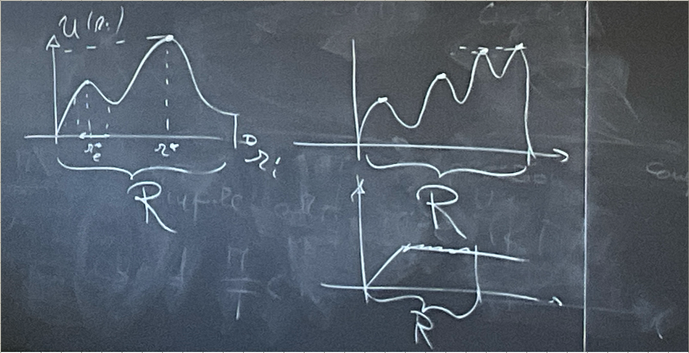

*The left sketch shows a local peak below the global peak. The two right sketches show
distinct global optima and a whole interval of maximizing points.*

### Example 1a

Two alarm sources send $L=1000$-bit packets with deadlines $\delta_1=1$ ms and $\delta_2=1.5$ ms
over a $C=5$ Mbit/s link. For each source, $w_i=L/\delta_i$ is the smallest rate that delivers
the packet on time, so $w_1=1$ Mbit/s and $w_2=2/3$ Mbit/s. The two thresholds fit within the link
capacity because $w_1+w_2=5/3<C$.

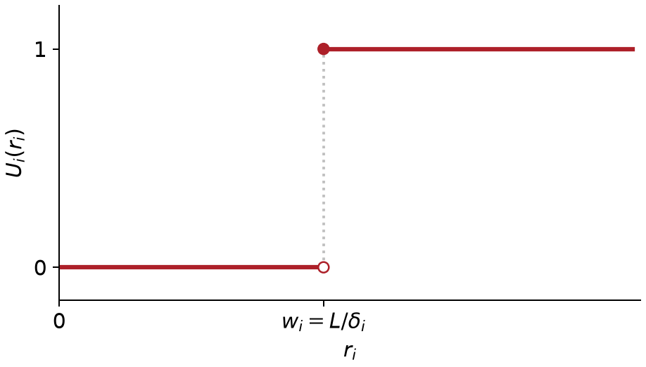

*Redraw of the threshold sketch. The filled point gives $U_i(w_i)=1$.*

Both users reach utility 1 at $(r_1,r_2)=(1,2/3)$ Mbit/s, so the total utility is 2. The
proposed allocation $(2,3)$ Mbit/s also gives 2, but it consumes the entire link. The
**frugality principle** selects an allocation with $r_i\le w_i$ when $w_i$ is the rate beyond
which user $i$ gains no further utility.

The handwritten indicator and L01, p. 14, use a strict inequality. Here equality is included
because $r_i=w_i$ gives $d=\delta_i$, which meets the stated deadline and agrees with the
lecture's explanation of the threshold and L01, pp. 8 and 15.

### Example 1b

First consider the step utilities of Example 1a with the capacity reduced to $C=1.5$ Mbit/s.
The lecture considers a split proportional to the requested rates ($w_1,w_2$), which gives

$$
r_i=C\frac{w_i}{w_1+w_2},
\qquad
(r_1,r_2)=(0.9,0.6)\ \text{Mbit/s}.
$$

Since each source falls below its threshold, the proportional split gives total utility 0.
There is capacity to satisfy either source individually, so the greatest possible utility is 1. The lecture chooses source 2, which requires the smaller rate. Giving it $2/3$ Mbit/s
and giving the remaining $5/6$ Mbit/s to source 1 yields utility 1. The same utility is
achieved at $(0,2/3)$ Mbit/s because any rate below $w_1$ still gives source 1 zero utility.
This saves capacity when assigned resources carry a cost (transcript part 2, 06:33–12:15).

For the weighted problem in L01, p. 18, keep $C=1.5$ Mbit/s and the same deadlines, but give
users weights $a_1=1$ and $a_2=3$. The utility now represents the shortfall from each user's
target rate.

$$
U_i(r_i)=\min\left(0,\frac{r_i\delta_i}{L}-1\right)
=\min\left(0,\frac{r_i}{w_i}-1\right).
$$

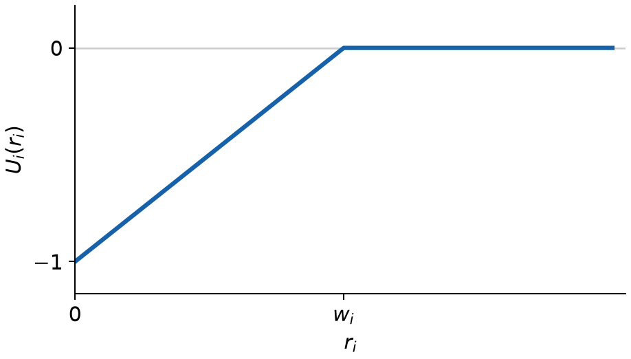

*The weighted problem gives each user utility $-1$ at zero rate and increases it up to zero
at $w_i$.*

**Must the entire link be used?** Here $C<w_1+w_2$, so at least one user is below its target
in every feasible allocation. Each utility increases strictly up to its target, and both
weights are positive. If capacity were left unused, assigning some of it to an unsatisfied
user would improve the objective. Thus every optimum satisfies $r_1+r_2=C$. With
nondecreasing utilities alone, leftover capacity can be assigned without reducing utility,
so a full-capacity optimum can be chosen even when slack optima also exist.

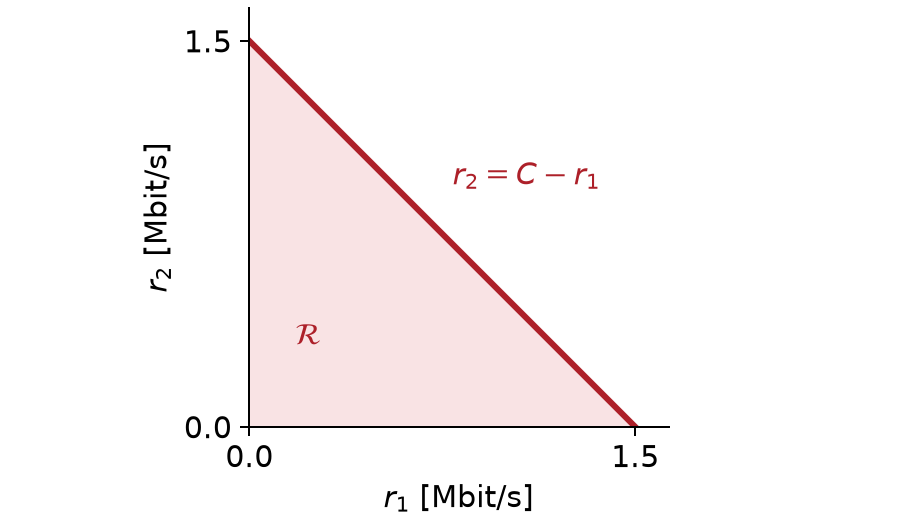

*The shaded triangle is feasible. The weighted shortfall objective reaches its maximum
somewhere on the red boundary, where $r_2=C-r_1$.*

Substituting $r_2=C-r_1$ reduces the search to one variable.

$$
\max_{(r_1,r_2)\in\mathcal R}
  \bigl[a_1U_1(r_1)+a_2U_2(r_2)\bigr]
=\max_{0\le r_1\le C}
  \bigl[a_1U_1(r_1)+a_2U_2(C-r_1)\bigr].
$$

For $r_1\le C-w_2=5/6$ Mbit/s, source 2 stays at utility 0 while source 1's utility increases.
Beyond $5/6$ Mbit/s, moving one more unit of rate from source 2 to source 1 costs $a_2/w_2=9/2$ units of weighted utility per Mbit/s, while source 1 gains at most
$a_1/w_1=1$. The weighted sum therefore rises to $5/6$ Mbit/s and then falls.

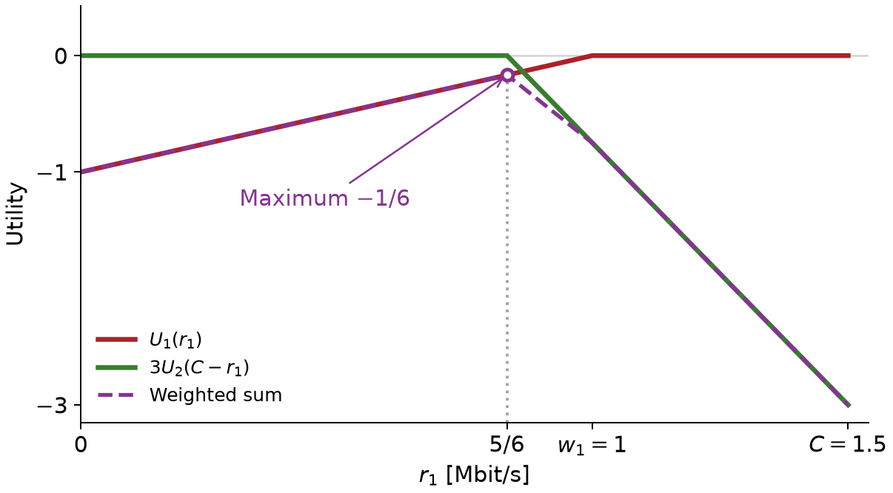

*Redraw of the handwritten graph. The purple sum peaks where the green term begins to fall.*

$$
(r_1^*,r_2^*)=\left(\frac56,\frac23\right)\ \text{Mbit/s},
\qquad
U(\bar r^*)=\left(\frac56-1\right)+3(0)=-\frac16\simeq -0.17.
$$

The lecturer rechecked the solution in class and found it agrees with L01, p. 19
(transcript part 2, 23:40–25:12).

### Example 1c (left for us)

The packet size, deadlines, and weights stay the same, but $C=3$ Mbit/s and each utility is
clipped below at 0 and above at 1.

$$
U_i(r_i)
=\min\left(\max\left(0,\frac{r_i}{w_i}-1\right),1\right).
$$

Utility is zero through $w_i$, rises linearly, and reaches 1 when $r_i/w_i-1=1$. The full
utility threshold is therefore $w_i^*=2w_i$, or $2$ Mbit/s for source 1 and $4/3$ Mbit/s for
source 2. Their sum is $10/3$ Mbit/s, which exceeds the link capacity.

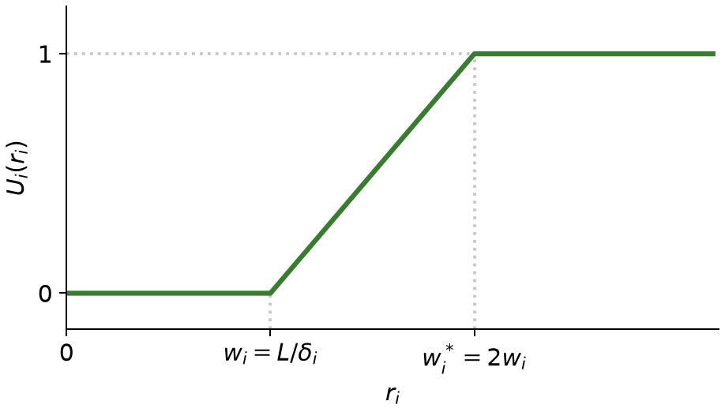

*The middle segment rewards additional rate. Below $w_i$ and above $w_i^*$ the utility is flat.*

*Solution to the exercise left in class (L01, p. 20).* For any given $r_2$, we can assign
the remaining rate $C-r_2$ to source 1 because $U_1$ is nondecreasing. If $r_2\le w_2$,
the total weighted utility is at most 1, since user 2 contributes zero. In the interval
$w_2<r_2<w_2^*$, increasing $r_2$ gains $a_2/w_2=9/2$ units of utility per Mbit/s and costs
at most $a_1/w_1=1$ through the corresponding reduction in $r_1$. The weighted objective
therefore increases up to $r_2=w_2^*$. Beyond that point, source 2 stays at its maximum,
while source 1 gets less than $5/3$ Mbit/s and has lower utility than it did at $r_2=w_2^*$.
The optimal allocation and its objective value are

$$
(r_1^*,r_2^*)=\left(3-\frac43,\frac43\right)
=\left(\frac53,\frac43\right)\ \text{Mbit/s},
\qquad
U(\bar r^*)=\frac23+3=\frac{11}{3}.
$$

## Fairness and utility functions

### Concave utility function

For a real-valued function $U:\mathbb R^k\to\mathbb R$ restricted to a convex domain,
$k$ is the dimension of the allocation vector. With one resource type it is the number of
users. The function is **concave** if for all points $\bar r$ and $\bar v$ in the domain and
every $\theta\in[0,1]$,

$$
U\bigl(\theta\bar r+(1-\theta)\bar v\bigr)
\ge \theta U(\bar r)+(1-\theta)U(\bar v).
$$

Varying $\theta$ traces the segment between the two inputs. The inequality says that the
value at an intermediate input lies on or above the chord between the two function values.

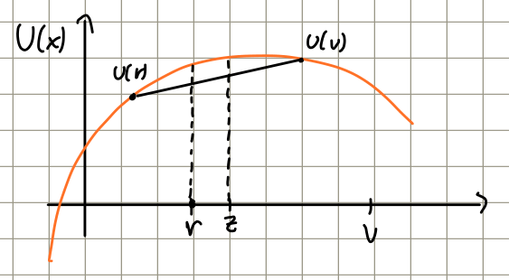

*The orange utility curve lies above the black chord at an intermediate input $z$.*

When $U$ is differentiable, an equivalent condition is that each tangent hyperplane bounds
the function from above. The expansion point $\bar r$ determines both the value
$U(\bar r)$ and the gradient, while $\bar v-\bar r$ is the displacement.

$$
U(\bar v)\le U(\bar r)+\nabla U(\bar r)^{\mathsf T}(\bar v-\bar r),
\qquad
\nabla U(\bar r)=
\begin{bmatrix}
\frac{\partial U}{\partial r_1}(\bar r)\\[3pt]
\vdots\\[3pt]
\frac{\partial U}{\partial r_k}(\bar r)
\end{bmatrix}.
$$

The gradient is a column vector, so the transpose times the displacement is a scalar.
In one dimension the tangent bound becomes $U(v)\le U(r)+U'(r)(v-r)$. The two terms
$U(r)$ and $U'(r)$ use the same base point, as in L02, p. 2.

#### Affine functions

An **affine function** has the form $f(\bar x)=A\bar x+a=\sum_{i=1}^k a_ix_i+a$,
where $A\in\mathbb R^{1\times k}$. Its chord coincides with the graph along every
segment, so it is both concave and convex. A nonnegative multiple of a capped linear
utility $\min(r,w)$ and the logarithm $\log(r/w)$ on $r>0$ are also concave. The capped
utility illustrates that the chord definition still applies at a kink where the
function is not differentiable.

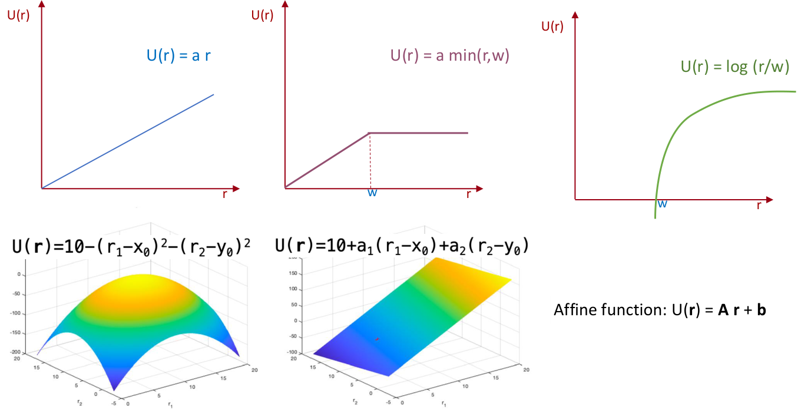

*L02, p. 3. The upper row shows three single-variable utilities. The lower row shows a
concave quadratic surface and an affine plane.*

#### Proof

Changing the sign of a concave utility $U$ gives a convex cost $F=-U$. On a convex
feasible set, every local maximum of $U$ is global, and the equivalent statement for
$F$ applies to local minima. For the link-sharing problem, $\mathcal R$ is convex because
its nonnegativity and capacity constraints are affine.

Suppose $\bar r_0$ is locally optimal within a radius $\delta>0$, but some feasible
$\bar r_1$ satisfies $U(\bar r_1)>U(\bar r_0)$. Then
$\lVert\bar r_1-\bar r_0\rVert\ge\delta$. By convexity of $\mathcal R$, the segment
joining them is feasible, so we can choose the point

$$
\bar z=\theta\bar r_0+(1-\theta)\bar r_1,
\qquad
\theta=1-\frac{\delta}{2\lVert\bar r_1-\bar r_0\rVert}.
$$

This choice gives 
$$\lVert\bar z-\bar r_0\rVert=(1-\theta)\lVert\bar r_1-\bar r_0\rVert
=\delta/2$$
, so local optimality implies $U(\bar z)\le U(\bar r_0)$. Concavity gives
a lower bound at that same point.

$$
U(\bar z)\ge
\theta U(\bar r_0)+(1-\theta)U(\bar r_1)
>U(\bar r_0).
$$

The bounds contradict each other, so no better feasible $\bar r_1$ exists. The choice
of $\theta$ follows L02, p. 6. It uses the coefficient $1-\theta$ for the displacement
from $\bar r_0$, correcting the mismatch in the book chapter's proof on p. 4.

### Optimality condition

If $U$ is differentiable and concave on a convex feasible set $\mathcal R$, then
$\bar r^*\in\mathcal R$ is optimal if and only if

$$
\nabla U(\bar r^*)^{\mathsf T}(\bar v-\bar r^*)\le 0
\qquad\text{for every }\bar v\in\mathcal R.
$$

The product measures the first-order change toward another feasible allocation. For
**necessity**, the segment $\bar r^*+t(\bar v-\bar r^*)$ is feasible for $0\le t\le1$,
so a positive derivative at $t=0$ would give a nearby feasible point of higher utility.
For **sufficiency**, concavity bounds $U(\bar v)$ from above by
$U(\bar r^*)+\nabla U(\bar r^*)^{\mathsf T}(\bar v-\bar r^*)$. If the product is
nonpositive for every feasible $\bar v$, then every feasible utility is at most
$U(\bar r^*)$ (book chapter, Theorem 4.2, pp. 4–5).

At an interior optimum, small moves in both signs of each coordinate are feasible, so
the condition reduces to $\nabla U(\bar r^*)=0$. On the capacity boundary, a move that
increases the total rate can be infeasible, so the condition applies only to feasible
directions.
