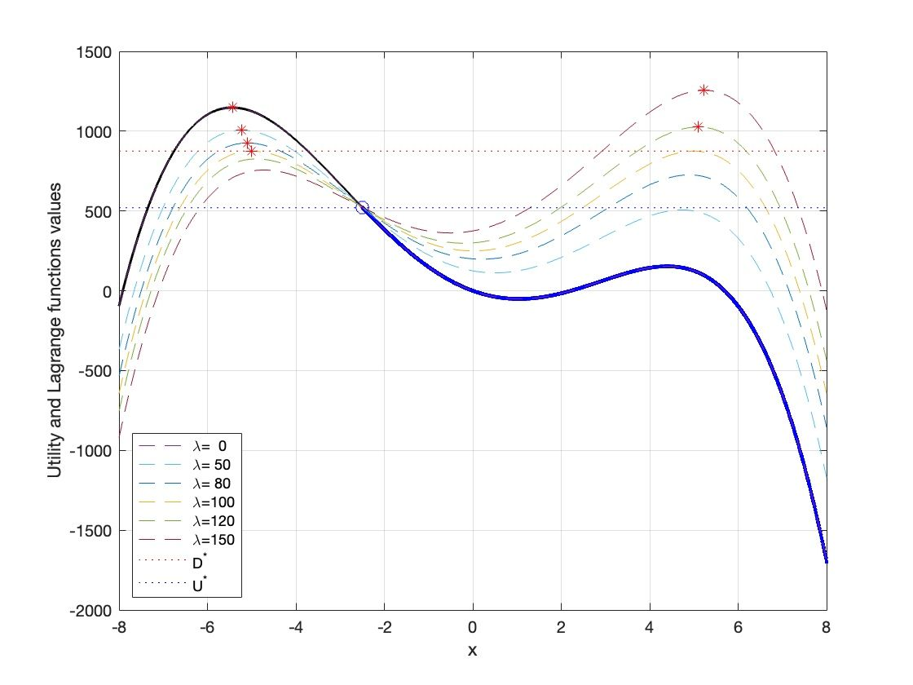

<!-- Pagina 1 -->

4.1 Introduction

As anticipated in Sec. 1.1, one of the purposes of network design is to help the design and dimensioning of complex systems, assigning resources to the different Information Flows so as to maximize the overall network utility. In Sec. 2.3.5, we provided examples of possible utility functions that relate the QoE perceived by the end users to the bitrate generated by the data source. However, utility functions can also be defined by the network operator to achieve other quality objectives, such as fair allocation of network resources among different Information Flows, maximizing the number of Information Flows that the system can sustain with acceptable (though possibly uneven) quality levels, optimizing the operator’s revenue, and so on. Irrespective of their actual purpose, most of the utility functions $U(\mathbf{r})$ typically considered in the networking domain share the following fundamental characteristics.

1. The utility function $U(\mathbf{r})$ is continuous in the domain $\mathbf{R}$ and has continuous first and second partial derivatives almost everywhere.

2. $U(\mathbf{r})$ is often (though not always) concave (see Sec. A.7). As a result, the following properties hold.

- For any $\mathbf{x}, \mathbf{y} \in \mathbf{R}$ and any $\theta \in [0, 1]$ it holds

$$U(\theta \mathbf{x} + (1 - \theta)\mathbf{y}) \geq \theta U(\mathbf{x}) + (1 - \theta)U(\mathbf{y}).$$

(4.1)

Communication Network Modeling
Draft
By Andrea Zanella Copyright © 2026 John Wiley & Sons, Inc.

---

<!-- Pagina 2 -->

Loosely speaking, this means that the straight segment between any two points $U(\mathbf{x})$ and $U(\mathbf{y})$ of the function always lies below the function itself.

• For any $\mathbf{x}, \mathbf{y} \in \mathbf{R}$ it holds

$$U(\mathbf{y}) \leq U(\mathbf{x}) + \nabla U(\mathbf{x})^{\mathrm{T}}(\mathbf{y} - \mathbf{x}),$$

(4.2)

where, in our case, $\mathbf{x}$ and $\mathbf{y}$ are resource allocation vectors. Eq. (4.2) means that any hyperplane tangent to the function at a certain point $U(\mathbf{x})$ is always above the function itself, so that, the right-hand side of (4.2) gives an upper bound of $U(\mathbf{x})$ in the surrounding of $\mathbf{x}$.

• The point $\mathbf{x}^*$ is the absolute maximum of $U(\mathbf{x})$ if and only if (iff) $\nabla U(\mathbf{x}^*) = 0$.

The allocation of network resources to the different Information Flows is generally managed by an entity called the Resource Manager (RM). The objective of the RM is to maximize the overall system utility, while ensuring that the capacity of any network element is not exceeded, and efficiently utilized. Mathematically, these conditions can be expressed as follows:

$$\begin{cases}
\sum_{s \in S} r_s(k) \leq c_k, & \forall k \in \mathcal{G}_{\mathrm{net}} \\
r_s(k) \leq w_s(k), & \forall s \in \mathcal{S}
\end{cases},$$

(4.3)

where we recall that $S$ is the set of users (Information Flows), $\mathcal{G}_{\mathrm{net}}$ is the set of different network resources, $r_s(k)$ is the amount of resource $k$ assigned to user $s$, and $c_k$ is the capacity (total availability) of resource $k$. The first condition requires that the allocated resources do not exceed the available resources, while the second condition ensures that users are not allocated more resources than they need.

Given the utility functions of the different Information Flows, the overall system utility function is typically defined as the weighted sum of the individual utilities of the Information Flows:

$$U(\mathbf{r}) \triangleq \sum_{s \in S} \varphi_s U_s(\mathbf{r}_s);$$

(4.4)

where the coefficients $\varphi_s \geq 0$, $s \in S$, can be used to prioritize certain Information Flows over others. The resource allocation problem gets the form of the so-called Network Utility Maximization (NUM) problem, which is defined as follows:

$$\begin{align*}
\max_{\{r_s\} \in \mathbf{R}} U(\mathbf{r}) \\
\text{subject to (s.t.)} \\
\sum_{s \in S} r_s(k) \leq c_k, & \forall k \in \mathcal{G}_{\mathrm{net}}; \\
r_s \geq 0, & \forall s \in \mathcal{S}
\end{align*}$$

(4.5)

If the global utility function $U(\mathbf{r})$ is concave, and all the constraint functions are affine or, more generally, convex functions, then (4.5) can be expressed in the following standard convex minimization form

$$\begin{align*}
\min_{\{r_s\} \in \mathbf{R}} V(\mathbf{r}) = -U(\mathbf{r}) \\
\text{subject to (s.t.)} \\
\sum_{s \in S} r_s(k) - c_k \leq 0, & \forall k \in \mathcal{G}_{\mathrm{net}}; \\
-r_s \leq 0, & \forall s \in \mathcal{S}
\end{align*}$$

(4.6)

---

<!-- Pagina 3 -->

where $V(\mathbf{r}) = -U(\mathbf{r})$, being the opposite of a concave function, is convex. Therefore, problem (4.6) is a convex problem, requiring the minimization of a convex function under convex constraint. However, since (4.5) and (4.6) are equivalent, in the sense that they admit the same solution $\mathbf{r}^*$, problem (4.5) is also said to be a convex problem.

In summary, the standard form of a convex optimization problem is the following:

$$\max_{\mathbf{r} \in \mathbb{R}} U(\mathbf{r}) \text{ or, equivalently} \min_{\mathbf{r} \in \mathbb{R}} - U(\mathbf{r})$$

s.t.

$$h_i(\mathbf{r}) \leq 0, \quad i = 1, 2, \ldots, H;$$

$$g_j(\mathbf{r}) = 0, \quad j = 1, 2, \ldots, G.$$

**Definition 4.1** The following definitions specify some properties of the constrained optimization problem (4.7).

- **The domain** set $\mathcal{D}$ of (4.7) is defined as the intersection of the domains of all the involved functions:

$$\mathcal{D} = \{ \text{dom}(U) \cap \text{dom}(h_1) \cdots \cap \text{dom}(h_H) \cap \text{dom}(g_1) \cdots \cap \text{dom}(g_G) \}.$$

- **The feasibility set** is the set of points $\mathbf{r} \in \mathcal{D}$ that satisfy all the constraints:

$$\mathbf{R} = \{ \mathbf{r} \in \mathcal{D} : h_i(\mathbf{r}) \leq 0, i = 1, 2, \ldots, H; g_j(\mathbf{r}) = 0, j = 1, 2, \ldots, G \}.$$

- **If $\mathbf{R} \neq \emptyset$, i.e., $\exists \mathbf{r} \in \mathcal{D}$ that satisfies all the constraints, then the problem is said to be feasible.** Conversely, if $\mathbf{R} = \emptyset$, the problem is said to be **infeasible**, since it does not admit any solution that satisfies all the constraints simultaneously.

- **An inequality constraint in standard form, $h_i(\mathbf{r}) \leq 0$, is said to be active at a certain point $\mathbf{r} \in \mathcal{D}$ if $h_i(\mathbf{r}) = 0$. This means that the point $\mathbf{r}$ lies exactly on the boundary defined by the constraint, and thus, the constraint directly influences the feasibility of neighboring points. Instead, the constraint is said to be **inactive** (or **slack**) at $\mathbf{r}$ if $h_i(\mathbf{r}) < 0$. This indicates that the point $\mathbf{r}$ lies strictly within the feasible region defined by the constraint, and the constraint does not influence the feasibility of neighboring points.**

- **A constraint is said to be convex if the feasible region that it defines is convex.**

- **For equality constraints, convexity requires the functions $g_i(\mathbf{r})$ to be affine, i.e., take the form $g_i(\mathbf{r}) = A^* \mathbf{r} + b$, where $A$ is a vector of real coefficients of the same size as $\mathbf{r}$, and $b$ is a constant.**

- **A point $\mathbf{r} \in \mathbf{R}$ is said to be locally optimal if there exists a $\delta > 0$ such that, for any point $\mathbf{v} \in \mathbf{R}$ at a distance lower than $\delta$ from $\mathbf{r}$ it holds $U(\mathbf{r}^*) \geq U(\mathbf{v})$:**

$$\exists \delta > 0 \text{ s.t. } \forall \mathbf{v} \in \mathbf{R}, |\mathbf{r}^* - \mathbf{v}| < \delta \text{ it holds } U(\mathbf{r}^*) \geq U(\mathbf{v}).$$

In most of the cases considered in this book, the inequality constraints will take the form $h_k(\mathbf{r}) = \sum_{s \in S} r_s(k) - c_k \leq 0$ for $k \in G_{\text{net}}$ (resource capacity cannot be exceeded), and $h_s(\mathbf{r}) = -r_s \leq 0$ for any $s \in S$ (resource allocation cannot be negative). The equality constraints can be useful whenever the problem requires to fully allocate a given amount

---

<!-- Pagina 4 -->

of resources (e.g., the total transmit power of a node to be fully allocated to all its radio bearers, or the time frame of an access protocol to be fully allocated to all nodes).

In the following we present some fundamental theorems regarding the optimal solutions of convex problems.

**Theorem 4.1 (Absolute optimal)** Any locally optimal point of a convex optimization problem (4.7). Therefore, there exists a $\delta > 0$ such that $\forall r \in \mathbf{R}$ with $|r - r_0| < \delta$ it holds $U(r_0) \geq U(r)$.

Suppose by contradiction that $r_0$ is not globally optimal. Therefore, there must exist another point $r_1 \in \mathbf{R}$, with $r_1 \neq r_0$, such that $U(r_1) > U(r_0)$. We shall then prove that this assumption leads to a contradiction.

Because of the previous condition, it must be $|r_1 - r_0| > \delta$. Moreover, the convexity of the problem requires that $\mathbf{R}$ is convex, so that for any $\theta \in [0, 1]$, the point $z = \theta r_0 + (1 - \theta)r_1$ belongs to the feasibility set.

Let us then fix $\theta = \frac{\delta}{2|r_1 - r_0|}$. We hence have $|z - r_0| = \theta|r_1 - r_0| = \frac{\delta}{2} < \delta$. This $z$ falls within the ball of radius $\delta$ centred in $r_0$. Consequently, $U(z) \leq U(r_0)$. Because of the concavity of $U(\cdot)$, moreover, we have $U(z) \geq \theta U(r_0) + (1 - \theta)U(r_1)$. Combining the two inequalities, we get

$$U(r_0) \geq U(z) \geq \theta U(r_0) + (1 - \theta)U(r_1) \rightarrow U(r_0) \geq U(r_1),$$

that contradicts the assumption, proving the theorem.

**Theorem 4.2 (Optimality conditions)** If $U(r)$ is differentiable and concave, then $r^* \in \mathbf{R}$ is optimal if and only if $\forall v \in \mathbf{R}$ it holds

$$\nabla U(r^*)^{\mathrm{T}}(v - r^*) \leq 0.$$

In other words, the directional derivative in every direction $(v - r^*)$ in the domain must be non-positive. This means that moving in any direction away from $r^*$, within the feasible region, cannot increase the value of $U(r)$.

**Proof:** We prove first the necessity condition, that is: assuming $r^* \in \mathbf{R}$ is optimal, we prove that $\nabla U(r^*)^{\mathrm{T}}(v - r^*) \leq 0$.

We resort to the proof by contradiction method. Assume that there exists a point $v \in \mathbf{R}$ such that $\nabla U(r^*)^{\mathrm{T}}(v - r^*) > 0$, thus violating the condition. Given the convexity of $\mathbf{R}$, then for any $\theta \in [0, 1]$ the point $z(\theta) = \theta v + (1 - \theta)r^* \in \mathbf{R}$. By taking the derivative of $U(z(\theta))$ with respect to $\theta$, we get

$$\frac{\mathrm{d}U(z(\theta))}{\mathrm{d}\theta} = \nabla U(z(\theta))^{\mathrm{T}}(v - r^*)$$

that, for $\theta \rightarrow 0$, tends to $\nabla U(r^*)^{\mathrm{T}}(v - r^*)$, which is greater than zero for the contradictory hypothesis. Since $U(z(\theta))$ has strictly positive derivative around $\theta = 0$, then it grows in the proximity of $r^*$, which means that $r^*$ cannot be the global optimal, contradicting the assumption. This proves the necessary condition of the theorem.

---

<!-- Pagina 5 -->

Let us now prove the sufficiency condition, that is: assuming $\nabla U(\mathbf{r}^*)^{\mathrm{T}}(\mathbf{v} - \mathbf{r}^*) \leq 0$ for any $\mathbf{v} \in \mathbf{R}$ then $\mathbf{r}^*$ must be globally optimal.

Since $U(\cdot)$ is concave, we have

$$U(\mathbf{v}) \leq U(\mathbf{r}^*) + \nabla U(\mathbf{r}^*)^{\mathrm{T}}(\mathbf{v} - \mathbf{r}^*).$$

from which we have

$$U(\mathbf{r}^*) \geq U(\mathbf{v}) - \nabla U(\mathbf{r}^*)^{\mathrm{T}}(\mathbf{v} - \mathbf{r}^*).$$

Since $\nabla U(\mathbf{r}^*)^{\mathrm{T}}(\mathbf{v} - \mathbf{r}^*) \leq 0$ by assumption, then $U(\mathbf{r}^*) \geq U(\mathbf{v})$ for any $\mathbf{v} \in \mathbf{R}$, which means that $\mathbf{r}^*$ is globally optimal.

In general, convex problems are well understood and there are a number of well established methods to solve them in a reasonable time. In some cases, the solution can be derived in closed form, but in most of the cases it requires iterative search methods that, however, are proved to converge in a limited time. In this book, we will quickly revise some of such methodologies, which we apply to a few practical cases connected to the network design problem. For the mathematical foundations of such methods, we refer the reader to any of the many excellent textbooks on convex optimization (see, e.g., [1]).

In the following we illustrate some approaches to the resolution of prototypal resource allocation problems by adopting a centralized approach, i.e., assuming that the RM is a single entity with perfect knowledge of utility functions and resources constraints.

### 4.2 Gradient ascent method

For any concave utility function, if there exists a feasible point $\mathbf{r}^*$ such that $\nabla U(\mathbf{r}^*) = 0$, then $\mathbf{r}^*$ is the optimal solution to our problem (4.5).

In many cases, however, the utility function is non-decreasing with respect to the amount of allocated resources, which implies that $\nabla U(\mathbf{r}) > 0$. Broadly speaking, convex functions with $\nabla U(\mathbf{r}) > 0$ increase as more resources are assigned, though possibly with diminishing utility gains. In such cases, the unconstrained optimal point would theoretically be reached as $\mathbf{r} \rightarrow \infty$. However, in most practical scenarios, the capacity of each type of resource is finite, which means that the amount of resources assigned to the Information Flows are constrained to be feasible, i.e., to do not exceed the available capacity. In this case, the utility function will be maximized at points that lie on the boundary of the feasible region, which prevent any further increasing of the allocated resources.

One approach to find the optimal resource allocation vector is then to start from an allocation within the feasible region, and then move along the direction of maximum increment of the utility function, until the boundary of the feasible region is reached. The coordinates of this boundary point will represent the optimal allocation vector.

This method, named gradient ascent, is then an iterative optimization technique used to maximize a differentiable objective function $U(\mathbf{r})$. The basic idea is to start from an initial point $\mathbf{r}_0$ internal to the feasibility region, and iteratively move along the direction of the gradient $\nabla U(\mathbf{r})$, which provides the steepest increase in the function. The gradient ascent update rule can be expressed as:

$$\mathbf{r}_{k+1} = \mathbf{r}_k + \alpha_k \nabla U(\mathbf{r}_k)$$

where $\mathbf{r}_k$ is the resource allocation vector at iteration $k$, $\alpha_k > 0$ is the step size (or learning rate) at iteration $k$, and $\nabla U(\mathbf{r}_k)$ is the gradient of the utility function $U$ evaluated at $\mathbf{r}_k$.

---

<!-- Pagina 6 -->

As mentioned, the gradient $\nabla U(\mathbf{r}_k)$ provides the direction in which the utility function increases most rapidly. By moving in this direction, we can increase the utility $U(\mathbf{r})$ by a value approximately equal to $\alpha||\nabla U(\mathbf{r}_k)||^2$. The method iteratively updates the resource allocation vector $\mathbf{r}_k$ until convergence, which typically occurs when the gradient $\nabla U(\mathbf{r}_k)$ becomes sufficiently small, indicating that a local maximum has been reached. However, the choice of the step size $\alpha_k$ is critical. In fact, $\alpha$ controls how far we move along the gradient direction at each iteration. If $\alpha_k$ is too large, the method may overshoot the maximum, while if it is too small, the method may converge very slowly.

When the resources are limited, the gradient ascent method must be modified to remain within the boundary of the feasibility region. A common approach is to use projected gradient ascent, where the update step is followed by a projection of $\mathbf{r}_{k+1}$ onto the feasible region $\mathbf{R}$:

$$\mathbf{r}_{k+1} = \text{Proj}_{\mathbf{R}}(\mathbf{r}_k^a)$$

where $\mathbf{r}_{k+1}^a = \mathbf{r}_k + \alpha_k \nabla U(\mathbf{r}_k)$ and $\text{Proj}_{\mathbf{R}}(\cdot)$ denotes the projection operator that maps the updated vector back onto the feasible region $\mathbf{R}$. It is defined as

$$\text{Proj}_{\mathbf{R}}(\mathbf{r}) = \arg\min_{\mathbf{r}' \in \mathbf{R}} ||\mathbf{r} - \mathbf{r}'||$$

where $||\mathbf{r} - \mathbf{r}'||$ represents the Euclidean distance between $\mathbf{r}$ and $\mathbf{r}'$. We recall that the projection of a vector $v_1^i$ onto another vector $v_2^i$ is given by

$$\text{Proj}_{\mathbf{v}_1^i} v_1^i = \frac{v_1^i \cdot v_2^i}{|v_2^i|^2} v_2^i$$

where $v_1^i \cdot v_2^i$ is the dot product of the two vectors (i.e., the sum of the element-wise product of the vectors), and $|v_1^i|$ denotes the module of vector $\vec{v}$. The projection of $v_1^i$ to a direction $v_2^i$ that is orthogonal to $v_2^i$ is hence given by

$$\text{Proj}_{\mathbf{v}_1^i} (v_1^i) = \text{Proj}_{\mathbf{v}_2^i} (v_1^i) - v_1^i.$$

The new point $\mathbf{r}_{k+1}$ can then be obtained as the projection of the vector $\mathbf{r}_{k+1}^a$ onto the direction that is tangent to the feasible region, i.e., perpendicular to the gradients of the functions that defines the feasible region. Considering one such function, $h(\mathbf{r})$, we hence have

$$\mathbf{r}_{k+1} = \text{Proj}_{\nabla h(\mathbf{r})} (\mathbf{r}_{k+1}^a) - \mathbf{r}_{k+1}^a \approx \frac{U(\mathbf{r}_k) \cdot \nabla h(\mathbf{r}_k)}{|\nabla h(\mathbf{r}_k)|^2} \nabla h(\mathbf{r}_k) - \nabla U(\mathbf{r}_k),$$

where the approximation holds if the incremental step is small enough.

### 4.3 Variable replacement method

The Variable Replacement Method is a technique in convex optimization used to simplify or reformulate problems by substituting complex or non-convex expressions with new variables, transforming the problem into a more tractable convex form. The process begins by identifying non-convex or difficult-to-handle expressions within the optimization problem, such as products or ratios. These expressions are then replaced with new variables, which are introduced to represent the complex terms. To maintain the equivalence of the problem, the new variables are related back to the original variables through additional

---

<!-- Pagina 7 -->

constraints. The original optimization problem is then rewritten using these new variables and the associated constraints, resulting in a reformulated problem that is convex. This new problem can be solved using standard convex optimization techniques, which guarantee global optimality under appropriate conditions. Finally, the solution of the convex problem is interpreted in the context of the original problem by substituting the values of the new variables back into the original expressions to find the optimal values of the original variables. This method is particularly useful in cases like geometric programming and fractional programming, where non-convex problems can be transformed into convex ones using variable substitutions.

**Example 4.3 A** Consider the following simple optimization problem:

$$\max_{x,y} x \cdot y,$$

s.t.

$$x + y \leq 1, x > 0, y > 0.$$

Here, the objective function $f(x,y) = x \cdot y$ is neither concave nor convex, since its Hessian is indefinite. However, since $x > 0$ and $y > 0$, maximizing $x \cdot y$ is equivalent to maximizing $f(x,y) = \log(x \cdot y) = \log(x) + \log(y)$, which is concave on the positive orthant. The original problem can now be rewritten as:

$$\max_{x,y} \log(x) + \log(y),$$

s.t.

$$x + y \leq 1, x > 0, y > 0.$$

The transformed problem is a convex optimization problem, since the objective function is concave and the feasible region is convex. Therefore, the problem admits at most one optimal solution, which, if it exists, is necessarily the global optimum.

We can solve the problem using the gradient ascent method. The gradient of the objective function is

$$\nabla f(x,y) = \begin{bmatrix} \frac{1}{x} \\ \frac{1}{y} \end{bmatrix}.$$

Since both components are strictly positive, moving in the direction of the gradient increases both $x$ and $y$, and hence the objective function. Therefore, no point in the interior of the feasible region can be optimal, since a sufficiently small step along the gradient would increase the objective function without violating any constraint.

Consequently, the optimal solution must lie on the boundary

$$x + y = 1.$$

On this boundary, the two variables are no longer independent, since $y = 1 - x$. We can therefore reduce the problem to a single variable:

$$\max_{0 < x < 1} g(x) = \log(x) + \log(1 - x).$$

The derivative of the objective function is

$$g'(x) = \frac{1}{x} - \frac{1}{1-x} = \frac{1-2x}{x(1-x)}.$$

---

<!-- Pagina 8 -->

A gradient ascent iteration along the boundary can then be written as

$$x_{k+1} = x_k + \alpha_k g'(x_k).$$

where $\alpha_k > 0$ is a suitable step size, chosen so that $x_{k+1} \in (0,1)$ and the objective function increases.

Since $x(1-x) > 0$ for $x \in (0,1)$, the sign of the derivative depends only on $1-2x$. Therefore,

$$g'(x) > 0 \quad \text{for } x < 1/2,$$
$$g'(x) = 0 \quad \text{for } x = 1/2,$$
$$g'(x) < 0 \quad \text{for } x > 1/2.$$

Thus, the gradient points toward $x = 1/2$ from either side. The stationary point is obtained by setting the derivative to zero:

$$g'(x) = 0 \implies x^* = \frac{1}{2}.$$

Since the second derivative is

$$g''(x) = -\frac{1}{x^2} - \frac{1}{(1-x)^2} < 0,$$

the function is strictly concave over the entire feasible interval. Hence, the stationary point is the unique global maximum.

Recalling that $y = 1-x$, we finally obtain

$$x^* = y^* = \frac{1}{2},$$

which is also the unique global optimum of the original problem, with maximum objective value

$$f(x^*, y^*) = \frac{1}{4}.$$

### 4.4 Dual problem method

The Dual Problem Method is a powerful technique in convex optimization that involves transforming the original problem, referred to as primal problem, into a related problem called the dual problem. Solving the dual problem can provide insights into the primal problem and, under certain conditions, can be easier to solve. The dual problem also helps in understanding the sensitivity of the optimal solution to changes in the problem’s parameters.

To construct the dual problem, we start from an optimization problem in its standard maximization form (4.7) (then assuming $U(\mathbf{r})$ is concave). We then define the Lagrangian function $\mathcal{L}(\mathbf{r}, \lambda, \mu)$ that combines the objective function and the constraints using Lagrange multipliers as follows:

$$\mathcal{L}(\mathbf{r}, \lambda, \mu) = U(\mathbf{r}) - \sum_{i=1}^{H} \lambda_i h_i(\mathbf{r}) + \sum_{j=1}^{G} \mu_j g_j(\mathbf{r})$$

(4.8)

---

<!-- Pagina 9 -->

Here, $\lambda_i \geq 0$ are the Lagrange multipliers associated with the inequality constraints, and $\mu_j$ are the multipliers associated with the equality constraints. To be noticed, the Lagrange multiplier is formed by subtracting from the target utility function $U(\mathbf{r})$ the constraint functions $h_i(\mathbf{r})$ that, in the feasible region, are non-positive. Therefore, $\mathcal{L}(\mathbf{r}, \lambda, \mu)$ is larger than or equal to the function to maximize, $U(\mathbf{r})$, for any $\mathbf{r} \in \mathbf{R}$. We then define the dual function $D(\lambda, \mu)$ as the supremum of the Lagrangian over the primal variables $\mathbf{r}$:

$$D(\lambda, \mu) = \sup_{\mathbf{r}} \mathcal{L}(\mathbf{r}, \lambda, \mu). \tag{4.9}$$

Notice that, the supremum of the function is considered in the whole domain $\mathcal{D}$, not limitedly to the feasibility set $\mathbf{R}$.

**Theorem 4.3 (Convexity and Dominance of the Dual function)** The dual function $D(\lambda, \mu)$ is always convex in $\lambda, \mu$ (even when $U(\mathbf{r})$ is not concave). Moreover, $D(\lambda, \mu) \geq U(\mathbf{r}^*)$, where $\mathbf{r}^*$ is an optimal solution to the convex maximization problem (4.7).

**Proof:** To prove the convexity of $D(\lambda, \mu)$, we introduce the more general function:

$$H(\mathbf{x}) = \sup_{\mathbf{r}} \left\{ U(\mathbf{r}) + \sum_{n=1}^{N} x_i f_i(\mathbf{r}) \right\}$$

where $f_i(\mathbf{r})$ are convex functions, and $\mathbf{x}^T = [x_1, \ldots, x_N]$ are real coefficients. We note that $D(\lambda, \mu)$ is a special case of $H(\mathbf{x})$. Therefore, if we prove that $H(\mathbf{x})$ is convex, we can conclude that $D(\lambda, \mu)$ is also convex.

To prove the convexity of $H(\mathbf{x})$ we need to verify that, for any $\theta \in [0, 1]$ and $\mathbf{x}_0, \mathbf{x}_1$, we have

$$H(\theta \mathbf{x}_0 + (1 - \theta) \mathbf{x}_1) \leq \theta H(\mathbf{x}_0) + (1 - \theta) H(\mathbf{x}_1).$$

Let us work on the left-hand side expression. For notation convenience, we introduce the vector $\mathbf{f}(\mathbf{r})^T = [f_1(\mathbf{r}), \ldots, f_N(\mathbf{r})]$. Hence, we have

$$H(\theta \mathbf{x}_0 + (1 - \theta) \mathbf{x}_1) = \sup_{\mathbf{r}} \left\{ U(\mathbf{r}) + \mathbf{f}(\mathbf{r})^T \theta \mathbf{x}_0 + (1 - \theta) \mathbf{x}_1 \right\}$$

$$= \sup_{\mathbf{r}} \left\{ U(\mathbf{r}) + \theta \mathbf{f}(\mathbf{r})^T \mathbf{x}_0 + (1 - \theta) \mathbf{f}(\mathbf{r})^T \mathbf{x}_1 \right\}$$

$$= \sup_{\mathbf{r}} \left\{ \theta \left( U(\mathbf{r}) + \mathbf{f}(\mathbf{r})^T \mathbf{x}_0 \right) + (1 - \theta) \left( U(\mathbf{r}) + \mathbf{f}(\mathbf{r})^T \mathbf{x}_1 \right) \right\}$$

$$= \sup_{\mathbf{r}} \left\{ \theta A(\mathbf{r}) + (1 - \theta) B(\mathbf{r}) \right\}$$

where, in the last step, we introduced the functions $A(\mathbf{r}) = \sup_{\mathbf{r}} \theta A(\mathbf{r}) + \sup_{1 - \theta} B(\mathbf{r})$ and $B(\mathbf{r}) = \sup_{\mathbf{r}} \theta A(\mathbf{r}) + \sup_{1 - \theta} B(\mathbf{r})$.

Considering that the supremum of a sum is always less than or equal to the sum of the supremum of the individual terms, we can write:

$$\sup_{\mathbf{r}} \left\{ \theta A(\mathbf{r}) + (1 - \theta) B(\mathbf{r}) \right\} \leq \sup_{\mathbf{r}} \theta A(\mathbf{r}) + \sup_{1 - \theta} B(\mathbf{r})$$

$$= \theta \sup_{\mathbf{r}} A(\mathbf{r}) + (1 - \theta) \sup_{\mathbf{r}} B(\mathbf{r}) = \theta H(\mathbf{x}_0) + (1 - \theta) H(\mathbf{x}_1)$$

which proves the convexity of $H(\mathbf{x})$ and, in turn, of $D(\lambda, \mu)$.

Now, to prove that $D(\lambda, \mu) \geq U(\mathbf{r}^*)$, we observe that $D(\lambda, \mu) = \sup_{\mathbf{r}} \mathcal{L}(\mathbf{r}, \lambda, \mu) \geq \mathcal{L}(\mathbf{r}^*, \lambda, \mu)$ by definition of supremum. Moreover, in the feasible region, the constraints

---

<!-- Pagina 10 -->

are always satisfied, so that $h_i(\mathbf{r}^*) \leq 0$ and $g_j(\mathbf{r}^*) = 0$. Therefore, $\mathcal{L}(\mathbf{r}^*, \lambda, \mu) = U(\mathbf{r}^*) - \lambda^T h(\mathbf{r}^*) + \mu^T g(\mathbf{r}^*) \geq U(\mathbf{r}^*)$, which proves that $D(\lambda, \mu)$ is an upper bound to the optimal solution of the primal problem.

**Remark** The previous theorem holds even when the primal problem is not convex.

**Definition 4.2 (Lagrange dual problem)** The Lagrange dual problem is defined as the minimization of the dual function in the domain $\lambda \succeq 0, \mu$:

$$\inf_{\lambda \succeq 0, \mu} D(\lambda, \mu).$$

The solution of the dual problem is indicated by $D^*$, and the optimal point are denoted by $\lambda^*$ and $\mu^*$, i.e.,

$$D^* \stackrel{\text{def}}{=} D(\lambda^*, \mu^*), \quad \{\lambda^*, \mu^*\} \stackrel{\text{def}}{=} \arg \inf_{\lambda \succeq 0, \mu} D(\lambda, \mu). \tag{4.10}$$

**Remark** The dual method can also be used to solve the problem (4.7) defined as the minimization of a cost function/In this case, the definition of the Lagrange and dual functions is 'complementary' to that considered for the manifold problem. In fact, these functions must offer lower bounds to the optimal value of the cost function. Accordingly, the Lagrange function is defined as

$$\mathcal{L}(\mathbf{r}, \lambda, \mu) = U(\mathbf{r}) + \sum_{i=1}^{K} \lambda_i g_i(\mathbf{r}) + \sum_{j=1}^{H} \mu_j h_j(\mathbf{r})$$

and the dual function as

$$D(\lambda, \mu) = \inf_{\mathbf{r}} \mathcal{L}(\mathbf{r}, \lambda, \mu).$$

In this case, the dual function is concave in $\lambda$ and $\mu$, even if the primal problem is not convex. It provides a lower bound on the optimal value of the primal problem for any non-negative $\lambda$ and any $\mu$.

**Definition 4.3 (Duality gap, strong and weak duality)** The duality gap is defined as the difference between $D^*$ and $U^* \stackrel{\text{def}}{=} U(\mathbf{r})$:

$$G = D^* - U^*.$$

Strong duality holds when the duality gap is zero. Conversely, Weak duality holds when the duality gap is strictly positive:

$$G = 0, \quad \text{Strong Duality};$$

$$G > 0, \quad \text{Weak Duality}.$$

In case of strong duality, the optimal value of the primal problem can be obtained from that of the dual problem, which is sometimes more convenient to solve. Strong duality is hence a particularly nice property that, however, is not always present in constrained optimization problems.

---

<!-- Pagina 11 -->

**Figure 4.1** Example 4.4 A: maximization problem with weak duality. The solid line shows the utility function of the primal problem (the feasible part in blue). The dashed lines show the Lagrange functions for different $\lambda$. Red marks represent the maximum of the Lagrange functions, corresponding to the value $D(\lambda)$ of dual function. Horizontal dotted lines highlight the optimal solution of the primal problem $(U^*, \text{in blue})$ and of the dual problem $(D^*, \text{in red})$.

**Remark** Let $\mathbf{r}^0$ be the point where the Lagrangian is maximized for $\lambda^*$ and $\mu^*$, i.e., $D^* = D(\lambda^*, \mu^*) = \mathcal{L}(\mathbf{r}^0, \lambda^*, \mu^*)$. In general, strong duality does not necessarily imply that $\mathbf{r}^0 = \mathbf{r}^*$, in particular for non-convex optimization problems.

**Example 4.4 A** To exemplify a case where strong duality does not hold, we consider the maximization of a simple univariate utility function $U(x) = -x^4 + 50x^2 - 100x + 100$ subject to $x \geq -2.5$. In standard form the problem can be expressed as follows

$$\max_x U(x) = -x^4 + 50x^2 - 100x + 100$$
s.t.
$$h(x) = -x - 2.5 \leq 0,$$

where $h(x)$ is the only constraint function. Fig. 4.1 shows the utility function over part of its domain. The portion of the curve in the feasible region is plotted with a thinner blue line. From the plot, we can see that the optimal of the primal problem is reached at $x^* = -2.5$, where the utility function gets the value $U^* = 523.4375$.

Now, consider the Lagrange function $\mathcal{L}(x, \lambda) = U(x) - \lambda h(x)$. For $\lambda = 0$ the Lagrange function corresponds to the unconstrained utility function, and it reaches its maximum around $x_{\max} = -5.4$ where it gets the value $D(0) = \mathcal{L}(-5.4, 0) \approx 147 > U^*$. The dual problem requires to change $\lambda$ until we reach the minimum of $D(\lambda)$. The dashed lines in Fig. 4.1 shows the Lagrange functions obtained for increasing values of $\lambda$. A red star marks the maximum of the Lagrange function for each $\lambda$, which corresponds to the value of the dual function $D(\lambda)$. We can observe that, increasing $\lambda$

---

**Immagini estratte:**

---

<!-- Pagina 12 -->

will initially shift the maximum of the Lagrange function towards the feasibility range of the primal problem, while the dual function progressively decreases, getting closer to $U^*$. However, when $\lambda$ exceeds a value around 100, the right-hand side peak of the Lagrange function becomes dominant, and the dual function starts increasing. Therefore, in this case, the minimum of the dual function remains strictly larger than the optimal solution of the primal problem and the duality gap cannot be nullified.

As seen from the previous example, not all optimization problems exhibit strong duality. However, simple, yet effective, conditions to check strong duality exist. In the following, we provide some of them.

**Lemma 4.1** If the unconstrained objective function is maximized within the feasible region of the primal problem, then strong duality holds.

**Proof:** Let $\mathbf{r}_{\max}$ be the point at which the unconstrained objective function $U(\mathbf{r})$ is maximized. If $\mathbf{r}_{\max} \in \mathbf{R}$, then we clearly have $U^* = U(\mathbf{r}_{\max})$. Choosing $\lambda_i = 0$ for all $i$, and $\mu_j = 0$ for all $j$, the Lagrange function becomes $\mathcal{L}(\mathbf{r}, 0, 0) = U(\mathbf{r})$ and its supremum is $\sup_{\mathbf{r}} \mathcal{L}(\mathbf{r}, 0, 0) = U(\mathbf{r}_{\max})$. Since $D(\lambda, \mu) \geq U^*$ and $D(0, 0) = U^*$, then the solution of the dual problem is achieved by setting to zero all Lagrangian coefficients, and the duality gap is zero.

Note that, this result is rather general, since it does not require convexity (or concavity), but the assumption that $\mathbf{r}_{\max} \in \mathbf{R}$ is quite strong. Slightly more stringent sufficient conditions are provided by the following theorem.

**Theorem 4.4** (Slater’s condition) The maximization problem (4.7) exhibits strong duality when the following conditions are all true:

1. $U(\mathbf{r})$ is a concave function, $h_i(\mathbf{r})$ are convex functions, and $g_j(\mathbf{r})$ are affine functions (i.e., the optimization problem, in its maximization formulation, is convex);
2. the feasible region contains at least one point $\mathbf{r} \in \mathbf{R}$ (called a strictly feasible point) in which all the inequality constraints are inactive: $h_i(\mathbf{r}) < 0$, for all $i = 1, \ldots, H$.

Under these conditions, the maximizer of the Lagrangian for given $\lambda^*$ and $\mu^*$ coincides with the primal optimal solution, i.e., $\mathbf{r}^* = \mathbf{r}^*$.

Slater’s condition is sufficient for strong duality because it guarantees that the problem is well-behaved. In fact, a point strictly inside the feasible region ensures that the feasible region is not just a boundary or a sharp edge but, rather, it has a well-behaved interior. Moreover, the convexity of the problem guarantees that the Lagrange function is concave, thus admitting one single maximum point. This is a sufficient (but not necessary) condition to guarantee strong duality, as discussed in the next section.

### 4.4.1 Intuitive interpretation of weak duality

In the dual problem, the constraints are seen as additional objective functions and the problem is treated as for a multi-objective optimization problem. The aim is to maximize the utility function $U(\mathbf{r})$ and, at the same time, minimize the constraint functions $h_i(\mathbf{r})$ (the equality constraints can be seen as pairs of inequality constraints, therefore we can

---

<!-- Pagina 13 -->

neglect them in this intuitive reasoning). The Lagrange function combines these different objective functions into a single one to be maximized: $\mathcal{L}(\mathbf{r}, \lambda) = U(\mathbf{r}) - \lambda^2 \mathbf{h}(\mathbf{r})$. The coefficients $\lambda$ balance the weights of the different objective functions: increasing $\lambda_i$ will increase the weight of the constraint function $h_i(\mathbf{r})$, pushing the solution $r$ towards a region where $h_i(\mathbf{r})$ is smaller (hence, $\mathcal{L}(\mathbf{r}, \lambda)$ is larger). The dual optimization problem aims at finding the values $\lambda^*$ for which the maximum of the Lagrange function cannot be further reduced. As proved in Theorem 4.3, the dual function $D(\lambda) = \sup_{\mathbf{r}} \mathcal{L}(\mathbf{r}, \lambda)$ is always not lower than $U(\mathbf{r}^*)$. Therefore, the minimum $D^* = D(\lambda^*) = \inf_{\mathbf{r}} D(\lambda)$ can be equal to $U(\mathbf{r}^*)$ (strong duality) or strictly larger than it (weak duality). As seen in Lemma 4.1, if the point $\mathbf{r}_{\text{max}}$ that maximizes the unconstrained objective function $U(\mathbf{r})$ is within the feasibility set, then strong duality holds. We hence consider the alternative scenario and explore the conditions under which weak duality may arise.

Assume that the feasibility set $\mathbf{R}$ is convex and well structured. Moreover, assume that $U(\mathbf{r})$ is well-behaved within its domain (e.g., continuous and differentiable everywhere) and gets its maximum at $\mathbf{r}^* \notin \mathbf{R}$. For the sake of simplicity, suppose that all the constraint functions are positive outside the feasible region, negative inside the feasible region, and zero on the boundary.

Let us start from $\lambda = 0$, for which the Lagrangeian is equal to $U(\mathbf{r})$, and consequently $D(0) = U(\mathbf{r}_{\text{max}}) > U(\mathbf{r}^*)$. Therefore, the Lagrangeian $\mathcal{L}(\mathbf{r}, \lambda)$ for $\lambda = 0$ reaches its maximum outside the feasible region. If we slightly increase the coefficients $\lambda_i$, the Lagrangeian $\mathcal{L}(\mathbf{r}, \lambda)$ decreases outside the feasible region, increases within the feasible region, and remains unchanged on the boundary. If the functions are well-behaved, small increments in $\lambda_i$ will correspond to smooth variations of the Lagrangeian, therefore the maximum value of the function will also change smoothly. We keep increasing $\lambda$ as long as the maximum of the Lagrange function remains outside the feasible region, and $D(\lambda)$ keeps decreasing.

In absence of discontinuity, we will reach a point $\lambda^*$ where the maximum of the Lagrange function outside the feasible region equals that inside $\mathbf{R}$. This point corresponds to the minimum of $D(\lambda^*)$, since any change of $\lambda^*$ will increase the function either inside or outside the feasible region, so that the dual function will increase. Now, if this equilibrium is reached at a point $\mathbf{r}^*$ on the boundary of the feasible region, then the dual gap is zero, since on the boundary the Lagrangeian is equal to $U(\mathbf{r})$, whose maximum in $\mathbf{R}$ is $U^*$. Therefore, it must be $\mathbf{r}^* = \mathbf{r}^*_0$. The alternative scenario is that the equilibrium is reached at two points, one strictly inside and one strictly outside the feasible region. Let $\mathbf{r}_{\text{in}}^0$ and $\mathbf{r}_{\text{out}}^0$ be such points. In this case, if $D(\lambda^*) = U(\mathbf{r}_{\text{in}}^0) - \sum_i \lambda_i h_i(\mathbf{r}_{\text{in}}^0) > U(\mathbf{r}^*)$, we will have a duality gap. A sufficient condition to avoid this case is that the Lagrange function $\mathcal{L}(\mathbf{r}, \lambda^*)$ admits a unique maximum at a single point. This condition is certainly verified for any $\lambda$ if $U(\mathbf{r})$ is concave (in maximization problems) and all the constraint functions are convex or affine.

Summing up, when Slater’s conditions are satisfied, the duality gap is zero because the Lagrange function is always convex, admitting a single maximum point, and changing $\lambda$ such a maximum gets minimized at the boundary of the feasible region (or strictly inside it, if there is the optimal value of $U(\mathbf{r})$). It is interesting to notice that the Lagrange coefficients of the dual problem are zero for all the constraints that are inactive at the optimal point, and greater than zero for all active constraints, so that $\lambda_i h_i(\mathbf{r}^*) = 0$ for all $i$.

**Example 4.4 B** Consider the following convex (minimization) primal problem:

$$\text{minimize } f(x) = x_1^2 + x_2^2$$

---

<!-- Pagina 14 -->

subject to:
$$x_1 + x_2 \geq 1, \quad x_1 \geq 0, \quad x_2 \geq 0$$

The Lagrangian is:
$$\mathcal{L}(x_1, x_2, \lambda) = x_1^2 + x_2^2 + \lambda(1 - x_1 - x_2)$$

The dual function is:
$$g(\lambda) = \inf_{x_1, x_2} \mathcal{L}(x_1, x_2, \lambda) = \inf_{x_1, x_2} \left(x_1^2 + x_2^2 - \lambda x_1 - \lambda x_2 + \lambda\right)$$

The dual problem is:
$$\text{maximize } g(\lambda) \quad \text{subject to } \lambda \geq 0$$

Solving the dual problem yields the optimal value of $\lambda^*$ and, hence, the optimal value of the primal problem.

4.4.2 Karush-Kuhn-Tucker (KTT) conditions

The Karush-Kuhn-Tucker (KKT) conditions are a set of necessary conditions for a solution in a nonlinear programming problem to be optimal, assuming that certain regularity conditions (like constraint qualifications) hold. Consider a primal problem in the standard form (4.7) and its corresponding dual problem (4.10). Assume the utility and constraints functions are differentiable. For a point $\mathbf{r}^*$ to be optimal, the following conditions must be satisfied:

1. **Primal Feasibility:** $\mathbf{r}^*$ must belong to the feasibility set of the primal problem, i.e.,
   $$h_i(\mathbf{r}^*) \leq 0, \quad i = 1, 2, \ldots, H;$$
   $$g_j(\mathbf{r}^*) = 0, \quad j = 1, 2, \ldots, G.$$

2. **Dual Feasibility:** The Lagrange multipliers $\lambda_i^*$ associated with the inequality constraints must be non-negative:
   $$\lambda_i^* \geq 0, \quad i = 1, 2, \ldots, H.$$

3. **Stationarity:** The gradient of the Lagrange function with respect to $\mathbf{r}$ must vanish at $\mathbf{r}^*$:
   $$\nabla_{\mathbf{r}} \mathcal{L}(\mathbf{r}^*, \lambda^*, \mu^*) = \nabla_{\mathbf{r}} U(\mathbf{r}^*) - \sum_{i=1}^{H} \lambda_i^* \nabla h_i^i(\mathbf{r}^*) + \sum_{j=1}^{G} \mu_j^* \nabla g_j^j(\mathbf{r}^*) = 0.$$

4. **Complementary Slackness:** For each inequality constraint, the product of the Lagrange multiplier $\lambda_i^*$ and the corresponding constraint function must be zero:
   $$\lambda_i^* h_i(\mathbf{r}^*) = 0, \quad i = 1, \ldots, H.$$

This condition implies that if the inequality constraint $h_i(\mathbf{r}) \leq 0$ is strictly less than zero at $\mathbf{r}^*$ (slack), then the corresponding Lagrange multiplier $\lambda_i^*$ must be zero. Conversely, if the constraint is active (i.e., $h_i(\mathbf{r}^*) = 0$), then the corresponding multiplier

---

<!-- Pagina 15 -->

$\lambda^*_i$ can be strictly positive (i.e., slack in the dual problem, for which the Lagrange multipliers must be $\lambda_i \geq 0$).

We observe that the KKT conditions are necessary for the optimality of $r^*$, even if the primal optimization problem is not convex (i.e., $U(r)$ is not concave). However, if the problem is convex and well behaved (i.e., if the Slater’s conditions are verified), then the KKT conditions are also sufficient for optimality and strong duality. This means that the solution $r^*$ of the primal problem, and $\lambda^*, \mu^*$ of the corresponding dual problem, must satisfy the KKT conditions. The KKT conditions hence provide a powerful framework for finding optimal solutions in constrained convex optimization problems.

**Theorem 4.5** For convex optimization problems (i.e., when $U(r)$ is concave), strong duality holds if and only if the KKT conditions are satisfied from some values $r^*$, $\lambda^*, \mu^*$, which are hence the solutions of the primal and dual problems, respectively.

**Proof:**

We start by proving the necessity of KKT conditions, which means that the optimal solutions $r^*$, $\lambda^*$, $\mu^*$ of the primal and dual problem under strong duality must satisfy the KKT conditions.

We then assume the duality gap is zero, i.e., $D^* = U^*$. This implies that there exists at least one feasible point $r^*$ for which $U^* = U(r^*) \geq U(r)$ for any other $r \in \mathbf{R}$. Moreover, $r^*$ being feasible, must satisfy the Primal Feasibility condition. Similarly, there must exist $\lambda^*, \mu^*$ such that $D^* = D(\lambda^*, \mu^*)$, with $\lambda^* \geq 0$, which corresponds to the Dual Feasibility condition. By construction, we also have $D(\lambda, \mu) \geq L(r, \lambda, \mu)$, for any $r$. In particular, we have

$$D^* = D(\lambda^*, \mu^*) = \sup_{r} \mathcal{L}(r, \lambda^*, \mu^*) = \sup_{r} \left\{ U(r) - \sum_{i=1}^{H} \lambda^*_i h_i(r) + \sum_{j=1}^{G} \mu^*_j g_j(r) \right\}$$

$$\geq U(r^*) - \sum_{i=1}^{H} \lambda^*_i h_i(r^*) + \sum_{j=1}^{G} \mu^*_j g_j(r^*),$$

where the inequality follows from the observation that the supremum of the Lagrange function is, by definition, not lower than its value at any point $r$ and, in particular, at $r^*$. Because of the primal feasibility condition, the function $g_j(r^*) = 0$, while $h_i(r^*) \leq 0$.

Then we have

$$D^* \geq U(r^*) - \sum_{i=1}^{H} \lambda^*_i h_i(r^*) \geq U(r^*).$$

On the other hand, strong duality requires $D^* = U^* = U(r^*)$. Therefore, the previous inequality can hold true only if $\lambda^*_i h_i(r^*) = 0$ for all $i = 1, \ldots, H$, which represents the Complementary Slackness condition. Finally, we have that $D^* = D(\lambda^*, \mu^*) = \sup_{r} \mathcal{L}(r, \lambda^*, \mu^*) \geq L(r^*) = U^*$. Since the duality gap is zero, then it must be $U(r^*) = L(r^*, \lambda^*, \mu^*)$. This means that $r^*$ must be a global maximizer for $\mathcal{L}(r, \lambda^*, \mu^*)$, which implies that $\nabla_r \mathcal{L}(r^*, \lambda^*, \mu^*) = 0$, i.e., the Stationarity condition must hold.

Let us now prove the sufficiency of KKT conditions for optimality and strong duality. We hence need to prove that, if $r^*, \lambda^*, \mu^*$ satisfy the KKT conditions, then they are optimal for the primal and dual problem, respectively, and the duality gap is zero. Because of Complementary Slackness, we have $\lambda^*_i h_i(r^*) = 0$ for $i = 1, \ldots, H$, while Primal

---

<!-- Pagina 16 -->

Feasibility requires $g_j(\mathbf{r}^*) = 0$. Then, $\mathcal{L}(\mathbf{r}^*, \boldsymbol{\lambda}^*, \boldsymbol{\mu}^*) = U(\mathbf{r}^*)$. The Stationarity Condition implies that the function $\mathcal{L}(\mathbf{r}, \boldsymbol{\lambda}^*, \boldsymbol{\mu}^*)$ exhibits a critical point at $\mathbf{r}^*$. Since $U(\mathbf{r})$ is concave, then this critical point must be a maximum. Hence we have $D(\boldsymbol{\lambda}^*, \boldsymbol{\mu}^*) = \sup_{\mathbf{r}} \mathcal{L}(\mathbf{r}, \boldsymbol{\lambda}^*, \boldsymbol{\mu}^*) = U(\mathbf{r}^*)$, from which we conclude that $\mathbf{r}^*$ is the optimal solution of the primal problem (because it belongs to the feasible set and the utility function at this point is equal to the dual function, which is an upper bound of the optimal solution). On the other hand, we have that $D^* = \inf_{\boldsymbol{\lambda}, \boldsymbol{\mu}} D(\boldsymbol{\lambda}, \boldsymbol{\mu})$ by definition, and that $D(\boldsymbol{\lambda}, \boldsymbol{\mu}) \geq U^*$ by construction. Since we have just proved that $D(\boldsymbol{\lambda}^*, \boldsymbol{\mu}^*) = U(\mathbf{r}^*) = U^*$, then we can conclude that $D^* = D(\boldsymbol{\lambda}^*, \boldsymbol{\mu}^*) = U^*$, i.e., the duality gap is zero.

### 4.5 Utility maximization for a single network resource

Consider a set $S$ of $n = |S|$ Information Flows, which share a common network element (e.g., a link), and let $w_i$ denote the resource request by flow $s$ (for instance, the required throughput). Furthermore, let $c$ be the capacity of the shared network element, i.e., the total available resources at that element (e.g., the link bitrate).

(i) $h_i(\mathbf{r}^*) \leq 0$ for $i = 1, \ldots, H,$

(primal feasibility)

(ii) $\lambda_i \geq 0$ for all $i = 1, \ldots, H,$

(dual feasibility)

(iii) $\nabla_{\mathbf{r}} \mathcal{L}(\mathbf{r}^*, \boldsymbol{\lambda}^*, \boldsymbol{\mu}^*) = 0,$

(stationarity)

(iv) $\lambda_i h_i(\mathbf{r}^*) = 0$ for all $i = 1, \ldots, H.$

(complementary slackness)

The complementary slackness conditions say that, if a dual variable is strictly greater than zero (slack), $\lambda_i > 0$, then the corresponding primal constraint must be an equality (tight): $h_i(\mathbf{r}^*) = 0$. Conversely, if the primal constraint is slack, i.e., $h_i(\mathbf{r}^*) < 0$, then the corresponding dual variable is tight, i.e., $\lambda_i = 0$. Therefore, if some inequality constraints in the primal problem are slack, i.e., not active at the optimal point $\mathbf{r}^*$, then the corresponding terms in the Lagrangian disappear at the optimal point $(\boldsymbol{\lambda}^*, \boldsymbol{\mu}^*)$ of the dual problem, as required for the duality gap to be zero.

### 4.5.1 Fairness

AZ says: WARNING: The section on fairness is not complete. Please, complement it with the content of Sections 2.1-2.2 of the book “Communication Networks” by Srikant and Ying. As mentioned, the allocation of resources to different Information Flows can be based on different criteria. A common approach consists in following a fairness approach in resource assignment.

Fairness is a fundamental concept that addresses the just and impartial distribution of limited goods or services among different individuals or groups. This principle is crucial in various fields, including economics, ethics, and public policy. The notion of fairness encompasses several key aspects, such as equal treatment, proportionality, efficiency, sustainability, and transparency in the allocation process.

In network design, a fair allocation should aim to maximize the overall utility of the resources, while ensuring that every user has equal opportunities to access resources, taking into account their relative needs. The challenge lies in balancing these different aspects.

---

<!-- Pagina 17 -->

of fairness with other objectives, such as economic efficiency. Ultimately, fairness in resource allocation remains a complex and debated topic with significant implications across many areas of society.

In the following we describe some reference fairness paradigms commonly considered in resource allocation problems. AZ says: TO BE MERGED WITH THE CONTENT DESCRIBED IN THE BOOK. SEE ALSO SLIDES

### 4.5.1.1 Max-min fairness

The Max-Min Fairness (MMF) concept can be summarized with the motto “all flows are equal” and it is probably the closest to the way the term fairness is intended in the everyday life. According to this fairness principle, in fact, the available resources are split in equal parts to all applicants. However, because of the non-redundancy principle in (4.3), applicants that are satisfied with less resources than the equal partition will return the resources in excess to the RM that, in turn, allocates such resources equally among the remaining flows. This process is repeated until all resources are assigned.

To mathematically formalize the max-min fairness RM principle, we assume, without loss of generality, that the flows are enumerated in ascending order of resource requests, so that $w_i \leq w_{i+1}$ for $i = 1, 2, \ldots, n-1$. Each flow is entitled to an equal share $c_i = c/n$ of the resources, but such the assignment shall not exceed the request. Therefore, if $w_1 < c_1$, then the RM will assign $r_1 = w_1$ to the first flow and divide the remaining resources to the other flows. The new potential assignment for each flow $i = 2, \ldots, n$ is hence

$$c_i = \frac{c}{n} + \frac{c}{n-1} = \frac{(n-1)c + c - nw_1}{n(n-1)} = \frac{c - w_1}{n-1}. \tag{4.11}$$

Applying iteratively this reasoning, we easily see that max-min resource allocation can be expressed by means of the following recursion:

$$r_i = \min \left\{ w_i, \frac{c - \sum_{j=1}^{i-1} r_j}{n-i+1} \right\}, \quad i = 1, \ldots, n.$$

Let $\mathcal{U} = \{i \in S : r_i < w_i\}$ be the set of unsatisfied flows, and $u = n - |\mathcal{U}| + 1$ the index of the first such unsatisfied flows. We note that all such flows will be allocated the same rate, which is no lower than the rate of any satisfied flow. In summary we have:

$$\begin{cases}
r_i = w_i & , \quad h = 1, 2, \ldots, u-1; \\
r_j = \frac{c - \sum_{j=1}^{u-1} w_j}{n-u} < w_j & , \quad j = u, u+1, \ldots, n;
\end{cases}$$

with $r_1 \leq r_2 \leq \ldots \leq r_u = r_{u+1} = \ldots = r_n$. Therefore, the amount of resources given to unsatisfied flows cannot be further increased without reducing the resources assigned to fully satisfied flows with less requirements, from which the naming max-min fairness.

### 4.5.1.2 Weighted Fair Sharing

Weighted Fair Share (WFS) is achieved when resources are allocated to the different Information Flows according to their positive weights $\{\varphi_i, i \in S\}$.

AZ says: Add here definition from book.

1The weight can reflect the priority of the data flow, or be proportional to the average flow rate of the source, or be chosen according to other criteria.

---

<!-- Pagina 18 -->

Hence, the resources will be allocated to the different flows proportionally to their weights, i.e.,

$$r_i = \frac{\varphi_i}{\sum_{j \in A} \varphi_j} c;$$

(4.12)

where $A$ is the set of all flows with pending resource request at a certain time $t$, which are generally referred to as active or backlogged flows. Note that (4.12) yields a non-redundant allocation only when $w_i \geq r_i$, whereas in the contrary case it is possible that some flows get more resources than what required, while others remain unsatisfied even in non-congested scenarios. To correct these deficiencies, it is possible to recursively reassign the resources in excess to the other flows, similarly to what described for MMF. Then, ordering the sources for increasing demand, we have

$$r_i = \min \left\{ w_i, \frac{\varphi_i}{\sum_{j=i}^{n} \varphi_j} \left( c - \sum_{j=1}^{i-1} r_j \right) \right\}, \quad i = 1, \ldots, n.$$

(4.13)

In a resource-constrained scenario, the WFS allocation is obtained by maximizing the sum of the utility functions of the users defined as

$$U_i(r_i) = \varphi_i \log(r_i).$$

(4.14)

AZ says: Add proof

4.5.1.3 Minimum Potential Delay fairness

4.5.1.4 $\alpha$-fairness

4.5.1.5 The Jain’s fairness index The Jain’s fairness index $J$ is a measure of the fairness of the allocation provided to the different Information Flows, and is defined as [2]

$$J = \frac{\left( \sum_{i=1}^{n} x_i \right)^2}{n \sum_{i=1}^{n} x_i^2}$$

(4.15)

where $x_i$ is the throughput achieved by the $i$th Information Flow. It should be noted that $J = 1/n$ corresponds to the minimum fairness, while $J = 1$ indicates perfect fairness among the users in the system.