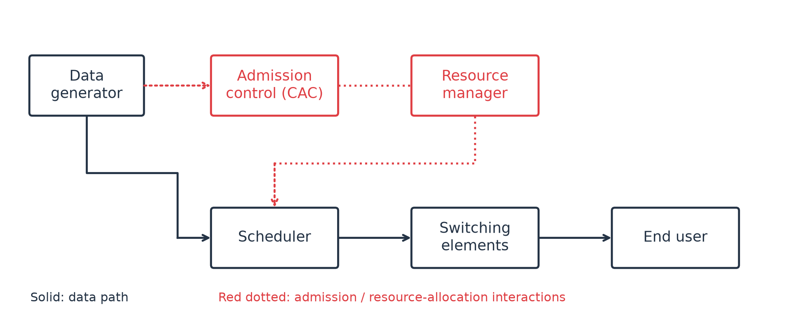
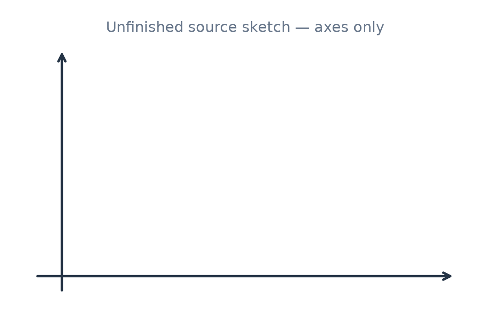
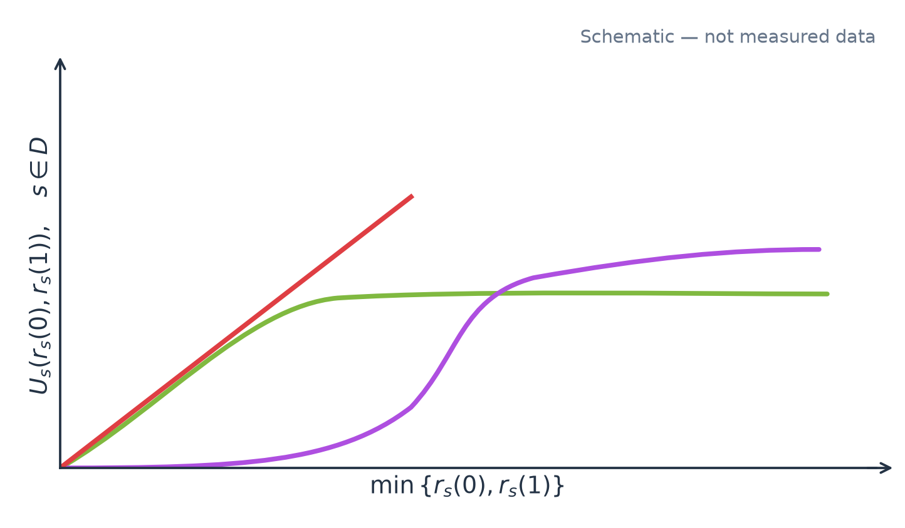
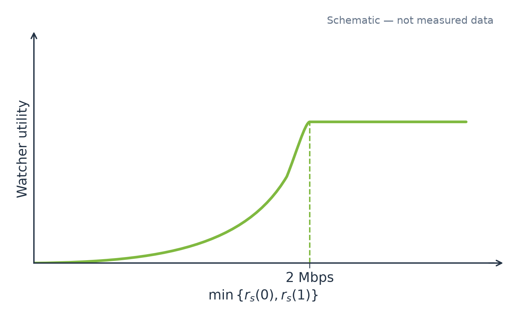
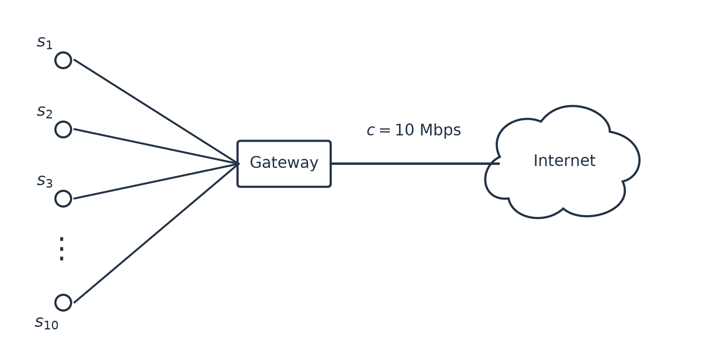
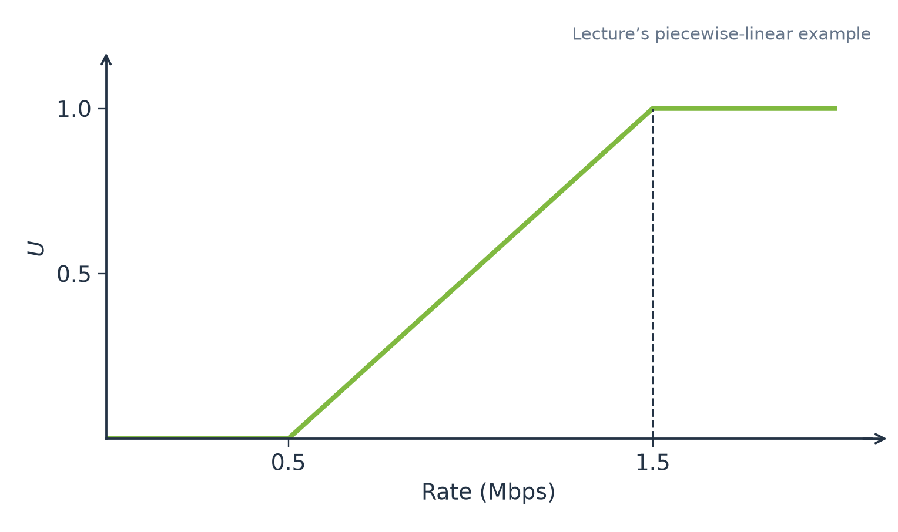
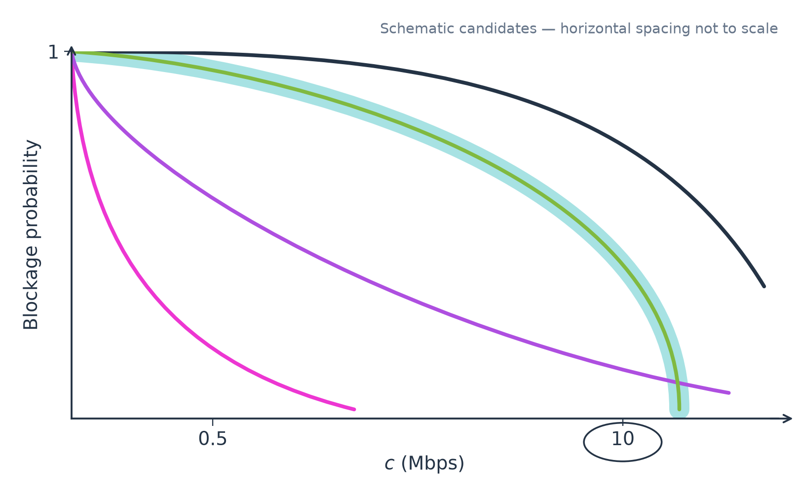
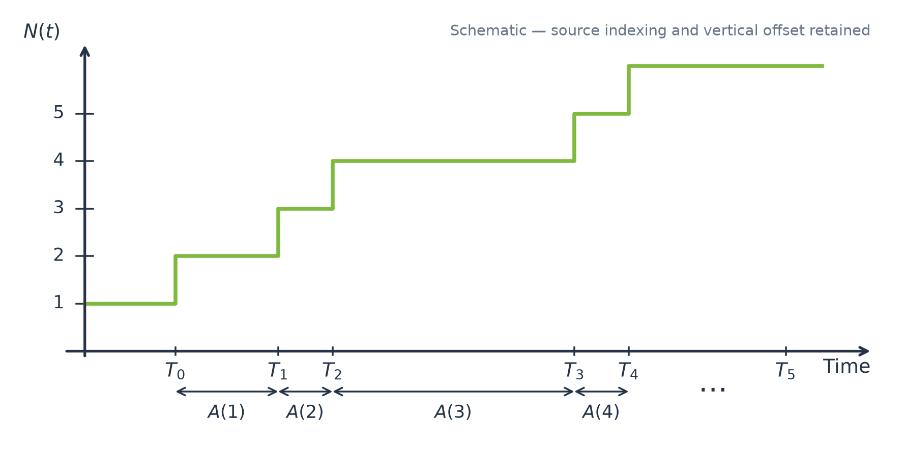

# How to build a network model

*Lecture references use **part 1** for `1 6 ott 2026, 08-33.transcript.txt` and **part 2** for `2 6 ott 2026, 09-52.transcript.txt`. Explanations follow the lecturer; original headings and notation are retained; all eight figures have been redrawn from the handwritten sources. Speech-recognition errors in mathematical terms are resolved using the handwritten notes where possible; unresolved discrepancies are identified locally.*

## Main modules

*Part 1, 00:00:04–00:07:39.*

A communication system can be described through the following components:

| Module                  | Role                                                                                                                             |
| ----------------------- | -------------------------------------------------------------------------------------------------------------------------------- |
| Data generator          | Produces the traffic flows to be delivered across the network. Traffic/source models describe these inputs.                      |
| Admission control (CAC) | Decides whether a new flow can be accepted, considering its requested service, available resources and impact on existing users. |
| Resource manager        | Allocates communication resources to an admitted flow so that its data can be transmitted with an acceptable quality.            |
| Scheduler               | Decides when a source or data unit can use a particular resource.                                                                |
| Switching elements      | Forward packets towards their destinations. Buffers store packets while they wait, introducing queueing delays.                  |
| End user                | Consumes the delivered traffic and experiences a certain quality of experience (QoE).                                            |

*Redrawn from original p. 1: the data path passes through the scheduler and switching elements to the end user; red dotted connections represent admission and resource-allocation interactions.*

Admission control is not present in every system. The lecturer compares a theatre, which stops admitting customers when all places are occupied, with university courses that do not apply the same strict admission rule. In networks that offer admission control, the decision requires both the source's request and the current resource-allocation state.

The resource manager decides the allocation, whereas the scheduler determines the actual use of resources by the generated data units. At switching elements, incoming traffic may have to wait before forwarding; queueing models will be used to study throughput and delays.

QoE depends on the service. For a streamed film, it can depend on playback smoothness, image quality and the price paid. The course roadmap is: modeling concepts, traffic generation, an overview of QoS/QoE, resource management, admission control, scheduling and queueing. Resource management is discussed before admission control because admission decisions depend on the allocation method.

# Network Abstraction

*Part 1, 00:07:43–00:10:11.*

A network model is a manageable framework that can be analyzed mathematically or numerically to predict a real system's behavior. It can support capacity dimensioning and the evaluation of what happens when the number of flows grows.

The abstraction identifies four elements:

1. **Users:** entities that require the system's services to achieve their goals, such as data sources or data consumers.
2. **Resources:** elements needed to provide those services.
3. **Resource manager (RM):** the mechanism that assigns resources to different users.
4. **Utility metrics:** measures of how the combination of users, resources and allocation produces a useful service, from the perspective of users, the system or the service provider.

# Users

*Part 1, 00:10:13–00:13:19.*

Users, also called customers, require resources. Their objective is to obtain a satisfactory QoE, but the meaning of quality depends on their needs.

The running example is the classroom Wi-Fi network, with two classes:

- **Downloaders**, denoted by $D$, download files. Their main interest is completing the download as quickly as possible; irregular delivery during the download is less important than its completion time.
- **Watchers**, denoted by $W$, watch videos. They need smooth playback without freezes and adequate image quality. The required bitrate should be sufficiently stable and high enough for that quality, but providing more than the video needs does not further improve it.

The two classes share the same network resources, while valuing the resulting service differently.

# Resources and Requests

*Part 1, 00:13:26–00:20:35.*

Resources are available in finite quantities and are shared among users. Let

$$
c_k=\text{maximum available quantity of resource type }k,
$$

$$
d_s(k)=\text{quantity of resource type }k\text{ demanded by user }s.
$$

In the classroom example, two resources are relevant: Wi-Fi capacity and the capacity of the access point's connection to the Internet. They must both support the traffic delivered to a user.

The notes ask whether a downloader's request of

$$
d_s(0)=10\text{ Mbps},\qquad d_s(1)=6\text{ Mbps}
$$

makes sense. The lecturer explains that the achieved throughput is limited by the smaller allocation. This is the **bottleneck**: requesting more on one of the two links does not increase throughput beyond what the other link can carry. For the watchers, the spoken example uses a full-quality video requiring 2 Mbps and discusses requesting that rate on both resources.

> [!note] Difference between the handwritten prompt and the spoken example
> The handwritten watcher request on p. 2 is 3 Mbps and 2 Mbps. In part 1, 00:16:58–00:18:10, the lecturer discusses 2 Mbps on both links. Both illustrate the same bottleneck explanation, but the numerical requests are not identical. The downloader's 10/6 Mbps request is explicitly discussed at 00:18:24–00:20:25.

# RM (Resource Management)

*Part 1, 00:20:43–00:36:59.*

The resource manager assigns resources to users. The notes distinguish centralized and distributed management. The notation is

$$
r_s(k)=\text{quantity of resource type }k\text{ assigned to user }s,
$$

$$
\mathbf r_s=[r_s(0),\ldots,r_s(M-1)],
$$

where $\mathbf r_s$ is the resource-allocation vector for user $s$, with one component for each resource type.

The lecturer introduces two principles:

|Principle|Condition|Meaning|
|---|---|---|
|Feasibility|$\displaystyle\sum_{s\in S}r_s(k)\leq c_k,\quad\forall k$|Do not allocate more of a resource than the system has.|
|Principle of Least Privilege (PLP)|$r_s(k)\leq d_s(k),\quad\forall k$|Do not allocate more to a user than that user requests.|

Here $S$ denotes the set of users in the handwritten feasibility condition. The lecturer uses **Principle of Least Privilege** for this resource-allocation restriction, at part 1, 00:33:09–00:33:26.

## Ex

*Part 1, 00:22:44–00:34:14.*

Airline booking illustrates why requests and actual resource use need not coincide. A reservation is a nominal request; the customer may fail to appear. Statistical multiplexing exploits variability in actual demand when many requests are combined.

Let $\hat d_s\in\{0,1\}$ indicate whether user $s$ booked a seat, and $d_s\in\{0,1\}$ indicate whether that user actually requests the service at check-in.

*Redrawn from original p. 3: unfinished axes associated with the discussion of actual versus nominal demand. No distribution has been added to the source sketch.*

For a booked customer, the lecturer uses a 98% probability of appearing and a 2% probability of not appearing:

$$
\Pr[d_s=x\mid\hat d_s=1]=
\begin{cases}
0.98,&x=1,\\
0.02,&x=0.
\end{cases}
$$

> [!note] Spoken numerical slip
> At part 1, 00:27:13, the transcript says 0.01 for the second case, but at 00:27:20–00:27:31 the lecturer explicitly says “Two percent” and 98%. The handwritten p. 3 also gives 0.02. The pair above follows that clarification.

For a person who did not book beforehand, the lecturer also considers the possibility of buying a ticket at the airport. The transcript gives the illustrative pair

$$
\Pr[d_s=x\mid\hat d_s=0]=
\begin{cases}
0.01,&x=1,\\
0.99,&x=0.
\end{cases}
$$

> [!note] Unresolved source discrepancy
> Part 1, 00:28:10–00:28:33 gives 0.01 and 0.99, whereas handwritten p. 3 gives 0.001 and 0.999. The transcript values are used here to follow the spoken example. The lecturer explicitly says these are illustrative numbers, not measured airline statistics.

Suppose the plane has $c=300$ seats and accepts exactly $c$ reservations. The lecturer defines efficiency as actual use divided by nominal capacity:

$$
\eta=\frac{\sum_{s=1}^{n}d_s}{c}.
$$

For $n=c$ booked customers, the classroom calculation gives

$$
\mathbb E[\eta]
=\frac{c\Pr[d_s=1\mid\hat d_s=1]}{c}
=0.98=98\%.
$$

Accepting more reservations than seats can increase utilization, but creates the risk that too many customers appear. The lecturer distinguishes accepting reservations from physically assigning seats: overbooking relaxes feasibility at the reservation stage, while actual allocation must respect the physical capacity. The company balances empty seats against the consequences of being unable to serve some customers.

PLP can also be violated in practice: a passenger who booked economy may be upgraded to business class. The lecturer presents this as another example of allocating more than requested, before returning to the networking setting.

A trivial networking allocation is to split every resource equally among all users:

$$
\forall s\in D\cup W,\qquad
r_s(0)=\frac{c_0}{|D\cup W|},\qquad
r_s(1)=\frac{c_1}{|D\cup W|}.
$$

This satisfies feasibility but can violate PLP. If the only user is a watcher, equal sharing gives that user the entire capacity even though the video only needs 2 Mbps.

The lecturer considers 15 downloaders and five watchers: each receives 5 Mbps of Wi-Fi capacity and 1 Mbps of Internet-link capacity, hence 1 Mbps of end-to-end throughput. Whether this allocation is satisfactory requires a utility function; the resource quantities alone do not quantify satisfaction.

# Utility functions

*Part 1, 00:37:05–00:41:05.*

A utility function $U_s(\mathbf r_s)$ expresses how the allocation contributes to user $s$'s goal. It can represent different performance measures, including throughput, energy efficiency or cost. Larger utility is preferable; a cost can therefore be represented as negative utility.

For the downloader example, the lecturer considers utility proportional to the achieved bitrate, which is limited by

$$
\min\{r_s(0),r_s(1)\}.
$$

He also sketches alternative utility functions: one that grows initially and then flattens, and one that remains small below a threshold before growing more rapidly. The utility function is a modeling choice tied to the application and design purpose, and changing it can change the allocation selected by the resource manager.

*Redrawn from original p. 4, left panel: linear, saturating and threshold-like alternatives. These are qualitative sketches, not fitted functions.*

For watchers, utility also depends on the bottleneck bitrate. At low rates the video quality may be poor or jerky; quality then improves rapidly and reaches its maximum at the example's 2 Mbps. Allocating more does not further improve that video.

*Redrawn from original p. 4, right panel: utility saturates when the bottleneck bitrate reaches 2 Mbps.*

# System utility

*Part 1, 00:41:07–00:42:53.*

The system perspective considers the combined effect of serving multiple users. Overall cost or utility can depend on the total allocated resources, the utilities experienced by customers and other factors.

A common choice mentioned by the lecturer is a weighted sum of individual utilities. Weights can distinguish customer classes: for example, an airline may value a frequent flyer's satisfaction differently from that of an occasional passenger.

# The problem

*Part 1, 00:42:55–00:44:35.*

The resource-allocation problem is to choose allocations that maximize the overall system utility $U_0$:

$$
\max_{\mathbf r} U_0,
$$

subject to feasibility and any required minimum-performance constraints. Depending on the service, such minimum requirements may apply to all users or to particular users.

The lecturer emphasizes that the constraints can make the problem infeasible: the available resources may be insufficient to meet the required minimum utilities. An optimization formulation does not guarantee that an allocation satisfying every constraint exists.

# Examples

*Part 1, 00:44:41–00:55:18.*

A small company has ten employees. Each makes, on average, two video conference calls per day, with durations between 30 and 90 minutes. The company wants to model the average traffic and the risk of blockage if the Internet capacity available to the service is limited to 10 Mbps.

*Redrawn from original p. 4: users $s_1,\ldots,s_{10}$ share a connection of capacity $c=10$ Mbps to the Internet.*

The customers are the employees making calls. The shared resource is the bitrate of the Internet connection. In this example, the lecturer focuses on that connection as the bottleneck, rather than modeling two separate limiting links as in the classroom Wi-Fi example.

Resource demand depends both on how much traffic an ongoing call generates and on when and how often calls occur. A source model is needed to describe this demand.

## Utility functions = ?

Suppose an ongoing video call requires 1.5 Mbps for full quality and 0.5 Mbps for minimum usable quality. Below 0.5 Mbps the call becomes too discontinuous to use. The lecturer sketches a possible user utility that is zero up to the minimum rate, increases linearly between 0.5 and 1.5 Mbps, and then remains at its maximum. A smoother transition is another possible choice.

*Redrawn from original p. 5, left panel: the proposed utility increases between 0.5 and 1.5 Mbps and then saturates. The curve is a modeling example.*

To assess the system's risk of blockage, the lecturer proposes studying blockage probability as a function of link capacity $c$.

*Redrawn from original p. 5, right panel: alternative schematic curves, with the 10 Mbps design point marked. The curves illustrate possible behaviors; horizontal spacing is not to scale, and their heights at the marked capacities are not computed probabilities. The lecture does not supply a numerical blockage result.*

If capacity is below 0.5 Mbps, no call can receive even the minimum usable service, and the example's blockage probability is one. Increasing capacity reduces blockage, but a model is needed to determine how fast it decreases. Once that relationship is obtained, the designer can assess the 10 Mbps choice and the effect of changing capacity. No particular analytical curve or numerical result is supplied in this lecture.

# Network

## Point process

*Part 2, 00:00:00–00:08:55.*

A point process describes the occurrence of events over time. In a source model, an event can generate one information unit (IU) or a batch of IUs. The lecturer presents three equivalent descriptions:

|Representation|Meaning|
|---|---|
|Arrival instants $\{T_i\}$|Absolute times at which events occur.|
|Counting process $N(t)$|Number of arrivals up to the observation time.|
|Interarrival process $\{A_i\}$|Durations between consecutive arrivals, $A_i=T_i-T_{i-1}$.|

With the strict comparison used in the handwritten notes, the counting representation is

$$
N(t)=\max\{n:t>T_n\}
=\sum_{k=1}^{\infty}\mathbf 1(t>T_k),
$$

where the indicator is one when its condition is true and zero otherwise.

*Redrawn from original p. 5: a staircase counting sketch, arrival labels and intervals $A(1),A(2),\ldots$. The original zero-based arrival labels are retained in the image.*

> [!note] Index and boundary conventions
> At part 2, 00:03:23–00:03:43, the lecturer explicitly warns that the blackboard and slides start their indices at different values. The handwritten sketch includes $T_0$, while its displayed indicator sum starts at 1. The formula above retains that displayed sum; the figure retains its original labels. It counts events strictly before $t$ because the source uses $t>T_k$. The supporting book, `Lesson3-book.pdf`, p. 3, uses $T_k\leq t$ instead. These differ at the arrival instants; the conventions should not be silently mixed.
>
> The transcript sometimes says events “after time t”; the lecturer's counting explanation and the handwritten definition concern events observed **up to** $t$.

The process can be enriched with two additional descriptions:

- **Compound traffic $\{B_i\}$:** the number of IUs generated at event $i$, also called the batch size. A batch is a group generated together or within a very short interval.
- **Workload $\{W_i(n)\}$:** the work brought to the system by IU $n$ of arrival $i$. In the packet example, this is the packet size in bits; packets in one batch can have different sizes.

The lecturer uses IU and workload rather than only packet and packet size because the model can also describe other requests for resources.

The **aggregate offered workload $S_g(t)$** is the sum of the workloads of all IUs in all batches generated up to time $t$. The **aggregate average offered traffic** is

$$
\frac{S_g(t)}{t}.
$$

This is the average rate at which the source brings workload to the system. When workload is measured in bits, the resulting rate is a bitrate.

## Renewal Process

*Part 2, 00:09:11–00:17:07.*

A renewal process generalizes the homogeneous Poisson process. For a homogeneous Poisson process, the interarrival times $A_i$ are i.i.d. exponential random variables with parameter $\lambda$. Homogeneity means that the arrival-rate parameter $\lambda$ does not change over time.

For a renewal process, the interarrival times are still i.i.d., but their common distribution can be more general. The lecturer denotes its cumulative distribution function by $F$.

The process “starts over” probabilistically at every event: the next interarrival time is independent of the past. Examples discussed are failures of a machine after repair, under the renewal assumption, and web browsing cycles consisting of clicking, downloading, reading and clicking again, if cycle durations are i.i.d.

Two classroom checks distinguish the requirements:

1. **Constant interarrival times $A_i=5$ seconds.** This is periodic and is not Poisson because the distribution is not exponential. It is a renewal process: a constant is a degenerate distribution, and the constant interarrival times satisfy the i.i.d. condition.
2. **An interarrival time depending on its predecessor.** The lecturer considers

$$
A_{i+1}=
\begin{cases}
A_i,&\text{with probability }0.1,\\
\text{a random value between }0\text{ and }1,&\text{with probability }0.9.
\end{cases}
$$

This is not Poisson and is not a renewal process. In particular, dependence on $A_i$ violates the independence requirement. The source does not specify the distribution of the random value within $[0,1]$; no uniform distribution is assumed here.

### Renewal process

*Part 2, 00:17:19–00:17:51.*

The formal definition requires positive, finite, i.i.d. interarrival random variables $\{A_i\}$. The time of the $n$th arrival is obtained by accumulating the interarrival times. The lecturer presents this as equivalent to the earlier arrival-time and counting descriptions.

## Renewal-reward Process

*Part 2, 00:17:55–00:23:35.*

Associate a reward or gain $G(i)$ with each renewal event. The accumulated reward is

$$
Y(t)=\sum_{n=1}^{N(t)}G(n).
$$

The process is specified by the interarrival times $\{A_i\}$ and the rewards $\{G(i)\}$. The pairs

$$
\bigl(A_i,G(i)\bigr)
$$

must be independent and identically distributed across renewal cycles. Within a pair, $A_i$ and $G(i)$ may be correlated; in particular, the reward can depend on the interarrival duration.

Both processes are needed because $G(i)$ specifies the reward at an event, while $A_i$ determines how many events have occurred by time $t$. The sum contains $N(t)$ rewards, not $t$ rewards. One adds the rewards, not the interarrival durations to the rewards.

The lecturer mentions rewards proportional to an interval duration, briefly referring to age of information. He also considers a machine whose repair cost may correlate with how long it worked before failing: a longer working period might require replacing more parts. Such within-cycle correlation is compatible with independence between different renewal pairs.

## Elementary renewal theorem

The handwritten p. 7 contains this heading without a statement. The lecturer announces a theorem about average reward at part 2, 00:18:15–00:18:24, but the supplied recording ends at 00:23:39 after the discussion of renewal-reward pairs. No theorem statement or proof is given in the supplied transcripts, so none is added here.
