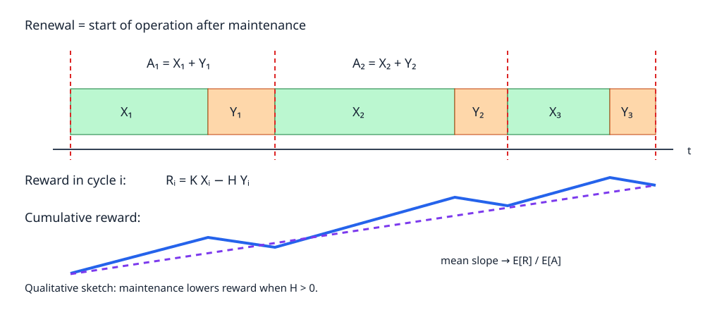
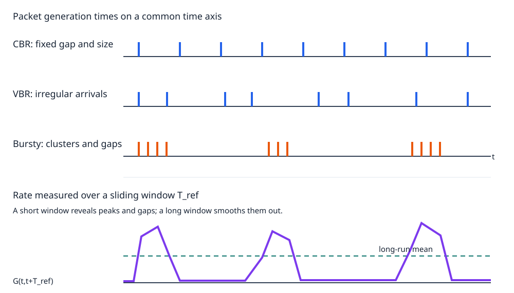
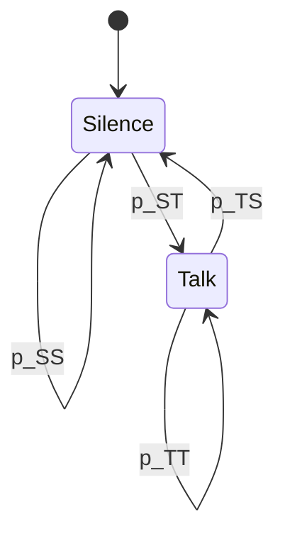

# Lesson 4 — Traffic source models

## 1. Why model traffic beyond its average rate?

An information flow model gives a useful **long-run average** offered rate. It does not say
when packets arrive. Two sources can offer the same average load while producing very
different queue lengths, delays, losses, and required buffer sizes. A traffic source model
describes the *generation pattern* at the resolution needed for the question being asked.

> [!info] Definition — Offered traffic
> Traffic generated by a source and presented to a system. It differs from *carried traffic*
> when packets are lost, rejected, or delayed.

The same flow can be described at three levels:

| Level | Events or quantities represented | Suitable question |
|---|---|---|
| Session | Session start, end, duration, average rate | How many connections coexist? |
| Activity | Active and idle periods within a session | How often does the source become busy? |
| Packet | Individual generation times, batch sizes, packet sizes | What delay or buffer occupancy should be expected? |

For a voice call, the session is the call, activity alternates between speech and silence,
and packet-level behavior records each encoded voice packet. Choice of level also fixes
the **observation time scale**: packets that look highly variable in milliseconds can look
nearly constant when averaged over minutes.

## 2. A general representation: marked and weighted point processes

Let $\tau_i$ be the time of arrival event $i$, ordered so that
$0<\tau_1<\tau_2<\cdots$. Define:

$$
A_i=\tau_i-\tau_{i-1},\qquad
N(t)=\sum_{i\ge1}\mathbf{1}\{\tau_i\le t\},\qquad
N(t_1,t_2]=N(t_2)-N(t_1).
$$

$A_i$ is the **inter-arrival time**; $N(t)$ counts arrivals by time $t$. An event can bring
more than one information unit (IU), such as a message split into packets:

- $B_i\in\mathbb N_0$: **mark**, here the number of IUs in batch $i$;
- $W_{i,k}$: **weight** of IU $k$ in batch $i$, such as its length in bits;
- $R_i=\sum_{k=1}^{B_i}W_{i,k}$: total workload brought by event $i$.

The marked and weighted point process (MWPP) is the triplet $(\mathcal T,B,W)$, or
equivalently $(A,B,W)$. With bit-valued weights, the offered rate in $(t_1,t_2]$ is

$$
G(t_1,t_2)=\frac{\displaystyle\sum_{i=N(t_1)+1}^{N(t_2)}
\sum_{k=1}^{B_i}W_{i,k}}{t_2-t_1}
\quad\text{bits/s}.
$$

> [!example] Message versus packet viewpoint
> One message of $M$ bytes every $T$ seconds has $A_i=T$, $B_i=1$, and
> $W_{i,1}=M$ bytes at message level. If each message becomes $K$ equal-size packets,
> packet-level modeling has $B_i=K$ and $W_{i,k}=M/K$ bytes, before protocol headers.
> Mean payload rate remains $8M/T$ bits/s.

Arrival events, batch sizes, and weights may be random and mutually dependent. Always
state the unit of $W$: a packet length in bytes must be multiplied by $8$ before comparing
it with a bit/s link rate.

### Renewal process and Poisson special case

An arrival process is a **renewal process** when successive $A_i$ are independent and
identically distributed (i.i.d.). Its renewal epochs are $\tau_i$. If
$A_i\sim\mathrm{Exp}(\lambda)$, it is a homogeneous Poisson process:

$$
P\bigl(N(t,t+u]=n\bigr)=e^{-\lambda u}\frac{(\lambda u)^n}{n!},
\qquad E[N(t,t+u]]=\lambda u.
$$

Counts in disjoint intervals are independent. A Poisson source is mathematically convenient
and can approximate the superposition of many independent, individually rare sources.
It is **not** automatically a good model for an individual application or highly correlated
Internet traffic.

## 3. Renewal-reward processes and long-run rate

Attach a reward $R_i$ to renewal cycle $i$ of duration $A_i$. Let
$Y(t)=\sum_{i=1}^{N(t)}R_i$ be cumulative reward at completed renewals. If the pairs
$(A_i,R_i)$ are i.i.d. across cycles, $0<E[A_i]<\infty$, and $E[|R_i|]<\infty$, then

$$
\lim_{t\to\infty}\frac{Y(t)}{t}
=\frac{E[R_i]}{E[A_i]}
\qquad\text{almost surely}.
$$

This is the **renewal-reward theorem**: long-run reward per unit time equals expected
reward per cycle divided by expected cycle duration. The result still applies when $A_i$
and $R_i$ *within the same cycle* are dependent. Independence is required **between
cycles**, not between duration and reward within one cycle. Rewards accumulated
continuously during a cycle give the same limit when the unfinished-cycle contribution
becomes negligible over a long observation time.

For a MWPP whose arrivals form a renewal process, choose
$R_i=\sum_{k=1}^{B_i}W_{i,k}$. Then

$$
\bar G=\frac{E\!\left[\sum_{k=1}^{B_i}W_{i,k}\right]}{E[A_i]}.
$$

Only with suitable independence assumptions between batch size and individual weights
does the numerator simplify to $E[B_i]E[W]$. No independence from $A_i$ is needed for
the ratio itself. A zero-size batch is possible, for example when an event produces no
admitted workload.

### Worked example: industrial machine

A machine earns $K$ euros per operating day. Its operating duration $X_i$ is geometric
with parameter $p$ on $\{1,2,\ldots\}$:

$$
P(X_i=x)=p(1-p)^{x-1},\qquad E[X_i]=\frac1p.
$$

It then stops for $Y_i$ maintenance days. Define each renewal epoch as the **start of
operation after maintenance**. One complete cycle has

$$
A_i=X_i+Y_i.
$$

If maintenance costs $H$ euros per day, its net cycle reward is

$$
R_i=KX_i-HY_i,
\qquad
\bar r=\frac{K E[X]-H E[Y]}{E[X]+E[Y]}.
$$

Linearity of expectation gives $E[X+Y]=E[X]+E[Y]$ and
$E[KX-HY]=K E[X]-H E[Y]$ **even if $X$ and $Y$ are dependent**. By contrast,
$E[XY]=E[X]E[Y]$ generally needs independence.

**Case A — independent maintenance duration.** If $Y$ is uniform on
$\{1,2,3\}$ and independent of $X$, then $E[Y]=2$ and, without maintenance cost,

$$
\bar r=\frac{K/p}{1/p+2}=\frac{K}{1+2p}
\quad\text{euros/day}.
$$

**Case B — maintenance duration depends on operating duration.** Let

$$
Y=\begin{cases}
1,&X=1,\\
2,&2\le X\le4,\\
3,&X\ge5.
\end{cases}
$$

Writing $q=1-p$ gives

$$
P(Y=1)=p,\qquad
P(Y=2)=p(q+q^2+q^3)=q-q^4,\qquad
P(Y=3)=q^4,
$$

and hence

$$
m_Y=E[Y]=p+2(q-q^4)+3q^4=2-p+(1-p)^4.
$$

The long-run net revenue is therefore

$$
\boxed{\bar r=\frac{K/p-Hm_Y}{1/p+m_Y}
=\frac{K-Hpm_Y}{1+pm_Y}}.
$$

Here $X_i$ and $Y_i$ are dependent, as are $A_i$ and $R_i$. Renewal-reward still works
if new cycle pairs $(X_i,Y_i)$ are independent and identically distributed across $i$.
Sampling *every* state change would alternate $X$ and $Y$ intervals and would not
produce an i.i.d. renewal sequence. Sampling only starts of operation does.

## 4. Common traffic source models

| Model | Generation pattern | Useful for | Main caution |
|---|---|---|---|
| Saturated | Always has a packet ready | Maximum throughput or limiting-load tests | Source rate depends on service; queue delay under an infinite backlog has no useful finite interpretation |
| CBR | Fixed batch and size at fixed intervals | Periodic sensors, packetized constant-rate audio | Appears variable under very short observation windows |
| VBR | At least one of $A$, $B$, or $W$ varies | Compressed video, interactive sources | VBR alone says little about temporal correlation |
| Bursty | Clusters of high activity separated by quiet periods | Web browsing, file transfer, some multimedia | Peaks can stress buffers despite moderate mean load |
| On–Off | Alternates active and silent states | Talk spurts, application activity | State-duration distributions matter |

### Saturated source

A saturated source is always backlogged: it has work ready whenever a resource becomes
available. It probes system throughput under heavy load. In simulation, one practical
construction inserts a new packet immediately after the preceding packet is accepted or
transmitted, keeping the source nonempty. Its offered rate is then **endogenous**: a slower
system causes fewer new packet insertions. An infinite preloaded backlog and this
one-packet construction can produce the same busy server, but they do not give the same
queue-length or waiting-time interpretation. Use a finite, externally specified arrival
process when studying ordinary queueing delay.

### Constant bit rate (CBR)

A packetized CBR model has fixed $A_i=T$, fixed $B_i=B$, and fixed
$W_{i,k}=W$. Its long-run rate is $BW/T$. For a single packet of $L$ bits every $T$
seconds, $\bar G=L/T$.

> [!example] G.711 voice
> $8{,}000$ samples/s × $8$ bits/sample = **64 kbit/s** encoded payload. At
> $20$ ms per packet this is $160$ payload bytes per packet. Adding illustrative
> RTP (12 B), UDP (8 B), and IPv4 (20 B) headers gives $200$ B per packet,
> or **80 kbit/s** at the IP layer. Link-layer overhead is additional.

A short window may contain either one packet or none, so measured rate oscillates.
Over a window covering many packet periods, edge effects become small and the source
looks constant.

### Variable bit rate (VBR)

VBR means that packet spacing, number of packets per event, packet sizes, or a
combination varies. Compressed video is an example: scenes of different complexity
need different numbers of bits. A Poisson arrival process with fixed packet size is one
simple VBR model because its inter-arrival times vary. VBR does not imply bursts;
the distribution and dependence of arrivals must also be examined.

### Bursty traffic and its measurements

A **burst** is a period of high arrival rate compared with the source's longer-term
average. A web session may download a page rapidly, pause while a user reads it, then
download more data. Packet-level inter-arrival times can consequently include many
short gaps and occasional long gaps.

Let $S(t)$ be cumulative generated bits and let $T_{\mathrm{ref}}$ be a fixed observation
window. Define

$$
G_{T_{\mathrm{ref}}}(t)=
\frac{S(t+T_{\mathrm{ref}})-S(t)}{T_{\mathrm{ref}}},
\qquad
\beta_{\mathrm{peak}}(T_{\mathrm{ref}})=
\frac{\sup_t G_{T_{\mathrm{ref}}}(t)}{\bar G}.
$$

The **peak-to-mean ratio** depends on the chosen window: state
$T_{\mathrm{ref}}$ whenever reporting it. Define $N_T(t)=N(t+T)-N(t)$.
Two other measures are:

$$
CV_A=\frac{\sqrt{\operatorname{Var}(A)}}{E[A]},
\qquad
F_T=\frac{\operatorname{Var}[N_T(t)]}{E[N_T(t)]}.
$$

$CV_A$ measures variability of **inter-arrival times**; the **Fano factor** $F_T$
(index of dispersion for counts) measures variability of **counts in windows of length
$T$**. They are different statistics and need not agree. For a homogeneous Poisson
process, both equal $1$; this is a reference value, not proof of realistic burstiness.
Packet-size variation is also relevant to bit-rate peaks, even if arrival counts stay stable.

A bursty source **can** be a renewal process if its i.i.d. inter-arrival distribution
mixes frequent short gaps with occasional long gaps. Many practical bursty sources
instead have correlated gaps because they switch between operating states. Burstiness
alone does not settle whether the renewal assumption holds. Long-tailed gap
distributions can represent occasional long silences; check this against measurements.

### On–Off source and average rate

An On–Off source generates traffic while **ON** and no traffic while **OFF**. Let
$T_{\mathrm{ON}}=E[t_{\mathrm{ON}}]$ and
$T_{\mathrm{OFF}}=E[t_{\mathrm{OFF}}]$. If successive cycles are i.i.d. and the mean
rate during ON is $G_{\mathrm{ON}}$, renewal-reward reasoning gives

$$
P_{\mathrm{ON}}=\frac{T_{\mathrm{ON}}}{T_{\mathrm{ON}}+T_{\mathrm{OFF}}},
\qquad
\bar G=G_{\mathrm{ON}}P_{\mathrm{ON}}.
$$

If OFF carries traffic at mean rate $G_{\mathrm{OFF}}$, then

$$
\bar G=\frac{G_{\mathrm{ON}}T_{\mathrm{ON}}+
G_{\mathrm{OFF}}T_{\mathrm{OFF}}}{T_{\mathrm{ON}}+T_{\mathrm{OFF}}}.
$$

For a MWPP active during ON, $G_{\mathrm{ON}}$ may be computed as
$E[R]/E[A]$ for its active generation mechanism under the relevant stationarity
assumptions. ON durations and OFF durations can have exponential, Pareto, or other
distributions. Their means determine the average rate above; their distributions also
affect delay and overflow behavior.

## 5. Markov-modulated Poisson process (MMPP)

A Markovian source switches among states $S$; state $s$ selects a Poisson arrival rate
$\lambda_s$. In a standard MMPP, the driving state evolves as a **continuous-time
Markov chain**. For a two-state silence/talk example,
$\lambda_{\mathrm{silence}}=0$ and $\lambda_{\mathrm{talk}}>0$.

The lecture also uses a discrete-time approximation, sampling the state every $\Delta$
seconds. Its transition matrix is

$$
P=\begin{pmatrix}
p_{SS}&p_{ST}\\
p_{TS}&p_{TT}
\end{pmatrix},
\qquad p_{SS}+p_{ST}=p_{TS}+p_{TT}=1.
$$

For an irreducible two-state chain, the stationary probabilities are

$$
\pi_S=\frac{p_{TS}}{p_{ST}+p_{TS}},\qquad
\pi_T=\frac{p_{ST}}{p_{ST}+p_{TS}},
$$

and the mean arrival rate is
$\bar\lambda=\pi_S\lambda_S+\pi_T\lambda_T$. With independent packet sizes of
mean $E[W]$ bits, mean bit rate is $\bar\lambda E[W]$.

Conditional on a fixed state, arrivals follow its Poisson rate. Over time, state changes
produce clusters and quiet periods; the complete arrival process generally is **not** a
homogeneous Poisson process. A continuous-time MMPP specifies transition *rates*
instead of the probabilities in $P$.

> [!warning] Modeling limitation — speech packets
> A pure MMPP can enter **Talk** and then wait a random time before its first packet.
> Real speech detection usually causes a packet at the start of activity. Also, during
> active speech an encoder often produces fixed-size packets at fixed intervals (for
> example, every $20$ ms), which is better represented by an On–Off model with CBR
> during ON. MMPP remains useful when analytical simplicity matters.

The transcript also separates **call-level traffic** from **within-call traffic**: call
starts can be modeled as Poisson with rate $\lambda$, call durations as exponential with
parameter $\mu$, and speech/silence inside a call with an additional activity model.
These are distinct time scales and modeling decisions.

## 6. Choosing and checking a model

1. Specify target metric: throughput, delay, loss, buffer occupancy, or average load.
2. Set observation level and time scale; state packet direction and where measurement
   occurs (application, IP, or link layer).
3. Extract event times $\tau_i$, gaps $A_i$, batch sizes $B_i$, and weights $W_{i,k}$
   from a traffic trace.
4. Inspect rate over several window lengths, inter-arrival distributions, packet sizes,
   correlations, ON/OFF durations, and peaks.
5. Fit a candidate model and compare its predicted distributions and time patterns with
   the measured trace. Matching only the mean does not validate delay or buffer results.

The lecture's practical assignment asks students to isolate traffic from one application
in a packet trace, characterize $A$, $B$, and $W$, choose suitable distributions, and
compare fitted and empirical behavior (for example with CDFs and time plots). A
separate peer review follows. Check the current course platform for the actual deadline
and submission requirements; the recording gives only a relative date.

## Key distinctions to remember

- **Offered rate versus throughput:** source generation versus successfully carried data.
- **CBR versus VBR:** rate constancy depends on the observation window.
- **VBR versus bursty:** variability does not by itself imply clustered activity.
- **Renewal versus Markov modulation:** renewal needs i.i.d. inter-arrival times; state
  changes can make arrivals correlated.
- **Renewal-reward dependence:** $(A_i,R_i)$ may be dependent internally; cycle pairs
  must be i.i.d. across $i$ for the stated theorem.
- **Average rate versus performance:** equal means can yield different queues and delays.

## Source material

- [Handwritten Lesson 4 notes](Lesson%204.pdf), especially pp. 1–3 (renewal reward and
  machine example) and pp. 4–7 (source models and MMPP).
- [Lesson transcript, first part](1%209%20ott%202026%2C%2012-35.transcript.txt),
  especially 00:01–00:09 and 00:09–00:45.
- [Lesson transcript, second part](2%209%20ott%202026%2C%2013-32.transcript.txt),
  especially 00:00–00:35.
- [Traffic Source Models, extracted book chapter](3-Traffic-Source-Model-BookChapter%20-%20extracted.pdf),
  §§3.1–3.5.

Figures in this note are original explanatory redrawings. Equations and examples are
restated and checked against the source material; speech-recognition errors in the
transcripts have been corrected where the notes or chapter resolve them.
