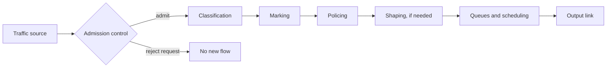
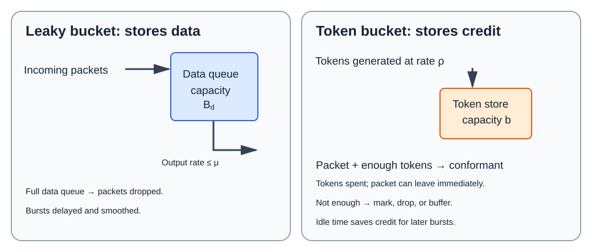
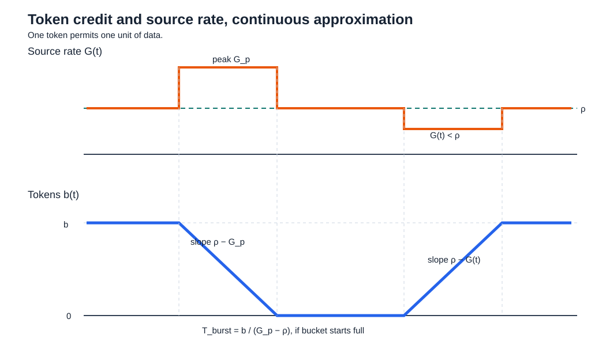

# Lesson 6 — Quality of service and token bucket filters

## 1. From traffic models to quality of service

Traffic models describe what a source offers. Quality-of-service mechanisms determine whether a new flow can enter the network and how its packets are treated afterward.

> [!info] Definition — Quality of service (QoS)
> Network treatment intended to meet specified performance requirements, such as latency, jitter, throughput, packet loss, or availability. An **SLA** (service-level agreement) states measurable commitments and the traffic profile to which they apply.

An SLA may specify latency, minimum bit rate, loss, uptime, and acceptable downtime. The lecture uses simpler traffic-profile agreements to study the filters: token rate and bucket size, with a peak rate when needed. These parameters describe traffic admitted as conformant; they do not by themselves guarantee an end-to-end delay or loss bound.

- Best-effort Internet forwarding offers no per-flow guarantee merely because an application needs low delay or high reliability.
- Real-time speech is sensitive to delay and jitter; a small amount of loss can sometimes be concealed. File transfer can tolerate more delay but must recover lost data.

The lecture uses 5G network slicing as an example of different traffic requirements:

| Service class | Typical use | Main challenge |
|---|---|---|
| URLLC — ultra-reliable low-latency communication | Industrial control | Reliability and very small delay at once; retransmission can add delay |
| eMBB — enhanced mobile broadband | Multimedia and entertainment | High data rate and capacity |
| MTC/mMTC — (massive) machine-type communication | Many IoT sensors | Signaling overhead for huge numbers of short, infrequent transmissions |

Separate slices can isolate classes, but rigidly reserving capacity for each slice can leave resources idle while another slice is busy. Dynamic resource allocation seeks better utilization while preserving agreed isolation.

### Four principles for QoS guarantees

QoS guarantees depend on four principles:

1. **Identify traffic classes.** The network must distinguish packets that need different treatment. Classification assigns a packet to a class; marking records that class in a header or label so later nodes can recognize it. For example, voice and file-transfer packets can receive different treatment only if the network can tell them apart.
2. **Isolate classes.** Traffic in one class must not consume resources needed to meet another class's service commitment. Reserving separate capacity is one way to achieve isolation, but unused capacity in one class may then sit idle while another class is busy.
3. **Use resources efficiently and fairly.** Isolation should still allow effective use of shared capacity. Resource management and scheduling can allocate capacity dynamically, subject to the promised treatment of each class, instead of relying only on fixed partitions.
4. **Control admission.** If accepting a new flow would overload the network and break existing commitments, its service request must be rejected. Call admission control makes this decision before the flow is admitted; packet scheduling cannot repair an already overloaded system.

These are design requirements. The classification, marking, policing, shaping, resource-management, scheduling, and admission mechanisms below are ways to implement them.

## 2. QoS mechanisms and their roles

- **Call admission control (CAC):** accept a new flow only if resources can support its SLA without breaking existing commitments. It acts on a flow/request, not each packet.
- **Classification:** inspect fields or application context to assign a packet to a traffic class; source/destination addresses, ports, or protocol can be inputs.
- **Marking:** encode class or treatment in a header/label so later nodes can recognize it. Classification decides *which* class; marking communicates that decision. The lecture gives IP-header fields and MPLS labels as examples.
- **Policing:** test a packet against the agreed traffic profile. Depending on policy, non-conformant packets may be remarked, treated as best effort, or dropped.
- **Shaping:** hold excess traffic in a buffer and release it later at an allowed rate. It changes timing and can add delay or cause loss if the buffer fills.
- **Scheduling/resource management:** allocate link capacity and choose which queued packet transmits next; priorities or weights can distinguish classes.

These blocks are a conceptual chain, not a mandatory fixed placement. For example, classification may precede CAC, and shaping may be combined with scheduling. Marking and policing usually occur at a network edge where customer traffic enters a managed domain; downstream nodes then read the markings.

> [!example] Policing versus shaping
> An IoT service agrees to one packet per hour but presents ten at once. If its bucket holds only one packet's worth of tokens, a policer can identify nine as excess. A shaper can buffer them and release them at a permitted pace, if its queue and the application's delay tolerance allow it. Marking alone does not delay packets; buffering does.

## 3. Leaky bucket: data accumulate, output is smoothed

A **leaky bucket filter (LBF)** stores incoming data in a finite buffer of capacity $B_d$ bits. It serves data at a maximum rate $\mu$ bits/s. If the input rate $g(t)$ exceeds $\mu$, backlog grows; once $B_d$ is full, additional traffic is lost unless another policy intervenes.

For a fluid approximation with backlog $q_d(t)$:

$$
0\le q_d(t)\le B_d,\qquad
g_{\mathrm{out}}(t)=
\begin{cases}
\mu, & q_d(t)>0,\\
\min\{g(t),\mu\}, & q_d(t)=0.
\end{cases}
$$

- When queue is nonempty, it drains at $\mu$ until empty.
- When queue is empty and input is slower than $\mu$, output follows input.
- LBF turns bursts into delay and a steadier output; finite buffer makes overflow possible.
- In packet systems, departure occurs in packets, so the constant-rate fluid picture is an approximation over time intervals.

A token bucket used only as a policer needs no data queue.

## 4. Token bucket: a reusable traffic contract

Tokens enter a bucket at rate $\rho$ tokens/s, up to capacity $b$ tokens. Tokens generated while the bucket is full are discarded. If one token permits $D$ bits, a packet of $W$ bits costs $W/D$ tokens.

The same token-bucket model can describe a source's allowed average and burst behavior, or operate as a filter between the source and network. As a policer it marks or drops excess packets; as a soft shaper it buffers them and changes their departure times.

| Symbol | Meaning | Unit |
|---|---|---|
| $\rho$ | Token generation rate; committed rate is $D\rho$ | tokens/s |
| $b$ | Maximum saved credit, often called committed burst size (CBS) | tokens |
| $D$ | Data represented by one token | bits/token |
| $\mu$ | Separate peak-rate cap, if imposed | tokens/s |
| $b(t)$ | Tokens currently in bucket; $0\le b(t)\le b$ | tokens |

The **committed information rate (CIR)** is $D\rho$ bits/s. With one token per byte, CIR is $\rho$ bytes/s and $b$ tokens allow $b$ bytes of saved burst credit. Here $b$ is bucket capacity, while $b(t)$ is its current token level; they are equal only when the bucket is full. A two-parameter bucket $(\rho,b)$ limits sustained average and burst *volume* but has no finite instantaneous peak rate by itself; $\mu$ or a physical output link imposes that extra bound. The chapter's three-parameter description includes $\mu\ge\rho$.

### Exact packet decision

For packet $i$ arriving at time $\tau_i$, let $b_{i-1}^{+}$ be tokens after the previous decision and $W_i$ its size in bits. First replenish, then test:

$$
b_i^{-}=\min\!\left\{b,\ b_{i-1}^{+}+\rho(\tau_i-\tau_{i-1})\right\},
$$

$$
b_i^{+}=\begin{cases}
b_i^{-}-W_i/D, & b_i^{-}\ge W_i/D\quad\text{(conformant)},\\
b_i^{-}, & b_i^{-}<W_i/D\quad\text{(marked or dropped as excess)}.
\end{cases}
$$

The second line assumes a **policer or drop policy**: an excess packet consumes no tokens. For a soft shaper, an excess packet waits; tokens are consumed when it is eventually released. A packet must also fit the bucket: if $W_i/D>b$, it can never be conformant under this one-bucket whole-packet rule.

Starting with an empty bucket, a $W$-bit packet needs $W/D$ tokens. The earliest it can be conformant is after $W/(D\rho)$ seconds of refill; a policer marks an earlier arrival as excess, while a soft shaper can hold it. If each accepted packet leaves the bucket empty, the next equal-size packet needs the same refill time.

| Policy | Packet action | Data buffer needed? | Main effect |
|---|---|---|---|
| Policer | Mark non-conformant; downstream treatment may differ | No | Preserves packet timing at this filter |
| Drop / lossy shaping | Discard excess packet | No | Conformant output, with loss |
| Soft shaper | Queue packet until enough tokens arrive | Yes | Conformant output, with added delay; finite queue may overflow |

Let $S_g(t)$ be cumulative conformant bits by time $t$. For any interval of length $T$, the token-bucket envelope is

$$
S_g(t+T)-S_g(t)\le D(b+\rho T)\quad\text{bits}.
$$

Thus long-run average conformant rate cannot exceed $D\rho$. If a separate peak cap $\mu$ applies, also $S_g(t+T)-S_g(t)\le D\mu T$ in the fluid model. Neither inequality alone promises low end-to-end delay: scheduler, link capacity, and buffer sizes also matter.

## 5. Worked lecture example: periodic packets and an undersized CIR

This section explains the **“Example” at the bottom of page 4** of the handwritten PDF, which continues at the top of page 5. The separate example starting later on page 5, with $\bar G=100$ kB/s and a $10$ ms peak, appears in Section 6 below.

- CBR source in the PDF's notation: $A=20$ ms between batches, $B=1$ packet per batch, and $W=80$ B per packet. Thus one $80$-byte packet arrives every $20$ ms. Here $B$ counts packets per batch; lowercase $b$ below is token-bucket capacity.
- SLA: one token per byte, $\rho=3000$ tokens/s, $b=250$ tokens.
- Initial state: **full bucket**, $b(0^-)=b=250$ tokens.

Source average is

$$
\bar G=\frac{BW}{A}=\frac{1\cdot80\ \text{B}}{0.020\ \text{s}}
=4000\ \text{B/s}=32\ \text{kbit/s}.
$$

The CIR is only $3000$ B/s. Each $20$ ms generates $60$ tokens, but each accepted packet consumes $80$: during the initial conformant run, token balance falls by $20$ per packet interval.

| Packet | Tokens before test | Decision | Tokens after test |
|---:|---:|---|---:|
| 1 | 250 | Conformant | 170 |
| 2 | 230 | Conformant | 150 |
| 3 | 210 | Conformant | 130 |
| 9 | 90 | Conformant | 10 |
| 10 | 70 | Excess | 70 |
| 11 | 130 | Conformant | 50 |
| 12 | 110 | Conformant | 30 |
| 13 | 90 | Conformant | 10 |
| 14 | 70 | Excess | 70 |

After the transient, **three packets conform, then one is excess**, repeatedly. Thus 75% conform, matching the rate ratio $3000/4000=0.75$. Initial credit delays the first excess packet but cannot make up for a permanently insufficient CIR. If excess packets are **buffered** instead of marked or dropped, departure timing and backlog require separate analysis; the table no longer describes immediate output.

## 6. Design a bucket for a declared burst

Suppose a source declares:

- long-run mean rate $\bar G$ bits/s;
- peak rate $G_p>\bar G$ bits/s;
- maximum uninterrupted time at that peak $T_{\mathrm{burst}}$.

For tokens of $D$ bits, avoiding sustained excess requires $\rho\ge\bar G/D$. To support one peak lasting $T_{\mathrm{burst}}$ from a full bucket, require $b\ge(G_p/D-\rho)T_{\mathrm{burst}}$ when $G_p/D>\rho$. Choosing the smallest values gives the fluid-model contract

$$
\rho=\frac{\bar G}{D},\qquad
\mu=\frac{G_p}{D},\qquad
b=(\mu-\rho)T_{\mathrm{burst}}.
$$

When a full bucket supports traffic at $G_p$, it loses tokens at rate $G_p/D-\rho=\mu-\rho$. Its full-credit peak duration is therefore

$$
T_{\mathrm{burst}}=\frac{b}{\mu-\rho}.
$$

For a period with constant source rate $G(t)=G$ and $D\rho<G<D\mu$, credit lasts $b/(G/D-\rho)$, longer than the declared peak duration. When $G<D\rho$, tokens accumulate at $\rho-G/D$ until the bucket fills. Sustaining exactly CIR while the bucket is empty leaves it empty in the fluid model: tokens are spent as generated.

This sizing covers a peak that starts with a full bucket. Another peak can be fully conformant only after enough time below CIR has restored its required tokens. A long-run mean, peak rate, and maximum single-burst duration alone do not specify how closely bursts may recur.

> [!warning] Meaning of the average
> A traffic profile cannot stay above its stated long-run mean indefinitely. Bursts above $\bar G$ require later traffic below $\bar G$ to restore that long-run mean and refill saved token credit. $b$ permits a finite excess volume; it does not increase the sustainable average rate.

### Numerical SLA example and lecture questions

The handwritten notes (pages 5–7) specify a source with declared mean rate $\bar G=100$ kB/s, peak rate $G_p=1$ MB/s, and maximum peak duration $T_{\mathrm{burst}}=10$ ms. Use decimal units: $1$ kB $=1000$ bytes and $1$ MB $=1{,}000{,}000$ bytes. One token pays for one byte ($D=8$ bits/token), so traffic rates in bytes/s and token-consumption rates in tokens/s have the same numerical value.

The SLA chooses the token generation rate equal to the declared mean and the bucket size just large enough for a $10$ ms peak from a **full** bucket. The book chapter (printed pages xiii–xiv) gives $T_{\mathrm{burst}}=b/(\mu-\rho)$. With one token per byte, the peak rate $G_p=1$ MB/s consumes $\mu=1{,}000{,}000$ tokens/s:

$$
\rho=100{,}000\ \text{tokens/s},\qquad
\mu=1{,}000{,}000\ \text{tokens/s},\qquad
b=(\mu-\rho)T_{\mathrm{burst}}=900{,}000(0.010)=9000\ \text{tokens}.
$$

The three questions then change the **initial state** to an empty bucket: $b(0)=0$. As in the handwritten notes, $b(t)$ is the current token count and $b=9000$ tokens is its maximum. The following calculations treat traffic as a continuous stream; whole packets need enough tokens before a policer can mark them conformant.

#### 1. Maximum conformant rate from an empty bucket

With no saved credit, the source can continuously consume tokens no faster than they are generated. At $G(t)=\bar G=100{,}000$ bytes/s, it consumes $100{,}000$ tokens/s, exactly the generation rate $\rho$, so $b(t)$ stays at zero. A higher sustained rate would require tokens that are not available, so some traffic would be excess. Hence the maximum **sustained conformant rate** is the committed information rate, $100$ kB/s ($800$ kbit/s). This is the “average rate equal to $\rho$” stated by the lecturer in transcript 2 at 00:28:14: with one token per byte, the SLA's token rate has the same numerical value as the source's declared mean $\bar G$. The “average” refers to the traffic rate in the SLA, not an average of the bucket's token count.

> [!warning] Rate versus first packet
> In the continuous model, transmission at $100$ kB/s can begin while newly generated tokens are consumed immediately. In the packet model, no whole packet is conformant at the exact instant $t=0$. An idle source must wait $W/100{,}000$ seconds to accumulate tokens for its first $W$-byte packet, provided $W\le9000$ bytes. An earlier packet is marked excess by a policer or held by a soft shaper.

#### 2. Time needed to earn a full peak burst

“Half that rate” means half the answer to question 1: the source now sends at $G(t)=\bar G/2=50{,}000$ bytes/s. With one token per byte, it consumes $50{,}000$ tokens/s while the bucket gains $\rho=100{,}000$ tokens/s. Starting empty, its **net refill rate** is $50{,}000$ tokens/s. Before the bucket fills:

$$
b(t)=50{,}000t\ \text{tokens},\qquad
t_{\mathrm{full}}=\frac{b}{50{,}000\ \text{tokens/s}}=\frac{9000\ \text{tokens}}{50{,}000\ \text{tokens/s}}=0.18\ \text{s}.
$$

At $t=0.18$ s, the source can switch to its total peak rate $G_p=1$ MB/s for $T_{\mathrm{burst}}=10$ ms. 
Peak traffic consumes $\mu=1{,}000{,}000$ tokens/s while $\rho=100{,}000$ new tokens/s still arrive, so net depletion is $\mu-\rho=900{,}000$ tokens/s. 
Over $10$ ms it uses exactly $900{,}000(0.010)=9000$ saved tokens. If it switches earlier, it can sustain the peak for less than $10$ ms.

#### 3. Peak duration after 500 seconds at half rate

The bucket reaches its $9000$-token capacity after $0.18$ s. Further time at $50$ kB/s cannot store more credit: newly generated tokens beyond capacity are discarded. After $500$ s,

$$
b(500)=\min\{9000,\ 50{,}000(500)\}=9000\ \text{tokens}.
$$

Thus the longest conformant peak at $1$ MB/s is still

$$
\frac{b(500)}{\mu-\rho}=\frac{9000}{1{,}000{,}000-100{,}000}=0.010\ \text{s}=10\ \text{ms}=T_{\mathrm{burst}}.
$$

Here $50$ kB/s is the **actual rate during refill**; $100$ kB/s remains the **declared mean used to set the SLA**. Transcript 2 answers question 1 explicitly and leaves questions 2–3 for the next class. The latter results follow from the bucket dynamics in the notes and the book chapter, rather than from quoted lecture answers.

---

## 7. Extra from the book: shaping, link capacity, and delay

For a **soft token-bucket shaper**, consider an input queue of capacity $B_{\mathrm{in}}$ bits and a downstream link of capacity $c$ bits/s. Use bit units here: $D=1$ bit/token, so $\rho$ and $\mu$ are also bit/s. Assume an initially full token bucket, sustained source peak $\mu$, fluid FIFO service, and $\rho<c$.

- If $c\ge\mu$, the link can drain the shaper's peak output. Its output queue stays empty. After the bucket empties at $T_1=b/(\mu-\rho)$, input backlog grows at $\mu-\rho$; a full input queue can contribute up to $B_{\mathrm{in}}/\rho$ waiting time.
- If $\rho<c<\mu$, the output queue grows during the initial peak at rate $\mu-c$. At $T_1$ its maximum backlog is

$$
Q_o^{\max}=\frac{b(\mu-c)}{\mu-\rho}.
$$

After tokens run out, the shaper transmits at $\rho<c$; output queue drains at $c-\rho$ while input queue grows at $\mu-\rho$ if the source stays at peak. The chapter's fluid bound for a packet admitted before input-buffer overflow is

$$
d_{\max}=\max\!\left\{
\frac{B_{\mathrm{in}}}{\rho},\quad
\frac{(b+B_{\mathrm{in}})(\mu-c)}{c(\mu-\rho)}
\right\}.
$$

To require $d_{\max}\le d_{\mathrm{target}}$ under these assumptions, both terms must satisfy the target. Algebra therefore gives

$$
B_{\mathrm{in}}\le \min\!\left\{
\rho d_{\mathrm{target}},\quad
\frac{c(\mu-\rho)}{\mu-c}d_{\mathrm{target}}-b
\right\},
$$

with a nonnegative right-hand side. Size the **output** buffer at least $Q_o^{\max}$ to avoid that burst overflowing it. A real packet system needs to account for packet serialization, finite packet sizes, and other queues as well.

> [!warning] Book-chapter algebra
> The chapter's final formula for input-buffer size $B_i$ uses `max` and a sign inconsistent with its preceding expression for $d_{\max}$. The two inequalities above follow by solving that expression directly.

## 8. Comparison and quick checks

| Question | Leaky bucket | Token bucket |
|---|---|---|
| What is stored? | Data awaiting service | Transmission tokens/credit |
| What limits sustained rate? | Constant leak/service rate $\mu$ | Token generation rate $D\rho$ |
| Can saved idle time support a later burst? | No credit is saved | Yes, up to $b$ tokens |
| What happens to an excess packet? | Queue, then possible overflow | Mark, drop, or queue depending on filter policy |
| What determines latency? | Data backlog and service rate | Only soft shaping adds filter delay; downstream scheduling also matters |

Before solving an exercise, check:

- **Units:** tokens, bits, bytes, and seconds must match; state $D$.
- **Initial state:** full versus empty bucket changes early decisions.
- **Decision policy:** excess packet marked/dropped without token consumption, or buffered for later transmission?
- **Traffic scale:** long-run average, short-window peak, and instantaneous physical line rate are different quantities.
- **Capacity:** a token bucket's $b$ is not its data queue size $B_{\mathrm{in}}$; output queue capacity is a third quantity.

## Source material

- [Handwritten Lesson 6 notes](Lesson%206.pdf): QoS chain, token-bucket example, burst-sizing graph, and three follow-up questions.
- [First lecture transcript](1%2016%20ott%202026%2C%2012-35.transcript.txt): four principles for QoS guarantees (00:12:25–00:17:54), QoS mechanisms, token-bucket decisions, and $80$ B / $20$ ms example.
- [Second lecture transcript](2%2016%20ott%202026%2C%2013-43.transcript.txt): mean/peak-rate distinction, bucket sizing, refill, and follow-up questions.
- [QoS and Token Filters book chapter](4-QoS-TokenFilters-BookChapter.pdf): leaky bucket, policing/shaping policies, token-bucket envelope, and buffer/delay extension.
