# Lesson 7 · Token bucket and leaky bucket

*Network Modeling · 20 October 2026 · Integrated notes*

These notes follow the lecture: a token bucket recap, the two-rate three-color policer, the leaky bucket, the sawtooth exercise, and shaper sizing with burst, grace-period and delay requirements. The professor's explanations and the handwritten notes are the main sources; the book chapter completes the same topics.

## 1. Checking traffic versus changing traffic

A **policer**, in the model presented by the professor, checks whether a packet respects the traffic contract and **marks** it. Other modules decide whether to forward it with lower priority, treat it as best effort, or drop it.

A **shaper** changes the outgoing traffic: it can hold packets in a queue and release them more slowly. If its finite buffer fills up, excess traffic is lost.

> **Basic idea.** Tokens are credits for transmission; buffers hold data waiting to be transmitted. These are different things.

### Notation and units

| Symbol | Meaning in `Lesson 7.pdf` |
|---|---|
| $\rho$ | Token generation rate in the token bucket; output-rate limit in the leaky bucket |
| $b$ | Bucket capacity: tokens in the token bucket, data in the leaky bucket |
| $b(t)$ | Current bucket level; the context specifies tokens or queued data |
| $B$ | Packet size in bytes, as in the policer diagram on handwritten p. 1 |
| $G(t)$, $G_{\mathrm{out}}(t)$ | Input and output rates |

We retain the handwritten notation, including the reuse of $\rho$, $b$ and $b(t)$ in different contexts. The shaper's input and output buffer capacities are $B_i$ and $B_o$; the link rate is $C$. We assume **1 token = permission to transmit 1 byte**. In the shaping calculations, rates are in bytes/s and capacities in bytes. The sawtooth exercise uses bits/s, so its data capacity is converted to bits. The handwritten notes mix “bit-rate” wording with a link labeled bytes/s: units must be converted consistently before calculating.

### One-rate two-color token bucket

The bucket receives tokens at rate $\rho$ and holds at most $b$. For a packet of $B$ bytes:

- If $b(t)\ge B$, the filter consumes $B$ tokens and marks the packet **conformant**.
- Otherwise, it marks the packet **exceed** and **consumes no tokens**.

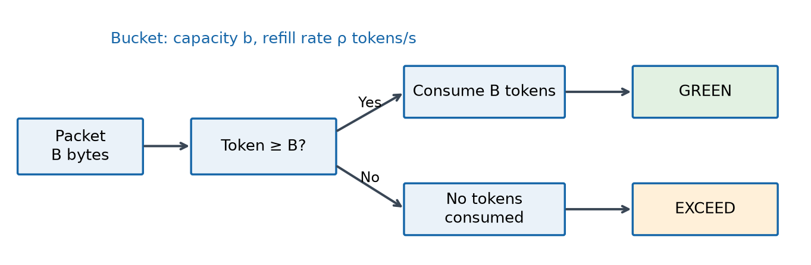

**Reading the diagram.** The central question concerns credits, not free buffer space. The negative branch assigns a mark; it does not itself require a drop. In the contract, **CIR** (*Committed Information Rate*) is the agreed rate, and **CBS** (*Committed Burst Size*) is the credit capacity, corresponding to $b$ in the minimum configuration.

<!-- page -->

## 2. Credits, bursts and the two-rate policer

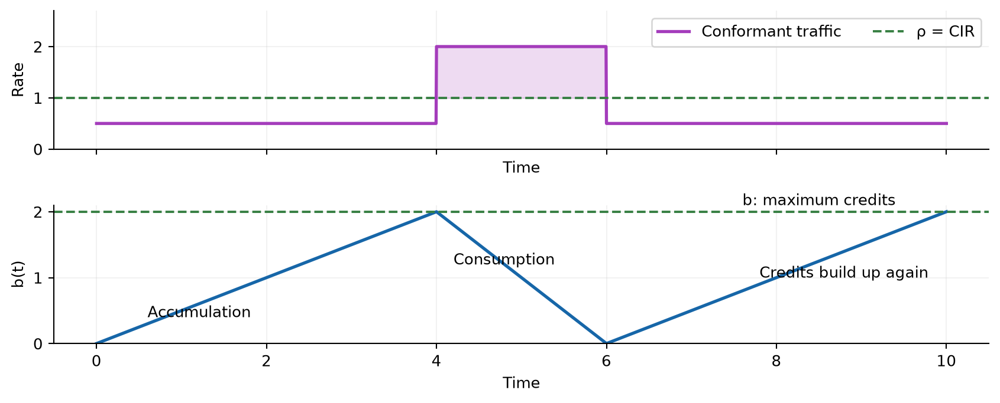

**What the graphs mean.** When the rate is below $\rho$, tokens accumulate. During a burst, the rate exceeds $\rho$ and the bucket drains: previously saved credits are spent. Once the bucket reaches $b$, newly generated unused tokens are lost; waiting longer cannot increase the reserve.

The simple token bucket controls the long-term conformant rate and the accumulated excess, but **does not by itself limit the instantaneous peak rate**. Credits can be spent very quickly. Also, $b$ limits the excess above tokens generated in the meantime, not the total bytes transmitted during a burst of nonzero duration.

### Two-rate three-color: two checks, three outcomes

The professor introduces a second bucket to distinguish exceeding the committed profile from also violating the peak profile.

| Bucket | Refill rate | Capacity | What it checks |
|---|---|---|---|
| Committed | CIR | CBS | Conformant traffic profile |
| Peak | PIR, with PIR $\ge$ CIR | PBS | Peak profile, with its own burst allowance |

The filter checks the **peak bucket first**, then the committed bucket. For a packet of $B$ bytes:

| Available credits | Color | Tokens consumed |
|---|---|---|
| Peak $<B$ | **Red: violating** | None |
| Peak $\ge B$, committed $<B$ | **Yellow: exceed** | $B$ from peak only |
| Both $\ge B$ | **Green: conformant** | $B$ from each bucket |

**The professor's qualitative example, using a fluid model.** Starting with available credits, if the source maintains $\lambda\le\mathrm{CIR}$, traffic can remain green. If $\mathrm{CIR}<\lambda\le\mathrm{PIR}$, committed credits decrease and yellow traffic appears. If $\lambda>\mathrm{PIR}$, peak credits can also run out and red packets appear.

This does not mean that every packet necessarily has the same color after the first depletion: tokens keep being generated. The depletion order also depends on CBS, PBS and initial levels. The green-yellow-red sequence described in class is an intuitive example, not a rule independent of those parameters.

This is still a **policer**: colors classify packets. A shaper is needed to impose a hard output-rate limit; the peak bucket still allows a finite burst tolerance.

<!-- page -->

## 3. Leaky bucket: a queue with a limited output rate

Imagine a bucket with a hole: data arrives, accumulates when necessary, and leaves at a maximum rate $\rho$. The bucket is a **data buffer of capacity $b$**, not a wallet of tokens.

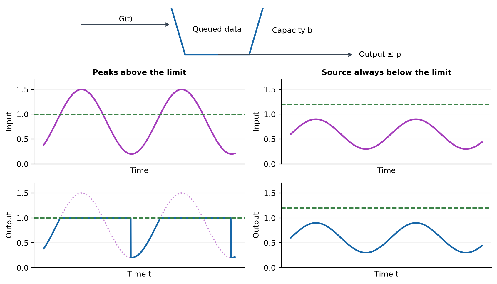

**Right-hand panels.** If the buffer is initially empty and the input always stays below $\rho$, no queue forms: output equals input.

**Left-hand panels.** When input exceeds $\rho$, output is capped at $\rho$ and the excess is queued. When input falls below $\rho$ again, **output stays at $\rho$ while a backlog remains**. Only after the queue empties does output follow the source again. The dotted purple line helps compare input and output: the peak is spread over a longer time.

The fluid-model rule is:

$$
G_{\mathrm{out}}(t)=
\begin{cases}
\min\{G(t),\rho\}, & b(t)=0,\\
\rho, & b(t)>0.
\end{cases}
$$

When $0<b(t)<b$, the queue changes according to **input minus output**:

$$
\frac{db(t)}{dt}=G(t)-\rho.
$$

If $b(t)=b$ and $G(t)>\rho$, the buffer cannot grow further: excess data is dropped. A larger buffer absorbs a longer peak, but cannot solve permanent overload.

> **Remember.** “Constant rate” means that the leaky bucket serves at rate $\rho$ **when it has data to transmit**. It does not create dummy traffic when the queue is empty.

<!-- page -->

## 4. Exercise: periodic sawtooth input

The professor proposes a leaky bucket with $\rho=1\,\mathrm{Mbit/s}$ and $b=1\,\mathrm{kB}=8000\,\mathrm{bits}$, using the decimal kilobyte. The source rate rises linearly from zero towards $R$ and restarts every $T$ seconds:

$$
G(t)=\frac{R}{T}\operatorname{mod}(t,T)
=R\left(\frac{t}{T}-\left\lfloor\frac{t}{T}\right\rfloor\right).
$$

Here $\operatorname{mod}(t,T)=t-T\lfloor t/T\rfloor\in[0,T)$, and *floor* rounds down to the nearest integer. The factor $1/T$ is necessary: **$R$ is a rate**, not a slope. The professor corrects this normalization during the lecture.

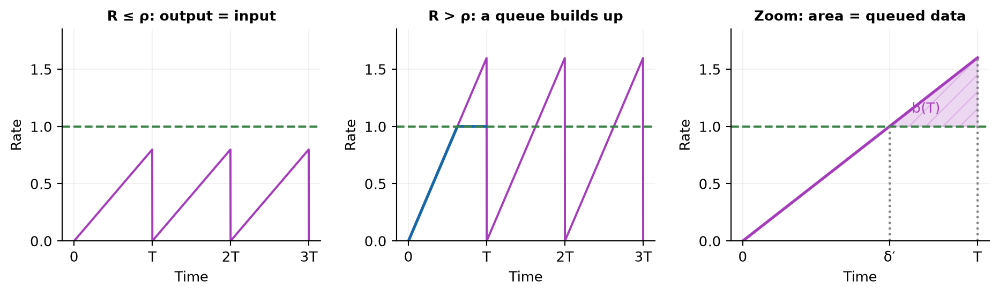

**Left: $R\le \rho$.** Starting with an empty buffer, $G_{\mathrm{out}}(t)=G(t)$: there is no queue. Output is not constantly $R$; $R$ is only the peak value approached by the ramp.

**Middle: $R>\rho$.** During the first period, output follows the ramp until $G(t)=\rho$, then stays at $\rho$:

$$
\delta'=\frac{\rho T}{R},\qquad
\delta=T-\delta'=\frac{R-\rho}{R}T.
$$

**Right: close-up of the triangle.** The area between input and output measures queued data, because a rate multiplied by time gives an amount of data. At the end of the period:

$$
b(T)=\frac{(R-\rho)\delta}{2}
=\boxed{\frac{(R-\rho)^2T}{2R}}.
$$

This assumes an **initially empty queue and no overflow during the first period**. Therefore, $b\ge b(T)$ is required; otherwise the queue reaches $b$ before $T$ and some excess is dropped.

The entire input triangle has area $RT/2$: this is the data generated in one period. The average rate is therefore $R/2$. The provisional “$RT$ per period” expression in the handwritten notes needs the factor $1/2$.

<!-- page -->

## 5. After input resets to zero: when does the queue empty?

At $t=T$, input restarts from zero, but the buffer still contains $b(T)$ data. Output therefore stays at $\rho$. Write $t=T+\varepsilon$, with $0\le\varepsilon<T$. We follow the steps on handwritten p. 4, identifying the correction that changes the quadratic equation.

### Step 1: the balance written in the handwritten notes

Page 4 writes the following expression, **before correction**:

$$
b(T+\varepsilon)=b(T)+\left(\frac{R}{T}\varepsilon-\rho\right)\varepsilon.
$$

Setting it to zero gives the quadratic shown on that page:

$$
\frac{R}{T}\varepsilon^2-\rho\varepsilon+b(T)=0
\quad\Longrightarrow\quad
\varepsilon^2-\frac{\rho T}{R}\varepsilon+\frac{T}{R}b(T)=0.
$$

This explains why the handwritten roots look different. These equations multiply the **final arrival rate** $G(T+\varepsilon)=R\varepsilon/T$ by the entire interval $\varepsilon$, as if this rate had been constant throughout.

### Step 2: correct the incoming-data term

Input actually increases linearly from zero. Its average rate over the interval is half its final rate, so the incoming amount is a triangular area:

$$
\int_T^{T+\varepsilon}G(t)\,dt
=\frac{1}{2}\,\varepsilon\,\frac{R\varepsilon}{T}
=\frac{R}{2T}\varepsilon^2.
$$

While the queue stays positive and there are no losses, the corrected balance is therefore:

$$
b(T+\varepsilon)=b(T)+\frac{R}{2T}\varepsilon^2-\rho\varepsilon.
$$

Use the end-of-period backlog calculated from the triangle on handwritten p. 3:

$$
b(T)=\frac{(R-\rho)^2T}{2R}.
$$

The provisional substitution on p. 4 also omits this factor $1/2$. The reasoning is still “previous backlog + arrivals − departures”; the two missing factors must be corrected consistently.

### Step 3: set the corrected balance to zero

As on p. 4, set $b(T+\varepsilon)=0$, then divide by the coefficient of $\varepsilon^2$:

$$
\frac{R}{2T}\varepsilon^2-\rho\varepsilon+b(T)=0
\quad\Longrightarrow\quad
\varepsilon^2-\frac{2\rho T}{R}\varepsilon+\frac{2T}{R}b(T)=0.
$$

Applying the quadratic formula gives both algebraic roots:

$$
\varepsilon_{1,2}
=\frac{\dfrac{2\rho T}{R}\pm
\sqrt{\left(\dfrac{2\rho T}{R}\right)^2-\dfrac{8T}{R}b(T)}}{2}
=\frac{T}{R}\left[\rho\pm\sqrt{R(2\rho-R)}\right].
$$

### Step 4: select the first physical zero

For $\rho<R<2\rho$, the smaller root is the emptying time marked $\varepsilon_m$ in the graph:

$$
\boxed{\varepsilon_m=\frac{T}{R}\left[\rho-\sqrt{R(2\rho-R)}\right]}.
$$

It satisfies $0<\varepsilon_m<\delta'=\rho T/R<T$. The handwritten check $R\varepsilon/T>\rho$ means that input exceeds service again after $\varepsilon>\delta'$: by then the queue starts growing again. If it emptied earlier, its level must remain zero until this crossing, rather than following the quadratic into negative values.

Thus, the second algebraic root is not a second emptying event. For $R>2\rho$ there are no real roots: the queue does not empty in this cycle under the no-loss balance. Section 6 discusses finite-buffer losses and the boundary case $R=2\rho$.

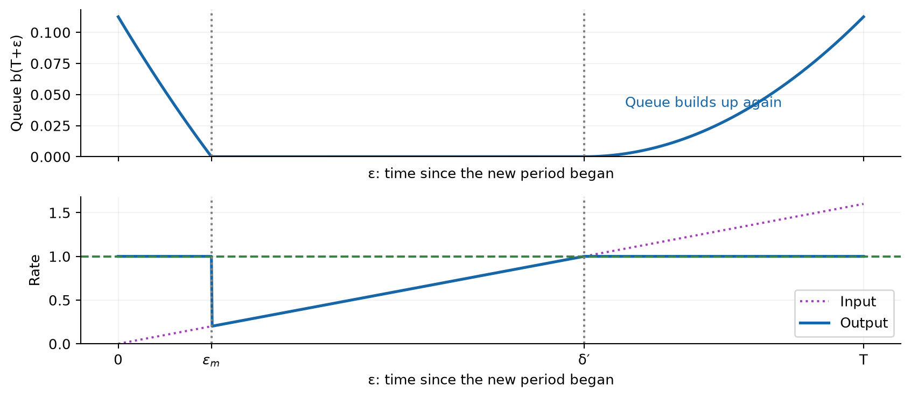

**Upper graph.** The queue decreases along a parabola until $\varepsilon_m$, stays at zero until $\delta'=\rho T/R$, and grows again when the new ramp exceeds $\rho$. The handwritten drawing was schematic: the zero-level segment does not continue to the end of the period.

**Lower graph.** Output equals $\rho$ until $\varepsilon_m$. When the backlog runs out, output drops to the source's current rate, follows the ramp, and returns to $\rho$ when input reaches the limit. This explains the downward step drawn by the professor.

<!-- page -->

## 6. Stability and losses: completing the exercise

The decisive comparison is between the average input rate $R/2$ and the service rate $\rho$:

| Condition | Behavior with an initially empty buffer |
|---|---|
| $R\le \rho$ | No queue; output equals input |
| $\rho<R<2\rho$ | Queue empties each cycle; no loss if $b\ge b(T)$ |
| $R=2\rho$ | Boundary case: queue touches zero at $\varepsilon_m=T/2$ and immediately grows again |
| $R>2\rho$ | An unlimited buffer accumulates data across cycles; a finite buffer eventually drops data |

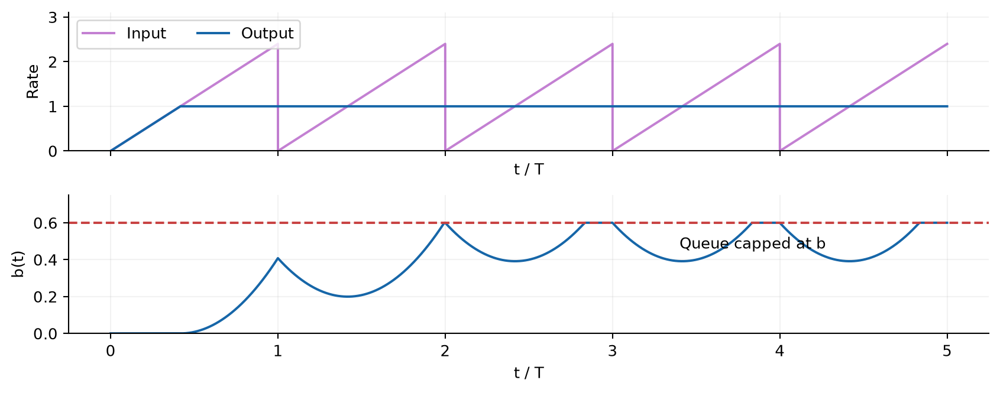

**Top:** input keeps oscillating; in this example, after the transient, enough backlog always remains to keep output at $\rho$. **Bottom:** the buffer reaches its limit $b$, then partly drains each cycle. Thus, the note “$b(t)\to b$” should not be taken literally: with periodic input, the queue can oscillate even when losses occur. A very small buffer may even empty, temporarily letting output fall below $\rho$.

### The professor's simpler example: a CBR source

With constant input $\lambda=1.5\rho$, an initially empty queue grows at rate $\lambda-\rho=0.5\rho$. It becomes full after:

$$
\frac{b}{\lambda-\rho}.
$$

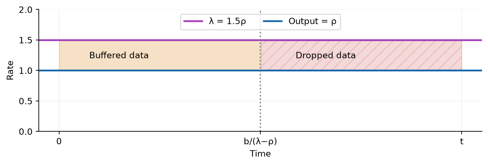

**Meaning of the areas.** Before $b/(\lambda-\rho)$, the area between $\lambda$ and $\rho$ fills the buffer. Afterwards, the same excess is lost. Output always equals $\rho$; the steady-state drop rate is $\lambda_d=0.5\rho$, or **one third of the input**. Unlike the sawtooth case, the buffer stays full because input never decreases.

<!-- page -->

## 7. Token bucket as a shaper: burst and grace period

The second part of the lecture combines a token bucket with data buffers and an output link. The source specifies an **SLA** (*Service Level Agreement*), describing its service requirements:

| Parameter | Source requirement |
|---|---|
| $\lambda_a$ | Long-term average rate |
| $\lambda_p>\lambda_a$ | Peak rate |
| $T_b$ | Burst duration to be forwarded through the TBF at peak rate |
| $T_g$ | Additional time at peak rate tolerated without loss: the **grace period** |
| $d_{\max}$ | Maximum acceptable delay for data that is not dropped |

The **burst** uses available credits and passes through the TBF at $\lambda_p$. During the **grace period**, credits have run out: the source may still generate at $\lambda_p$, but the TBF forwards at $\rho$. The difference must wait in a queue.

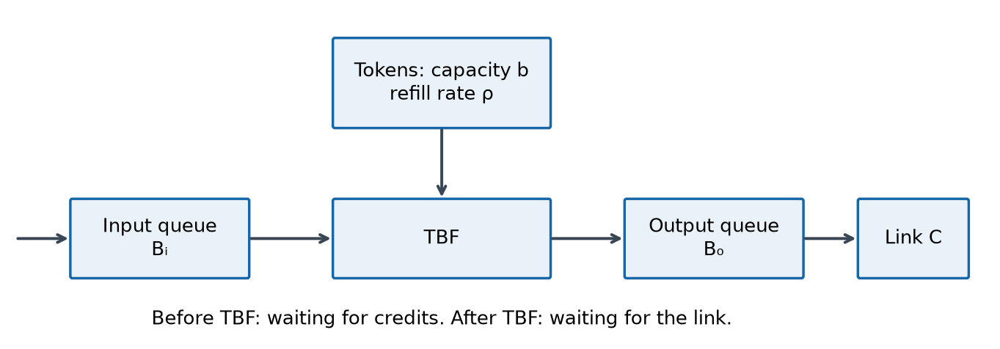

**Reading the diagram from left to right.**

- Buffer **$B_i$** holds data waiting for tokens.
- Bucket **$b$** holds only credits; the filter consumes them to authorize data forwarding.
- Buffer **$B_o$** holds data that has passed the filter but is waiting for link transmission.
- The link transmits at a maximum rate **$C$**.

The combination **output buffer + link** behaves like a leaky bucket of rate $C$. This explains the combined design: the TBF allows credit-limited bursts; the link imposes the final physical limit. If $C<\lambda_p$, a burst passes through the TBF at peak rate but **does not leave the link at peak rate**: it queues in $B_o$.

### Assumptions behind the professor's calculations

We use a **fluid model**: data is a continuous stream, without packet boundaries. At the start of the burst, the token bucket is full and both data buffers are empty. Queues are FIFO, the source does not exceed $\lambda_p$, and TBF forwarding in the model is limited to that peak. We study the worst case where the source stays at peak rate throughout the burst and grace period.

The peak limit is an additional assumption or configuration of this system: a simple bucket with only $\rho$ and $b$ does not enforce it by itself. The calculated delays are queuing delays in the model, excluding propagation and packet serialization details.

<!-- page -->

## 8. Sizing tokens and buffers using rate balances

The common rule is: **accumulated amount = rate difference × duration**. For a minimum configuration, choose $\rho=\lambda_a$; generally, $\rho\ge\lambda_a$ is needed. We consider $\rho<\lambda_p$ and a link with $C>\rho$, so it can drain the backlog while carrying post-burst traffic.

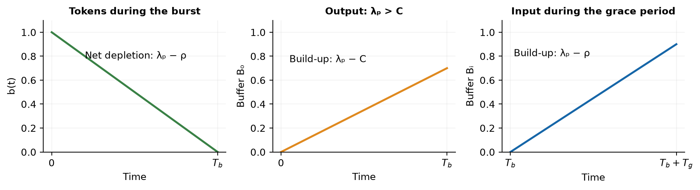

### Credits needed for the burst

**Left panel.** Tokens leave at rate $\lambda_p$, but keep arriving at rate $\rho$. The level therefore decreases at $\lambda_p-\rho$, not at $\lambda_p$. Starting with a full bucket, its depletion time is:

$$
\frac{b}{\lambda_p-\rho}.
$$

To allow at least $T_b$, we need $b\ge(\lambda_p-\rho)T_b$. To make credits run out exactly at the end of the agreed burst, choose:

$$
\boxed{b=(\lambda_p-\rho)T_b}.
$$

The following formulas use this choice. Increasing $b$ also increases the effective burst duration that must be considered when sizing the output buffer.

### Output buffer

**Middle panel.** If $\rho<C<\lambda_p$, then $\lambda_p T_b$ bytes arrive and $CT_b$ bytes depart during $T_b$. Therefore:

$$
\boxed{B_o\ge(\lambda_p-C)T_b}.
$$

If $C\ge\lambda_p$, no output backlog builds up and $B_o=0$ is sufficient in the fluid model. In practice, some memory is still needed to handle packets. Buying a link much faster than the peak avoids this queue but may waste capacity: this is the trade-off highlighted by the professor.

### Input buffer and grace period

**Right panel.** After token depletion, $\lambda_p$ bytes/s arrive, but only $\rho$ pass through. To tolerate a grace period $T_g$:

$$
\boxed{B_i\ge(\lambda_p-\rho)T_g}.
$$

With equality, the buffer fills at $T_b+T_g$. If the source stays at peak rate beyond that time, excess traffic is dropped. Filling a data buffer differs from exhausting tokens: the former causes losses; the latter reduces the forwarding rate.

<!-- page -->

## 9. Maximum delay with a fast link: $C\ge\lambda_p$

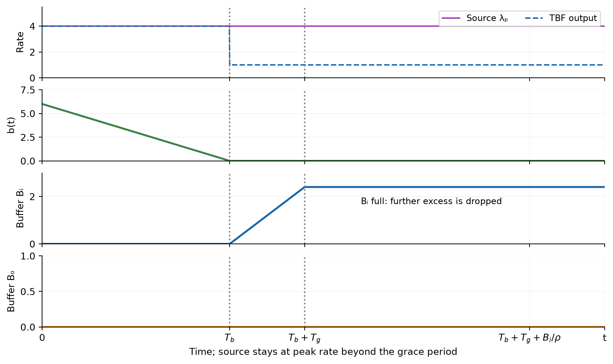

These are the graphs described by the professor for the blank space on the last handwritten page. Here the source stays at peak rate beyond the grace period to show saturation and drops.

**First graph: rates.** Until $T_b$, the TBF forwards at peak rate. After $T_b$, tokens are exhausted and it forwards only at $\rho$.

**Second graph: tokens.** The reserve decreases linearly from $b$ to zero at rate $\lambda_p-\rho$. Afterwards, newly generated tokens are consumed immediately, so the level stays at zero.

**Third graph: input.** The queue is empty during the burst; it grows during the grace period at rate $\lambda_p-\rho$ and reaches $B_i$ at $T_b+T_g$. If the peak continues, the buffer remains full and further excess is dropped.

**Fourth graph: output.** This queue is always empty because the link can transmit at least as fast as the TBF supplies data.

The worst-case data is accepted at the tail of a full input queue. Approximately $B_i$ bytes are ahead of it, served at rate $\rho$. The resulting maximum delay is:

$$
\boxed{\frac{B_i}{\rho}}.
$$

To meet the agreed maximum delay $d_{\max}$ and guarantee the grace period, both bounds must hold:

$$
(\lambda_p-\rho)T_g\le B_i\le\rho d_{\max}.
$$

Greater tolerance therefore needs more memory, but may also increase the maximum wait. If the source drops below $\rho$, the queue starts draining. Tokens accumulate again **after the backlog has cleared**: while queued data remains, all newly generated tokens are still needed to forward it.

<!-- page -->

## 10. Two queues: $\rho<C<\lambda_p$

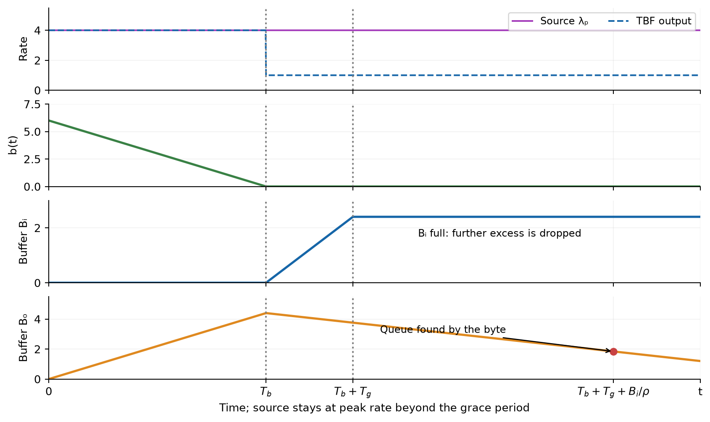

**Rates and tokens.** These behave as before: forwarding drops from $\lambda_p$ to $\rho$ when credits run out.

**Input buffer.** It is empty during the burst, then fills during the grace period until it reaches $B_i$.

**Output buffer.** During the burst, it fills at rate $\lambda_p-C$. With the minimum sizing used below, its capacity equals the maximum backlog:

$$
B_o=(\lambda_p-C)T_b.
$$

After $T_b$, the TBF supplies $\rho<C$, so the output buffer drains at rate $C-\rho$. At any time $t\ge T_b$, its remaining data is:

$$
\max\{0,B_o-(C-\rho)(t-T_b)\}.
$$

This holds while the TBF keeps forwarding at $\rho$, as in the illustrated example where the source stays at peak rate. A larger physical buffer can be installed, but the delay must use the actual backlog; the following formulas use the minimum capacity above.

### The central point in the professor's explanation

Data first waits at the input, then reaches the output buffer later. Its total delay is **the input waiting time plus the output waiting time**. The latter equals the output backlog found at arrival divided by $C$.

Do not add the two buffers as photographed at the same instant: while data waits at the input, the output buffer is already draining. The red point marks the level found **when that data actually reaches the output buffer**. With different parameters, this buffer could already be empty then.

<!-- page -->

## 11. Completing the calculation and checking the SLA

Use the minimum input capacity $B_i=(\lambda_p-\rho)T_g$. Data accepted at the end of the grace period, at $T_b+T_g$, finds the input buffer full and waits $B_i/\rho$.

During the $T_g+B_i/\rho$ elapsed since token depletion, the output buffer has decreased. The maximum delay produced by the configuration is:

$$
\boxed{\frac{B_i}{\rho}
+\frac{\max\{0,B_o-(C-\rho)(T_g+B_i/\rho)\}}{C}}.
$$

This completes the procedure explained in the final minutes of the lecture. Using the same symbols as the handwritten notes, the equivalent compact expression is:

$$
\boxed{\max\left\{
\frac{B_i}{\rho},\;
\frac{B_o}{C}+\frac{\lambda_p-C}{C}T_g
\right\}},\qquad \rho<C<\lambda_p.
$$

**Why is the worst case at the end of the grace period?** While an output backlog remains when the data arrives, total delay increases with slope $\lambda_p/C-1>0$. If the output buffer is already empty, input waiting time increases with slope $(\lambda_p-\rho)/\rho>0$. Both therefore reach their maximum at the end of the grace period. We must follow the same data through both buffers.

The value calculated above must not exceed the **agreed maximum delay $d_{\max}$**, the symbol used in the handwritten notes. For two buffers, check both conditions:

$$
\frac{B_i}{\rho}\le d_{\max},\qquad
\frac{B_o}{C}+\frac{\lambda_p-C}{C}T_g\le d_{\max}.
$$

### Quick checks to remember

- A **policer marks**; a **shaper delays** and may drop data when its buffer is full.
- A **token bucket saves credits** and allows bursts; a **leaky bucket stores data** and always caps output at $\rho$.
- For a queue, **integrating the rate difference gives an area**: a triangular region contributes the factor $1/2$.
- For queues in series, evaluate the second queue **when the data arrives there**, not when it is generated.

### Sources and coverage of the drawings

**Main sources:** all 7 pages of `Lesson 7.pdf`; `20 ott 2026, 08-45.transcript.txt`, from 00:00 to 01:33:54. **Targeted additions:** `4-QoS-TokenFilters-BookChapter.pdf`, §0.2 and the parts of §0.3 covering policers, soft shaping, bursts, buffers and delays (§0.3.0.1-0.3.0.2). The general QoS pipeline, CAC, scheduling and network slicing are excluded because they were not developed in this lecture.

The drawings are recreated and explained: handwritten p. 1 → fig. 1 and the color table; p. 2 → fig. 3-4; p. 3 → fig. 4, including the close-up; p. 4 → fig. 5-6, with corrections; p. 5 → fig. 7-8; p. 6 → fig. 8-9; p. 7 → fig. 8 and 10-11. Figure 2 reconstructs the credit graph described orally. Repeated TBF diagrams are combined in fig. 8 and the three balances in fig. 9.

The provisional sawtooth formulas have been recalculated. The two-queue delay also corrects the chapter's typo labeling the output backlog with the input subscript. The chapter's final inverse formulas for $B_i$, not developed by the professor and inconsistent in the supplied version, are not used: the checks here follow directly from the delay expression.

**Notation check against the handwritten PDF.** $\rho$, $b$ and $b(t)$ are retained for the leaky bucket (pp. 2-5); $B$ denotes packet size in the policer (p. 1); $R$, $T$, $\delta$, $\delta'$, $\varepsilon$ and $\varepsilon_m$ follow the sawtooth exercise (pp. 2-4); $\lambda$, $\lambda_d$, $\lambda_a$, $\lambda_p$, $T_b$, $T_g$, $B_i$, $B_o$, $C$ and $d_{\max}$ follow pp. 5-7. Additional derivations use these symbols; corrections to provisional formulas are identified separately.
