# Lezione 7 · Token bucket e leaky bucket

*Network Modeling · 20 ottobre 2026 · Appunti integrati*

Questi appunti seguono la lezione: richiamo del token bucket, policer a due rate e tre colori, leaky bucket, esercizio a dente di sega e dimensionamento di uno shaper con vincoli di burst, tolleranza e ritardo. Le spiegazioni del prof e gli appunti manoscritti sono la base; il capitolo serve a completare gli stessi argomenti.

## 1. Prima distinzione: controllare o modificare il traffico

Un **policer**, nel modello presentato dal prof, verifica se un pacchetto rispetta il contratto e lo **marca**. Saranno altri moduli a decidere se inoltrarlo con meno priorità, trattarlo come best effort oppure scartarlo.

Uno **shaper** modifica invece il traffico in uscita: può trattenere i pacchetti in una coda e farli uscire più lentamente. Se la coda finita si riempie, il traffico in eccesso viene perso.

> **Idea di base.** I token sono crediti per trasmettere; i buffer contengono dati in attesa. Non sono la stessa cosa.

### Notazione e unità

| Simbolo | Significato in `Lesson 7.pdf` |
|---|---|
| $\rho$ | Generazione di token nel token bucket; limite di uscita nel leaky bucket |
| $b$ | Capacità del bucket: token nel token bucket, dati nel leaky bucket |
| $b(t)$ | Livello corrente del bucket; il contesto distingue token e dati accodati |
| $B$ | Dimensione del pacchetto in byte, come nello schema del policer a p. 1 |
| $G(t)$, $G_{\mathrm{out}}(t)$ | Rate di ingresso e uscita |

Manteniamo la notazione manoscritta, compreso il riuso di $\rho$, $b$ e $b(t)$ in contesti diversi. I buffer di ingresso e uscita dello shaper hanno capacità $B_i$ e $B_o$; il rate del link è $C$. Assumiamo **1 token = permesso di trasmettere 1 byte**. Nei calcoli dello shaping i rate sono in byte/s e le capacità in byte. L'esercizio a dente di sega usa bit/s: convertiamo quindi la capacità in bit. Gli appunti alternano la dicitura “bit-rate” a un link indicato in byte/s: prima dei calcoli occorre rendere coerenti le unità.

### Token bucket a un rate e due colori

Il bucket riceve token al rate $\rho$ e ne contiene al massimo $b$. Per un pacchetto di $B$ byte:

- Se $b(t)\ge B$, si consumano $B$ token e il pacchetto è **conformant**.
- Altrimenti il pacchetto è **exceed** e **non si consumano token**.

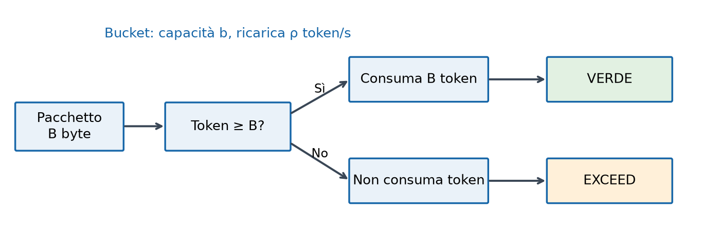

**Come leggere lo schema.** La domanda centrale riguarda i crediti, non lo spazio in un buffer. Il ramo negativo assegna una marca; non impone da solo uno scarto. Nel contratto, **CIR** (*Committed Information Rate*) corrisponde al rate concordato e **CBS** (*Committed Burst Size*) alla capacità di crediti, ossia $b$ nel modello minimo.

<!-- pagina -->

## 2. Crediti, burst e policer a due rate

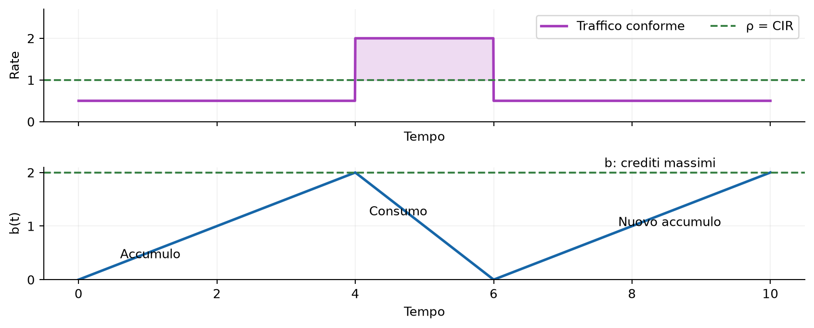

**Significato del grafico.** Quando il rate è sotto $\rho$, i token si accumulano. Durante il burst, il rate supera $\rho$ e il bucket si svuota: si spendono crediti risparmiati prima. Una volta raggiunto $b$, i nuovi token inutilizzati sono persi; aspettare ancora non aumenta la riserva.

Il token bucket semplice controlla il rate conforme di lungo periodo e l'eccesso accumulabile, ma **non pone da solo un limite al picco istantaneo**. I crediti possono essere spesi molto rapidamente. Inoltre, $b$ limita l'eccesso rispetto ai token prodotti nel frattempo, non tutti i byte trasmessi durante un burst di durata non nulla.

### Two-rate three-color: due controlli, tre risultati

Il prof introduce un secondo bucket per distinguere un superamento del rate concordato da una violazione anche del profilo di picco.

| Bucket | Ricarica | Capacità | Cosa controlla |
|---|---|---|---|
| Committed | CIR | CBS | Profilo del traffico conforme |
| Peak | PIR, con PIR $\ge$ CIR | PBS | Profilo di picco, con propria tolleranza al burst |

Si controlla **prima il bucket peak**, poi quello committed. Per un pacchetto di $B$ byte:

| Crediti disponibili | Colore | Token consumati |
|---|---|---|
| Peak $<B$ | **Rosso: violating** | Nessuno |
| Peak $\ge B$, committed $<B$ | **Giallo: exceed** | $B$ solo dal peak |
| Entrambi $\ge B$ | **Verde: conformant** | $B$ da entrambi |

**Esempio qualitativo del prof, nel modello fluido.** Partendo con crediti disponibili, se la sorgente mantiene $\lambda\le\mathrm{CIR}$, il traffico può restare verde. Se $\mathrm{CIR}<\lambda\le\mathrm{PIR}$, i crediti committed diminuiscono e compare traffico giallo. Se $\lambda>\mathrm{PIR}$, possono esaurirsi anche i crediti peak e comparire pacchetti rossi.

Non significa che, dopo il primo esaurimento, ogni pacchetto abbia necessariamente lo stesso colore: i token continuano a essere generati. L'ordine esatto di esaurimento dipende anche da CBS, PBS e dai livelli iniziali. Il percorso verde-giallo-rosso descritto a voce è un esempio intuitivo, non una regola indipendente dai parametri.

Anche questo è un **policer**: i colori classificano i pacchetti. Per imporre un limite rigido al rate in uscita serve uno shaper; il bucket peak conserva comunque una tolleranza finita al burst.

<!-- pagina -->

## 3. Leaky bucket: una coda con uscita limitata

Immaginiamo un recipiente con un foro: arrivano dati, si accumulano se necessario ed escono al massimo al rate $\rho$. Il recipiente è un **buffer dati di capacità $b$**, non un portafoglio di token.

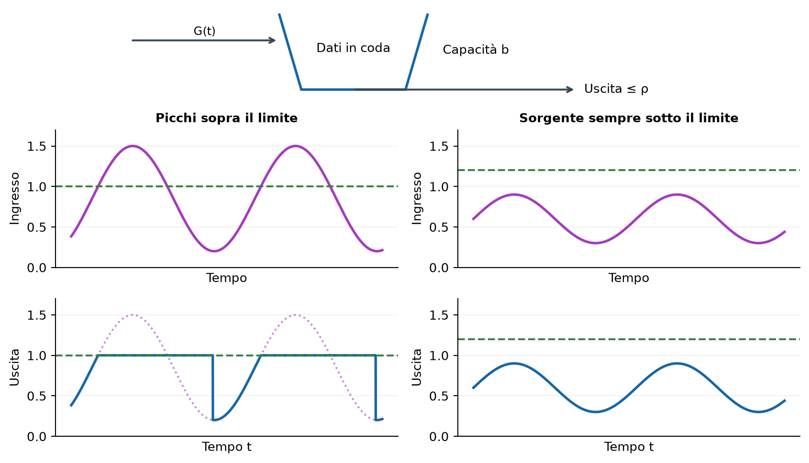

**Pannelli di destra.** Con buffer inizialmente vuoto e ingresso sempre sotto $\rho$, non si forma coda: l'uscita coincide con l'ingresso.

**Pannelli di sinistra.** Quando l'ingresso supera $\rho$, l'uscita si ferma a $\rho$ e l'eccesso viene accodato. Quando l'ingresso torna sotto $\rho$, **l'uscita resta a $\rho$ finché ci sono dati arretrati**. Solo dopo lo svuotamento torna a seguire la sorgente. La linea viola tratteggiata aiuta a confrontare ingresso e uscita: il picco viene distribuito su un tempo più lungo.

La regola, nel modello fluido, è:

$$
G_{\mathrm{out}}(t)=
\begin{cases}
\min\{G(t),\rho\}, & b(t)=0,\\
\rho, & b(t)>0.
\end{cases}
$$

Quando $0<b(t)<b$, la coda varia secondo **ingressi meno uscite**:

$$
\frac{db(t)}{dt}=G(t)-\rho.
$$

Se $b(t)=b$ e $G(t)>\rho$, il buffer non può crescere: si scarta l'eccesso. Un buffer più grande assorbe un picco più lungo, ma non risolve un sovraccarico permanente.

> **Da ricordare.** “Rate costante” significa che il leaky bucket serve al rate $\rho$ **quando ha dati da trasmettere**. Non produce traffico fittizio quando la coda è vuota.

<!-- pagina -->

## 4. Esercizio: ingresso periodico a dente di sega

Il prof propone un leaky bucket con $\rho=1\,\mathrm{Mbit/s}$ e $b=1\,\mathrm{kB}=8000\,\mathrm{bit}$, usando il kilobyte decimale. Il rate della sorgente cresce linearmente da zero a $R$ e riparte ogni $T$ secondi:

$$
G(t)=\frac{R}{T}\operatorname{mod}(t,T)
=R\left(\frac{t}{T}-\left\lfloor\frac{t}{T}\right\rfloor\right).
$$

Qui $\operatorname{mod}(t,T)=t-T\lfloor t/T\rfloor\in[0,T)$ e il *floor* prende la parte intera inferiore. Il fattore $1/T$ è necessario: **$R$ è un rate**, non una pendenza. Il prof corregge questa normalizzazione durante la lezione.

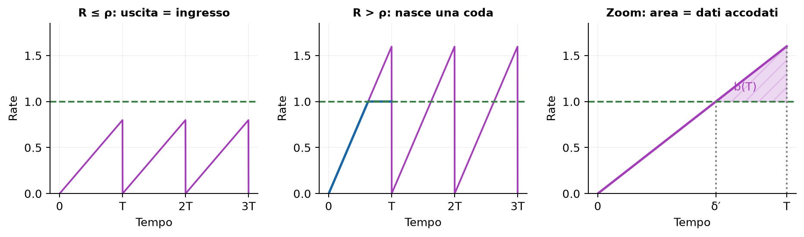

**Sinistra: $R\le \rho$.** Partendo con buffer vuoto, $G_{\mathrm{out}}(t)=G(t)$: non c'è coda. L'uscita non è costantemente $R$; $R$ è soltanto il valore massimo raggiunto dalla rampa.

**Centro: $R>\rho$.** Nel primo periodo l'uscita segue la rampa fino all'istante in cui $G(t)=\rho$, poi rimane a $\rho$:

$$
\delta'=\frac{\rho T}{R},\qquad
\delta=T-\delta'=\frac{R-\rho}{R}T.
$$

**Destra: zoom del triangolo.** L'area tra ingresso e uscita misura i dati accodati, perché un rate moltiplicato per un tempo dà una quantità di dati. A fine periodo:

$$
b(T)=\frac{(R-\rho)\delta}{2}
=\boxed{\frac{(R-\rho)^2T}{2R}}.
$$

Questo risultato assume **coda inizialmente vuota e nessun overflow nel primo periodo**. Serve quindi $b\ge b(T)$; altrimenti la coda raggiunge $b$ prima di $T$ e parte dell'eccesso viene scartata.

L'intero triangolo di ingresso ha invece area $RT/2$: sono i dati generati in un periodo. Quindi il rate medio è $R/2$. La scritta provvisoria “$RT$ per periodo” negli appunti va corretta con il fattore $1/2$.

<!-- pagina -->

## 5. Dopo il salto a zero: quando si svuota la coda?

A $t=T$ l'ingresso riparte da zero, ma il buffer contiene ancora $b(T)$ dati. L'uscita resta quindi a $\rho$. Poniamo $t=T+\varepsilon$, con $0\le\varepsilon<T$. Seguiamo i passaggi di p. 4, distinguendo la correzione che cambia l'equazione di secondo grado.

### Passaggio 1: il bilancio scritto negli appunti

A p. 4 compare la seguente espressione, **prima della correzione**:

$$
b(T+\varepsilon)=b(T)+\left(\frac{R}{T}\varepsilon-\rho\right)\varepsilon.
$$

Imponendo che sia nulla, si ottiene l'equazione riportata in quella pagina:

$$
\frac{R}{T}\varepsilon^2-\rho\varepsilon+b(T)=0
\quad\Longrightarrow\quad
\varepsilon^2-\frac{\rho T}{R}\varepsilon+\frac{T}{R}b(T)=0.
$$

Questo spiega perché le radici manoscritte hanno una forma diversa. Quelle equazioni moltiplicano il **rate finale di arrivo** $G(T+\varepsilon)=R\varepsilon/T$ per l'intero intervallo $\varepsilon$, come se tale rate fosse stato costante.

### Passaggio 2: correggere la quantità di dati in ingresso

L'ingresso cresce invece linearmente da zero. Il rate medio nell'intervallo è metà del rate finale, quindi i dati arrivati corrispondono all'area di un triangolo:

$$
\int_T^{T+\varepsilon}G(t)\,dt
=\frac{1}{2}\,\varepsilon\,\frac{R\varepsilon}{T}
=\frac{R}{2T}\varepsilon^2.
$$

Finché la coda rimane positiva e non ci sono perdite, il bilancio corretto è dunque:

$$
b(T+\varepsilon)=b(T)+\frac{R}{2T}\varepsilon^2-\rho\varepsilon.
$$

Usiamo l'accumulo di fine periodo calcolato dal triangolo a p. 3:

$$
b(T)=\frac{(R-\rho)^2T}{2R}.
$$

Anche nella sostituzione provvisoria a p. 4 manca questo fattore $1/2$. Il ragionamento resta “accumulo precedente + arrivi − partenze”; i due fattori mancanti vanno corretti coerentemente.

### Passaggio 3: annullare il bilancio corretto

Come a p. 4, imponiamo $b(T+\varepsilon)=0$ e dividiamo per il coefficiente di $\varepsilon^2$:

$$
\frac{R}{2T}\varepsilon^2-\rho\varepsilon+b(T)=0
\quad\Longrightarrow\quad
\varepsilon^2-\frac{2\rho T}{R}\varepsilon+\frac{2T}{R}b(T)=0.
$$

La formula risolutiva fornisce entrambe le radici algebriche:

$$
\varepsilon_{1,2}
=\frac{\dfrac{2\rho T}{R}\pm
\sqrt{\left(\dfrac{2\rho T}{R}\right)^2-\dfrac{8T}{R}b(T)}}{2}
=\frac{T}{R}\left[\rho\pm\sqrt{R(2\rho-R)}\right].
$$

### Passaggio 4: scegliere il primo zero fisicamente valido

Per $\rho<R<2\rho$, la radice minore è il tempo di svuotamento indicato nel grafico con $\varepsilon_m$:

$$
\boxed{\varepsilon_m=\frac{T}{R}\left[\rho-\sqrt{R(2\rho-R)}\right]}.
$$

Vale $0<\varepsilon_m<\delta'=\rho T/R<T$. Il controllo manoscritto $R\varepsilon/T>\rho$ indica che l'ingresso supera nuovamente il servizio dopo $\varepsilon>\delta'$: da quel momento la coda ricomincia a crescere. Se si è svuotata prima, deve restare nulla fino a quell'incrocio, invece di seguire la parabola fino a livelli negativi.

La seconda radice algebrica non è quindi un secondo svuotamento. Per $R>2\rho$ non ci sono radici reali: la coda non si svuota in questo ciclo nel bilancio senza perdite. La sezione 6 tratta le perdite con buffer finito e il caso limite $R=2\rho$.

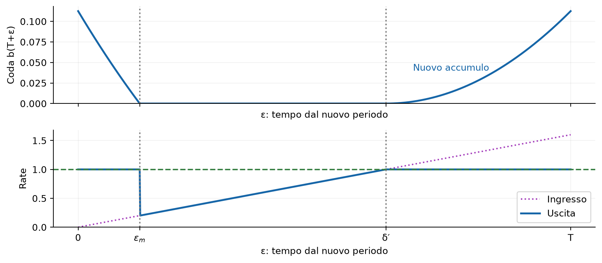

**Grafico superiore.** La coda scende con andamento parabolico fino a $\varepsilon_m$, resta nulla fino a $\delta'=\rho T/R$, poi ricomincia a crescere quando la nuova rampa supera $\rho$. Il disegno manoscritto era schematico: il tratto a zero non continua fino a fine periodo.

**Grafico inferiore.** Fino a $\varepsilon_m$ l'uscita vale $\rho$. Quando finiscono i dati arretrati, scende al rate istantaneo della sorgente, segue la rampa e torna a $\rho$ quando l'ingresso raggiunge il limite. Questo spiega il “gradino verso il basso” disegnato dal prof.

<!-- pagina -->

## 6. Stabilità e perdite: completamento dell'esercizio

Il confronto decisivo è tra il rate medio $R/2$ e il servizio $\rho$:

| Condizione | Comportamento, con buffer inizialmente vuoto |
|---|---|
| $R\le \rho$ | Nessuna coda, uscita uguale all'ingresso |
| $\rho<R<2\rho$ | La coda si svuota in ogni ciclo; nessuna perdita se $b\ge b(T)$ |
| $R=2\rho$ | Caso limite: la coda tocca zero a $\varepsilon_m=T/2$ e ricresce subito |
| $R>2\rho$ | Un buffer illimitato accumula dati ciclo dopo ciclo; con buffer finito compaiono perdite |

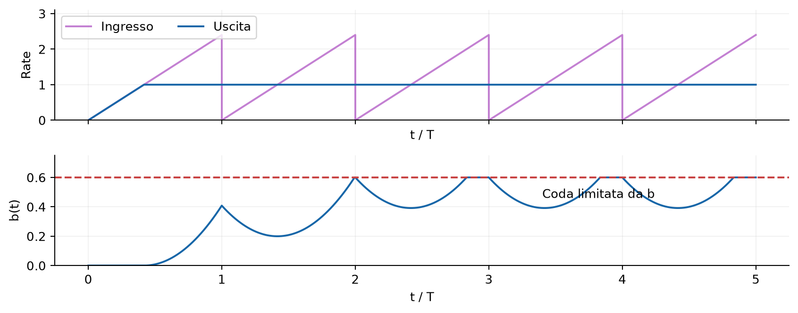

**Sopra:** l'ingresso continua a oscillare; nell'esempio, dopo il transitorio, c'è sempre abbastanza backlog per mantenere l'uscita a $\rho$. **Sotto:** il buffer tocca il limite $b$ e poi si svuota parzialmente a ogni ciclo. Dunque non va interpretata letteralmente l'annotazione “$b(t)\to b$”: con ingresso periodico, la coda può oscillare anche quando ci sono perdite. Con un buffer molto piccolo può perfino svuotarsi e far scendere temporaneamente l'uscita sotto $\rho$.

### Esempio più semplice del prof: sorgente CBR

Se l'ingresso è costante, $\lambda=1{,}5\rho$, la coda inizialmente vuota cresce al rate $\lambda-\rho=0{,}5\rho$. Diventa piena dopo:

$$
\frac{b}{\lambda-\rho}.
$$

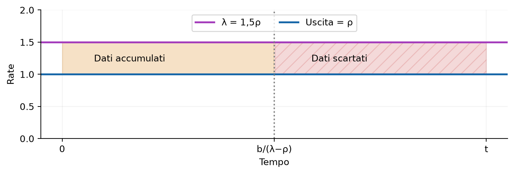

**Significato delle aree.** Prima di $b/(\lambda-\rho)$, l'area tra $\lambda$ e $\rho$ riempie il buffer. Dopo, lo stesso eccesso viene perso. L'uscita vale sempre $\rho$; il rate scartato a regime è $\lambda_d=0{,}5\rho$, cioè **un terzo dell'ingresso**. Diversamente dal dente di sega, qui il buffer rimane pieno perché l'ingresso non scende mai.

<!-- pagina -->

## 7. Token bucket come shaper: burst e grace period

La seconda parte della lezione combina un token bucket con buffer dati e link di uscita. La sorgente specifica un **SLA** (*Service Level Agreement*), ossia i requisiti del servizio:

| Parametro | Richiesta della sorgente |
|---|---|
| $\lambda_a$ | Rate medio di lungo periodo |
| $\lambda_p>\lambda_a$ | Rate di picco |
| $T_b$ | Durata del burst da far passare al picco attraverso il TBF |
| $T_g$ | Ulteriore tempo al picco tollerato senza perdita: **grace period** |
| $d_{\max}$ | Massimo ritardo accettabile per dati non scartati |

Il **burst** usa i crediti già disponibili e attraversa il TBF a $\lambda_p$. Nel **grace period** i crediti sono finiti: la sorgente può ancora generare a $\lambda_p$, ma il TBF inoltra a $\rho$. La differenza deve aspettare in una coda.

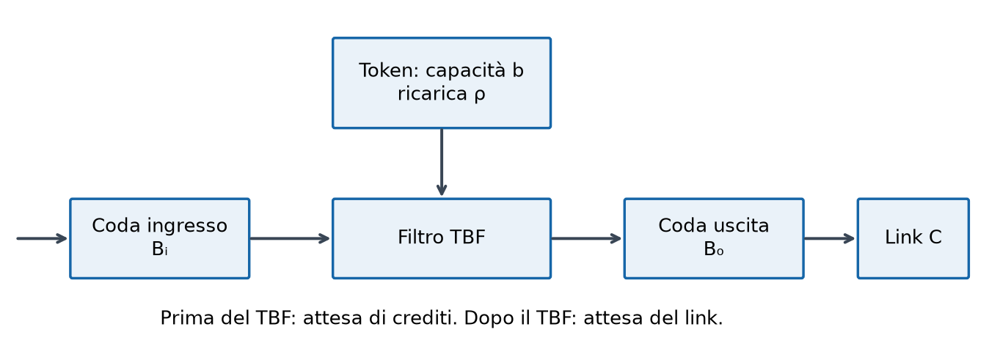

**Come leggere lo schema, da sinistra a destra.**

- Il buffer **$B_i$** conserva dati che aspettano i token.
- Il bucket **$b$** conserva solo crediti; il filtro li consuma per autorizzare il passaggio dei dati.
- Il buffer **$B_o$** conserva dati già passati dal filtro, ma in attesa di trasmissione sul link.
- Il link trasmette al rate massimo **$C$**.

La coppia **buffer di uscita + link** si comporta come un leaky bucket di rate $C$. Ecco il senso della combinazione: il TBF consente burst limitati dai crediti; il link impone il limite fisico finale. Se $C<\lambda_p$, un burst attraversa il TBF al picco ma **non esce dal link al picco**: si accoda in $B_o$.

### Ipotesi usate nei calcoli del prof

Usiamo un **modello fluido**: i dati sono un flusso continuo, senza confini tra pacchetti. All'inizio del burst il bucket è pieno e i due buffer sono vuoti. Le code sono FIFO, la sorgente non supera $\lambda_p$ e l'inoltro del TBF nel modello analizzato è limitato a quel picco. Studiamo il caso peggiore in cui la sorgente resta al picco per tutto il burst e il grace period.

Il limite di picco è un'ipotesi/configurazione aggiuntiva del sistema analizzato: il bucket semplice, con i soli $\rho$ e $b$, non lo impone da solo. I ritardi calcolati sono ritardi di accodamento del modello, senza propagazione e dettagli di serializzazione dei pacchetti.

<!-- pagina -->

## 8. Dimensionare token e buffer con un bilancio

La regola comune è: **quantità accumulata = differenza tra rate × durata**. Per un dimensionamento minimo scegliamo $\rho=\lambda_a$; in generale serve $\rho\ge\lambda_a$. Consideriamo $\rho<\lambda_p$ e un link con $C>\rho$, così può smaltire anche il traffico successivo al burst.

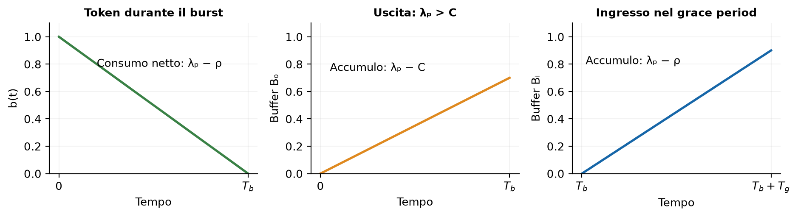

### Crediti necessari al burst

**Pannello sinistro.** I token escono al rate $\lambda_p$, ma continuano a entrare al rate $\rho$. Il livello scende quindi a $\lambda_p-\rho$, non a $\lambda_p$. Partendo dal bucket pieno, il tempo di esaurimento è:

$$
\frac{b}{\lambda_p-\rho}.
$$

Per consentire almeno $T_b$, serve $b\ge(\lambda_p-\rho)T_b$. Se vogliamo che i crediti finiscano esattamente alla fine del burst concordato, scegliamo:

$$
\boxed{b=(\lambda_p-\rho)T_b}.
$$

Le formule successive usano questa scelta. Aumentando $b$, aumenta anche il burst effettivo da considerare nel dimensionamento dell'uscita.

### Buffer di uscita

**Pannello centrale.** Se $\rho<C<\lambda_p$, durante $T_b$ entrano $\lambda_p T_b$ byte ed escono $CT_b$ byte. Quindi:

$$
\boxed{B_o\ge(\lambda_p-C)T_b}.
$$

Se invece $C\ge\lambda_p$, non si accumula coda all'uscita e nel modello fluido basta $B_o=0$. Nella pratica rimane memoria per gestire i pacchetti. Comprare un link molto più veloce del picco evita questa coda, ma può essere uno spreco di capacità: è il compromesso evidenziato dal prof.

### Buffer di ingresso e grace period

**Pannello destro.** Dopo l'esaurimento dei token arrivano $\lambda_p$ byte/s, ma ne passano solo $\rho$. Per tollerare un grace period $T_g$:

$$
\boxed{B_i\ge(\lambda_p-\rho)T_g}.
$$

Se scegliamo l'uguaglianza, il buffer si riempie a $T_b+T_g$. Se la sorgente insiste al picco oltre quell'istante, l'eccesso viene scartato. Riempire un buffer dati è diverso dall'esaurire i token: il primo porta a perdite, il secondo riduce il rate di inoltro.

<!-- pagina -->

## 9. Ritardo massimo con link veloce: $C\ge\lambda_p$

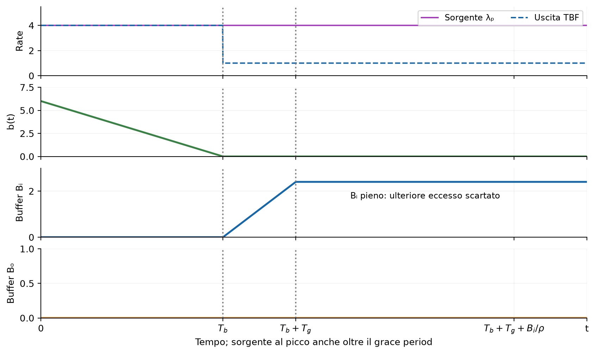

Questi sono i grafici descritti dal prof nella parte lasciata vuota nell'ultima pagina degli appunti. Qui la sorgente continua al picco anche oltre il grace period, per mostrare saturazione e scarti.

**Primo grafico: rate.** Fino a $T_b$ il TBF inoltra al picco. Dopo $T_b$, esauriti i token, inoltra solo a $\rho$.

**Secondo grafico: token.** La riserva scende linearmente da $b$ a zero al rate $\lambda_p-\rho$. Dopo, i nuovi token vengono consumati appena prodotti: il livello resta zero.

**Terzo grafico: ingresso.** La coda è vuota durante il burst; cresce nel grace period al rate $\lambda_p-\rho$ e raggiunge $B_i$ a $T_b+T_g$. Se il picco continua, rimane piena e l'ulteriore eccesso viene scartato.

**Quarto grafico: uscita.** La coda è sempre nulla perché il link riesce a trasmettere almeno quanto riceve dal TBF.

Il dato nel caso peggiore è quello accettato in fondo a una coda d'ingresso piena. Davanti ha circa $B_i$ byte, serviti al rate $\rho$:

$$
\boxed{\frac{B_i}{\rho}}.
$$

Per rispettare il massimo ritardo concordato $d_{\max}$ e garantire il grace period devono valere insieme:

$$
(\lambda_p-\rho)T_g\le B_i\le\rho d_{\max}.
$$

Quindi più tolleranza richiede più memoria, ma può anche aumentare l'attesa massima. Se la sorgente riduce il rate sotto $\rho$, la coda comincia a svuotarsi; i token tornano ad accumularsi **dopo che il backlog è stato smaltito**, finché tutti i nuovi token servono ancora a inoltrare i dati arretrati.

<!-- pagina -->

## 10. Due buffer: $\rho<C<\lambda_p$

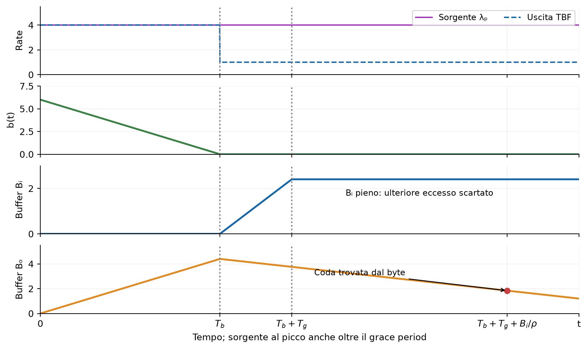

**Rate e token.** Sono uguali al caso precedente: il filtro passa da $\lambda_p$ a $\rho$ quando finiscono i crediti.

**Buffer d'ingresso.** È vuoto durante il burst, poi si riempie nel grace period fino a $B_i$.

**Buffer d'uscita.** Durante il burst si riempie al rate $\lambda_p-C$. Nel dimensionamento minimo usato di seguito, la capacità coincide con il massimo accumulo:

$$
B_o=(\lambda_p-C)T_b.
$$

Dopo $T_b$ il TBF fornisce $\rho<C$, quindi il buffer di uscita si svuota al rate $C-\rho$. A un istante $t\ge T_b$, i dati rimasti sono:

$$
\max\{0,B_o-(C-\rho)(t-T_b)\}.
$$

Questo vale finché il TBF continua a inoltrare a $\rho$, come nell'esempio in cui la sorgente resta al picco. Si può installare un buffer fisico più grande, ma il ritardo dipende dall'accumulo effettivo; le formule successive usano la capacità minima sopra indicata.

### Il punto centrale della spiegazione del prof

Un dato aspetta prima all'ingresso e raggiunge il buffer d'uscita più tardi. Il ritardo complessivo è **l'attesa all'ingresso più l'attesa all'uscita**. La seconda è l'accumulo trovato all'arrivo nel buffer d'uscita, diviso per $C$.

Non bisogna sommare i due buffer fotografati allo stesso istante: mentre il dato aspetta all'ingresso, il buffer d'uscita si sta già svuotando. Il punto rosso indica il livello trovato **quando il dato arriva davvero all'uscita**. Con altri parametri, il buffer potrebbe essere già vuoto.

<!-- pagina -->

## 11. Chiudere il calcolo e verificare lo SLA

Usiamo la capacità minima $B_i=(\lambda_p-\rho)T_g$. Il dato accettato alla fine del grace period, a $T_b+T_g$, trova il buffer d'ingresso pieno e aspetta $B_i/\rho$.

Durante il tempo $T_g+B_i/\rho$ trascorso dall'esaurimento dei token, il buffer d'uscita si è svuotato parzialmente. Il massimo ritardo prodotto dalla configurazione è:

$$
\boxed{\frac{B_i}{\rho}
+\frac{\max\{0,B_o-(C-\rho)(T_g+B_i/\rho)\}}{C}}.
$$

Questo completa il procedimento spiegato dal prof negli ultimi minuti. Con gli stessi simboli degli appunti manoscritti, la forma compatta equivalente è:

$$
\boxed{\max\left\{
\frac{B_i}{\rho},\;
\frac{B_o}{C}+\frac{\lambda_p-C}{C}T_g
\right\}},\qquad \rho<C<\lambda_p.
$$

**Perché il caso peggiore è alla fine del grace period?** Finché all'arrivo resta accumulo in uscita, il ritardo totale cresce con pendenza $\lambda_p/C-1>0$. Se il buffer d'uscita è già vuoto, l'attesa all'ingresso cresce con pendenza $(\lambda_p-\rho)/\rho>0$. Entrambe raggiungono quindi il massimo alla fine del grace period. Occorre seguire lo stesso dato attraverso i due buffer.

Il valore calcolato deve essere al massimo uguale al **massimo ritardo concordato $d_{\max}$**, simbolo usato negli appunti. Nel caso dei due buffer verifichiamo entrambe le condizioni:

$$
\frac{B_i}{\rho}\le d_{\max},\qquad
\frac{B_o}{C}+\frac{\lambda_p-C}{C}T_g\le d_{\max}.
$$

### Controlli rapidi da ricordare

- Il **policer marca**; lo **shaper ritarda** e può scartare quando il buffer è pieno.
- Il **token bucket risparmia crediti** e consente burst; il **leaky bucket conserva dati** e limita sempre l'uscita a $\rho$.
- Per una coda, **rate × tempo è un'area**: se il rate varia linearmente, compare il fattore $1/2$.
- Nei ritardi in cascata, valutare la seconda coda **all'arrivo**, non alla generazione.

### Fonti e copertura dei disegni

**Base:** `Lesson 7.pdf`, tutte le 7 pagine; trascrizione `20 ott 2026, 08-45.transcript.txt`, da 00:00 a 01:33:54. **Integrazione mirata:** `4-QoS-TokenFilters-BookChapter.pdf`, §0.2 e parti di §0.3 relative a policer, soft shaper, burst, buffer e ritardi (§0.3.0.1-0.3.0.2). Esclusi pipeline QoS generale, CAC, scheduling e network slicing, non sviluppati in questa lezione.

I disegni sono ricreati e spiegati: p. 1 → fig. 1 e tabella dei colori; p. 2 → fig. 3-4; p. 3 → fig. 4, incluso lo zoom; p. 4 → fig. 5-6, con correzioni; p. 5 → fig. 7-8; p. 6 → fig. 8-9; p. 7 → fig. 8 e 10-11. La fig. 2 ricostruisce il grafico dei crediti descritto a voce. Gli schemi ripetuti del TBF sono riuniti nella fig. 8 e nei tre bilanci della fig. 9.

Le formule provvisorie del dente di sega sono state ricalcolate; nel ritardo a due code è corretto anche il refuso del capitolo che indica la coda d'uscita con il pedice d'ingresso. Le ultime formule del capitolo per ricavare inversamente $B_i$, non sviluppate dal prof e incoerenti nella versione fornita, non sono usate: la verifica qui deriva direttamente dal ritardo.

**Controllo della notazione sul PDF manoscritto.** $\rho$, $b$ e $b(t)$ sono mantenuti per il leaky bucket (pp. 2-5); $B$ indica la dimensione del pacchetto nel policer (p. 1); $R$, $T$, $\delta$, $\delta'$, $\varepsilon$ e $\varepsilon_m$ seguono l'esercizio a dente di sega (pp. 2-4); $\lambda$, $\lambda_d$, $\lambda_a$, $\lambda_p$, $T_b$, $T_g$, $B_i$, $B_o$, $C$ e $d_{\max}$ seguono le pp. 5-7. Le derivazioni aggiuntive usano questi simboli; le correzioni alle formule provvisorie sono segnalate separatamente.
