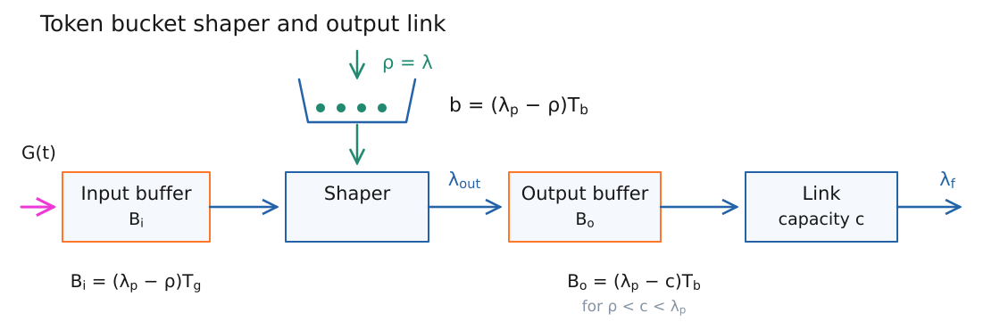
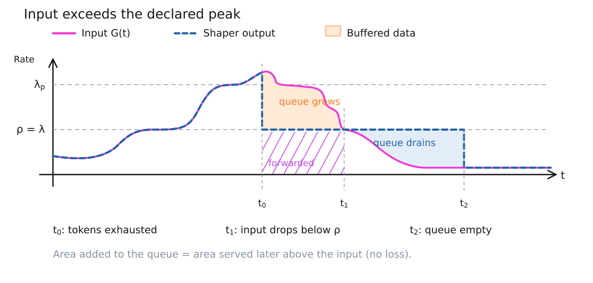
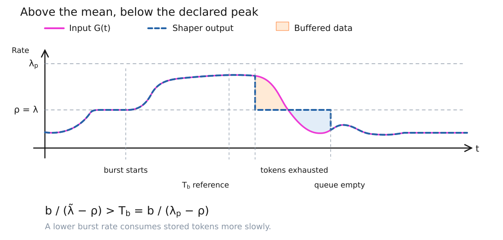
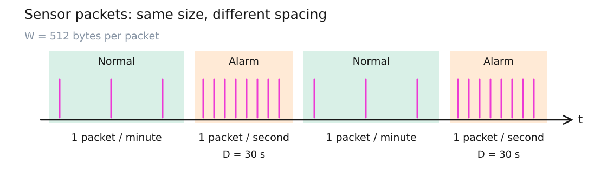
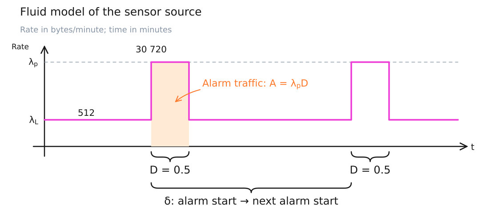
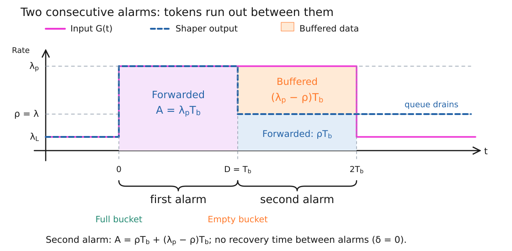
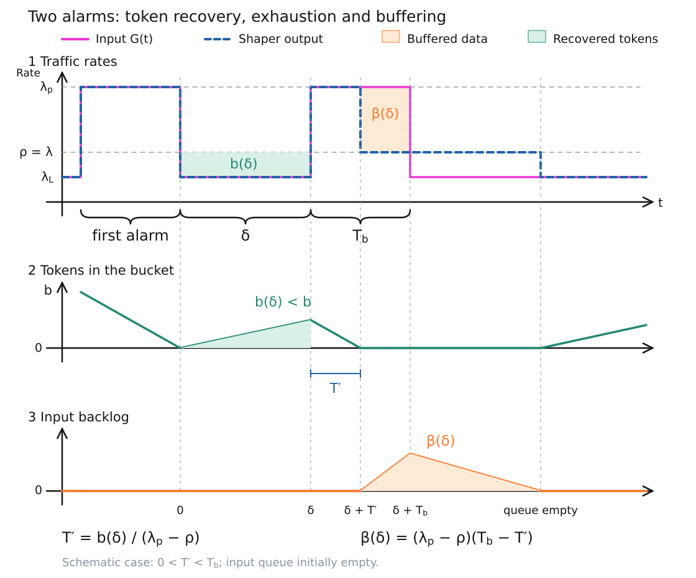

# Little recap from lesson 7

The token bucket filter (TBF) is used as a **shaper**: data that cannot be forwarded immediately waits in an input buffer of capacity $B_i$. The shaper feeds an output buffer of capacity $B_o$, followed by a link of rate $c$.

*Redesigned scheme based on Lesson 8.pdf, p. 1. $\lambda_{out}$ is the shaper output rate; $\lambda_f$ is the rate forwarded by the physical link.*

We use the fluid approximation, with one token authorizing one byte. Thus, traffic rates are measured in bytes per unit time, $\rho$ in tokens per unit time, $b$ in tokens, and buffer capacities in bytes. The bucket capacity $b$ differs from its time-dependent content $b(t)$; similarly, $B_i$ differs from the queued amount $b_i(t)$.

## SLA

The service level agreement specifies:

- $\lambda$: the **long-term average rate**, including bursts.
- $\lambda_p>\lambda$: the declared **peak rate**.
- $T_b$: the duration for which a burst at $\lambda_p$ can be forwarded without token-induced buffering, starting with a full bucket and no input backlog.
- **Grace period $T_g$**: the additional time for which the source can continue at $\lambda_p$ after tokens run out, without overflowing an initially empty input buffer.

The minimum token configuration discussed in the lecture is

$$
\rho=\lambda,\qquad b=(\lambda_p-\rho)T_b.
$$

During a peak, tokens are consumed at rate $\lambda_p$ but generated at rate $\rho$. The bucket therefore loses tokens at the **net** rate $\lambda_p-\rho$, giving

$$
T_b=\frac{b}{\lambda_p-\rho}.
$$

Once tokens are exhausted, a backlogged shaper forwards at rate $\rho$. The input queue grows at rate $\lambda_p-\rho$, so

$$
B_i=(\lambda_p-\rho)T_g.
$$

The grace period permits **buffering without loss**, not continued forwarding at peak rate. It assumes the input buffer is empty when token depletion occurs; existing backlog reduces the available tolerance.

For a burst forwarded at $\lambda_p$ for $T_b$, starting with an empty output queue,

$$
B_o=
\begin{cases}
0, & c\ge\lambda_p,\\
(\lambda_p-c)T_b, & \rho<c<\lambda_p.
\end{cases}
$$

In the second case the queue grows during the burst, then drains at rate $c-\rho$ while the shaper output is $\rho$.

*Supplementary clarification from `../Lesson 7/4-QoS-TokenFilters-BookChapter.pdf`, printed pp. xiv–xv (PDF pp. 7–8): choose $c>\rho$ to let the output queue drain after bursts. The chapter's peak token service rate, denoted there by $\mu$, corresponds to $\lambda_p$ here; it must not be confused with the alarm rate $\mu$ introduced later.*

## Question

What happens if the source's offered traffic $G(t)$ exceeds the declared peak rate?

*Schematic profile based on p. 1. Pink: offered input; dashed blue: shaper output. Orange: queue accumulation; light blue: later drainage. These two areas are equal when no data is lost. The lower purple area represents data forwarded while the queue grows. Event times are qualitative.*

Initially, $G(t)<\rho$, so the shaper follows the input and unused tokens accumulate up to capacity $b$. If $G(t)=\rho$, token content remains constant. When $G(t)>\rho$, the shaper can still follow the input while tokens remain, but the bucket starts draining.

In the lecture's example, traffic above $\lambda_p$ is allowed through while tokens are available. Tokens are consumed faster than anticipated, so depletion can occur earlier than the nominal peak-duration reference. For a constant rate $G(t)>\rho$ and a full bucket, depletion takes $b/(G(t)-\rho)$. For a varying rate, it depends on accumulated net token consumption, rather than a fixed timer.

> [!warning] Model distinction — Peak-rate enforcement
> The lecture explicitly permits traffic above $\lambda_p$ before token exhaustion (transcript 00:13:36–00:15:04). A bucket governed only by $(\rho,b)$ limits accumulated traffic but does not independently enforce a hard instantaneous peak. The Moodle chapter also defines a separate maximum service rate. If such a cap is enforced at $\lambda_p$, excess traffic must wait even while tokens remain. The plot follows the lecture's uncapped example; the earlier $B_o$ formula assumes the forwarded burst is bounded by $\lambda_p$.

After token depletion, the output falls to $\rho$, provided data is waiting. A **drop in output rate is not a packet drop**. The excess input is stored until the buffer fills.

> [!info] Definition — Backlog
> Backlog, queued data and buffered data denote work held in a buffer awaiting service.

Starting at token depletion time $t_0$ with no queued data, and while the queue remains nonempty and no loss occurs,

$$
b_i(t)=\int_{t_0}^{t}\bigl(G(u)-\rho\bigr)\,du.
$$

The orange accumulation area must be compared with $B_i$: losses begin only when the available capacity is exceeded. If the input settles at $\rho$, the backlog stays constant. It drains only when $G(t)<\rho$. During drainage, output remains $\rho$ until the area of excess service equals the previously accumulated backlog; afterwards, output follows the input again.

*Correction to the handwritten annotation on p. 1: the relevant early event is token exhaustion and an output-rate decrease, not necessarily loss “before $T_g$”. Its timing depends on net token use; loss additionally depends on $B_i$ (transcript 00:14:03–00:18:38).*

## Other scenario, same setting

Now the source exceeds the average rate but stays below $\lambda_p$.

*Schematic profile based on p. 1. Pink input stays below $\lambda_p$; dashed blue output follows it beyond the nominal $T_b$ reference, then falls to $\rho$ at token exhaustion. Orange and light-blue areas show queue accumulation and drainage. Output rejoins input once the queue is empty; the later input rebound is retained.*

For a constant intermediate rate $\rho<\tilde{\lambda}<\lambda_p$, starting with a full bucket,

$$
\frac{b}{\tilde{\lambda}-\rho}
>
T_b=\frac{b}{\lambda_p-\rho}.
$$

The shaper does not reduce the output merely because $T_b$ has elapsed. Tokens remain because their net consumption rate is smaller. Once exhausted, output falls to $\rho$ and the excess traffic is queued. If the source subsequently drops below $\rho$, output stays at $\rho$ until the backlog drains, as in the previous example.

### Burst period can be exceeded if...

...the source transmits above $\rho$ but below $\lambda_p$. Thus, $T_b$ is a reference duration **at the declared peak**, not a universal limit on every interval above the mean. Faster token consumption can shorten the unbuffered interval; slower consumption can lengthen it. Neither case alone determines whether packets are lost.

# We consider some practical case

The modelling task is to translate the source description into rates, durations and random variables before choosing an SLA. The lecturer stresses this first step: knowing how to follow a solution is different from identifying the model needed to construct it.

## Source

A sensor sends a packet of size $W=512$ bytes every minute in its normal state. At random times it enters an alarm state lasting $D=30$ seconds. During an alarm it generates CBR traffic with interarrival time $A_i=1$ second, batch size $B_i=1$ packet, and packet size $W_i=512$ bytes.

Here $B_i=1$ belongs to the source-model notation and denotes a batch size; elsewhere $B_i$ denotes input-buffer capacity. The context distinguishes these quantities.

Alarm events are described as a Poisson point process of rate

$$
\mu=0.1\ \text{alarms/minute}.
$$

Corresponding exponential interevent times have mean $1/\mu=10$ minutes; individual waiting times need not be close to this mean.

*Schematic packet view based on p. 2. Packet spacing changes from one minute to one second during each 30-second alarm; packet size stays fixed. Representative stems show the change in density, not every packet; horizontal distances are not to scale.*

For the subsequent **fluid model**, time is measured in minutes. The low rate is

$$
\lambda_L=\frac{W}{1\ \text{min}}=512\ \text{bytes/min},
$$

while the alarm rate is

$$
\lambda_p=\frac{W}{(1/60)\ \text{min}}=60W=30\,720\ \text{bytes/min}.
$$

Each high-rate interval lasts $D=0.5$ minutes. These fluid rates describe packet traffic averaged over the relevant packet spacings, rather than the instantaneous serialization rate of a packet.

*Simplified fluid profile based on p. 2, with the low-state rate explicitly labelled $\lambda_L$. The alarm rectangle has area $(60W)\cdot0.5$ bytes. Here $\delta$ spans successive alarm starts.*

## SLA = ?

The low-state rate $512$ bytes/min is **not** the long-term average: alarms contribute substantial traffic. Neither should the two state rates be added without weighting them by time spent in each state.

Following the lecture's renewal-reward calculation, let $\delta$ denote an interval between successive alarm starts, with $E[\delta]=1/\mu$. A cycle containing one complete alarm and normal traffic for the remaining time generates

$$
\lambda_pD+\lambda_L(\delta-D)
$$

bytes. The resulting expression used in class is

$$
\lambda
=\frac{E[\lambda_pD+\lambda_L(\delta-D)]}{E[\delta]}
=\frac{512\cdot30+512\,(10-0.5)}{10}
=2022.4\ \text{bytes/min}.
$$

*Arithmetic correction, Lesson 8.pdf, pp. 2–3: $2022.4$ is the corrected value also confirmed in the transcript at 00:58:48–00:58:56; the earlier approximate $2048$ is not the exact result.*

> [!warning] Unresolved assumption — Alarm timing
> The sources describe Poisson alarm starts but draw non-overlapping alarms of fixed duration. An exponential start-to-start interval can be shorter than $D$, making the cycle's normal duration $\delta-D$ negative. No rule is supplied for overlapping alarms, ignored triggers or alarm extension. Thus, $2022.4$ bytes/min preserves the classroom calculation under its single-alarm-cycle assumption; it is not an exact derivation for an unspecified overlap rule. Later, the time variable is measured from an alarm's **end**, rather than its start. These uses must be distinguished. If exponential waiting began only after each alarm ended, a cycle would instead have mean duration $D+1/\mu$; that is a different model.

Using the classroom value, the minimum shaper settings are

$$
\rho=\lambda=2022.4\ \text{tokens/min},\qquad
T_b=D=0.5\ \text{min},
$$

$$
b=(\lambda_p-\rho)T_b
=(30\,720-2022.4)\cdot0.5
=14\,348.8\ \text{tokens}.
$$

A complete alarm generates $\lambda_pT_b=15\,360$ bytes. The bucket need not initially contain that many tokens: a further $\rho T_b=1011.2$ tokens are generated during the alarm. Fractional token values belong to the fluid approximation; packet transmission requires enough whole-byte credits for the packet.

## Do we need a grace period?

Yes, if early alarms are to be buffered rather than immediately lost. A mean separation of ten minutes does not guarantee sufficient recovery time before every alarm. After a recent burst, the next alarm can arrive with a partially refilled bucket.

The lecturer proposes two ways to increase tolerance (01:04:12–01:05:13):

- Negotiate a larger token generation rate, for example $10\%$ above the calculated mean, so credits recover faster. For a chosen $T_b$, recompute $b=(\lambda_p-\rho)T_b$.
- Provide a grace period through an input buffer, allowing some alarm data to wait when tokens run out.

A numerical $T_g$, and consequently $B_i$, requires a tolerance or loss target; none is specified. Finite buffering does not guarantee loss-free operation for every possible sequence of random alarms.

For the next calculation, impose the initial condition stated in class: at $t=0$, an alarm has just ended, the input queue is empty, and the token bucket is empty,

$$
b_i(0)=0,\qquad b(0)=0.
$$

Let $\delta$ now denote the waiting time **from this alarm's end to the next alarm's start**. The following calculation uses the lecture's assumption $\delta\sim\operatorname{Exp}(\mu)$ and is conditional on the stated initial condition. It does not establish a stationary queue distribution.

During the intervening normal state, tokens accumulate at net rate $\rho-\lambda_L$, up to capacity:

$$
b(\delta)=\min\{b,(\rho-\lambda_L)\delta\}.
$$

### ? Prob. that next alarm will not be at least partially buffered?

The handwritten question uses “not”, but its inequality and the lecturer's question at 01:07:16–01:08:19 concern the probability that the alarm **will be at least partially buffered**. We compute that event first; its complement answers the literal heading.

The next complete alarm can pass without token-induced buffering precisely when

$$
b(\delta)\ge(\lambda_p-\rho)T_b.
$$

Under the minimum choice $b=(\lambda_p-\rho)T_b$, this requires a full bucket at the alarm's start. The lecturer briefly questions this requirement, then confirms it (01:13:39–01:14:25). New tokens generated during the alarm are already included through the subtraction of $\rho$.

Therefore,

$$
\begin{aligned}
P[\text{partial buffering}]
&=P[b(\delta)<b]\\
&=P\left[\delta<\frac{b}{\rho-\lambda_L}\right]\\
&=1-\exp\left(-\mu\frac{b}{\rho-\lambda_L}\right)\\
&=1-\exp\left(-\mu\frac{(\lambda_p-\lambda)T_b}{\lambda-\lambda_L}\right),
\end{aligned}
$$

where the last line uses $\rho=\lambda$. Conversely,

$$
P[\text{no buffering}]
=\exp\left(-\mu\frac{b}{\rho-\lambda_L}\right).
$$

*Substantive correction, handwritten p. 3 and transcript 01:11:53–01:12:52: for an exponential variable, $P[\delta<x]=1-e^{-\mu x}$, whereas $e^{-\mu x}$ is $P[\delta\ge x]$. The sources attach the latter expression to the former inequality.*

With the classroom parameters, full refill takes

$$
\frac{b}{\rho-\lambda_L}
=\frac{14\,348.8}{1510.4}
=9.5\ \text{min}.
$$

Thus the conditional probability of partial buffering is $1-e^{-0.95}\simeq0.6133$, and that of no buffering is $e^{-0.95}\simeq0.3867$. These are **buffering probabilities**, not loss probabilities.

## How many bytes will be buffered?

Without knowing the next alarm time, there is no single deterministic answer. The buffered amount is a random variable; meaningful questions concern its distribution or mean. For a specified waiting time $\delta$, however, it can be calculated directly.

## What's the PDF of # of

The unfinished handwritten title refers to the **number of bytes buffered during the next alarm**. Continue with an empty initial input queue and a sufficiently large buffer, as explicitly assumed in class (01:22:15–01:24:12).

The total bytes generated during an alarm are fixed:

$$
A\triangleq\lambda_pT_b=15\,360\ \text{bytes}.
$$

If the bucket contains no tokens at the alarm's start, the shaper still forwards at $\rho$, using newly generated tokens. The amount left queued at the alarm's end is therefore

$$
(\lambda_p-\rho)T_b<A.
$$

*Two consecutive alarms, as in the original sketch on p. 3. The first starts at $t=0$ with a full bucket and is entirely forwarded at $\lambda_p$. At $t=D=T_b$, tokens are exhausted and the second alarm begins immediately: the input remains at $\lambda_p$, while output falls to $\rho$. For this second alarm, the blue rectangle is $\rho T_b$ bytes forwarded during the alarm and the orange rectangle is $(\lambda_p-\rho)T_b$ bytes left queued at its end; together they form $A$. No token recovery occurs between alarms ($\delta=0$). The time origin here is the start of the first alarm; the general waiting-time calculation instead measures time from its end. Drainage after the second alarm continues beyond the displayed window.*

If the bucket instead contains $b(\delta)$ tokens, output initially follows the alarm input at $\lambda_p$. Tokens last for

$$
T'=\frac{b(\delta)}{\lambda_p-\rho}.
$$

*Correction to the denominators on handwritten p. 4: token depletion depends on the rate difference $\lambda_p-\rho$, as explained at 01:28:40–01:29:07. A denominator containing the waiting time $\delta$ cannot be dimensionally valid.*

*Redesigned explanation of the board diagram on p. 4. All three panels share the same time axis: rates above, token content in the middle, backlog below. Here $t=0$ is the end of the first alarm. The green rate-area recovers $b(\delta)$ credits, supporting the first $T′$ of the next alarm; the remaining orange rate-area produces backlog $\beta(\delta)$. Tokens stay at zero during queue drainage and start accumulating again only after the queue empties. The drawing illustrates $0<T′<T_b$ without assigning a numerical waiting time.*

If $T'\ge T_b$, the entire alarm is forwarded without buffering, including the equality case where the last token is consumed exactly at its end. Under the minimum bucket size, $T'\le T_b$, so equality is the full-refill case. If $T'<T_b$, output falls to $\rho$ for the remaining alarm time and backlog grows at $\lambda_p-\rho$.

Retaining the lecturer's notation $\beta(\delta)$ for the queued amount at the end of the next alarm,

$$
\begin{aligned}
\beta(\delta)
&=\max\left\{(\lambda_p-\rho)\left(T_b-\frac{b(\delta)}{\lambda_p-\rho}\right),0\right\}\\
&=\max\{(\lambda_p-\rho)T_b-b(\delta),0\}.
\end{aligned}
$$

This is the **maximum backlog produced by this alarm**, not the count of every byte that experiences any waiting. With $\rho=\lambda$ and $b=(\lambda_p-\lambda)T_b$,

$$
\beta(\delta)=\max\{b-(\lambda-\lambda_L)\delta,0\}.
$$

After the alarm, if no new alarm intervenes, this backlog drains at rate $\lambda-\lambda_L$; until it has drained, newly generated tokens serve queued data rather than accumulating in the bucket.

The lecture ends by setting up the tail probability $P[\beta(\delta)>a]$. For $0\le a<b$, the algebraic steps left to complete at 01:32:12–01:34:06 give

$$
\begin{aligned}
P[\beta(\delta)>a]
&=P[b(\delta)<b-a]\\
&=P\left[\delta<\frac{b-a}{\lambda-\lambda_L}\right]\\
&=1-\exp\left(-\mu\frac{b-a}{\lambda-\lambda_L}\right).
\end{aligned}
$$

For $a<0$ this probability is $1$; for $a\ge b$ it is $0$. Hence the CDF of the random variable $\beta=\beta(\delta)$ is

$$
F_{\beta}(a)=
\begin{cases}
0, & a<0,\\
\exp\left(-\mu\dfrac{b-a}{\lambda-\lambda_L}\right), & 0\le a<b,\\
1, & a\ge b.
\end{cases}
$$

There is a point mass at zero,

$$
P[\beta=0]=\exp\left(-\mu\frac{b}{\lambda-\lambda_L}\right),
$$

because all sufficiently long normal intervals refill the bucket completely. On $0<a<b$, differentiating the CDF gives the continuous density

$$
f_{\beta}(a)=\frac{\mu}{\lambda-\lambda_L}
\exp\left(-\mu\frac{b-a}{\lambda-\lambda_L}\right).
$$

The fluid result is thus a **mixed distribution**: a mass at zero plus a density for positive backlog. Integrating the positive density gives $1-e^{-\mu b/(\lambda-\lambda_L)}$; adding the zero mass gives total probability one.

The lecturer uses “PDF” loosely for both continuous and discrete quantities (01:17:19–01:19:00). For a continuous variable, density values can exceed one; their integral must equal one. For a discrete variable, the probability mass function assigns values in $[0,1]$ whose sum is one. Packet-level backlog needs a discrete model; it is not obtained by treating this fluid density as individual byte probabilities. Also, $P[\beta>a]$ is a **tail probability**; the CDF is $P[\beta\le a]$.

*Scope of this completion: the distribution follows the lecture's final transformation under its explicitly stated initial condition and exponential post-alarm waiting assumption. It does not resolve the earlier alarm-overlap ambiguity or supply a steady-state finite-buffer loss analysis.*
