# Exercises + new topic

## 1)

Consider a periodic fluid traffic source with period $T$ and peak rate $G_p$:

$$
G(t)=G_p\frac{T/2-\left|\operatorname{rem}(t,T)-T/2\right|}{T/2}.
$$

Here $\operatorname{rem}(t,T)$ is the remainder of division by $T$, in $[0,T)$ for $t\geq0$. The remainder is taken **before** subtracting $T/2$ and taking the absolute value. This is the corrected triangular-wave expression established in the first transcript, 00:08:15–00:09:11. Over one period,

$$
G(t)=
\begin{cases}
2G_p t/T, & 0\leq t\leq T/2,\\
2G_p(1-t/T), & T/2<t<T.
\end{cases}
$$

The traffic passes through a token bucket **shaper**, with token generation rate $\rho$, bucket capacity $b$, instantaneous token content $b(t)$, and output rate $\lambda_{out}(t)$. Traffic waiting for tokens is stored in the input buffer, whose occupancy is $b_i(t)$. Assume a sufficiently large input buffer and no additional peak-rate constraint. Token quantities and data amounts use matching units: one token authorizes one unit of data.

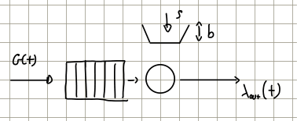
*Original scheme, Lesson 9.pdf, p. 1: the token bucket controls forwarding from the input buffer.*

Find the average generation rate,

$$
\overline G=\lim_{t\to\infty}\frac1t\int_0^t G(u)\,du,
$$

then set $\rho=\overline G$, $b(0)=0$, and determine $b(t)$, the required bucket capacity, and $\lambda_{out}(t)$. The input buffer is also initially empty.

Because the source is periodic, the average is the area of one triangle divided by its period:

$$
\overline G=\frac1T\frac{TG_p}{2}=\frac{G_p}{2},
\qquad \rho=\frac{G_p}{2}.
$$

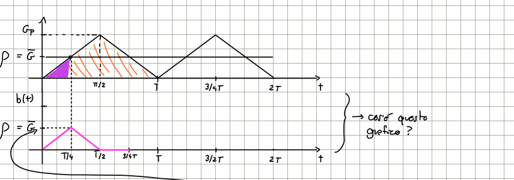
*Original first sketch, p. 1. The shaded areas compare tokens generated and consumed; the token-content curve is qualitative. Its vertical label and straight segments are corrected below.*

For $0<t<T/4$, the source consumes tokens more slowly than they are generated: $G(t)<\rho$. Tokens therefore accumulate, but their accumulation rate decreases as $G(t)$ grows. The maximum token content occurs at $t=T/4$, where $G(t)=\rho$:

$$
b(T/4)=\rho\frac T4-\frac12\frac T4\overline G
=\frac{\overline G T}{8}=\frac{G_pT}{16}.
$$

For $T/4<t<T/2$, the source consumes tokens faster than they are generated. The tokens accumulated during the first quarter are exhausted at $t=T/2$. On the whole first half-period,

$$
b(t)=\int_0^t[\rho-G(u)]\,du
=\frac{G_p}{2}t-\frac{G_p}{T}t^2,
\qquad 0\leq t\leq T/2.
$$

Consequently, the minimum bucket capacity needed to avoid discarding generated tokens in this trajectory is

$$
b\geq\max_t b(t)=\frac{G_pT}{16}.
$$

This capacity condition matters: a smaller bucket loses tokens during the first quarter and changes the later evolution.

> [!info] Correction — Token-content formula
> On p. 1, the expression for $b(t)$ after $T/4$ treats the varying rate difference as a constant, and its starting value is written as $G_pT/8$. The starting value is actually $G_pT/16$, as calculated immediately above it. The correct expression is
> $$
> b(t)=\frac{G_pT}{16}-\int_{T/4}^{t}[G(u)-\rho],du
> =\frac{G_pT}{16}-\frac{G_p}{T}(t-T/4)^2.
> $$
> It reaches zero at $T/2$. The integral follows the lecturer's area argument in transcript 1, 00:13:02–00:17:25. The resulting curve is parabolic, rather than piecewise linear.

From $T/2$ to $3T/4$, the bucket is empty while $G(t)>\rho$. Every new token is immediately consumed, the output is limited to $\rho$, and the excess input accumulates in the input buffer. At $3T/4$, $G(t)=\rho$ again and the input backlog reaches its maximum.

From $3T/4$ to $T$, $G(t)<\rho$, but the bucket **does not refill**: the newly generated tokens are used to forward previously buffered data. The input queue drains and becomes empty at $T$. Thus, both bucket and input buffer return to their initial empty state at the end of each period.

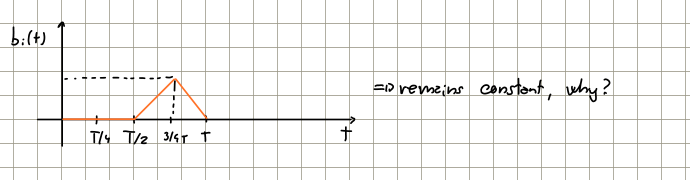
*Original sketch, p. 2: backlog is zero until $T/2$, peaks at $3T/4$, and vanishes at $T$. The question about remaining constant concerns the token content while the input buffer drains.*

More precisely, over one period,

$$
b(t)=
\begin{cases}
G_pt/2-G_pt^2/T, & 0\leq t\leq T/2,\\
0, & T/2<t\leq T,
\end{cases}
$$

and

$$
b_i(t)=
\begin{cases}
0, & 0\leq t\leq T/2,\\
\displaystyle\int_{T/2}^t[G(u)-\rho],du
=G_p\left(\frac{3t}{2}-\frac{t^2}{T}-\frac T2\right), & T/2<t\leq T.
\end{cases}
$$

In particular, $b_i(3T/4)=G_pT/16$. These expressions give the exact curves underlying the lecturer's qualitative sketches.

The output follows the input while stored tokens are available; afterwards it remains at $\rho$ until the backlog has drained:

$$
\lambda_{out}(t)=
\begin{cases}
G(t), & 0\leq t<T/2,\\
\rho, & T/2\leq t<T.
\end{cases}
$$

The evolution repeats every $T$. At $T/2$, the output drops from the left-hand limit $G_p$ to $\rho$; at $T$, it drops from $\rho$ to zero as the next period begins. Values at individual switching instants do not change fluid traffic amounts.

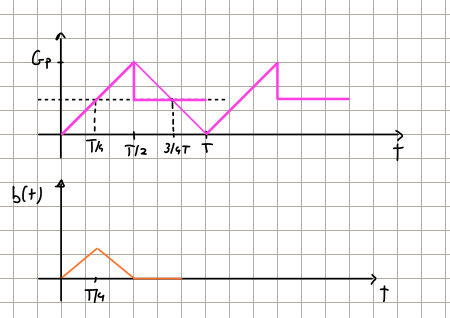
*Final sketches, p. 1: output superimposed on the triangular input, followed by token content. They preserve the original construction; straight token-content segments are schematic.*

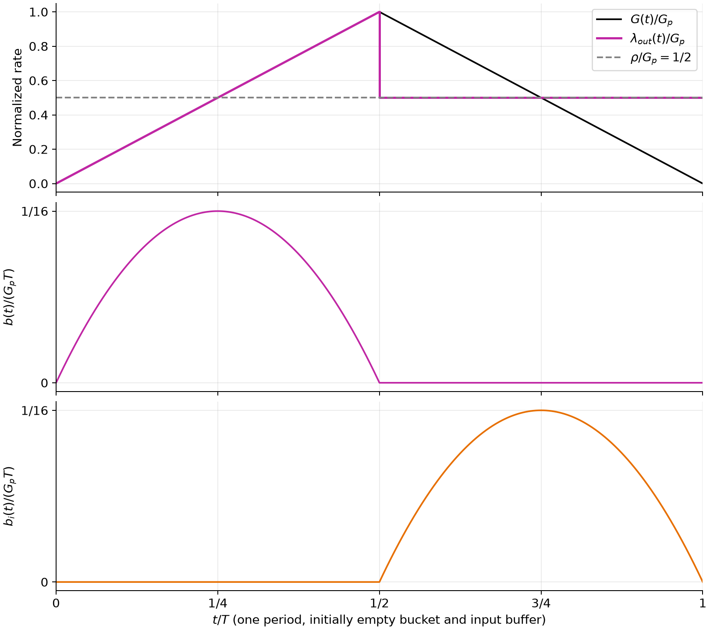
*Exact redraw over one period, using the equations above. Rates are normalized by $G_p$ and stored amounts by $G_pT$. Both storage curves are parabolic. Regeneration code: `Pics/redraw_plots.py`.*

For $3T/4<t<T$, $\lambda_{out}(t)>G(t)$ because the shaper is forwarding stored traffic. No backlog carries over to the next period, despite $\rho$ being exactly equal to the average input rate: this conclusion relies on the specified deterministic periodic pattern.

## 2)

Consider a periodic ON–OFF source:

- **ON: CBR**, $G(t)=\lambda_p=10\ \text{Mbit/s}$ for $T_{ON}=20\ \text{ms}$.
- **OFF:** $G(t)=0$ for $T_{OFF}=80\ \text{ms}$.

A leaky bucket filter (LBF) has buffer capacity $B_o$ and forwarding rate $\mu$. Use the fluid model and an initially empty buffer.

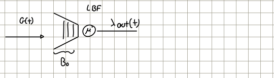
*Original scheme, p. 3: excess input waits in a buffer of capacity $B_o$ before a server of rate $\mu$.*

Determine:

1. The minimum $\mu$ ensuring no traffic is discarded, with sufficiently large $B_o$.
2. For $\mu=4\ \text{Mbit/s}$, the maximum buffer occupancy and minimum $B_o$ avoiding losses.
3. The maximum buffering delay.
4. $\Pr[\lambda_{out}(t)=\mu]$, interpreted as the fraction of time the output equals $\mu$.

### Answers:

**1. Minimum forwarding rate.** Draw the input pattern first. Over one period, the source generates $\lambda_pT_{ON}$ bits, so

$$
\overline G=
\frac{\overline G_{ON}T_{ON}+\overline G_{OFF}T_{OFF}}{T_{ON}+T_{OFF}}
=10\ \text{Mbit/s}\frac{20}{100}
=2\ \text{Mbit/s}.
$$

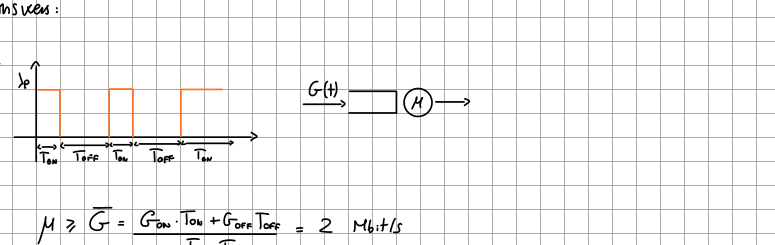
*Original construction, p. 3, including the equivalent constant-rate server.*

If $\mu<\overline G$, each period contributes more input than the link can transmit, so the backlog grows and eventually overflows any finite buffer. For this deterministic periodic source,

$$
\mu\geq\overline G,
\qquad \mu_{min}=2\ \text{Mbit/s}.
$$

Equality is sufficient with enough memory: the backlog accumulated during ON drains exactly at the end of OFF. With $\mu>\overline G$, it drains earlier. This statement does not establish stability at equality for general random traffic. The lecturer explicitly distinguishes deterministic cycles from random ON/OFF durations: in the latter case, a particular cycle may end with residual backlog even when the mean offered rate is below the service rate.

**2. Maximum buffer occupancy and required capacity.** Let $b_o(t)$ be the amount of queued data. The p. 4 sketches also label this same LBF queue $b_i(t)$; here $b_o(t)$ follows the notation of p. 3 and keeps it distinct from the token bucket input queue in exercise 1.

During ON, $b_o(t)$ increases with slope $\lambda_p-\mu=6\ \text{Mbit/s}$. During OFF, it decreases with slope $-\mu$ until empty. Hence,

$$
\sup_t b_o(t)=b_o(T_{ON})
=(\lambda_p-\mu)T_{ON}
=6\cdot10^6\cdot20\cdot10^{-3}
=120\ \text{kbit}.
$$

Therefore,

$$
B_o\geq120\ \text{kbit},
\qquad B_{o,min}=120\ \text{kbit}=15\ \text{kB}.
$$

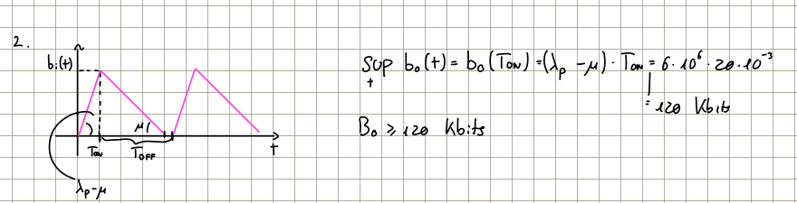
*Original sketch and calculation, p. 3: slopes $\lambda_p-\mu$ and $-\mu$ determine the maximum occupancy.*

**3. Max delay.** In FIFO service, fluid arriving when the queue is largest finds the greatest amount of data ahead of it. The maximum buffering delay is the time to transmit that backlog:

$$
d_{max}=\frac{b_o(T_{ON})}{\mu}
=\frac{120\cdot10^3}{4\cdot10^6}
=0.03\ \text{s}=30\ \text{ms}.
$$

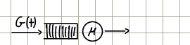
*Original delay scheme, p. 4.*

The handwritten numerator $b_i(T/2)$ on p. 4 should be evaluated at **$T_{ON}$** for this exercise: the maximum occurs at 20 ms, not halfway through the 100 ms period. This follows both the p. 3 calculation and transcript 1, 00:39:30–00:40:48.

In a packet model, a packet of length $L$ bits additionally needs its own transmission time $L/\mu$. Queueing delay is backlog ahead divided by $\mu$; delay through completion of that packet also includes $L/\mu$.

**4. $\Pr[\lambda_{out}(t)=\mu]$.** The output equals $\mu$ throughout ON and while the remaining backlog drains during OFF. The drain time is

$$
T_{fw}=\frac{b_o(T_{ON})}{\mu}=d_{max}=30\ \text{ms}.
$$

Using the handwritten symbol $\delta$ for the duration of output activity,

$$
\delta=T_{ON}+T_{fw}=20+30=50\ \text{ms}.
$$

Therefore, the output is $4\ \text{Mbit/s}$ for the first 50 ms of each period, then zero for the remaining 50 ms. For an observation time with uniformly distributed phase within the period,

$$
\Pr[\lambda_{out}(t)=\mu]
=\frac{\delta}{T_{ON}+T_{OFF}}
=\frac{50}{100}=\frac12.
$$

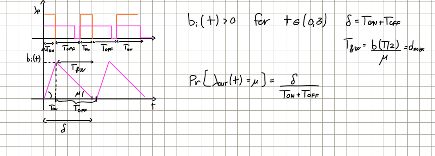
*Original compound sketch, p. 4: input and output rates above; backlog, $T_{fw}$ and $\delta$ below.*

The notes write $\delta=T_{ON}+T_{OFF}$ beside this sketch. Here the second term must instead be **$T_{fw}$**, as explained in transcript 1, 00:43:26–00:45:55: the queue empties before OFF ends. Also, this is a probability over the observation phase; at a fixed known time the deterministic output is already known.

# Call-admission Control (CAC)

> [!info] Definition — Call Admission Control
> CAC decides whether a new information flow can enter a system without violating the service commitments of the flows already admitted, including the new flow. “Call” is the historical terminology; the same idea applies to general traffic flows.

CAC normally works with the **Resource Manager**, which assigns resources to accepted flows. This introduction assumes a simple shared link: sources feed a buffer of capacity $B$ followed by a channel of bitrate $c$. Its queueing behavior is that of an LBF with $\mu=c$.

The lecturer starts with ON–OFF sources: source $j$ generates CBR traffic at $\lambda_{p_j}$ during ON and nothing during OFF. Initially, ON and OFF durations are treated as fixed; parameters and phases may differ between sources.

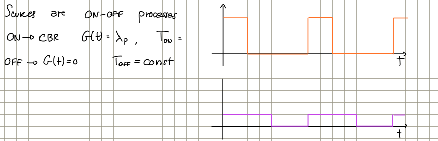
*Two ON–OFF source examples, p. 5, with different parameters and timing.*

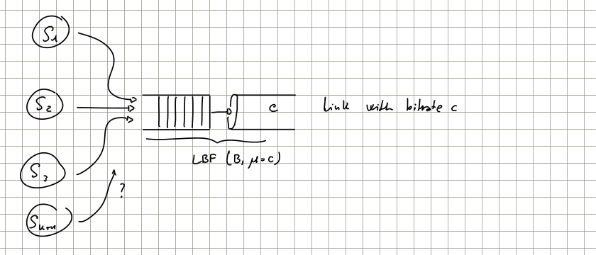
*Original shared-link scheme, p. 5: the new source requests access to resources already shared by active sources.*

## Stochastic Bound

A stochastic policy allows a prescribed small probability of failing to meet a service requirement. It can admit more flows and improve resource utilization because the most demanding source conditions need not occur simultaneously. The lecturer compares this trade-off to airline overbooking. Lesson 9 introduces this motivation only; the actual statistical bounds are deferred to the next lecture.

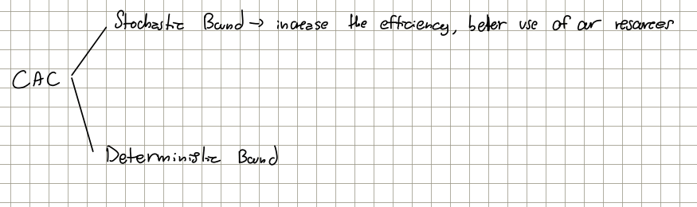
*Original branching scheme, p. 5: stochastic and deterministic admission approaches.*

## Deterministic Bound

A deterministic policy guarantees the required behavior even in the worst case, provided the sources respect their declared traffic limits. A simple rule is to provision for all sources transmitting at their peak rates simultaneously. If $k$ counts all sources **including the candidate**, accept the candidate only if

$$
\sum_{j=1}^{k}\lambda_{p_j}\leq c.
$$

The equality boundary is allowed. This prevents aggregate input from exceeding link capacity, but may leave most resources unused for bursty sources.

### Example

For identical sources, use the handwritten example parameters

$$
c=10\ \text{Mbit/s},\qquad \lambda_p=1\ \text{Mbit/s},
\qquad T_{ON}=1\ \text{ms},\qquad T_{OFF}=1\ \text{s}.
$$

The peak-rate rule admits at most

$$
\left\lfloor\frac{c}{\lambda_p}\right\rfloor=10\ \text{calls}.
$$

Each source is active for only about one thousandth of the time. Its average rate is about $1\ \text{kbit/s}$, so ten sources use only about $10\ \text{kbit/s}$ on average, or $0.1\%$ of the link capacity.

A less restrictive **deterministic** rule describes each source using a token bucket, or explicitly shapes its traffic before multiplexing.

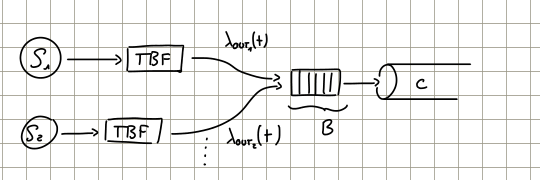
*Original scheme, p. 6: each TBF output enters the common buffer $B$ and link $c$.*

For periodic ON–OFF source $j$, choose

$$
\rho_j=\overline G_j
=\lambda_{p_j}\frac{T_{ON}}{T_{ON}+T_{OFF}},
\qquad b_j=(\lambda_{p_j}-\rho_j)T_{ON}.
$$

The bucket must be full at the start of ON to pass the whole burst immediately. Its tokens cover the excess above the continuously generated rate $\rho_j$; OFF replenishes the bucket. The constant $b_j$ is the token bucket capacity, while $B$ is the shared **data** buffer capacity. Use consistent bit or byte units for both.

Two conditions must hold simultaneously, with the candidate included:

$$
\sum_{j=1}^{k}\rho_j\leq c,
\qquad
\sum_{j=1}^{k}b_j\leq B.
$$

The first condition provides enough sustained service capacity. The second reserves enough memory even if all permitted bursts arrive together. For heterogeneous sources, the actual sums must be checked whenever a candidate arrives.

If actual aggregate mean traffic exceeds $c$, any finite buffer eventually overflows. Exceeding the sum-of-bursts buffer condition instead means that a worst-case overflow can no longer be ruled out; it does not mean that overflow must occur. The buffer criterion is conservative when bursts rarely coincide, which motivates the statistical approach mentioned above.

For identical sources, the two limits become

$$
N_{rate}=\left\lfloor\frac c\rho\right\rfloor,
\qquad
N_{buffer}=\left\lfloor\frac B b\right\rfloor,
\qquad
N_{max}=\min\{N_{rate},N_{buffer}\}.
$$

With the conservative rounded values $\rho=1\ \text{kbit/s}$ and $b=1\ \text{kbit}$, and $B=1\ \text{Mbit}$,

$$
N_{rate}=10000,\qquad N_{buffer}=1000,
\qquad N_{max}=1000.
$$

The buffer is the limiting resource. This admits far more flows than the peak-rate criterion while retaining the deterministic guarantee for traffic conforming to the TBF limits.

> [!info] Correction — Burst size in the CAC example
> On p. 6, the calculation substitutes $20\ \text{ms}$ into $b=(\lambda_p-\rho)T_{ON}$, although the CAC example specifies $T_{ON}=1\ \text{ms}$. The same inconsistency occurs in transcript 2, 00:21:44–00:23:47. With the stated CAC parameters,
> $$
> \rho=10^6\frac{10^{-3}}{1+10^{-3}}\simeq999\ \text{bit/s},
> \qquad b\simeq(10^6-999)10^{-3}\simeq999\ \text{bits}.
> $$
> Rounding both upward to $10^3$ gives the consistent limits above, also reported in `5a-CAC.pdf`, PDF pp. 2–4 (printed pp. 18–20). A burst of $20\ \text{kbit}$ with $B=1\ \text{Mbit}$ would allow only about 50 simultaneous bursts, not 1000.

*Supplementary clarification from `5a-CAC.pdf`, PDF pp. 2–4:* the book's example uses exponentially distributed OFF durations with mean 1 s, whereas the introductory classroom model uses fixed durations. A bucket sized for one ON burst may not refill before another ON burst if OFF is random and very short. Thus, the deterministic shared-link guarantee requires traffic to conform to the declared token bucket limits, enforced through shaping or policing when necessary. The book's later statistical analysis is outside this lesson.
